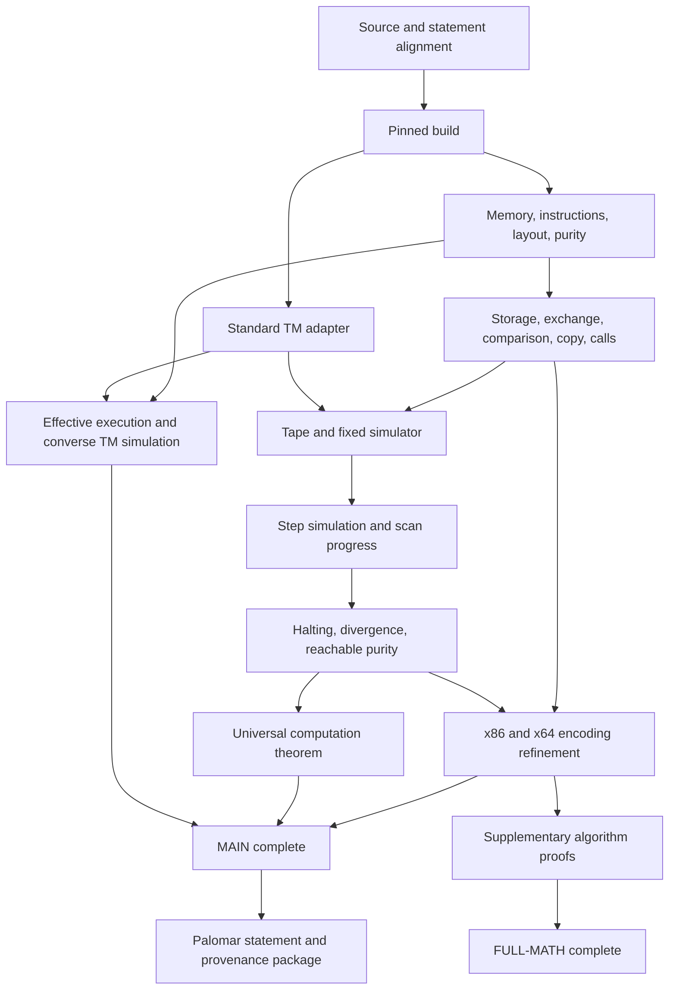

# smcTuring Lean proof ledger

Current complete audit passes for E958-E960. Round5 complete mathematical/native binding deliverable:E958-E960 add three modules/fifteen audited facts. SameTraceBinding.execute/complete_input identifies ONE full joint/native fetch/read/store/output/register/frame trace by exact instruction counts and derives a structural pre-cleanup head cut of THAT trace. PhysicalImageBinding proves exact absolute32/absolute64/relative32(+suffix,including REL32_1) normalization,loaded symbol-plus-signed-addend targets after a whole nonoverlapping relocation stream,and unchanged disjoint byte windows. PRESENT finite normalized object/register/backing agreement derives initial state equality. Local current-instruction ISA and static mapping/canonical conditions then derive the physical trace by induction,and every physical prefix projects to the SAME mathematical prefix. Listing9PhysicalBinding.complete_input/full_paper retain the corrected-paper umbrella,full two-sided tape output,physical pre-cleanup head,actual full-seed AX restoration at the intermediate epilogue boundary,precise M20 final AX,and EVERY same-prefix global/late/joint executable/exact original/copied owner and current fetch/read/write permission certificate. Only genuine physical ISA,coherent fetch,flat segments,CET-off,stable mapping,compatible ABI,present normalized object/entry and canonical endpoint conditions remain explicit;no whole CPU/OS proof or inferred hardware RET/stop. Actual binary/configuration/Windows native evidence remains a separate rounds6-7 gate. Original JointFullExecution.execute is strengthened to expose its ALREADY PROVED exact code length;all old conclusions retained,no new premise. All1146 other inherited library sources,eight native originals,68 validation helpers and six errata inputs unchanged. Current minimal M01-M20 errata unchanged60 exact excerpts/128 positive references/two pages;no new correction discovered. Round4 ACCEPTED at actual b8490ee,all2583 inventory/bundle hashes verified,Linux1148/7960. Round5 proof conditions focused/root pass;current complete audit and actual turn-end publication pending. Full goal ACTIVE;release/CI and overall completion false. No reopened foundation,admission,new agent,pin/cap change or public push.

Earlier audit sections retain their historical scopes.

Round4 complete mathematical deliverable:E956-E957 add two modules/seven audited facts. Listing9JointFullExecution.execute constructs ONE actual fetched full Listing9 trace from original emission and logical Steps:prologue,bootstrap,all maintained passes,terminal table/reset/nodes,epilogue and both trailing declarations. EVERY SAME prefix retains the closed global13/18 and late6/12 catalogs jointly with the accepted main partial-copy/exact-owner invariant,original bootstrap inventories,terminal exact packet certificate,or fully restored late original/copied owner catalog. final_catalog uses actual trace determinism to transport positive terminal restoration;epilogue_packets derives future bytes from original packets and exact exterior frames. complete_input derives all logical/native phases from actual source-TM input/halting and numeric capacity/reach only. CorrectedPaper.full_paper combines fixed-image unbounded pure SMC universality,halting/divergence/infinite changes and a distinct-unbounded-field witness,Dolan four-register MOV foundation,effective finite numbered interpreter with terminal journals,all-integer tape/head observations on SAME pure traces,and the bounded printed appendix Certificate. Unbounded semantic claims remain separate from finite hardware conditions. Rounds1-3 ACCEPTED;E954-E955 actual e8f0b83 publication verified2579 files/bundle,Linux1146/7953. BOTH round4 remaining proof conditions are closed in focused/root checks;acceptance awaits current complete audit and actual completed-turn publication. Next round5 exact same-trace native/head/COFF and final minimal proved errata;physical ISA/fetch/segment/CET/mapping/ABI/stop assumptions remain explicit. Full goal ACTIVE;overall mathematical/release completion remain false until remaining HANDOFF gates. All1145 inherited library sources,eight native originals,68 validation helpers and six errata inputs unchanged;no reopened foundation,admission,future whole-run premise,weakened claim,new agent,pin/cap change or public publication.

Fresh complete Linux kernel/axiom audit passed with terminal exit 0 at 2026-10-10T20:42:16.351939+00:00, verified at 2026-10-10T20:42:27.614557+00:00: **1148 production modules, 7,960 declarations and 1178 source/helper hashes**. The production source closure and complete declaration registry match. The strict incremental builder reused 1145 unchanged modules and kernel-compiled only 3 changed/new modules (two new proof modules plus the root import). Only propext, Classical.choice and Quot.sound occur; earlier reports are historical.

Lean report SHA-256 `dfde099a08c7a7a9045efc6937b4edbd64835f2490a211e694c71804df549563`; axiom log SHA-256 `31c00d5ad2fe21d9556067e59b8f8bb9dd932265b1152e920117a47121f405b7`; errata binding SHA-256 `4d6a748d742a1c3ee12036e522e8d0d27c27800f16d7728ac08aa7df49890f2d`; input-stability report SHA-256 `69c564140d3dabfe78b07c64798a583dfc481cbd8fa995a72b0326ed06667857`. Recorded inputs fixed: 1328 task inputs, six errata inputs, 296 temporary Python helpers and two pinned reference inputs. Reports are in validation/remote-evidence.

All 1145 inherited library sources, eight native originals, 68 validation helpers and six errata inputs remain unchanged. Root imports and the axiom registry append two modules and seven facts, E956-E957. Current totals: 1147 library sources and 1192 unique ledger IDs. Previous immutable publication `e8f0b83f56da134fd9b77e28a399ac2b2e1f5859` matched all 2,579 inventoried files and its bundle digest at turn start.

Lean 4.35.0-rc3 commit 470d5ce1400764999581fd26d5d72b00d990b0f4; Mathlib 302343bb9a029d4edab4f736703f0736896c1b64. Serial direct complete-map builder; eight Lean threads. Sampled peak 6,042,419,200 bytes under the unchanged 7,499,997,184-byte inherited cgroup limit; swap zero, TasksMax 512, launcher CPUQuota 800%. Runtime cpu.max is unavailable. Kernel checking and linters remain enabled.

Earlier audit sections retain their historical scopes.

Round4 Steps/TM induction progress:E954-E955 add two modules/eight facts. JointIteration.execute constructs phase-indexed Run certificates by logical Steps induction using actual next context,HaltImage and executed exit;at_prefix binds the accepted covered main lifetime invariant to every SAME native prefix. JointInterpreter.main_prefix includes the final halting main pass;execute composes all maintained passes with transition/reset/updated-node declarations,retaining the full TerminalProperty and exact active packet certificate at actual append endpoints. original derives first HaltImage from emitted memory and bootstrap;complete_input lifts the existing source-TM finite_halt witness to this SAME-prefix full original native BODY trace and binds the logical terminal node to the source head. No whole-run/future catalog or readiness premise,proof weakening,closed simulation/global-late/copy/head reproof,agents,pin/cap change or public publication. Rounds1-3 ACCEPTED from actual immutable evidence;round4 remains IN_PROGRESS. Specific remaining lemma:join this joint original BODY certificate to the already proved full Listing9 prologue/epilogue/storage/global-late trace at deterministic endpoints,and state corrected-paper unbounded purity/universality/halting/divergence/observation umbrella theorems with mathematical ledger closure. Mathematical and release/CI completion remain false. All1143 inherited library sources,eight native originals,68 validation helpers and six errata inputs unchanged.

Fresh complete Linux kernel/axiom audit passed with terminal exit 0 at 2026-10-10T20:19:35.441196+00:00, verified at 2026-10-10T20:19:41.839314+00:00: **1146 production modules, 7,953 declarations and 1176 source/helper hashes**. The production source closure and complete declaration registry match. The strict incremental builder reused 1143 unchanged modules and kernel-compiled only 3 changed/new modules (two new proof modules plus the root import). Only propext, Classical.choice and Quot.sound occur; earlier reports are historical.

Lean report SHA-256 `a70d5a835672312df1477cceeb387443abda57287d515c07f6cf000ae42878a1`; axiom log SHA-256 `9b88fe0812254967efc7dfa4463d0b37b52b7afdfe495cce981b48759af36d92`; errata binding SHA-256 `8cc81cd8bfe944a606dea1e4163803ba980284658e55f791254d605b7df8aaf7`; input-stability report SHA-256 `d747bdd0081263d246a91291ced3bcf5a2814839b1f1515af9f5d2c974580de4`. Recorded inputs fixed: 1326 task inputs, six errata inputs, 288 temporary Python helpers and two pinned reference inputs. Reports are in validation/remote-evidence.

All 1143 inherited library sources, eight native originals, 68 validation helpers and six errata inputs remain unchanged. Root imports and the axiom registry append two modules and eight facts, E954-E955. Current totals: 1145 library sources and 1190 unique ledger IDs. Previous immutable publication `f782fd71f27a22ac99c3e22b92b97ed23900c236` matched all 2,575 inventoried files and its bundle digest at turn start.

Lean 4.35.0-rc3 commit 470d5ce1400764999581fd26d5d72b00d990b0f4; Mathlib 302343bb9a029d4edab4f736703f0736896c1b64. Serial direct complete-map builder; eight Lean threads. Sampled peak 5,998,120,960 bytes under the unchanged 7,499,997,184-byte inherited cgroup limit; swap zero, TasksMax 512, launcher CPUQuota 800%. Runtime cpu.max is unavailable. Kernel checking and linters remain enabled.

Earlier audit sections retain their historical scopes.

Round3 complete acceptance batch:E952-E953 add two modules and11 audited facts. OriginalResetBinding.reset/current derive the positively emitted original reset packet and full LoopHaltImage.Current at actual afterBoot from OriginalControlImage.memory and existing layout/emission/frame facts. BoundarySummary.coverage exhaustively classifies every structural native prefix;ONE PrefixInvariant retains exact prologue/bootstrap inventories,the accepted round2 covered lifetime-aware main PrefixInvariant,and the exact common terminal-tail certificate. complete covers BOTH logical/native halt and reentry branches at actual deterministic save/bootstrap/main/tail endpoints. complete_trace binds this SAME invariant at EVERY prefix of ONE positively fetched native trace,with initial prologue/epilogue packet observations and static bounded placement only. Future epilogue bytes are derived by full-memory/terminal frames;no future readiness or whole-run trace is assumed. Copied headers are never asserted before birth;exact active architectural words and all stronger phase-specific positive restorations remain. observations reuses the existing pre-cleanup head decoder and all terminal output symbols at the SAME initialized main state. This closes BOTH remaining round3 acceptance conditions together. Rounds1-2 ACCEPTED;round3 proof-complete with current complete audit passed;actual turn-end publication pending,then proceed directly to round4. All1141 inherited library sources,eight native originals,68 validation helpers and six errata inputs unchanged. No closed simulation,Dolan,global-late,copies,fetch/output/head proof reopened;no weakened claim,new agents,pin/cap changes or external publication. Full goal ACTIVE;whole-paper proof and release/CI incomplete.

Fresh complete Linux kernel/axiom audit passed with terminal exit 0 at 2026-10-10T19:43:45.884773+00:00, verified at 2026-10-10T19:43:53.352605+00:00: **1144 production modules, 7,945 declarations and 1174 source/helper hashes**. The production source closure and complete declaration registry match. The strict incremental builder reused 1141 unchanged modules and kernel-compiled only 3 changed/new modules (two new proof modules plus the root import). Only propext, Classical.choice and Quot.sound occur; earlier reports are historical.

Lean report SHA-256 `ee811c5b3881c4365a48669b2591ec6c3df47cde1fbab4348e8f3979664ae9ab`; axiom log SHA-256 `6635adc8925a334f046ce7173aee5fdfd73631b990bc6e063dd81b9c3771c334`; errata binding SHA-256 `9c574f806db455a7fe30a189cc93838ea2938cdde2942c605d005679b172a117`; input-stability report SHA-256 `b50184f6754b40b7c875af4770cae24a6e6204ad4d10f917f8335f16cd70980c`. Recorded inputs fixed: 1324 task inputs, six errata inputs, 280 temporary Python helpers and two pinned reference inputs. Reports are in validation/remote-evidence.

All 1141 inherited library sources, eight native originals, 68 validation helpers and six errata inputs remain unchanged. Root imports and the axiom registry append two modules and 11 facts, E952-E953. Current totals: 1143 library sources and 1188 unique ledger IDs. Previous immutable publication `531b8fd64b7cb6b7c2f13e72bf37946e378d0e44` matched all 2,570 inventoried files and its bundle digest at turn start.

Lean 4.35.0-rc3 commit 470d5ce1400764999581fd26d5d72b00d990b0f4; Mathlib 302343bb9a029d4edab4f736703f0736896c1b64. Serial direct complete-map builder; eight Lean threads. Sampled peak 5,983,428,608 bytes under the unchanged 7,499,997,184-byte inherited cgroup limit; swap zero, TasksMax 512, launcher CPUQuota 800%. Runtime cpu.max is unavailable. Kernel checking and linters remain enabled.

Earlier audit sections retain their historical scopes.

Round3 positive proof progress:E951 adds one module and15 audited facts. One generic late-store frame covers every original/copied observer and all full inactive executable families for accumulator save/pointer slots beyond the graph. terminal_seed derives full catalogs from actual terminal declaration/reset endpoints;maintained_epilogue carries them through all three accumulator instructions with an empty observer active region. prologue preserves the complete pre-copy local/macro/four-patch/original/global inventory without asserting unborn copied headers. saved_bootstrap and saved_bootstrap_main bind actual save+bootstrap+first-main execution to the accepted covered lifetime-aware invariant using proved save/image commutation and deterministic endpoints. terminal_tail appends actual transition declarations,reset,node declarations and accumulator epilogue under ONE common same-prefix full executable/owner certificate;exact pointer-self/referent/reset architectural words only,and all earlier stronger phase-specific/restoration statements retained. This closes accumulator store/catalog transport and terminal-tail composition. Round3 remains IN_PROGRESS for its final single coverage summary and original reset packet/HaltImage binding at actual first main entry;no future readiness may replace that binding. Rounds1-2 ACCEPTED;E945-E950 closed coverage retained. All1140 inherited library sources,eight native originals,68 validation helpers and six errata inputs unchanged. No reopened simulation,Dolan,global-late,copies,fetch/output/head proof;no weakening,whole-run future premise,new agents,pin/cap changes or external publication. Full goal ACTIVE and incomplete.

Fresh complete Linux kernel/axiom audit passed with terminal exit 0 at 2026-10-10T19:15:37.910044+00:00, verified at 2026-10-10T19:15:44.999565+00:00: **1142 production modules, 7,934 declarations and 1172 source/helper hashes**. The production source closure and complete declaration registry match. The strict incremental builder reused 1140 unchanged modules and kernel-compiled only 2 changed/new modules (one new proof module plus the root import). Only propext, Classical.choice and Quot.sound occur; earlier reports are historical.

Lean report SHA-256 `28eda163c7dfbfc5b84f2053cb9c7aba4a9066355f6205802a25b0f97b155cfb`; axiom log SHA-256 `9b6146c238d1a81816d4b147ae71e874cd390edac0c43a02b32fae08ca632bbf`; errata binding SHA-256 `5778de7732b2d42b8cebe02171bf61224b6e43f8af2139397bef7069039d2408`; input-stability report SHA-256 `0a089512c08d69ec4206bd07ea9a56ac9adfa1e053a384369f3cf4b635599f51`. Recorded inputs fixed: 1322 task inputs, six errata inputs, 271 temporary Python helpers and two pinned reference inputs. Reports are in validation/remote-evidence.

All 1140 inherited library sources, eight native originals, 68 validation helpers and six errata inputs remain unchanged. Root imports and the axiom registry append one module and 15 facts, E951. Current totals: 1141 library sources and 1186 unique ledger IDs. Previous immutable publication `e6e328524a0a3e2c160ffbeff849ab7dce613534` matched all 2,568 inventoried files and its bundle digest at turn start.

Lean 4.35.0-rc3 commit 470d5ce1400764999581fd26d5d72b00d990b0f4; Mathlib 302343bb9a029d4edab4f736703f0736896c1b64. Serial direct complete-map builder; eight Lean threads. Sampled peak 5,945,970,688 bytes under the unchanged 7,499,997,184-byte inherited cgroup limit; swap zero, TasksMax 512, launcher CPUQuota 800%. Runtime cpu.max is unavailable. Kernel checking and linters remain enabled.

Earlier audit sections retain their historical scopes.

Round3 positive proof progress: E950 adds one module and10 audited facts. Listing8OriginalControlImage.memory derives full emitted-memory restoration at the actual bootstrap endpoint. Present direction/head/state/failure images and all entry/prefix/CALL/fail packets therefore yield full LoopControlImage.Current for the original first main iteration,without future image premises. main applies the accepted covered lifetime-aware joint invariant at EVERY actual first-main prefix;bootstrap_then_main binds it after the actual appended bootstrap prefix via the proved deterministic endpoint. One generic early-store frame transports the full52/82 local catalog,both macros and four pre-copy patch headers through EVERY actual bootstrap boundary,jointly with the global decoder and full original graph observers. Copied headers are not asserted before birth. This closes original/bootstrap/first-main compatibility;round3 accumulator/output continuation remains open. Rounds1-2 remain ACCEPTED;E949 complete actual reset executable/owner coverage and E945-E948 terminal declarations are retained. All1139 inherited library sources,eight native originals,68 validation helpers and six errata inputs unchanged. No closed simulation,Dolan,global-late,copies,fetch/output or native head theorem reopened. No admissions,weakened claims,future whole-run premise,new agents,pin/cap change or external publication. Full goal ACTIVE and incomplete.

Fresh complete Linux kernel/axiom audit passed with terminal exit 0 at 2026-10-10T18:56:41.563259+00:00, verified at 2026-10-10T18:56:55.060786+00:00: **1141 production modules, 7,919 declarations and 1171 source/helper hashes**. The production source closure and complete declaration registry match. The strict incremental builder reused 1139 unchanged modules and kernel-compiled only 2 changed/new modules (one new proof module plus the root import). Only propext, Classical.choice and Quot.sound occur; earlier reports are historical.

Lean report SHA-256 `42a0863823125ceccb9f44d9296154bbe9b02769fb9757d7f08cb16b774f2d50`; axiom log SHA-256 `3af925419f092e84ca0f27cd5512e055ebe7f8a62c210bd4e98915ec0ff9d8b4`; errata binding SHA-256 `981fc504aaf81ed4f21c3deed77b302acacc3e42df5cf56a1318d278257f6c53`; input-stability report SHA-256 `c1dbb318122cd3cd7c31ff44e9731012356ec673d58e193cce9a7667c8d9fe1e`. Recorded inputs fixed: 1321 task inputs, six errata inputs, 263 temporary Python helpers and two pinned reference inputs. Reports are in validation/remote-evidence.

All 1139 inherited library sources, eight native originals, 68 validation helpers and six errata inputs remain unchanged. Root imports and the axiom registry append one module and 10 facts, E950. Current totals: 1140 library sources and 1185 unique ledger IDs. Previous immutable publication `4e472dae94942395e41a994dcb5ae39e0c4b8284` matched all 2,566 inventoried files and its bundle digest at turn start.

Lean 4.35.0-rc3 commit 470d5ce1400764999581fd26d5d72b00d990b0f4; Mathlib 302343bb9a029d4edab4f736703f0736896c1b64. Serial direct complete-map builder; eight Lean threads. Sampled peak 5,904,949,248 bytes under the unchanged 7,499,997,184-byte inherited cgroup limit; swap zero, TasksMax 512, launcher CPUQuota 800%. Runtime cpu.max is unavailable. Kernel checking and linters remain enabled.

Earlier audit sections retain their historical scopes.

Round3 positive proof progress: E949 adds one production module and11 audited facts. Listing8JointResetObserverRun.complete composes all five actual reset phases at their deterministic native prefixes: CALL restoration,input WordCopy,initializer,transition WordCopy and marker. Every non-initializer phase keeps the complete original/copied observer inventory intact. The initializer permits exactly its own operand word or TTAPE first-table word and positively restores the entire memory. Intermediate seeds are derived from actual executed endpoints;no future readiness is assumed. maintained joins that precise shared certificate with the full52/82 inactive local catalog,both macros,eight retarget descriptors,global and executing reset decoders at the SAME prefixes. This closes the complete reset executable/owner compatibility row. Rounds1-2 remain ACCEPTED;held original/bootstrap E932-E934 and terminal declaration E945-E948 progress is retained. Round3 original/bootstrap/full first-main and accumulator composition remains open. All1138 inherited library sources,eight native originals,68 validation helpers and six errata inputs are unchanged. No closed simulation,Dolan,global-late,copy,fetch/output or head theorem is reopened. No weakening,future whole-run premise,new agent,resource/pin change or external publication. Full goal ACTIVE and incomplete.

Fresh complete Linux kernel/axiom audit passed with terminal exit 0 at 2026-10-10T18:39:46.852520+00:00, verified at 2026-10-10T18:39:54.111690+00:00: **1140 production modules, 7,909 declarations and 1170 source/helper hashes**. The production source closure and complete declaration registry match. The strict incremental builder reused 1138 unchanged modules and kernel-compiled only 2 changed/new modules (one new proof module plus the root import). Only propext, Classical.choice and Quot.sound occur; earlier reports are historical.

Lean report SHA-256 `af0786af77d60ea3f48022bf609b9239836b16284bbf0e1c8f8dc4e0d8481df5`; axiom log SHA-256 `5b37cd90641213fe2a79c2464f380f70af27ce5f7face7311e5fc10eab459bd1`; errata binding SHA-256 `9b32fca331cd5904f65c17c955cbf050fddae012dba5e098eb45c233cd7ef320`; input-stability report SHA-256 `5a02b3a9a0f01bd30e6afc5588061c5753c1d3c92a6f97d5ba59c032cc63baf2`. Recorded inputs fixed: 1320 task inputs, six errata inputs, 256 temporary Python helpers and two pinned reference inputs. Reports are in validation/remote-evidence.

All 1138 inherited library sources, eight native originals, 68 validation helpers and six errata inputs remain unchanged. Root imports and the axiom registry append one module and 11 facts, E949. Current totals: 1139 library sources and 1184 unique ledger IDs. Previous immutable publication `f12abf84cce6a366c3461f2a6f8867fa1d339c72` matched all 2,564 inventoried files and its bundle digest at turn start.

Lean 4.35.0-rc3 commit 470d5ce1400764999581fd26d5d72b00d990b0f4; Mathlib 302343bb9a029d4edab4f736703f0736896c1b64. Serial direct complete-map builder; eight Lean threads. Sampled peak 5,871,443,968 bytes under the unchanged 7,499,997,184-byte inherited cgroup limit; swap zero, TasksMax 512, launcher CPUQuota 800%. Runtime cpu.max is unavailable. Kernel checking and linters remain enabled.

Earlier audit sections retain their historical scopes.

Round3 positive progress: four modules add28 facts,E945-E948. Complete terminal transition declarations now preserve all52/82 inactive local descriptors,both macro catalogs,eight retarget descriptors,global control and the full original/copied observer inventory at the SAME actual prefix,under ONE exact original-reader architectural word and positive whole-memory restoration. A generic snapshot frame lifts the existing declaration memory certificates to arbitrary observed templates. All seven actual reset write fields are positively compatible with the same full inactive catalog,including full-word cursor exchanges,the failure initializer operand and CALL displacement. The complete actual reset run joins those catalogs with its executing reset/global decoders. Its actual endpoint retains the entire original/copied observer inventory;all updated trailing node declarations then carry the same full catalogs and one exact shared declaration-word certificate. A generic initializer bridge supplies exact self/referent-word snapshots and positive full-memory restoration for all observed catalogs. Refined observer geometry classifies copied descriptors as physical copies or genuine original graph members and proves precise reset-gap/early-field frames. This closes terminal declaration compatibility and reset inactive executable compatibility;the shared owner certificate INSIDE the actual reset initializer remains to be composed from the proved bridge. Original/bootstrap and accumulator composition also remain in round3. All1134 inherited library sources,eight native originals,68 validation helpers and six errata inputs are unchanged. Round2 is ACCEPTED from actual immutable5dba3e00abd8de80780162eab5fdcf9d02ae6179,2556 hash-verified files,Linux1135/7870,E942-E944;round1 remains independently ACCEPTED. No closed main/simulation/global-late/copy/fetch/output/head proof is reopened. No future native state,image or whole-run premise,new agent,proof weakening,pin/cap change or external publication. Full goal ACTIVE and incomplete.

Fresh complete Linux kernel/axiom audit passed with terminal exit 0 at 2026-10-10T18:14:31.610365+00:00, verified at 2026-10-10T18:14:39.101673+00:00: **1139 production modules, 7,898 declarations and 1169 source/helper hashes**. The production source closure and complete declaration registry match. The strict incremental builder reused 1134 unchanged modules and kernel-compiled only 5 changed/new modules (four new proof modules plus the root import). Only propext, Classical.choice and Quot.sound occur; earlier reports are historical.

Lean report SHA-256 `b2c5d9171aee11bc44a29a4205eaaa28e2b89511a50008b9126d97f663c8b5f4`; axiom log SHA-256 `b03c3f369ebc6cb4cbeab69f68d566351dd8c302f1275cd28a5d0b4fef480cf7`; errata binding SHA-256 `39d05043ca76a7072fdc0b04f993833a27db259464505d3fda3ba32818875e9f`; input-stability report SHA-256 `c56c60acc298217989d628ed4cdb371d02e82a0fe25acf33d2011210b6f4a080`. Recorded inputs fixed: 1319 task inputs, six errata inputs, 248 temporary Python helpers and two pinned reference inputs. Reports are in validation/remote-evidence.

All 1134 inherited library sources, eight native originals, 68 validation helpers and six errata inputs remain unchanged. Root imports and the axiom registry append four modules and 28 facts, E945-E948. Current totals: 1138 library sources and 1183 unique ledger IDs. Previous immutable publication `5dba3e00abd8de80780162eab5fdcf9d02ae6179` matched all 2,556 inventoried files and its bundle digest at turn start.

Lean 4.35.0-rc3 commit 470d5ce1400764999581fd26d5d72b00d990b0f4; Mathlib 302343bb9a029d4edab4f736703f0736896c1b64. Serial direct complete-map builder; eight Lean threads. Sampled peak 5,830,889,472 bytes under the unchanged 7,499,997,184-byte inherited cgroup limit; swap zero, TasksMax 512, launcher CPUQuota 800%. Runtime cpu.max is unavailable. Kernel checking and linters remain enabled.

Earlier audit sections retain their historical scopes.

Round2 mathematical milestone: three modules add42 positive facts,E942-E944. Listing8JointCopyOwnerLifetimes.complete derives ONE PrefixInvariant at EVERY actual prefix of the maintained139/182 main/control program from its present image. Positive coverage partitions every native cut into first copy setup/MOVS/restoration, second copy setup/MOVS/restoration, or the actual postcopy retarget/owner/pointer/input/head/state/failure/CALL/return suffix. Inventories select precisely the copied fixed headers whose birth thresholds are reached by the actual MOVS byte count;unborn inventory is empty and the full bounded inventory includes every header. Both first-copy restore helpers retain all born node headers;the entire second macro retains those headers,including temporary initializer exchange words;second MOVS and both restorations join the complete earlier node inventory with newly born rule headers at the SAME reached state. ONE shared exact contiguous packet covers full original graph and born copied observers,with positive restoration and retained stronger fixed endpoints. The full52/82 local catalog,global,both macros,full20/26 input helper windows and positive decoders remain joint. The four already-existing patch headers are proved across both complete copies;after copying the existing eight retarget descriptors and phase-accurate source/copied owner inventory join the same full local predicate. Generic frames,actual append/endpoints and static cut induction supply all transports;no future native state,image or whole-run premise. All1131 inherited library sources,eight native originals,68 validation helpers and six errata inputs are unchanged. Round1 remains independently ACCEPTED at ff5f00d1122/7735. Round2 proof is complete subject to this current complete audit and actual turn-end publication;published51d638 round3 bootstrap progress is retained. Full source-TM/bootstrap/terminal purity and final binding/replay/CI gates remain incomplete. No proof weakening,new agent,pin/cap change or external publication.

Fresh complete Linux kernel/axiom audit passed with terminal exit 0 at 2026-10-10T17:29:39.759635+00:00, verified at 2026-10-10T17:30:10.054003+00:00: **1135 production modules, 7,870 declarations and 1165 source/helper hashes**. The production source closure and complete declaration registry match. The strict incremental builder reused 1131 unchanged modules and kernel-compiled only 4 changed/new modules (three new proof modules plus the root import). Only propext, Classical.choice and Quot.sound occur; earlier reports are historical.

Lean report SHA-256 `589c533e99917917fc00400a852917ecef56867fdc6ee5cf670512d6e2000cfe`; axiom log SHA-256 `7ba4d4d807793b9cd228e52ccae69069a4ae2c2ed29148a5afa375cfaae4a1ed`; errata binding SHA-256 `e4db84c33a4abdfa6ebf941511d65689587ba9fdae6bbbe44ce91672a14e0fed`; input-stability report SHA-256 `a1a46bf13b66d9e9be35c6a1b9414129c4e37aba73ee83473ed53534b9cf7874`. Recorded inputs fixed: 1315 task inputs, six errata inputs, 239 temporary Python helpers and two pinned reference inputs. Reports are in validation/remote-evidence.

All 1131 inherited library sources, eight native originals, 68 validation helpers and six errata inputs remain unchanged. Root imports and the axiom registry append three modules and 42 facts, E942-E944. Current totals: 1134 library sources and 1179 unique ledger IDs. Previous immutable publication `f8fd312268b6b586e4981542191664758129f849` matched all 2,550 inventoried files and its bundle digest at turn start.

Lean 4.35.0-rc3 commit 470d5ce1400764999581fd26d5d72b00d990b0f4; Mathlib 302343bb9a029d4edab4f736703f0736896c1b64. Serial direct complete-map builder; eight Lean threads. Sampled peak 5,779,070,976 bytes under the unchanged 7,499,997,184-byte inherited cgroup limit; swap zero, TasksMax 512, launcher CPUQuota 800%. Runtime cpu.max is unavailable. Kernel checking and linters remain enabled.

Earlier audit sections retain their historical scopes.

Round2 progress: three modules add32 positive facts,E939-E941. The common52/82 local executable catalog now holds at EVERY actual prefix of the full139/182 maintained main/control run, including both copy macro setup/MOVS/restoration sequences, all five retarget stores, seven owner readers and pointer transfers, followed by input/head/state/failure/CALL/return. Generic complete-store frames and actual append/endpoint facts join this catalog with global,both macro catalogs and the full original graph observers under their exact active packet and positive restoration. Positive decoders and full20/26 input helper windows are bound at the SAME reached prefix and actual returned endpoint. This closes the remaining inactive executable phase pairs. The lifetime-aware inventory of already-created copied headers through setup/restoration and the second copy remains the named round2 gap; no round2 acceptance is claimed. All1128 inherited library sources,eight native originals,68 validation helpers and six errata inputs are unchanged. Round1 remains independently ACCEPTED at ff5f00d1122/7735;published51d638 round3 bootstrap progress is retained. No future whole-run premise,proof weakening,new agent,pin/cap change or external publication.

Fresh complete Linux kernel/axiom audit passed with terminal exit 0 at 2026-10-10T17:00:03.801909+00:00, verified at 2026-10-10T17:00:11.054913+00:00: **1132 production modules, 7,828 declarations and 1162 source/helper hashes**. The production source closure and complete declaration registry match. The strict incremental builder reused 1128 unchanged modules and kernel-compiled only 4 changed/new modules (three new proof modules plus the root import). Only propext, Classical.choice and Quot.sound occur; earlier reports are historical.

Lean report SHA-256 `1c6c965afef5cb44a9ae67bbe75f748ffc29550ff33db3873e23812bfee4b912`; axiom log SHA-256 `88f94846b9cf124cbc617153a4ec6510a5a3e5c881568e80852df90c2fcfe4c2`; errata binding SHA-256 `d19ba33b45d353da3cda26a70ff5965408a63e478f7941c025aa9a3d6ea50f18`; input-stability report SHA-256 `2ea831cd25d43e6ac4b4eab76bf4805e443a26a6d64403bb9f522e9e51f82446`. Recorded inputs fixed: 1312 task inputs, six errata inputs, 229 temporary Python helpers and two pinned reference inputs. Reports are in validation/remote-evidence.

All 1128 inherited library sources, eight native originals, 68 validation helpers and six errata inputs remain unchanged. Root imports and the axiom registry append three modules and 32 facts, E939-E941. Current totals: 1131 library sources and 1176 unique ledger IDs. Previous immutable publication `6908eb1b095c6d4f0a16a0a10694f6e35e62fa9c` matched all 2,544 inventoried files and its bundle digest at turn start.

Lean 4.35.0-rc3 commit 470d5ce1400764999581fd26d5d72b00d990b0f4; Mathlib 302343bb9a029d4edab4f736703f0736896c1b64. Serial direct complete-map builder; eight Lean threads. Sampled peak 5,711,855,616 bytes under the unchanged 7,499,997,184-byte inherited cgroup limit; swap zero, TasksMax 512, launcher CPUQuota 800%. Runtime cpu.max is unavailable. Kernel checking and linters remain enabled.

Earlier audit sections retain their historical scopes.

Round2 progress:two modules add35 positive facts,E937-E938. ONE common fixed executable inventory has52 x86/82 x64 descriptors:all20/26 actual input boundaries including copy,mask-distribution and cursor helpers;head12/27;state6/12;failure13/16 plus relative CALL. A single generic store frame preserves that inventory under positively proved complete-store compatibility. Exact head/state slot lists and complete failure/stack-slot regions derive compatibility for transient architectural writes as well as endpoints. The present main-entry image and actual input-prefix snapshot derive the seed. Actual input/head/state/failure/CALL/return traces append the same invariant from the restored MainPrefix endpoint to the returned LoopControl endpoint. At EVERY such native prefix,all descriptors are intact and positively decoded together with global,both macros,eight retarget descriptors,and the exact original/copied node/table observers under ONE shared active contiguous packet. Existing reader/sentinel restoration and stronger fixed post-retarget claims are retained. The complete actual input-window coverage,trace,maintained wrapper,returned endpoint and arbitrary prefix are explicitly bound. This closes the inactive head/state/failure/control suffix compatibility pairs as one batch;copy/setup/restore,retarget,owner/pointer and partial-copy lifetimes still precede full round2 acceptance. All1126 inherited library sources,eight native originals,68 validation helpers and six errata inputs are unchanged. Round1 remains ACCEPTED at ff5f00d1122/7735;published51d638 bootstrap/original-prefix progress remains held for round3. No future whole-run premise,proof weakening,new agent,pin/cap change or external publication.

Fresh complete Linux kernel/axiom audit passed with terminal exit 0 at 2026-10-10T16:11:01.818130+00:00, verified at 2026-10-10T16:11:12.302321+00:00: **1129 production modules, 7,796 declarations and 1159 source/helper hashes**. The production source closure and complete declaration registry match. The strict incremental builder reused 1126 unchanged modules and kernel-compiled only 3 changed/new modules (two new proof modules plus the root import). Only propext, Classical.choice and Quot.sound occur; earlier reports are historical.

Lean report SHA-256 `083fdd92c7452dd58536f172cf0a168677839e47fc752938509e18c6dbf7a700`; axiom log SHA-256 `49e3a4ea8bf7de00c14f0319ecb7e4500a2a3e254934f4ab37e94e55d84dd1d0`; errata binding SHA-256 `a9abd5d88725618da6974e6d1143ce61c4ac66b92e86fad7d786a667601ae12c`; input-stability report SHA-256 `97f4fc474fd1eba419ac283d0d6a4789c9f3f83caaee2fb9066d06de9c932c61`. Recorded inputs fixed: 1309 task inputs, six errata inputs, 226 temporary Python helpers and two pinned reference inputs. Reports are in validation/remote-evidence.

All 1126 inherited library sources, eight native originals, 68 validation helpers and six errata inputs remain unchanged. Root imports and the axiom registry append two modules and 35 facts, E937-E938. Current totals: 1128 library sources and 1173 unique ledger IDs. Previous immutable publication `967b918b9a8e5cd750f02e57dfb6992b2f347fcf` matched all 2,540 inventoried files and its bundle digest at turn start.

Lean 4.35.0-rc3 commit 470d5ce1400764999581fd26d5d72b00d990b0f4; Mathlib 302343bb9a029d4edab4f736703f0736896c1b64. Serial direct complete-map builder; eight Lean threads. Sampled peak 5,676,351,488 bytes under the unchanged 7,499,997,184-byte inherited cgroup limit; swap zero, TasksMax 512, launcher CPUQuota 800%. Runtime cpu.max is unavailable. Kernel checking and linters remain enabled.

Earlier audit sections retain their historical scopes.

Round2 progress:two modules add12 positive facts,E935-E936. One reusable snapshot/store-frame invariant covers all fixed direction/head and state windows plus every failure/CALL subwindow. Static geometry proves separation for every actual input store,including temporary source exchanges and cursor writes. The present maintained main-entry image derives the snapshot at the actual restored main-prefix endpoint; no future image is a premise. Every actual input prefix simultaneously has the executing input catalog,global/both macro/retarget/copied-owner certificates,the complete original graph,and all inactive head12/27,state6/12,failure13/16 and relative CALL decoders. Existing exact ownership/restoration certificates are retained at those SAME prefixes. This closes the input-to-inactive-head/state/failure compatibility pairs; it does not claim the complete joint main invariant. All1124 inherited library sources,eight native originals,68 validation helpers and six errata inputs are unchanged. Round1 remains ACCEPTED at actual ff5f00d1122/7735,E929-E931. Published51d6381125/7749,E932-E934 bootstrap/original-prefix progress remains held for round3. Six rounds remain;round2 is IN_PROGRESS. No whole-run future premise,proof weakening,new agent,pin/cap change or external publication.

Fresh complete Linux kernel/axiom audit passed with terminal exit 0 at 2026-10-10T15:37:00.906332+00:00, verified at 2026-10-10T15:37:15.630054+00:00: **1127 production modules, 7,761 declarations and 1157 source/helper hashes**. The production source closure and complete declaration registry match. The strict incremental builder reused 1124 unchanged modules and kernel-compiled only 3 changed/new modules (three proofs plus the root import). Only propext, Classical.choice and Quot.sound occur; earlier reports are historical.

Lean report SHA-256 `a79472e3616f67f6a997b7868ec9c9f85e306f1f6086d372cc76318aa3186e81`; axiom log SHA-256 `94e3b67af6994ca40172b1bb27e9b100418d3fafbfc4d121e5068185ce33746f`; errata binding SHA-256 `9c1adc1e9e7544bc0b8861f6fbcdad610e6367fb1cbe08a05297eb53459115e4`; input-stability report SHA-256 `e988c101f398d3b061a28d956e937b6f5eae0ac018b0f113616ef8ec7be7035e`. Recorded inputs fixed: 1307 task inputs, six errata inputs, 223 temporary Python helpers and two pinned reference inputs. Reports are in validation/remote-evidence.

All 1124 inherited library sources, eight native originals, 68 validation helpers and six errata inputs remain unchanged. Root imports and the axiom registry append three modules and 14 facts, E935-E936. Current totals: 1126 library sources and 1171 unique ledger IDs. Previous immutable publication `51d63896777dff66ec508bb516dcc1e4eb470173` matched all 2,536 inventoried files and its bundle digest at turn start.

Lean 4.35.0-rc3 commit 470d5ce1400764999581fd26d5d72b00d990b0f4; Mathlib 302343bb9a029d4edab4f736703f0736896c1b64. Serial direct complete-map builder; eight Lean threads. Sampled peak 5,621,104,640 bytes under the unchanged 7,499,997,184-byte inherited cgroup limit; swap zero, TasksMax 512, launcher CPUQuota 800%. Runtime cpu.max is unavailable. Kernel checking and linters remain enabled.

Earlier audit sections retain their historical scopes.

Three modules add14 positive facts,E932-E934,retained as round3 progress while round2 remains active. One original emitted image supplies every original node/rule packet,including the selected source overlay. Every actual bootstrap store is positively before the graph; complete graph bytes,not just headers,are preserved. Global control and every original graph observer hold at SAME bootstrap prefixes with empty active graph region. The actual bootstrap endpoint derives the full first MainGraphImage.Current contract:original graph/table,macro/cursor/helper packets and initial input values. No future contract is a premise. Executed global transport derives entry readiness. Actual endpoint traces append complete copies,all five retarget stores,owner readers and pointer transfers to the SAME original graph/global/both-macro invariant through Listing8MainPrefix.program. Stronger original retarget and owner/pointer wrappers retain exact copied/original geometry and one precise active word,with positive restoration. No future image,packet,readiness,boundary or whole-run trace premise.

The user-directed seven-round plan is installed. Round1 is ACCEPTED from actual post-upgrade publication ff5f00d5a70333a09b921d024d8e7d96648cf415,source-matched Linux1122/7735 and real agent-turn-complete event,without an identical audit. This new batch strictly advances round3 bootstrap/original continuations; it does NOT accept round3 before round2. Round2 remains IN_PROGRESS:one lifetime-aware full maintained-main predicate including remaining inactive executable catalogs and partial-copy ownership,with one summary theorem and exact common packet/restoration. Existing complete maintained graph/global/macro139/182 and phase-accurate94/135 rows remain closed. Round3 terminal/shared-predicate,round4 Steps/TM/full-paper,round5 same-trace native/head/COFF/final errata,round6 cold replay/portable pinned CI and round7 actual CI acceptance remain open. All1121 inherited library sources,eight native originals,68 validation helpers and six errata inputs are unchanged. No mandatory resource-only InputBounds/DivisionSetup refactor or full Windows Lean/sub-2GB completion gate; existing caps remain. Full mathematical and release/CI completion are separately false.

Fresh complete Linux kernel/axiom audit passed with terminal exit 0 at 2026-10-10T15:06:59.713756+00:00, verified at 2026-10-10T15:07:33.543783+00:00: **1125 production modules, 7,749 declarations and 1155 source/helper hashes**. The production source closure and complete declaration registry match. The strict incremental builder reused 1121 unchanged modules and kernel-compiled only 4 changed/new modules (three proofs plus the root import). Only propext, Classical.choice and Quot.sound occur; earlier reports are historical.

Lean report SHA-256 `e9fce8ea2ec57e6e0082c83b3cbd99deef92f9363c88c6e90e21d56dacf49aeb`; axiom log SHA-256 `627375ebf5c77655f2c3b526e1cfea4d2ba80fa0109859f3a79856253e47ab01`; errata binding SHA-256 `81ef9778206b22e7259496215842963e3d647ab4fd99cc320bbfc51a87d4f051`; input-stability report SHA-256 `c5ec2f22aec75b0a7918cbd9fe9b848381d84264028d84d1adc41f4f47516dc2`. Recorded inputs fixed: 1305 task inputs, six errata inputs, 220 temporary Python helpers and two pinned reference inputs. Reports are in validation/remote-evidence.

All 1121 inherited library sources, eight native originals, 68 validation helpers and six errata inputs remain unchanged. Root imports and the axiom registry append three modules and 14 facts, E932-E934. Current totals: 1124 library sources and 1169 unique ledger IDs. Previous immutable publication `ff5f00d5a70333a09b921d024d8e7d96648cf415` matched all 2,527 inventoried files and its bundle digest at turn start.

Lean 4.35.0-rc3 commit 470d5ce1400764999581fd26d5d72b00d990b0f4; Mathlib 302343bb9a029d4edab4f736703f0736896c1b64. Serial direct complete-map builder; eight Lean threads. Sampled peak 5,597,368,320 bytes under the unchanged 7,499,997,184-byte inherited cgroup limit; swap zero, TasksMax 512, launcher CPUQuota 800%. Runtime cpu.max is unavailable. Kernel checking and linters remain enabled.

Earlier audit sections retain their historical scopes.

Three modules add13 positive facts,E929-E931. Full original graph observers now hold jointly with global13/18 and BOTH macro catalogs at EVERY SAME actual prefix of the complete139/182 maintained copy/retarget/owner/pointer/input/direction/head/state/failure/CALL/return iteration. The actual two-copy endpoint supplies the restored full original node/rule catalog; every one of the actual five retarget stores is positively before all original graph packets. A strengthened post-copy94/135 theorem joins all original observers to the eleven phase-accurate original/copied owner descriptors and eight retarget executable descriptors under ONE common exact active packet. Scalars retain the exact same-memory displacement DWORD during retarget; pointers retain exact original/copied geometry. The stronger fixed relocated catalog after retarget stays unchanged. The full iteration transports the SAME graph/global/macro invariant through actual copy and retarget endpoint traces and the already proved owner-through-return continuation. Allowed active packets are empty,an actual owner self/referent word,the actual selected node/rule initializer first word,or the exact halt-node first word; every nonempty exception has exact architectural width and positive restoration is retained. No future image,packet,readiness,boundary or whole-run trace premise.

This closes the maintained main-phase full original graph observer row and its retarget bridge; completed copy/reader and owner/late rows are imported unchanged. Original/bootstrap/terminal ownership composition,other inactive local catalogs,Steps/TM lifting and final SAME-trace native/head/COFF bindings remain open. Completed unbounded simulation,Dolan,fetch/read/store/output and pre-cleanup head observation stay closed. All1118 inherited library sources,eight native originals,68 validation helpers and six errata inputs are unchanged. Full goal active; overall completion false. See lean/LISTING8_COMPATIBILITY.md.

Fresh complete Linux kernel/axiom audit passed with terminal exit 0 at 2026-10-10T14:45:07.487123+00:00, verified at 2026-10-10T14:45:26.259338+00:00: **1122 production modules, 7,735 declarations and 1152 source/helper hashes**. The production source closure and complete declaration registry match. The strict incremental builder reused 1118 unchanged modules and kernel-compiled only 4 changed/new modules (three proofs plus the root import). Only propext, Classical.choice and Quot.sound occur; earlier reports are historical.

Lean report SHA-256 `0899b356a3381b5741c8de17d77af004de5f44a9bbbc41a1433b17622f6a0d8b`; axiom log SHA-256 `8a51a8cfe31a64ef53b19f205dd179f980b8cf12b656d374c031ecea1b6e412f`; errata binding SHA-256 `6f84fce8d92e3c5805fe53d7d6e09158b9c2634d06e8e576ad1e8a6d13753c3e`; input-stability report SHA-256 `235fc50fc7dffe2e553611180553922c0a7df326387779c165871e27452805d7`. Recorded inputs fixed: 1301 task inputs, six errata inputs, 217 temporary Python helpers and two pinned reference inputs. Reports are in validation/remote-evidence.

All 1118 inherited library sources, eight native originals, 68 validation helpers and six errata inputs remain unchanged. Root imports and the axiom registry append three modules and 13 facts, E929-E931. Current totals: 1121 library sources and 1166 unique ledger IDs. Previous immutable publication `7adb8653130107039ba6ff44874e8605edfa43fb` matched all 2,521 inventoried files and its bundle digest at turn start.

Lean 4.35.0-rc3 commit 470d5ce1400764999581fd26d5d72b00d990b0f4; Mathlib 302343bb9a029d4edab4f736703f0736896c1b64. Serial direct complete-map builder; eight Lean threads. Sampled peak 5,529,268,224 bytes under the unchanged 7,499,997,184-byte inherited cgroup limit; swap zero, TasksMax 512, launcher CPUQuota 800%. Runtime cpu.max is unavailable. Kernel checking and linters remain enabled.

Earlier audit sections retain their historical scopes.

Three modules add17 positive facts,E926-E928. Full original node/rule observers now join global13/18 and BOTH macro executable catalogs at EVERY SAME actual prefix of both complete copies,including source/destination initializer readers,cursor saves,all partial MOVS and both cursor restorations. One exact packet certifies every original observer outside its active word. The generic initializer proof uses the actual four-instruction x64 reader,retains both restorations and positively restores full memory; self-field writes before the graph collapse to empty graph regions. Macro setup derives readiness and restored graph headers from executed effects. MOVS destinations and cursor-restoration fields are positively before all original graph packets,so those phases have empty observer regions. Actual first-copy effects derive the full graph catalog and second-copy entry; neither is a future premise. Destination initializer words before the graph collapse to empty regions in the joint theorem; only the actual selected node or rule first architectural word may be active. Existing exact byte counts,source-owner and completed copied-header certificates join this graph/global/macro invariant at the SAME actual partial MOVS prefixes. No future image,packet,readiness,boundary or whole-run trace premise.

This closes the original graph observer row for both complete partial-copy macro executions,including initializer exchange words/readers and positive restoration. The retarget bridge and complete copy/retarget/owner/late append,original/bootstrap/terminal ownership composition,other inactive local catalogs,Steps/TM lifting and final SAME-trace native/head/COFF bindings remain open. Existing fixed post-retarget claims,phase-accurate retarget owners,full macro iteration and global/late trace stay unchanged. Completed unbounded simulation,Dolan,fetch/read/store/output and pre-cleanup head observation stay closed. All1115 inherited library sources,eight native originals,68 validation helpers and six errata inputs are unchanged. Full goal active; overall completion false. See lean/LISTING8_COMPATIBILITY.md.

Fresh complete Linux kernel/axiom audit passed with terminal exit 0 at 2026-10-09T19:14:58.560225+00:00, verified at 2026-10-09T19:15:15.884898+00:00: **1119 production modules, 7,722 declarations and 1149 source/helper hashes**. The production source closure and complete declaration registry match. The strict incremental builder reused 1115 unchanged modules and kernel-compiled only 4 changed/new modules (three proofs plus the root import). Only propext, Classical.choice and Quot.sound occur; earlier reports are historical.

Lean report SHA-256 `23308d0348e33bdadb8b7437d6b053cf1638dd2543a9c5675225c03eae72f4fb`; axiom log SHA-256 `4b205ae2a29a3c33454fd5bb58b05259d41885de763f4e48e7bf983fcc72ad38`; errata binding SHA-256 `5ef7fc2e9b2425dcc92e5f141916b2a805e947445bda892a2f00e06eb7f48ceb`; input-stability report SHA-256 `2f9ece5964dfbff853df8f14c49052f8b0ad411ae79149a6354437cf11759914`. Recorded inputs fixed: 1298 task inputs, six errata inputs, 214 temporary Python helpers and two pinned reference inputs. Reports are in validation/remote-evidence.

All 1115 inherited library sources, eight native originals, 68 validation helpers and six errata inputs remain unchanged. Root imports and the axiom registry append three modules and 17 facts, E926-E928. Current totals: 1118 library sources and 1163 unique ledger IDs. Previous immutable publication `4078b7ff0991cafaf85b49cf9d2f4c5ed6347958` matched all 2,515 inventoried files and its bundle digest at turn start.

Lean 4.35.0-rc3 commit 470d5ce1400764999581fd26d5d72b00d990b0f4; Mathlib 302343bb9a029d4edab4f736703f0736896c1b64. Serial direct complete-map builder; eight Lean threads. Sampled peak 7,499,145,216 bytes under the unchanged 7,499,997,184-byte inherited cgroup limit; swap zero, TasksMax 512, launcher CPUQuota 800%. Runtime cpu.max is unavailable. Kernel checking and linters remain enabled.

Earlier audit sections retain their historical scopes.

Three modules add16 positive facts,E923-E925. Every original node/rule observer now joins global13/18,both macro catalogs,eight retarget descriptors and eleven exact original-source/copied owner descriptors at EVERY SAME actual owner/pointer/input/direction/head/state/failure/CALL/return prefix after the actual retarget endpoint. One COMMON packet certifies original and copied observers outside its exact contiguous region. The generic reader theorem applies the actual copied pointer reader to the COMBINED catalog; the permitted packet is empty or one exact self/referent architectural word belonging to an actual pointer owner. Both reader restorations are retained. Scalar targets and all pointer transfers are positively located before every original graph packet. Full original node/rule headers are derived from present memory through actual copy/retarget and restored at the actual owner endpoint; the entire pointer-transfer phase has empty active region. Exact emitted owner and pointer traces append to the proved input-through-return continuation, yielding one invariant throughout the complete89/130 post-retarget suffix. The maintained wrapper derives entry global readiness from the actual complete execution. No future image,packet,readiness,boundary or whole-run trace premise.

This closes full original graph observer compatibility during owner readers and pointer transfers and composes it with the completed input/head/state/failure/control invariant. Partial-copy initializer exchange words,original/bootstrap/terminal ownership composition,other inactive local catalogs,Steps/TM lifting and final SAME-trace native/head/COFF bindings remain open. Existing fixed post-retarget claims,phase-accurate retarget owners,full macro iteration and global/late trace stay unchanged. Completed unbounded simulation,Dolan,fetch/read/store/output and pre-cleanup head observation stay closed. All1112 inherited library sources,eight native originals,68 validation helpers and six errata inputs are unchanged. Full goal active; overall completion false. See lean/LISTING8_COMPATIBILITY.md.

Fresh complete Linux kernel/axiom audit passed with terminal exit 0 at 2026-10-09T18:51:05.249594+00:00, verified at 2026-10-09T18:51:23.661663+00:00: **1116 production modules, 7,705 declarations and 1146 source/helper hashes**. The production source closure and complete declaration registry match. The strict incremental builder reused 1112 unchanged modules and kernel-compiled only 4 changed/new modules (three proofs plus the root import). Only propext, Classical.choice and Quot.sound occur; earlier reports are historical.

Lean report SHA-256 `d138fe791fc3da659f97c3d8c18c027c815d3a1c133f370e568043147e2a3070`; axiom log SHA-256 `6fca115323c0a220fb927b28da91c2dac21d02d5bdd4b578586daa2ea0e4ba1e`; errata binding SHA-256 `1e388ea23bc028591f454e198668fa3182eff5d50ac40fdd834d2abf39813335`; input-stability report SHA-256 `1ce7e1c084016a798f7df24c27f458642ba7e49f4c294c805bef7a42495e25a0`. Recorded inputs fixed: 1295 task inputs, six errata inputs, 211 temporary Python helpers and two pinned reference inputs. Reports are in validation/remote-evidence.

All 1112 inherited library sources, eight native originals, 68 validation helpers and six errata inputs remain unchanged. Root imports and the axiom registry append three modules and 16 facts, E923-E925. Current totals: 1115 library sources and 1160 unique ledger IDs. Previous immutable publication `59c6c03877358ad07f4618ff6150090e87ca1d8e` matched all 2,509 inventoried files and its bundle digest at turn start.

Lean 4.35.0-rc3 commit 470d5ce1400764999581fd26d5d72b00d990b0f4; Mathlib 302343bb9a029d4edab4f736703f0736896c1b64. Serial direct complete-map builder; eight Lean threads. Sampled peak 7,438,225,408 bytes under the unchanged 7,499,997,184-byte inherited cgroup limit; swap zero, TasksMax 512, launcher CPUQuota 800%. Runtime cpu.max is unavailable. Kernel checking and linters remain enabled.

Earlier audit sections retain their historical scopes.

Three modules add24 positive facts,E920-E922. Every original node/rule observer now joins global13/18,both macro catalogs,eight retarget descriptors and eleven exact original-source/copied owner descriptors at EVERY SAME actual input/direction/head/state/failure/CALL/return prefix after the restored main prefix. One COMMON packet certifies original and copied observers outside its exact contiguous region. The failure initializer permits only the actual halt-node first architectural word to be active; its self-field writes are before every graph observer and yield empty graph regions. Both reader restorations and full initializer memory restoration are positively proved. Every reset/comparison/fail-mask/CALL field is exactly located before the original graph packets; the complete original graph catalog is restored at the actual failure endpoint and transported through actual stack/CALL/return stores. Exact emitted trace append binds all continuations to the SAME real states. Executing failure descriptors also join their own phase. No future image,packet,readiness,boundary or whole-run trace premise.

This closes full original graph observer compatibility through the failure sentinel and CALL/return,and composes it with the completed input/head/state invariant. The shared region is either empty,an existing exact owner self/referent word,or the exact halt-node first word; no broad exception interval is introduced. Partial-copy initializer exchange words,owner-reader original observers,original/bootstrap/terminal ownership composition,other inactive local catalogs,Steps/TM lifting and final SAME-trace native/head/COFF bindings remain open. Existing fixed post-retarget claims,phase-accurate retarget owners,full macro iteration and global/late trace stay unchanged. Completed unbounded simulation,Dolan,fetch/read/store/output and pre-cleanup head observation stay closed. All1109 inherited library sources,eight native originals,68 validation helpers and six errata inputs are unchanged. Full goal active; overall completion false. See lean/LISTING8_COMPATIBILITY.md.

Fresh complete Linux kernel/axiom audit passed with terminal exit 0 at 2026-10-09T18:22:06.001109+00:00, verified at 2026-10-09T18:22:13.934315+00:00: **1113 production modules, 7,689 declarations and 1143 source/helper hashes**. The production source closure and complete declaration registry match. The strict incremental builder reused 1109 unchanged modules and kernel-compiled only 4 changed/new modules (three proofs plus the root import). Only propext, Classical.choice and Quot.sound occur; earlier reports are historical.

Lean report SHA-256 `4c12e1d6d4bcc3765ac494d30119eb668390e8f7b8039fc28bedcf896b5d7cf0`; axiom log SHA-256 `1ae9ba192b532d13dad0dae27ccc4d06b4af33be8a7eab2b4f26110eab1d435c`; errata binding SHA-256 `b80bf3f9a21903bea89168e8958f23b4eddc17d2fa48ce6d52ed39f2149ad74f`; input-stability report SHA-256 `fdac192bb8e10e91dc9fab28a1ad14adf2e35c68fef6e1e6b043e0a5c6262d7d`. Recorded inputs fixed: 1292 task inputs, six errata inputs, 208 temporary Python helpers and two pinned reference inputs. Reports are in validation/remote-evidence.

All 1109 inherited library sources, eight native originals, 68 validation helpers and six errata inputs remain unchanged. Root imports and the axiom registry append three modules and 24 facts, E920-E922. Current totals: 1112 library sources and 1157 unique ledger IDs. Previous immutable publication `2597cfcacc72eac28eb071fd323cd4547f7ad1f9` matched all 2,503 inventoried files and its bundle digest at turn start.

Lean 4.35.0-rc3 commit 470d5ce1400764999581fd26d5d72b00d990b0f4; Mathlib 302343bb9a029d4edab4f736703f0736896c1b64. Serial direct complete-map builder; eight Lean threads. Sampled peak 7,498,387,456 bytes under the unchanged 7,499,997,184-byte inherited cgroup limit; swap zero, TasksMax 512, launcher CPUQuota 800%. Runtime cpu.max is unavailable. Kernel checking and linters remain enabled.

Earlier audit sections retain their historical scopes.

Two modules add10 positive facts,E918-E919. Complete original node/rule observer headers now survive EVERY SAME actual input/direction/head/state prefix jointly with global13/18,both macros,eight retarget and eleven original-source/copied owner catalogs. A generic exact store-compatibility theorem protects every original descriptor against all positively located early/body/cursor stores; actual head and state region runs instantiate it. Input and head endpoint catalogs are derived from actual emitted traces,then StringTemplateStates.append binds the complete input/head/state sequence to the SAME real continuation states. Executing head12/27 and state6/12 catalogs also join their own phases. A maintained wrapper derives entry global control from the already proved actual trace. Every original observer is intact and positively decoded throughout these phases; the copied-owner certificate retains its empty region. No future image,packet,readiness,boundary or whole-run trace premise.

This closes full original graph observer compatibility through direction/head/state and appends it to the completed joint input invariant. The all-phase gate remains open for partial-copy initializer exchange words,owner readers,failure sentinel,CALL/return and original/bootstrap/terminal composition. Existing exact active-word/restoration certificates,fixed post-retarget claims,phase-accurate retarget owners,full macro iteration and complete global/late trace remain unchanged. Other inactive local catalogs,Steps/TM lifting and final SAME-trace native/head/COFF bindings remain open. Completed unbounded simulation,Dolan,fetch/read/store/output and pre-cleanup head observation stay closed. All1107 inherited library sources,eight native originals,68 validation helpers and six errata inputs are unchanged. Full goal active; overall completion false. See lean/LISTING8_COMPATIBILITY.md.

Fresh complete Linux kernel/axiom audit passed with terminal exit 0 at 2026-10-09T17:54:58.782795+00:00, verified at 2026-10-09T17:55:07.070906+00:00: **1110 production modules, 7,665 declarations and 1140 source/helper hashes**. The production source closure and complete declaration registry match. The strict incremental builder reused 1107 unchanged modules and kernel-compiled only 3 changed/new modules (two proofs plus the root import). Only propext, Classical.choice and Quot.sound occur; earlier reports are historical.

Lean report SHA-256 `ce3f64a76962289e139a774e57cc0f79c2940264a706bb65a3803882b903cf91`; axiom log SHA-256 `aa20473549bfac4db043324d8a097247eef7de8db8f1bf95fb617ed0ae7eaa7c`; errata binding SHA-256 `3d4179925cb8c4f109c54cc877af2917f630239934ca3202eeca152d30018816`; input-stability report SHA-256 `4ec822142f99a3a3f1093501e756569522bdd66776301c776a662ee1eb42c2ff`. Recorded inputs fixed: 1289 task inputs, six errata inputs, 205 temporary Python helpers and two pinned reference inputs. Reports are in validation/remote-evidence.

All 1107 inherited library sources, eight native originals, 68 validation helpers and six errata inputs remain unchanged. Root imports and the axiom registry append two modules and 10 facts, E918-E919. Current totals: 1109 library sources and 1154 unique ledger IDs. Previous immutable publication `d0acfd4dfa22198de4ee7f21de547193d12d8042` matched all 2,499 inventoried files and its bundle digest at turn start.

Lean 4.35.0-rc3 commit 470d5ce1400764999581fd26d5d72b00d990b0f4; Mathlib 302343bb9a029d4edab4f736703f0736896c1b64. Serial direct complete-map builder; eight Lean threads. Sampled peak 7,498,641,408 bytes under the unchanged 7,499,997,184-byte inherited cgroup limit; swap zero, TasksMax 512, launcher CPUQuota 800%. Runtime cpu.max is unavailable. Kernel checking and linters remain enabled.

Earlier audit sections retain their historical scopes.

Three modules add15 positive facts,E915-E917. A complete exact original graph observer catalog now includes every declared node scalar/back/forward instruction and every declared rule next/current/new/direction/state instruction. Its fixed original source geometry is derived positively from the present complete node/table packet contract. The actual restored main-prefix endpoint supplies this entire catalog; no future image or whole-run premise is added. Every actual input store is proved compatible with all original node/rule observers: later main-code operands and the macro cursor are disjoint; the selected node symbol store lies inside its exact four-byte operand; all other nodes and all rules are protected by exact graph separation. Throughout every SAME emitted SUB/XOR/AND input prefix the full original catalog is intact and positively decodes, jointly with global13/18,both macros,eight retarget,eleven source/copy owners and the executing local input catalog. A maintained wrapper derives entry global control from the already proved actual trace.

This closes complete original graph observer compatibility during input. The all-phase original observer gate remains open: partial copies/initializer exchange words, owner readers, direction/head/state/failure sentinel, CALL/return,bootstrap/terminal must share the precise active-word/restoration certificate. Existing fixed relocated owner claims, phase-accurate retarget owners and full macro iteration stay unchanged. Every inactive local catalog across other phases,original/bootstrap/terminal composition,Steps/TM lifting and final SAME-trace native/head/COFF bindings remain open. Completed global/late trace,unbounded simulation,Dolan,fetch/read/store/output and pre-cleanup head observation stay closed. All1104 inherited library sources,eight native originals,68 validation helpers and six errata inputs are unchanged. Full goal active; overall completion false. See lean/LISTING8_COMPATIBILITY.md.

Fresh complete Linux kernel/axiom audit passed with terminal exit 0 at 2026-10-09T17:35:53.620449+00:00, verified at 2026-10-09T17:36:02.734849+00:00: **1108 production modules, 7,655 declarations and 1138 source/helper hashes**. The production source closure and complete declaration registry match. The strict incremental builder reused 1104 unchanged modules and kernel-compiled only 4 changed/new modules (three proofs plus the root import). Only propext, Classical.choice and Quot.sound occur; earlier reports are historical.

Lean report SHA-256 `abeb70a7a5c906d58678e3a996968e78dcc4f970dc56aca30d935cd54035b17c`; axiom log SHA-256 `a1e94f42b30f789113b8477c08fa35e40b8c153347f4ff055d88a96a8f7e1b7e`; errata binding SHA-256 `f821bf12fe92a67bc0b96e1ad67e5b0b0369652a498288d1610eb210a66582ae`; input-stability report SHA-256 `c98aee61b967bb1c2d2ac95cf049a5dd471b2f0e7ba268f3b81d19a411449275`. Recorded inputs fixed: 1287 task inputs, six errata inputs, 202 temporary Python helpers and two pinned reference inputs. Reports are in validation/remote-evidence.

All 1104 inherited library sources, eight native originals, 68 validation helpers and six errata inputs remain unchanged. Root imports and the axiom registry append three modules and 15 facts, E915-E917. Current totals: 1107 library sources and 1152 unique ledger IDs. Previous immutable publication `d17f4386d75e251268813bf089554d5dfad89ffa` matched all 2,493 inventoried files and its bundle digest at turn start.

Lean 4.35.0-rc3 commit 470d5ce1400764999581fd26d5d72b00d990b0f4; Mathlib 302343bb9a029d4edab4f736703f0736896c1b64. Serial direct complete-map builder; eight Lean threads. Sampled peak 7,499,931,648 bytes under the unchanged 7,499,997,184-byte inherited cgroup limit; swap zero, TasksMax 512, launcher CPUQuota 800%. Runtime cpu.max is unavailable. Kernel checking and linters remain enabled.

Earlier audit sections retain their historical scopes.

Three modules add16 positive facts,E912-E914. Exact original-source/copied pointer owner headers are derived from the actual restored copy packets and preserved through all five retarget/tape stores. Every copied scalar owner uses the displacement DWORD read from the SAME reached memory; its exact current scalar instruction is positively decoded, including before and after its actual relocation store. All eleven phase-accurate owner descriptors join global13/18 control,both macro catalogs and eight retarget descriptors throughout the complete94/135-instruction post-copy suffix. Retarget prefixes have an empty active region; later reader prefixes retain the existing ONE exact complete self/referent word and positive restoration. The original image/bootstrap derives the same retarget certificate. At the actual retarget endpoint, the stronger fixed relocated eleven-owner catalog is positively established from the emitted writes. No future whole-run,image,packet,readiness,boundary or trace premise.

This closes the retarget versus phase-accurate original-source/copied owner pair and extends the common catalog/precise active-region invariant back to the actual copy completion. The previously fixed relocated owner statements remain unchanged. Full original graph node/table observers, ownership at all partial copies/bootstrap/terminal prefixes, every inactive input/head/state/failure/control/reset/accumulator/declaration catalog across other phases, Steps/TM lifting and final same-trace native/head/COFF bindings remain open. Completed global/late trace, full maintained macro catalogs, unbounded simulation,Dolan,fetch/read/store/output and pre-cleanup head observation stay closed. All1101 inherited library sources,eight native originals,68 validation helpers and six errata inputs are unchanged. Full goal active; overall completion false. See lean/LISTING8_COMPATIBILITY.md.

Fresh complete Linux kernel/axiom audit passed with terminal exit 0 at 2026-10-09T17:14:36.680485+00:00, verified at 2026-10-09T17:14:47.775260+00:00: **1105 production modules, 7,640 declarations and 1135 source/helper hashes**. The production source closure and complete declaration registry match. The strict incremental builder reused 1101 unchanged modules and kernel-compiled only 4 changed/new modules (three proofs plus the root import). Only propext, Classical.choice and Quot.sound occur; earlier reports are historical.

Lean report SHA-256 `a9d7d96213c0ec427e1ec93a2865d41d191d31a47d34657975e4cdcbfca46c15`; axiom log SHA-256 `a3d29dda84633d66350d576261f0f72b12bfe4a2c66d86321292f1a5005e88ee`; errata binding SHA-256 `8623b8ac1ed9f876fbb1ef66f6296c7a8e46be5f203a99340d665c3afc940332`; input-stability report SHA-256 `285ffa69a3db6ce714349d0bc22ee8466faf7d09a3fbf283703fa969f2310ccd`. Recorded inputs fixed: 1284 task inputs, six errata inputs, 199 temporary Python helpers and two pinned reference inputs. Reports are in validation/remote-evidence.

All 1101 inherited library sources, eight native originals, 68 validation helpers and six errata inputs remain unchanged. Root imports and the axiom registry append three modules and 16 facts, E912-E914. Current totals: 1104 library sources and 1149 unique ledger IDs. Previous immutable publication `e1f843454854408da796b62ed7c75cc88e1e9689` matched all 2,487 inventoried files and its bundle digest at turn start.

Lean 4.35.0-rc3 commit 470d5ce1400764999581fd26d5d72b00d990b0f4; Mathlib 302343bb9a029d4edab4f736703f0736896c1b64. Serial direct complete-map builder; eight Lean threads. Sampled peak 7,471,939,584 bytes under the unchanged 7,499,997,184-byte inherited cgroup limit; swap zero, TasksMax 512, launcher CPUQuota 800%. Runtime cpu.max is unavailable. Kernel checking and linters remain enabled.

Earlier audit sections retain their historical scopes.

Two modules add10 positive facts,E910-E911. Both macro executable catalogs and global13/18 control now hold at EVERY SAME prefix of the complete actual139/182-instruction maintained Listing8 main/control iteration, including both complete initializer/setup/copy/cursor-restoration macros, retarget/tape initialization, owner/pointer/input/direction/head/state/failure/CALL/return. Exact post-copy retarget stores are positively located after both macro code intervals, and both intact macro catalogs are derived from the actual restored copy endpoint. All eight retarget descriptors join the SAME macro/global catalog through the entire94/135-instruction post-copy suffix. The original emitted image and actual bootstrap also supply the joint50/52-instruction copy/retarget prefix. No future image, packet, readiness, boundary or whole-run trace premise.

This closes both macro catalogs versus retarget and composes their full maintained iteration coverage. The existing exact eleven-owner active-word/restoration invariant through the89/130-instruction post-copy/retarget suffix is retained. Earlier scalar displacement retargeting requires phase-accurate owner descriptors; no fixed post-retarget scalar displacement is claimed before its actual patch. All inactive input/head/state/failure catalogs across other phases, full original graph observers, original/bootstrap/terminal ownership composition, Steps/TM lifting and final same-trace native/head/COFF bindings remain open. Completed global/late source-TM control, unbounded simulation,Dolan,fetch/read/store/output and pre-cleanup head decoder stay closed. All1099 inherited library sources,eight native originals,68 validation helpers and six errata inputs are unchanged. Full goal active; overall completion false. See lean/LISTING8_COMPATIBILITY.md.

Fresh complete Linux kernel/axiom audit passed with terminal exit 0 at 2026-10-09T16:51:33.191699+00:00, verified at 2026-10-09T16:51:41.237361+00:00: **1102 production modules, 7,624 declarations and 1132 source/helper hashes**. The production source closure and complete declaration registry match. The strict incremental builder reused 1099 unchanged modules and kernel-compiled only 3 changed/new modules (two proofs plus the root import). Only propext, Classical.choice and Quot.sound occur; earlier reports are historical.

Lean report SHA-256 `9fb696a649feb2c5754305f87b16f65468ccbc0290bd6e730a1f2327a3fff072`; axiom log SHA-256 `0ffa9553b6bb4d5ceec185502e99e5a87e0bab810e23c04ccfedfacb40726600`; errata binding SHA-256 `b6bc72246aa86fb970ebe31bb9a9d60314973e2796dea136469d2c541e895523`; input-stability report SHA-256 `baecef7f9f365a1f20b64b1e13b195c32575d4f3a9d8be1947733de0a577bd7f`. Recorded inputs fixed: 1281 task inputs, six errata inputs, 196 temporary Python helpers and two pinned reference inputs. Reports are in validation/remote-evidence.

All 1099 inherited library sources, eight native originals, 68 validation helpers and six errata inputs remain unchanged. Root imports and the axiom registry append two modules and 10 facts, E910-E911. Current totals: 1101 library sources and 1146 unique ledger IDs. Previous immutable publication `87a1c8ca65095da0777b25a72e18ac10bc8dcbcb` matched all 2,483 inventoried files and its bundle digest at turn start.

Lean 4.35.0-rc3 commit 470d5ce1400764999581fd26d5d72b00d990b0f4; Mathlib 302343bb9a029d4edab4f736703f0736896c1b64. Serial direct complete-map builder; eight Lean threads. Sampled peak 7,499,104,256 bytes under the unchanged 7,499,997,184-byte inherited cgroup limit; swap zero, TasksMax 512, launcher CPUQuota 800%. Runtime cpu.max is unavailable. Kernel checking and linters remain enabled.

Earlier audit sections retain their historical scopes.

Two modules add12 positive facts,E908-E909. The SAME joint global13/18 control, both macros, eight retarget descriptors and eleven original-source/copied owner invariant now appends actual CALL/return/target execution to the complete owner/pointer/input/direction/head/state/failure prefix. Its exact post-copy/retarget suffix has89 native instructions on x86 and130 on x64. Every control store is positively located in the established early stack operand slots; all inactive catalogs remain intact and decode with empty active region throughout control. Exact emitted prefix forms and traces bind the continuation to the SAME real failure endpoint. A positive endpoint theorem retains the strong retarget/macro/owner catalog at the actual return state and binds it to logical halt versus loop reentry. Maintained entry derives its global catalog from the existing actual control trace. No future whole-run/image/packet/readiness/trace premise.

This closes the inactive macro/retarget/source-copy-owner versus CALL/return/backedge suffix compatibility pair. It completes their common invariant from actual copy/retarget completion through the complete maintained iteration or terminal-table entry. Earlier copy/retarget/bootstrap transport, full original graph observers, all-family inactive compatibility, terminal continuations, Steps/TM lifting and final native/head/COFF bindings remain open. Completed global/late source-TM control, fetch/read/store/output and pre-cleanup head decoder stay closed. All1097 inherited library sources,eight native originals,68 helpers and six errata inputs are unchanged. Full goal active; overall completion false. See lean/LISTING8_COMPATIBILITY.md.

Fresh complete Linux kernel/axiom audit passed with terminal exit 0 at 2026-10-09T16:29:47.668775+00:00, verified at 2026-10-09T16:29:57.785683+00:00: **1100 production modules, 7,614 declarations and 1130 source/helper hashes**. The production source closure and complete declaration registry match. The strict incremental builder reused 1097 unchanged modules and kernel-compiled only 3 changed/new modules (two proofs plus the root import). Only propext, Classical.choice and Quot.sound occur; earlier reports are historical.

Lean report SHA-256 `b2f178a9ca511ea6029dabbdc9a1d863dc1df2f9298bc70de9b77c6574ebc7cf`; axiom log SHA-256 `e4331f10295b503c1a0d2e5d786923ae441b31aa211c20aad53d4f5fadbac65e`; errata binding SHA-256 `98be3ec4cc6a7ec587499c7c440536e23b6be186c55443b576276effe6354b75`; input-stability report SHA-256 `4e45d8ed623c99f8e73781cfdc0c300a680b6be2bdf83d252e8a2f80d6dfee81`. Recorded inputs fixed: 1279 task inputs, six errata inputs, 193 temporary Python helpers and two pinned reference inputs. Reports are in validation/remote-evidence.

All 1097 inherited library sources, eight native originals, 68 validation helpers and six errata inputs remain unchanged. Root imports and the axiom registry append two modules and 12 facts, E908-E909. Current totals: 1099 library sources and 1144 unique ledger IDs. Previous immutable publication `200759e19b8e554dcbca080a49ffae9dfc3a1d69` matched all 2,479 inventoried files and its bundle digest at turn start.

Lean 4.35.0-rc3 commit 470d5ce1400764999581fd26d5d72b00d990b0f4; Mathlib 302343bb9a029d4edab4f736703f0736896c1b64. Serial direct complete-map builder; eight Lean threads. Sampled peak 7,499,677,696 bytes under the unchanged 7,499,997,184-byte inherited cgroup limit; swap zero, TasksMax 512, launcher CPUQuota 800%. Runtime cpu.max is unavailable. Kernel checking and linters remain enabled.

Earlier audit sections retain their historical scopes.

Six modules add26 positive facts,E902-E907. The SAME joint global13/18 control, both macros, eight retarget descriptors and eleven original-source/copied owner invariant now appends actual state selection and the complete failure sequence to owner/pointer/input/direction/head execution. Each state prefix additionally carries its executing6/12-descriptor catalog; each failure prefix carries its complete executing failure catalog. All eleven owner headers remain intact and decode, with empty active region throughout both phases. A shared transport lemma covers early windows, later main/control fields and exact subwords of either macro cursor. Actual state store fields are derived from the native helpers and packets. Failure stores include the mutable CALL displacement and the temporary original halt-node sentinel word: positive node/table separation proves that word leaves every listed source/copy owner header valid, including when the halt node equals the current node. Initial catalogs, exact prefix forms/traces and maintained entry are derived from present images and actual preceding execution; no future whole-run/image/packet/readiness/trace premise.

This closes the inactive macro/retarget/source-copy-owner versus state and failure compatibility pairs and composes one invariant through the entire owner/pointer/input/direction/head/state/failure prefix. Full original graph observers, all-family inactive compatibility, CALL/return/backedge transport, original/bootstrap/terminal continuations, Steps/TM lifting and final native/head/COFF bindings remain open. The sentinel result concerns the listed eleven owner descriptors; it does not claim the unlisted original symbol header stays valid during its temporary word exchange. The completed global/late source-TM trace, fetch/read/store/output and pre-cleanup head decoder stay closed. All1091 inherited library sources,eight native originals,68 helpers and six errata inputs are unchanged. Full goal active; overall completion false. See lean/LISTING8_COMPATIBILITY.md.

Fresh complete Linux kernel/axiom audit passed with terminal exit 0 at 2026-10-09T15:57:29.270648+00:00, verified at 2026-10-09T15:57:40.482908+00:00: **1098 production modules, 7,602 declarations and 1128 source/helper hashes**. The production source closure and complete declaration registry match. The strict incremental builder reused 1091 unchanged modules and kernel-compiled only 7 changed/new modules (six proofs plus the root import). Only propext, Classical.choice and Quot.sound occur; earlier reports are historical.

Lean report SHA-256 `7377ad749fae949ddd9d9f062b0806a65784d9a2d87dd1225079b216bd9bb580`; axiom log SHA-256 `d5e0153537301108350a931b21b3e1fccf9c8cfdb88f462b86c873394ba67c52`; errata binding SHA-256 `eb4cfed491fc922f38c812a9a7b04f6eafaaddd1e84592d581366d1a0ae683f5`; input-stability report SHA-256 `77944874816535a5773571da9b8e34787a6c9ffd7ea44d958bf453c741bdaa6c`. Recorded inputs fixed: 1277 task inputs, six errata inputs, 190 temporary Python helpers and two pinned reference inputs. Reports are in validation/remote-evidence.

All 1091 inherited library sources, eight native originals, 68 validation helpers and six errata inputs remain unchanged. Root imports and the axiom registry append six modules and 26 facts, E902-E907. Current totals: 1097 library sources and 1142 unique ledger IDs. Previous immutable publication `2be8c970860c1c9115f90419460467d4c78b8c59` matched all 2,467 inventoried files and its bundle digest at turn start.

Lean 4.35.0-rc3 commit 470d5ce1400764999581fd26d5d72b00d990b0f4; Mathlib 302343bb9a029d4edab4f736703f0736896c1b64. Serial direct complete-map builder; eight Lean threads. Sampled peak 7,499,460,608 bytes under the unchanged 7,499,997,184-byte inherited cgroup limit; swap zero, TasksMax 512, launcher CPUQuota 800%. Runtime cpu.max is unavailable. Kernel checking and linters remain enabled.

Earlier audit sections retain their historical scopes.

Three modules add14 positive facts,E899-E901. The SAME joint global13/18 control, both macros, eight retarget descriptors and eleven original-source/copied owner invariant now appends the complete actual direction/head phase to owner/pointer/input execution. Every direction/head prefix additionally carries the executing12/27-descriptor arithmetic, fixed-helper and XOR catalog. All eleven owner headers remain intact and decode with an empty active region throughout this phase. Cursor half-word exchanges and updates preserve the first macro mutable operand, while all other stores lie in later main-code operands. These exact field/subword compatibility facts and the initial direction/head catalogs are derived from present main-entry images and actual preceding input execution. Maintained entry derives its global catalog from the existing actual control trace; no future whole-run/image/packet/trace/readiness premise.

This closes the inactive macro/retarget/source-copy-owner versus complete direction/head compatibility pair and extends the common invariant through owner/pointer/input/direction/head. Full all-family cross-phase compatibility, state/failure/control/backedges, full original graph observers, original/bootstrap/terminal continuations, Steps/TM lifting and final native/head/COFF bindings remain open. Completed source-TM global/late control, fetch/read/store/output and pre-cleanup head decoder stay closed. All1088 inherited library sources,eight native originals,68 helpers and six errata inputs are unchanged. Full goal active; overall completion false. See lean/LISTING8_COMPATIBILITY.md.

Fresh complete Linux kernel/axiom audit passed with terminal exit 0 at 2026-10-09T15:20:50.999918+00:00, verified at 2026-10-09T15:21:02.366037+00:00: **1092 production modules, 7,576 declarations and 1122 source/helper hashes**. The production source closure and complete declaration registry match. The strict incremental builder reused 1088 unchanged modules and kernel-compiled only 4 changed/new modules (three proofs plus the root import). Only propext, Classical.choice and Quot.sound occur; earlier reports are historical.

Lean report SHA-256 `f60e2f691b5d58239e7d4b66d5223bf54b5404159856ae54bb785efa39b3d7d9`; axiom log SHA-256 `b564854ebaf19e0fa35535b021db6663e7098e4cd320e75ed2aaf8281500c33c`; errata binding SHA-256 `3e644b9534d2d867ce90191320fcf6c9d61f338dd7a81223d39e5d379bf2b6bb`; input-stability report SHA-256 `e2cac549d619738a369748d50fab2fa96bda6838fe2a8589faca6f0072f5319f`. Recorded inputs fixed: 1271 task inputs, six errata inputs, 187 temporary Python helpers and two pinned reference inputs. Reports are in validation/remote-evidence.

All 1088 inherited library sources, eight native originals, 68 validation helpers and six errata inputs remain unchanged. Root imports and the axiom registry append three modules and 14 facts, E899-E901. Current totals: 1091 library sources and 1136 unique ledger IDs. Previous immutable publication `24fdae6422b571fb7ef7204fc19b653598e1da52` matched all 2,461 inventoried files and its bundle digest at turn start.

Lean 4.35.0-rc3 commit 470d5ce1400764999581fd26d5d72b00d990b0f4; Mathlib 302343bb9a029d4edab4f736703f0736896c1b64. Serial direct complete-map builder; eight Lean threads. Sampled peak 7,499,931,648 bytes under the unchanged 7,499,997,184-byte inherited cgroup limit; swap zero, TasksMax 512, launcher CPUQuota 800%. Runtime cpu.max is unavailable. Kernel checking and linters remain enabled.

Earlier audit sections retain their historical scopes.

Four modules add16 positive facts,E895-E898. The SAME joint global13/18, both macro, eight retarget and eleven original-source/copied owner invariant now appends the complete actual literal input phase to the owner/pointer prefix. Every input prefix additionally carries its executing SUB/XOR/AND executable catalog. All eleven owner headers stay intact and decode, with an empty active region throughout input; the preceding reader retains its one exact active word and positive restoration. Store regions are derived from actual input execution: later main-code operands, the first macro mutable cursor word and the original node symbol operand. Exact compatibility with every inactive catalog is positively proved, including separation of original transition packets from node symbol writes. Initial input catalogs are derived through actual copy/retarget/owner/pointer execution from present main-entry packets. A maintained-entry wrapper derives its global catalog from the existing actual control trace. No future whole-run, packet, readiness, memory or trace premise is introduced.

This closes the inactive macro/retarget/source-copy-owner versus input-phase compatibility pair and extends the common invariant through owner/pointer/input phases. Original full graph observer catalogs, head/state/failure/control/backedge transport, original/bootstrap/terminal continuations, Steps/TM lifting and final native/head/COFF bindings remain open. The completed full source-TM global/late control, fetch/read/store/output and pre-cleanup head decoder remain closed. All1084 inherited library sources,eight native originals,68 helpers and six errata inputs are unchanged. Full goal active; overall completion false. See lean/LISTING8_COMPATIBILITY.md.

Fresh complete Linux kernel/axiom audit passed with terminal exit 0 at 2026-10-09T14:54:34.188775+00:00, verified at 2026-10-09T14:54:43.186842+00:00: **1089 production modules, 7,562 declarations and 1119 source/helper hashes**. The production source closure and complete declaration registry match. The strict incremental builder reused 1084 unchanged modules and kernel-compiled only 5 changed/new modules (four proofs plus the root import). Only propext, Classical.choice and Quot.sound occur; earlier reports are historical.

Lean report SHA-256 `88c28d5d8bb018b7cc148b4487a318cccfcca8f0ed34f3f15e59f458bfdd30b3`; axiom log SHA-256 `791e6462d62a31b9498fc4c23ee5ea2faa3b26b61dac2cfec3cdf1edb6557a96`; errata binding SHA-256 `63f5f808545d87ba414fc69252928eb7dc72d554c55c92bfb7a68933942ea940`; input-stability report SHA-256 `25b885b396658447a6c88cc8a465f83fff61036ee2e8ad20cf952ff87915c8a1`. Recorded inputs fixed: 1268 task inputs, six errata inputs, 184 temporary Python helpers and two pinned reference inputs. Reports are in validation/remote-evidence.

All 1084 inherited library sources, eight native originals, 68 validation helpers and six errata inputs remain unchanged. Root imports and the axiom registry append four modules and 16 facts, E895-E898. Current totals: 1088 library sources and 1133 unique ledger IDs. Previous immutable publication `f4df09ecff420970adce4cf8d685eb7c5586ff99` matched all 2,453 inventoried files and its bundle digest at turn start.

Lean 4.35.0-rc3 commit 470d5ce1400764999581fd26d5d72b00d990b0f4; Mathlib 302343bb9a029d4edab4f736703f0736896c1b64. Serial direct complete-map builder; eight Lean threads. Sampled peak 7,499,407,360 bytes under the unchanged 7,499,997,184-byte inherited cgroup limit; swap zero, TasksMax 512, launcher CPUQuota 800%. Runtime cpu.max is unavailable. Kernel checking and linters remain enabled.

Earlier audit sections retain their historical scopes.

Six modules add 31 positive facts, E889-E894. A single invariant now spans the complete actual copied-owner phase and following word/DWORD pointer transfers:31 native instructions on x86 and40 on x64. At every identical prefix it carries global13/18 control, both macro catalogs, all eight retarget descriptors and all eleven original-source/copied owner descriptors outside one exact active contiguous reader word. The reader restores that word positively; throughout the pointer transfers every owner header is intact and decodes, with an empty active region. Precise store-field compatibility is proved from actual source/destination layouts, including half-word transfers and the mutable second macro cursor. Original-bootstrap and maintained-entry wrappers derive the initial images and all intermediate states from present source-graph context and actual execution.

This closes the macro/retarget/global/source-copy-owner versus pointer-transfer compatibility pair and composes it with the already closed owner phase. It does not claim all main phases or full source-TM owner purity. The complete source-TM global/late catalog, fetch/read/store/output and pre-cleanup native head decoder remain closed. Full cross-phase purity, original full graph observers, final native/head/COFF bindings and Windows/native/replay gates remain open. All1078 inherited library sources, eight native originals,68 validation helpers and six errata inputs are unchanged. No whole-run future premises, proof weakening or new erratum. Full goal active; overall completion false. See lean/LISTING8_COMPATIBILITY.md.

Fresh complete Linux kernel/axiom audit passed with terminal exit 0 at 2026-10-09T14:30:29.577518+00:00, verified at 2026-10-09T14:30:42.205944+00:00: **1085 production modules, 7,546 declarations and 1115 source/helper hashes**. The production source closure and complete declaration registry match. The strict incremental builder reused 1078 unchanged modules and kernel-compiled only 7 changed/new modules (six proofs plus the root import). Only propext, Classical.choice and Quot.sound occur; earlier reports are historical.

Lean report SHA-256 `1242b76e031a82c9e20c5c0c1e0001035d8c636a40d2db0727b05d11b91f0323`; axiom log SHA-256 `14d2f596e3a6579bcba75cec891f0cd0832f07d3c5d26f5a0f62958147485f81`; errata binding SHA-256 `649ee3f1df32aa5056ae464d51c45ac4e70a15712a16d206724800afa454a46b`; input-stability report SHA-256 `999faa57bac6232aeacd0309caad5b6714c83b1413e9c552738f6f182e92f15a`. Recorded inputs fixed: 1264 task inputs, six errata inputs, 181 temporary Python helpers and two pinned reference inputs. Reports are in validation/remote-evidence.

All 1078 inherited library sources, eight native originals, 68 validation helpers and six errata inputs remain unchanged. Root imports and the axiom registry append six modules and 31 facts, E889-E894. Current totals: 1084 library sources and 1129 unique ledger IDs. Previous immutable publication `9c57a8fd799f8c96826abcc32461ad338aef0a34` matched all 2,441 inventoried files and its bundle digest at turn start.

Lean 4.35.0-rc3 commit 470d5ce1400764999581fd26d5d72b00d990b0f4; Mathlib 302343bb9a029d4edab4f736703f0736896c1b64. Serial direct complete-map builder; eight Lean threads. Sampled peak 7,499,890,688 bytes under the unchanged 7,499,997,184-byte inherited cgroup limit; swap zero, TasksMax 512, launcher CPUQuota 800%. Runtime cpu.max is unavailable. Kernel checking and linters remain enabled.

Earlier audit sections retain their historical scopes.

Five modules add 24 positive facts, E884-E888. At every identical prefix of the complete 19-instruction copied-owner phase, one joint certificate carries global13/18 control, both inactive copy macros, all eight retarget executable descriptors and all eleven original-source/copied owner descriptors outside one exact active contiguous reader word. Both positive reader restorations empty that region. Precise store-field placement and compatibility are proved for every pointer and scalar owner, rather than using a broad code interval. Original-bootstrap and maintained-entry wrappers derive the initial images and all future owner packets from actual copy/retarget execution. This closes the macro/retarget versus owner-phase compatibility pair.

The complete source-TM global/late control catalog, full fetch/read/store/output composition and pre-cleanup native head observation remain closed. Full cross-phase executable/owner purity and final native/head/COFF bindings remain open. No future whole-run premises, proof weakening or new physical assumptions are introduced. All1073 inherited library sources, eight native originals,68 validation helpers and six errata inputs are unchanged. Overall completion is false; the full goal stays active. See lean/LISTING8_COMPATIBILITY.md for the compact remaining compatibility table.

Fresh complete Linux kernel/axiom audit passed with terminal exit 0 at 2026-10-09T13:58:40.343608+00:00, verified at 2026-10-09T13:58:56.004446+00:00: **1079 production modules, 7,515 declarations and 1109 source/helper hashes**. The production source closure and complete declaration registry match. The strict incremental builder reused 1073 unchanged modules and kernel-compiled only 6 changed/new modules (five proofs plus the root import). Only propext, Classical.choice and Quot.sound occur; earlier reports are historical.

Lean report SHA-256 `0490f1b8e8939caa88900b77feacf543d919e8359c207525d4b4e23cc9753f4f`; axiom log SHA-256 `0f8307eab4e299b0bbfc0a9e40d44401ae2cab65e822989f5577e25e184bbe46`; errata binding SHA-256 `b1c63543df62448b18aabe8208da66a89f1e59d37c224537845b62bbb9d7f59e`; input-stability report SHA-256 `6bb072262425c45ca82b53c80a057b6465572bd5eec682a13201a4955c50292d`. Recorded inputs fixed: 1258 task inputs, six errata inputs, 178 temporary Python helpers and two pinned reference inputs. Reports are in validation/remote-evidence.

All 1073 inherited library sources, eight native originals, 68 validation helpers and six errata inputs remain unchanged. Root imports and the axiom registry append five modules and 24 facts, E884-E888. Current totals: 1078 library sources and 1123 unique ledger IDs. Previous immutable publication `aec1a57b27f8505d7a193637d6046b9151610c7a` matched all 2,430 inventoried files and its bundle digest at turn start.

Lean 4.35.0-rc3 commit 470d5ce1400764999581fd26d5d72b00d990b0f4; Mathlib 302343bb9a029d4edab4f736703f0736896c1b64. Serial direct complete-map builder; eight Lean threads. Sampled peak 7,498,715,136 bytes under the unchanged 7,499,997,184-byte inherited cgroup limit; swap zero, TasksMax 512, launcher CPUQuota 800%. Runtime cpu.max is unavailable. Kernel checking and linters remain enabled.

Earlier audit sections retain their historical scopes.

Five modules add 21 positive facts, E879-E883. Copied DEFADDR execution now has an exact active-region certificate for each actual complete word write: x86 exchanges the original operand, x64 the copied operand, and the indirect step exchanges the exact encoded referent word. The second and fourth native steps positively restore the complete memory and empty the active region. Every source/copy owner descriptor outside that exact contiguous word remains intact and decodes; the executing copied pointer template remains valid at every boundary, including transient arbitrary accumulator values.

Listing8CopiedOwnerCatalog constructs both original-source and physical-copy pointer descriptors plus actual relocated scalar descriptors from present packets. Listing8CopiedOwnerActiveRun inducts over the complete actual seven-owner sequence and derives every later packet and PC. Scalars preserve all listed source/copy executable headers; pointers restore the full memory. No region enlargement or future ownership premise is used.

Listing8JointCopiedOwnerTemplates joins these exact active-region owner certificates with global13/18 control at EVERY identical native prefix of the owner sequence. Its original-emission/bootstrap and maintained-entry wrappers construct all seven owner packets, referents, entries and static placements from actual copy/retarget execution and present source-graph context. Complete observer packets and executable headers are positively preserved/restored at the owner-sequence endpoint.

Listing8JointRetargetControl attaches all eight actual retarget descriptors and global control to the same retarget/tape-owner native prefixes, using deterministic segments of the actual complete original147/195-instruction bootstrap/main/control or maintained139/182-instruction main trace. Every later image, packet, readiness and trace is derived in the concrete wrappers.

Retain both macro catalogs throughout both complete copies and their same-MOVS-prefix original/completed copied owner certificates, same-prefix input/head/state/failure phase validity, complete source-TM global13/18 plus Listing9 late6/12 catalog, full emitted classifier/fetch/read/store/output/count/register/frame, pre-cleanup native terminal-head decoder, M04/M20 and all mathematical/Dolan results. Carrying ALL remaining executable catalogs and all original graph node/table owners jointly across ALL other phases and the complete source-TM trace remains open. Final native-head/binding/COFF/ledger/physical and fresh Windows/native gates remain open. Mathematical unbounded and bounded native claims stay separate; overall completion is false.

All1068 inherited library sources, eight native originals,68 current validation helpers and six errata inputs remain unchanged. Efficiency adoption is complete; exact compiler/options/full dependency/all companion artifact hash verification is used, with the current complete axiom audit. No new erratum is established.

Fresh complete Linux kernel/axiom audit passed with terminal exit 0 at 2026-10-09T13:18:43.389373+00:00, verified at 2026-10-09T13:18:59.786341+00:00: **1074 production modules, 7,491 declarations and 1104 source/helper hashes**. The production source closure and complete declaration registry match. The strict incremental builder reused 1068 unchanged modules and kernel-compiled only 6 changed/new modules (five proofs plus the root import). Only propext, Classical.choice and Quot.sound occur; earlier reports are historical.

Lean report SHA-256 `8aae34938f14803437fe3f205ac2fbc4d615a7f433f4bb416ecb68cf2f32dce4`; axiom log SHA-256 `88936ff920fb8f58a241dd0a4d80047e002e146dcb91b514008dc1cd3887cf83`; errata binding SHA-256 `12f199162a22075e95d98564f87f7a5c549c21d1c2a90ff88169612b0e496499`; input-stability report SHA-256 `431a096b4a24f8a840a6811eca88aa2df24a9e39dfc8388cc389042b7c34211a`. Recorded inputs fixed: 1253 task inputs, six errata inputs, 175 temporary Python helpers and two pinned reference inputs. Reports are in validation/remote-evidence.

All 1068 inherited library sources, eight native originals, 68 validation helpers and six errata inputs remain unchanged. Root imports and the axiom registry append five modules and 21 facts, E879-E883. Current totals: 1073 library sources and 1118 unique ledger IDs. Previous immutable publication `89a2cea383854263eaaae9a848d9472024bf2e41` matched all 2,420 inventoried files and its bundle digest at turn start.

Lean 4.35.0-rc3 commit 470d5ce1400764999581fd26d5d72b00d990b0f4; Mathlib 302343bb9a029d4edab4f736703f0736896c1b64. Serial direct complete-map builder; eight Lean threads. Sampled peak 7,499,927,552 bytes under the unchanged 7,499,997,184-byte inherited cgroup limit; swap zero, TasksMax 512, launcher CPUQuota 800%. Runtime cpu.max is unavailable. Kernel checking and linters remain enabled.

Earlier audit sections retain their historical scopes.

Six modules add 22 positive facts, E873-E878. The actual maintained main trace now binds global 13/18 control descriptors jointly to input, head, state and failure/CALL executable-family validity at each corresponding phase prefix. Deterministic trace segments place the independently positively constructed phase in that same actual main execution.

Both copy macros now decode together, alongside global control, at EVERY reached prefix throughout BOTH complete copies, including all initializer/index-save/MOVS/cursor-restoration stores. Exact code, original-source and copied-buffer envelopes prove that each macro preserves the other macro executable catalog. One original emitted image and its actual bootstrap derive this joint catalog; maintained entry uses present main bytes and exact reversible frames. No future image, packet, readiness, trace, simulation or whole-run ownership premise is added to those concrete wrappers.

Listing8JointCopyOwnerPrefixes binds original and completed copied node/rule owner headers, exact copied byte count and cursor positions to that same reached MOVS memory, simultaneously with both macro catalogs and global control. Every arbitrary actual MOVS prefix has this binding; copied-header membership is positively concluded only after its complete header has been emitted. Existing exact single-word original declaration certificates and positive restoration are retained. This milestone does not yet carry ALL remaining Listing 8 families and owners jointly across every other phase of the whole source-TM trace.

Retain the complete source-TM joint global 13/18 plus Listing 9 late 6/12 catalog, complete emitted classifier/fetch/read/store/output/count/register/frame composition, exact pre-cleanup native terminal-head decoder, M04/M20 and all previously proved mathematical/Dolan results. Full same-prefix Listing 8 purity, remaining final native-head/binding/COFF/ledger/physical and fresh Windows/native gates remain open. Mathematical unbounded and bounded native claims stay separate. Overall completion is false.

All 1062 inherited library sources, eight native originals, 68 current validation helpers and six errata inputs remain unchanged during this proof milestone. The coordinator-authorized efficiency adoption preceded these proof edits and reused all 1063 modules with ZERO recompilation in a fresh 7448-declaration audit; its protected task configuration was completed by the coordinator. Five cache-integrity tests passed on both platforms. No new erratum is established.

Fresh complete Linux kernel/axiom audit passed with terminal exit 0 at 2026-10-09T12:45:11.265544+00:00, verified at 2026-10-09T12:46:32.296000+00:00: **1069 production modules, 7,470 declarations and 1099 source/helper hashes**. The production source closure and complete declaration registry match. The strict incremental builder reused 1062 unchanged modules and kernel-compiled only 7 changed/new modules (six proofs plus the root import). Only propext, Classical.choice and Quot.sound occur; earlier reports are historical.

Lean report SHA-256 `97b0b77cd103277d45a3c30865237ca31b65e4b6cfa3833bb1b4c16c7b01d05d`; axiom log SHA-256 `59d2e23e86358cf5fa7f49909109ea7b9cec281af1af1c151f433017e522b3e0`; errata binding SHA-256 `8762700651f742e2a6f9b408e7dddd3b9269cfd1d5ca64db998a22f8a4ca9a10`; input-stability report SHA-256 `bf0b11f47c03ac36b6ff694f9233ed6ee76b594e2c89ebd7dc3837808c91d189`. Recorded inputs fixed: 1248 task inputs, six errata inputs, 172 temporary Python helpers and two pinned reference inputs. Reports are in validation/remote-evidence.

All 1062 inherited library sources, eight native originals, 68 validation helpers and six errata inputs remain unchanged. Root imports and the axiom registry append six modules and 22 facts, E873-E878. Current totals: 1068 library sources and 1113 unique ledger IDs. Previous immutable publication `3aa642711c7acf2d41ff98a43b675d3f7391995d` matched all 2,404 inventoried files and its bundle digest at turn start.

Lean 4.35.0-rc3 commit 470d5ce1400764999581fd26d5d72b00d990b0f4; Mathlib 302343bb9a029d4edab4f736703f0736896c1b64. Serial direct complete-map builder; eight Lean threads. Sampled peak 7,499,763,712 bytes under the unchanged 7,499,997,184-byte inherited cgroup limit; swap zero, TasksMax 512, launcher CPUQuota 800%. Runtime cpu.max is unavailable. Kernel checking and linters remain enabled.

Earlier audit sections retain their historical scopes.

Fifteen modules add 49 positive facts, E858-E872. The global 13/18 Listing 8 control descriptors now jointly decode at every reached prefix of ONE complete finite source-TM emitted native trace: original emission and bootstrap, first main branch, every maintained main iteration and backedge, selected BEGIN/FAIL targets, all original transition declarations, reset, all node declarations, Listing 9 accumulator entry/epilogue and both trailing save/pointer declarations. The same trace simultaneously carries all six/twelve Listing 9 late executable templates at those identical prefixes.

Listing8GlobalOriginalInterpreterTemplates.execute includes immediate original halt and arbitrary finite maintained continuations. Its exact instruction count is 8/13 + count*(139/182) + 148/194 + 11*lastGraph.transitions + 9*lastGraph.nodes. Listing9GlobalControlExecution.execute adds 6/12 late instructions. Listing9TMGlobalControlExecution.complete_input derives source-graph continuation, all native states/images/packets, exact store regions and actual fetch/execute trace from actual finite TM.run/TM.step evidence and numeric capacity/reach bounds. No future state/image/packet/readiness/trace/simulation or whole-run ownership premise is added. Determinism proves independent constructed traces have identical forms and endpoints; their certificates are attached to the same native prefix.

Retain completed full emitted classifier/fetch/read/store/output/count/register/frame composition, exact pre-cleanup native terminal-head observation, positive exact original declaration/owner active modification certificates, and completed macro/input/retarget/head/state/failure/reset/late family certificates. M04/M20 remain precise. Joint global control and late-template validity completes this catalog binding; validity of every remaining Listing 8 executable family and original/copied owner at the same full source-TM prefix is still open. Remaining corrected-paper/native/COFF binding/ledger, explicit physical/observation gates and fresh Windows/native aggregation remain open. Entire-CPU/OS verification is not required.

All 1047 inherited library sources, eight native originals, 66 validation helpers and six errata inputs remain unchanged. No new erratum is established. Mathematical unbounded claims and bounded native instances remain separate. Overall completion is false.

Fresh complete Linux kernel/axiom audit passed with terminal exit 0 at 2026-10-09T11:54:30.110255+00:00, verified at 2026-10-09T11:55:10.627345+00:00: **1063 production modules, 7,448 declarations and 1092 source/helper hashes**. The production source closure and complete declaration registry match. Only propext, Classical.choice and Quot.sound occur; earlier reports are historical.

Lean report SHA-256 `b2747d50e12af97a48518391972527ecfa4eaef41ed1854a10c9d6a77a1e9cd5`; axiom log SHA-256 `00d2cf57ea12d9ba61055472607b5758ea6c1f06a16599a323ff9b92b25bd7e4`; errata binding SHA-256 `b41102e0c67f309af26dff5720c8d62a8fcafba5f11fa84855fd89d78cd4657c`; input-stability report SHA-256 `7590fa4b8cab9785e03b3515e77f3c8a29677344cb2a5bb08d8d8715e20be1dc`. Recorded inputs fixed: 1240 task inputs, six errata inputs, 170 temporary Python helpers and two pinned reference inputs. Reports are in validation/remote-evidence.

All 1047 inherited library sources, eight native originals, 66 validation helpers and six errata inputs remain unchanged. Root imports and the axiom registry append fifteen modules and 49 facts, E858-E872. Current totals: 1062 library sources and 1107 unique ledger IDs. Previous immutable publication `d0447cf44a5099ff9009163cc4ffe8d03ffea29a` matched all 2,374 inventoried files and its bundle digest at turn start.

Lean 4.35.0-rc3 commit 470d5ce1400764999581fd26d5d72b00d990b0f4; Mathlib 302343bb9a029d4edab4f736703f0736896c1b64. Serial direct complete-map builder; eight Lean threads. Sampled peak 7,499,649,024 bytes under the unchanged 7,499,997,184-byte inherited cgroup limit; swap zero, TasksMax 512, launcher CPUQuota 800%. Runtime cpu.max is unavailable. Kernel checking and linters remain enabled.

Earlier audit sections retain their historical scopes.

Fourteen modules add 47 positive facts, E844-E857. Every complete actual main-body store is positively placed in the global control-preserving policy. Packed bounds strictly separate the main/copy/input/direction/head/state/cursor fields before the SP prefix from original node/rule/state/next referents after FullTable.start. The proof tracks separate StringMacro source, destination and operand envelopes, both actual copies and derived second readiness, every retarget displacement and tape-owner store, all four native reader stores of each copied pointer, all seven copied owners, full-word and DWORD half copies, literal SUB/XOR/AND/comparison/mask/cursor/tape interleaving, head/state selection and failure. Arbitrary previous pending and mask values are retained. x86 original versus x64 copied pointer operands and complete cursor widths remain precise.

Listing8GlobalMainControlTemplates.execute constructs the complete actual 139/182 x86/x64 instruction main iteration, from present main entry through both copies, retargeting, copied owners, pointer/input/head/state/failure and CALL/target execution. All global 13/18 control descriptors jointly decode at the same every reached prefix: both BEGIN and FAIL targets, SP prefix, live relative CALL displacement and early stack declaration. Its terminal theorem extends this certificate from actual main entry through every original transition declaration and complete reset, covering 148/194 instructions plus 11 per transition. Present maintained main-entry bytes, source-graph context and halt predicate are the inputs; future native states/images/packets/traces and complete store regions are concluded. No future native boundary, simulation or whole-run ownership premise is added.

Retain exact original node/table single-word active modification certificates and their same-prefix global control composition, complete emitted classifier/fetch/read/store/output/count/register/frame composition, exact pre-cleanup native terminal-head observation and all 6/12 Listing 9 entry/epilogue/trailing descriptors at every full finite source-TM native prefix. M04/M20 remain precise. The new global catalog now covers the complete maintained main iteration and terminal main/table/reset continuation. Bootstrap/original-node/full source-TM trace binding of that catalog, joint validity of every Listing 8 executable family and original/copied owner outside each exact active modification region, remaining corrected-paper/native/COFF binding/ledger and explicit physical gates and fresh Windows/native aggregation remain open. Entire-CPU/OS verification is not required.

All 1033 inherited library sources, eight native originals, 66 validation helpers and six errata inputs remain unchanged. No new erratum is established. Unbounded mathematical and bounded native claims remain separate. Overall completion is false.

Fresh complete Linux kernel/axiom audit passed with terminal exit 0 at 2026-10-09T09:51:29.334049+00:00, verified at 2026-10-09T09:52:30.682916+00:00: **1048 production modules, 7,399 declarations and 1077 source/helper hashes**. The production source closure and complete declaration registry match. Only propext, Classical.choice and Quot.sound occur; earlier reports are historical.

Lean report SHA-256 `993090be603f83eb65a2a79834f448f6f091050f6d2a0df2bd60b8fe47936d3b`; axiom log SHA-256 `c9cf9e3de9c79d5381f64a3d240a59778eefa1bdd76361a4e421463711812e50`; errata binding SHA-256 `1039d9444e3393cf5d98c9c5ac9a1f16d66d02bbbd7b4a92faaf4718ea07310d`; input-stability report SHA-256 `1124c55aa571820d3ac2dbefa9be653e79e0fcbccfb757274db25d30ca18ad52`. Recorded inputs fixed: 1225 task inputs, six errata inputs, 168 temporary Python helpers and two pinned reference inputs. Reports are in validation/remote-evidence.

All 1033 inherited library sources, eight native originals, 66 validation helpers and six errata inputs remain unchanged. Root imports and the axiom registry append fourteen modules and 47 facts, E844-E857. Current totals: 1047 library sources and 1092 unique ledger IDs. Previous immutable publication `356984e0b2e142acd457c874245b3847b424460b` matched all 2,346 inventoried files and its bundle digest at turn start.

Lean 4.35.0-rc3 commit 470d5ce1400764999581fd26d5d72b00d990b0f4; Mathlib 302343bb9a029d4edab4f736703f0736896c1b64. Serial direct complete-map builder; eight Lean threads. Sampled peak 7,489,687,552 bytes under the unchanged 7,499,997,184-byte inherited cgroup limit; swap zero, TasksMax 512, launcher CPUQuota 800%. Runtime cpu.max is unavailable. Kernel checking and linters remain enabled.

Earlier audit sections retain their historical scopes.

Eight modules add 32 positive facts, E836-E843. Every complete store through actual failure reset, initializer, all seven WORD comparison operations and the post-mask sequence lies in one of six exact fields: transition cursor, initializer source, mask, AND immediate, live CALL DWORD or halt-node word. Packed graph geometry puts these fields in the proved global policy and protects both BEGIN/FAIL targets, SP prefix, relative CALL opcode and early stack headers. Protected-byte equality in both directions, including both early stack operands and the x64 opcode gap, reconstructs all earlier prefix validity from an independently proved reached catalog. Original, selected-rule and maintained failure paths jointly preserve global 13/18 control descriptors and the local failure catalog at exactly the same reached prefixes; no future native image is an input to these graph bindings.

Original node, rule, state and next-word bounds are sharpened to FullTable.start, including halt-node labels and empty-row cases. All complete original node/transition declaration stores lie after that label. Global control decoding is composed with the existing exact single-word modification certificate for all reached node/table prefixes. Original, selected-rule and maintained transition-table executions derive their entry images and global catalog positively. All original templates wholly outside the exact current contiguous word region remain valid and decoding; prior temporary writes are restored. No region is enlarged to hide another invalid template.

Listing8TerminalControlTemplates.execute constructs the complete actual terminal suffix from failure entry through CALL/target, all original transition declarations and complete reset. Its 29/37 x86/x64 instructions plus 11 per transition carry the global 13/18 catalog through every reached prefix of the same emitted native trace. The present maintained main-entry invariant, source-graph halt predicate and native bounds are the inputs; all reached states, packets, traces and regions are derived. Earlier global/local CALL and reset certificates are retained. Extension through the preceding main-body interleaving, all original/copied families and the whole complete source-TM native trace remains open.

Retain complete emitted classifier/fetch/read/store/output/count/register/frame composition, exact pre-cleanup native terminal-head observation and all 6/12 Listing 9 entry/epilogue/trailing descriptors at every full finite source-TM native prefix. M04/M20 remain precise. Remaining corrected-paper/native/COFF binding/ledger and genuine physical ISA/coherent-fetch/mapping/ABI/observation/stop gates and fresh exact-snapshot Windows/native aggregation remain pending; entire-CPU/OS verification is not required. All 1025 inherited library sources, eight native originals, 66 validation helpers and six errata inputs remain unchanged. No new erratum is established. Unbounded mathematical and bounded native claims remain separate. Overall completion is false.

Fresh complete Linux kernel/axiom audit passed with terminal exit 0 at 2026-10-09T07:54:04.189919+00:00, verified at 2026-10-09T07:54:27.420384+00:00: **1034 production modules, 7,352 declarations and 1063 source/helper hashes**. The production source closure and complete declaration registry match. Only propext, Classical.choice and Quot.sound occur; earlier reports are historical.

Lean report SHA-256 `80696748d79c53ac52f213f3d8841e1b75bf1189a8fff03945c691fea3d5b3c8`; axiom log SHA-256 `0784fe7123ad9004f00c7032fae4d18907214fd41d895a96fc79e1f505c6b3a3`; errata binding SHA-256 `ed7da1588de7523a16b0ea656063edc440be66b99bbdae7c9e1fb812a27c9076`; input-stability report SHA-256 `070b4f74e97c21b84789c4c879e1bcb59cc87ff00069bda8d506d67df846c78a`. Recorded inputs fixed: 1211 task inputs, six errata inputs, 166 temporary Python helpers and two pinned reference inputs. Reports are in validation/remote-evidence.

All 1025 inherited library sources, eight native originals, 66 validation helpers and six errata inputs remain unchanged. Root imports and the axiom registry append eight modules and 32 facts, E836-E843. Current totals: 1033 library sources and 1078 unique ledger IDs. Previous immutable publication `a75bcd2ad9fb2e828d59ad698aa7b7c0bb3ba152` matched all 2,330 inventoried files and its bundle digest at turn start.

Lean 4.35.0-rc3 commit 470d5ce1400764999581fd26d5d72b00d990b0f4; Mathlib 302343bb9a029d4edab4f736703f0736896c1b64. Serial direct complete-map builder; eight Lean threads. Sampled peak 7,499,550,720 bytes under the unchanged 7,499,997,184-byte inherited cgroup limit; swap zero, TasksMax 512, launcher CPUQuota 800%. Runtime cpu.max is unavailable. Kernel checking and linters remain enabled.

Earlier audit sections retain their historical scopes.

Six modules add 28 positive facts, E830-E835. A cross-phase catalog includes both BEGIN and FAIL target regions, the SP prefix, a relative CALL reconstructed from its current DWORD displacement and the early stack declaration: 13/18 x86/x64 descriptors. Every descriptor jointly remains valid and decoding at every actual CALL/target prefix. The exact complete stores are proved to occupy only the stptr or return operand words; the x64 opcode gap between the early stack fields stays intact. Original, selected-rule and maintained paths derive both target packets from the same reached memory before branch selection.

The global control catalog and all 10/13 local reset/CALL descriptors jointly decode at exactly the same reached reset prefixes. All seven reset field windows lie in a positively proved global preservation policy: exact early stack slots, the main-body interval, the live CALL DWORD operand or later declaration addresses. Both target regions and the CALL opcode are protected through every displacement, source/input/transition cursor, initializer, ttape and marker store. Original and selected graph compositions and maintained terminal-loop composition derive actual reset entries and images after the complete transition-table execution; no future packet, trace or whole-run ownership premise is supplied.

The paper defines pure code validity outside contiguous modification regions. Existing original/copied declaration proofs retain their exact temporary single-word region and prove restoration, rather than enlarging that region to hide other invalid code. No new erratum is established. This milestone covers the actual CALL/target and reset segments; extension of the global catalog through the preceding failure/main-body and intervening original declaration prefixes remains open. Joint validity of every Listing 8 family and original/copied pointer/table/node owner at the same complete source-TM native prefix is still required.

Retain the complete emitted classifier/fetch/read/store/output/count/register/frame composition, exact pre-cleanup native terminal-head observation and all 6/12 Listing 9 entry/epilogue/trailing templates at every full finite source-TM native prefix. M04/M20 effects remain precise. Remaining corrected-paper/native/COFF binding/ledger and explicit physical ISA/coherent-fetch/mapping/ABI/observation/stop gates and fresh exact-snapshot Windows/native aggregation remain pending; entire-CPU/OS verification is not required. All 1019 inherited library sources, eight native originals, 66 validation helpers and six errata inputs remain unchanged. Unbounded mathematical and bounded native claims remain separate. Overall completion is false.

Fresh complete Linux kernel/axiom audit passed with terminal exit 0 at 2026-10-09T06:52:55.854337+00:00, verified at 2026-10-09T06:53:19.384560+00:00: **1026 production modules, 7,320 declarations and 1055 source/helper hashes**. The production source closure and complete declaration registry match. Only propext, Classical.choice and Quot.sound occur; earlier reports are historical.

Lean report SHA-256 `b68a91bf262cf60940b3f837a2fffca254d2b936fd25e87544002374eafa9613`; axiom log SHA-256 `c7a6a120110c2269e5241965067e11f493a0c428d2220e92c8ee1b9377879ad7`; errata binding SHA-256 `55bf7ae2f06a2885eac6633ef32aa9eb55526d3c9721445e3f64185be59dd800`; input-stability report SHA-256 `c7c9f41bf95d25ad6a77981252c3749ddebd71e7c5c6033bdb2441264c72a592`. Recorded inputs fixed: 1203 task inputs, six errata inputs, 164 temporary Python helpers and two pinned reference inputs. Reports are in validation/remote-evidence.

All 1019 inherited library sources, eight native originals, 66 validation helpers and six errata inputs remain unchanged. Root imports and the axiom registry append six modules and 28 facts, E830-E835. Current totals: 1025 library sources and 1070 unique ledger IDs. Previous immutable publication `0c17539cbf689a3f92cf99d5499f88f54b11c4b4` matched all 2,318 inventoried files and its bundle digest at turn start.

Lean 4.35.0-rc3 commit 470d5ce1400764999581fd26d5d72b00d990b0f4; Mathlib 302343bb9a029d4edab4f736703f0736896c1b64. Serial direct complete-map builder; eight Lean threads. Sampled peak 7,499,739,136 bytes under the unchanged 7,499,997,184-byte inherited cgroup limit; swap zero, TasksMax 512, launcher CPUQuota 800%. Runtime cpu.max is unavailable. Kernel checking and linters remain enabled.

Earlier audit sections retain their historical scopes.

Fourteen modules add 52 positive facts, E816-E829. All 9/12 x86/x64 reset-phase instructions and the pending relative CALL jointly remain valid and decoding at every reached reset prefix (10/13 descriptors). Exact complete store windows are derived through CALL displacement restoration, both three-instruction word copies, transition DEFDATA initialization and the terminal marker. The seven possible fields are the live CALL DWORD, source/input/transition cursor words, initializer word, original table word and marker immediate. Both current DWORD operands, current initializer pointer and current CALL displacement are reconstructed. Packed graph separation is positively proved; original, selected graph and maintained terminal-loop reset executions are bound without future packet or ownership premises.

All 6/12 Listing 9 prologue/epilogue/trailing-declaration descriptors jointly decode at the same every reached prefix of the complete actual finite native execution, including the one-time entry store, full Listing 8 interpreter, all three accumulator epilogue instructions and both trailing initializers. The four fixed accumulator packets and two initializer opcode prefixes are derived from the original emitted image after all Listing 8 overlays. Exact save/pointer field policies and the existing positively proved complete body store interval preserve that catalog. The actual epilogue reconstructs both later initializer packets from retained opcode bytes and restored full-width pointer words. Listing9TMTemplateExecution.complete_input constructs this complete trace and joint same-prefix certificate from an actual completed source-TM input run and numeric native capacity/reach bounds alone. No future native state, image, packet, readiness, trace, simulation or whole-run ownership premise is supplied in the final native/source-TM compositions. Precise M04 DWORD and M20 intermediate versus trailing accumulator effects remain intact.

Complete CALL/target/early-stack 8/13, failure 13/16 plus pending CALL, head/state/input/retarget and every-prefix StringMacro certificates are retained. Complete emitted classifier/fetch/read/store/output/count/register/frame composition and exact reached-boundary native terminal-head observation remain proved. The six/twelve late templates now cover the complete finite source-TM native trace, while joint validity of every Listing 8 family and original/copied pointer/table/node owner at the same full-source-TM prefix remains open. Whole-source-TM purity and remaining positive corrected-paper/native/COFF binding/ledger gates are incomplete. Fresh exact-snapshot Windows/native aggregation remains required. All 1005 inherited library sources, eight native originals, 66 validation helpers and six errata inputs remain unchanged; no new erratum is established. Unbounded mathematical and bounded native claims remain separate. Overall completion is false.

Fresh complete Linux kernel/axiom audit passed with terminal exit 0 at 2026-10-09T05:50:06.906668+00:00, verified at 2026-10-09T05:50:27.770853+00:00: **1020 production modules, 7,292 declarations and 1049 source/helper hashes**. The production source closure and complete declaration registry match. Only propext, Classical.choice and Quot.sound occur; earlier reports are historical.

Lean report SHA-256 `38fe6ef3414c25c040e1058aacd23445cba512a3f53e114152b6c3bddbf2c909`; axiom log SHA-256 `894911042ccf56bf7e7a618f7eb20cc5a11e299f57630cd9fc324d93481ce100`; errata binding SHA-256 `55e00fc4e2e00c27449899da82ecfd7dc386291af15d1be17e7963cccd8ac3d9`; input-stability report SHA-256 `3cbde4ab870aecf658eb6b4c5c01a744d54475152e2bae54c62bfbaa9f5dd904`. Recorded inputs fixed: 1197 task inputs, six errata inputs, 162 temporary Python helpers and two pinned reference inputs. Reports are in validation/remote-evidence.

All 1005 inherited library sources, eight native originals, 66 validation helpers and six errata inputs remain unchanged. Root imports and the axiom registry append fourteen modules and 52 facts, E816-E829. Current totals: 1019 library sources and 1064 unique ledger IDs. Previous immutable publication `d506f03e733b9170f30e963ff26466a7176ce9fd` matched all 2,290 inventoried files and its bundle digest at turn start.

Lean 4.35.0-rc3 commit 470d5ce1400764999581fd26d5d72b00d990b0f4; Mathlib 302343bb9a029d4edab4f736703f0736896c1b64. Serial direct complete-map builder; eight Lean threads. Sampled peak 7,499,792,384 bytes under the unchanged 7,499,997,184-byte inherited cgroup limit; swap zero, TasksMax 512, launcher CPUQuota 800%. Runtime cpu.max is unavailable. Kernel checking and linters remain enabled.

Earlier audit sections retain their historical scopes.

Eight modules add 44 positive facts, E808-E815. All 8/13 x86/x64 executable descriptors for the complete actual CALL/target phase and original early stack declaration jointly remain valid and decoding at every reached phase prefix. The late control catalog contains all 7/9 actual SP-prefix, relative CALL and five chosen target instructions. The early declaration contributes one x86 DWORD store or four x64 instructions. Its live stack-pointer and return words are reconstructed from current memory, including transient SP/return stores. Every complete native store through the x64 ADD 18, actual CALL and all five target packets is positively bounded to one of the two exact operand fields. In x64 this preserves the opcode bytes between those fields; broad ownership of the declaration alone would not establish that fact. Original and selected graph executions derive both computed CALL outcomes from emitted images; the maintained main-loop path is bound from its present invariant. No future native state, packet, readiness, image, trace, simulation or whole-run ownership premise is supplied in these bindings.

All completed StringMacro initializer/setup/cursor-restoration, pending SUB/XOR/AND, input/retarget/head/state/failure template certificates remain intact. Complete emitted classifier/fetch/read/store/output/count/register/frame composition and exact reached-boundary native terminal-head observation remain proved, with precise M04/M20 effects. The current CALL displacement is fixed only during this phase; reset later modifies it, so the whole-source-TM composition must use RelativeCallTemplate with a live displacement and cover both target regions. Joint executable-owner validity across all fragments at the same complete source-TM prefix remains open, including original/copied pointer owners across phases, reset, accumulator and both trailing declarations. Remaining positive binding/ledger/COFF gates and fresh exact-snapshot Windows/native aggregation remain required. All 997 inherited library sources, eight native originals, 66 validation helpers and six errata inputs remain unchanged. No new erratum is established. Unbounded mathematical and bounded native claims remain separate. Overall completion is false.

Fresh complete Linux kernel/axiom audit passed with terminal exit 0 at 2026-10-09T04:40:15.661688+00:00, verified at 2026-10-09T04:40:45.786619+00:00: **1006 production modules, 7,240 declarations and 1035 source/helper hashes**. The production source closure and complete declaration registry match. Only propext, Classical.choice and Quot.sound occur; earlier reports are historical.

Lean report SHA-256 `3ded791c01fbe16992accc633b2a762cbd8b1ce787adfec5257289efc4ac142b`; axiom log SHA-256 `db9e23461641236d470d44c15f9bbbe2e17d2cc2057021fbd4221a0ea7892afa`; errata binding SHA-256 `77e569eac7be3c953ee5ec03aa85381118845850d17f2a510f2522096bdf899e`; input-stability report SHA-256 `1c5381bdc75f40271ab0b7d70100c0fd839076a4c0a9ae8ed7a6c680c533dad7`. Recorded inputs fixed: 1183 task inputs, six errata inputs, 160 temporary Python helpers and two pinned reference inputs. Reports are in validation/remote-evidence.

All 997 inherited library sources, eight native originals, 66 validation helpers and six errata inputs remain unchanged. Root imports and the axiom registry append eight modules and 44 facts, E808-E815. Current totals: 1005 library sources and 1050 unique ledger IDs. Previous immutable publication `b1cef5079ba698a92c005279da905c1e9ced112a` matched all 2,274 inventoried files and its bundle digest at turn start.

Lean 4.35.0-rc3 commit 470d5ce1400764999581fd26d5d72b00d990b0f4; Mathlib 302343bb9a029d4edab4f736703f0736896c1b64. Serial direct complete-map builder; eight Lean threads. Sampled peak 7,499,804,672 bytes under the unchanged 7,499,997,184-byte inherited cgroup limit; swap zero, TasksMax 512, launcher CPUQuota 800%. Runtime cpu.max is unavailable. Kernel checking and linters remain enabled.

Earlier audit sections retain their historical scopes.

Eleven modules add 46 positive facts, E797-E807. All 13/16 x86/x64 failure-phase instruction descriptors jointly remain valid and decoding at every actual phase prefix, together with the pending relative CALL. This includes mask reset, standalone DEFDATA initialization, all seven full-width comparison operations and post-mask/CALL-displacement selection. Initializer pointers and CALL displacements are reconstructed from current memory, including temporary native exchanges. Every full store window and subsequent PC is positively derived from present bytes and static layout. Original, selected graph and maintained main-loop executions are bound; the actual halt-node declaration is proved to lie after the phase and CALL, so its temporary indirect writes protect the entire region.

Exact bounded native terminal-head observation is now proved using an explicit reached boundary before cleanup resets the cursor. A decoder reads the actual stored native cursor and derives its packed tape position. Original initialization, immediate original halt and arbitrary later iterations construct their actual observation prefixes. Listing9NativeHeadObservation.complete_input derives the one-time accumulator store, original image, all native states and the observation trace from a completed source-TM input run and numeric native capacity/reach bounds. Reading the cursor at that constructed boundary gives exactly finish.head. No future native boundary state, image, packet, readiness, trace, simulation or whole-run ownership premise is supplied. This is an emitted architectural observation contract; physical fetch, mapping, observation and stopping assumptions remain explicit. The final cleanup cursor is not used as the terminal source head.

Complete head-region 12/27 and state-region 6/12 templates, complete 20/26 input windows, all five retarget-phase scalar/patch states, every-prefix StringMacro templates, original/copied owners and complete emitted classifier/fetch/read/store/output/count/register/frame composition remain intact, with precise M04/M20 effects. Joint executable-owner validity across all fragments at the same complete source-TM prefix remains open, including original/copied pointer owners across phases, CALL stack/return, reset, accumulator and both trailing declarations. Remaining positive binding/ledger/COFF gates and fresh exact-snapshot Windows/native aggregation remain required. All 986 inherited library sources, eight native originals, 66 validation helpers and six errata inputs remain unchanged. No new erratum is established. Unbounded mathematical and bounded native claims remain separate. Overall completion is false.

Fresh complete Linux kernel/axiom audit passed with terminal exit 0 at 2026-10-09T03:28:34.882963+00:00, verified at 2026-10-09T03:28:41.864225+00:00: **998 production modules, 7,196 declarations and 1027 source/helper hashes**. The production source closure and complete declaration registry match. Only propext, Classical.choice and Quot.sound occur; earlier reports are historical.

Lean report SHA-256 `619612cbb9f131bb998c5651d101c0609abc75bcd97f0feedb8aad8591c334e7`; axiom log SHA-256 `858c77bb8e998d1a5aba6227c6e1b9ddf034e5c8779a323a2dc5660901d4cc8f`; errata binding SHA-256 `bfff6a8199d4c92827f2e3a197228392e51da33755b35cb0e9cc61e1de3b097c`; input-stability report SHA-256 `e1ec054ea6adda07030599e564a4c630f4354c3151c78d19e5e6fadc1084f106`. Recorded inputs fixed: 1175 task inputs, six errata inputs, 158 temporary Python helpers and two pinned reference inputs. Reports are in validation/remote-evidence.

All 986 inherited library sources, eight native originals, 66 validation helpers and six errata inputs remain unchanged. Root imports and the axiom registry append eleven modules and 46 facts, E797-E807. Current totals: 997 library sources and 1042 unique ledger IDs. Previous immutable publication `2a87a251a7546af61777f3c9185f13df415af121` matched all 2,252 inventoried files and its bundle digest at turn start.

Lean 4.35.0-rc3 commit 470d5ce1400764999581fd26d5d72b00d990b0f4; Mathlib 302343bb9a029d4edab4f736703f0736896c1b64. Serial direct complete-map builder; eight Lean threads. Sampled peak 7,499,976,704 bytes under the unchanged 7,499,997,184-byte inherited cgroup limit; swap zero, TasksMax 512, launcher CPUQuota 800%. Runtime cpu.max is unavailable. Kernel checking and linters remain enabled.

Earlier audit sections retain their historical scopes.

Fourteen modules add 67 positive facts, E783-E796. Complete state selection now has all 6/12 x86/x64 instruction descriptors jointly valid and decoding at every actual state-phase prefix. Complete head selection, including the earlier direction copy/arithmetic prefix, XOR helper sequences, masks and head updates, has all 12/27 descriptors jointly valid and decoding at every actual head-region prefix. All properties refer to the same reached memory within their actual phase. Full source/destination DWORD windows, actual packet PCs, temporary exchanges and cursor restoration are derived from static placements and existing execution effects. Both x64 pointer halves are covered.

Original initialization, selected graph execution and maintained main-loop execution positively derive their actual entry images and PCs. No future native state, packet, readiness, image, trace, simulation or whole-run ownership premise is supplied to these composed applications. Generic store-region lemmas are discharged using the exact original geometry. Existing complete 20/26-window input validity, all five retarget-phase scalar/patch states, every-prefix StringMacro templates, original/copied owner results and full emitted classifier/fetch/read/store/output/count/register/frame composition remain intact, together with precise M04/M20 effects.

Joint executable-owner validity across all remaining fragments at the same prefix of the complete source-TM trace remains open. Failure initialization and WORD comparison, post-mask/CALL displacement templates, CALL stack/return, reset, accumulator and both trailing declarations remain required. Exact native terminal-head observation, remaining positive binding/ledger/COFF gates and fresh exact-snapshot Windows/native aggregation remain required. All 972 inherited library sources, eight native originals, 66 validation helpers and six errata inputs remain unchanged. No new erratum is established. Genuine physical assumptions remain explicit; entire-CPU/OS verification is not required. Unbounded mathematical and bounded native claims remain separate. Overall completion is false.

Fresh complete Linux kernel/axiom audit passed with terminal exit 0 at 2026-10-09T02:21:43.755648+00:00, verified at 2026-10-09T02:21:51.949376+00:00: **987 production modules, 7,150 declarations and 1016 source/helper hashes**. The production source closure and complete declaration registry match. Only propext, Classical.choice and Quot.sound occur; earlier reports are historical.

Lean report SHA-256 `2dffbf9f8b5e5133cf299d463beffa3fadc2fcdeae08004e63fc96fb7bd25381`; axiom log SHA-256 `78dfff3511798cf4cf33d07771a42ff5bc9ea1be7e1d227777d474dfef9e16c6`; errata binding SHA-256 `9cdeb2d557b7d926305ba709115f287de9dbf66a628c5471e58bd8e31af80073`; input-stability report SHA-256 `4d22a5a343b93e5c36e49173e5a0acca6eeb42ab4126fe404b4826b0ae776b21`. Recorded inputs fixed: 1164 task inputs, six errata inputs, 156 temporary Python helpers and two pinned reference inputs. Reports are in validation/remote-evidence.

All 972 inherited library sources, eight native originals, 66 validation helpers and six errata inputs remain unchanged. Root imports and the axiom registry append fourteen modules and 67 facts, E783-E796. Current totals: 986 library sources and 1031 unique ledger IDs. Previous immutable publication `d594e9d1cd0d3acc33e4eb99dcf95422543eb312` matched all 2,224 inventoried files and its bundle digest at turn start.

Lean 4.35.0-rc3 commit 470d5ce1400764999581fd26d5d72b00d990b0f4; Mathlib 302343bb9a029d4edab4f736703f0736896c1b64. Serial direct complete-map builder; eight Lean threads. Sampled peak 7,372,738,560 bytes under the unchanged 7,499,997,184-byte inherited cgroup limit; swap zero, TasksMax 512, launcher CPUQuota 800%. Runtime cpu.max is unavailable. Kernel checking and linters remain enabled.

Earlier audit sections retain their historical scopes.

Six modules add 35 positive facts, E777-E782. Complete fixed DWORD-copy packets, every literal mask-copy helper and both cursor exchanges retain their entire original encoding throughout the whole input phase. Every actual full write field is derived from the original image, static placements and the reached execution. Arbitrary old AND masks are covered; the normalization/restoration equality is a memory proof, with no host reset in the native trace.

Explicit x86 and x64 geometry lemmas check the ordered literal expansion. The nine mutable arithmetic descriptors and all 11/17 fixed helper descriptors jointly cover all 20/26 original instruction windows. At every actual input-phase prefix, every one of those windows decodes from the same reached memory with its exact original byte extent. Displacement/immediate DWORDs are reconstructed from current bytes where they may change; fixed helpers retain their complete packet. The original/maintained main image and graph input context derive the actual input entry, current whole image and cursor, retaining the complete existing main trace, endpoint and selected tape output.

The complete five-instruction retarget phase now preserves all four patch and four copied-scalar descriptors, including during the final copied tape-owner store. Its complete target window is derived at the post-patch PC; original static bounds prove it lies outside every protected descriptor. Actual completed node/transition copies derive the entry and copied image. No future native state, packet, readiness, image, trace, simulation or whole-run ownership premise is supplied to these composed results.

This closes complete joint input-window validity within the input phase and scalar/patch descriptor validity through the final retarget store. Joint validity across the remaining main-body fragments, original/copied pointer owners, head/state/failure/CALL/return/reset/accumulator/trailing declarations and whole same-prefix source-TM purity remain open. Exact native terminal-head observation, remaining positive binding/ledger gates and fresh exact-snapshot Windows/native aggregation remain required. The completed full emitted source-TM classifier/fetch/read/store/output/count/register/frame composition, previous StringMacro/original/copied-owner results and precise M04/M20 effects are retained. All 966 inherited library sources, eight native originals, 66 validation helpers and six errata inputs remain unchanged. No new erratum is established. Genuine physical assumptions remain explicit; entire-CPU/OS verification is not required. Unbounded mathematical and bounded native claims remain separate. Overall completion is false.

Fresh complete Linux kernel/axiom audit passed with terminal exit 0 at 2026-10-09T00:51:19.722212+00:00, verified at 2026-10-09T00:51:30.552117+00:00: **973 production modules, 7,083 declarations and 1002 source/helper hashes**. The production source closure and complete declaration registry match. Only propext, Classical.choice and Quot.sound occur; earlier reports are historical.

Lean report SHA-256 `ed7b65ae31343a4cdd63aa3f5b35f6c117d2e21a64a2cf5937d413caac85e177`; axiom log SHA-256 `8abb872dc94cac930d281512911266e15915acb5dd484b2ec7a94b275c5bfcd0`; errata binding SHA-256 `06cba1cea467d132e6ac7b0a4837d5a865c7aaa9b8079ee85b7088a25e31c481`; input-stability report SHA-256 `8425276f3c0025c49873d96dc700447f8bdafa94e0100473953a09b540001076`. Recorded inputs fixed: 1150 task inputs, six errata inputs, 154 temporary Python helpers and two pinned reference inputs. Reports are in validation/remote-evidence.

All 966 inherited library sources, eight native originals, 66 validation helpers and six errata inputs remain unchanged. Root imports and the axiom registry append six modules and 35 facts, E777-E782. Current totals: 972 library sources and 1017 unique ledger IDs. Previous immutable publication `0c12180039a702400178e1f7bd584330bab2bbdb` matched all 2,212 inventoried files and its bundle digest at turn start.

Lean 4.35.0-rc3 commit 470d5ce1400764999581fd26d5d72b00d990b0f4; Mathlib 302343bb9a029d4edab4f736703f0736896c1b64. Serial direct complete-map builder; eight Lean threads. Sampled peak 7,393,812,480 bytes under the unchanged 7,499,997,184-byte inherited cgroup limit; swap zero, TasksMax 512, launcher CPUQuota 800%. Runtime cpu.max is unavailable. Kernel checking and linters remain enabled.

Earlier audit sections retain their historical scopes.

Eight modules add 51 positive facts, E769-E776. Complete STORE/SUB/XOR/AND/OR templates retain their opcode while reconstructing both displacement and immediate DWORDs from current memory, including partial writes and retargets. NEG/NOT/SBB-zero and XOR-at-accumulator descriptors reconstruct their current DWORD and protect all fixed header/suffix bytes. Collection invariants retain exact canonical StringStack decoding at every actual reached state.

The original literal input image, present cursor and static capacities/placements positively derive every actual store field in its equality prefix, temporary source exchange/restoration, all mask-copy helpers and complete cursor update. All nine arithmetic owners—reset/scalar/SUB/NEG/SBB/NOT/XOR/AND/cursor-XOR—remain intact and currently decode at every prefix of the whole input phase. Arbitrary original AND masks, including the printed force mask and previous live masks, are covered through the actual first reset store; normalization is used only in a proved memory equality, with no host reset in the trace. Both mutable operands are reconstructed from the same reached memory. The pending SUB source is restored before its later fetch, while the pending cursor-XOR and AND values change through actual stores.

Every one of the four printed retarget stores has a derived full displacement-field window. All four retarget instructions and all four copied scalar owners preserve their opcode and decode at every patch prefix, with exact original source encodings and live displacement/immediate values. Actual completed node/transition copies derive the retarget entry and image. Actual main-prefix execution derives the input entry, whole current packet and cursor; the graph input binding preserves the existing full native trace, endpoint and tape output. No future native state, packet, readiness, image, trace, simulation or ownership run is supplied to these composed results.

These results cover the nine arithmetic descriptors throughout the complete input phase and the eight scalar/patch descriptors throughout the four retarget stores. Joint validity of all other executable owners across fragment boundaries, fixed helper packets, the final tape-owner store, head/state/failure/CALL/return/reset/accumulator/trailing declarations and whole same-prefix source-TM purity remain open. Exact native terminal-head observation, remaining binding/ledger gates and fresh exact-snapshot Windows/native aggregation remain required. The completed full emitted source-TM classifier/fetch/read/store/output/count/register/frame composition, previous macro/original/copied-owner results and precise M04/M20 effects are retained. All 958 inherited library sources, eight native originals, 66 validation helpers and six errata inputs remain unchanged. No new erratum is established. Genuine physical assumptions remain explicit; entire-CPU/OS verification is not required. Unbounded mathematical and bounded native claims remain separate. Overall completion is false.

Fresh complete Linux kernel/axiom audit passed with terminal exit 0 at 2026-10-08T23:56:58.945760+00:00, verified at 2026-10-08T23:57:07.304605+00:00: **967 production modules, 7,048 declarations and 996 source/helper hashes**. The production source closure and complete declaration registry match. Only propext, Classical.choice and Quot.sound occur; earlier reports are historical.

Lean report SHA-256 `00cdc9ae44422d1520b0c40cdc92f2962bcf41b9fe5d6dddb7918e614f13fe0c`; axiom log SHA-256 `74c723273851c8b78e7e30d9e290d0befbd67cb584c197971057e818b6b26950`; errata binding SHA-256 `7669cbca91a5981c462088508db9550ce13a6657193f474561dd8aeb9feea3fa`; input-stability report SHA-256 `95cc98de0411ded90ff88aa7b86674c423209303cbaf6169a0ad086d74329aed`. Recorded inputs fixed: 1144 task inputs, six errata inputs, 152 temporary Python helpers and two pinned reference inputs. Reports are in validation/remote-evidence.

All 958 inherited library sources, eight native originals, 66 validation helpers and six errata inputs remain unchanged. Root imports and the axiom registry append eight modules and 51 facts, E769-E776. Current totals: 966 library sources and 1011 unique ledger IDs. Previous immutable publication `00ffddb84ee526b83b142538fe61e3ae502fd223` matched all 2,196 inventoried files and its bundle digest at turn start.

Lean 4.35.0-rc3 commit 470d5ce1400764999581fd26d5d72b00d990b0f4; Mathlib 302343bb9a029d4edab4f736703f0736896c1b64. Serial direct complete-map builder; eight Lean threads. Sampled peak 7,333,449,728 bytes under the unchanged 7,499,997,184-byte inherited cgroup limit; swap zero, TasksMax 512, launcher CPUQuota 800%. Runtime cpu.max is unavailable. Kernel checking and linters remain enabled.

Earlier audit sections retain their historical scopes.

Six modules add 42 positive facts, E763-E768. A paired-operand invariant protects all three fixed segments of the exact printed StringMacro encoding while reconstructing both arbitrary live cursor words from current memory. It handles complete and partial operand writes and full exterior buffer windows. The complete original macro image and static Ready conditions positively derive every actual x86/x64 initializer, SI/DI save, MOVS and restoring XCHG/SUB packet within the two cursor operands or two separate buffer envelopes. Every intermediate reached state, including helper-internal stores and the endpoint, retains the fixed bytes.

Every original statically emitted instruction boundary currently decodes through StringStack at every actual macro prefix. Full current encoding and current operand values derive the forms; instruction lengths and positions are proved independent of those values. This covers all initializer, exchange/index, MOVS and SUB instructions, without assuming future packet/image/readiness/trace/state/simulation conclusions. Temporary decoding does not assert the original intended operand meaning at arbitrary entry boundaries.

Both complete node/transition macro certificates are bound to initialized graph execution, maintained present macro images and selected actual graph backedges. The second macro's readiness and bytes are derived from the first actual completion. This closes executable-template validity throughout each actual macro's own initialization/setup/MOVS/cursor-restoration sequence. Existing full emitted source-TM fetch/read/store/output/count/register/frame composition, original/copied-owner results and precise M04/M20 effects are retained. Joint owner validity throughout other fragments, pending SUB/XOR/AND and retarget/head/state/failure/CALL/return/reset/accumulator/trailing declarations, whole same-prefix source-TM purity, exact native terminal-head observation and remaining binding/ledger gates remain open. Genuine physical assumptions stay explicit; entire-CPU/OS verification is not required. Unbounded mathematical and bounded native quantifiers remain separate. All 952 inherited library sources, eight native originals, 66 validation helpers and six errata inputs remain unchanged. No new erratum is established; coordinator M04 two-page rebuild/visual QA remain acknowledged. Overall completion is false.

Fresh complete Linux kernel/axiom audit passed with terminal exit 0 at 2026-10-08T22:53:03.681945+00:00, verified at 2026-10-08T22:53:17.572749+00:00: **959 production modules, 6,997 declarations and 988 source/helper hashes**. The production source closure and complete declaration registry match. Only propext, Classical.choice and Quot.sound occur; earlier reports are historical.

Lean report SHA-256 `329e5f2937721e91f4fe2b403334ab050a0943b94cea619619f624c2ee1d0793`; axiom log SHA-256 `adbcbe97385cace49427a5befc9852ac23e9d1d9af68f811acd3d31f0ff765d2`; errata binding SHA-256 `92bf20c490c5cde0ff2625574030417cdab179d20ec080dfdc56cd944bd1381f`; input-stability report SHA-256 `ad59a44adefbf1d187b5cd1830ebf7afbe3f69714684d6ec863eb167acb1f03f`. Recorded inputs fixed: 1136 task inputs, six errata inputs, 150 temporary Python helpers and two pinned reference inputs. Reports are in validation/remote-evidence.

All 952 inherited library sources, eight native originals, 66 validation helpers and six errata inputs remain unchanged. Root imports and the axiom registry append six modules and 42 facts, E763-E768. Current totals: 958 library sources and 1003 unique ledger IDs. Previous immutable publication `d86712f44a1836b20ad71bea530c40ba48f5111e` matched all 2,184 inventoried files and its bundle digest at turn start.

Lean 4.35.0-rc3 commit 470d5ce1400764999581fd26d5d72b00d990b0f4; Mathlib 302343bb9a029d4edab4f736703f0736896c1b64. Serial direct complete-map builder; eight Lean threads. Sampled peak 7,249,162,240 bytes under the unchanged 7,499,997,184-byte inherited cgroup limit; swap zero, TasksMax 512, launcher CPUQuota 800%. Runtime cpu.max is unavailable. Kernel checking and linters remain enabled.

Earlier audit sections retain their historical scopes.

## Current coordinator audit refresh

Coordinator continuation 20261008T213657Z confirms the inherited repair is satisfied and requests immediate proof progress after this turn-end audit checkpoint. Full emitted fetch/read/store/output composition remains completed. Executable-template/same-prefix purity, native terminal-head observation and remaining binding/ledger/Windows gates remain open; entire-CPU/OS verification is not required. Local Windows checks of aa81521c passed 21 changed modules / 127 declarations under 1.5 GB; Listing8InputBounds and DivisionSetup dependency closures are pending.

Coordinator-requested audit boundary: verify the inherited build repair, refresh the complete source-matched kernel/axiom audit, and prepare the actual turn-end checkpoint. No new production proof claim this turn. Full Listing 8 composition and every remaining handoff gate stay open.

Fresh complete Linux audit reached terminal exit 0 at 2026-10-08T21:54:57.233288+00:00; verified 2026-10-08T21:55:32.030579+00:00. **953 production modules, 6,955 declarations, 982 source/helper hashes.** Complete source/module and declaration closures match; all module checks pass and inherited linter diagnostics are unchanged. Only propext, Classical.choice and Quot.sound occur.

Lean report SHA-256 `7df29797661fe3c54db3ebbe696ba43b9b1b60bca2bfff3b58a7636cc3fbd5fc`; axiom log SHA-256 `410c4075e2c592af6f6f95dfad1f58de370f1512297bf8d5950474509275c22f`; input-stability report SHA-256 `569846f0dbd3032c4bdb34efb921ca60d57e32943f201026cc18b628cef88afa`; errata binding SHA-256 `6e5e87ec11c36661e07b4b1cf624244b2409b46cf1bc16b37f1b14329cdfa99e`.

All 1130 recorded task inputs, six errata inputs, 147 parent temporary Python helpers and two pinned references stayed fixed until terminal exit. All 952 inherited library sources, eight native originals and 66 validation helpers remain unchanged. No proof or helper repair was needed in this refresh. The inherited build repair remains verified; 997 unique ledger IDs are retained.

Actual Listing 8 composition continues next turn. Overall completion is false; fresh exact-snapshot Windows validation and every remaining HANDOFF gate are required. Earlier audit sections below are historical.

Six modules add 43 positive facts, E757-E762. Every arbitrary actual MOVS prefix is identified with a width-prefix cut. Its source/destination indices, exact contiguous copied byte count, initial-source snapshot and next complete architectural store packet are derived from forward execution and static nonoverlap/capacity. Snapshot bytes may come from initial memory while backing memory contains the two actual cursor-save overlays. Setup and all source subwindows are connected positively to this same original macro state; no host reset or future state/read/packet is supplied.

Original node/transition descriptors omit mutable values. At every actual body prefix, all source templates still decode at every static instruction boundary. Once a copied template's fixed header is complete, its whole current instruction or DEFADDR helper decodes, even when operand bytes are only partly copied; the live value is reconstructed from memory. x86 absolute fields and x64 encoded relative fields are copied exactly; decoding is kept distinct from later retargeted operand meaning. Templates outside an exact snapshot-prefix window are framed. Both actual node/transition transfers derive second-macro readiness and its source image from the first complete execution and original resources. The initialized bootstrap result, present maintained graph copy entry and selected actual graph backedge now carry these prefix certificates. Original/live graph theorems retain their existing full Trace, fetch, data-read and complete-store conclusions and add all node/transition template decoding after both cursor restorations. Original source templates are retained at the endpoint as well.

This proves exact body-prefix snapshot/template validity and completed copy-owner decoding for the actual original/live transfers. All static helper instructions throughout intermediate initializer/setup/restore states, pending SUB/XOR/AND and other mutable operands, retargets, head/state/failure/CALL/return, reset/accumulator/trailing declarations and whole same-prefix source-TM purity still require composition. The existing full emitted source-TM fetch/read/store/output/count/register/frame facts and precise M04/M20 effects are preserved. Genuine physical ISA/coherent-fetch/mapping/ABI/observation/stop refinement, fresh exact-snapshot Windows validation and every remaining HANDOFF gate remain required. Unbounded mathematical and bounded native claims remain separate. Overall completion is false. All 946 inherited library sources, eight native originals, 66 validation helpers and six errata inputs remain unchanged. Coordinator M04 two-page rebuild/visual QA remain acknowledged. No new erratum is established.

Fresh complete Linux kernel/axiom audit passed with terminal exit 0 at 2026-10-08T21:05:05.775709+00:00, verified at 2026-10-08T21:06:28.384858+00:00: **953 production modules, 6,955 declarations and 982 source/helper hashes**. The production source closure and complete declaration registry match. Only propext, Classical.choice and Quot.sound occur; earlier reports are historical.

Lean report SHA-256 `7df29797661fe3c54db3ebbe696ba43b9b1b60bca2bfff3b58a7636cc3fbd5fc`; axiom log SHA-256 `410c4075e2c592af6f6f95dfad1f58de370f1512297bf8d5950474509275c22f`; errata binding SHA-256 `6e5e87ec11c36661e07b4b1cf624244b2409b46cf1bc16b37f1b14329cdfa99e`; input-stability report SHA-256 `945a61e7be0783c9be694671e5a9ad1ab15625930e7a309e413032dac2a4f7ef`. Recorded inputs fixed: 1130 task inputs, six errata inputs, 145 temporary Python helpers and two pinned reference inputs. Reports are in validation/remote-evidence.

All 946 inherited library sources, eight native originals, 66 validation helpers and six errata inputs remain unchanged. Root imports and the axiom registry append six modules and 43 facts, E757-E762. Current totals: 952 library sources and 997 unique ledger IDs. Previous immutable publication `2c0d0369f5f6da4188382529aaa378512d58ee67` matched all 2,172 inventoried files and its bundle digest at turn start.

Lean 4.35.0-rc3 commit 470d5ce1400764999581fd26d5d72b00d990b0f4; Mathlib 302343bb9a029d4edab4f736703f0736896c1b64. Serial direct complete-map builder; eight Lean threads. Sampled peak 7,180,533,760 bytes under the unchanged 7,499,997,184-byte inherited cgroup limit; swap zero, TasksMax 512, launcher CPUQuota 800%. Runtime cpu.max is unavailable. Kernel checking and linters remain enabled.

Earlier sections retain their historical scopes.

Nine modules add 62 positive facts, E748-E756. Mutable-operand prefixes reconstruct complete current encodings after full or partial writes. Exact original/copied DEFADDR templates decode at all four static boundaries at every reached helper prefix, including arbitrary temporary accumulator values; x86 original self fields and x64 copied self fields retain their precise distinction. Printed DEFDATA32 templates remain valid after partial immediate writes, and actual located stores derive their full four-byte target, payload and resulting live decoding.

Static owner descriptors omit mutable values. Original/live owner images derive those descriptors from current initialized bytes. A complete operand write preserves all separated owner templates; a temporary header-touching write preserves each template wholly outside its exact architectural window. For arbitrary finite original declaration sequences, including full node and transition tables, every reached prefix has whole memory equal to the initial memory with at most one exact contiguous word override. The allowed region is empty, a listed original pointer operand, or its initially encoded referent word. It cannot grow to hide earlier changes, and each owner restores whole memory before the next owner. Original placement proves every nonempty region lies completely inside the emitted interval. Every original template wholly outside that region currently decodes at all of its static instruction boundaries. All reached states and modification windows are derived from actual execution and initial bytes/static geometry; no future packet, image, readiness, trace or simulation is supplied.

This closes original declaration-sequence transient template validity and copied DEFADDR local validity. Whole MOVS copy states, complete main-body mutable SUB/XOR/AND and other operands, CALL stack/return regions, reset/accumulator/trailing-declaration binding, every static original instruction and whole source-TM purity composition remain open. The existing full emitted source-TM fetch/read/store/output/count/register/frame results and exact M04/M20 effects remain intact. Genuine physical ISA/coherent-fetch/mapping/ABI/observation/stop refinement, fresh exact-snapshot Windows validation and every remaining HANDOFF gate remain required. Mathematical unboundedness and bounded native instances remain separate. Overall completion is false. All 937 inherited library sources, eight native originals, 66 validation helpers and six errata inputs are preserved; coordinator M04 two-page rebuild/visual QA remain acknowledged. No new erratum is established.

Fresh complete Linux kernel/axiom audit passed with terminal exit 0 at 2026-10-08T20:01:22.213828+00:00, verified at 2026-10-08T20:01:30.318914+00:00: **947 production modules, 6,912 declarations and 976 source/helper hashes**. The production source closure and complete declaration registry match. Only propext, Classical.choice and Quot.sound occur; earlier reports are historical.

Lean report SHA-256 `4fe71ecd98a1156bdfc7971fb5b2eb822b66bfe07d4f6a2516c6f75d4988ce52`; axiom log SHA-256 `5a03a04b5cbec78fec44fff9aa84acd9db72be558471053a84af52cb4b9c0bf9`; errata binding SHA-256 `493e44def09bd6bb55ac65fd50e1e75a0dae2b3f03fbd94a4cd154826a985223`; input-stability report SHA-256 `ff7e84da1fa2a0262f5ee9b66cfcfa5106c72b58651bdcdb144c4a989ab3ebde`. Recorded inputs fixed: 1124 task inputs, six errata inputs, 143 temporary Python helpers and two pinned reference inputs. Reports are in validation/remote-evidence.

All 937 inherited library sources, eight native originals, 66 validation helpers and six errata inputs remain unchanged. Root imports and the axiom registry append nine modules and 62 facts, E748-E756. Current totals: 946 library sources and 991 unique ledger IDs. Previous immutable publication `a1865206495937efe7e55b98d0e131c67ccd77c1` matched all 2,154 inventoried files and its bundle digest at turn start.

Lean 4.35.0-rc3 commit 470d5ce1400764999581fd26d5d72b00d990b0f4; Mathlib 302343bb9a029d4edab4f736703f0736896c1b64. Serial direct complete-map builder; eight Lean threads. Sampled peak 7,116,599,296 bytes under the unchanged 7,499,997,184-byte inherited cgroup limit; swap zero, TasksMax 512, launcher CPUQuota 800%. Runtime cpu.max is unavailable. Kernel checking and linters remain enabled.

Earlier sections retain their historical scopes.

Twenty-nine modules add 92 positive facts, E719-E747. Original pointer/scalar declarations, arbitrary finite node/transition tables and reset/DOHALT now have exact emitted byte spans and classifier-header margins. The proof uses actual row extents, not an oversized instruction-count bound. The original 52/97-byte bootstrap and 795/1247-byte bootstrap/pre-CALL body are proved sequential; their positively derived endpoints, current decoding and packed geometry give every actual classifier/fetch window. Actual CALL effects derive both return targets. Immediate and later halt, original transition declarations, reset and updated node declarations compose on one actual original finite Listing 8 trace, retaining full tape/head/rule output, counts, registers and exterior frames.

Listing 9 composition includes its actual prologue, complete initialized interpreter, all three accumulator epilogue instructions and both trailing declarations. Prefix/full fetch, complete data-read and nonempty full-store containment are proved on the same trace. Source-TM finite execution and complete-input padding construct all original layouts/resources from numeric native capacity and signed RIP reach. The fixed two-sided output decoder still uses only original compilation geometry, input and blank symbol, including proved blank exterior cells. Static canonical/effective mapping derives every actual classifier/packet read/execute window, data-read window and complete writable store at the same reached prefix; final observation PC validity is proved. No future native PC, target, window, readiness, packet, value, image, trace or simulation is an input. M04 and M20 scopes remain precise: full seed AX is restored at the epilogue boundary; after x64 trailing declarations it equals the save-field address.

This closes complete emitted finite classifier/fetch/control-window composition and its source-TM/fixed-output permission binding in the modeled native decoder. Code-region containment and successful current decoding do not yet prove validity of every executable owner outside permitted contiguous modifications at every intermediate state. That purity/owner-template audit, genuine physical ISA/coherent-fetch/mapping/ABI/observation/stop refinement, fresh exact-snapshot Windows evidence and every remaining handoff gate remain required. The unbounded mathematical model and bounded native instantiations remain separate. Overall completion is false. All 908 inherited library sources, eight native originals, 66 validation helpers and six errata inputs remain unchanged. Coordinator M04 rebuilt TeX/PDF and local two-page visual QA remain acknowledged; no new erratum is established.

Fresh complete Linux kernel/axiom audit passed with terminal exit 0 at 2026-10-08T18:58:40.306139+00:00, verified at 2026-10-08T18:59:18.381940+00:00: **938 production modules, 6,850 declarations and 967 source/helper hashes**. Production closure and the complete declaration registry match the exact sources. Only `propext`, `Classical.choice` and `Quot.sound` occur. Earlier reports are historical.

- Lean report: `validation/remote-evidence/lean.json`, SHA-256 `df3b9115935d7cfa4aa972b718948f105c18c6444bb38a91745923772fc09620`.
- Axiom log: `validation/remote-evidence/axiom-audit.log`, SHA-256 `d27fd8e4fa2b146f3db3c28b1ce364c86936d483d58bc83bc8a3780d1b6501ac`.
- Input stability: `validation/remote-evidence/checkpoint-input-stability.json`, SHA-256 `56dfedf337f1c07f6d1574fc297e36c038ba12f39436fbec4c1587b11ee18b32`; 1115 recorded task inputs, six errata inputs, 141 temporary Python helpers and two pinned reference inputs stayed fixed until terminal exit.
- Errata binding: `validation/remote-evidence/errata-source-proof.json`, SHA-256 `95c113f81fd809dc7feff1def045edc95a8aec8d2c55433fcb17eab30c6cffbf`; M01-M20, 60 exact excerpts, 128 positive proofs and two pages match this audit.

All 908 inherited library sources, eight native originals, 66 validation helpers and six errata inputs remain unchanged. Root imports and the axiom registry append 29 modules and 92 facts, E719-E747. Current totals: 937 library sources and 982 unique ledger IDs. Prior immutable hook publication `297c7b9937bd59f9c1e8f652aef967bc915155bd` matched 2,096 eligible files at turn start.

Lean 4.35.0-rc3 commit `470d5ce1400764999581fd26d5d72b00d990b0f4`; Mathlib `302343bb9a029d4edab4f736703f0736896c1b64`. Serial direct complete-map builder, eight Lean threads. Sampled peak 7,016,620,032 bytes under the unchanged 7,499,997,184-byte inherited scope cap, zero swap, TasksMax 512 and launcher CPUQuota 800%. Runtime cpu.max is unavailable. Kernel checking and linters remain enabled.

Earlier sections are historical milestones.

Ten modules add 48 positive facts, E709-E718. The actual Listing 8 pre-CALL body is proved sequential, including ordered graph copies, live retargeting, pointer owners, the exact printed input interleaving, direction/head/state selection and failure calculation. The maintained present entry and original packed geometry positively derive its endpoint and exact 743-byte x86 / 1,150-byte x64 span. A decoded size bound rules out modular wrap; a proved original-geometry margin covers every actual classifier/header request, including short MOVS instructions. No future PC, window, readiness, packet, value, image, trace or simulation is an input.

The whole 132/173-instruction pre-CALL body now has one actual trace with complete classifier/fetch, data-read and store containment. Composing the actual CALL/target helper certifies one complete 139/182-instruction loop body for both outcomes and supplies canonical read/execute, data-read and full-store permissions at the same arbitrary reached prefix. These certificates are positively carried through finite maintained logical iterations with exact instruction counts and SP/SI/DI preservation. Existing output, frames, M04/M20 effects and source-TM results retain their proved scopes; the complete body preserves its actual failure-end accumulator, not a stronger entry-AX claim.

Original bootstrap, immediate/later terminal halt, accumulator epilogue, trailing declarations and complete finite source-TM fetch binding remain open, as do executable owner-template validity, physical refinement, fresh exact-snapshot Windows evidence and every remaining handoff gate. This milestone does not assert complete emitted-interpreter access safety or overall completion. All 898 inherited library sources, eight native originals, 66 validation helpers and six errata inputs remain unchanged. Coordinator M04 rebuilt TeX/PDF and local two-page visual QA remain acknowledged; no new erratum is established.

Fresh complete Linux kernel/axiom audit passed with terminal exit 0 at 2026-10-08T17:09:47.717092+00:00, verified at 2026-10-08T17:10:46.719842+00:00: **909 production modules, 6,758 declarations and 938 source/helper hashes**. Production closure and the complete declaration registry match the exact sources. Only `propext`, `Classical.choice` and `Quot.sound` occur. Earlier reports are historical.

- Lean report: `validation/remote-evidence/lean.json`, SHA-256 `ea3ad5ca5c52977b89a5314a4f26b96027e7409ec41147cbd5e645d380a5b664`.
- Axiom log: `validation/remote-evidence/axiom-audit.log`, SHA-256 `e27605a346ae8a7348e0d050ae96cf297f6f3e07d835c41754ffbf7b0c4fcedc`.
- Input stability: `validation/remote-evidence/checkpoint-input-stability.json`, SHA-256 `c35bbbc319ac2fca72446bc021f247e062927a2683cbc1076484a23d2a29e1d5`; 1086 recorded task inputs, six errata inputs, 139 temporary Python helpers and two pinned reference inputs stayed fixed until terminal exit.
- Errata binding: `validation/remote-evidence/errata-source-proof.json`, SHA-256 `a74aa1dfce9108f7cdfc65e0743d00d6edf4b2357961fc6ecf2a23a58ff4d36f`; M01-M20, 60 exact excerpts, 128 positive proofs and two pages match this audit.

All 898 inherited library sources, eight native originals, 66 validation helpers and six errata inputs remain unchanged. Root imports and the axiom registry append 10 modules and 48 facts, E709-E718. Current totals: 908 library sources and 953 unique ledger IDs. Prior immutable hook publication `bf4b1009c6c7a5ae2f0e3782b911a6d5609c4735` matched 2,076 eligible files at turn start.

Lean 4.35.0-rc3 commit `470d5ce1400764999581fd26d5d72b00d990b0f4`; Mathlib `302343bb9a029d4edab4f736703f0736896c1b64`. Serial direct complete-map builder, eight Lean threads. Sampled peak 6,849,114,112 bytes under the unchanged 7,499,997,184-byte inherited scope cap, zero swap, TasksMax 512 and launcher CPUQuota 800%. Runtime cpu.max is unavailable. Kernel checking and linters remain enabled.

Earlier sections are historical milestones.

Fifteen modules add 72 positive facts, E694-E708. Successful current StringStack decoding now positively recovers every exact selected packet and its legality. The exact classifier/packet request list includes failed fallback decoders, repeated arithmetic headers, bare DWORD probes and optional x64 native probes. Every actual requested width is bounded by max(3, selected instruction size), without an expected/future packet premise. Reached PC envelopes therefore yield complete classifier/fetch windows and canonical read/execute permissions at the same prefix as complete stores and data reads.

These facts are composed into the actual TRANSFERDATA macro, both original and maintained live Listing 8 graph-copy transfers, and the complete fail-mask CALL/backedge plus target helper. The actual CALL effects derive the reached target PC; original packed graph geometry derives both possible full target-helper windows and permissions. Static Context/placement/capacity and present initial images are inputs; no later readiness, PC, window, value, image, trace or simulation is supplied. Existing complete source-TM/output, counts, frames, register, M04/M20 and data-read/store results retain their proved scopes.

Full main-body fetch composition, bootstrap and immediate/later-halt fetch composition, accumulator/final declarations, complete finite source-TM fetch binding, executable owner-template validity, physical refinement and remaining handoff gates remain open. This milestone does not assert full emitted-interpreter access safety or overall completion. All 883 inherited library sources, eight native originals, 66 validation helpers and six errata inputs match the published baseline exactly. A decoder-helper filename collision was restored byte-for-byte; its existing audited facts are reused. Coordinator M04 rebuilt TeX/PDF and two-page local visual QA are acknowledged; no new erratum is established.

Fresh complete Linux kernel/axiom audit passed with terminal exit 0 at 2026-10-08T15:44:33.246360+00:00, verified at 2026-10-08T15:45:39.710307+00:00: **899 production modules, 6,710 declarations and 928 source/helper hashes**. Production closure and the complete declaration registry match the exact sources. Only `propext`, `Classical.choice` and `Quot.sound` occur. Earlier reports are historical.

- Lean report: `validation/remote-evidence/lean.json`, SHA-256 `153f2213df0fcd9eb0d25e1f36fc3d5ea249dd9c3edcf14c75acec7057875e54`.
- Axiom log: `validation/remote-evidence/axiom-audit.log`, SHA-256 `2f4fa439ba5c64277ff4ccdf61d2fdfcf9dbd76c66fa5931f4678f724dc48924`.
- Input stability: `validation/remote-evidence/checkpoint-input-stability.json`, SHA-256 `ca9115dd181eca938e56937aa475cfdb319f251e123398eac7539998c35def26`; 1076 recorded task inputs, six errata inputs, 137 temporary Python helpers and two pinned reference inputs stayed fixed until terminal exit.
- Errata binding: `validation/remote-evidence/errata-source-proof.json`, SHA-256 `40eaaa59b913f5ca05e94dbcefd9ef3a08012fad2ff07042e73b330d0eff4918`; M01-M20, 60 exact excerpts, 128 positive proofs and two pages match this audit.

All 883 inherited library sources, eight native originals, 66 validation helpers and six errata inputs remain unchanged. Root imports and the axiom registry append 15 modules and 72 facts, E694-E708. Current totals: 898 library sources and 943 unique ledger IDs. Prior immutable hook publication `b0a7f5317d3356b867858d8b8a46caabf5f740b1` matched 2,046 eligible files at turn start.

Lean 4.35.0-rc3 commit `470d5ce1400764999581fd26d5d72b00d990b0f4`; Mathlib `302343bb9a029d4edab4f736703f0736896c1b64`. Serial direct complete-map builder, eight Lean threads. Sampled peak 6,873,006,080 bytes under the unchanged 7,499,997,184-byte inherited scope cap, zero swap, TasksMax 512 and launcher CPUQuota 800%. Runtime cpu.max is unavailable. Kernel checking and linters remain enabled.

Earlier sections are historical milestones.

Four modules add 26 positive facts, E690-E693. Exact sequential StringStack PC effects and encoded byte totals now yield reached instruction PC envelopes from static original placement, word capacity and a proved final-header margin. The actual TRANSFERDATA macro satisfies these envelopes from initial readiness and its original emitted geometry. No future PC or window conclusion is assumed.

These envelopes contain max(3, instruction size) bytes. Connecting them to every actual decoder request, including failed decoder fallbacks, and composing actual nonzero CALL targets and the complete Listing 8/9 trace remains open. This milestone does not assert complete instruction-fetch safety, executable owner validity or physical ISA refinement. All existing source-TM/output, data-read/store, M04/M20 and bounded versus unbounded results retain their proved scopes.

The inherited DwordComparison dependency repair is present. All 879 inherited library sources, eight native originals, 66 validation helpers and six errata inputs are unchanged. The coordinator's rebuilt M04 TeX/PDF and local two-page visual check are acknowledged. Overall coverage remains incomplete until every HANDOFF gate and fresh exact-snapshot bounded Windows validation pass.

Fresh complete Linux kernel/axiom audit passed with terminal exit 0 at 2026-10-08T14:16:36.980411+00:00, verified at 2026-10-08T14:17:25.333501+00:00: **884 production modules, 6,638 declarations and 913 source/helper hashes**. Production closure and the complete declaration registry match the exact sources. Only `propext`, `Classical.choice` and `Quot.sound` occur. Earlier reports are historical.

- Lean report: `validation/remote-evidence/lean.json`, SHA-256 `2db3af46420d29686819fa95c93403ca2f754c0383fbfbb3291bd8418872e2c8`.
- Axiom log: `validation/remote-evidence/axiom-audit.log`, SHA-256 `bdbd20a7e832767e057169fda8fc167f88311943da8a7dcf3b2adfcfcb4b87db`.
- Input stability: `validation/remote-evidence/checkpoint-input-stability.json`, SHA-256 `a706b948d1881caa72106febee265cf9a6e1b366bac369b7634944b08bd56f68`; 1061 recorded task inputs, six errata inputs, 135 temporary Python helpers and two pinned reference inputs stayed fixed until terminal exit.
- Errata binding: `validation/remote-evidence/errata-source-proof.json`, SHA-256 `dd0258a5dc79311aa7a24fe7f7ce09b4301922a8ae2ee055cc3f974dd649b23d`; M01-M20, 60 exact excerpts, 128 positive proofs and two pages match this audit.

All 879 inherited library sources, eight native originals, 66 validation helpers and six errata inputs remain unchanged. Root imports and the axiom registry append four modules and 26 facts, E690-E693. Current totals: 883 library sources and 928 unique ledger IDs. Prior immutable hook publication `65df44cb2d8640266ef4141a911f20fb70dd84d0` matched 2,038 eligible files at turn start.

Lean 4.35.0-rc3 commit `470d5ce1400764999581fd26d5d72b00d990b0f4`; Mathlib `302343bb9a029d4edab4f736703f0736896c1b64`. Serial direct complete-map builder, eight Lean threads. Sampled peak 6,769,856,512 bytes under the unchanged 7,499,997,184-byte inherited scope cap, zero swap, TasksMax 512 and launcher CPUQuota 800%. Runtime cpu.max is unavailable. Kernel checking and linters remain enabled.

Earlier sections are historical milestones.

Six modules add nine positive facts, E684-E689. The complete finite emitted Listing 8/9 read theorem is connected to actual source-TM compilation, constructed static body geometry, padded finite-input execution and the decoder fixed solely by original geometry and blank symbol. Prefix and complete read certificates retain the same native trace, all complete stores, source head/tape output, original transition bytes, exact iteration/instruction counts, register effects and exterior frames. Complete two-sided terminal tape reconstruction still has proved blank exterior. No future packet, readiness, image, value, read bound, trace or simulation is assumed.

StringReadPermissions derives canonical addresses and effective read permission for every byte of the actual computed optional data-read window. Listing9TMCheckedReadAccess.complete_input combines each complete read with its complete store at exactly the state reached by the same actual prefix. Forms without a data read require no data window. Static canonical interval and readable/writable/executable bits are host allocation conditions, not future native access or whole-trace premises. The strict low-canonical final endpoint condition and precise M04/M20/entry-register/DF effects are retained.

This closes source-TM binding and bytewise canonical/effective data-read permission for the complete finite emitted interpreter. Current-memory fetch success remains proved, but complete classifier/instruction-fetch window bounds, control-target windows, executable owner-template validity and physical ISA/current-fetch/mapping/ABI/observation/stop refinement remain open. N56-N67 concern the earlier Native.Form kernel and do not substitute for these complete StringStack obligations. The uniform unbounded mathematical model remains distinct from bounded native instances.

All 873 inherited library sources, eight native originals, 66 validation helpers and six errata inputs remain unchanged. M01-M20 retains 60 exact excerpts, 128 positive references and two pages; coordinator M04 rebuilt PDF/TeX and local two-page visual check are acknowledged. No new erratum is established. Overall completion remains false until every HANDOFF gate and fresh exact-snapshot bounded Windows validation pass.

Fresh complete Linux kernel/axiom audit passed with terminal exit 0 at 2026-10-08T13:02:03.467524+00:00, verified at 2026-10-08T13:05:27.912706+00:00: **880 production modules, 6,612 declarations and 909 source/helper hashes**. Exact production closure and axiom registry match. Only `propext`, `Classical.choice` and `Quot.sound` occur. Earlier reports are historical.

- Lean report: `validation/remote-evidence/lean.json`, SHA-256 `ccfc31f651ea9e954e35313b8c5254f63528b3ec611c83ccae648fb96cf9f4a9`.
- Axiom log: `validation/remote-evidence/axiom-audit.log`, SHA-256 `021a90d5a135583b25ff4fc63be2dafc74d28ef937e8d718eb5d95b57a77a7ff`.
- Input stability: `validation/remote-evidence/checkpoint-input-stability.json`, SHA-256 `f2d56a2b8dadb9c055ca9a7c73b1e0cb462958d4e56affd4a4edd6f7af826ec5`; all 1057 recorded inputs, six errata inputs, 133 temporary Python helpers and the pinned primary-source PDF/text remained fixed through terminal exit.
- Errata binding: `validation/remote-evidence/errata-source-proof.json`, SHA-256 `bb5fab895756d9d98b9b830c9f9487ff851ed6dd8b7337452edcdf0c0ad3cd47`; M01-M20 / 60 exact excerpts / 128 positive proofs / two pages bound to this exact audit.

All 873 inherited library sources, eight native originals, 66 validation helpers and six errata inputs remain unchanged. Root imports and the axiom registry append six modules and nine facts, E684-E689. There are 879 library sources and 924 unique ledger IDs. Prior actual hook publication `9a75ff3567786a2443484466604ac16caeca4643` matched all 2,026 eligible files at turn start.

Lean 4.35.0-rc3 commit `470d5ce1400764999581fd26d5d72b00d990b0f4`, Mathlib `302343bb9a029d4edab4f736703f0736896c1b64`; serial direct complete-map builder with eight Lean threads. Sampled peak 6,733,258,752 bytes under the unchanged 7,499,997,184-byte scope cap, zero swap and TasksMax 512. Launcher CPUQuota 800%; runtime cpu.max is unavailable. Kernel checking and linters remain enabled.

Earlier sections are historical milestones.

Sixteen modules add 31 positive facts, E668-E683. Actual Listing 8 data-read containment is composed through finite logical Steps, original executed bootstrap and both copies, immediate original halt, later halt, every table/reset/DOHALT and updated node declaration. The induction retains the complete maintained final image, architectural byte trace, complete stores, original transition bytes, terminal tape symbols/head witness, registers, exact counts and exterior frames.

The actual accumulator prologue and all three epilogue instructions compose with that same trace. Listing9FullExecutionReads.execute includes both trailing declarations, intermediate full seed-AX restoration and the precise final M20 x86 seed/x64 save-field-address effect. It proves read containment for both prefix and complete emitted lists. No future read bounds, readiness, images, traces, simulation conclusions or host reinitialization are assumed. Original resources and actual effects derive both MOVS source bounds; scalar reads follow proved complete store bounds.

This closes data-read containment for the complete finite emitted Listing 8/9 interpreter under its precise static Context/capacity/placement conditions. Source-TM compiler/static-layout/output wrappers still need the added certificate connected to their same original-geometry trace. Canonical addresses and effective read permissions, all complete fetch/classifier/control-target windows and executable owner-template validity remain open. Genuine physical ISA/current-fetch/mapping/ABI/observation/stop conditions remain explicit in NATIVE_EXECUTION_CONTRACT.md. The uniform unbounded mathematical model remains distinct from bounded native instantiations.

All 857 inherited library sources, eight native originals, 66 validation helpers and six errata inputs remain unchanged. M01-M20 retains 60 exact excerpts, 128 positive references and two pages; coordinator M04 rebuilt PDF/TeX and local two-page visual check are acknowledged. No new erratum is established. Overall completion remains false until fresh exact-snapshot bounded Windows validation and every HANDOFF gate pass.

Fresh complete Linux kernel/axiom audit passed with terminal exit 0 at 2026-10-08T11:55:14.315226+00:00, verified at 2026-10-08T11:56:12.589894+00:00: **874 production modules, 6,603 declarations and 903 source/helper hashes**. Exact production closure and axiom registry match. Only `propext`, `Classical.choice` and `Quot.sound` occur. Earlier reports are historical.

- Lean report: `validation/remote-evidence/lean.json`, SHA-256 `4ab05d168148b15e9cee7d99cd242b39842e1d99f611422e98822425f0c52865`.
- Axiom log: `validation/remote-evidence/axiom-audit.log`, SHA-256 `16bdd4aa5f2b40a90205b17395e9ffd56d2e2b30ac25bb864d0c6ae5ee937428`.
- Input stability: `validation/remote-evidence/checkpoint-input-stability.json`, SHA-256 `18f3ad298ab013a4bb105e46f0f47b17d0bf4068538bacbae586a402b78f2c5b`; all 1051 recorded inputs, six errata inputs, 130 temporary Python helpers and the pinned primary-source PDF/text remained fixed through terminal exit.
- Errata binding: `validation/remote-evidence/errata-source-proof.json`, SHA-256 `326bcddf2afba0a1e2b61e9cbf3c4901f8c7138c893eea8c074ea67adfe0d2e1`; M01-M20 / 60 exact excerpts / 128 positive proofs / two pages bound to this exact audit.

All 857 inherited library sources, eight native originals, 66 validation helpers and six errata inputs remain unchanged. Root imports and the axiom registry append 16 modules and 31 facts, E668-E683. There are 873 library sources and 918 unique ledger IDs. Prior actual hook publication `8240def06e5a2740c7648d15ceb79398768094bf` matched all 1,994 eligible files at turn start.

Lean 4.35.0-rc3 commit `470d5ce1400764999581fd26d5d72b00d990b0f4`, Mathlib `302343bb9a029d4edab4f736703f0736896c1b64`; serial direct complete-map builder with eight Lean threads. Sampled peak 6,693,986,304 bytes under the unchanged 7,499,997,184-byte scope cap, zero swap and TasksMax 512. Launcher CPUQuota 800%; runtime cpu.max is unavailable. Kernel checking and linters remain enabled.

Earlier sections are historical milestones.

Thirteen modules add 64 positive facts, E655-E667. The exact computed data-read windows cover the complete StringStack instruction family, including scalar memory operations and MOVS source reads. Effects and successive read runs are proved from actual memory bytes and represented entry registers. Scalar read bounds are derived from their already-proved complete store bounds; MOVS source bounds are derived separately from original source resources and actual forward cursor advances.

The two TRANSFERDATA copies, retargets, scalar owners, pointer copies, tape update, direction/head/state/failure selection and actual CALL/return/reset compose into a data-read containment certificate for one complete actual repeated Listing 8 body (139 instructions on x86, 182 on x64). Its premises are the present maintained entry image and static Context. It does not assume future read bounds or a whole future trace. Relative CALL has no memory-indirect data read in this printed program.

This checkpoint stops at the requested fresh complete audit milestone. The read certificate still needs composition across the finite logical loop, original bootstrap, immediate/later halt, accumulator wrapper and complete emitted Listing 9. Canonical/read permissions, complete fetch/classifier/control-target windows and executable owner-template validity remain open. Existing full interpreter trace/output/register/count/frame results are retained. Genuine physical ISA/current-fetch/mapping/ABI/observation/stop conditions remain explicit in NATIVE_EXECUTION_CONTRACT.md; the unbounded mathematical model remains distinct from bounded native instances.

All 844 inherited library sources, eight native originals, 66 validation helpers and six errata inputs remain unchanged. M01-M20 retains 60 exact excerpts, 128 positive references and two pages. The coordinator M04 rebuilt PDF/TeX and local two-page visual check are acknowledged. No new erratum is established. Overall completion remains false until every HANDOFF gate and fresh exact-snapshot bounded Windows validation are satisfied.

Fresh complete Linux kernel/axiom audit passed with terminal exit 0 at 2026-10-08T10:48:50.139932+00:00, verified at 2026-10-08T10:49:59.530911+00:00: **858 production modules, 6,572 declarations and 887 source/helper hashes**. Exact production closure and axiom registry match. Only `propext`, `Classical.choice` and `Quot.sound` occur. Earlier reports are historical.

- Lean report: `validation/remote-evidence/lean.json`, SHA-256 `f74b2138d075a20c14fa83ffabdc68495570486650e06a97ed564c6393640ea0`.
- Axiom log: `validation/remote-evidence/axiom-audit.log`, SHA-256 `0269bb10c06d294a76ff102fa8c443c6cad957ee2e9f8a8026a872a557e93fc4`.
- Input stability: `validation/remote-evidence/checkpoint-input-stability.json`, SHA-256 `649f20d4e2bebf989395d9416ecc8ecafdca3745c193de39e29d6d1ea612e079`; all 1035 recorded inputs, six errata inputs, 127 temporary Python helpers and the pinned primary-source PDF/text remained fixed through terminal exit.
- Errata binding: `validation/remote-evidence/errata-source-proof.json`, SHA-256 `b358f18eff35cf178c0c91af3ce179cd9ee31b3a02274b020ed6e47ff466aeb8`; M01-M20 / 60 exact excerpts / 128 positive proofs / two pages bound to this exact audit.

All 844 inherited library sources, eight native originals, 66 validation helpers and six errata inputs remain unchanged. Root imports and the axiom registry append 13 modules and 64 facts, E655-E667. There are 857 library sources and 902 unique ledger IDs. Prior actual hook publication `a40506b7fa67f267766ed2e84790a89451256499` matched all 1,968 eligible files at turn start.

Lean 4.35.0-rc3 commit `470d5ce1400764999581fd26d5d72b00d990b0f4`, Mathlib `302343bb9a029d4edab4f736703f0736896c1b64`; serial direct complete-map builder with eight Lean threads. Sampled peak 6,607,032,320 bytes under the unchanged 7,499,997,184-byte scope cap, zero swap and TasksMax 512. Launcher CPUQuota 800%; runtime cpu.max is unavailable. Kernel checking and linters remain enabled.

Earlier sections are historical milestones.

Six modules add 16 positive facts, E649-E654. The complete actual emitted Listing 8/9 interpreter now uses a decoder fixed solely by its original compilation geometry and blank symbol; terminal graph, rule and tape values are not decoder inputs. Every existing trace, complete-store containment, register/count/head/tape/transition/exterior conclusion is retained.

The same actual trace is split at every reached prefix. Each next instruction is proved to fetch from the memory reached after that prefix and to perform a positive-length complete store within the original emitted interval. Static canonical interval endpoints and effective mapping permissions derive canonical address and write permission for every byte of that store. A strict low-canonical endpoint condition separately derives final PC validity. No final fetch, physical halt/return or actual physical page table is claimed.

Host entry preserves seed AX/SP/SI/DI/CF, installs the emitted memory/PC and establishes DF=0. This is an explicit setup contract, not an executed CLD or restoration of arbitrary incoming DF. The previously proved epilogue seed-AX restoration and final x86 seed/x64 save-address effects remain precise. The native contract document identifies remaining complete fetch/read/control-window checks, executable owner-template field validity, physical ISA/current-fetch/segments/CET/ABI refinement and the observation/fallthrough stopping boundary. The unbounded mathematical model remains distinct from finite native prefix instantiations.

All 838 inherited library sources, eight native originals, 66 validation helpers and six errata inputs are preserved. M01-M20 remains 60 exact excerpts, 128 positive references and two pages; the coordinator M04 rebuild/visual QA is acknowledged. No new erratum is established. Overall completion remains false until fresh snapshot-matched bounded Windows evidence and every HANDOFF gate are satisfied.

Fresh complete Linux kernel/axiom audit passed with terminal exit 0, verified at 2026-10-08T09:17:12.786181+00:00: **845 production modules, 6,508 declarations and 874 source/helper hashes**. Exact production closure and axiom registry match. Only `propext`, `Classical.choice` and `Quot.sound` occur. Prior reports are historical.

- Lean report: `validation/remote-evidence/lean.json`, SHA-256 `55f0bb3c0d0cb3756b57875ef5e0e94eaee78227d4321bdcf80c5aa09450ccf8`.
- Axiom log: `validation/remote-evidence/axiom-audit.log`, SHA-256 `d58fc097539b4a5c9d39e361e5c123a85e4a380bf1eed0fe240c7a4b634925d0`.
- Input stability: `validation/remote-evidence/checkpoint-input-stability.json`, SHA-256 `b54e2c7507f92895564637f55bf1cac97f8d34286dc8c3d3e5385df5e17aad16`; all 1022 recorded inputs, six errata inputs, 125 temporary Python helpers and the pinned primary-source PDF/text remained fixed through terminal exit.
- Errata binding: `validation/remote-evidence/errata-source-proof.json`, SHA-256 `5f27688305c3d1abd9262fc90f9763f8ad073a96a2d46c1bbcc626100e798fa3`; M01-M20 / 60 exact excerpts / 128 positive proofs / two pages bound to this exact Lean audit.

All 838 inherited library sources, eight native originals, 66 validation helpers and six errata inputs remain unchanged. Root imports and the axiom registry append six modules and 16 facts, E649-E654. There are 844 library sources and 889 unique ledger IDs. Prior actual hook publication `00e9372c137ab89624e85cdf244b1fea6fa86081` matched all 1,955 eligible files at turn start.

Lean 4.35.0-rc3 commit `470d5ce1400764999581fd26d5d72b00d990b0f4`, Mathlib `302343bb9a029d4edab4f736703f0736896c1b64`; serial direct complete-map builder with eight Lean threads. Sampled peak 6,482,575,360 bytes under the unchanged 7,499,997,184-byte scope cap, zero swap and TasksMax 512. Launcher CPUQuota 800%; runtime cpu.max is unavailable. Kernel checking and linters remain enabled.

See NATIVE_EXECUTION_CONTRACT.md for the exact execution/observation boundary. Earlier entries are milestone history.

Ten modules add 43 positive facts, E639-E648. The original packed Listing 8 body layout, every helper target, complete copy resources, whole-word and both x64-half DWORD pointer-copy certificates, mask/owner fields and all nested direction/state/failure/bootstrap bounds are constructed and checked against the preserved encoders. Listing8PackedContext.context derives the complete static Context, with no caller-supplied helper layout or resource certificate.

Listing9PackedCapacity.endPC_exact proves the full emitted byte extent: start+943+66*rules+46*nodes on x86, start+1481+84*rules+64*nodes on x64. Numeric word capacity and x64 RIP extent (1474+84*rules+64*nodes<=2^31) derive all native bounds and Context fields. Listing9TMStaticExecution.execute now composes the source TM run through one actual emitted image using only these numeric capacity/reach conditions, source symbol capacity alphabet<2^32, source run/halting facts and arbitrary backing/seed. No future image, value, packet, readiness, trace, ownership or simulation conclusion is an input premise.

The input/output window is enlarged by the finite input length L: a completed n-step source run uses 2*(n+L)+3 cells, including every input cell and every visited position. Source execution still performs exactly n steps. Actual TM.step/run prove the exterior tape frame and blank initial/terminal exterior. Listing9TMObservedExecution.complete_input retains full architectural trace and every complete store's code ownership, exact counts, original transition bytes, complete finite window/head output, SP/SI/DI, DF=false, CF=false and exterior byte frames. Its explicit observation of native tape bytes with proved blank exterior equals the complete two-sided terminal TM tape at every integer position. Immediate halt, empty rule lists and later halt remain included. The arbitrary full seed accumulator is restored at the epilogue boundary; trailing fallthrough preserves x86 seed AX and leaves the encoded save-field address in x64 RAX per M20.

Native loop iterations remain bounded by (n+1)*alphabet; instruction count is (162/219)+iterations*(139/182)+11*states*(alphabet+1)+9*(2*(n+L)+3). These are bounded architectural-model instantiations, with precise numeric capacity/reach constraints, and do not claim an infinite run on fixed finite hardware. The existing unbounded mathematical model remains separate. Remaining formalizable appendix/native/COFF obligations, explicit physical ISA/current-fetch/ABI/observation/stop bindings, fresh snapshot-matched bounded Windows evidence and every HANDOFF gate remain required. Overall completion is false. All 828 inherited library sources, eight native originals, 66 validation helpers and six errata inputs are preserved. Coordinator M04 rebuilt two-page TeX/PDF and local visual QA are acknowledged; M01-M20 remains 60 exact excerpts and 128 positive references. No new erratum is established.

Fresh complete Linux kernel/axiom audit passed with terminal exit 0 at 2026-10-08T08:11:55.739838+00:00: **839 production modules, 6,492 declarations and 868 source/helper hashes**. Exact production closure and declaration registry match; only `propext`, `Classical.choice` and `Quot.sound` occur. Earlier audit reports are historical.

- Lean report: `validation/remote-evidence/lean.json`, SHA-256 `7f1b1a85f3aa73aa9016752ff756fc2327e5af07feb933b83a0e1b868ed97086`.
- Axiom log: `validation/remote-evidence/axiom-audit.log`, SHA-256 `73cd182cc0757b5103373516e09b32319a94cc8c9ba8b0bb83ca31c2fd5c32ac`.
- Fixed-input report: `validation/remote-evidence/checkpoint-input-stability.json`, SHA-256 `3d7d5650c252b587dc6cf564cee4638dbd58fbbce70be890e5cdf6379546ae78`; all 1016 recorded inputs, six errata inputs and temporary helpers remained fixed through terminal exit.
- Errata source/proof/PDF report: `validation/remote-evidence/errata-source-proof.json`, SHA-256 `fa0090f86a24ca5898ebc45eadfc00a3f72cd4213770bbd31e52d110d176d0fc`; bound to the fresh Lean report, M01-M20 / 60 exact excerpts / 128 positive proofs / two pages.

All 828 inherited library sources, eight native originals, 66 validation helpers and six errata inputs are unchanged. Public-root imports and the exact axiom registry append 10 modules and 43 facts, E639-E648. There are 838 library sources and 883 unique ledger IDs. Focused checks, root check, complete audit and errata binding are terminal and passing. Prior actual hook publication `29cbf14e2a17d0f94078ef95f220ce9c02cbf045` matched all 1,934 eligible files before this turn's edits.

Lean 4.35.0-rc3 commit `470d5ce1400764999581fd26d5d72b00d990b0f4`, Mathlib `302343bb9a029d4edab4f736703f0736896c1b64`; serial direct complete-map builder, eight Lean threads. Sampled peak 6,064,349,184 bytes under the unchanged 7,499,997,184-byte inherited cap, zero swap and TasksMax 512. Launcher CPUQuota remains 800%; runtime cpu.max is unavailable. All commands and descendants remain in the existing scope. Finite heartbeat allowances are recorded in the new Lean sources; kernel checking and linters remain enabled.

Earlier entries are milestone history.

Six modules add 48 positive facts, E633-E638. The logical TM compiler now emits the actual Listing 8 graph consumed by the preserved interpreter. Each state has an alphabet-sized scan block and an explicit unmatchable end rule; missing transitions use the reserved DWORD sentinel. Injective symbol encoding requires alphabet<2^32, an explicit finite native-symbol capacity condition. Frozen machine tables round-trip, and absent or empty rows mean missing transitions. Empty initial state rule lists are handled without excluding them: all slots mismatch, the end rule halts, and tape and head remain unchanged.

Actual graph scan/write/move/state operations are proved against the existing Listing8GraphStep definitions. The compiler derives the existing Steps relation, with exactly input-symbol-value mismatch iterations plus one matched iteration for each source transition. Mismatch iterations preserve every finite tape cell and head. A concrete line window of 2*n+3 cells is constructed for every completed n-step TM run, from its initial head and prefix length. All reached heads, entire window tapes and state entries are derived by induction from TM.run; no future image, value, packet, readiness, trace, ownership or simulation conclusion is a premise.

Listing9TMExecution.execute composes a source run and its missing transition through one emitted original Listing 9 image. It concludes the actual architectural trace, full code ownership of every store, all terminal tape cells in the constructed window, logical head symbol/location, original transition bytes, SP/SI/DI, DF=false, CF=false, exact native instruction count and exterior frames. Full seed AX is restored at the intermediate epilogue boundary; final x86 AX retains the seed and final x64 RAX is the encoded save-field address per M20. Native loop iterations are bounded by (n+1)*alphabet, and total instructions are (162/219)+iterations*(139/182)+11*states*(alphabet+1)+9*(2*n+3).

Static native Context/Bounds are still explicit hypotheses. Constructive layout/resources/capacity instantiation, remaining formalizable appendix/native/COFF and physical ISA/current-fetch/ABI/observation/stop bindings remain open. The existing unbounded mathematical model remains separate from these finite native prefix instantiations. Fresh snapshot-matched bounded Windows evidence and every HANDOFF gate are still required. Overall completion is false. All 822 inherited library sources, eight native originals, 66 validation helpers and six errata inputs are preserved. Coordinator M04 rebuilt two-page TeX/PDF and local visual QA are acknowledged; M01-M20 remains 60 exact excerpts and 128 positive references. No new erratum is established.

Fresh complete Linux kernel/axiom audit passed with terminal exit 0 at 2026-10-08T07:06:47.623801+00:00: **829 production modules, 6,449 declarations and 858 source/helper hashes**. Exact production closure and declaration registry match; only `propext`, `Classical.choice` and `Quot.sound` occur. Earlier audit reports are historical.

- Lean report: `validation/remote-evidence/lean.json`, SHA-256 `354f163873bed0a10ba89203f3af6143188b355fb8704a17ebcb30b29d6167c8`.
- Axiom log: `validation/remote-evidence/axiom-audit.log`, SHA-256 `9c986aceaaa0837cdab538187efc087f9b2f3667ad0147a509aa24dba329596c`.
- Fixed-input report: `validation/remote-evidence/checkpoint-input-stability.json`, SHA-256 `1f26ec5715833dd9e52c1b9e5e9253fd02c10ee8eaa85367809c216ff4501650`; all 1006 recorded inputs, six errata inputs and temporary helpers remained fixed through terminal exit.
- Errata source/proof/PDF report: `validation/remote-evidence/errata-source-proof.json`, SHA-256 `217d242d11b22d41b6b471c64a5a3fb0d791d6ad8b37e1d8600f0cb727c8aa3c`; bound to the fresh Lean report, M01-M20 / 60 exact excerpts / 128 positive proofs / two pages.

All 822 inherited library sources, eight native originals, 66 validation helpers and six errata inputs are unchanged. Public-root imports and the exact axiom registry append 6 modules and 48 facts, E633-E638. There are 828 library sources and 873 unique ledger IDs. Focused checks, root check, complete audit and errata binding are terminal and passing. Prior actual hook publication `0e0f562229ca2e518c2213e3353323ef7ec62b34` matched all 1,922 eligible files before this turn's edits.

Lean 4.35.0-rc3 commit `470d5ce1400764999581fd26d5d72b00d990b0f4`, Mathlib `302343bb9a029d4edab4f736703f0736896c1b64`; serial direct complete-map builder, eight Lean threads. Sampled peak 6,352,347,136 bytes under the unchanged 7,499,997,184-byte inherited cap, zero swap and TasksMax 512. Launcher CPUQuota remains 800%; runtime cpu.max is unavailable. All commands and descendants remain in the existing scope. Finite heartbeat allowances are recorded in the new Lean sources; kernel checking and linters remain enabled.

Earlier entries are milestone history.

Six modules add nine positive facts, E627-E632. The complete finite Listing 8 ownership theorem now retains exterior bytes on the same actual trace. A new AccumulatorBodyWrites.body strengthens the preserved AccumulatorFinalization.body result by composing the actual full-word accumulator prologue with that finite interpreter and deriving ownership throughout. Its original entry, exact count, original transition bytes, all final tape/head output, saved seed accumulator, pointer retention, SP/SI/DI, DF and CF conclusions are retained.

Listing9ExecutionWrites derives the actual prologue/body/three-instruction epilogue trace and all packet contracts from one fully emitted original image, static Context/Bounds, logical Steps and the final declared halt. No future native value, readiness, packet/image, trace, ownership or simulation conclusion is an input premise. Listing9FullExecutionWrites extends that very trace through both trailing declarations; every complete architectural store lies within the full emitted code interval, and all exterior byte windows are retained. Immediate and later original halt are included by the finite interpreter theorem.

The full arbitrary seed accumulator is restored at the intermediate epilogue boundary. At the final physical-layout fallthrough position, the audited architectural model preserves seed AX on x86 and leaves the encoded save-field address in RAX on x64, exactly as M20 states. The full trace instruction count is (162/219) + count*(139/182) + 11*lastTransitions + 9*lastNodes. Full tape/head output, original transition bytes, SP/SI/DI, DF=false and CF=false remain proved. This is bounded native-model execution under explicit static capacity/placement conditions; physical ISA/fetch/ABI/observation/stop bindings remain separate.

Logical TM graph compilation including empty rule lists, remaining formalizable appendix/native/COFF obligations, physical bindings, fresh snapshot-matched bounded Windows evidence and every HANDOFF gate remain required. Overall completion is false. All 816 inherited library sources, eight native originals, 66 validation helpers and six errata inputs are preserved. Coordinator M04 rebuilt two-page TeX/PDF and local visual QA are acknowledged; M01-M20 remains 60 exact excerpts and 128 positive references. No new erratum is established.

Fresh complete Linux kernel/axiom audit passed with terminal exit 0 at 2026-10-08T06:06:29.092310+00:00: **823 production modules, 6,401 declarations and 852 source/helper hashes**. Exact production closure and declaration registry match; only `propext`, `Classical.choice` and `Quot.sound` occur. Earlier audit reports are historical.

- Lean report: `validation/remote-evidence/lean.json`, SHA-256 `9f71b12698470581bf946a87dbcbcaa3c76f610dd9049172bb486e4efafc9994`.
- Axiom log: `validation/remote-evidence/axiom-audit.log`, SHA-256 `a9736503fef1eda3b697d52ae8eada44ed6cb98a3ee6f69b84bbe54ef5929eb5`.
- Fixed-input report: `validation/remote-evidence/checkpoint-input-stability.json`, SHA-256 `d0c74d1df6886f0b586043468e9e25447643773e9c3bedc2a7cc21146af5b119`; all 1000 recorded inputs, six errata inputs and temporary helpers remained fixed through terminal exit.
- Errata source/proof/PDF report: `validation/remote-evidence/errata-source-proof.json`, SHA-256 `a72881f1c83803cfe7bb4b8d2d85671390e2f475f37fcc938d4214ca858b3b96`; bound to the fresh Lean report, M01-M20 / 60 exact excerpts / 128 positive proofs / two pages.

All 816 inherited library sources, eight native originals, 66 validation helpers and six errata inputs are unchanged. Public-root imports and the exact axiom registry append 6 modules and 9 facts, E627-E632. There are 822 library sources and 867 unique ledger IDs. Focused checks, root check, complete audit and errata binding are terminal and passing. Prior actual hook publication `ffc40c561d1fb34d6ea598d7b7e7bcd29d705205` matched all 1,910 eligible files before this turn's edits.

Lean 4.35.0-rc3 commit `470d5ce1400764999581fd26d5d72b00d990b0f4`, Mathlib `302343bb9a029d4edab4f736703f0736896c1b64`; serial direct complete-map builder, eight Lean threads. Sampled peak 6,281,732,096 bytes under the unchanged 7,499,997,184-byte inherited cap, zero swap and TasksMax 512. Launcher CPUQuota remains 800%; runtime cpu.max is unavailable. All commands and descendants remain in the existing scope. Finite heartbeat allowances are recorded in the new Lean sources; kernel checking and linters remain enabled.

Earlier entries are milestone history.

Fifteen modules add 32 positive facts, E612-E626. The repeated main-entry body now derives copy/retarget/copied-owner/pointer, literal input, head/state and reusable failure ownership from its present current image and static graph Context. All 132/173 body instructions and all 139/182 body/CALL/selected-return instructions have nonempty architectural stores whose full spans lie in the original emitted graph interval. Arbitrary prior pending and mask operands are supported; every later PC, packet, indirect destination, readiness and trace follows from actual predecessor execution.

Listing8LoopIterationWrites.execute propagates the present main-entry/reset invariant and ownership by induction on the existing logical Steps relation. Logical steps preserve graph node and transition counts, so every iteration uses the same original code interval. Listing8LoopTerminalBodyWrites owns the complete repeated terminal iteration, including body/CALL/return, all transition declarations, reset/DOHALT and all updated input/node declarations.

Listing8LoopOriginalInterpreterWrites.execute proves the complete finite Listing 8 trace and ownership from one original initialized image, covering immediate original halt and every later declared halt. It retains exact final endpoint and instruction count: bootstrap (8/13) + count*(139/182) + terminal (148/194) + 11*lastTransitions + 9*lastNodes. It also retains full final logical tape/head output, original transition bytes, SP/SI/DI restoration, forward direction and clear carry. No future image, native value, readiness, trace, ownership or simulation conclusion is an input premise. The mathematical claim concerns the audited native execution model and explicit static capacity/placement conditions; physical hardware assumptions remain separate.

Actual Listing 9 composition with this complete finite body, logical TM graph compilation including empty rule lists, remaining formalizable appendix/native/COFF and precise physical ISA/current-fetch/ABI/observation/stop bindings, fresh snapshot-matched bounded Windows evidence and every HANDOFF gate remain required. Overall completion is false. All 801 inherited library sources, eight native originals, 66 validation helpers and six errata inputs are preserved. Coordinator M04 rebuilt two-page TeX/PDF and local visual QA are acknowledged; M01-M20 remains 60 exact excerpts and 128 positive references. No new erratum is established.

Fresh complete Linux kernel/axiom audit passed with terminal exit 0 at 2026-10-08T05:11:21.369956+00:00: **817 production modules, 6,392 declarations and 846 source/helper hashes**. Exact production closure and declaration registry match; only `propext`, `Classical.choice` and `Quot.sound` occur. Earlier audit reports are historical.

- Lean report: `validation/remote-evidence/lean.json`, SHA-256 `65611aec55e75f1b81d60da379fa62a81fff984bcc1b8ccceff0f148cdd5993d`.
- Axiom log: `validation/remote-evidence/axiom-audit.log`, SHA-256 `a2f487657605d44be2d3d007e49019b05316e2933b7145c790a14e6768f70602`.
- Fixed-input report: `validation/remote-evidence/checkpoint-input-stability.json`, SHA-256 `d50d6e6e2e6a950e58ff1566f45d4bd548cc7165f8fa13dc60561623ba6ed67c`; all 994 recorded inputs, six errata inputs and temporary helpers remained fixed through terminal exit.
- Errata source/proof/PDF report: `validation/remote-evidence/errata-source-proof.json`, SHA-256 `dbab078882093fd3d41bc9696d02ce5789c9affe70cf4a5794d092d5f784d5cd`; bound to the fresh Lean report, M01-M20 / 60 exact excerpts / 128 positive proofs / two pages.

All 801 inherited library sources, eight native originals, 66 validation helpers and six errata inputs are unchanged. Public-root imports and the exact axiom registry append 15 modules and 32 facts, E612-E626. There are 816 library sources and 861 unique ledger IDs. Focused checks, root check, complete audit and errata binding are terminal and passing. Prior actual hook publication `c080efd0cfe880865139f85c40347a58366465f2` matched all 1,880 eligible files before this turn's edits.

Lean 4.35.0-rc3 commit `470d5ce1400764999581fd26d5d72b00d990b0f4`, Mathlib `302343bb9a029d4edab4f736703f0736896c1b64`; serial direct complete-map builder, eight Lean threads. Sampled peak 6,243,860,480 bytes under the unchanged 7,499,997,184-byte inherited cap, zero swap and TasksMax 512. Launcher CPUQuota remains 800%; runtime cpu.max is unavailable. All commands and descendants remain in the existing scope. Finite heartbeat allowances are recorded in the new Lean sources; kernel checking and linters remain enabled.

Earlier entries are milestone history.

Ten modules add 46 positive facts, E602-E611. Original pointer/scalar declaration packets derive their indirect targets and restore whole memory before the next fetch. Complete word/DWORD spans for every transition and node declaration, both cursor copies, DEFDATA, the CALL-operand reset and unchanged DOHALT marker follow from the static graph layout. Both actual CALL return branches have code ownership.

Listing8GraphHaltTerminalWrites.execute proves the complete immediate-halt path from one original initialized graph: original bootstrap/full first body/CALL, failure return, every transition declaration, reset/DOHALT, input and every node declaration. All (156/207)+11*transitions+9*nodes instructions have nonempty architectural stores whose full byte spans lie in emitted code. The final state is the existing Listing8LoopFirstHalt.finish, preserving its exact endpoint, restored SP/SI/DI, cursor reset and logical tape/head output results. No future native value, image, readiness, trace, ownership or simulation conclusion is an input premise.

Listing8LoopReturnWrites proves all 7/9 stack-prefix/CALL/return stores from the existing present main-entry invariant. Listing8LoopTerminalWrites composes the reached terminal suffix, all (16/21)+11*transitions+9*nodes instructions, using images derived across the body, return, table and reset. Its input invariant concerns the same present main-entry state; it does not assume a future suffix image or ownership result. Whole repeated-body ownership and its propagation through finite interpreter induction remain open. These loop helpers do not establish that full induction without the remaining body proof.

Whole finite Listing 8/9 CODE purity, logical TM graph compilation including empty rule lists, remaining formalizable appendix/native/COFF and precise physical ISA/current-fetch/ABI/observation/stop bindings, fresh snapshot-matched bounded Windows aggregation and every HANDOFF gate remain required. Overall completion is false.

All 791 inherited library sources, eight native originals, 66 validation helpers and six errata inputs are preserved. M01-M20 remains 60 exact excerpts, 128 positive references and two PDF pages. Coordinator M04 rebuilt TeX/PDF and local two-page visual QA are acknowledged. No new erratum is established. The larger new graph declarations use a finite 1,000,000-heartbeat allowance; kernel checking and linters are enabled.

Fresh complete Linux kernel/axiom audit passed with terminal exit 0 at 2026-10-08T03:31:12.374585+00:00: **802 production modules, 6,360 declarations and 831 source/helper hashes**. The production source closure and exact declaration registry match. Only `propext`, `Classical.choice` and `Quot.sound` occur in the audited dependency closure. Earlier reports are historical.

- Lean report: `validation/remote-evidence/lean.json`, SHA-256 `12a778fda44187c8e0f4ab4efe97fce3a21d53df57b74be2539f0857a3560faa`.
- Axiom log: `validation/remote-evidence/axiom-audit.log`, SHA-256 `e850762883c2438f994cc7f31f5fa44162323f922bb4c10adba5ae3481b36cd7`.
- Fixed-input report: `validation/remote-evidence/checkpoint-input-stability.json`, SHA-256 `f0c487ae48befffd4f971780f5786235a467693f9f120aad3b5342c455f4aeb3`; all 979 recorded inputs and six errata inputs remained fixed through terminal exit.
- Errata source/proof/PDF report: `validation/remote-evidence/errata-source-proof.json`, SHA-256 `3006d8b865064c1e0968f22cc18578db643550c8dc1800262ec9998110e3ffb6`; bound to this fresh Lean report, M01-M20 / 60 exact excerpts / 128 positive references / two pages.

All 791 inherited library sources, eight native originals, 66 validation helpers and six errata inputs are unchanged. Root imports and the axiom registry append ten modules and 46 facts. The library has 801 sources and the ledger has 846 unique IDs. Focused checks, the root check, complete audit and errata binding are terminal and passing. The previous real hook publication `df94c0fb09f3b2abccb0ff14557d4f842f0462d8` was verified against all 1,860 eligible files before this turn's edits.

Lean 4.35.0-rc3 commit `470d5ce1400764999581fd26d5d72b00d990b0f4`, Mathlib `302343bb9a029d4edab4f736703f0736896c1b64`; serial direct complete-map builder, eight Lean threads. Sampled peak 6,152,916,992 bytes under the unchanged 7,499,997,184-byte inherited cgroup cap, zero swap and TasksMax 512. Launcher CPUQuota remains 800%; runtime cpu.max is unavailable. Every command and descendant remained in the existing scope.

Earlier entries are milestone history.

Six modules add 31 positive facts, E596-E601. Current stack declaration bytes derive the actual stack prefix and CALL store addresses. The original graph bootstrap/body is now composed through CALL with all 134/177 body instructions code-owned, 142/190 instructions total. Every store is nonempty and its entire byte span lies in emitted code; future SP, PCs, mutable packets and CALL outcomes are derived from actual preceding execution and the original current-byte image.

The complete printed DEFSTACK/JUMP/JUMPTARGET bootstrap is also code-owned: 8/13 instructions. The proof includes temporary exchanges, restored stores, unchanged-value stores and the initial CALL return word. The generic memory-field helper requires the static operation to differ from callIndirect, whose architectural write is the decremented stack slot and is handled by the CALL proofs.

Listing8GraphEntryWrites.execute proves both the one-original-image 142/190-instruction trace and ownership of every instruction, including bootstrap. On the derived nonhalt branch, Listing8GraphReturnWrites.execute appends the actual five begin instructions: all 147/195 instructions are code-owned, and the endpoint is the original graph backedge finish with restored SP/SI/DI, forward direction and clear carry. No future value, image, readiness, trace, ownership or simulation is an input premise.

This closes first-body, bootstrap and first nonhalt return ownership. Finite interpreter iterations, loop/reset/transition/input/node terminal declarations and output ownership, whole Listing 8/9 CODE purity, logical TM graph compilation including empty rule lists, remaining formalizable appendix/native/COFF and precise physical ISA/current-fetch/ABI/observation/stop bindings, fresh snapshot-matched bounded Windows aggregation and every HANDOFF gate remain required. Overall completion is false.

All 785 inherited library sources, eight native originals, 66 validation helpers and six errata inputs are preserved. M01-M20 remains 60 exact excerpts, 128 positive references and two PDF pages. Coordinator M04 rebuilt TeX/PDF and local two-page visual QA are acknowledged. No new erratum is established. Finite heartbeat allowances are 1,000,000 for larger graph declarations and 2,000,000 for the combined graph CALL trace/ownership declaration and 4,000,000 for the full bootstrap/body ownership declaration; kernel checking is unchanged.

Fresh complete Linux kernel/axiom audit passed with terminal exit 0 at 2026-10-08T02:38:12.291434+00:00: **792 production modules, 6,314 declarations and 821 source/helper hashes**. The production source closure and exact declaration registry match. Only `propext`, `Classical.choice` and `Quot.sound` occur in the audited dependency closure. Earlier reports are historical.

- Lean report: `validation/remote-evidence/lean.json`, SHA-256 `63d0acb9e31891d8e2ada952d0f0d888cd2f07afdcb7a61e40ccaff678026054`.
- Axiom log: `validation/remote-evidence/axiom-audit.log`, SHA-256 `c397a32e0a2b32dbb70d3637ec03946cfd5e5ae090e39232add4a3c5c6c1cfbd`.
- Fixed-input report: `validation/remote-evidence/checkpoint-input-stability.json`, SHA-256 `b3edac8e7bb210406900c40ef803676f88075ca3f23b7d55e284af9280a0cacc`; all 969 recorded inputs and six errata inputs remained fixed through terminal exit.
- Errata source/proof/PDF report: `validation/remote-evidence/errata-source-proof.json`, SHA-256 `e9d0b6966876acd957201aa5776b6923ac630d18d2f961788c1d110121dc6046`; bound to this fresh Lean report, M01-M20 / 60 exact excerpts / 128 positive references / two pages.

All 785 inherited library sources, eight native originals, 66 validation helpers and six errata inputs are unchanged. Root imports and the axiom registry append six modules and 31 facts. The library has 791 sources and the ledger has 836 unique IDs. Focused checks, the root check, complete audit and errata binding are terminal and passing. The previous real hook publication `ad9df4646f593d5332a6acf04088759543cc9480` was verified against all 1,848 eligible files before this turn's edits.

Lean 4.35.0-rc3 commit `470d5ce1400764999581fd26d5d72b00d990b0f4`, Mathlib `302343bb9a029d4edab4f736703f0736896c1b64`; serial direct complete-map builder, eight Lean threads. Sampled peak 6,138,671,104 bytes under the unchanged 7,499,997,184-byte inherited cgroup cap, zero swap and TasksMax 512. Launcher CPUQuota remains 800%; runtime cpu.max is unavailable. Every command and descendant remained in the existing scope.

Earlier entries are milestone history.

Eleven modules add 53 positive facts, E585-E595. Complete DWORD XOR/helper, control packet and DEFDATA bridges prove nonempty architectural stores and full destination spans from static code bounds and the actual current image. Both pointer halves, live arithmetic payloads, restored stores and unchanged-value stores are included.

Listing8GraphFailureWrites.execute extends one original graph initialization and real bootstrap through the copied owners, pointer copies, literal input, direction selection, difference/mask/head update, state selection, then the actual failure reset/DEFDATA/comparison/mask/CALL-operand patch. All 132/173 reached body instructions have complete code-owned stores. The full trace contains 140/186 instructions and reaches the stack prefix before CALL. Future PCs and packets follow from predecessor execution; no future native image, value, ownership or trace is a premise.

Listing8JumpWrites separately proves all 2/4 actual stack-prefix/CALL stores code-owned from current stack declaration bytes and static placement/capacity. The temporary exchanges and x64 ADD target code words; the actual CALL pushes its return word into emitted code after SP is derived. Joining this ownership proof to the original graph trace remains next. Whole body, bootstrap, loop/reset/declaration ownership and whole Listing 8/9 CODE purity remain open. Logical TM graph compilation including empty rule lists, remaining formalizable appendix/native/COFF and precise physical ISA/fetch/ABI/observation/stop bindings, fresh snapshot-matched Windows aggregation and every HANDOFF gate remain required. Overall completion is false.

All 774 inherited library sources, eight native originals, 66 validation helpers and six errata inputs are preserved. M01-M20 remains 60 exact excerpts, 128 positive references and two PDF pages. Coordinator M04 rebuilt TeX/PDF and local two-page visual QA are acknowledged. No new erratum is established. Finite heartbeat allowances of 1,000,000 for the larger composition proofs only address elaboration limits; kernel checking is unchanged.

Fresh complete Linux kernel/axiom audit passed with terminal exit 0 at 2026-10-08T01:23:36.667218+00:00: **786 production modules, 6,283 declarations and 815 source/helper hashes**. The production source closure and exact declaration registry match. Only `propext`, `Classical.choice` and `Quot.sound` occur in the audited dependency closure. Earlier reports are historical.

- Lean report: `validation/remote-evidence/lean.json`, SHA-256 `c17f9cfc739e757d554633420336fc41f493d996d8c526ae4cf391a01f108cac`.
- Axiom log: `validation/remote-evidence/axiom-audit.log`, SHA-256 `bbf3b4a5589d8c9b6544e7f6ac991118bf86cf4f9e4f6d11854e2d298c0e6605`.
- Fixed-input report: `validation/remote-evidence/checkpoint-input-stability.json`, SHA-256 `ebfc6d8189a9da24c40cc7feffed81fa3b5c4188f68180a2b569734c8037dcde`; all 963 recorded inputs and six errata inputs remained fixed through terminal exit.
- Errata source/proof/PDF report: `validation/remote-evidence/errata-source-proof.json`, SHA-256 `057c25acec2c9e96c5834896413c1c7c0c38b060b9f488c9157efd135957238f`; bound to this fresh Lean report, M01-M20 / 60 exact excerpts / 128 positive references / two pages.

All 774 inherited library sources, eight native originals, 66 validation helpers and six errata inputs are unchanged. Root imports and the axiom registry append eleven modules and 53 facts. The library has 785 sources and the ledger has 830 unique IDs. Focused checks, the root check, complete audit and errata binding are terminal and passing. The previous real hook publication `aa39634148d988977eaabbca8b165768574d4bf6` was verified against all 1,826 eligible files before this turn's edits.

Lean 4.35.0-rc3 commit `470d5ce1400764999581fd26d5d72b00d990b0f4`, Mathlib `302343bb9a029d4edab4f736703f0736896c1b64`; serial direct complete-map builder, eight Lean threads. Sampled peak 6,092,820,480 bytes under the unchanged 7,499,997,184-byte inherited cgroup cap, zero swap and TasksMax 512. Launcher CPUQuota remains 800%; runtime cpu.max is unavailable. Every command and descendant remained in the existing scope.

Earlier entries are milestone history.

Six modules add 31 positive facts, E579-E584. The static graph context derives complete input, cursor, tape, mask and direction-region code spans. The actual printed force mask is removed by the first reached reset; no host normalization step occurs in the resulting trace. Canonical mixed writes and live arithmetic payloads derive exact complete four-byte destinations in both modes, including restored and unchanged-value stores.

Listing8GraphDirectionWrites.execute extends one original emitted graph initialization and the real bootstrap through both transfers, retargets, copied owners, pointer copies, the full literal input reset/M13/M14/SUB/NEG/SBB/NOT/M15/conditional tape update, then direction helper duplication/copies and AND/NOT/AND/OR selection. All 108/135 reached body instructions have nonempty code-owned architectural stores. The full trace contains 116/148 instructions and reaches the direction selection endpoint. All future PCs, input/cursor packets and mutable instruction values follow from actual predecessor execution and the original current-byte image.

Direction difference/mask/head update, state selection, failure-mask CALL, bootstrap ownership, loop/reset/declaration ownership and whole Listing 8/9 CODE purity remain open. The complete interpreter/output and Listing 9 fallthrough traces are preserved. Logical TM graph compilation including empty rule lists, remaining formalizable appendix/native/COFF and precise physical ISA/fetch/ABI/observation/stop bindings, fresh snapshot-matched bounded Windows aggregation and every HANDOFF gate remain required. Overall completion is false.

All 768 inherited library sources, eight native originals, 66 validation helpers and six errata inputs are preserved. M01-M20 remains 60 exact excerpts, 128 positive references and two PDF pages. Coordinator M04 rebuilt TeX/PDF and local two-page visual QA are acknowledged. No new erratum is established.

Fresh complete Linux kernel/axiom audit passed with terminal exit 0 at 2026-10-08T00:11:37.920537+00:00: **775 production modules, 6,230 declarations and 804 source/helper hashes**. The production source closure and exact declaration registry match. Only `propext`, `Classical.choice` and `Quot.sound` occur in the audited dependency closure. Earlier reports are historical.

- Lean report: `validation/remote-evidence/lean.json`, SHA-256 `8675a72fe2f3aa89d4cc9a514bb10efe0cfd27ba47cfb8f874f0819e07f347e8`.
- Axiom log: `validation/remote-evidence/axiom-audit.log`, SHA-256 `2a135cc57df4349d666b54acf82cb49a5ccf6090a1e50e6d64ca4ce420f3bef6`.
- Fixed-input report: `validation/remote-evidence/checkpoint-input-stability.json`, SHA-256 `2c2068ab508b0002b1e415c566ed77ab05fe20fd8d4c305e54667f21bb342f61`; all 952 recorded inputs and six errata inputs remained fixed through terminal exit.
- Errata source/proof/PDF report: `validation/remote-evidence/errata-source-proof.json`, SHA-256 `b39ff1b3480b7c6c92c5307e2bb8b9434bb38c37cb711dfb7eacc07db4a23e7b`; bound to this fresh Lean report, M01-M20 / 60 exact excerpts / 128 positive references / two pages.

All 768 inherited library sources, eight native originals, 66 validation helpers and six errata inputs are unchanged. Root imports and the axiom registry append six modules and 31 facts. The library has 774 sources and the ledger has 819 unique IDs. Focused checks, the root check, complete audit and errata binding are terminal and passing. The previous real hook publication `3b0af58fc3f25cadcc418ada70c6373a01f524f9` was verified against all 1,814 eligible files before this turn's edits.

Lean 4.35.0-rc3 commit `470d5ce1400764999581fd26d5d72b00d990b0f4`, Mathlib `302343bb9a029d4edab4f736703f0736896c1b64`; serial direct complete-map builder, eight Lean threads. Sampled peak 6,000,250,880 bytes under the unchanged 7,499,997,184-byte inherited cgroup cap, zero swap and TasksMax 512. Launcher CPUQuota remains 800%; runtime cpu.max is unavailable. Every command and descendant remained in the existing scope.

Earlier entries are milestone history.

Five preparatory modules add 16 positive facts, E574-E578: exact canonical mixed store addresses and widths, actual mixed run/trace/append composition, complete relocated DWORD fields, SUB/NEG/SBB/NOT ownership, and sequential DWORD-copy ownership. These facts use current states and static bounds; future PCs derive from execution. Actual Listing 8 input composition is the next task. The inherited original prefix still reaches literal input entry in 89/105 instructions with all 81/92 body stores code-owned; bootstrap and whole-body ownership remain open. Overall completion is false; every HANDOFF gate and fresh bounded Windows aggregation remain required.

Fresh complete Linux kernel/axiom audit passed with terminal exit 0 at 2026-10-07T23:38:33.187984+00:00: **769 production modules, 6,199 declarations and 798 source/helper hashes**. The production source closure and exact declaration registry match. Only `propext`, `Classical.choice` and `Quot.sound` occur in the audited dependency closure. Earlier reports are historical.

- Lean report: `validation/remote-evidence/lean.json`, SHA-256 `08153514e9db2f30a4c4681614692fe1e19159846d15268a02d0c08c281e2d3f`.
- Axiom log: `validation/remote-evidence/axiom-audit.log`, SHA-256 `3de4bccd40792863333be82c4a1a86618d1f5e0ad7f0d2a64a6d0f7a8909ae40`.
- Fixed-input report: `validation/remote-evidence/checkpoint-input-stability.json`, SHA-256 `a3c943dfb95c2f2e9807e29ef1022e5b7e2da17f7416357722cda52820c557ba`; all 946 recorded inputs and six errata inputs remained fixed through terminal exit.
- Errata source/proof/PDF report: `validation/remote-evidence/errata-source-proof.json`, SHA-256 `d1548fce8a13d11ec674314e0ffcc97847d89054b655265a96e7237d7764278f`; bound to this fresh Lean report, M01-M20 / 60 exact excerpts / 128 positive references / two pages.

All 763 inherited library sources, eight native originals, 66 validation helpers and six errata inputs are unchanged. Root imports and the axiom registry append five modules and 16 facts. The library has 768 sources and the ledger has 813 unique IDs. Focused checks, the root check, complete audit and errata binding are terminal and passing. The previous real hook publication `a58062f17efe08fe19a5064c1a7b8e367547de4c` was verified against all 1,804 eligible files before this turn's edits.

Lean 4.35.0-rc3 commit `470d5ce1400764999581fd26d5d72b00d990b0f4`, Mathlib `302343bb9a029d4edab4f736703f0736896c1b64`; serial direct complete-map builder, eight Lean threads. Sampled peak 5,953,126,400 bytes under the unchanged 7,499,997,184-byte inherited cgroup cap, zero swap and TasksMax 512. Launcher CPUQuota remains 800%; runtime cpu.max is unavailable. Every command and descendant remained in the existing scope.

Earlier entries are milestone history.

Fifteen modules add 52 positive facts, E559-E573. The existing static graph input context now derives every copy/source buffer placement, logical node/rule/state/next full-word target, copied reader operand, scalar input/direction field and pointer-copy source/cursor/destination span. The actual bootstrap result is positively equal to the initialized body state; no host memory/PC reset, future image/readiness/trace/ownership or native destination-value premise bridges execution.

Listing8GraphPointerWrites.execute constructs one actual current-byte StringStack trace from the complete original emitted graph initialization through the printed bootstrap, both ordered TRANSFERDATA blocks, four retarget stores, tape owner, all seven copied pointer/scalar declarations and the full-word/DWORD pointer-copy prefix. Every one of the 81/92 reached body instructions has a nonempty architectural store wholly inside the original emitted graph code, including restored/unchanged-value writes. The full prefix has 89/105 instructions and reaches the literal input entry. Present original/copied bytes derive indirect targets; actual execution derives every future PC and packet. x86 original pointer operands and x64 relocated copied operands are proved precisely; DWORD stores remain four bytes in long mode.

This reaches input entry. Bootstrap ownership and the remaining input/direction/head/state/failure/CALL/backedge/reset/table/input/node declaration ownership, propagation through finite interpreter iterations and whole Listing 8/9 CODE purity remain open. The already proved complete interpreter/output/Listing 9 fallthrough traces remain intact. Logical TM graph compilation including empty rules, remaining appendix/native/COFF and physical ISA/fetch/ABI/stop bindings, and fresh snapshot-matched bounded Windows aggregation remain required. Unbounded mathematical claims and bounded native realizations remain distinct. Overall completion is false.

All 748 inherited library sources, eight native originals, 66 validation helpers and six errata inputs are preserved. M01-M20 remains 60 exact excerpts, 128 positive references and two PDF pages. Coordinator M04 local two-page rebuilding/visual QA is acknowledged. No new erratum is established.

Fresh complete Linux kernel/axiom audit passed with terminal exit 0 at 2026-10-07T23:03:34.607668+00:00: **764 production modules, 6,183 declarations and 793 source/helper hashes**. The complete production source closure and declaration registry match. Only `propext`, `Classical.choice` and `Quot.sound` are permitted. Earlier reports/counts are historical.

- Lean report: `validation/remote-evidence/lean.json`, SHA-256 `cd95dab08acbe4911f7aaa4410400b43087cf0ab8622dff4c7e7b88d541e4583`.
- Axiom log: `validation/remote-evidence/axiom-audit.log`, SHA-256 `434733ecfb8b4272f7856914f61043b19cd03d39575ec4c301e5af9174864e3b`.
- Fixed-input report: `validation/remote-evidence/checkpoint-input-stability.json`, SHA-256 `f11d4ad84c7c0ce9e17cccd18d7444852ec13dcdd00be233c6b1ec04498b43e9`; all 941 recorded inputs and six errata inputs were fixed through terminal exit.
- Errata source/proof/PDF report: `validation/remote-evidence/errata-source-proof.json`, SHA-256 `d150cc7612a48efd70e6b817f20d4758b6741e9789bf35217289a3f309088da9`; bound to the fresh Lean report, M01-M20 / 60 exact excerpts / 128 positive references / two pages.

The real preceding turn-complete hook published `50a68e37e895fe387ddbb815c8a7f2ae80c5eee5`; all 1,774 eligible files matched before this turn's edits. All 748 inherited library sources, eight native originals and 66 validation helpers are unchanged. All six errata inputs remained unchanged before and during the full audit; only README's audit-binding documentation is updated after terminal exit. Root imports and the axiom registry append fifteen modules and 52 facts. The library now has 763 sources and the ledger has 808 unique IDs. All focused checks, the root check, complete audit and errata source/proof/PDF binding are terminal and passing.

Lean 4.35.0-rc3 commit `470d5ce1400764999581fd26d5d72b00d990b0f4`, pinned Mathlib `302343bb9a029d4edab4f736703f0736896c1b64`; serial direct complete-map builder, eight Lean threads. Sampled peak 5,908,484,096 bytes under the unchanged 7,499,997,184-byte inherited cgroup cap, swap 0 and TasksMax 512. Launcher CPUQuota remains 800%; runtime cpu.max is unavailable. No detached job, scope escape or shared daemon is used.

Earlier entries are milestone history.

Eight modules add 24 positive facts, E551-E558. Exact nonempty architectural store ownership is proved for the two ordered original Listing 8 TRANSFERDATA blocks from their complete initialized copy image and explicit static code placement. Present initializer packets determine indirect declaration targets. Actual source setup derives the second declaration packet; actual forward MOVS derives every later destination; actual cursor effects determine restoration addresses. The second complete copy readiness follows from the first computed copy effect. No future trace, image, readiness, ownership, destination value or simulation conclusion is a hypothesis.

The current boundary covers copy-prefix support. Its static copy/source placement still needs to be derived from the complete graph input context and connected to the actual boot state. Whole Listing 8 body ownership, retarget/scalar/pointer/input/direction/head/state/failure/CALL/backedge/reset ownership, logical TM graph compilation including empty rules, remaining appendix/native/COFF and physical ISA/fetch/ABI/stop bindings, and fresh snapshot-matched bounded Windows aggregation remain open. Mathematical unbounded and bounded native claims remain distinct. Overall completion is false.

All 740 inherited library sources, eight native originals, 66 validation helpers and six errata inputs remain intact. M01-M20 remains 60 exact excerpts, 128 positive references and two PDF pages. The coordinator's M04 two-page rebuild and visual check is acknowledged. No new erratum is established.

Fresh complete Linux kernel/axiom audit passed with terminal exit 0 at 2026-10-07T22:18:18.769144+00:00: **749 production modules, 6,131 declarations and 778 source/helper hashes**. The complete production source closure and declaration registry match. Only `propext`, `Classical.choice` and `Quot.sound` are permitted. Earlier reports/counts are historical.

- Lean report: `validation/remote-evidence/lean.json`, SHA-256 `5bf25964fdeca10b48a98b5027d955c08d9c885e5789691c03dd5a3b44393f37`.
- Axiom log: `validation/remote-evidence/axiom-audit.log`, SHA-256 `92ada32152c96cf53b72b7a7177960e4201f1c38c225c61b56161277b94b0b18`.
- Fixed-input report: `validation/remote-evidence/checkpoint-input-stability.json`, SHA-256 `580ce1acd3bf4f141d497f44c48fccd4db0512c0e8a5d353916b131fb0ad3134`; all 926 recorded inputs and six errata inputs were fixed through terminal exit.
- Errata source/proof/PDF report: `validation/remote-evidence/errata-source-proof.json`, SHA-256 `0209cbdbdec67706ef3e33ecebb2dec412538af4a4763666990780d4a43b9d09`; bound to the fresh Lean report, M01-M20 / 60 exact excerpts / 128 positive references / two pages.

The real preceding turn-complete hook published `25188e2e4a5be6d0d4c0ca8f842dd97ae96e7513`; all 1,758 eligible files matched before this turn's edits. All 740 inherited library sources, eight native originals and 66 validation helpers are unchanged. All six errata inputs remained unchanged before and during the full audit; only README's audit-binding documentation is updated after terminal exit. Root imports and the axiom registry append eight modules and 24 facts. The library now has 748 sources and the ledger has 793 unique IDs. All focused checks, the root check, complete audit and errata source/proof/PDF binding are terminal and passing.

Lean 4.35.0-rc3 commit `470d5ce1400764999581fd26d5d72b00d990b0f4`, pinned Mathlib `302343bb9a029d4edab4f736703f0736896c1b64`; serial direct complete-map builder, eight Lean threads. Sampled peak 5,797,736,448 bytes under the unchanged 7,499,997,184-byte inherited cgroup cap, swap 0 and TasksMax 512. Launcher CPUQuota remains 800%; runtime cpu.max is unavailable. No detached job, scope escape or shared daemon is used.

Earlier entries are milestone history.

Nine modules add 35 positive facts, E542-E550. Listing9FullExecution.execute now constructs one complete native trace from the fully emitted original initial image through the actual entry, finite Listing 8 interpreter, three-instruction epilogue and both trailing DEFDATA packets. Every initial/current/future native packet and state is derived from logical-only finite steps, declared halt and explicit static native layout/capacity/reach; no future value, image, trace, readiness, fetch, ownership or simulation premise is supplied. All updated tape symbols, logical terminal-head output, original rule bytes, complete SP/SI/DI, DF=false and CF=false are retained through the full emitted end. The exact count is (6/12)+(8/13)+n*(139/182)+(148/194)+11*transitions+9*nodes.

The full seed AX is restored at the intermediate epilogue boundary. The dynamically rewritten save declaration is self-pointing; both trailing packets preserve every byte. x86 retains seed AX through fallthrough. x64 ends with the save-field address in RAX, preserving seed RAX after full fallthrough exactly when it already equals that address. The save address is positively proved representable and nonzero. Every admitted native placement/logical halt with zero seed RAX has an actual full trace restoring zero at the epilogue boundary and then ending with nonzero RAX. No physical stop, return or preservation after unproved execution is claimed.

Native.StringWrites gives the exact architectural store packet for every selected StringStack family: native full words/CALL return slots, string/MOVS/index stores, bare DWORD helpers/arithmetic/XOR, full-word NEG and ADD. Its CodeWrite/OwnedRun require a nonempty actual store wholly contained in the indicated code interval, including unchanged-value writes. Trace/run/append, exterior-byte frame and native ownership bridges are positive. Present declaration bytes derive all indirect targets, including self-pointer cases. Actual prologue, three-instruction epilogue and both trailing declaration packets now have positive complete code-word ownership; actual interpreter outputs derive the metadata ownership and body exit. Whole Listing 8 body ownership remains open.

M01-M20 remains 60 exact excerpts, 128 positive references and two PDF pages. No paper correction, helper, native original or inherited library source is changed. The existing M20 justification already states full seed AX restoration before trailing declarations, and the new exact fallthrough effects preserve that scope. Remaining gates are whole-body CODE ownership/purity, logical TM-to-source-graph compilation including empty rule lists, remaining appendix/native/COFF/physical fetch/ABI/exit bindings and fresh exact bounded Windows aggregation. Unbounded mathematics and bounded native realizations remain separate. Overall completion is false.

Fresh complete Linux kernel/axiom audit passed with terminal exit 0 at 2026-10-07T21:29:41.374022+00:00: **741 production modules, 6,107 declarations and 770 source/helper hashes**. All production sources and the exact declaration registry match. Only `propext`, `Classical.choice` and `Quot.sound` are permitted. Earlier reports/counts are historical.

- Lean report: `validation/remote-evidence/lean.json`, SHA-256 `240348153649157909041b657887dd5c686c7ae9b8e88826171b9d657fd1ef20`.
- Axiom log: `validation/remote-evidence/axiom-audit.log`, SHA-256 `62b278c0903fbb692c6c5ddda14f7ff3ac42f353aa3b502fa951889ecaaff060`.
- Fixed-input report: `validation/remote-evidence/checkpoint-input-stability.json`, SHA-256 `8e0fa60f25474decc46b7628997cba33864dcf704d02f01ca4a7f20460792d12`; all 918 recorded inputs and six errata inputs were fixed through terminal exit.
- Errata source/proof/PDF report: `validation/remote-evidence/errata-source-proof.json`, SHA-256 `438bb62680c2f8364215f0c3ae6e8ac58bca372e0a9b5ad77b6cc29e8a025868`; freshly bound to this Lean report, M01-M20 / 60 excerpts / 128 positive references / two pages.

The real preceding turn-complete hook published `01a7d5069366f976b50670b1d9980407af603b51`; all 1,740 eligible files matched at this turn's start. All 731 inherited library sources, eight native originals and 66 validation helpers are unchanged. All six errata inputs were unchanged before and during the complete audit; only README's fresh proof-binding documentation is updated after terminal exit. Root imports/axiom registry append nine modules and 35 facts. The library has 740 sources and the ledger has 785 unique IDs. All focused checks, root check, complete audit and source/proof/PDF binding are terminal and passing.

Lean 4.35.0-rc3 commit `470d5ce1400764999581fd26d5d72b00d990b0f4`, Mathlib `302343bb9a029d4edab4f736703f0736896c1b64`; serial direct complete-map builder, eight Lean threads. Sampled peak 5,843,107,840 bytes under the unchanged 7,499,997,184-byte inherited cgroup cap; swap 0 and TasksMax 512. Launcher CPUQuota remains 800%; runtime cpu.max is unavailable. No detached job, scope escape or shared daemon is used.

Earlier entries are milestone history.

Eleven modules add 36 positive facts, E531-E541. The complete emitted original Listing 9 image includes the entry store, actual Listing 8 interpreter, all three epilogue instructions and both trailing DEFDATA owners. The packed layout derives every accumulator admissibility condition and full owner capacity from explicit native capacity and x64 signed-reach bounds. Earlier-window preservation retains the prologue through complete original Listing 8 initialization. The emitted bytes positively supply all present entry/exit/pointer packet observations; no future image, value, fetch, trace, readiness, ownership or simulation premise is supplied.

Listing9ExecutionImage.execute composes one original initialization through the full finite interpreter and actual three-instruction epilogue, retaining complete updated tape, logical terminal-head output, all original rule bytes, seed SP/SI/DI, DF=false and CF=false. It restores full seed AX including high x64 bits at the epilogue code boundary. It also derives the complete later metadata window: the save operand now contains its own address, and the pointer declaration still points there. Positive self-pointer DEFDATA execution/effects are proved, including the x64 accumulator effect. Their composition with the complete interpreter through trailing-storage fallthrough and physical exit remains the next task.

M20 applies existing DATAOFFS to the four Listing 9 memory operands and the pointer declaration's initial save-label value. Exactly five local substitutions correct x86 header addresses while retaining the x64 operand addresses, instruction order and save declaration. The original PDF was visually checked; positive field/value/layout/execution proofs justify the repair. M01-M20 now comprise 60 exact source excerpts, 128 positive references and a compact two-page errata. The errata helper changes only its corresponding counts/markers/proof references.

Whole-code ownership/purity, TM graph compilation including empty rule lists, remaining appendix/native/COFF/physical realization, exact exit/trailing-storage scope and fresh bounded Windows aggregate remain required. Mathematical unbounded claims and bounded native contracts remain separate. Overall completion is false.

Fresh complete Linux kernel/axiom audit passed with terminal exit 0 at 2026-10-07T20:41:39.529902+00:00: **732 production modules, 6,072 declarations and 761 source/helper hashes**. The complete production source closure and exact declaration registry match; only `propext`, `Classical.choice` and `Quot.sound` are allowed. Earlier reports/counts are historical.

- Lean report: `validation/remote-evidence/lean.json`, SHA-256 `061875145a2e73dfa919af94b3490beef8325495e51d9f0f895d56a640753547`.
- Axiom log: `validation/remote-evidence/axiom-audit.log`, SHA-256 `98543e4b249f6bf977424276ddf387890373c126f94bb8c03d8c2987e279d3d8`.
- Fixed-input report: `validation/remote-evidence/checkpoint-input-stability.json`, SHA-256 `9380f0c75260ecc155bcdfa2763402e8a3642f40c8e0769feec3671fd85951c2`; all 909 recorded inputs and six errata inputs stayed fixed through terminal audit exit.
- Errata source/proof/PDF report: `validation/remote-evidence/errata-source-proof.json`, SHA-256 `b7e58efdd65856781a6ce799f042f2ef68da861c920a1b8d01ebe2726f83a9ae`; freshly bound to this Lean report, M01-M20 / 60 exact excerpts / 128 positive references / two pages.

The real hook published the preceding checkpoint `90873e7e96aa5945341c8c95af27dd037b81652f`, matching all 1,718 eligible files at turn start. All 720 inherited library sources and eight native originals remain unchanged. Of 66 inherited validation helpers, 65 are unchanged; `validation/audit_errata.py` changes only M20 counts, markers and seven positive references. Five errata inputs are updated for M20; POLICY.md is unchanged. Root imports and axiom registry append the 11 modules and 36 facts. The library has 731 sources and the ledger has 776 unique IDs. All focused checks, public root check, full audit and errata binding check are terminal and passing.

Exact Lean 4.35.0-rc3 commit `470d5ce1400764999581fd26d5d72b00d990b0f4`, Mathlib `302343bb9a029d4edab4f736703f0736896c1b64`; serial direct complete-map builder, eight Lean threads. Sampled cgroup peak 5,788,250,112 bytes under the unchanged 7,499,997,184-byte cap; swap 0 and TasksMax 512. Launcher CPUQuota remains 800%; runtime `cpu.max` is unavailable. All commands and descendants remain in the inherited task scope.

Earlier entries are milestone history.

Fourteen modules add 41 positive facts, E517-E530. The immediate original-halt case now executes every trailing updated input declaration. Both immediate and later halt are unified in one native interpreter trace from one original initialization, with complete tape, logical terminal-head output, all original rule bytes and SP/SI/DI retained; DF=false and CF=false. The count is (8/13)+n*(139/182)+(148/194)+11*transitions+9*nodes, where n includes every nonhalting step.

Every later reserved byte window is retained by original emission, body/control, finite iteration and complete terminal cleanup. Fixed-overlay locality and full-word save/code-initialization commutation are proved. The actual Listing 9 entry store reaches exactly the original interpreter state; there is no host reinitialization. The new `SmcTuring.Native.AccumulatorFinalization.body` composes this actual store and complete Listing 8 trace, deriving the saved full seed AX and pointer retention. It takes a present prologue packet observation and explicit static layout/resource certificates; no future body trace, value, fetch, image, readiness, ownership or simulation premise is added.

The actual three epilogue instructions now execute in the same StringStack decoder after that derived body. The epilogue fetches and pointer value follow from retained initial packet bytes and a decoded initial DEFDATA pointer packet. `Listing8AccumulatorRestored.execute` restores complete original AX, including high x64 bits, with SP/SI/DI, complete tape and all original rule bytes retained. Its count is four plus the full Listing 8 interpreter count. This statement ends at the epilogue code boundary before trailing storage declarations; it does not claim physical halt or preservation after their fallthrough execution.

Full emitted Listing 9 image construction and its present entry packet contract, original save/pointer owner declarations, trailing-storage/physical-exit semantics and whole-code ownership/purity remain open. TM graph compilation including empty rule lists, remaining appendix/native/COFF/physical binding, fresh bounded Windows evidence and every HANDOFF gate remain required. Native placement/capacity and unbounded mathematical claims remain separate. Overall completion is false.

Fresh complete Linux kernel/axiom audit passed with terminal exit 0 at 2026-10-07T19:48:19.917506+00:00: **721 production modules, 6,036 declarations and 750 source/helper hashes**. The complete production source closure and exact declaration registry match. Only `propext`, `Classical.choice` and `Quot.sound` are permitted. Earlier audit counts are historical.

- Lean report: `validation/remote-evidence/lean.json`, SHA-256 `7b43604a0b24fc479a0864b87584496674f16ba26b7020cea17a0a7a1fab6682`.
- Axiom log: `validation/remote-evidence/axiom-audit.log`, SHA-256 `d07c3125bf284c6e1fb55990e1c62fcca9c884f3ec374de2d188b5f843f00312`.
- Fixed-input report: `validation/remote-evidence/checkpoint-input-stability.json`, SHA-256 `c2842486851ef762ec01b5ac3b5a2e6dd583b5e50548ddcb46d792652b165abf`; all 898 recorded inputs stayed fixed through terminal exit.
- Errata proof report: `validation/remote-evidence/errata-source-proof.json`, SHA-256 `b20d03c364cf7f27837b305acf8efc83176c5154e05d0b7d22819b317e542bf8`; freshly bound to this Lean report. M01-M19, 55 exact excerpts, 121 positive references and two PDF pages pass. No errata input was changed.

The real hook published the preceding checkpoint `a0d2426e748ce635a5c66da8e2241d27880c895b`, matching all 1,690 eligible files at turn start. All 706 inherited library sources, eight native originals, 66 validation Python helpers and six errata inputs remain unchanged. Root imports and the axiom registry append all fourteen modules and 41 facts. The library now has 720 sources and the ledger has 765 unique IDs. All focused checks, public root check, complete audit and errata binding check are terminal and passing.

Exact Lean 4.35.0-rc3 commit `470d5ce1400764999581fd26d5d72b00d990b0f4`, Mathlib `302343bb9a029d4edab4f736703f0736896c1b64`; serial direct complete-map builder, eight Lean threads. Sampled cgroup peak 5,679,431,680 bytes under the unchanged 7,499,997,184-byte cap, swap 0 and TasksMax 512. Launcher CPUQuota remains 800%; runtime `cpu.max` is unavailable. All commands and descendants remain in the inherited task scope.

Earlier entries are milestone history; the scope and counts above are current.

Eight modules add 51 positive facts, E509-E516. Generic logical halt now derives actual execution of every original transition declaration, reset/DOHALT instruction and trailing updated input declaration. Reset restores the original CALL operand, the first cursor to the halt sentinel and the second cursor to the first transition label. Every updated tape symbol and neighbor label and all original rule bytes survive cleanup. The terminal logical-head symbol is read from its logical node; the reset native cursor is deliberately the sentinel.

The maintained present main-entry contract now includes reset/DOHALT packets, positively anchored on the actual first return and reconstructed after every nonhalting iteration. Logical-only finite steps derive the native trace, then the complete halt cleanup and code-boundary endpoint. From generic main, the count is n*(139/182)+(148/194)+11*transitions+9*nodes. From one original initialization with a selected first nonhalting successor, the count is (147/195)+n*(139/182)+(148/194)+11*transitions+9*nodes. Complete updated tape/original rule bytes, SP/SI/DI preservation, DF=false and CF=false are proved. No future values, images, readiness, fetches, traces or simulation are assumed.

The original immediate-halt case is still to be connected to all trailing input declarations and unified with the finite interpreter anchor. Actual Listing 9/AccumulatorFinalization.body and full original seed AX restoration remain open, as do TM graph compilation including empty rule lists, global ownership/purity, remaining appendix/native/COFF/physical binding and fresh bounded Windows evidence. Native finite placement/capacity is explicit and separate from the unbounded mathematical model. Overall completion is false.

Fresh complete Linux kernel/axiom audit passed with terminal exit 0 at 2026-10-07T19:02:14.047558+00:00: **707 production modules, 5,995 declarations and 736 source/helper hashes**. The complete production source closure and exact declaration registry match. Only `propext`, `Classical.choice` and `Quot.sound` are permitted. Earlier dated audit counts are historical.

- Lean report: `validation/remote-evidence/lean.json`, SHA-256 `521117d69392e4afc11ac33adfd21b466ebde639ba6d5e413eff4b838a6fe2d0`.
- Axiom log: `validation/remote-evidence/axiom-audit.log`, SHA-256 `e8b92741c7a237d0694bdd2817342e591ce6f5bfede80fdee16cd87fcd297e2c`.
- Fixed-input report: `validation/remote-evidence/checkpoint-input-stability.json`, SHA-256 `5ad14c42f74b764b95e3a8ae50b28b789d8e0de24e5815c0a530db75400f9111`; all 884 recorded inputs stayed fixed through terminal audit exit.
- Errata proof report: `validation/remote-evidence/errata-source-proof.json`, SHA-256 `064515fba4ad69dcd7b238b423c11afabb63fb21bb72b16a47bbb5a9dd5b744b`; freshly bound to this Lean report. M01-M19, 55 exact excerpts, 121 positive references and two PDF pages pass; no new erratum.

The real hook previously published checkpoint `f2131e41839630a42eca94e108fa639747c773b3`, matching all 1,674 eligible files before this turn's registration edits. All 698 inherited library sources, eight native originals, 66 validation Python helpers and six errata inputs remain unchanged. Root imports and the axiom registry append all eight modules and 51 facts. The library now has 706 sources and the ledger has 751 unique IDs. All focused checks, the public root check, complete audit and errata binding check are terminal and passing.

Exact Lean 4.35.0-rc3 commit `470d5ce1400764999581fd26d5d72b00d990b0f4`, Mathlib `302343bb9a029d4edab4f736703f0736896c1b64`; serial direct complete-map builder, eight Lean threads. Sampled cgroup peak 5,631,578,112 bytes under the unchanged 7,499,997,184-byte cap, swap 0 and TasksMax 512. Launcher CPUQuota remains 800%; runtime `cpu.max` is unavailable. All commands and descendants remain in the inherited task scope.

Earlier entries are retained as milestone history; the counts and scope above are current.

Fifteen new modules add 74 positive facts, E494-E508. The actual generic main/body/failure/stack-prefix/CALL/target-return trace executes 139 x86 / 182 x64 instructions. Both CALL outcomes follow from the logical halt decision; nonhalt returns to main and halt reaches the transition-table entry. The control path restores the reached whole body memory and preserves its exact accumulator value, SP/SI/DI/DF, with CF cleared. Full original seed AX restoration remains open.

All returned logical head/rule words, updated graph/original rule bytes, both copy macros, patches, full pointer-helper code, prior input fields, reusable direction/state/failure fragments and entry/prefix/CALL/fail packets are derived. Every field of `Listing8LoopControl.Current` is reconstructed for the logical nonhalting successor. Static graph/layout/resource/capacity bounds are rebound positively. The enlarged contract is established on the actual first return from one original initialization; the generic control trace connects that initialization to both outcomes in 286/377 instructions.

`Listing8LoopIteration.execute` proves by induction that logical successor steps produce actual native traces and maintain this complete generic body/control contract. Each iteration costs 139/182 instructions. `Listing8LoopIterationAnchor.execute` anchors any finite logical continuation on the single original initialization: 147/195 plus n times 139/182 instructions. The entire original rule table remains byte-exact; no host reinitialization or future native values/images/readiness/fetches/traces/simulation is assumed.

This closes the generic body/control loop contract and its finite iteration. The whole interpreter remains incomplete: generic halt cleanup through all table/reset/DOHALT instructions, complete interpreter/output invariant, actual Listing 9/full seed AX/terminal output, TM graph compilation including empty rule lists, global ownership/purity, remaining appendix/native/COFF/physical binding and fresh bounded Windows evidence are still required. Native finite capacity/placement is explicit and separate from the unbounded mathematical model. Overall completion is false.

Fresh complete Linux kernel/axiom audit passed with terminal exit 0 at 2026-10-07T17:52:19.702536+00:00: **699 production modules, 5,944 declarations and 728 source/helper hashes**. The complete production source closure and exact declaration registry match. Only `propext`, `Classical.choice` and `Quot.sound` are permitted. Earlier dated audit counts are historical.

- Lean report: `validation/remote-evidence/lean.json`, SHA-256 `5d4196d65ed8a5110e4535a4d36b09d54e971706a5a6e066c9ffecfcb5d7c763`.
- Axiom log: `validation/remote-evidence/axiom-audit.log`, SHA-256 `3e519fdfe06e48b6f0b1dc10b3b3ce331db0aa85b600fc0957477ad75c0ccb07`.
- Fixed-input report: `validation/remote-evidence/checkpoint-input-stability.json`, SHA-256 `c12cfaf3b1ea7124d13a175c8d98834ebc16041b7292ab45477ea20c2984d520`; all 876 recorded inputs stayed fixed through terminal audit exit.
- Errata proof report: `validation/remote-evidence/errata-source-proof.json`, SHA-256 `43525259757e591d7afe35891477320012704a436cbc5e8f8e67ac179a89cb23`; freshly bound to this Lean report. M01-M19, 55 exact excerpts, 121 positive references and two PDF pages pass; no new erratum.

The real hook published checkpoint `c2be18a22c96e614ef16b4fdce929c92ea62df63`, matching all 1,644 eligible files at turn start. All 683 inherited library sources, eight native originals, 66 validation Python helpers and six errata inputs remain unchanged. Root imports and the axiom registry append all fifteen modules and 74 facts. The library now has 698 sources and the ledger has 743 unique IDs. All focused checks, the public root check, full audit and errata binding check are terminal and passing.

Exact Lean 4.35.0-rc3 commit `470d5ce1400764999581fd26d5d72b00d990b0f4`, Mathlib `302343bb9a029d4edab4f736703f0736896c1b64`; serial direct complete-map builder, eight Lean threads. Sampled cgroup peak 5,541,556,224 bytes under the unchanged 7,499,997,184-byte cap, swap 0 and TasksMax 512. Launcher CPUQuota remains 800%; runtime `cpu.max` is unavailable. All commands and descendants remain in the inherited task scope.

Three pending generic control-image modules now pass focused checks: 14 positive facts, E491-E493. Early and late byte frames derive entry, stack, begin, jump-prefix, fail-target and selected CALL packets after actual body writes, from fragments required in the same present main-entry memory. This supplies reached control images; actual generic CALL execution, original-initialization anchoring of the enlarged contract and complete loop-invariant closure remain open. The inherited DwordComparison repair is retained. Overall completion is false; every HANDOFF gate remains required.

Fresh complete Linux kernel/axiom audit passed with terminal exit 0 at 2026-10-07T17:04:08.551261+00:00: **684 production modules, 5,870 declarations and 713 source/helper hashes**. Production module closure, exact source hashes and the complete declaration registry match. Only `propext`, `Classical.choice` and `Quot.sound` are permitted. Earlier dated counts are historical.

- Lean report: `validation/remote-evidence/lean.json`, SHA-256 `36f86e1f023970dafe8b7c5e8c10e35b63677129003b6c011e8eb12673e02afd`.
- Axiom log: `validation/remote-evidence/axiom-audit.log`, SHA-256 `72fb509c9a958a6ab5f57c31807d69ceabc7511a5c3eaca7fab5d1673843b154`.
- Fixed-input report: `validation/remote-evidence/checkpoint-input-stability.json`, SHA-256 `59e478202670062fe3b7c235ca016503f22f5157ad2c769628a20527e8cff034`; all 861 recorded inputs remained fixed through terminal audit exit.
- Errata proof report: `validation/remote-evidence/errata-source-proof.json`, SHA-256 `eec2a23dfd427ed110d8af34af82819f602d348d58d7695453d1fe0bd6d116cf`; positively bound to this fresh Lean report. M01-M19, 55 exact excerpts, 121 positive references and two PDF pages pass; no new erratum.

Published checkpoint `2964fe7bc054ad20a6ec6a532de98ba5b22fa57b` matched all 1,638 eligible files at turn start. All 680 inherited library sources, eight original native inputs, 66 validation Python helpers and six errata inputs remain unchanged. Root imports and the axiom registry append the three pending modules and their 14 facts. The current library has 683 sources; the ledger has 728 unique IDs. Focused checks and the public root check passed before the complete serial audit.

Lean 4.35.0-rc3 commit `470d5ce1400764999581fd26d5d72b00d990b0f4`, pinned Mathlib `302343bb9a029d4edab4f736703f0736896c1b64`. Sampled cgroup peak 5,457,580,032 bytes under the unchanged 7,499,997,184-byte cap, swap 0, TasksMax 512 and eight Lean threads. Launcher CPUQuota remains 800%; runtime `cpu.max` is unavailable. All commands and descendants remain in the inherited task scope.

Fifteen new production modules add 85 positive facts (E476-E490). Present immutable state fragments and the reusable failure image extend the same current main-entry contract. Actual prefix/input/direction/head writes derive their reached currentness. Live new-state operands, full transition cursor and match masks are derived; generic full-width state selection proves the logical next rule/halt sentinel and retained next head. Actual state execution takes 119 x86 / 157 x64 instructions from main, reaching failure entry.

Generic actual failure execution then reaches stack-prefix entry in 132/173 instructions. It derives the exact memory/CALL-operand XOR effect, logical halt equivalence, retained logical head/rule, complete updated node graph/original rule table and reusable direction/head/state/failure fragments. Arbitrary prior failure mask/AND and prior input fields are allowed. The whole selected CALL packet and code-field fetch are derived from present original CALL bytes and actual writes.

The extended state/failure contracts and original CALL image are positively instantiated on actual first-return memory from the single original initialization/body/backedge. The reusable traces join that original execution without reinitialization: 266/352 instructions through state and 279/368 through failure, with derived logical head/rule/halt decision and selected CALL packet/fetch.

The new generic trace ends at stack-prefix entry. Generic stack-prefix/CALL/backedge/reset execution, full main-entry invariant closure and finite-iteration composition remain open. Actual Listing 9/full original AX/terminal head/output, TM graph compilation including empty logical rule lists, global purity, remaining formalizable appendix/native/physical binding and fresh source-matched Windows aggregation are required. Native finite placement/capacity and the unbounded mathematical model remain separate. No future values/images/readiness/fetches/traces/simulation are assumed. Overall completion is false; the full persistent objective remains active.

Fresh complete Linux kernel/axiom audit passed with terminal exit 0: **681 production modules, 5,856 declarations and 710 source/helper hashes**. Exact source closure and declaration/axiom registry were verified at 2026-10-07T16:28:28.382297+00:00. Only `propext`, `Classical.choice` and `Quot.sound` are permitted. Earlier dated audit counts below are historical.

- Lean report: `validation/remote-evidence/lean.json`, SHA-256 `3ca6f64c474cff67bf9f0a974fa9cc72217a22cf8aaf68091cc3bf2bca189ab8`.
- Axiom log: `validation/remote-evidence/axiom-audit.log`, SHA-256 `742ef4013a0eb42118d134d6d184beea3cbe2fb5bfce37714d42055e18459722`.
- Fixed-input report: `validation/remote-evidence/checkpoint-input-stability.json`, SHA-256 `ed250139a0a77f5284d3a81f14ac4b819a37d677be24251fed334b7545c540b2`; all 858 recorded inputs stayed fixed through terminal complete audit exit.
- Refreshed errata proof report: `validation/remote-evidence/errata-source-proof.json`, SHA-256 `ab0bfd68eb88028f2f7611c0aa401dcd89a7127d99071645a6f2892ee0f0b894`; bound to the fresh Lean report. M01-M19, 55 exact excerpts, 121 positive references and two PDF pages pass. No new erratum or printed-code change.

The real hook published the previous checkpoint `26e995db50ee5f4dbe6dcb2a0d54f301885459e0`; it matched all 1,608 eligible files at turn start. All 665 inherited library sources, eight native originals, 66 validation Python helpers and six frozen errata inputs remain exact. Only root imports and the axiom registry changed among inherited Lean sources. The library now has 680 source files and the ledger has 725 unique IDs. All focused/root checks, complete audit and errata check are terminal and passing; the inherited DwordComparison repair remains validated.

Pinned Lean 4.35.0-rc3 commit `470d5ce1400764999581fd26d5d72b00d990b0f4`, Mathlib `302343bb9a029d4edab4f736703f0736896c1b64`; serial direct complete-map builder with eight Lean threads. Sampled cgroup peak was 5,430,329,344 bytes under the unchanged 7,499,997,184-byte cap; swap 0 and TasksMax 512. Launcher CPUQuota remains 800%; runtime `cpu.max` is unavailable, so runtime CPU verification is not claimed. All descendants remain in the inherited task scope.

Eight new production modules add 43 positive facts (E468-E475). The generic live direction and back/forward operands are derived from actual prefix pointer writes, scalar-owner stores and input frames. Full selected-neighbor and conditional full-width head effects are proved for both native modes, both x64 halves, both direction branches and match/mismatch. Actual generic main prefix/input/direction/head execution takes 113 x86 / 145 x64 instructions, reaching state entry with precise registers and retained immutable direction/head fragments.

The present graph-labelled entry contract now derives the logical next head, complete updated node graph and complete original rule table after actual head execution. The extended immutable-fragment contract is positively instantiated on actual first-return memory from the single original initialization/body/backedge. Its reusable generic trace joins that original execution without reinitialization, taking 260/340 instructions to state entry with the logical next head and retained fragments.

Generic state/failure/CALL/reset/control composition, complete main-entry invariant closure and finite iteration remain open. Actual Listing 9/full original AX/terminal head/output, TM graph compilation including empty rule lists, global purity, remaining appendix/native/physical binding and fresh source-matched Windows aggregation are still required. Native finite placement/capacity and the unbounded mathematical model remain separate. No future values/images/readiness/fetches/traces/simulation are assumed. Overall completion is false; the persistent full objective remains active.

Fresh complete Linux kernel/axiom audit passed with terminal exit 0: **666 production modules, 5,771 declarations and 695 source/helper hashes**. Exact source closure and declaration/axiom registry were verified at 2026-10-07T15:35:23.610886+00:00. Only `propext`, `Classical.choice` and `Quot.sound` are permitted. Earlier dated audit counts below are historical.

- Lean report: `validation/remote-evidence/lean.json`, SHA-256 `5e78524d07383ee8ff949653cc03cc2e87a6b4ef637c9c187440b1a6462c6fc5`.
- Axiom log: `validation/remote-evidence/axiom-audit.log`, SHA-256 `4cd302a74bf99d594d57301f1eaa8bcd8b0abf0ebdf42e3f201ea3ef15477771`.
- Fixed-input report: `validation/remote-evidence/checkpoint-input-stability.json`, SHA-256 `ff9819713852030d089e3530a61aca25d345f61329bd8c4b42c6582b2a76e6cd`; all 843 recorded inputs stayed fixed through terminal complete audit exit.
- Refreshed errata proof report: `validation/remote-evidence/errata-source-proof.json`, SHA-256 `7fec98eb376ff6a3f50ca5f0f1cbfbfff34351653d8360e1ec586ce5a330ee28`; bound to the fresh Lean report. M01-M19, 55 exact excerpts, 121 positive references and two PDF pages pass. No new erratum or printed-code change.

The real hook published the previous checkpoint `377f403639c3e97f6a9463827cc459eb4a79b9d1`; it matched all 1,592 eligible files at turn start. All 657 inherited library sources, eight native originals, 66 validation Python helpers and six frozen errata inputs remain exact. Only root imports and the axiom registry changed among inherited Lean sources. The library now has 665 source files; the ledger has 710 unique IDs. All focused/root checks, complete audit and errata check are terminal and passing. The inherited DwordComparison repair remains freshly validated.

Pinned Lean 4.35.0-rc3 commit `470d5ce1400764999581fd26d5d72b00d990b0f4`, Mathlib `302343bb9a029d4edab4f736703f0736896c1b64`; serial direct complete-map builder with eight Lean threads. Sampled cgroup peak was 5,342,322,688 bytes under the unchanged 7,499,997,184-byte cap; swap 0 and TasksMax 512. Launcher CPUQuota remains 800%; runtime `cpu.max` is unavailable, so runtime CPU verification is not claimed. All descendants remain in the inherited task scope.

Four new production modules add 21 positive facts (E464-E467). Present immutable direction/head fragments are retained through the actual generic main prefix/input writes. The generic copied pointer source values, full transition cursor, both x64 halves and exact pointer-write effect are derived. Actual direction execution then composes with the main prefix/input trace in 108 x86 / 135 x64 instructions, reaching selectionEnd with precise registers and retained reusable fragments.

The present direction-fragment contract is an explicit entry requirement. This increment does not yet instantiate that extension on the original first-return memory or establish the logical selected-neighbor/head value. Generic head/state/failure/control composition, full main invariant closure and finite iteration remain open, as do actual Listing 9/full seed AX/terminal output, TM graph compilation, global purity, native binding and fresh Windows evidence. Overall completion is false; the full persistent goal remains active.

Fresh complete Linux kernel/axiom audit passed with terminal exit 0: **658 production modules, 5,728 declarations and 687 source/helper hashes**. Exact source closure and declaration/axiom registry were verified at 2026-10-07T15:00:54.592711+00:00. Only `propext`, `Classical.choice` and `Quot.sound` are permitted. Earlier dated audit counts below are historical.

- Lean report: `validation/remote-evidence/lean.json`, SHA-256 `fa5d9f1ed4a189290940924379328fa39ebea9729837c892364db6f3936bee12`.
- Axiom log: `validation/remote-evidence/axiom-audit.log`, SHA-256 `652b79a46f8b19f183b33beadb11ecaab9125c445ae59a9e7f27fd365079a33e`.
- Fixed-input report: `validation/remote-evidence/checkpoint-input-stability.json`, SHA-256 `7df9060c8df3a6be0c18621dcb9357a9cc1872c429e7746b372d0076e12ea7b0`; all 835 recorded inputs stayed fixed through the complete audit's terminal exit.
- Refreshed errata proof report: `validation/remote-evidence/errata-source-proof.json`, SHA-256 `cb47a919881ab170716d7a21cd942b642a6fad927e8aa9223f0fe18bd440916d`; bound to the fresh Lean report. M01-M19, 55 exact excerpts, 121 positive references and two PDF pages pass. No new erratum or printed-code change.

The published baseline `f10267461f29fe3a90ca81eaf094b5b2a7272f96` matched all 1,584 eligible files at turn start. All 653 inherited library sources, eight native originals, 66 validation Python helpers and six frozen errata inputs remain exact. Only the public root imports and axiom registry changed among inherited Lean sources. The library now has 657 source files and the ledger has 702 unique IDs. Focused checks, the root check, complete audit and errata check are terminal and passing.

The inherited `DwordComparison` repair is freshly validated (`SmcTuring.Appendix.DwordComparison exit 0`); its source SHA-256 is `71f7b3775ab45368b3146204d8e4697b38dd8b95d800bc4b54645f47954714ad`. No additional repair was needed in this refreshed workspace.

Pinned Lean 4.35.0-rc3 commit `470d5ce1400764999581fd26d5d72b00d990b0f4`, Mathlib `302343bb9a029d4edab4f736703f0736896c1b64`; serial direct complete-map builder, eight Lean threads. Sampled cgroup peak was 5,294,252,032 bytes under the unchanged 7,499,997,184-byte cap; swap 0, TasksMax 512. Launcher CPUQuota remains 800%; runtime `cpu.max` is unavailable, so runtime CPU verification is not claimed. All descendants remain in the inherited task scope.

Fresh complete Linux kernel/axiom audit passed with terminal exit 0: **654 production modules, 5,707 declarations and 683 source/helper hashes**. Exact complete source closure and declaration/axiom registry were verified at 2026-10-07T14:25:41.056228+00:00. Allowed axioms are only `propext`, `Classical.choice`, `Quot.sound`. Earlier dated snapshots below are historical.

- Lean report: `validation/remote-evidence/lean.json`, SHA-256 `3b54ac5e67abea5f2a83d673e8c23ceaf83b394a01b7a20fb2a17e72bf08e319`.
- Axiom log: `validation/remote-evidence/axiom-audit.log`, SHA-256 `a9ef2cd78b2db7e056876950d6c1d6f9afe99202e597966683abd96dbc437084`.
- Fixed-input report: `validation/remote-evidence/checkpoint-input-stability.json`, SHA-256 `aa24e867b3d9baec2fed2e7cbc8133e947a89ff01d85f0e796347255804cc319`; all 831 recorded inputs stayed fixed during the complete audit.
- Refreshed errata proof report: `validation/remote-evidence/errata-source-proof.json`, SHA-256 `b60839d51384aa7ef1365f9e76223b164320119ce06e7dbcb72996ff89b22bf7`, bound to this Lean report. M01-M19, 55 exact excerpts, 121 positive proof references and two PDF pages pass. No new erratum or printed-code change this turn.

Seventeen new production modules add 89 positive facts (E447-E463) for the actual printed Listing 8 main prefix/input phase. `Listing8MainGraphImage.Current` records the present complete logical node/rule graph, immutable macro fragments, actual full-width source operands, pointer helpers and arbitrary prior input fields. Static placement/capacity/relocation certificates remain explicit. The generic trace derives every intermediate source value, copied packet, retarget block, owner image, pointer helper, input image, readiness and fetch from that same current memory.

Both actual copy macros take 45 x86 / 47 x64 instructions. Four retargets and the tape owner extend the trace to 50 / 52; the seven copied owners to 69 / 71; pointer helpers to 81 / 92 at input entry. The actual mask reset, symbol comparison, both mask-copy calls and selected tape update complete after **101 / 118 instructions from main**, ending at the direction-region entry. Arbitrary previous rule/tape/fresh/pending/mask fields are allowed; the actual owners and input stores replace them before use. The selected tape effect is proved exactly in both match branches.

`Listing8MainGraphInput.correct` combines the actual trace, exact endpoint, complete logically updated node graph and complete unchanged original rule table. Every resulting tape symbol and full neighbor word is positively recovered. Both immutable copy-macro header/suffix pairs, the full current head-copy macro, head cursor and four retarget packets are retained. The present main-entry contract requires DF=0. SP/SI/DI and this DF value are preserved, CF=0 is derived, and x64 DWORD accumulator zero extension remains precise. Full original seed AX restoration is open.

`Listing8MainGraphBackedgeEntry.current` derives the generic contract and all next static bounds on the actual first returned memory from the original initialization, with the logical first next rule present. Its generic trace composes with that original initialization, first body and nonfailure return in 248 / 313 instructions, without reinitialization. Rule-byte congruence proves that changing tape symbols leaves all five declared transition fields and the complete rule-table encoding unchanged. The inherited `Listing8MainOwners` source was restored exactly after a name collision; the new reusable proof is `Listing8MainLiveOwners`.

This closes the generic prefix/input phase contract. General actual direction/head/state/failure/control composition, complete main-entry invariant closure and finite-iteration induction remain open. The earlier actual finite two-pass control outcomes remain proved. The TM graph compiler including empty logical rule lists, remaining packed appendix conditions, global code-word ownership/purity, actual Listing 9/full AX and terminal head/output, native/COFF/physical binding and fresh source-matched Windows aggregation are still required. Native claims have explicit finite placement/capacity bounds; the mathematical unbounded model remains separate. Overall completion is false; the persistent full goal remains active.

## Earlier checkpoint evidence (historical)

Fresh complete Linux kernel/axiom audit passed with terminal exit 0: **637 production modules, 5,618 declarations and 666 source/helper hashes**. Exact source closure and all declaration names/axioms were checked at 2026-10-07T13:21:52.197350+00:00. Allowed axioms are only `propext`, `Classical.choice`, `Quot.sound`. Earlier dated evidence below is historical.

- Lean report: `validation/remote-evidence/lean.json`, SHA-256 `c327ba40f4688ab4806058c654e281221dc42dd512ca6536b2ae7484fb1066fe`.
- Axiom log: `validation/remote-evidence/axiom-audit.log`, SHA-256 `019399c74e3eaf68b60b2c8be35f658ed1e2108de5583be003ccc3d357ba622f`.
- Fixed-input report: `validation/remote-evidence/checkpoint-input-stability.json`, SHA-256 `74a08deec3776f3c737739bf6befc45879747d39b3fbe3f56175b02edff41298`; all 814 recorded inputs stayed fixed during the complete audit.
- Refreshed errata proof report: `validation/remote-evidence/errata-source-proof.json`, SHA-256 `3cf01d21208d1f39815fdcbda073b8795cc24de3366f4044a89c87b94c11c307`; bound to this Lean report. M01-M19, 55 exact excerpts, 121 positive references and two PDF pages pass; no new erratum or printed-code change this turn.

Seventeen new production modules add 121 positive facts (E430-E446). `Listing8GraphNextControl.trace` derives both actual second outcomes from one original initialization, without reinitializing between passes. Its native branch is the computed second failure Boolean, proved equivalent to the logical second halt condition. The logical first next rule must be present; original placement, capacity and configured initial DF=0 certificates remain explicit. No future values, images, readiness, fetches, traces or simulation claims are assumed.

The second stack-prefix/CALL is reached after 281 x86 / 372 x64 instructions. On nonfailure, begin restoration returns to main at origin+52 / origin+97 after 286 / 377 instructions and preserves the entire second post-body memory, logical head and next-state cursor. On failure, fail restoration reaches the original rule-table entry at origin+837 / origin+1310 after 286 / 377 instructions; every original rule declaration, CALL/cursor reset and pure DOHALT marker then execute. The complete halted trace has 295 / 389 + 11*rules instructions and ends at `Listing8GraphLayout.input mode origin g.transitions`, origin+(901 / 1399)+rules*transitionSpan.

Both outcomes retain the complete twice-updated node graph and original rule table, with every final tape symbol and full neighbor word available from that image. On failure the input cursor is reset to the original halt-sentinel node pointer and the transition cursor to the original table start. The original CALL opcode/displacement and complete fetch, bootstrap stack/begin packets, both full-word stack metadata fields and printed jump prefix are retained or restored. The reusable `Listing8JumpReturn.Current` control fragments are derived at both outcomes. Its generic trace uses present memory packets and proves the resulting memory and packet preservation.

SP/SI/DI are restored and CF=DF=0 is derived; x64 DWORD zero extension remains precise. Full seed AX restoration and complete terminal head/output recovery are still open. This is a finite two-pass bounded native-layout result. The mathematical unbounded model remains separate. Maintained arbitrary repetition, the TM graph compiler including empty logical rule lists, global Listing 8 code-word ownership/purity, actual `AccumulatorFinalization.body` / Listing 9, native/COFF/physical binding and fresh Windows aggregation are required before overall completion. The full goal is active; overall completion is false.

Date: 2026-10-06. Author of the source result: Gregory Morse.
Planning baseline: repository commit `55ca78fe5c89981c8715f9f760df79e1fc511be4`.
Status: active proof work. The DEFADDR repair, fixed MOV simulator, and
four-register compilation are kernel checked, including TM simulation, bounded
progress, halting, and divergence. Successful SMC effect lowering, fetched shared routines,
direct logical-register encoding, exact tag classification and a halt guard are
also checked. The complete guarded pure SMC compiler and computation theorem
are now checked in the unbounded word model, including terminal tape/head
recovery and actual changes in unboundedly many owned fields for an explicit
infinite witness. The complete finite native kernel passes on both architectures.
G37-G39 check both machine adapters and connect actual pinned Mathlib TM0
evaluation and full relative tape output to SMC. G40-G56 close effective execution
and the converse, with finite-label normalization and full journal recovery.
G57 checks the worked repository addition example. G58-G61 check the selected
byte codec, sequential byte-memory patch/fetch and affine native layout. G62
checks finite-word guard decisions and indexed addressing under capacity bounds.
G63 checks selected sequential ISA effects, decoded CF-preserving traces, CALL
aliasing and live patched operands. G64 checks opcode-derived automatic fetch;
G65 checks complete byte writes and the four-instruction reader contract. G66-G67
check reusable code-backed reset/CALL and complete shared-reader invocation. G68
constructs/protects the register/heap byte storage grid. G69-G70 construct finite
mixed control/metadata fragments, compute their placement and prove combined
control/grid initialization and byte preservation. G71 discharges the placed
four-instruction reader's fetch, resolved-address and ownership premises. G72
checks signed rel32, RIP-relative and absolute-address resolution, including
backward CALL and SBB's complete length. G73 checks fragment views, exact finite
operand initialization and distinct owned-field byte separation; readers now
support metadata, other readers and self-aliases in the whole image. G74 derives
placed reset/CALL fetches and targets. G75 constructs the seven-instruction
reader callee with derived fetch, ownership, initializer and reusable StackTop
contracts. G76 composes the ten-instruction read invocation, including the
return-field alias. G77 constructs the four-instruction store callee at the
reader's same mutable MOFFS instruction. G78 composes the seven-instruction
store invocation, with exact destination/return-field effects and preserved
AX/CF/StackTop. G79-G80 compute padded global packet placement and its exact
control/grid image, with derived separation, gap framing and owned-write
preservation. The G73-G78 global reader/call/callee/invocation contracts now use
this padded context. G81 proves the generator's reader/scalar ALIGN formulas,
including bounded encoded operand alignment. G82 constructs fixed scalar
MOV/ADD/SUB/XOR/AND/SBB packets with derived fetch/address/ownership and exact
word/CF/frame effects. G83 composes the actual 13-instruction SUB/read-zero/MOV/SBB
borrow-mask stage, derives every intermediate readiness condition, and checks
its exact mask, CF, memory frame and reusable metadata. G84 checks the
26-instruction inline capture/save/candidate/Scratch/boundary setup, including
return-word preservation before nested CALLs, AX/SP/CF and reusable image,
StackTop and boundary metadata. Scalar MOV is corrected to MASM's actual
5/7-byte x86/x64 forms, and all scalar/borrow-mask contracts are rechecked.
G85 checks complete eleven-instruction read/update pairs. G86 composes the
47-instruction XOR/AND/XOR selector and reset/indirect CALL, with derived
readiness, exact target choice, final Selected/Slot memory, CF/AX/SP, owned
execution and reusable image/StackTop/field frames. G87-G88 check the full 86/89 guard composition. The full objective remains
incomplete: byte/CPU refinement and the remaining source,
appendix and ancillary obligations are pending.
Execution and kernel evidence is in `../validation/` and [ERRATA.md](ERRATA.md).
See [COMPLETION_AUDIT.md](COMPLETION_AUDIT.md) for the original goal criteria
and [SMC_COMPILER_PLAN.md](SMC_COMPILER_PLAN.md) for the next implementation.

## 1. Intended outcome and difficulty

Construct and verify a uniform simulator for arbitrary finite Turing machines
whose computation takes place in instruction operands and whose executed
instructions write into code. Prove simulation, progress, preservation of the
code invariant, and equivalence of halting outcomes. Then connect the model to
the particular x86 and x86-64 instruction forms used by the construction.

The local primitive proofs should be small. The complete result is a moderate
formalization project: specifying purity accurately, preserving decoding during
patches, proving progress through transition scans, and connecting finite machine
words to an unbounded model are the substantial parts. The number of instruction
mnemonics alone does not measure this work. No elapsed-time estimate is reliable
until the first primitive and layout proofs compile.

Use two completion labels:

- **MAIN:** the general computation theorem, strict purity, progress, source
  alignment, and focused x86/x64 realization results.
- **FULL-MATH:** MAIN plus all applicable arithmetic and branching algorithms
  in the appendix and the ancillary register/coverage/reuse claims.

Benchmark timings, practical resistance to decompilation, and proposed processor
designs need their own empirical or threat models. They are documented boundaries
of this project, not consequences of universal computation.

## 2. Evidence and venue fit

The source is [Morse, IJET 64(2), pp. 123-129, 2018](https://ijet.ise.pw.edu.pl/index.php/ijet/article/view/10.24425-119359),
published 2018-04-27, with the [seven-page published PDF](https://ijet.ise.pw.edu.pl/index.php/ijet/article/view/10.24425-119359/447).
Its construction uses memory-writing operations, exchanges, and calls; a
mov-only proof is a different target. Listings 1-9 provide the main source map;
Listings 10-12 are supplementary algorithms.

| Venue | Assessment as of this date | Consequence |
| --- | --- | --- |
| Palomar | A plausible destination. Previously proved results are explicitly supported through source-based provenance. Registration still needs successful verification and a credible research audience. | Describe this as a formalization of a 2018 result; explain its relevance to computability and code semantics. |
| VibeMathed | This proposal is outside the stated scope: formalizing a result already proved by humans is expressly excluded. | A later new theorem answering a genuinely open question would need a separate assessment. |

Rechecked 2026-10-06. These assessments follow [Palomar's submission policy](https://github.com/PalomarRegistry/PalomarPolicy/blob/main/CONTRIBUTING.md)
and [VibeMathed's methodology](https://vibemathed.com/methodology). Publication age
is not itself a Palomar obstacle. Neither publication nor a Lean build guarantees
registration, and Palomar describes itself as a registry rather than a journal.

## 3. What the repository establishes today

The original baseline had no Lean project. `main.cpp` constructs transition records, tape
arrays, and three simulator families. `tm.asm` implements the external variants.
No full implementation of the paper's SMC macro construction was found among
the tracked source files. Reconstruct it explicitly from the listings, with
every normalization or correction recorded.

| Local evidence | Observation | Use in this project |
| --- | --- | --- |
| `smcTuring/main.cpp:27-56` | Transition and tape storage comes from `malloc`; scratch storage is a local array. | A reference for a data-based simulation and finite allocation constraints. |
| `smcTuring/tm.asm:139-144` | `MovTM` includes `cmp`, `je`, `jmp`, and `ret`. | Treat loop/exit instructions explicitly; this is not the strict-purity witness. |
| `smcTuring/main.cpp:196-220` | C emulation makes the intended matching, tape movement, and transition selection readable. | A comparison specification, not an assumed correctness theorem. |
| `smcTuring/main.cpp:460` onward | A fixed binary-addition transition table and worked input. | A regression example after general simulation. |
| `README.md:81-95` | Describes the repository variant as pure SMC and branch-free. | This description does not match the inspected source. Resolve documentation alignment before publication. |
| `LICENSE.txt` | Contains CC0 1.0 text. | Starting SPDX identifier for repository metadata: `CC0-1.0`; separate from the paper license. |

The allocated tapes are finite. End links may point just beyond allocated
storage. Missing target states and exhausted transition lists share termination
sentinels in the reference code. A proof of its bounded behavior therefore needs
capacity, pointer validity, initialization, and an explicit interpretation of
acceptance versus generic termination. The reference executable is not an
unconditional universality witness.

### Source-to-ledger map

These are locators for implementation and audit, rather than copied listings.

| Published source | Ledger coverage |
| --- | --- |
| Sections I-II, Tables I-III | S01-S02, C01-C04, X01, Y01 |
| Listing 1 | P01-P02; distinguish the emulation route from the main simulator |
| Listing 2 | P01, P07; audit storage, address, and terminal semantics |
| Listing 3 | P03 |
| Listing 4 | P05-P06 |
| Listing 5 | P02, P04 |
| Listing 6 | P04, E01 |
| Listing 7 and Figures 1-2 | T01-T05 |
| Listing 8 | T04-T11, X02-X03, Y02-Y03, A03 |
| Listing 9 and adjacent ancillary claims | A02-A03 |
| Appendix, Listings 10-12 | E02-E05 |
| Sections IV-V | Empirical/security/design boundaries in section 1 |

## 4. Definitions to settle before proving the headline result

### 4.1 The machine state and purity

Use a small operational semantics, rather than formalizing all of the x86 ISA.
State includes unified memory, the instruction pointer, the required registers,
the stack pointer, relevant flags, a layout description, and an explicit terminal
outcome. Each step decodes the **current** memory at the current instruction
pointer. Never execute an immutable instruction list while maintaining unrelated
mutable bytes labelled as code.

Record a write event even if the stored value equals its old value. Distinguish:

1. `WritesCode`: every executed computational instruction has a nonempty write
   footprint in actual instruction encoding fields or an allowed code patch.
2. `CodeOnly`: persistent simulated state is encoded in instruction fields;
   register scratch values have stated restoration contracts at macro boundaries.
3. `SafeDecode`: every fetched instruction is valid, and invalid intermediate
   bytes occur only inside explicitly tracked, temporarily unexecuted patch regions.
4. `ChangesCode`: at least one code byte actually differs after a step. This is
   stronger than writing code and needs a separate theorem if advertised.

An executable page alone does not turn arbitrary data into instructions. Prove
that the encoded tape, transitions, and storage cells belong to well-described
instruction templates and that the placeholder instructions have the required
execution behavior. Likewise, writes to an ordinary stack do not prove purity;
the call's return-address write must land in the intended code storage region.

Prefer instruction-level `WritesCode` as the principal requirement. Keep a
separate macro-level property for comparison, but do not substitute it silently.
Distinguish all nonterminal instructions from the terminal action and from any
host setup or observation code; publish the exact boundary of the theorem.

### 4.2 A first source-alignment gate

The published `DEFADDR` sequence contains a register-only load. At instruction
granularity that load does not satisfy `WritesCode`. The printed source must
therefore be checked against the intended purity statement before implementation.

The implemented correction exchanges the accumulator with the pointed-to code
cell, then restores that cell with the following store. `Defaddr.lean` now proves
boundary equivalence, memory restoration, failure of literal instruction purity,
and corrected code-write purity, including exact self-aliasing. The generic
proof applies to Nat and fixed-width words. Native x86/x64 tests passed 20,324
cases each. Byte decoding, partial overlap, and temporary fetch validity remain
separate obligations. The change is disclosed as an adaptation in ERRATA.md.

Also settle terminal behavior explicitly: a self-overwrite is not automatically
a normal CPU halt. Specify whether completion is an observable code state, an
intentional trap, or a host stop at a proved boundary. Prove correspondence for
that observation instead of conflating it with instruction decoding failure.

### 4.3 Unbounded computation and finite hardware

Use unbounded logical addresses for the universality theorem and a computable
initialization of blank instruction cells. Each finite execution prefix must
touch only finitely many locations. The initialization must not encode a future
answer, an oracle, or an infinite precomputed execution trace.

Represent the infinite initialized memory by an effective default template
generator plus a finite map of changes. This makes every reached state finitely
describable. Prove effectiveness of initialization, decode, and each step;
arbitrary Lean functions over addresses must not supply hidden uncomputable data.

Concrete x86 and x64 address spaces are finite. Their refinement results are
conditional: a trace must fit allocated code/tape storage, its addresses and
displacements must be representable, and arithmetic used as pointer arithmetic
must not wrap unintentionally. Fixed-width **data** arithmetic is modeled
modulo its word size; fixed-width **addresses** are not silently identified with
unbounded naturals.

Do not assert that every arbitrarily long trace fits a fixed 32-bit or 64-bit
machine. An unbounded abstract machine and correctness of representable finite
hardware runs are different quantifiers. Merely choosing more memory separately
for each trace is also insufficient to supply a single nonhalting abstract run.

### 4.4 Standard computation model and observations

Use a finite-state, finite-alphabet TM specification. Mathlib's
[`Turing.TM0`](https://leanprover-community.github.io/mathlib4_docs/Mathlib/Computability/TuringMachine/PostTuringMachine.html)
is imported at the pinned revision: it separates writing and movement into individual statements.
The concrete adapter and converse work is specified in
[TM_LIBRARY_PLAN.md](TM_LIBRARY_PLAN.md), including the compatible installed
Mathlib revision. G37-G38 check the actual TM0-to-SMC adapter;
G39 checks the reverse adapter; G40-G56 check the finite-evaluator TM computability
certificate, literal finite-label normalization and source/SMC composition.
If a paper-style transition writes and moves together, prove the finite
translation with intermediate states and match halting conventions.
[`Turing.Tape`](https://leanprover-community.github.io/mathlib4_docs/Mathlib/Computability/TuringMachine/Tape.html)
supplies the two-sided tape in both checked adapters. The source-to-TM0
translation has finite intermediate labels and checked trace/output contracts.

Specify initial state, blank symbol, head location, output decoding, missing
transition behavior, and any distinct accept/reject marker. Recover the logical
tape and head, not just the bytes printed by the fixed demo. If symbols are
limited to bytes, give an effective block encoding for larger finite alphabets
or state the restricted alphabet and use a proved universal machine over it.

## 5. Principal theorem contracts

The names below are targets, not existing Lean declarations. `R` is an encoding
relation between a TM configuration and a machine state at a simulation boundary.
All compiler and initialization functions must be effective and independently
defined from the instruction semantics.

| Target | Required mathematical content |
| --- | --- |
| `initialize_correct` | For every finite TM and input, initialization produces a well-formed state related to the standard initial TM configuration. |
| `macro_correct` | Each primitive implements its specified operation, writes only permitted code fields, restores required scratch state, and returns to a safe decode boundary. |
| `simulate_step` | If `R c s` and the TM makes a step to `c'`, the machine reaches some `s'` after a positive finite number of instructions with `R c' s'` and the invariants preserved. |
| `boundary_progress` | From each nonterminal boundary the machine reaches the next boundary or corresponding terminal observation in finite time; transition scanning cannot livelock. |
| `reflect_step` | A machine boundary transition has the specified TM meaning; it cannot invent acceptance or an extra computation step. |
| `halt_iff` | The initialized simulator reaches the chosen terminal output exactly when the TM has the corresponding halting computation, with equal decoded result. |
| `pure_reachable` | Every executed nonterminal instruction of every reachable run satisfies the published purity predicate; macro summaries alone are insufficient. |
| `diverges_iff` | Infinite TM computation corresponds to infinite simulator computation, using progress to rule out internal infinite stuttering. |
| `universal_interpreter` | There is one finite interpreter kernel, independent of the input machine, that simulates each finite TM given its effective transition encoding. |
| `pure_smc_turing_complete` | The resulting unbounded pure-code model simulates all machines of the standard TM model; the finite alphabet and finite-control hypotheses are explicit. |
| `smc_execution_tm_computable` | A standard TM can simulate each effective, finitely described program in this code model; the abstraction gains no oracle power. |
| `x86_realizes_finite_trace` / `x64_realizes_finite_trace` | Concrete encoded instruction execution matches every representable, resource-safe abstract trace under the stated architectural environment. |

The headline existential witness must contain executable primitive instructions,
not a `TMstep` primitive, an assumed simulator, or a purity proof supplied as a
hypothesis. `R` should be established by layout/tape lemmas, not defined as
"these states have the same future output."

For actual infinite runs, use deterministic small-step execution plus induction
over finite prefixes, or an explicit infinite trace indexed by naturals.
`simulate_step` alone is not enough: the progress and reflection results close
the halting and divergence claims.

## 6. Proof obligations and dependencies

Status meanings: **REVIEWED** means source/planning evidence was inspected;
**PLANNED** means no proof has been attempted; **IN_PROGRESS** means only part
of the stated contract is established; **CHECKED** requires successful
kernel checking in the pinned build; **AUDITED** additionally means the statement
was compared with the stated source claim. Record any correction as **ADAPTED**
with its precise source difference. The F/D/G rows below record the exact checked
subresults; wider contracts remain pending where their other parts are unproved.

### 6.1 Bootstrap, specification, and core primitives

| ID | Obligation / proposed module | Depends on | Completion evidence | Status |
| --- | --- | --- | --- | --- |
| S00 | Source and repository inventory | None | Paper identified; tracked sources and current commit inspected; venues researched. | REVIEWED |
| S01 | Literal-source transcription and correction log | S00,E956-E957 |All Listings1-12/macros/outcome layers are inventoried. Current minimal M01-M20 errata passes60 exact excerpts,128 positive references and two pages. E956-E957 close complete printed Listing8/9 SAME-prefix joint executable/owner composition and corrected-paper mathematical umbrella. Final exact native/COFF/errata bindings remain round5. Current mathematical/binding closure:E958-E960 and FINAL_THEOREM_MAP.md positively bind complete current-byte/SAME-prefix native ownership,all access/target bounds,physical projection and observations. Present normalized-object/ISA/configuration/ABI/stop conditions remain explicit in PHYSICAL_BINDING_CONTRACT.md;actual cold/native/CI acceptance is rounds6-7. | CHECKED |
| S02 | Purity, termination, and resource contracts / `Specification` | S01 |Writes/changes/unboundedness and the TM, Dolan, SMC, native-byte, finite-loaded and physical outcome/resource contracts are documented in SOURCE_INVENTORY.md. Word-model equivalence is checked; physical unexpected-fault/finalization refinement remains P07. Current mathematical/binding closure:E958-E960 and FINAL_THEOREM_MAP.md positively bind complete current-byte/SAME-prefix native ownership,all access/target bounds,physical projection and observations. Present normalized-object/ISA/configuration/ABI/stop conditions remain explicit in PHYSICAL_BINDING_CONTRACT.md;actual cold/native/CI acceptance is rounds6-7. | CHECKED |
| B00 | Pinned Lean/Lake project | S00 | Lean v4.35.0-rc3; Mathlib revision 302343bb9a029d4edab4f737003f0736896c1b64 and eight transitive revisions locked in the manifest; successful library and allowed-axiom audit. The proof-validation cache is separate from the editor cache; strict configuration-equivalence and provenance checks retain the same options and pins. | CHECKED |
| C01 | Memory and word laws / `Memory` | B00 |Read/write, overwrite, restore, and disjoint writes checked; byte/word and modular bridges pending. Current mathematical/binding closure:E958-E960 and FINAL_THEOREM_MAP.md positively bind complete current-byte/SAME-prefix native ownership,all access/target bounds,physical projection and observations. Present normalized-object/ISA/configuration/ABI/stop conditions remain explicit in PHYSICAL_BINDING_CONTRACT.md;actual cold/native/CI acceptance is rounds6-7. | CHECKED |
| C02 | Small-step instructions / `Instruction` | C01 |MOV and SMC word effects, current-memory operand fetch, guard flags and explicit CALL writes are checked. G58-G96 and N00-N22 derive selected byte decoding, initialized packet fetch, owned effects and whole bounded native source passes. N23-N27 now construct finite loaded-prefix refinement; the allocation bounds are closed through N55; hardware mapping/canonical conditions and coherent fetch remain open. Current mathematical/binding closure:E958-E960 and FINAL_THEOREM_MAP.md positively bind complete current-byte/SAME-prefix native ownership,all access/target bounds,physical projection and observations. Present normalized-object/ISA/configuration/ABI/stop conditions remain explicit in PHYSICAL_BINDING_CONTRACT.md;actual cold/native/CI acceptance is rounds6-7. | CHECKED |
| C03 | Template layout and relocation / `Layout` | C01, S01 |Numeric fields, represented source data, metadata separation, physical template ownership/alignment and selected relocations are checked through N00-N22 under explicit capacity/compactness. Original code-copy inventory and applied loaded-image/canonical bounds remain open. Current mathematical/binding closure:E958-E960 and FINAL_THEOREM_MAP.md positively bind complete current-byte/SAME-prefix native ownership,all access/target bounds,physical projection and observations. Present normalized-object/ISA/configuration/ABI/stop conditions remain explicit in PHYSICAL_BINDING_CONTRACT.md;actual cold/native/CI acceptance is rounds6-7. | CHECKED |
| C04 | Purity and patch invariants / Purity | C02,C03,S02,E956-E957 |DEFADDR and word-model purity/restoration remain checked. Listing9JointFullExecution.execute/complete_input positively derive all original/bootstrap/maintained/terminal/epilogue/storage catalogs and exact owners at EVERY SAME native prefix,with one precise active word and restoration. CorrectedPaper.full_paper closes the unbounded mathematical universality/purity/infinite-change umbrella separately from bounded native resources. Exact native/COFF and genuine physical ISA/fetch/mapping/ABI bindings remain round5. Current mathematical/binding closure:E958-E960 and FINAL_THEOREM_MAP.md positively bind complete current-byte/SAME-prefix native ownership,all access/target bounds,physical projection and observations. Present normalized-object/ISA/configuration/ABI/stop conditions remain explicit in PHYSICAL_BINDING_CONTRACT.md;actual cold/native/CI acceptance is rounds6-7. | CHECKED |
| P01 | Data and address placeholders / `Primitives` | C04 |DEFADDR effect/purity repair, complete finite register/heap code-field initialization and emitted reader/metadata/capture ownership are checked. N09-N22 derive actual consistent roles and all source readiness. The model's allocation bounds are closed through N55; hardware mapping/canonical conditions and coherent fetch remain open. Current mathematical/binding closure:E958-E960 and FINAL_THEOREM_MAP.md positively bind complete current-byte/SAME-prefix native ownership,all access/target bounds,physical projection and observations. Present normalized-object/ISA/configuration/ABI/stop conditions remain explicit in PHYSICAL_BINDING_CONTRACT.md;actual cold/native/CI acceptance is rounds6-7. | CHECKED |
| P02 | Read/write through temporary exchange | P01 | Word restoration/aliasing and complete current-byte read/store/guard/source block effects are checked, including source-register aliases, AX/SP/CF and reusable StackTop. N18-N22 instantiate every emitted source block and whole bounded/closed kernel pass. The model's allocation bounds are closed through N55; hardware mapping/canonical conditions and coherent fetch remain open. | IN_PROGRESS |
| P03 | Comparison and masks | P02 | SUB borrow, SBB mask and XOR/AND selection, full 86/89-instruction guards, both source tag decisions and all guarded load/store effects are checked. N13-N22 derive actual guard/source setup, physical alias exclusions and complete bounded kernel composition. Remaining original supplementary comparison inventory and applied hardware conditions remain open. | IN_PROGRESS |
| P04 | Code copying and field relocation | P02, C03, E68-E97 | Full-width USEWORD field copy and patched MOFFS decoding are checked for x86/x64, with exact current-byte effects, disjoint complete fields and explicit signed relocations. Original-image code-to-code copy has actual owned writes and retained whole-image decoding. E73-E77 prove the exact forward byte copy, printed tail-width plan, SI/DI/cursor restoration, unified-memory frame and full macro codec/geometry, with the minimal M10 correction. E91-E94 close the complete literal macro live-fetch execution/full-state/frame/reuse from one original image and static resources, deriving all backward RIP bounds. E95-E97 construct every destination operand, both original images, the whole actual copying trace and every destination packet fetch/address. This closes the paper's compilation initialization route under its static resources. Physical ISA and each copied program's algorithm contract remain separate. | CHECKED |
| P05 | Calls and code-backed stack / `ControlFlow`, `Native/Calls`, `Native/CallsImage` | P01, C02 | Word CALL/reset and selected byte reset/read/store/guard/source round trips, exact code-backed returns and AX/SP/CF effects are checked. N17/N22 derive actual emitted backedge setup and complete accepted closed passes. Loaded/canonical, segment, permission, CET and coherent fetch conditions remain open. | IN_PROGRESS |
| P06 | Conditional transfer and loop closure | P03, P05 |Exact source tag selection and constructed word-model loops are checked. N16-N22 derive both complete initialized native guards, all source blocks and full current-byte/code-owned closed passes through the actual backedge. N23-N27 construct finite loaded body/backedge execution; the allocation bounds are closed through N55; hardware mapping/canonical conditions and coherent fetch remain open. Current mathematical/binding closure:E958-E960 and FINAL_THEOREM_MAP.md positively bind complete current-byte/SAME-prefix native ownership,all access/target bounds,physical projection and observations. Present normalized-object/ISA/configuration/ABI/stop conditions remain explicit in PHYSICAL_BINDING_CONTRACT.md;actual cold/native/CI acceptance is rounds6-7. | CHECKED |
| P07 | Terminal observation and finalization | P04,P06,S02,E136-E143,E956-E957 |Corrected DOHALT current-byte trace and complete Listing8/9 terminal/reset/output/epilogue/trailing-declaration composition are positively proved. The full native trace and SAME-prefix joint catalogs are derived by Listing9JointFullExecution.complete_input;modeled finite endpoint and M20 accumulator scopes remain precise. Exact pre-cleanup head/native/COFF bindings and physical observation/stop assumptions remain round5;no hardware RET or host stop is inferred. Current mathematical/binding closure:E958-E960 and FINAL_THEOREM_MAP.md positively bind complete current-byte/SAME-prefix native ownership,all access/target bounds,physical projection and observations. Present normalized-object/ISA/configuration/ABI/stop conditions remain explicit in PHYSICAL_BINDING_CONTRACT.md;actual cold/native/CI acceptance is rounds6-7. | CHECKED |

### Checked SMC effect and control milestones

These rows record intermediate contracts under Lean v4.35.0-rc3. They do not
close the main computation, physical layout, or native realization gates.
The current build (2026-10-05) audits 2847 public declarations in `../validation/lean.json`.
All use only the permitted standard axioms; the library contains no proof holes.

| ID | Obligation / module | Depends on | Completion evidence | Status |
| --- | --- | --- | --- | --- |
| G01 | Integer word effects and current-memory fetch / `SMC/Machine` | C01, F01 | `every_instruction_writes`, `execute_memory_frame`, `fetch_storage_current_word`, `patched_operand_changes_fetch`; mutable operand resolution and explicit CALL stack store. | CHECKED |
| G02 | Corrected read and code-backed stack primitives / `SMC/Primitives` | G01 | `read_correct`, `read_pure`, `stack_reset_correct`, `reset_call_operand_correct`, `reset_call_operand_pure`; accumulator/carry/stack and memory effects stated exactly. | CHECKED |
| G03 | Numeric source words and data fields / `SMC/NumericEncoding` | D20, G01 | `field_address_injective`, `heap_field_injective`, `encode_word_injective`, `indexed_address_correct`, `flags_below_heap`, and register/heap update representation. | CHECKED |
| G04 | Metadata and source-state frames / `SMC/OperandLayout` | G03 | `Lowering.static_write_frame`, `pointer_rep`, `register_rep`, `heap_rep`; active metadata kept separate from the data grid. | CHECKED |
| G05 | Code-writing comparison, mask and selection / `SMC/Macros`, `SMC/Control` | G02 | `copy_correct`, `borrow_mask_correct`, `compare_program_correct`, `selection_program_correct`, and their per-instruction purity proofs. | CHECKED |
| G06 | Source indexed-address formation / `SMC/LoweringPrograms` | G04, G05 | `Lowering.address_program_correct`, `address_result_rep`, `address_program_pure`; source-register aliasing allowed. | CHECKED |
| G07 | Three successful source MOV effects / `SMC/LoweringCorrect` | G06 | `Lowering.immediate_correct`, `load_correct`, `store_correct`, `instruction_correct`; source success supplies the valid tagged address. | CHECKED |
| G08 | Successful finite program lowering / `SMC/LoweringCorrect` | G07 | `Lowering.compile_run`; representation and every-instruction code writes for successful source runs. No fault-reflection claim. | CHECKED |
| G09 | Conditional word-image execution embedding / `SMC/Execution` | G08 | `linear_image_execution`, `Lowering.compile_image_run`; fetches current operands, with image placement and storage-template coverage explicit hypotheses. | CHECKED |
| G10 | Actual code-change detection / `SMC/Execution` | G01 | `boundary_change_has_instruction_change`; a changed boundary field implies an instruction that changed code. Infinite fetched changes and distinct-field unboundedness are checked in G31-G32. | CHECKED |
| G11 | Explicit conditional CALL guard / `SMC/Guard` | G02, G05 | `guard_program_correct`, `guard_program_pure`; 39 instructions, memory SUB/SBB/XOR/AND, code-backed stack reset and actual selected CALL target. | CHECKED |
| G12 | Guard frames and typed-address reflection / `SMC/Guard` | G03, G11 | `guard_memory_frame`, `guard_numeric_rep`, `guard_typed_address_correct`; four persistent writes and correct invalid-base termination when offsets are Boolean. | CHECKED |
| G13 | Fetched execution composition / `SMC/ExecutionComposition` | G09 | `run_image_add`, `pure_steps_composition`, `reset_call_image`; actual control transfers and code-backed CALL writes compose. | CHECKED |
| G14 | Shared read and copy / `SMC/ReadRoutines`, `RoutineOperations` | G02, G13 | `read_routine_correct`, `read_copy_correct`, `read_copy_frame`; 10/11 fetched instructions, one owning MOFFS operand, return-field effect and carry preservation. | CHECKED |
| G15 | Shared dynamic store / `SMC/StoreRoutines` | G14 | `store_routine_correct`; seven fetched instructions enter the read body's same MOFFS instruction and return through a code field. | CHECKED |
| G16 | Direct logical registers and arithmetic data initializer / `SMC/VirtualRegisters`, `VirtualInitialization` | G03 | `Virtual.data_state_correct`, field injectivity/disjointness and source update frames; thirteen code-word registers. Constructed word metadata/image initialization is now checked in G20/G21; byte refinement remains pending. | CHECKED |
| G17 | Explicit offset/base tag tests / `SMC/NumericEncoding`, `VirtualInstructions` | G03, G11 | `mov_address_none_iff`, `guard_offset_tag_correct`, `Virtual.mov_address_two_tests`; exact fault classification for all tagged words. Shared guard placement and fetched branch execution are now checked in G23/G24. | CHECKED |
| G18 | Fetched source effect tails / `SMC/RoutineFrames`, `CallContracts`, `VirtualInstructions` | G14, G15, G16 | `Virtual.immediate_image_correct`, `load_image_correct`, `store_image_correct`; 11/11/7-instruction effects and purity under structural placement and valid-pointer hypotheses. Address/guard integration is checked in G26-G27. | CHECKED |
| G19 | Fetched code-change detection / `SMC/ImageChanges` | G13, G16 | `image_boundary_change_has_instruction_change`, `Virtual.represented_register_change`; actual boundary changes imply a fetched code-changing instruction. Infinite fetched changes and distinct-field unboundedness are checked in G31-G32. | CHECKED |
| G20 | Constructed unbounded word image / `SMC/ConcreteImage` | G03, G14, G15 | `data_owner`, `metadata_owner`, `storage_owner_injective`, `unbounded_storage`, `reader_placement`; fixed finite control and effective storage-owner definitions. Byte geometry is separate. | CHECKED |
| G21 | Metadata and finite-input TM initialization / `SMC/ConcreteInitialization`, `ConcreteTMInitialization` | G16, G20 | `initialized_metadata`, `initial_static`, `initial_rep`, `initial_tm_rep`; literal control words, arithmetic data lookup and the checked finite-table/blank-tape Dolan initializer. | CHECKED |
| G22 | Constructed shared read/operation contracts / `SMC/ConcreteCalls`, `ConcreteReadOps` | G14, G20, G21 | `static_call_ready`, `static_read_image`, `read_op_correct` and static/source/memory frames; callee ownership and placement discharged, caller snippet placement explicit. | CHECKED |
| G23 | Shared guard placement and fetched callee / `SMC/ConcretePlacement`, `ConcreteGuards` | G05, G13, G22 | `guard_read_site`, `guard_sbb_site`, `guard_final_call_site`, `guard_execute`, `guard_memory_frame`; 86 fetched instructions, per-instruction code writes, source preservation and five-field boundary frame. | CHECKED |
| G24 | Shared guard branches and caller composition / `SMC/ConcreteGuardEffects`, `ConcreteGuardCalls` | G17, G23 | `guard_prefix_selected`, `guard_target_pc`, `guard_invocation_execute`, `guard_invocation_pc`, `guard_invocation_terminal_iff`; 89 instructions including caller, exact offset/base comparison and intended terminal observation. Caller snippet placement remains explicit. | CHECKED |
| G25 | Supported fixed kernel and word placement / `SMC/ConcreteImage`, `ConcretePlacement` | G20, G23 | `kernel_supported`, `kernel_length_bound`, `kernel_placement`, `linear_at_append`; constructed finite kernel headers and composition of structural snippets. Whole source-instruction execution is checked in G26-G28. | CHECKED |
| G26 | Guarded address formation / `SMC/ConcreteMetadataOps`, `ConcreteAddress` | G17, G22, G24, G25 | `offset_guard_correct`, `address_success`, `address_fault`; exact tag classification and 222-instruction success; invalid offsets stop in 100 instructions and invalid bases in 222, without invalid dereferences. Static words and complete source data are preserved. | CHECKED |
| G27 | Complete fetched source instructions / `SMC/ConcreteInstructionTails`, `ConcreteStores`, `ConcreteCompiler` | G26, G14, G15 | `immediate_success`, `load_success`, `store_success`, `instruction_success`, `instruction_fault`; 11/233/239 instruction counts, every instruction writes code, arbitrary register aliases, full source effects and intended terminal on faults. | CHECKED |
| G28 | Complete programs and actual backedge / `SMC/ConcretePrograms`, `ConcreteLoops` | G25, G27 | `program_success`, `program_fault`, `kernel_success`, `kernel_fault`, `loop_call_execute`; source-program effects compose, faults terminate within a finite bound, and the actual code-backed CALL returns to the fixed kernel. | CHECKED |
| G29 | Initialized word-model computation and purity / `SMC/ConcreteSimulation` | G21, G28, D06 | `kernel_passes`, `source_terminal_iff`, `source_forever_iff`, `fixed_pure_smc_simulation`; positive loop progress, TM halting/divergence equivalence and every reached computational instruction writing an owned code field. Image placement is discharged. | CHECKED |
| G30 | Complete finite TM trace observations / `SMC/ConcreteTMTrace` | G29, D11, D18 | `source_tm_run_progress`, `tm_run_correct`, `configuration_head_word`, `configuration_tape_words`; at least one body pass per TM step and complete head/two-sided-tape recovery, including outside finite input. | CHECKED |
| G31 | Arbitrarily late actual fetched changes / `SMC/ConcreteChanges` | G19, G30 | `divergent_tm_infinitely_changes`, `pure_infinitely_smc_universality`; every nonhalting initialized TM has actual operand-value changes beyond every instruction-time bound, derived from represented head movement. Writes of the old value do not suffice. | CHECKED |
| G32 | Distinct-field unboundedness witness / `SMC/ConcreteFreshFields` | G30, G31 | `field_change_in_run`, `walker_run`, `walker_unbounded_fields`, `pure_unbounded_smc_witness`; one explicit one-state/one-symbol TM gives a pure infinite execution with actual fetched changes in owned tape-link operands beyond every finite address bound. | CHECKED |
| G33 | Complete terminal output recovery / `SMC/ConcreteTerminalTape` | G27-G30 | `sentinel_prefix_correct`, `sentinel_terminal_tape`, `tm_halt_output`, `terminal_output_reflects`; the final guard preserves all tape/head words, and every reached intended terminal recovers the entire halted TM output. | CHECKED |
| G34 | Finite journal execution / `SMC/FiniteExecution` | G01, G09 | `Finite.execute_correct`, `step_correct`, `run_correct`, `run_length`, `reached_description`, `lookup_outside`; an independent finite-list evaluator matches functional-memory execution, including faults, and adds exactly one write record per instruction. The initial-word function is an explicit parameter here. | CHECKED |
| G35 | Finite machine input and closed evaluator / `FrozenTM`, `SMC/ConcreteFiniteExecution` | G21, G29, G34 | `TM.thaw_freeze`, `freeze_rows`, `freeze_columns`, `Concrete.finite_run_correct`, `every_reached_state_finite`, `finite_data_computation`; transition callbacks are frozen into finite rows and the concrete evaluator takes only finite table/input data plus the prefix count. Default/header algorithms are fixed definitions. | CHECKED |
| G36 | Reversible natural-list state encoding / `SMC/FiniteSerialization`, `ConcreteFiniteExecution` | G34, G35 | `Finite.deserialize_serialize_nat`, `serialize_nat_injective`, `serialize_nat_length`, `Concrete.encoded_run_roundtrip`, `every_reached_state_encoded`; decoding recovers the complete reached word state, and a prefix of n instructions has an encoding of length 4+2n. | CHECKED |
| G37 | Actual Mathlib TM0 compiler / `MathlibTM0/Compiler` | B00, D09 | `initial_rep`, `move_step`, `write_two_steps`, `move_rep`, `write_rep`, `missing_step_iff`, `simulate_step`; a finite TM0 machine compiles to twice as many source labels, each step takes one or two actual steps, and every relative tape position is preserved. | CHECKED |
| G38 | Mathlib partial evaluation and SMC output / `MathlibTM0/Simulation` | G31, G33, G37 | `compiler_respects`, `standard_halts_iff`, `fixed_smc_mathlib_simulation`, `standard_terminal_output`; actual `TM0.eval` domain is equivalent to SMC halting, its complement gives pure infinite execution with actual changes, and terminal code words recover Mathlib's output and the full relative tape. | CHECKED |
| G39 | Reverse finite TM0 adapter / `MathlibTM0/Reverse` | B00, D09, G37 | `labels_finite`, `labels_card`, `initial_rep`, `two_steps`, `result_rep`, `compiler_respects`, `halts_iff`, `terminal_output`; arbitrary source blank/start values, three finite labels per source state, exactly two actual TM0 steps per transition, intended halting and complete relative tape output. | CHECKED |
| G40 | Primitive-recursive journal and canonical integer codec / `SMC/ComputableJournal` | B00, G34, G36 | `read_correct`, `push_correct`, `serialize_journal`, `read_primrec`, `push_primrec`, `flatten_primrec`, `zigzag_encode`, `unzigzag_ofNat`, `journal_code_primrec`, `journal_decode_primrec`; newest-write lookup, finite fallback word, list updates and canonical signed coding are certified. The fixed initial-word generator is certified separately in G48. | CHECKED |
| G41 | Primitive-recursive signed arithmetic / `SMC/ComputableArithmetic` | G40 | `add_correct`, `subtract_correct`, `less_correct`, `subtract_borrow_correct` and their primitive-recursion certificates; arbitrary signed words, comparison, negation and carry/borrow encoding. | CHECKED |
| G42 | Primitive-recursive bitwise operations / `SMC/ComputableBitwise` | G41 | `boolean_binary_primrec`, `bitwise_children_decrease`, `bitwise_combine_correct`, `nat_bitwise_primrec`, `xor_correct`, `and_correct`, `xor_primrec`, `and_primrec`; finite truth tables, certified halving recursion and exact signed two's-complement XOR/AND. | CHECKED |
| G43 | Primitive-recursive state packing and parsing / `SMC/ComputableState` | G40, G41, G42 | `pack_state_correct`, `pack_state_primrec`, `unflatten_correct`, `unflatten_primrec`, `parse_state_primrec`, `parse_pack_state`, `parse_serialized_state`; raw finite state codes, journal decoding and exact recovery of serialized reached states. | CHECKED |
| G44 | Primitive-recursive instruction execution / `SMC/ComputableInstruction` | G40-G43 | `instruction_code_valid`, `decode_instruction_code`, `execute_instruction_code_correct`, `execute_instruction_code_primrec`, `execute_invalid_code`; exact effects of all ten instructions on finite coded states, including arithmetic carry and CALL's stack write. The only memory input is a finite fallback word. | CHECKED |
| G45 | Primitive-recursive operand resolution / `SMC/ComputableHeader` | G40, G44 | `resolve_address_code_correct`, `resolve_address_code_primrec`, `decode_header_code_correct`, `decode_header_code_primrec`; fixed, accumulator and current-memory operands agree with the existing evaluator. Invalid address/header tags are rejected. | CHECKED |
| G46 | Actual fixed-image header lookup / `SMC/ComputableFixedHeaders` | G20, G45 | `fixed_control_header_code_correct`, `fixed_storage_header_code_correct`, `fixed_headers_code_correct`, `fixed_headers_code_primrec`; the actual finite control table and arithmetic negative-PC storage templates are certified for every integer PC, including missing headers and next-PC coding. No header callback is an input. | CHECKED |
| G47 | Primitive-codable finite machine and word types / `SMC/ComputableFiniteTypes` | G40, D05 | `machine_codec_primrec`, `frozen_codec_primrec`, `word_codec_primrec`, `frozen_transition_primrec`, `thaw_primrec`, `transition_primrec`, `entries_primrec`; structural finite descriptors, Mathlib's finite-function vector encoding, finite transition-row filtering and ragged frozen-table lookup. No unbounded memory function is encoded. | CHECKED |
| G48 | Actual initial-word generator / `SMC/ComputableTable`, `ComputableInitialization` | G21, G46, G47 | `table_record_primrec`, `table_from_cache_correct`, `initial_symbol_correct`, `initialized_tape_correct`, `initialized_heap_correct`, `initialized_data_memory_correct`, `metadata_code_correct`, `initial_word_code_correct`, `initial_word_code_primrec`; exact finite table/register/metadata caches and arithmetic blank/link templates, certified uniformly in the frozen machine, finite input and signed address. | CHECKED |
| G49 | Complete primitive-recursive bounded interpreter / `SMC/ComputableExecution` | G43-G48 | `step_code_primrec`, `step_code_correct`, `run_code_iterate_option`, `run_code_primrec`, `run_code_correct`, `concrete_finite_run_primrec`; fetch, operand resolution, both initial-word fallback reads, ten instruction effects and bounded recursion agree with the actual finite evaluator, including faults. | CHECKED |
| G50 | Unbounded partial-recursive terminal search / `SMC/ComputableSearch` | G49 | `terminal_prefix_primrec`, `terminal_search_partrec`, `terminal_search_domain`, `terminal_search_halts`, `terminal_search_diverges`, `terminal_search_output`; increasing prefix search has exactly the source TM's halting domain and returns a genuine complete terminal SMC journal. | CHECKED |
| G51 | Natural interface and finite library code / `SMC/ComputableTMCode` | G50 | `terminal_search_nat_partrec`, `terminal_search_nat_encoded`, `terminal_search_nat_domain`, `terminal_search_vector_partrec`, `terminal_search_library_code`; the canonical descriptor/answer encoding and actual finite `ToPartrec.Code` are derived from proved partial recursion. | CHECKED |
| G52 | Actual compiled TM2 and finite progress / `SMC/ComputableTM2` | G51 | `terminal_search_tm2`, `tm2_alphabet_finite`, `tm2_local_storage_finite`, `tm2_stacks_enumerated`, `tm2_control_support_finite`, `tm2_compiler_positive_steps`, `tm2_compiler_initial_progress`; exact partial evaluation, four-symbol alphabet, finite optional-symbol storage, four stacks, closed finite control support and positive finite operational simulation. | CHECKED |
| G53 | Actual library TM0 reduction and complete output / `SMC/ComputableTM0` | G52 | `interpreter_alphabet_finite`, `tm2_code_eval`, `terminal_search_tm0`, `tm0_terminal_output`, `terminal_search_positive_progress`, `terminal_search_tm0_with_output`; TM2-to-TM1-to-TM0 composition has finite alphabet/control support, exact source halting domain and main-track recovery of the complete coded terminal journal. Normalization and adapter composition are checked in G54-G56. | CHECKED |
| G54 | Literal finite-support label restriction / `MathlibTM0/FiniteSupport` | G53 | `labels_finite`, `labels_card`, `step_embedding`, `restrict_respects`, `configuration_eval`, `initial_embedding`, `eval_eq`; restrict to exactly the closed finite label support, retain the original start, preserve each step/halt, positive progress and complete partial configuration/tape output. | CHECKED |
| G55 | Default-preserving finite numbering / `MathlibTM0/Numbering` | G54 | `transport_respects`, `configuration_eval`, `initial_encoding`, `right_output`, `eval_eq`; actual library machine mapping retains supplied blank/start, positive progress and the full tape, with exact partial output after alphabet/label renumbering. | CHECKED |
| G56 | Finite interpreter and actual source/SMC composition / `SMC/ComputableFiniteTM0` | G38, G53-G55 | `terminal_search_numbered_tm0`, `terminal_search_pure_smc`; literal finite alphabet/labels and explicit finite descriptor codec, fixed transition table before input, exact halting/divergence, pure SMC execution, arbitrarily late changes on divergence and complete terminal-journal/tape recovery. Closes T13 in the word model. | CHECKED |
| G57 | Exact repository addition example / `Examples/Addition` | G29, G33 | `addition_trace`, `displayed_output`, `addition_halts_with_output`, `addition_pure_smc`; exact 17-row source table and input, kernel-reduced 132-transition trace, undefined state-2 halt, head 10 and printed output `1101_0000_`; a terminal pure SMC run retains the entire tape/head. | CHECKED |
| G58 | Little-endian native words / `Native/LittleEndian` | B00, C02 | `pack_encode`, `encode_pack`, word round trips/injectivity, exact lengths and wrong-length rejection for full x86/x64 operand widths. | CHECKED |
| G59 | Selected instruction codec / `Native/Encoding` | G58 | `form_roundtrip`, `form_encode_injective`, operand/displacement slices and length bounds; separate x86/x64 MOFFS, ModR/M, REX and direct/indirect CALL forms, including SBB's zero immediate. | CHECKED |
| G60 | Byte-memory patch and current fetch / `Native/ByteMemory` | G58, G59 | `patch_payload`, `read_put_word`, `moffs_patch`, `fetch_patched_moffs`; exact byte stores, unchanged surrounding bytes, and sequential fetch of the patched address. CPU execution/coherence is separate. | CHECKED |
| G61 | Native operand grid / `Native/Layout` | G60 | Owner-PC identity, field injectivity/alignment, opcode/field disjointness, register/heap separation, Boolean tag bounds, adjacent heap fields, explicit finite capacity and other-field frames. | CHECKED |
| G62 | Finite-word guard arithmetic / `Native/Arithmetic` | G59, G61 | `sbb_zero_mask`, `xor_mask_select`, finite-width heap/Boolean guard decisions and `indexed_heap_address_toNat`; adopted unsigned SUB-borrow/SBB-value equations yield exact full-word selection, with capacity premises preventing pointer wrap. Executed CPU effects and CF preservation through readers/CALL remain separate. | CHECKED |
| G63 | Selected sequential ISA projection / `Native/Execution` | G59-G62 | Current-byte packet execution, full-width loads/stores, CF preservation through decoded ordinary MOV/XCHG/near-CALL traces, SUB-to-bridge-to-SBB masks, indirect-CALL target-before-aliased-push and live patched MOFFS execution. Non-faulting flat-segment projection; G64 closes opcode-derived lengths. Complete compiler refinement and hardware validity/fetch remain required. | CHECKED |
| G64 | Automatic current-byte fetch / `Native/Fetch` | G59, G60, G63 | `encoded_length`, `length_take_three`, `fetch_current_encoding`, `step_patched_moffs`, `trace_head_step`, `sub_bridge_sbb_mask`; the first at most three live bytes determine the selected packet length, independently of subsequent bytes and operand values. Automatic fetch then decodes the current full packet. Automatically fetched MOV/XCHG/near-CALL bridges preserve SUB borrow through the zero SBB mask. ISA validity, compiler alignment and hardware coherence remain separate. | CHECKED |
| G65 | Complete byte writes and repaired reader / `Native/Writes`, `Native/Reader` | G60, G63, G64 | `execute_memory`, `put_word_back`, `finish_memory`, `fetch_last`, `four_writes_owned`, `trace_result`; each selected instruction writes a nonempty complete word, stores frame outside bytes, and load/store restores every byte. The four-instruction reader restores the complete memory function, returns the double load, preserves SP/CF and writes only the label/pointer fields. Its last live packet is safe for exact self-alias or complete-packet disjointness; actual automatic traces have the full contract. Prefix lengths and operand offsets match both MASM modes. Whole-program placement/compiler and hardware validity remain open. | CHECKED |
| G66 | Code-backed reset/CALL contracts / `Native/Calls` | G63-G65 | `reset_memory`, `stack_slot`, `called_effect`, `aliased_return`, `called_top_word`, `owned_run`, `trace_result`; two SP-reset instructions restore all StackTop bytes for arbitrary incoming SP. Either selected near CALL pushes the complete next IP at the fixed return slot, preserves accumulator/CF and frames every other byte. Indirect alias returns to the old slot value. Byte separation preserves the StackTop constant for reuse, and all three writes are owned when the top/slot fields are owned. Actual automatic-fetch traces satisfy the contract; complete placed-program and hardware validity remain required. | CHECKED |
| G67 | Complete shared reader callee and invocation / `Native/ReadCallee` | G65, G66 | `target_pc`, `memory_effect`, `owned_run`, `trace_result`, `invocation_returns`, `invocation_memory`; compose four reader instructions with reset and aliased indirect return. Seven-instruction live traces return the double load, preserve CF, leave SP at the fixed return slot and restore every byte except that slot. All seven writes are owned, and the callee occupies 36/47 encoded bytes in x86/x64. Caller/callee composition returns to the caller's complete next IP and collapses both slot writes to the callee's return word. Resolved-address, owned-field and live-placement premises remain explicit; guard/source-block/compiler and hardware realization are still open. | CHECKED |
| G68 | Protected concrete native storage grid / `Native/Protected`, `Native/GridImage` | G59-G67 | `current_moffs`, `grid_store_protected`, `trace_grid_protected`, `initially_protected`, `initial_word`, `initial_fetch`; a protected MOFFS prefix decodes with its current operand bytes. Every grid field write preserves every owner opcode, including its own; actual owned-write traces retain this invariant. A concrete repeating byte initializer supplies each opcode and exact initial word without a header/fetch oracle. Representability connects natural operand loads to encoded CPU addresses. This covers register/heap storage templates; full placed control/metadata fields, finite-data compiler initialization, guard/source blocks and hardware realization remain open. | CHECKED |
| G69 | Constructed finite native control fragments / `Native/ControlImage`, `Native/ControlPacking` | G68 | `image_packet`, `initialized_intact`, `fetch_current`, `store_intact`, `placed_separated`, `initial_fetch`, `step_at_entry`; finite fixed/owned packets are initialized from actual encoded bytes and placed adjacently by computed lengths. Fixed packets preserve their complete opcode/displacement bytes; owned MOFFS packets preserve their opcode and decode current operands. Separation follows from placement; allowed writes preserve the fragment and external initialization bytes are framed. Whole generated-kernel role layout and alignment padding are not yet instantiated. | CHECKED |
| G70 | Combined native control and storage image / `Native/CombinedImage` | G69 | `initially_intact`, `initial_word`, `owned_operand`, `store_intact`, `trace_intact`; a finite control/metadata overlay on the concrete grid backing image preserves exact initial grid values and every owner opcode when the extents are separate. Writes to either region preserve both invariants. Ownership identifies an actual currently decodable MOFFS operand, and actual owned-write fetch traces retain the invariant. Complete native compiler initialization and guard/source-block simulation remain open. | CHECKED |
| G71 | Placed repaired native reader / `Native/ReaderImage` | G65, G70 | `placed_roles`, `label_owned`, `first_hits`, `second_hits`, `trace`, `owned_run`, `finish_position`, `initial_pointer`, `initialized_trace`, `initialized_accumulator`; construct the four packets and label address, derive x86 absolute and x64 fixed RIP offsets, all automatic fetches and code-owned writes, full memory restoration, SP/CF preservation and exact initialized-grid load. No fetch or packet-length premises remain for this placed reader. Capacity, region separation and pointer grid ownership are explicit; G75 composes the seven-instruction callee; whole kernel placement and hardware fetch remain open. | CHECKED |
| G72 | Computed native relocation arithmetic / `Native/Relocation` | G58, G63 | `relative32_toInt`, `sign_extended_relative32`, `memory_hits`, `instruction_memory_hits`, `relative_call_pc`, `relative_call_position`; signed rel32 reaches computed forward/backward targets in both IP widths, x64 sign extension is checked, x86 absolute and x64 RIP operands resolve, and SBB uses its complete size including imm8. Signed-displacement range and natural-address capacity are explicit. Applying the bounds to the full emitted image, canonical/segment/permission validity and hardware fetch remain open. | CHECKED |
| G73 | Finite fragment views and metadata-reader safety / `Native/Fragment`, `Native/ReaderView` | G69-G72 | `place_append`, `initialized_owned_word`, `owned_packet_safe`, `owned_fields_separate`, `ReaderView.trace`, `ReaderView.owned_run`; computed fragment entries embed into complete finite images. Encoded owned packets initialize their actual operand words exactly. Owned pointers are either the observed field or byte-disjoint from its whole packet; distinct owned fields have disjoint word bytes. Readers support metadata, other readers, grid fields and exact self-aliases with derived current fetches and ownership. Whole kernel role layout and hardware fetch remain open. | CHECKED |
| G74 | Placed code-backed reset and CALL / `Native/CallsImage` | G66, G72-G73 | `placed_roles`, `reset_ready`, `indirect_hits`, `trace`, `owned_run`, `target_pc`; construct the three packets and positions, compute absolute/RIP/relative displacements and derive all automatic fetches and resolved targets. Reset restores StackTop bytes; its initialized slot-plus-width value fixes the CALL push at the owned return operand. Both relative and indirect transfers are covered. Signed relocation/body-capacity bounds and finite image membership are explicit; full caller/callee, guards and source blocks still require composition. | CHECKED |
| G75 | Constructed seven-instruction native reader callee / `Native/ReadCalleeImage` | G67, G73-G74 | `packet_size`, `ready`, `return_next`, `trace`, `owned_run`, `finish_intact`, `boundary_effect`, `top_reusable`, `initialized_ready`, `initialized_trace`, `initialized_owned_run`; the 36/47-byte body composes the reader, reset and aliased indirect return. All fetch and resolved-address premises are derived; actual owned writes preserve the complete image. Return reads the old slot target before pushing the computed callee end IP; other bytes are restored, accumulator/SP/CF effects are exact, and distinct owned top/slot fields retain StackTop. Finite encoded metadata initializes the pointer and StackTop without load-equation premises. Range/capacity, finite whole-image membership and data ownership remain explicit; kernel role placement, guard/source/compiler simulation and hardware validity/fetch remain open. | CHECKED |
| G76 | Constructed ten-instruction native read invocation / `Native/ReadInvocationImage` | G73-G75 | `caller_label`, `callee_ready`, `trace`, `owned_run`, `return_position`, `memory_effect`, `accumulator`, `carry`, `top_reusable`, `finish_intact`, `memory_frame`, `program_count`; compose the placed caller reset/relative CALL with the full shared reader callee. Every fetch and resolved address is derived from current bytes and computed finite fragment positions. Return reaches the computed caller end IP; memory is restored except for the final callee return-field word. Reading the return field itself yields the caller's just-pushed IP; any distinct owned source retains its pre-invocation value. SP/CF, whole-image opcode preservation and reusable StackTop are checked. Finite role membership, metadata values, range/capacity and ownership remain explicit; guard/source/kernel/hardware composition remains open. | CHECKED |
| G77 | Shared-MOFFS four-instruction native store callee / `Native/StoreCalleeImage` | G73-G75 | `store_pc`, `store_fetch`, `trace`, `owned_run`, `return_pc`, `memory_effect`, `accumulator`, `carry`, `top_reusable`, `finish_intact`, `program_count`; enter the reader's same fourth mutable MOFFS instruction, then reset and indirectly return. Automatic fetch reads its current destination operand; every write is code-owned and preserves the whole image. The store and return-field writes are exact, AX/CF remain unchanged, SP is the return slot, and StackTop is reusable. The owned destination must differ from StackTop and the return field; their byte separation is derived from ownership. Whole generated-kernel layout, guards/source/compiler and hardware conditions remain open. | CHECKED |
| G78 | Constructed seven-instruction native store invocation / `Native/StoreInvocationImage`, `Native/Writes` | G73-G74, G77 | `callee_ready`, `trace`, `owned_run`, `return_position`, `memory_effect`, `accumulator`, `carry`, `top_reusable`, `finish_intact`, `memory_frame`, `program_count`, `put_bytes_commute`, `put_words_commute`; the placed caller transfers to the shared store entry and returns to its computed next IP. The complete current-byte trace has seven instructions and only actual code-owned writes. Disjoint full-word stores commute, eliminating the caller's intermediate return-field push: final memory contains exactly the destination store and the callee return-field word. AX/CF, return-slot SP, reusable StackTop and all other bytes are preserved. Range/capacity, finite role membership, valid owned destination distinct from StackTop/return and encoded metadata remain explicit; guards/source/kernel/hardware composition remains open. | CHECKED |
| G79 | Computed padded finite native placement / `Native/SpacedPacking` | G69 | `adjacent_size`, `adjacent_place`, `size_append`, `place_append`, `placed_lower`, `placed_upper`, `placed_separated`, `initial_packet`, `initially_intact`, `initial_fetch`, `uncovered_frame`, `image_frame`, `above_external`, `adjacent_member`; finite pieces carry nonnegative padding before actual packets. Placement derives every entry address, complete extent and packet separation. Exact byte initialization and automatic fetch follow from those computed entries; uncovered padding retains backing bytes. Contiguous reader/reset/CALL bodies embed through computed append positions. Zero-padding pieces recover the adjacent constructor exactly. Whole emitted role positions, bounds and compiler/hardware correspondence remain required. | CHECKED |
| G80 | Padded native control/grid image and migrated unit contracts / `Native/SpacedCombinedImage` | G68-G70, G79 | `initially_intact`, `initial_word`, `store_intact`, `owned_operand`, `trace_intact`, `adjacent_image`, `adjacent_intact`, `adjacent_owned`, `padding_byte`; the padded finite control initializer preserves exact grid values and owner opcodes, and owned writes preserve both regions. Ownership still names an actual currently fetched MOFFS operand; uncovered bytes before the grid initialize to 90h. Adjacent image/invariant/ownership equivalence is checked. G73-G78 fragment/reader/reset/CALL/callee/read/store invocation contracts are generalized to this padded context and rechecked, including initialized metadata, alias safety and all boundary/frame effects. Whole role-layout instantiation, guards/source/compiler simulation and hardware realization remain open. | CHECKED |
| G81 | Generator word-width ALIGN formulas / `Native/AlignedPacking` | G61, G71, G79-G80 | `alignment_small`, `aligned_end`, `reader_extra_constant`, `reader_field_aligned`, `scalar_extra_constant`, `scalar_field_aligned`, `reader_label_aligned`, `scalar_label_location`, `scalar_label_aligned`; the computed ALIGN padding is below word width and reaches a word boundary. Reader/capture prologues use exactly 2/5 extra bytes on x86/x64, and scalar MOFFS owners use 3/6; their actual operand fields are word-aligned. Explicit no-wrap bounds lift natural field alignment to the encoded word addresses. The formulas match the generator's ALIGN/DB patterns; the complete kernel role sequence, applied fits/relocations/canonical bounds and hardware validity/fetch are still required. | CHECKED |
| G82 | Constructed fixed scalar native packets / `Native/ScalarImage` | G63-G64, G72-G81 | `form_size`, `store_size`, `sbb_size`, `hits`, `fetch`, `trace`, `owned_run`, `position`, `memory_effect`, `written_value`, `accumulator`, `stack`, `carry`, `store_carry`, `load_frame`, `finish_intact`, `zero_mask`, `zero_carry`; MOV/ADD/SUB/XOR/AND/SBB memory-destination packets have computed displacements and automatic current-byte fetch. Every complete word write is code-owned, preserves the padded global image and frames distinct owned fields. AX/SP are unchanged; each modular result and CF effect is exact, including SBB's 7/8-byte complete size and zero-mask/CF behavior. Fixed MOV matches MASM's actual 5-byte x86 A3 and 7-byte x64 RIP-relative 89; the former 6-byte x86 scalar form is corrected and all contracts rechecked. Finite entry membership, displacement/word bounds and owned targets remain explicit; whole role/source/kernel/hardware composition remains open. | CHECKED |
| G83 | Constructed 13-instruction native borrow-mask stage / `Native/BorrowMaskImage` | G73, G76, G82 | `read_ready`, `read_zero`, `store_ready`, `sbb_ready`, `borrow_reaches_sbb`, `mask`, `trace`, `owned_run`, `position`, `carry`, `finish_intact`, `top_reusable`, `memory_effect`, `memory_frame`, `load_frame`, `zero_reusable`, `pointer_reusable`, `program_count`; SUB scratch, the ten-instruction zero-reader invocation, MOV mask and SBB zero form an actual current-byte trace with only owned writes. Intermediate readiness and the zero load follow from finite image/state setup and derived byte separation; no executed bridge or fetch premise is supplied. The mask is exactly the original unsigned SUB borrow's zero/all-ones word; AX is zero, SP is the return slot, CF is the borrow, and StackTop is reusable. Final memory has only scratch, reader-return and mask writes; the intermediate zero store is overwritten. Other owned fields retain their values, with reusable zero/reader metadata under the stated distinctness conditions. G84/G86 supply the capture/setup and selection/return stages; G87-G88 check complete 86/89 guards; whole role/source/kernel and hardware realization remain required. | CHECKED |
| G84 | Constructed 26-instruction native guard capture/setup / `Native/GuardSetupImage` | G71, G73, G76, G79-G82 | `capture_trace`, `capture_owned_run`, `capture_accumulator`, `candidate_ready`, `candidate_accumulator`, `boundary_ready`, `accumulator`, `saved_resume`, `saved_candidate`, `trace`, `owned_run`, `memory_effect`, `memory_frame`, `load_frame`, `stack`, `carry`, `position`, `finish_intact`, `top_reusable`, `boundary_value_reusable`, `boundary_pointer_reusable`, `run`, `program_count`; the inline repaired reader captures the original caller Slot word before any nested CALL, MOV saves Resume, the complete candidate reader and MOV save Scratch, and the complete boundary reader leaves its original value in AX. All executed readiness follows from original-memory setup, computed PCs and derived image/owned-field frames. Only Resume, Scratch and the sequential reader Slot words remain written; saved Resume/Scratch survive both calls, CF is preserved, SP is Slot and StackTop/image/boundary metadata are reusable. The module supplies 32 checked declarations including setup readiness transfer, plus read/scalar readiness transfer, read-word framing and exact 5/7-byte MASM MOV size helpers. No bridge trace, fetched packet or intermediate load is assumed. G86 supplies the selection/return stage; G87-G88 check complete 86/89 guards; whole role instantiation, source/compiler and hardware refinement remain open. | CHECKED |
| G85 | Constructed eleven-instruction native read/update pair / `Native/ReadScalarImage` | G76, G79-G82 | `transport_ready`, `scalar_ready`, `read_value_from`, `target_before_scalar`, `trace`, `owned_run`, `written_value`, `memory_effect`, `accumulator`, `stack`, `carry`, `xor_carry`, `and_carry`, `position`, `finish_intact`, `top_reusable`, `load_frame`, `memory_frame`, `run`, `program_count`; 22 checked declarations compose the complete ten-instruction reader caller/callee with one placed fixed scalar instruction. Original-memory setup gives computed positions, automatic current-byte fetch, only owned writes and exact modular result/CF/AX/SP. The only final writes are the reader Slot word and scalar destination; all other distinct owned fields and the reusable image/StackTop are preserved. A readiness transfer derives executed setup through code, stack-top and reader-label frames. No bridge state, fetched instruction or scalar input is assumed. Destination/Slot/Top separation is explicit and matches the selector roles; the full emitted role sequence and source/kernel/hardware refinement remain open. | CHECKED |
| G86 | Constructed 47-instruction native selector/return / `Native/GuardSelectionImage` | G62, G74, G85 | `transport_ready`, `second_ready`, `third_ready`, `fourth_ready`, `fourth_selected`, `selected_slot_separate`, `collapse_memory`, `call_stack_ready`, `before_trace`, `before_owned_run`, `trace`, `owned_run`, `pc`, `selects`, `stack`, `carry`, `accumulator`, `memory_effect`, `memory_frame`, `finish_intact`, `load_frame`, `top_reusable`, `selected_word`, `slot_word`, `run`, `program_count`; 50 checked declarations compose continuation-read/MOV, terminal-read/XOR, mask-read/AND, continuation-read/XOR and the reset/indirect CALL. All reader/update and return-call readiness is derived from initial-memory setup, computed PCs and maintained opcode/owned-field frames. The complete word mask selects exactly continuation or terminal for the stated SBB zero/all-ones value; arbitrary masks have the exact XOR/AND/XOR result. CALL reads the computed target before overwriting Slot. Byte-disjoint owned-field commutation removes all intermediate Slot/Selected writes, leaving exactly the computed caller-end Slot and selected word. CF is false, AX is the original continuation, SP is Slot, and the code image, StackTop and all other distinct owned words are reusable. The readiness transfer reads data values from the new executed state and assumes neither a bridge trace nor a chosen target. G87-G88 compose with G83/G84 and the outer caller into the actual 86/89 guards; whole role/source/compiler/hardware refinement remains required. | CHECKED |
| G87 | Complete 86-instruction native guard / `Native/GuardImage` | G83-G86 | `transport_ready`, `borrow_ready`, `selection_ready`, `borrow_carry`, `mask_value`, `saved_resume`, `terminal_owned`, `terminal_value`, `pc`, `trace`, `owned_run`, `stack`, `carry`, `accumulator`, `finish_intact`, `top_reusable`, `load_frame`, `selected_word`, `slot_word`, `memory_effect`, `memory_frame`, `run`, `program_count`; 26 guard theorems plus new borrow/setup readiness transfers compose the actual 26/13/47 stages in one padded image. All executed readiness follows from original-memory placement/pointer setup, computed PCs, injective physical metadata roles and derived byte/word frames. Candidate/boundary are the original values; the original incoming Slot word is saved before nested CALLs. Base selects terminal on borrow and saved return otherwise; Offset reverses these targets. CF is false, SP is Slot, AX is saved return for Base and terminal for Offset. Exact ordered memory writes, selected/Slot words, current-byte fetch, only code-owned writes, reusable image/StackTop and all distinct owned-field/byte frames are checked. No executed bridge, mask, return word or selected target is supplied. Whole emitted role-layout instantiation, source/compiler simulation and hardware realization remain required. | CHECKED |
| G88 | Complete 89-instruction native guard caller round trip / `Native/GuardInvocationImage` | G74, G87 | `caller_ready`, `caller_pc`, `caller_memory`, `caller_memory_nat`, `caller_return_word`, `caller_trace`, `caller_owned_run`, `caller_intact`, `caller_load_frame`, `caller_role_frame`, `capture_label_owned`, `body_ready`, `candidate_value`, `boundary_value`, `borrowed_after_caller`, `terminal_value`, `pc`, `trace`, `owned_run`, `stack`, `carry`, `accumulator`, `finish_intact`, `top_reusable`, `load_frame`, `selected_word`, `slot_word`, `memory_effect`, `memory_frame`, `run`, `program_count`; The caller round-trip theorems derive guard readiness after the actual reset/relative-CALL from original-memory static setup and byte-disjoint owned metadata. CALL pushes its computed complete next IP. Both Base/Offset contracts then choose exactly that outer caller end or the original terminal word using the original candidate/boundary borrow. The incoming push, all nested writes and the final transfer form one actual current-byte trace with only owned destinations. Exact memory/byte/word frames, CF/AX/SP, final selected/Slot words and reusable code image/StackTop are checked. No post-call readiness or supplied return/target premise is assumed. G92 adds ownership/separation of eleven read-only metadata fields and transfers original-memory setup through executed prefixes. Applied complete-generator role placement, native tags/source blocks/compiler, bounds and hardware fetch remain open. | CHECKED |
| G89 | Typed native source values and guard classification / `Native/SourceValues` | G62, G88 | `natural_injective`, `word_toNat`, `word_injective`, `word_borrow`, `offset_sum_below_boundary`, `offset_sum_borrow`, `address_candidate_borrow`, `typed_guard_borrow`, `typed_guard_pc`, `address_guard_borrow`, `address_guard_pc`, `source_address_encoded`, `source_address_toNat`; 13 declarations encode the actual Dolan tagged words as first-half heap pointers or 0/stride offsets. Natural encoding is injective; finite-word encoding is injective under explicit no-wrap bounds. The complete 89-instruction guard implements the source tag predicate with its computed outer return or original terminal. The Base guard classifies the computed base-plus-offset value: two offsets, including stride+stride, stay below the heap boundary; an address plus a valid offset reaches the correct whole field. A successful literal source address computes that exact native pointer, with its natural address recovered under capacity. No mask, selected target or executed trace is assumed. Full read/guard/address/load/store source-block composition and emitted-role/hardware realization remain open. | CHECKED |
| G90 | Finite native source representation and initializer / `Native/SourceData` | G68-G70, G79-G80, G89 | `field_fits`, `register_fits`, `heap_index_inside`, `heap_fits`, `register_toNat`, `heap_toNat`, `register_owned`, `heap_owned`, `register_injective`, `heap_address_injective`, `heap_injective`, `register_heap_separate`, `field_not_before`, `register_not_before`, `heap_not_before`, `boundary_fits`, `value_fits`, `address_fits`, `initial_register_value`, `initial_heap_value`, `initial_rep`; The data declarations represent all thirteen source registers and both words of every cell in the explicit finite heap prefix as actual byte-memory loads from code operands. The source register numbering is the checked Four.slot map. Capacity gives complete field/no-wrap bounds, ownership, injection and register/heap separation; metadata before the grid has different encoded addresses. The constructed initializer uses exactly thirteen register fields followed by paired heap fields and establishes the complete bounded source representation in the padded control/grid image. Value/pointer fits follow from the same capacity and source cell bounds. G92 also derives grid-base and before-grid metadata fits from capacity. These are conditional finite-prefix results, without an infinite physical address-space claim; complete emitted role instantiation, source compiler and hardware region/fetch refinement remain open. | CHECKED |
| G91 | Native source immediate refinement / `Native/ImmediateImage` | G85, G89-G90 | `read_value`, `destination_value`, `other_register_frame`, `heap_frame`, `represented`, `source_step`, `memory_effect`, `correct`; eight declarations connect the actual eleven-instruction constant-reader/fixed-MOV block to Dolan.Mov.execute for an offset immediate. The native block writes the encoded source value into the intended register, preserves every other source register and every heap word within the represented capacity, and establishes the full source result. Its Spec includes literal source execution, actual current-byte trace, only code-owned writes, computed next PC, intact/reusable image and StackTop, SP, original CF and exact AX. Final memory contains only the reader return-slot word and destination register update. All setup refers to the original image/constant reader; no executed bridge or supplied result is used. Source load/store blocks (233/239 instructions), whole kernel role/compiler instantiation, bounds and hardware realization remain required. | CHECKED |
| G92 | Native source offset-read/guard prefix / `Native/OffsetGuardImage` | G85, G88-G90 | `field_fits`, `data_not_field`, `metadata_after_read`, `guard_ready`, `read_value`, `candidate_after_read`, `boundary_after_read`, `terminal_after_read`, `after_read_data_frame`, `data_frame`, `represented`, `trace`, `owned_run`, `pc`, `stack`, `carry`, `accumulator`, `finish_intact`, `top_reusable`, `selected_word`, `slot_word`, `memory_frame`, `run`, `program_count`, `correct`; 25 prefix declarations plus guard metadata ownership/non-alias/readiness transfer and metadata capacity helpers compose the actual eleven-instruction source offset reader/Candidate store with the complete 89-instruction guard. Guard readiness follows from executed Candidate/Slot writes, current image and derived frames for eleven read-only guard words/reader labels; no intermediate ready state, candidate, borrow or selected target is assumed. Candidate is the encoded original source register value. Under explicit source-cell/no-wrap capacity, the prefix accepts precisely source offsets and returns to its computed continuation; an address-valued offset reaches the original failure target before pointer dereference. All thirteen source registers and both words of every represented heap cell remain unchanged, including source-register aliasing. The 100-instruction current-byte trace has only code-owned writes, preserves the code image/StackTop, leaves SP at Slot and CF false, and records exact AX/selected/Slot and outside-six-field byte frames. Complete pointer construction/Base guard, 233/239 load/store source effects/traps, emitted role/compiler instantiation and hardware region/fetch refinement remain open. | CHECKED |
| G93 | Actual 33-instruction native pointer construction / `Native/PointerImage` | G85, G89-G90, G92 | 25 declarations derive the later original-memory read/update setups through actual code-owned frames, read the base and offset from unchanged represented registers, store/add into the one active pointer operand, and read that operand word into Candidate. Source register names may alias. Both computed words equal the source encoded sum; a successful literal source address yields its exact selected heap field. Full source-data and owned-metadata frames, current-byte trace, owned writes, PC and intact image are checked. `OffsetGuardImage.load_frame` adds the general six-field metadata frame needed for composition. Full load/store source effects, whole role/compiler and hardware realization remain open. | CHECKED |
| G94 | Complete native source address prefix / `Native/AddressImage` | G88-G93 | 25 declarations compute the three stages in one placement context with shared control/helper fields and opposite guard orientation. Actual pointer/Base-guard readiness follows from the executed preceding prefix and original static metadata; no intermediate trace, mask, candidate or branch result is assumed. Malformed offsets stop at 100 instructions; valid offsets reach the Base guard at 222. The final continuation is selected exactly when the literal source address is valid, and the active shared load/store operand contains its exact heap word. Source-data preservation, current-byte trace, only owned writes, seven-field owned metadata frames and reusable image/StackTop/SP/CF are checked under explicit cell/no-wrap bounds. Full 233/239-instruction load/store effects/traps, emitted role/compiler instantiation, relocation/canonical bounds and hardware region/fetch discipline remain open. | CHECKED |
| G95 | Complete native source load / Native/LoadImage | G85, G90, G94 | 16 load declarations plus computed-pointer read/read-update transfers and SourceWriteImage.register_rep derive actual final reader setup from the accepted address prefix and owned selected heap word. The literal source MOV load result is represented in all thirteen registers and the complete finite heap prefix, including destination/base/offset aliases. Invalid offset/base paths stop after 100/222 instructions; success uses 233. Current-byte traces, only owned writes, actual continuation/failure target, owned-word metadata frames and reusable image/StackTop/SP/CF are checked under explicit cell/no-wrap bounds. Original-memory setup only is supplied; no executed trace or loaded source effect is assumed. Full emitted role/compiler/bounds and hardware realization remain open. | CHECKED |
| G96 | Complete native source store / Native/StoreImage | G78, G90, G94-G95 | 22 store declarations, three computed-pointer store/destination/frame helpers and SourceWriteImage.heap_rep derive the source-register read and shared-MOFFS store setup after the executed address prefix. The store enters the same fourth reader instruction as loads; no duplicate mutable operand is introduced. The exact source heap update, all register/other-heap frames and permitted source-register aliases are checked. Invalid offset/base paths use 100/222 instructions; success uses 239. Current-byte/owned traces, computed continuation/failure target, other owned-word frames and reusable image/StackTop/SP/CF follow from original-memory placement and actual executed frames under explicit cell/no-wrap bounds. N18-N22 close whole emitted role/compiler instantiation under explicit capacity/compactness and source-path bounds. Applied loaded-image/canonical and hardware region/fetch remain open. | CHECKED |
| G97 | Native source-block and finite-program composition / `Native/BlockImage`, `Native/ProgramImage` | G91, G95, G96 | 12 declarations: original-snapshot readiness, literal instruction dispatch, final write frames, active-pointer preservation, derived per-block setup, reusable invariant, exact source-run/trap correspondence and owned current-byte trace composition. `ProgramImage.Setup` contains finite static placement/metadata/separation premises; N18-N22 derive its complete emitter instance. | CHECKED |
| G98 | Actual native backedge and closed pass / `Native/LoopImage` | G97, G74 | `correct`, `pass_correct`: reset plus indirect CALL push into a code operand; exact target PC, AX/CF/SP, source data, frozen metadata and selected pointer; complete successful source body plus actual backedge. Static loop placement and initial code-target premises are explicit here and derived by N17 for the constructed image. | CHECKED |
| G99 | Exact 64-MOV native schedule compiler / `Native/KernelImage` | G97, G98, D05 | Five declarations: `lower_properties`, `compile_properties`, `compile_total`, `kernel_supported`, `fixed_kernel`. Literal source operands, block starts, common grid, contiguous encoded PCs and exactly 64 blocks; address immediates are rejected and absent from this kernel. No physical no-wrap/canonical or complete emitter-certificate claim. | CHECKED |
| N00 | Literal source/kernel packet construction / `Native/KernelPackets` | G99, G79, G81 | 14 declarations: computed segment extent/placement/append; actual call/scalar/read-update packets; exact source geometry and encoded continuation; no-wrap physical compiler ordering; coarse and fine source-fragment placement in the padded whole; 4/26/28 inline headers per source form and 1,678 for the exact kernel. Static bounds remain explicit. This derives caller/scalar placement, not the complete reader/metadata prefix or initialized Ready certificate. | CHECKED |
| N01 | Literal shared-guard packet construction / `Native/GuardPackets` | N00, G87, G88 | `ordered`, `packet_count`, `global_placement`: capture/setup, borrow-mask and selector/return form one computed contiguous 37-packet guard body for either orientation. All stage fragments embed in the constructed padded prefix; shared reader bodies remain separately emitted. N06-N08 derive full prefix address assignment and metadata initialization; N13-N16 derive actual placed guard readiness. | CHECKED |
| N02 | Aligned reader and metadata pools / `Native/AlignedTemplates`, `Native/AlignedPool` | N01, G81 | 11 declarations construct padded templates and finite pools; derive exact extent, whole-fragment placement, actual operand ownership, initialization and alignment. Pool geometry depends only on length; reader addresses do not depend on target payloads. Finite address fits remain explicit. | CHECKED |
| N03 | Literal role initialization / `Native/RoleInitialization` | N02, G90 | Six declarations establish the 23-reader and 13-metadata enumeration/index map and initialize the emitter's actual targets, constants, return-word top and shared pointer. Coordinates are resolved by N06, not assumed to follow a future trace. | CHECKED |
| N04 | Native byte lengths and whole-body capacity / `Native/ByteLengths` | N00, N01 | Seven declarations derive source/guard/program lengths, exact 9,382/10,816-byte x86/x64 kernel bodies and 206/244-byte guards. A single complete-body no-wrap bound derives all compiled block bounds and the exact physical backedge. x86 memory ADD is six bytes; accumulator store is five. | CHECKED |
| N05 | Metadata operand separation / `Native/MetadataGeometry` | N02, N03 | Seven declarations derive the affine operand stride from alignment and scalar templates, role-index injectivity and physical-address injectivity. Distinct encoded words follow under explicit finite address fits. | CHECKED |
| N06 | Two-pass native address allocation / `Native/LayoutPass` | N03, N04, N05 | Eight declarations derive the 23-reader/two-guard prefix, all source/body/backedge extents, metadata extent and aligned grid base. Role references are initialized from these computed coordinates. Host-stub span/terminal offset are explicit unfetched geometry inputs; normal observation and closed-loop target choices are explicit. Whole execution setup remains separate. | CHECKED |
| N07 | Complete emitted byte-image constructor / `Native/EmittedImage` | N06, G80, G90 | Eight declarations reserve the unfetched host gap in padding, construct the complete control/metadata sequence, derive its exact final extent and separation from the data grid, and prove initial code/grid protection and represented source words under capacity. N09-N12 tie the source reference context to this emitted image; whole-source-schedule readiness is subsequently derived by N18-N22. | CHECKED |
| N08 | Whole-image role initializer / `Native/ImageInitialization` | N07, N03 | Three declarations derive metadata-pool placement and exact reader/metadata initialization, code ownership and alignment in the complete constructed byte image. No intermediate Ready or execution trace is assumed. N09-N22 close context consistency, actual guard/backedge readiness and whole-source-schedule Ready. Applied loaded-image/canonical and hardware fetch conditions remain open. | CHECKED |
| N09 | Consistent native image context / `Native/Recontext` | N08, G99 | 13 declarations preserve literal operands, packet bytes and positions while transporting the image context; construct a fixed-kernel compilation whose reference equals its own complete emitted image. No future Ready or execution is assumed. | CHECKED |
| N10 | Complete reader/scalar pool geometry / `Native/PoolGeometry` | N02 | Six declarations derive affine reader positions, exact successor/end geometry and complete packet/operand bounds inside finite pools. | CHECKED |
| N11 | Capacity-derived role initialization / `Native/BoundedInitialization` | N08, N10 | 13 declarations derive all reader and metadata fit conditions from one source-grid capacity bound; initialize each operand, derive its code ownership and the ownership of every reader target, and establish reusable StackTop. Heap-zero target ownership requires positive cell count. | CHECKED |
| N12 | Actual bounded assembly / `Native/Assembly` | N09, N11 | Nine declarations construct an image with a consistent whole, derive common contexts and no-wrap bounds, embed all actual source snippets/read-scalar subfragments, and establish the initial intact/represented source state. | CHECKED |
| N13 | Both guards in the whole / `Native/GuardPlacement` | N12 | Five declarations derive complete guard, segment and finer read/scalar placement. Actual capture operands are bounded, code-owned, initialized to Slot and aligned. | CHECKED |
| N14 | Physical role separation / `Native/RoleSeparation` | N10-N13 | 11 declarations derive position/word injectivity and code ownership across metadata, reader operands and both captures; every role is below the source grid. The full guard role map is injective in the actual image. | CHECKED |
| N15 | Initial instruction readiness / `Native/ReadinessAtoms` | N11-N14 | Ten declarations derive destination ownership/bounds, fixed CALL bounds/relocations and actual initial reader/scalar/read-update Ready from placed bytes and the initializer. The compact control/register region condition is explicit: its width is below 2^31 bytes. No intermediate Ready or executed state is supplied. | CHECKED |
| N16 | Full initialized guard certificate / `Native/GuardReadiness` | N13-N15 | Four declarations derive setup, SUB/read-zero/MOV/SBB, both selector orientations and complete GuardImage.Ready from the actual initialized bytes, capacity and compactness. All pointer values and alias exclusions are derived. | CHECKED |
| N17 | Initial loop invariant and backedge / `Native/LoopInitialization` | N12, N14-N15 | Five declarations construct the owned static operand set, prove Slot exclusion, embed the literal backedge, derive the initial represented/intact/frame/selected invariant and full backedge Setup for closed or observed passes. This does not assume the whole source-schedule Setup certificate; N18-N22 subsequently construct it. | CHECKED |
| N18 | Literal compiled roles and static frames / `Native/CompiledLayout` | N12, N14, N17 | 14 declarations derive an actual lowerer witness for each compiled block, exact mutable/static role coordinates, the complete source static observation set and its inclusion in the constructed frozen set. Every frozen operand lies before source data and outside each compiled block's entire may-write set, including aliases and heap writes. | CHECKED |
| N19 | Initialized source invocation constructors / `Native/InvocationReadiness` | N15-N16, N18 | Four declarations derive reader, read/update, guard and shared-pointer-store Ready from literal placement and shape equations. The store enters the same MOFFS owner as the pointer reader; its initial heap-zero ownership and nonaliasing follow from capacity and positive cells. No Ready or executed state is supplied. | CHECKED |
| N20 | All source metadata exclusions / `Native/SourceSeparation` | N14, N18 | Eight declarations derive guard/control/pointer/reader metadata separation and before-grid bounds from typed physical role injectivity. Source register names may alias; the proof does not require distinct source registers. | CHECKED |
| N21 | Every emitted source block initially ready / `Native/SourceReadiness` | N19-N20, N12 | Five declarations derive immediate, complete guarded address, load, store and every compiled block's initial Ready from the actual initialized image, capacity, compactness and positive cells. No future pointer value, intermediate Ready or trace is assumed. | CHECKED |
| N22 | Whole emitted kernel certificate and byte pass / `Native/ProgramCertificate` | N17-N18, N21 | Seven declarations construct every field of ProgramImage.Setup, including the common context, initial Ready, frozen-role frames and single active pointer layout. Exact entry/end/Linked PCs and complete current-byte/code-owned source-pass correctness follow under the path's source-address bounds. Accepted closed passes execute the actual backedge and restore the full reusable invariant at kernel entry. Applied loaded-image/canonical and hardware fetch refinement remain open. | CHECKED |
| N23 | Finite loaded byte agreement / `Native/MemoryRegion` | G58-G65 | 12 declarations prove agreement for every contained byte window and little-endian load, agreement through complete overlapping stores, exterior framing for contained writes, and finite snapshot/expansion/store correspondence. The stored image has exactly `Fin (upper-lower)` byte indices. | CHECKED |
| N24 | Selected ISA and automatic-fetch locality / `Native/RegionExecution` | N23 | 13 declarations derive equal scalar effects, full write address/value and current-byte fetch from loaded-region agreement. Data reads distinguish indirect CALL's target from its stack write; stores have no data read. Live three-byte header, classifier-selected packet and complete data read/write bounds transfer through every executed state; safe traces and owned runs transfer, and exterior bytes are framed. | CHECKED |
| N25 | Partial finite loaded evaluator / `Native/LoadedExecution` | N24 | Six declarations prove exact finite snapshots and both directions of step/trace refinement. Forms are outputs of automatic live-byte fetch; acceptance requires all accessed windows inside the finite region. Every accepted finite trace supplies its own safe total-byte trace for any agreeing exterior completion. | CHECKED |
| N26 | Constructed finite prefix footprint / `Native/FiniteFootprint` | N25 | Eight declarations compute a containing interval for live header/packet, read and write windows at each successive executed state; derive safety and finite loaded execution for every actual finite fetched trace without a safe-trace or extent premise. This is a natural-address interval, with no physical mapping/canonical assertion. | CHECKED |
| N27 | Whole kernel and backedge in finite memory / `Native/ProgramLoaded` | N22, N26 | Five declarations include all represented register/heap fields, derive their complete byte bounds and output transfer, and construct finite loaded executions of the actual bounded kernel pass and accepted body plus CALL backedge. Literal source outcome, all represented finite source data, code-owned writes and closed entry PC are preserved. N55 derives containment in the allocation fixed before execution; its physical mapping/canonical conditions remain separate. | CHECKED |
| N28 | Static fetch/access bound composition / `Native/WindowBounds` | N24 | Six declarations: `contained_slice`, `core_length_bound`, `classified_length_bound`, `fetch_within`, `safe`, `safe_run_append`. The live classifier's complete selected packet fits fifteen bytes; static windows and read/write bounds yield step and sequential-run safety without assuming a fetched form or a future safe trace. | CHECKED |
| N29 | Repaired reader access bounds / `Native/ReaderBounds` | N28, G71 | Three declarations: `label_contained`, `safe_run`, `loaded`. Static code span and original pointer's complete word derive every executed fetch/read/write bound through exchange, restore and dereference, including permitted pointer/label aliasing. Literal placed bytes execute in the finite loaded region. | CHECKED |
| N30 | Reset/CALL access bounds / `Native/CallsBounds` | N28, G74 | `safe_run`, `loaded`: initial StackTop and full Top/Slot/code bounds derive the actual decremented-SP write. Indirect target reads have their separate complete-word bound; relative CALL has no data read. No validity assertion about a subsequent target instruction is inferred from a trace ending at CALL. | CHECKED |
| N31 | Seven-instruction callee access bounds / `Native/ReadCalleeBounds` | N29-N30, G75 | `safe_run`, `loaded`: slice the actual callee code span, derive the reset/return bounds using the reader's complete memory restoration, and construct finite loaded execution of the placed callee. | CHECKED |
| N32 | Complete read round-trip access bounds / `Native/ReadInvocationBounds` | N30-N31, G76 | `safe_run`, `loaded`: caller push preserves the original reader pointer and StackTop; derive every callee bound from those proved frames and compose the actual ten-instruction current-byte trace. | CHECKED |
| N33 | Scalar access bounds / `Native/ScalarBounds` | N28, G82 | `safe_run`, `loaded`: each fixed scalar uses its proved relocated full-word destination; arithmetic reads it, stores do not. Initial placed-packet Ready, a static fetch window and full target containment derive finite loaded execution. | CHECKED |
| N34 | Read/update access bounds / `Native/ReadScalarBounds` | N32-N33, G85 | `safe_run`, `loaded`: the scalar's actual readiness follows from the read round trip's proved return PC and maintained image; compose all eleven instruction bounds and finite loaded execution. | CHECKED |
| N35 | Constructed fixed allocation and placed fragments / `Native/Allocation` | N22, N27-N34, N36 | 19 declarations derive allocation capacity, actual control extent, every entry/snippet fetch window, complete operand/register/heap/reader/typed-destination bounds, all shared-callee spans, and safe/loaded execution of actual initialized placed reader callers, scalars and read/update fragments. `reader_invocation_loaded`, `scalar_loaded`, `read_scalar_loaded` construct executions from the emitter; no future safe trace is supplied. `control_contained` supplies the complete static interval. N36-N55 close guard/source/whole-kernel allocation bounds; hardware mapping/canonical/fetch refinement remains separate. | CHECKED |
| N36 | Bounds from static packet placement / `Native/PlacedBounds` | N28-N34 | Eight declarations: `snippet_bounds`, `snippet_window`, `entry_window`, `scalar_safe`, `calls_safe`, `reader_invocation_safe`, `read_scalar_safe`, `safe_trace_append`. One static control interval derives all placed fetch windows; initial word containment and established execution boundaries compose complete component access bounds. The allocation reuses the general span proof. | CHECKED |
| N37 | Borrow-mask access composition / `Native/BorrowMaskBounds` | N36, G83 | `safe_run`, `loaded`: derive every access of SUB/read-zero/store/SBB from initial setup, scratch/mask/zero/Top/Slot bounds and the subtraction's reader-pointer frame. Complete thirteen-instruction finite loaded execution, with no intermediate Ready premise. | CHECKED |
| N38 | Capture/setup access composition / `Native/GuardSetupBounds` | N36, G84 | `safe_run`, `loaded`: derive the capture pointer's Slot bound, metadata reader-pointer frames across resume/scratch/return writes, and all twenty-six actual instruction footprints from the original static setup. | CHECKED |
| N39 | Selector/return access composition / `Native/GuardSelectionBounds` | N36, G86 | `safe_run`, `loaded`: four read/update stages preserve their initial continuation/terminal/mask pointers despite Selected/Slot writes. The final indirect CALL separately bounds the selected-word read and actual stack write. All forty-seven accesses follow from the initial setup and static metadata bounds. | CHECKED |
| N40 | Complete guard access composition / `Native/GuardBounds` | N37-N39, G87 | `safe_run`, `loaded`: derive actual borrow and selector readiness from the setup stage; compose all eighty-six instruction bounds for both Base/Offset orientations. Only static control and full metadata containment are supplied. | CHECKED |
| N41 | Outer guard invocation access composition / `Native/GuardInvocationBounds` | N40, G88 | `safe_run`, `loaded`: the actual outer caller push supplies the proved body readiness and bounded return write. Every access of the eighty-nine-instruction invocation follows from initial setup and static control/metadata intervals. | CHECKED |
| N42 | Actual guards in prescribed finite memory / `Native/GuardAllocation` | N35, N40-N41, N16, N19 | Four declarations: `safe_run`, `loaded`, `invocation_safe`, `invocation_loaded`. The actual initialized emitter, capacity/compactness, positive cells and literal caller placement derive complete guard access bounds and finite loaded executions for both orientations. No future trace, access certificate or intermediate Ready is supplied. N43-N55 close dynamic source/whole-kernel allocation composition. Physical hardware conditions remain open. | CHECKED |
| N43 | Static source-access geometry / `Native/SourceAccess` | N41, G90 | `GuardFields` records only full static metadata word intervals; `DataWithin` records complete finite register/heap words. `guard_safe` and `invocation_safe` package the proved guard access composition. No runtime values, future pointers, readiness or safe traces are stored in these geometry records. | CHECKED |
| N44 | Offset-read/guard allocation bounds / `Native/OffsetGuardBounds` | N36, N43, G92 | `safe_run`, `loaded`: the actual offset reader's pointer equals a contained register word; derive the following guard's readiness and compose every access of its complete hundred-instruction path. | CHECKED |
| N45 | Pointer construction allocation bounds / `Native/PointerBounds` | N36, N43, G93 | `safe_run`, `loaded`: read the contained base and offset registers, update the contained active operand and read that operand word itself. Proved pointer-label frames derive all three read/update bounds. The computed value is not dereferenced during construction. | CHECKED |
| N46 | Both guarded-address paths bounded / `Native/AddressBounds` | N44-N45, N43, G94 | `safe_run`, `loaded`: a non-Boolean source offset has only the first guard path; a Boolean offset derives actual pointer/second-guard readiness from representation and frames, then composes the complete address prefix, including rejection of the base. No selected heap pointer is assumed here. | CHECKED |
| N47 | Dynamic store callee allocation bounds / `Native/StoreCalleeBounds` | N36, G77 | `safe_run`, `loaded`: static placement derives the live mutable MOFFS fetch window. Its complete actual destination is bounded separately from the following indirect-return read and decremented-SP Slot write; the store preserves current StackTop. | CHECKED |
| N48 | Dynamic store caller allocation bounds / `Native/StoreInvocationBounds` | N47, G78 | `safe_run`, `loaded`: the actual caller push preserves the bounded operand; derive executed callee readiness and all seven store/return accesses from initial static control and full Top/Slot/destination bounds. | CHECKED |
| N49 | Immediate source block allocation bounds / `Native/ImmediateBounds` | N36, N43, G91 | `safe_run`, `loaded`: the initial reader points to the contained literal constant and its actual scalar destination equals the contained logical register. Complete eleven-instruction finite loaded execution. | CHECKED |
| N50 | Complete source load allocation bounds / `Native/LoadBounds` | N46, N36, G95 | `safe_run`, `loaded`: rejected source addresses execute only the guarded prefix. A successful source address determines the actual reader operand; representation and `pointer_inside` derive the selected full heap-word bound before composing its register update. | CHECKED |
| N51 | Complete source store allocation bounds / `Native/StoreBounds` | N46, N48, G96 | `safe_run`, `loaded`: rejected addresses have only the guarded prefix. The successful source read is a contained logical register, and the proved post-read operand equals a contained selected heap word; no later pointer or safe trace is supplied. | CHECKED |
| N52 | Dispatch with static block geometry / `Native/BlockBounds` | N49-N51 | `StaticBounds` has only static code/metadata/finite-data geometry; `safe_run`, `loaded` dispatch all literal source forms under current Ready, source representation and cell bounds. Every dynamic footprint is derived rather than included in the static certificate. | CHECKED |
| N53 | Actual compiled block certificates / `Native/SourceAllocation` | N35, N52, N18 | Five declarations: `data_within`, `guard_fields`, `block_static`, `block_safe`, `block_loaded`. Actual lowerer witnesses construct every block's code, constant, metadata, active-operand and full source-grid allocation bounds, with no runtime-state or future-access premise. Current Ready/representation/cell bounds give actual loaded block execution. | CHECKED |
| N54 | Whole source-schedule access composition / `Native/ProgramBounds` | N52, G97 | `safe_run`, `loaded`: schedule induction derives current block Ready from the reusable represented/intact/frame/selected invariant, composes accepted blocks and stops at the literal first trap. Only static block geometry and source-path cell bounds are supplied; no future access certificate is assumed. | CHECKED |
| N55 | Actual kernel/backedge in the fixed allocation / `Native/ProgramAllocation` | N53-N54, N22, N35 | Four declarations: `kernel_safe`, `closed_safe`, `kernel_loaded`, `closed_loaded`. Derive every source/body/backedge access in the allocation chosen from layout and finite source capacity before execution. Construct actual finite loaded traces with exact source outcomes, all represented register/heap words, code-owned writes and the closed entry PC. N56-N58 apply modeled canonical/RWX conditions; physical ISA/current-fetch refinement remains separate. | CHECKED |
| N56 | Linear-address interval geometry / `Native/AddressSpace` | N23, N35 | Six declarations derive byte validity of every contained window from allocation endpoints. Flat x86 uses 32-bit capacity; x64 uses the low or high canonical interval for configured four/five-level paging. The canonical hole is rejected. CPU support, LAM and actual mapping remain environmental conditions. | CHECKED |
| N57 | Address/permission-checked finite execution / `Native/MappedExecution` | N56, N25 | Ten declarations: static address-valid RWX allocation certificates derive every live header/packet, selected data-read and complete word-write check. A partial finite evaluator selects the form from current bytes, rejects invalid PCs/missing execute permission, and refines the existing loaded execution with unchanged effects. Trace induction proves all modeled checks at actual successive states. Physical page-table/configuration and fetch-coherence refinement remains external. | CHECKED |
| N58 | Checked actual kernel and backedge / `Native/ProgramMapped` | N55-N57 | Six declarations construct x86 or low/high x64 mapping certificates from fixed endpoints and effective RWX permissions. `kernel_checked` and `closed_checked` apply them to the actual constructed body/backedge, preserving exact source outcomes, every represented register/heap word, owned writes and closed entry PC. No future access trace or pointer certificate is assumed. Physical ISA/fetch and original printed-source obligations remain separate. | CHECKED |
| N59 | Current trace control-target geometry / `Native/ControlBounds` | N55-N57 | Three declarations derive initial PC validity from a nonempty safe trace and every actual direct/indirect CALL target from its next contained instruction, with a separate final-PC validity premise. No target value or form is supplied to the live-byte evaluator. A trace ending at an unfetched target does not silently discharge that final premise. | CHECKED |
| N60 | Actual accepted closed-pass CALL targets / `Native/ProgramControl` | N58-N59, N22 | `closed_targets`, `closed_checked`: the actual full body/backedge is nonempty; its initial entry is contained and its proved final PC equals that entry. Every CALL target is therefore address-valid under the static mapping, including the final backedge. Exact source outcomes, full finite output/ownership, all memory-window checks and the entry PC are retained. Physical ISA/fetch/configuration conditions remain separate. | CHECKED |
| N61 | Actual source/host endpoint and CALL targets / `Native/SourceEndpoint` | N55, N59-N60, N62 | Eight declarations derive the original frozen terminal word, every compiled block's terminal snapshot, exact accepted/rejected final PC and configured address-valid targets. `terminalOffset < hostSpan` places the rejected endpoint in the fixed allocation; capacity prevents encoded wrap. `kernel_checked` retains exact source outcomes, full finite output/ownership, all memory-window checks and the derived endpoint/CALL targets. The MASM audit independently checks the actual host offset/span condition. | CHECKED |
| N62 | Frozen endpoint composition / `Native/ProgramEndpoint` | G97, N22 | `FailureSnapshot` contains only original terminal-field values and frozen membership. `failure_target` transfers these through the maintained frame invariant; `endpoint` derives the actual final PC by source-schedule induction, stopping at the first rejection or reaching Linked's end PC. No later target/trace/Ready is assumed. | CHECKED |
| N63 | Combined finite native evaluator / `Native/CheckedExecution` | N57, N59 | Eight declarations connect loaded-byte agreement to actual CALL target equality. Live-byte `step` checks fetch/read/full-word-write windows, effective permissions and actual CALL pointer loads; invalid targets are rejected separately from source halt. Safe derived-target traces construct checked finite executions; every accepted checked trace refines automatic fetch, full scalar/byte effects and every modeled check at each actual state. Physical segments/CET/fetch/ISA remain external conditions. | CHECKED |
| N64 | Actual kernel/backedge through the combined checker / `Native/SourceChecked` | N60-N61, N63 | `kernel` and `closed` construct combined-checked finite traces for the literal initialized emitter and actual CALL backedge, with exact source outcomes, all represented register/heap words, owned writes, all access/target checks and exact final PC. Only static mapping, capacity/compactness, source-path bounds and host-span condition where applicable are supplied. No future valid target, intermediate Ready or native trace is a premise. | CHECKED |
| N65 | Actual repeated native passes / `Native/SourceIteration` | N61, N63-N64, N66-N67 | Four declarations instantiate one original initializer, fixed allocation, literal compiled schedule, static loop geometry and frozen terminal values. `correct` derives every subsequent Ready/access/target fact from the preserved invariant. `checked` constructs one continuous finite evaluator trace through arbitrary source-bounded iterations, including first rejection, full output/ownership, all modeled checks and exact entry/terminal PC. Accepted runs have at least three native events per pass. The actual byte memory is never reinitialized between iterations. | CHECKED |
| N66 | Reusable body/backedge access bounds / `Native/LoopBounds` | N54, G98, N35 | `Static` contains only whole code, block geometry and full Top/Slot/target intervals. `pass_safe` derives an actual accepted body/backedge's complete access safety from the current invariant and the single original setup, without supplying later Ready or a safe trace. | CHECKED |
| N67 | Literal source-driven iteration / `Native/ProgramIteration` | N62, N66 | `run` threads actual source and native byte state through each accepted body/backedge and stops at first rejection. `Bounded` depends solely on literal source runs. `correct` composes exact source outcomes, live-byte traces, owned writes, fixed-allocation safety, full represented output and reusable original-snapshot invariants. `accepted_length` proves at least `3 * count` events; `targets` derives all actual CALL targets from static entry/terminal validity and the composed trace. | CHECKED |

The earlier effect compiler reuses read labels. The chosen physical backend
uses the checked shared routines, and its finite native layout is implemented
and tested. The complete word-image constructor, metadata/finite-input
initialization and shared guard execution are checked in G20–G25. Explicit
offset/base guards replace a global reached-offset typing premise in this
backend. G26–G33 close guarded address/source-program execution, the actual
loop, word-model halting/divergence and reachable purity, complete tape/head
observation, arbitrarily late actual changes and a distinct-field unboundedness
witness. G37-G38 now close actual Mathlib TM0-to-SMC evaluation and full relative
tape output. G39 checks the reverse adapter. Byte/fetch refinement and the
original source/appendix/ancillary gates remain open. G34-G36 give a finite-data execution algorithm and reversible
state encoding. G40-G49 certify all journal, arithmetic, bitwise, state and
instruction operations, the actual fixed-image header and initial-word generators,
and the complete bounded evaluator as primitive recursive. G48 proves exact
agreement with the finite table/register/metadata and blank/link initializer;
G49 proves every prefix and fault agrees with the existing interpreter. G50-G53 now check unbounded partial recursion and the actual library TM2/TM1/TM0
composition, with finite support, positive progress and full terminal-journal
recovery. G54-G56 close literal finite-label normalization and composition with
the checked source/SMC adapters, preserving defaults, positive progress and
complete journal/tape output. T13 is checked. G57 checks the exact repository
addition table/input and its terminal pure SMC realization.

### Checked repair milestones and Dolan foundation

All CHECKED rows below were built under Lean v4.35.0-rc3. Named public theorems
and their allowed-axiom audit are recorded in `../validation/lean.json`.

| ID | Obligation / module | Depends on | Completion evidence | Status |
| --- | --- | --- | --- | --- |
| F01 | Original/corrected DEFADDR boundary effect | B00 | `original_effect`, `corrected_effect`, `repair_equivalent`, `repair32`, `repair64`; exact aliasing included. | CHECKED |
| F02 | Strict DEFADDR code-write purity | F01 | `original_not_pure`, `corrected_pure`; pointed-to words explicitly required to be code fields. | CHECKED |
| F03 | Arbitrarily many finite macro repetitions | F02 | `arbitrary_repetitions_pure`, `arbitrary_repetitions_restore_memory`; no native-loop claim. | CHECKED |
| F04 | Baseline and native differential tests | F01, F02 | Four original configurations, 30 outputs; 20,324 DEFADDR cases per architecture; reports in validation. | REVIEWED |
| F05 | DEFADDR byte decoder and fetch refinement | F03, X01, Y01 | Selected DEFADDR bytes, temporary patches, current fetch, ownership and exact constructed reader/caller effects are checked. N09-N22 derive whole-image contexts, operand capacity/separation and complete native source-schedule initialization/composition. Applied loaded-memory/canonical and coherent hardware fetch conditions remain open. | IN_PROGRESS |
| D00 | Dolan printed-source audit | S00 | PDF pages inspected; corrections and two-sided initialization/early-sentinel adaptations recorded in ERRATA.md. | REVIEWED |
| D01 | Comparison, selection, and sentinel memory laws | B00 | `Dolan/Primitives.lean` general lemmas and counterexample to printed halt polarity. | CHECKED |
| D02 | Linked-tape push/pop effects | D01 | `Dolan/Tape.lean` move-left/right and nonmatching-register preservation; abstract effects only. | CHECKED |
| D03 | Three-form MOV machine and trap semantics | B00 | `Dolan/Machine.lean`; static program, typed pointer/offset words, explicit repeated passes. | CHECKED |
| D04 | Literal comparison and selector MOV programs | D01, D03 | `Dolan/Programs.lean` exact execution and side effects; no assumed comparison primitive. | CHECKED |
| D05 | Full MOV simulator and TM encoding | D02, D03, D04, D09-D18 | `Kernel.kernel_candidate_correct`, `Scan.scan_iteration`, and `Simulation.simulate_run`: one fixed 64-MOV body computes its match flag and preserves the entire represented configuration, including table and tape. Thirteen logical registers; D07 is separate. | CHECKED |
| D06 | MOV scanning, progress, halting, and divergence | D05 | `Progress.scan_resolves` bounds scanning by the remaining list length; `Simulation.kernel_halting_iff`, `kernel_divergence_iff`, and `fixed_mov_simulation` include empty initial lists and reject spurious halting/internal divergence. | CHECKED |
| D07 | Four-register compiler | D03, D00, D19, D20 | `FourCompile.compile_instruction_correct/fault`, `compile_run`, and `compile_fault_iff`: effective scratch-ring compiler preserves all memory/register effects, aliasing, and fault outcomes; cursor restored after each block. | CHECKED |
| D08 | Complete Dolan computation theorem in the disclosed model | D06, D07 | `FourSimulation.four_register_mov_simulation` and `kernel_length`: one fixed 2,252-MOV four-register body, one unconditional backedge, unbounded words/memory, and invalid-zero halting, with equivalent TM halting and divergence. D04/D05 errata disclose tape/sentinel adaptations. | CHECKED |
| D09 | Standard two-sided TM operational model | B00 | `Turing.lean`: finite state/alphabet, finite-input initialization, transition steps, finite runs, and `diverges_iff_not_halts`. Library adapter remains T01. | CHECKED |
| D10 | Literal MOV tape blocks | D02, D03, D04 | `TapePrograms.lean`: exact push, corrected pop, pop-direction selection, and conditional symbol write, including scratch effects. | CHECKED |
| D11 | Tape representation and executable initialization | D09, D10 | `TapeEncoding.lean` and `Initialization.lean`: stack links, injective signed-position encoding, scratch separation, and explicit finite-input blank/link generator. | CHECKED |
| D12 | Conditional MOV head motion | D10, D11 | `Advance.advance_program_correct`: 26 actual MOVs move on a match and preserve the represented tape/head on a nonmatch. | CHECKED |
| D13 | Conditional MOV tape step | D12 | `TapeStep.tape_step_program_correct`: 32 actual MOVs write/move on a match and preserve the represented tape/head otherwise. Matcher and TM state change are explicitly outside this theorem. | CHECKED |
| D14 | Finite linked transition-table encoding | D09, D11 | `Transitions.entries_sound/complete`, `TableLayout.table_memory_correct`, and initial table/tape representation; symbol flags, table, scratch, and tape regions are separated. | CHECKED |
| D15 | Sentinel guard and literal table readers | D03, D04, D14 | `Guard.guard_traps_iff`, four field-load programs, and `update_cursor_correct`; sentinel checked before candidate dereference. | CHECKED |
| D16 | Computed candidate match and data-supplied write | D04, D14, D15 | `Matcher.match_candidate_correct`, `WriteValue.write_value_correct`; no matching oracle or machine-dependent unrolled body. | CHECKED |
| D17 | Register/memory frames and stage invariants | D10-D16 | `Frames.run_register_frame`, `AdvanceEffect.advance_exact/advance_result_frame`, and `KernelState` stage theorems preserve scratch/constant registers, the immutable transition table, and the represented tape. | CHECKED |
| D18 | Initial scanner representation | D14, D15, D17 | `Scan.initial_scan_correct`: explicit initial registers, finite table, and blank/link memory generator, with no skipped transitions. | CHECKED |
| D19 | Four-register layout and memory separation | D03 | `FourRegisters.initial_coherent`, `spill_coherent`, and `heap_store_coherent`: virtual registers occupy a 13-cell linked prefix; the entire source heap is shifted above it, preserving both words and pointer tags. | CHECKED |
| D20 | Literal ring walk, fetch, spill, and reset | D19 | `FourWalk.walk_correct`, `FourOperations.fetch_correct/spill_correct/reset_coherent`: only MOVs walk the ring and perform virtual-register operations; already-fetched operands are preserved. | CHECKED |

### 6.2 Tape, simulation, and universality

| ID | Obligation / proposed module | Depends on | Completion evidence | Status |
| --- | --- | --- | --- | --- |
| T01 | Standard TM adapter / `Tape` | B00, S02, D09 | G37-G39 check both actual pinned Mathlib TM0/source adapters, finite labels, positive bounded progress, arbitrary source blank/start values, partial-evaluation domain and complete relative tape output; G38 composes TM0 with SMC. | CHECKED |
| T02 | Tape represented by instruction operands | C03, P01, T01 | Word-field tape and actual pinned TM0 output remain proved. E633-E648 additionally compile the actual printed graph, execute the complete emitted Listing 8/9 image and reconstruct the complete two-sided finite-input terminal tape with proved blank exterior. E650/E652 fix the native decoder from original geometry; terminal tape values are not decoder inputs. Physical realization and stronger executable-owner validity remain open.  E684-E689 now retain complete source-TM/output conclusions and derive canonical/effective read and store permissions for every byte at the same actual reached prefix; full classifier/fetch/control-target windows and executable owner validity remain open. | IN_PROGRESS |
| T03 | Effective transition-table encoding | P01, T01 | D14/G21 and G34-G56 retain effective finite-table and converse results. E633-E638 compile literal state/alphabet slots with exact reserved sentinels, missing transitions and empty rows. E639-E648 construct the packed native layout and all static copy/resource certificates. Physical assembler/ISA realization remains conditional. | IN_PROGRESS |
| T04 | Fixed interpreter construction / `Simulator` | P02-P07, T02, T03, D08 | The unbounded word interpreter remains fixed, initialized and effective. E612-E648 complete the actual finite printed Listing 8/9 current-byte interpreter and derive its layouts/resources from numeric capacity/reach. E650/E652 prove an output decoder independent of reached graph contents. Complete physical access/fetch refinement and executable-owner validity remain open.  E684-E689 now retain complete source-TM/output conclusions and derive canonical/effective read and store permissions for every byte at the same actual reached prefix; full classifier/fetch/control-target windows and executable owner validity remain open. | IN_PROGRESS |
| T05 | Initialization and frame invariant | T04 | Existing metadata/source and byte-kernel invariants remain proved. E612-E648 close the literal interleaving, one-time original initialization, finite loop induction, register/output and exterior frames. E649/E653 split the same reached trace and full stores at every prefix. E654 exposes host entry registers/CF and DF=0 setup. Full classifier/fetch/control-target window and physical refinement remain open.  E684-E689 now retain complete source-TM/output conclusions and derive canonical/effective read and store permissions for every byte at the same actual reached prefix; full classifier/fetch/control-target windows and executable owner validity remain open. | IN_PROGRESS |
| T06 | Match and nonmatch paths / `Simulation` | T05 | Existing word-model match/nonmatch semantics remain proved. E612-E626 and E633-E638 close the actual printed interleaving, rule scan, tape update, head/state selection and missing/end-rule paths. Complete emitted byte execution is proved by E639-E648; physical ISA/fetch and executable-owner validity remain separate. | IN_PROGRESS |
| T07 | Terminating scan and simulation progress | T06 | Existing decreasing scan rank and positive word-model progress remain proved. E634-E638 derive actual finite rule scans including empty rows, exact successful scan counts and missing-rule termination from source transitions. E646-E648 retain bounded native iteration/instruction counts. Physical execution is conditional on the explicit contract. | IN_PROGRESS |
| T08 | One-step simulation and reflection | T06, T07 | Existing word and pinned TM0 simulation/reflection remain proved. E633-E648 positively compose actual source TM.step/run through the literal emitted byte interpreter without future images/traces as premises. Source-to-native forward finite execution is closed; any stronger converse/reflection claim for the complete StringStack evaluator still requires exact proof and physical refinement. | IN_PROGRESS |
| T09 | Whole computation and halting equivalence | T08, P07 | Existing unbounded word-model halting/divergence equivalence and full output remain proved. E638/E645/E648/E652/E653 produce the actual finite halted Listing 8/9 trace and full two-sided tape output with fixed decoder and canonical/effectively writable complete stores. Its final PC is an observation/fallthrough boundary, not a proved physical stop. Full physical halt/return and any stronger printed-evaluator converse remain open.  E684-E689 now retain complete source-TM/output conclusions and derive canonical/effective read and store permissions for every byte at the same actual reached prefix; full classifier/fetch/control-target windows and executable owner validity remain open. | IN_PROGRESS |
| T10 | Reachable purity and divergent computation | T08, T09, C04 | G29-G32 retain actual unbounded changes, divergence equivalence and the distinct-field witness. E627-E648 prove every complete store in the bounded literal interpreter is nonempty and contained in its emitted interval; E649/E653 add every-prefix current fetch and canonical/effective write permission. Stronger executable-owner validity and physical fetch/refinement remain open. No infinite run on a fixed finite image is claimed.  E684-E689 now retain complete source-TM/output conclusions and derive canonical/effective read and store permissions for every byte at the same actual reached prefix; full classifier/fetch/control-target windows and executable owner validity remain open. | IN_PROGRESS |
| T11 | Universality / `Universality` | T03, T04, T09, T10 | Concrete and pinned MathlibTM0 uniform effective unbounded universality/converse remain proved. E633-E653 additionally instantiate any completed source prefix in a sufficiently large literal finite native image with complete output; this finite window depends on the chosen prefix bound. Fixed finite hardware universality, stronger purity ownership and physical realization are not inferred from that bounded result. | IN_PROGRESS |
| T12 | Worked addition example / `Examples/Addition` | T09 | G57 checks the exact repository table/input and all 132 actual TM steps: undefined state-2 halt, head 10, output `1101_0000_` and a terminal pure SMC run with complete tape/head recovery. | CHECKED |
| T13 | Effective code execution and converse simulation | C02, C03, T01 | G34-G49 certify finite execution and every fixed algorithm as primitive recursive. G50-G53 derive actual unbounded partial-recursive search and TM2/TM1/TM0 evaluation. G54-G56 restrict to literal finite labels, number symbols/labels with supplied defaults and compose actual source/SMC adapters: exact halting/divergence, positive progress, purity and complete terminal-journal output. | CHECKED |

For T06, track the machine state and the transition-search cursor separately.
A rejected candidate is an internal simulator step, not a TM transition. The rank
is the remaining length of the current state's finite candidate list. At a match
the simulator returns to the entry for the new state. Missing entries terminate
according to the chosen TM convention, rather than being labelled successful by
default.

### 6.3 x86, x86-64, and ancillary source claims

| ID | Obligation / proposed module | Depends on | Completion evidence | Status |
| --- | --- | --- | --- | --- |
| X01 | x86 encoding and constructed layout / `Native/Encoding`, `Native/Layout`, `Native/Assembly` | P01, S01 | Selected codecs, affine ownership/alignment and signed relocations remain checked. N00-N67 construct and validate the earlier whole-role image and its finite source iterations. E612-E648 additionally construct and execute the literal packed Listing 8/9 model with all layout/copy/resource certificates; E650-E654 add fixed output geometry, canonical store/endpoint and entry projections. Fresh actual MASM/COFF fixture binding, complete StringStack access/owner validity and physical ISA/fetch realization remain required; no universal assembler theorem is claimed. | IN_PROGRESS |
| X02 | x86 macro execution / `Native/ProgramCertificate` | X01, P01-P07 | The earlier reader/store/scalar/guard/source kernel and backedge traces, ownership and bounded/loaded/mapped checks remain proved. E612-E648 compose the complete literal Listing 8/9 current-byte execution and modeled register/output frames. E649/E653 derive next current fetch and complete canonical/effectively writable stores at every reached prefix; E654 exposes the exact host entry/DF contract. Complete classifier/data-read/control checks, executable-owner validity and physical unrepresented registers/flags/fetch/ABI remain open. | IN_PROGRESS |
| X03 | x86 finite-run realization | X02, T09, T10, A01 | N55-N67 retain fully access/target-checked single and repeated whole-role kernel passes, exact source outputs and endpoints. E633-E654 add actual completed source-prefix execution through a sufficiently large literal Listing 8/9 image, complete fixed-decoder output, every-prefix full-store checks and valid observation endpoint. Its full StringStack access checks and executable-owner validity remain open. Physical ISA/segments/CET/coherent fetch/ABI/stop are explicit conditions. No fixed finite address space supplies an infinite tape. | IN_PROGRESS |
| Y01 | x64 encoding and constructed layout / `Native/Encoding`, `Native/Assembly` | X01, S01 | Exact selected 64-bit codecs, full-width MOFFS, indirect CALL and signed RIP/CALL relocation including complete SBB size are checked. N00-N22 construct/initialize/certify the padded whole kernel; N55 closes fixed-allocation access bounds; N56-N58 derive canonical-window validity from low/high allocation endpoints for configured four/five-level paging. Literal printed-source alignment and universal assembler refinement remain open. | IN_PROGRESS |
| Y02 | x64 split-word algebra / `X64/HalfWords` | Y01, C01 | 22 declarations check reconstruction, corresponding-half MOV/XOR/AND/OR/NOT, repeated immediate masks, full carry/borrow propagation, no-carry/no-borrow special cases and concrete counterexamples. M04 states the precise OP64 interpretation. This is a value-level contract; literal half-field placement, aliasing, exchange frames and flags remain S01/A02/E05. | CHECKED |
| Y03 | x64 macro and finite-run realization | Y02, P01-P07, T09, T10, A01 | Full constructed native guard/source/kernel/backedge traces and finite loaded execution are checked. N55 closes allocation containment; N56-N58 apply static canonical/RWX certificates to the actual body and backedge with complete output and ownership. N61-N67 additionally derive rejected host endpoints and combined-checked single/repeated-pass finite execution. Physical configuration/CET/fetch refinement remains open. The adapted backend uses full-width operations; Y02 separately tracks the printed split-word macro. | IN_PROGRESS |
| Y04 | Printed split-word exchange/copy frame / `X64/HalfFrame` | Y02, C01, P02 | 28 positive declarations derive the literal three-operation USEWORD32 and two-half MOV/XOR/AND/OR effects, source/low-accumulator restoration, CF and all unrelated-word frames, six code-owned writes; the two-operation NOT contract is also checked. Native x64 printed two-half patterns and x86 paired primitives each pass 17,290 cases across five operations/both CF, all operand values and exterior code bytes. Actual native half-field placement, partial overlaps, arbitrary USEOP and full CPU/fetch remain S01/A02/E05. | CHECKED |
| A01 | Architectural execution environment | X01, Y01 | Intel SDM revision 093 is SHA256-pinned. N56-N67 retain modeled whole-role kernel address/effective-permission/target checks. E651/E653 derive canonical/effectively writable complete stores and a separately valid final endpoint for literal Listing 8/9. Complete StringStack fetch/read/control-window checks, real page tables/segments, nonfaulting alignment policies, CET-compatible configuration and physical current-byte coherence remain explicit. See NATIVE_EXECUTION_CONTRACT.md; no whole CPU/OS verification is claimed.  E684-E689 now retain complete source-TM/output conclusions and derive canonical/effective read and store permissions for every byte at the same actual reached prefix; full classifier/fetch/control-target windows and executable owner validity remain open. | IN_PROGRESS |
| A02 | Register preservation and reusable boundary state | P07,X02,Y03,E956-E957 |Existing original native body/epilogue/full fallthrough register/frame and source-TM output/head results remain proved. Complete classifier/fetch/read/store/output composition and full SAME-prefix executable/original/copied owner validity are closed by existing positive composition and E956-E957. Exact binding to native emission/COFF and the pre-cleanup head decoder,physical unrepresented registers/flags and ABI/stop assumptions remain round5. Current mathematical/binding closure:E958-E960 and FINAL_THEOREM_MAP.md positively bind complete current-byte/SAME-prefix native ownership,all access/target bounds,physical projection and observations. Present normalized-object/ISA/configuration/ABI/stop conditions remain explicit in PHYSICAL_BINDING_CONTRACT.md;actual cold/native/CI acceptance is rounds6-7. | CHECKED |
| A03 | Static instruction coverage claim | T04, P07, X02, Y03 | M03 in `ERRATA.md` discloses the narrower reachable-write theorem. Inactive metadata/grid MOFFS owners, padding and host stubs are excluded from execution coverage; some source blocks can be unreached before termination. The original stronger Listing 8/9 coverage assertion remains unproved and is not advertised for the adapted construction. | REVIEWED |

A01 is an assumption audit and model boundary, not a Lean axiom that grants
correctness. The current [Intel ISA manuals](https://www.intel.com/content/www/us/en/developer/articles/technical/intel-sdm.html)
are the reference for selected encodings and architectural behavior. SDM revision 093 is pinned by SHA256 in `validation/intel-manuals.json`. The proposed proof models sequential
instruction execution; it does not verify an operating system or a CPU pipeline.
Any claim that a modified instruction is immediately fetched on all processors
needs the relevant architectural protocol, not just a successful benchmark.

Shared x86/x64 lemmas should cover word and layout parameters where valid.
Mode-specific decoding, addressing, stack width, and relocation remain explicit.
Do not model a 64-bit add as two unrelated 32-bit adds: prove carry handling or
prove the values involved never require a carry, for each actual usage.

### 6.4 Supplementary algorithms for FULL-MATH

| ID | Obligation / proposed module | Depends on | Completion evidence | Status |
| --- | --- | --- | --- | --- |
| E01 | Constant multiplication and auxiliary data operations | P02, C01, E53-E77 | M08 retains the printed constant emitter with three local substitutions and explicit zero/bit-pattern/compile-time conventions. All-input product, compiled words, legal SHLs and finite byte refinement are checked. E63-E66 derive every static identity for the full variable emitter; `ConstantCorrect.correct` supplies actual original-image trace/product/EAX/ESP/owned writes/CF/endpoint/reusable image/exterior byte frame from only initialization, entry and complete image capacity. `reusable_correct` covers arbitrary current scratch/data. Native 54,366 runs/663 constants/11,350 pure packets/79,534 bytes compare against actual Lean whole-image geometry. E67 closes corrected DEFZERO with actual-byte zeroing, preserved registers/CF/ownership/frame and reusable fetch. E68-E72 close full-width Listing 6 conversion through actual bytes, restored source/AX/SP/CF, endpoint, repeated fetch, patched code decoding and code-owned copying. E73-E77 establish the printed MOVS plan, exact byte-copy/cursor/unified-memory contracts and complete literal macro geometry/native byte comparison. M10 changes six cursor operands and makes the example arguments/preconditions explicit. E91-E94 close the complete macro live-fetch/state/frame/reuse; E95-E97 close whole-template destination bindings/copy/fetch via the paper's compilation route. Physical ISA/fetch remains E05. | CHECKED |
| E02 | Signed/unsigned conditional branch / `Appendix/SpacedWhole` | C01, E06-E30, E133-E135 | All six signed/unsigned relations now construct complete current-byte execution from one original literal image in any disjoint order of DEFSTACK, core, taken continuation and input storage. Forward/backward targets, all current operands/fetches, true target and endpoint PCs, input/EAX/ESP restoration, CF=false, owned DWORD writes and exact original-byte/gap frames are proved under ten static extent/disjointness premises. The original ordered placement is included. Native evidence covers all 24 orders, 288 layouts and 1,785,600 cases; complete packets and actual COFF targets/owners match Lean. Full physical ISA/fetch and literal x64 conventions remain separate E05/A01/S01/A02 gates. | CHECKED |
| E03 | Long multiplication / `Appendix/MultiplyByteCorrect` | C01, E31-E52 | M07 repairs only the delta operand address/sign and two continuation labels. The 329 multiplication declarations now construct the entire continuous selected-byte execution from one original literal image, entry PC and ordered finite placement/capacity bounds. Actual guard/body/backedge/exit PCs, every reached current-byte fetch and owned DWORD write, all-input low-word product/termination, original input/EAX/ESP restoration, CF=false, zero displacement, endpoint PC and reusable image/stack values are proved. Every original byte outside ten scratch/result fields is restored, including input and DEFSTACK owners and arbitrary backing gaps. Native 11,458 cases and all 59 complete packets/422 bytes/fourteen fields/57 DIR32 relocations pass. Full physical ISA/configuration/fetch remains the distinct E05 realization gate. | CHECKED |
| E04 | Division/remainder / `Appendix/DivisionByteCorrect` | C01, E98-E132 | The minimally corrected original Listing 12 now constructs the entire selected-x86 original-image current-byte trace in all four modes, deriving every actual fetch, guard/body/backedge/CALL/continuation PC and code-owned DWORD write. All-input quotient/remainder and signed integer contracts, exact CF/input/EAX/ESP/reset/endpoint, reusable maintained image/stack and exact original-byte frame outside scratch/result fields are proved. All 344 packets/2,532 bytes/333 DIR32 sites/91 mode-owned fields and 52,648 native runs pass. Static ordered finite placement and nonzero divisor are explicit; full physical ISA/configuration/fetch remains E05/A01. | CHECKED |
| E05 | Physical purity and frame realization | E01-E04, C04, A01 | Selected-byte branch/multiplication/division/constant/copy traces retain current fetches, full stores and modeled frames. E649-E654 additionally bind each actual Listing 8/9 prefix to current fetch, canonical/effectively writable full stores, fixed output decoder, entry projection and valid fallthrough endpoint. Full classifier/data-read/control checks, executable owner validity and physical ISA/configuration/segments/CET/coherence/ABI/stop refinement remain open.  E684-E689 now retain complete source-TM/output conclusions and derive canonical/effective read and store permissions for every byte at the same actual reached prefix; full classifier/fetch/control-target windows and executable owner validity remain open. | IN_PROGRESS |
| E06 | Appendix 32-bit memory effects / `Appendix/Machine32` | C01, C04 | Five declarations check nonempty write events, exact unrelated-memory frames, sequential composition and code-write purity from actual owned destinations. NEG/NOT/immediate and mutable-field operations are explicit; this is a selected field-word projection. | CHECKED |
| E07 | Signed branch algebra / `Appendix/BranchAlgebra` | E06 | Sixteen declarations check sign-bit reconstruction/order normalization for all 32-bit words, difference nonzero, SUB/NEG raw predicates, all six signed/unsigned relations, SBB masks, complement and selection. | CHECKED |
| E08 | Literal branch predicate/patch prefix / `Appendix/Branching` | E06, E07 | Eighteen declarations execute the printed exchanges, subtraction/optional negations, zero-mask SBB, operand restoration and actual mutable mask/delta/displacement updates. Exact state frames, 10-17-event count, all relations, modular target, conditional owned-write purity and an alias counterexample are checked. E09 checks the word/register tail; byte owners/fetch and continuation IP/layout remain E02/E05. | CHECKED |
| E09 | Printed x86 branch stack/CALL and continuation / `Appendix/BranchTail` | E06, E08 | Twenty-three declarations execute the single XCHG/CALL, sample the current displacement before push, derive both branch endpoints, exact return write and frames, and execute the five JUMPTARGET register/word effects. The literal return-slot/address alias restores all boundary words and ESP; nonwrapping ADD gives CF=false. All branch relations and conditional owned writes compose. Continuation IP, bytes/fetch and full CPU are explicit exclusions. | CHECKED |
| E10 | Normalized whole x86 branch fixture / `validation/run_branch.py` | E08, E09, E11, E25-E30 | Native 74,400 cases cover all 12 signed/unsigned relations, both initial CF values, signed/unsigned boundaries and deterministic random inputs. Exact branch endpoints, all 8 GPRs, restored ESP/DEFSTACK alias, CF, seven owner words and all other code bytes are checked. MASM resolves 338 headers/338 field relocations/84 owners across 12 layouts against 13 Lean codec exports; continuation size is 30 bytes. All 338 complete pure packets now match the spaced Lean emitter at actual COFF sites, including target immediate and exact destinations/owners/ends; gaps are 50/12/76 bytes. Absolute payloads are independently relocation-checked. This is finite execution/assembler evidence; ordered forward live-byte correctness is E25-E30 and physical CPU remains separate. | CHECKED |
| E11 | Printed x86 branch byte codec and live patches / `Appendix/ByteCode` | G58, G64, E06, E09 | Twenty-four declarations check the 13 selected forms, complete address/imm32/rel32 encode/decode round trips and injectivity, 5-10-byte sizes, header-only length classification, actual current-memory fetch, payload and middle-operand writes, and fresh immediate/displacement/address fetch with exact retained header/suffix/outside bytes. No repeated initializer or future-packet premise is used. Full emitter/word-effect composition and physical ISA realization remain E02/E05. | CHECKED |
| E12 | Printed x86 instruction effects/current execution / `Appendix/ByteExecution` | E11, G63, G65 | Thirty-two declarations prove every selected form's PC/EAX/ESP/CF/full DWORD store and byte/load frame, nonempty footprint, NEG/NOT/SBB/ADD/CALL rules, seven existing native-form encoding/effect correspondences, actual current-fetch step, live patched immediate/rel32/address execution and trace/ownership composition. This is the selected sequential projection; physical ISA/fetch realization remains external. | CHECKED |
| E13 | Finite byte-field/word refinement / `Appendix/FieldRefinement` | E12, E06 | Twenty declarations derive exact nonwrapping field addresses, four-byte separation/frame, original word-to-byte window equality, translation of all ten source effects (including CURRENT byte-word AND/XOR operands), complete one-step/arbitrary-program agreement, ESP/exterior-byte preservation, conditional ownership and a conditional live-trace corollary. Initial agreement and static finite dependencies are explicit; no predicate/result/future-state oracle. Literal own-immediate layout/current fetch must still be constructed. | CHECKED |
| E14 | All-relation branch prefix byte-state results / `Appendix/BranchExecution` | E13, E08 | Sixteen declarations derive initial words from actual bytes and static dependency closure, then prove all six signed/unsigned selected displacements, modular target, all represented output words, restored EAX/ESP/x/y, CF=false, exact outside-byte frame including restored temporary x/y bytes, and conditional code ownership/live-trace result. Requires complete finite field capacity/separation and printed distinct fields. E15-E24 close reference-emitted own operands, headers, continuous live fetch and byte tail/continuation composition. General host-spacing/physical ISA remain E02/E05. | CHECKED |
| E15 | Protected literal branch byte image / `Appendix/ByteImage` | E11-E13 | Twenty-one declarations derive actual word operands from whole current encoded windows, fixed/mutable/dual-owner packet fetch, finite exact initializer, complete operand bounds, same-owner immediate/address patch preservation, full-image owned-store/execute invariant and packet frames. Live forms load actual bytes; operand witnesses are not used as result oracles. | CHECKED |
| E16 | Literal branch packet/owner placement / `Appendix/BytePacking` | E15 | Fourteen declarations derive adjacent placement, sizes/append decomposition, complete packet bounds/separation, initializer fetch and exterior frames. Actual within-packet and between-packet operand windows are disjoint; a full image extent bound constructs the finite field-word layout. | CHECKED |
| E17 | Constructed byte-program current execution / `Appendix/ByteProgram` | E13, E15, E16 | Seven declarations define source-instruction templates and static own-imm32 links, prove exact live translated forms and instruction/next-PC lengths, and construct a continuous fetched prefix from only one initial protected image plus static placement/ownership/links/capacity. Each actual write reestablishes the invariant; no future Ready/trace/payload or repeated initializer. Final PC is computed. | CHECKED |
| E18 | Literal reference branch emitter / `Appendix/BranchLayout` | E08, E16, E17 | Nine declarations derive all twelve spans, real AND/XOR/CALL own operands, all seven owner fields, complete image end, distinct comparison fields and full physical layout from a single extent bound. Image includes literal DEFSTACK, prefix, single XCHG/CALL, both 30-byte continuations and inactive MOV input owners. Reference continuations are adjacent; the native harness has separate host regions. | CHECKED |
| E19 | Closed reference prefix live-byte correctness / `Appendix/BranchPrefix` | E14, E17, E18 | Thirteen declarations derive prefix/storage membership, actual initial x/y words, prefix capacity, complete current-fetch prefix trace and computed end PC, signed/unsigned selected displacement on supplied inputs, EAX/ESP/CF and exact exterior-byte restoration, and final whole-image invariant. Only initial image/entry/extent are execution premises. Native compares all 158 prefix packets/order/fixed constants/destination roles and own operand offsets against twelve Lean emitter exports; target relocations/absolute addresses remain independently COFF-checked. E20-E24 close the reference byte tail/continuation composition. Host-spacing and physical ISA remain E02/E05. | CHECKED |
| E20 | Full byte stack/CALL and restoration effects / `Appendix/ByteControl` | E09, E12, E15 | Sixteen declarations check full byte loads/stores, separation symmetry/commutation/overwrite/back, exact XCHG ESP/EAX/ADD4/A3/CALL effects, literal two/five-operation runs and whole-byte restoration under the DEFSTACK alias. Actual displacement is read after exchange, target evaluated before push, and ADD carry derived from nonwrap. No future trace or successful CALL is assumed. | CHECKED |
| E21 | Constructed fixed continuation traces / `Appendix/ByteLinear` | E12, E15, E16 | Eight declarations derive packet sizes/minimum extent, exact next/end PCs, current-byte fetch traces from intact/static placed/owned fall-through forms, one-image specialization, every owned write and final invariant. CALL is excluded; all-state ownership describes constant static destinations rather than future readiness. | CHECKED |
| E22 | Actual DEFSTACK layout and byte words / `Appendix/BranchControl` | E18, E19, E20 | Ten declarations derive all seven physical field windows, ownership, stack/address and CALL-field separation, pointer-minus-four alias/nonwrap, literal DEFSTACK packet membership/initial word values and exact byte-frame transfer through the prefix. Only image/finite extent are execution premises. | CHECKED |
| E23 | Concrete tail and continuation packet membership/live fetch / `Appendix/BranchPaths` | E18, E20-E22 | Five declarations place the two tail instructions and both continuations at computed PCs, derive current fetch from the actual intact bytes, and construct both tail steps in the evolving image. CALL reads its current own displacement and writes actual owned DEFSTACK address bytes; complete image invariant is retained. | CHECKED |
| E24 | Complete reference branch live-byte certificate / `Appendix/BranchWhole` | E14, E19-E23 | Seventeen declarations compose prefix, tail and selected continuation into one actual current-byte trace for every relation/input/register/CF/backing memory. Selected CALL target and both continuation end PCs are derived. EAX/ESP restored, CF=false, all reached DWORD stores owned, all protected packets intact and all original bytes outside Delta/Mask/Displacement restored, including temporary CALL/address and input words. `correct` assumes only initial image, entry PC and finite extent; endpoints are finite observation boundaries, not halt. E25-E30 close ordered forward host spacing. E133-E134 now cover arbitrary disjoint target geometry; physical ISA/fetch remains E05/A01. | CHECKED |
| E25 | Separate pure byte regions / `Appendix/ByteRegions` | E15, E16 | Ten declarations derive region entry bounds, separation across ordered blocks, complete finite packet capacity and actual field layout, one-image invariants, initializer append/exterior frames and exclusion of every owned DWORD from a region gap. Arbitrary gap bytes are backing memory, not fabricated pure instructions. | CHECKED |
| E26 | Independently spaced concrete branch layout / `Appendix/SpacedLayout` | E18, E25 | Twenty-five declarations derive four independent coordinates and exact lengths/offsets, ordered static complete extent constraints, all seven real owner fields/dependencies, own-immediate links, actual block membership and initial backing-byte preservation in host gaps. Target displacement is Taken-Fall, not a fixed 30. Other region orderings/backward geometry remain E02. | CHECKED |
| E27 | Complete spaced prefix live-byte results / `Appendix/SpacedPrefix` | E14, E17, E26 | Eleven declarations derive actual initial input words, capacity, continuous current-byte prefix trace/end, signed/unsigned displacement and EAX/ESP/CF/exterior-byte restoration, with the whole separated image preserved. Only initial literal image, entry and static ordered placement are execution premises. | CHECKED |
| E28 | Spaced DEFSTACK metadata and alias / `Appendix/SpacedControl` | E20, E26, E27 | Seven declarations derive actual four-byte pointer/address and CALL-field separation, literal pointer-minus-four alias/nonwrap, initial DEFSTACK values and exact byte-frame transfer through the prefix across arbitrary initial host setup gap. | CHECKED |
| E29 | Actual spaced XCHG/CALL tail / `Appendix/SpacedPaths` | E23, E26-E28 | A constructed two-event current-byte tail trace reads CALL's actual own displacement after stack exchange and writes its real owned DEFSTACK address/return slot. Every protected packet in all separated blocks remains intact. No future fetch/target/Ready is supplied. | CHECKED |
| E30 | Complete ordered spaced branch certificate / `Appendix/SpacedWhole` | E20, E21, E26-E29 | Eighteen declarations derive one continuous live-byte prefix/tail/selected-continuation trace, actual modular target and both independent end PCs, restored EAX/ESP, CF=false, every reached DWORD code-owned, protected image and exact original-byte frame outside Delta/Mask/Displacement. Explicit host-gap theorem restores arbitrary original backing bytes. Only literal initial image/entry/static placement are execution premises; endpoints are observation boundaries, not halt. Native compares all 338 pure packets at actual COFF sites including target immediate, destinations/owners/ends; absolute words remain relocation-checked. Ordered forward geometry, selected x86 projection and physical realization conditions are explicit. | CHECKED |

Appendix division must state behavior at zero and at the signed minimum divided
by minus one; these cannot be hidden by a blanket "all inputs" theorem.
Transcription artifacts and apparent missing operands are tracked in S01 before
any correction is attributed to the printed paper. FULL-MATH remains pending if
any of E01-E05 or A02-A03 is omitted or narrowed without a documented decision.

| E31 | Multiplication algebra / `Appendix/MultiplyAlgebra` | E06 | Ten checked declarations derive low bit/right shift/doubling, decomposition, the modular product invariant, decreasing bit bound and all-word product after at most 32 iterations. | CHECKED |
| E32 | Literal multiplication data blocks / `Appendix/MultiplyWords` | E31, E07, Y04 | Twenty-eight declarations execute the printed 7/8/17/2 data operations with actual mutable operands, repaired target, all field/low-AX/CF/frame effects and code-write purity under static full-word separation/ownership. Native corrected literal CALL/continuation fixture passes 11,458 cases, all fourteen fields/GPRs/ESP/CF/exterior code bytes and repeated calls. E33-E36 close data/control and CALL/SP execution; live-byte refinement remains E03/E05. | CHECKED |

| E33 | Complete multiplication data/control loop / `Appendix/MultiplyLoop` | E31-E32 | Fifteen declarations connect actual displacement dispatch and literal guard/body/exit effects. Every input completes within 32 body passes; low-word product, inputs/AX/CF/reusable displacement, actual data-instruction trace, purity and exterior-word frame are derived. At most 817 data operations. E34-E36 close CALL/SP word/register composition; current-byte/whole-state refinement remains E03/E05. | CHECKED |

| E34 | Literal multiplication CALL/SP instruction model / `Appendix/MultiplyControl` | E09, E32-E33 | Fourteen declarations lift actual data effects with selected instruction lengths, execute current-field CALL and all five continuation instructions, restore memory/AX/ESP/CF under the code-backed return/address alias and nonwrap contract, derive PC and actual destination ownership, and erase irrelevant incoming CF for the guard/loop. | CHECKED |
| E35 | Full multiplication block/PC composition / `Appendix/MultiplyBlocks` | E34 | Sixteen declarations derive all four complete data/CALL/continuation block effects and entry/body/exit/backedge PCs from original separation/stack setup. Stack readiness, read-only CALL displacement words and every exterior word are maintained; full reached-instruction purity holds. Model spans 44/65/130/20, continuations 30, conditional delta171/back delta-277. Native checks 55 static headers and matches positions/spans/rel32 values with the Lean export. | CHECKED |
| E36 | Complete literal selected multiplication execution / `Appendix/MultiplyExecution` | E31-E35 | Five declarations dispatch on actual executed CALL/continuation PC and connect the complete actual instruction trace to the all-input arithmetic loop. `correct` constructs terminating execution, low-word product, original inputs/EAX/ESP, CF=false, reusable zero displacement, exact endpoint PC and original memory at every field outside the data slots, including both stack metadata words. Every reached data/CALL/continuation instruction writes owned code. Static setup only; no future trace, branch result or intermediate state is an execution premise. Live-byte fetch/owners and full physical ISA remain E03/E05. | CHECKED |

| E37 | Literal multiplication byte codecs / `Appendix/MultiplyByteCode` | E11 | Fourteen declarations add 21/05 AND EAX, 81/05 imm32 ADD, D1/25 SHL one and D1/2d SHR one, reusing all existing branch forms. Exact decoding/lengths, injection, current-byte fetch and patched ADD immediate consumption are checked. | CHECKED |
| E38 | Multiplication unified-byte effects / `Appendix/MultiplyByteExecution` | E37, E12 | Twenty-four declarations give every selected form's complete DWORD store, PC/EAX/ESP/CF effects, byte/load frames and nonempty footprints. The actual AND encoding/effect matches the existing native primitive. Current-fetch steps, patched ADD, trace composition and ownership infrastructure are checked; the entire original-image loop trace is not assumed complete. | CHECKED |
| E39 | Finite multiplication word/byte refinement / `Appendix/MultiplyRefinement` | E32, E38, E13 | Seventeen declarations refine every printed data instruction and any finite data sequence under static full-DWORD separation/capacity and initial agreement. Actual current field loads supply mutable immediates. Destination/value/EAX/CF/ESP/PC/length, all represented words, ownership and exterior bytes follow; no result or branch state is assumed. E44-E45 identify these reads with the emitted own operands and construct data fetches; E47-E49 close complete byte blocks. Whole-loop and physical realization remain open. | CHECKED |
| E40 | Complete literal multiplication packets / `Appendix/MultiplyPackets` | E34-E35, E37-E39 | Fifteen declarations emit the exact 55-packet contiguous body and four inactive input/result/DEFSTACK owner instructions. Current literal/effect translation agrees; exact instruction lengths, 382-byte body span, all positions, nine internal owner coordinates and stack address/immediate alias are checked. The native comparator matches all 422 emitted bytes and fourteen fields, with 57 complete DIR32 symbol/section/addend checks and preserved constants. E41-E49 close original-image placement and complete current-byte blocks; whole-loop and physical configuration remain E03/E05. | CHECKED |

| E41 | Multiplication live packet image / `Appendix/MultiplyImage` | E37-E38, E14 | Fifteen declarations reuse the checked branch owners and add the mutable ADD imm32. Exact current operands/fetch, original image initialization, actual own-word patches, whole packet preservation under every owned DWORD write and byte frames are checked. All packet headers/fixed operands remain protected; unchanged-value writes count. | CHECKED |
| E42 | Multiplication packed owners / `Appendix/MultiplyPacking` | E41 | Fifteen declarations derive contiguous placement, complete packet separation, owned word containment/disjointness and finite field capacity from the actual emitted packets. Every dual DEFSTACK owner word has its own complete window. Original image/exterior backing frames are checked. | CHECKED |
| E43 | Independent multiplication regions / `Appendix/MultiplyRegions` | E42 | Ten declarations compose ordered packet regions with arbitrary backing-memory gaps. Complete separation/capacity, field layout, initialized intactness, image composition and original host-gap/exterior bytes follow from static region endpoints. | CHECKED |
| E44 | Literal multiplication image placement / `Appendix/MultiplyLayout` | E40-E43 | Twenty-five declarations connect the 55 pure packets and four inactive owners to one input-parameterized image. Their initial forms agree with the already checked emitter. Nine internal words, the three input/result words and both DEFSTACK words are derived as the fourteen writable fields. Packet/field separation, capacities, initial fetches and all slot/metadata ownership follow from ordered region bounds; owned data patches retain the whole image. | CHECKED |
| E45 | Constructed live multiplication data blocks / `Appendix/MultiplyData` | E39, E44 | Seventeen declarations derive own-immediate identities, placement, dependencies/ownership, field capacity and code extent for each of the four printed data blocks. Actual evolving-byte traces are constructed from the image invariant and static entry; an original-image corollary supplies the invariant once. Every block preserves intactness and refines all fourteen finite field words/EAX/CF/ESP. E47-E49 close byte CALL/continuation composition; whole-loop dispatch/result/original-byte-frame and physical ISA remain E03/E05. | CHECKED |

| E46 | Fixed multiplication byte sequences / `Appendix/MultiplyLinear` | E41-E42, E16 | Nine declarations construct live-byte fixed fallthrough sequences, derive PC/capacity, retain the original image and prove all reached stores are owned. The extended byte machine agrees with the existing common-form run. CALL is handled separately in E48. | CHECKED |
| E47 | Derived multiplication initialization and stack / `Appendix/MultiplySetup` | E44-E46 | Twenty-seven declarations derive all tail/continuation/owner placements, full code/operand capacity, actual DEFSTACK alias/nonwrap/byte separation, original input/result/stack/CALL word values, data preservation of both metadata words and static twelve-slot/control separation. Fixed CALL values follow from protected bytes under the maintained invariant. No future trace or stack-value premise enters original-image initialization. | CHECKED |
| E48 | Live multiplication CALL and continuations / `Appendix/MultiplyPaths` | E46-E47 | Eighteen declarations construct both current-byte tail fetches and each five-instruction continuation, including displacement-after-XCHG and the actual owned CALL address-slot write. The current displacement equation derives transfer PC; all seven writes are owned, complete byte memory/EAX/ESP are restored and CF is cleared, preserving reusable image/stack values. E49 derives the equation from executed arithmetic. | CHECKED |
| E49 | Complete current-byte multiplication blocks / `Appendix/MultiplyByteBlocks` | E45, E47-E48 | Fifteen declarations compose every printed data block with its actual tail and selected continuation. The executed zero-test/fixed protected CALL words derive all control targets and endpoint PCs. Complete live-byte traces, all reached owned stores, whole fourteen-field/EAX/CF refinement, ESP preservation and reusable image/stack invariants follow. An original-image corollary supplies all setup values. The component guard-zero boundary is explicit; E50-E52 derive it at every reached guard and close the entire loop. No future PC, trace or intermediate Ready is supplied. | CHECKED |

| E50 | Complete word/register-to-byte block simulation / `Appendix/MultiplyByteSimulation` | E35-E36, E47-E49 | Nine declarations relate only fourteen disjoint field words plus EAX/CF/ESP/PC, derive source StackReady from actual byte metadata, and match every executed block and resulting PC. `advance` constructs the next context, current-byte trace and owned writes while framing both fixed source CALL values. No global independent-DWORD physical view is assumed. | CHECKED |
| E51 | Continuous current-byte multiplication loop / `Appendix/MultiplyByteLoop` | E36, E50 | Four declarations dispatch on actual executed byte PCs, prove reaching BODY implies a false zero test, and derive the actual backedge guard PC and zero displacement after every body. Inductive simulation of the constructed word loop produces one evolving-memory live-byte trace with only owned writes and all finite fields/registers/PC represented. The source trace is an internal helper input; E52 constructs it from original setup. | CHECKED |
| E52 | Original-image byte multiplication correctness / `Appendix/MultiplyByteCorrect` | E36, E47, E50-E51 | Seven declarations construct the whole terminating byte execution from original image/entry and static ordered finite placement bounds. `correct` proves the all-input low-word product, original inputs/EAX/ESP, CF=false, displacement=0, exact endpoint PC, reusable intactness/stack values, every current fetch and code-owned DWORD store, and exact ORIGINAL bytes outside ten scratch/result fields. The four non-scratch input/DEFSTACK owners are restored using equal loaded words and their original byte windows. No future trace, result, branch, intermediate state or Ready premise enters the public theorem. Selected nonfaulting/current-fetch x86 projection; full physical ISA/configuration/fetch is E05. | CHECKED |

| E53 | Constant-emitter gap algebra / `Appendix/ConstantAlgebra` | E31 | Eighteen positive declarations derive trailing-zero decomposition, consumed-bit logical shifts (including 32), decreasing remaining constant, initial/tail invariants, all-input low-word product and signed two's-complement interpretation. M08 changes only Leading to Trailing and two later runtime counts to NLZ+1, with local compile-time/zero conventions. | CHECKED |
| E54 | Complete constant-emitter word trace / `Appendix/ConstantWords` | E53, Y04 | Twenty-three declarations compile exactly the retained-bit emitter, expand each copy/accumulation into the printed three instructions and consume the final ADD's actual scratch immediate. Arbitrary scratch/backing memory is allowed. All-input product, EAX restoration, only two code-word writes, exact exterior-word frame, all actual shift counts 1..31 and length at most 128 are derived. Zero emits one store; identity may emit an empty pure trace. Generic live-byte/physical execution remains E01/E05. | CHECKED |
| E55 | Constant-emitter native and full-packet comparator / `validation/run_constant.py` | E53-E54 | Finite x86 reconstructed Listing 6 passes 54,366 runs/663 constants, every one-bit/two-bit pattern plus signed/boundary/random values, arbitrary original scratch, both incoming CF states, product/scratch/all GPRs/ESP/CF/exterior bytes and repeated use. The independent Lean word emitter and actual checked byte codec match all 11,350 pure packets and 79,534 complete original-image bytes, including actual data/scratch owner positions and fixed constants. Printed-emitter coefficient baseline is separately logged; unchanged original comparison-source baseline remains intact. | CHECKED |

| E56 | Constant-emitter byte codec / `Appendix/ConstantByteCode` | E37 | Fourteen declarations add exact C1/25 DWORD SHL packets with counts 1..31; zero is omitted and other masked C1 counts are outside the selected codec. Roundtrip/injection/length/current fetch and patched current ADD are checked. Existing D1 one-count and store/exchange/use-accumulator forms are reused unchanged. | CHECKED |
| E57 | Constant-emitter byte execution / `Appendix/ConstantByteExecution` | E56, E38 | Nineteen declarations model actual legal-count SHL value/CF/length and all reused forms, complete DWORD stores, exact EAX/ESP/CF/PC effects and exterior/load frames, patched ADD stepping, live-byte traces and owned-write composition. Selected nonfaulting/current-fetch x86; full CPU/fetch remains E05. | CHECKED |
| E58 | Constant-emitter finite byte refinement / `Appendix/ConstantRefinement` | E54, E57, E13 | Eighteen declarations derive current operands, D1 versus C1 selection, actual count-byte/value agreement under the already proved Legal counts, finite separated-field simulation, EAX/CF/ESP/PC/length/word and exterior-byte frames, and actual owned writes for a complete compiled sequence. Own-immediate identities/live fetch are E61-E62. | CHECKED |
| E59 | Constant-emitter evolving byte image / `Appendix/ConstantImage` | E56-E57, E41 | Fourteen declarations reuse every existing operand owner including the final ADD immediate and add only fixed C1 packets. Original initialization, current packet/fetch, full operand containment/separation, owner patching and every owned write preserve protected header/address/count bytes. | CHECKED |
| E60 | Constant-emitter byte packing / `Appendix/ConstantPacking` | E59, E42 | Fifteen declarations construct variable-length packet placement, concatenation/extent/separation, original image/fetch, actual owner fields and their complete finite layout, and exact backing bytes outside the packed image. | CHECKED |
| E61 | Constructed constant-emitter live data trace / `Appendix/ConstantData` | E58-E60, E45 | Eight declarations emit the literal selected store/exchange/accumulator/shift/final-ADD packets and compose actual current fetches under STATIC placement, own-immediate, ownership and finite-capacity facts. Every evolving write preserves the original image; actual endpoint PC is start plus emitted span. A single original initializer supplies all later packet invariants; no future trace or Ready is assumed. | CHECKED |
| E62 | All-input constant-emitter live-byte composition / `Appendix/ConstantSimulation` | E54, E58, E61 | Eleven declarations prove the compiled program uses only data/scratch, construct initial finite agreement, derive CF/word/register refinement and all-input low-word product, EAX/ESP restoration and exact exterior bytes outside two operand windows. `original_image_correct` composes these with a genuine evolving current-byte trace, only owned writes and reusable intactness from one original image plus static complete-packet placement/ownership/own-immediate/capacity. E63-E66 derive those identities for the entire variable constant emitter; full CPU/fetch and auxiliary operations remain E01/E05. | CHECKED |

| E63 | Address-independent constant-emitter shape / `Appendix/ConstantShape` | E54, E61 | Eighteen declarations prove append/shift/copy/accumulation spans, operand-independent recursive/program length, static no-immediate prefix laws and linkage. Every active bit pattern ends in the unique original ADD; its final immediate identity and owned field are derived from the endpoint. Zero/single-bit emitters have no own-immediate obligation. | CHECKED |
| E64 | Constant-emitter separated regions / `Appendix/ConstantRegions` | E60, E43 | Ten declarations construct ordered complete packet regions, derive all entry extents/separation/capacity/field layout and intact initialization, and preserve arbitrary backing gaps and every exterior byte. No host-gap byte is fabricated as a pure instruction. | CHECKED |
| E65 | Complete variable constant-emitter geometry / `Appendix/ConstantGeometry` | E63-E64, E62 | Twelve declarations compute byte span, pure packets and inactive owners, data=start+L+7, active scratch=start+L-4 or inactive scratch=start+L+17, and complete L+11/L+21 extent. All placement/separation/owned fields/distinctness/own ADD operand/finite layout/capacity follow from construction and the single complete extent bound. The native comparator exports actual complete Lean geometry packets/owners and matches every original-image byte after relocation. | CHECKED |
| E66 | Correct complete constant-emitter byte execution and reuse / `Appendix/ConstantCorrect` | E54, E62, E65 | Four declarations read the actual initial data owner and prove every-input/constant live-byte trace, initialized input*constant product, EAX/ESP restoration, only owned DWORD writes, Intact reuse, exact literal CF, endpoint and exterior-original-byte frame. Only original image, entry and complete extent bound are execution premises. `reusable_correct` proves the complete repeated-use contract for arbitrary current data/scratch from the preserved invariant and re-entry, with actual patched ADD consumption. Physical ISA/configuration/fetch and auxiliary algorithms remain separate. | CHECKED |

| E67 | Corrected literal DEFZERO / `Appendix/ZeroImage`, `validation/run_zero.py` | E11, E12, E16 | Eighteen positive declarations derive the forced imm32 packet owner, actual current fetch, v XOR v=0 for every live word, full one-event trace, EAX/ESP/CF/PC, owned DWORD store, exact exterior-byte frame, initializer and reusable Intact/live re-entry. M09 adds explicit DWORD typing and the existing CNSTFRC32 to the printed single XOR. Both architectures pass 9,312 executions/582 live words with all GPRs/SP/CF/exterior bytes/repeated calls; complete MASM packets match the actual Lean codec and x86 absolute/x64 RIP own-operand addressing. Remaining conversions/P04 and physical ISA/fetch retain scope. | CHECKED |
| E68 | Full-width conversion packet placement / `Native/ConversionLayout` | C01, C03, P02 | Fourteen declarations derive three actual x86/x64 encoded packets, their 17/21-byte extent, disjoint placement, full-word capacities, both before/after field placements, actual absolute/RIP hits and every successor PC. Signed rel32 bounds are initial geometry, not future-result premises. | CHECKED |
| E69 | Full-width conversion byte effects / `Native/ConversionEffects` | E68, C01 | Fifteen declarations prove all three complete byte stores, source/accumulator restoration, exact final destination copy and every exterior byte. No source/destination value or register seed is constrained. | CHECKED |
| E70 | Original-image conversion trace and reuse / `Native/ConversionImage` | E68, E69 | Twelve declarations derive every reached fetch from original helper bytes and retain Intact at each step. `correct` gives source/destination/AX/SP/CF/endpoint/frame; `original_image_correct` needs only initialization, entry and static geometry; re-entry needs no reinitialization. Data export is an observation boundary, and import is initialization. | CHECKED |
| E71 | Conversion into decodable code operands / `Native/ConversionOperands` | E70, P01 | Five declarations preserve owner headers and prove actual MOFFS fetch of the newly copied destination word and restored source word. Long mode uses complete eight-byte address operands; printed imm32 conversion still requires USEWORD32 and its separately tracked upper-RAX/half-placement contract. | CHECKED |
| E72 | Code-to-code conversion ownership / `Native/ConversionOwnership`, `validation/run_conversion.py` | E70, E71, C04 | Seven declarations derive each actual reached destination, supported writes, real MOFFS operand ownership, whole-code-image Intact and original-image pure code-copy trace/effect. Ordinary data is not treated as code. Native 21,792 x86 and 24,912 x64 executions across six placement/role layouts per architecture compare all helper/owner packets with the actual Lean encoder and check source/destination/all GPRs/SP/CF/full exterior bytes/repeated calls. Template MOVS copying and copied-field relocation remain P04. | CHECKED |
| E73 | Forward MOVS byte-copy contract / `Native/StringCopy` | C01, P04 | Ten universal byte-memory results prove adjacent stores, arbitrary finite element sequences, exact original-source snapshot copying, source/exterior frames and composition under complete nonoverlap. DF=0/no address wrap are selected MOVS execution premises. | CHECKED |
| E74 | Exact Listing 5 element plan / `Native/StringPlan` | E73 | Seventeen declarations prove all printed one/two/four tail-bit conditions, exact equality with the literal MOVSMACRO width plan, nonzero legal 1/2/4/8-byte elements, sum=size and complete all-input copy/source/frame contracts. | CHECKED |
| E75 | Declared cursor / SI/DI restoration / `Native/StringCursor` | E74, C01 | Nine declarations prove exchange/advance/exchange/subtract restores both index and cursor word for arbitrary full-width old index values; address capacity gives actual advanced natural pointers and CF=false after the final destination SUB. One SUB immediate must represent the supplied size in the native variant. | CHECKED |
| E76 | Unified cursor/template byte frame / `Native/StringFields` | E73, E75 | Eight declarations embed the saved indices in complete cursor byte fields, derive unchanged original source reads, commute disjoint template/cursor stores and restore every original byte outside the destination. This proves the positive minimal M10 operand correction; complete field/buffer separation is initial geometry. | CHECKED |
| E77 | Literal TRANSFERDATA macro geometry / `Native/StringCodec`, `validation/run_transfer.py` | E74-E76 | Seven declarations derive actual DEFDATA32/corrected DEFADDR initializers, SI/DI absolute/RIP exchange and imm8/imm32 SUB sizes, owner field positions, body coordinates and complete macro byte extent. Finite native x86/x64 each 6,144 executions over 48 sizes check SI/DI, cursor fields, source/destination, all GPRs/SP/CF, entire code bytes and repeats. Every complete macro byte/field/body/end compares with the actual Lean codec; the typed printed baseline is retained. E91-E94 close selected complete current-byte macro execution. Whole-template operand patching/copied relocation remains P04; physical refinement remains E05. | CHECKED |
| E78 | String instruction codec and automatic fetch / `Native/StringForm` | E77, G64 | Eight declarations extend the actual codec with the x86 immediate initializer, SI/DI exchanges, imm8/imm32 SUB and all legal MOVS widths. Native tags remain disjoint. Complete roundtrip, live three-byte length inference, maximum packet size and current-encoding fetch are universal. | CHECKED |
| E79 | Selected SI/DI/DF instruction execution / `Native/StringExecution` | E78, G63 | Fifteen declarations extend the byte-memory PC/AX/SP/CF projection with full SI/DI and DF. Actual current-byte MOVS loads/stores and forward/reverse index updates, literal index exchanges and sign-extended SUB effects are defined; forward element effect, exterior-byte frame, preserved AX/SP/CF/DF, native lift and actual-fetch trace/append are checked. Physical segment/configuration/fetch refinement remains E05. | CHECKED |
| E80 | Word-register refinement of snapshot copying / `Native/StringMoves` | E73-E74, E79 | Fourteen declarations prove nonwrapping SI/DI view refinement for arbitrary finite width sequences, exact original-source snapshot copying, complete exterior-byte frame, modular index advances, PC span and preserved AX/SP/CF. Only static full-pointer capacity and source/destination separation are used. | CHECKED |
| E81 | Constructed actual-byte MOVS body / `Native/StringMoveTrace` | E78-E80 | Eight declarations construct every live opcode/operand fetch and actual-PC step from the original initialized body. Each store preserves the remaining body; static full destination/code separation and pointer/code bounds derive the tail invariant. `correct` proves the exact printed plan's snapshot copy, full SI/DI advance, endpoint and AX/SP/CF/DF. E91-E94 now check complete macro prefix/cursor/SUB composition; whole-template operand patching remains P04. | CHECKED |
| E82 | Copied-packet decoding and target laws / `Native/StringTemplate` | E80-E81, G72 | Nine declarations prove exact complete subwindow copying and actual fetch of any legal copied packet. Internal RIP/relative displacement bytes and signed-range conditions are invariant under independently chosen source/destination bases, including backward placement; the copied RIP target is the correspondingly moved referent. External absolute targets retain their original meaning. E91-E94 close complete macro execution; whole-template absolute/MOFFS patching remains P04. | CHECKED |
| E83 | Literal index/SUB operands and effects / `Native/StringOperands` | E78-E80, G72 | Eleven declarations construct exact SI/DI exchange and imm8/imm32 SUB packets, prove byte/length equality, derive computed absolute/RIP hits and full index exchange effects, and prove actual sign extension equals the intended copy size under its representable bound. SUB's complete stored word/CF/next-PC effect is checked. | CHECKED |
| E84 | Original image subwindows and loads / `Native/StringWindow` | E78, C01 | Four declarations extract complete packet/payload windows from one original byte sequence, derive the initialized full word and prove unaligned full-word frames at natural field coordinates. These provide original-image facts, without future fetch/image premises. | CHECKED |
| E85 | Exact DEFDATA initializer state / `Native/StringInit` | E83-E84, G65, G71 | Eight declarations derive the actual first/second x64 RIP displacements 12/5, complete packet/payload shapes and initialized pointer. Both initializer variants restore all byte memory and preserve full SI/DI/SP/CF/DF. x86 retains AX; x64 returns the original pointed-to word in AX. The pointer follows from the original packet payload. | CHECKED |
| E86 | Actual cursor restoration pairs / `Native/StringRestore` | E83-E84, E75 | Six declarations prove exact XCHG/SUB packet encoding, original two-packet live-fetch traces and both full SI/DI restoration effects. Complete cursor pointers are restored, all other state/bytes are retained, PC derives from exact packet sizes, and no-borrow CF=false follows from the nonwrapping pointer bound. Static complete-field/second-packet separation preserves the later fetch. | CHECKED |
| E87 | Constructed DEFDATA live-byte trace / `Native/StringInitTrace` | E85, E84, E78 | One complete both-mode trace derives every actual opcode/operand fetch from the initial initializer window. The first field store cannot reach the second packet, the first pair restores memory before the third fetch, and static pointed-word/initializer separation preserves the final live MOFFS packet. Complete code/target capacity is explicit. No intermediate trace/fetch is assumed. | CHECKED |
| E88 | Complete literal prefix register/memory effect / `Native/StringSetup` | E85-E87, E83 | Seven declarations derive cursor RIP ranges and field/initializer capacity from actual macro placement, prove saving SI preserves the second initializer, and compose both initializers and index exchanges. The intended source/destination pointers are loaded, every old SI/DI bit is saved in its declared cursor field, and exact memory/PC/AX/SP/CF/DF are checked. x64 AX is the original destination word under its complete word/first-field separation. | CHECKED |
| E89 | Constructed whole prefix trace / `Native/StringSetupTrace` | E87-E88, E84 | Five declarations prove exact prefix byte encoding, retained later packets after saving SI, and the complete initialized prefix's live-byte/actual-PC trace. A single original prefix window derives all four starting windows; executed initializer restoration and field frames supply all later readiness. Full initializer pointed-word separation/capacity is explicit. | CHECKED |
| E90 | Exact complete legal instruction program / `Native/StringProgram` | E77-E89 | Eight declarations assemble the literal initializer/index/MOVS/restoration form list, prove universal equality with every complete macro byte, compute prefix/full extent and 8/14 fixed header counts, and prove all emitted forms legal. Native complete macros compare this actual program encoding and prefix bytes as well as the original codec and live decoder. E91-E94 now check whole-macro continuous trace/final-state composition; whole-template operand patching remains P04. | CHECKED |
| E91 | Computed complete macro layout/resources / `Native/StringMacroLayout` | E73-E90 | Fifteen declarations derive every stage coordinate, complete cursor separation/capacity/frame and all four backward rel32 ranges from actual packet sizes. The MOVS body is at most size/4+4 bytes; size<2^31 implies the whole macro fits signed rel32 reach. Ready contains original bytes, entry/DF and static complete-word/copy/code bounds only. | CHECKED |
| E92 | Full original macro image windows / `Native/StringMacroImage` | E84-E91 | Eight declarations extract all stage/initializer windows from one full original image, derive both pointer payloads and original cursor words, and construct the actual prefix trace/state. Complete word separation covers the initializer even for sizes below one word. Saved cursor stores preserve every following body/tail byte window. | CHECKED |
| E93 | Complete macro state composition / `Native/StringMacroEffects` | E74-E76, E80-E92 | Nine declarations compose the actual setup/MOVS/XCHG/SUB run, derive both saved full index loads after all copy stores and the first restoration, and prove exact full final state: original SI/DI/SP/DF, actual initializer AX, CF=false, computed endpoint and only the original-source snapshot written to destination. Both cursor fields return to original encoded pointers. | CHECKED |
| E94 | Continuous whole macro live-byte trace / `Native/StringMacroTrace` | E91-E93 | Fourteen declarations derive all stage fetches from one original image and static bounds, compose one whole current-byte/actual-PC trace and full program run, preserve the complete code/source/exterior frame, and derive Ready and another actual trace after explicit PC reentry. Both modes retain their actual AX contract; DF=0, complete buffer-word/code separation, source/destination copy separation and size<2^31 are explicit. No future Ready/load/hit/fetch/trace premise is supplied. All 48 native macros/architecture satisfy these static resources. Whole-template absolute/MOFFS patching remains P04. | CHECKED |
| E95 | Complete template address compiler / `Native/TemplateRelocation` | E82, E94, G72 | Twenty-five declarations construct internal/external MOFFS, all memory-operation absolute/RIP and near CALL operands for the destination. Complete placement/span/count, invariant packet sizes, original-window fetch, operand bytes, address targets and natural positions under signed/no-wrap bounds are checked. Internal RIP/CALL displacement invariance and external absolute/MOFFS target preservation are proved. | CHECKED |
| E96 | Constructed whole-template transfer / `Native/TemplateCopy` | E91-E95 | Sixteen declarations install destination-bound blueprint and macro bytes in one memory. `original_image_correct` derives the complete actual copying trace, every destination byte and every live packet fetch from compiled images/static resources alone. Copied MOFFS payloads, memory/CALL meanings, packet capacity and internal target bounds are checked. This implements the paper's compilation initialization route; arbitrary copied programs retain their algorithm contracts. | CHECKED |
| E97 | Independent whole-template native fixtures / `validation/run_template.py` | E95-E96, E94 | Both architectures each pass 768 actual copying executions across four independently placed forward/backward layouts. All 15 packets/template compare exact bytes, PC/length, live fetch and internal/external MOFFS/all ten memory-operation/near CALL targets against Lean. Source/destination/cursor/GPR/SP/CF/code/reuse frames pass. This validates copying and address binding, not arbitrary copied program execution. | CHECKED |

| E98 | Positive restoring-division arithmetic / `Appendix/DivisionAlgebra` | E06 | Nine declarations prove the bit-step invariant and remainder bound, exact width-bit scan quotient/remainder, same-word trial bounds and all unsigned DWORD inputs with a nonzero divisor. This is the arithmetic foundation; it supplies no assumed future literal-word or byte trace. | CHECKED |
| E99 | Minimal Listing 12 local repairs / `Appendix/DivisionRepairs` | E98, E32, E12 | Eight declarations prove the corrected signed divisor copy and accumulator restoration, actual eight-instruction zero-counter guard target, modular exit delta, existing fall-through coordinate/distinct label, real CALL operand ownership and complete reset packet/live fetch. M11 has four local substitutions and the standard nonzero/signed-range contract. Full signed word/byte/control loop and complete packet comparison remain E04; E100 supplies finite native evidence. | CHECKED |

| E100 | Corrected literal division native fixture / `validation/run_division.py` | E98-E99 | Four separately namespaced x86 fixtures retain the printed instruction order with only M06c/M11 corrections, explicit DWORD typing and existing near CALL/code-backed continuations. 52,648 executions check all four signed/unsigned quotient/remainder modes against independent C++ integer division, inputs, all GPRs/ESP/exact CF, complete exterior code-byte frames and reuse. Full field containment/separation and full-width owner tags are checked (19/19/27/26 fields). Signed quotient MIN_INT/-1 is excluded; signed remainder there is tested as zero. This finite fixture supplements the separately checked universal word/control and byte execution theorems in E115/E131. | CHECKED |

| E101 | Signed division algebra / `Appendix/DivisionSignedAlgebra` | E98, E06 | 29 results connect printed sign samples/XOR/SHR/NEG and masked double subtraction to absolute magnitude (including MIN_INT), core signed quotient/remainder patterns, and truncating mathematical integers with exactly the quotient MIN_INT/-1 exclusion. Remainder includes that case. | CHECKED |
| E102 | Literal division word language / `Appendix/DivisionWords` | E101, E29 | Nine results define and check actual full-word writes, frame/append/embedding/copy and static destination purity for the printed programs. ADC 0 reads actual incoming CF; SHR 31 and CF-preserving DEC have explicit selected effects. No guard, CALL, stack or byte trace is postulated. | CHECKED |
| E103 | Word-level restoring effects / `Appendix/DivisionWordAlgebra` | E102, E98 | Eight results prove doubled-low borrow equals old MSB, normalization no-borrow, conditional restore and quotient-bit masks, no low ADD carry, same-word trial/remainder Nat projection and exact signed-result carry. | CHECKED |
| E104 | Literal sign/normalization prefixes / `Appendix/DivisionPrefixes` | E101-E103 | 12 results execute the original 7/12-instruction sign prefix and each 12-instruction magnitude normalization with actual immediate reads. Every field, restored EAX and CF are proved under injective field placement; the original conditional scope is retained. | CHECKED |
| E105 | Literal restoring body / `Appendix/DivisionBody` | E102-E104 | Ten results execute all 23 original data instructions, derive every field effect, SUB/ADC bit reconstruction, conditional subtract/restore, quotient-bit ADD, preserved EAX, cleared CF, counter decrement, divisor agreement, exterior frame and static code-field purity. The arithmetic restoring remainder follows from the actual execution with its derived trial bound. | CHECKED |
| E106 | Literal initialization/result stages / `Appendix/DivisionStages` | E104-E105, E99 | 16 results compose repaired initialization and original quotient/remainder selection/signed suffix. Actual field effects, preserved input/EAX observations, counter/divisor setup, CF, stage lengths, static write ownership and arbitrary exterior-word frame are checked. Result carry retains the signed half-range edge case. | CHECKED |
| E107 | Packed dividend/quotient bridge / `Appendix/DivisionPacked` | E98, E103, E105 | Seven results prove prefix/quotient bounds, actual low MSB and shift effects for all 32 pass positions, the arithmetic next-prefix equation and the joint executed low/high restoring step. Width cases are kernel checked; no future execution is a premise. | CHECKED |
| E108 | Exactly 32 actual data bodies / `Appendix/DivisionIteration` | E105-E107 | Nine results prove the packed-low/high/counter/divisor invariant by induction over actual body execution, exact quotient/remainder and zero counter after 32 passes, preserved EAX, exterior-word frame, concatenated literal execution/length and static code-field purity. Guard/CALL scheduling is composed by E110-E131. | CHECKED |
| E109 | Four-mode literal data result / `Appendix/DivisionDataCorrect` | E101-E108 | 17 results compose initialization, 32 literal data bodies and original result suffix. They prove all four unsigned/signed quotient/remainder word patterns, truncating signed integers with the sole quotient overflow exclusion, input/EAX preservation, exact CF, code-field purity, arbitrary exterior-word frame and zero reusable displacement. The finite data schedule is proved, not assumed. Complete live guard/CALL/stack/byte execution and native packet comparison remain E04. | CHECKED |

| E110 | Literal division guard / `Appendix/DivisionGuard` | E102, E106 | Ten results bind and execute the original eight guard instructions through the checked zero-test interface. They prove all field effects, counter preservation, actual displacement selection, EAX/CF, write ownership/frame and preservation of the packed division invariant. | CHECKED |
| E111 | Division CALL/stack instruction language / `Appendix/DivisionControl` | E102, E34 | 13 results lift actual data instructions and embed the unchanged x86 CALL/continuation code. Execution, lengths, code-field writes and stack readiness compose; DEFSTACK readiness follows from its literal two initialized words, adjacent coordinates and capacity. No later trace or division answer is supplied. | CHECKED |
| E112 | Division control blocks and PCs / `Appendix/DivisionBlocks` | E106, E110-E111 | 21 results derive each complete initial/guard/body/finish block, literal data lengths (69/280/318 initialization, 65 guard, 177 body, 30/73 finish), real CALL targets, EAX/ESP, reusable stack, conditional write ownership and exterior-word frames. Delta 218 and distinct continuations are proved for all four modes. | CHECKED |
| E113 | Constructed division control execution / `Appendix/DivisionExecution` | E108, E112 | Six results derive successful bootstrap-to-end actual-PC execution from initialized data and the counter bound. The generated commands really execute to the returned state; the packed invariant reaches pass 32, EAX/ESP and stack readiness are restored, and the terminal result formula, exact CF and zero displacement are proved. Full original-input/sign/result/frame/purity composition and original-image bytes/complete packet comparison remain E04. The independent native comparator checks four actual layouts, 247 data lengths, 12 E8 operands/delta stores and 2,402 pure bytes, while all 52,648 executions retain their positive checks. | CHECKED |
| E114 | Original division observations / `Appendix/DivisionObservations` | E112-E113 | Eight results preserve original input/sign fields, code-write purity and exterior-word memory across the constructed counter-driven trace, including CALL/stack writes and restoration. | CHECKED |
| E115 | Complete four-mode word/control division / `Appendix/DivisionCorrect` | E101, E113-E114 | Eight results compose the original operands with the terminal packed invariant. The existential execution theorem constructs the full command trace and proves output/CF/EAX/ESP/PC/stack readiness/reset/input/frame/purity; signed integer quotient/remainder contracts retain only the stated quotient overflow exclusion. | CHECKED |
| E116 | Exact division byte primitives / `Appendix/DivisionByteCode, DivisionByteExecution` | E31-E33, E102 | 40 results add strict SUB imm32, SHR 31, ADC 0 and CF-preserving DEC codecs, exact full DWORD stores/flags/frames, current-memory fetch, freshly patched SUB operands and trace/ownership composition. Selected ISA effects remain explicit; no whole image trace is assumed proved. | CHECKED |
| E117 | Division data effect refinement / `Appendix/DivisionRefinement` | E35, E111, E116 | 17 results simulate actual literal data effects under static finite four-byte separation and initial word agreement. Current operands, all represented words/EAX/CF, instruction lengths/PC/ESP, exterior-byte frame and owned writes compose through actual data runs. This translation alone supplies no literal fetch certificate. | CHECKED |
| E118 | Evolving division packet image / `Appendix/DivisionImage` | E39, E116 | 15 results extend branch/multiplication owners with full mutable SUB immediates. Initial separated images derive live fetch; any owned full-word write preserves every protected packet header/address/count/trailer and yields its current dynamic operands. | CHECKED |
| E119 | Literal division packet placement / `Appendix/DivisionPackets` | E112, E117 | Ten results emit all four corrected original layouts, proving literal/current translation, lengths, pure/inactive spans and packet counts. Printed owner coordinates preserve original order; unused view slots receive no ownership premise. | CHECKED |
| E120 | Complete native division packet comparator / `validation/run_division.py` | E116-E119, E100 | Actual independent Lean export matches all 331 pure packets and 13 unique inactive owners: 344 packets, 2,532 complete bytes, 333 DIR32 symbol/section/addend sites and 91 mode-owned full disjoint fields. Native regression retains 52,648 positive executions. Finite initial-image evidence does not supply the whole current-byte trace. | CHECKED |
| E121 | Division byte packet packing / `Appendix/DivisionPacking` | E118-E119 | 15 results derive ordered placement, full owner-field separation/capacity, initialized fetch/intactness and exact backing-byte frames. | CHECKED |
| E122 | Division whole-image regions / `Appendix/DivisionRegions` | E121 | 10 results compose ordered disjoint pure/input/result/DEFSTACK regions, capacities, owner fields, initial image and exact gaps. | CHECKED |
| E123 | Division fixed byte sequences / `Appendix/DivisionLinear` | E116, E121 | Nine results construct straight current-fetch traces, exact PC, preserved protected bytes and owned writes; fixed control forms reuse the checked common-byte bridge. | CHECKED |
| E124 | Literal original division image and owners / `Appendix/DivisionLayout` | E119, E121-E122 | 26 results retain original instruction order and prove all four pure spans, actual owner-field lists, six static placement premises, capacity/separation/ownership and protected mutable image. Inactive logical slots require no fictitious code owners. | CHECKED |
| E125 | Current division data bytes / `Appendix/DivisionData` | E117, E124 | 18 results derive every actual current operand and own immediate from the protected placed image, full word effect refinement, current-byte block traces, exact PC, intactness and code-write purity. | CHECKED |
| E126 | Original division operands and control setup / `Appendix/DivisionSetup` | E124-E125 | 28 results derive original inputs, code-backed stack values, all initial/fixed CALL operands, field injectivity, metadata separation, capacities/nonwrap and exact continuation PCs from static geometry and the original image. | CHECKED |
| E127 | Division live CALL and continuations / `Appendix/DivisionPaths` | E123, E126 | 18 results execute actual stack exchange/CALL and five-instruction continuations. Current fetched targets, owned stores, complete pre-tail byte restoration, EAX/ESP/CF and reusable stack/image are proved. | CHECKED |
| E128 | Complete current-byte division blocks / `Appendix/DivisionByteBlocks` | E125-E127 | 15 results compose data with control, deriving guard choice from the executed counter, actual target/endpoint PCs, every current fetch, represented fields/EAX/CF/ESP, Ready/intactness and owned writes. | CHECKED |
| E129 | Whole division word-to-byte correspondence / `Appendix/DivisionByteSimulation` | E115, E126, E128 | 11 results relate only actual represented full code fields plus EAX/CF/ESP/PC. Every block advances the maintained context, current-fetch trace and owned writes; protected fixed CALL values remain literal. | CHECKED |
| E130 | Continuous current-byte division loop / `Appendix/DivisionByteLoop` | E113, E129 | Five results dispatch on actual executed byte PCs, prove BODY implies a false zero test, derive the true back edge and maintained reset, and inductively construct one evolving-memory byte trace from the constructed word execution. | CHECKED |
| E131 | Original-image and reusable byte division correctness / `Appendix/DivisionByteCorrect` | E115, E124, E129-E130 | 15 results construct the full terminating byte trace from original setup and all nonzero inputs, transfer four output/integer/CF/input/EAX/ESP/PC contracts and exact original-byte frame outside scratch/result fields, and prove repeated execution from maintained image/stack/reset with arbitrary scratch. No future trace/fetch/result/intermediate Ready premise enters the original-image theorem. | CHECKED |
| E132 | Constructed original division image comparator / `validation/run_division.py` | E120, E124-E131 | Actual Lean export independently matches the constructed original image, exact actual owner fields and six admissibility premises in all four native layouts. All 344 packets/2,532 bytes/333 DIR32 sites/91 mode-owned fields and 52,648 native executions pass; finite comparisons supplement the universal selected-byte theorem. | CHECKED |
| E133 | Unordered byte-region composition / `Appendix/ByteRegions` | E25 | Two results compose complete separated packet images from pairwise disjoint regions in either address order, with no execution/fetch premise. Existing capacity, owner-layout and gap-frame results apply unchanged. | CHECKED |
| E134 | Arbitrary branch geometry and original-image trace / `Appendix/SpacedLayout, SpacedControl, SpacedWhole` | E133, E26-E30 | Four new results prove the exact ten executable placement checks, include the original ordered contract, derive unordered region separation and restore metadata words on either side of the core. The existing complete theorem/gap frame is generalized to every disjoint order and backward/forward targets; all-input result/PC/register/CF/owned-write/original-byte contracts remain unchanged. | CHECKED |
| E135 | All 24 native branch region orders / `validation/run_branch_geometries.py` | E134, E10-E11 | 288 independent actual layouts cover all 24 orders and twelve relation modes, including 144 backward targets. The original pure instruction order, actual owner fields, all ten static premises, full packets and COFF relocations match Lean. Native regression checks 1,785,600 cases with independent comparison, both CF/outcomes, all GPRs/ESP/inputs/owner words and every exterior code byte. | CHECKED |
| E136 | Both-mode DWORD store and unchanged-value write / Native/DwordStore, Native/ByteMemory | N00, E11 | Thirteen declarations: exact C7/05 DWORD codec/decoder, complete current packet, x86 absolute and x64 RIP-relative targets, ten-byte PC advance, AX/SP/CF, complete four-byte store and exterior-byte frame. Storing the present byte window leaves all memory unchanged while retaining a nonempty architectural footprint. | CHECKED |
| E137 | Corrected printed terminal marker / Native/TerminalMarker | E136, P06 | Fourteen declarations derive x64 displacement -4, exact self-immediate target at offset six, current/original-image fetch, next PC, AX/SP/CF, unchanged whole memory and every output window, live reusable encoding and a nonempty wholly code-owned write. Termination is observed immediately after the marker, with host stopping outside the pure trace. M12 makes one destination-offset/type correction and one contract sentence. Physical ISA/fetch remains E05/A01. | CHECKED |
| E138 | Typed-original/corrected terminal native fixture / validation/run_terminal.py | E137 | Each x86/x64 fixture passes 4,128 typed-original and 4,128 corrected executions. Independent checks cover all GPRs/SP/status flags, endpoint, every neighboring code byte and corrected reuse without reset. All ten bytes of both loaded and COFF packets match actual Lean; x86 DIR32 and x64 REL32_4 symbol/addend/placement are checked. The typed original is host-restored after its self-header write. | CHECKED |
| E139 | Printed full-width save layout / Native/AccumulatorLayout | E68, E136 | Twelve declarations derive the literal entry/exit packet lengths, actual four PCs, complete save/pointer addresses, both-mode absolute/RIP hits and nonoverlapping full-word fields. Capacity and signed relocation conditions are explicit. | CHECKED |
| E140 | Printed accumulator-save byte effects / Native/AccumulatorEffects | E139, N02 | Fourteen declarations prove prologue saving and pointer frame; the first two epilogue instructions restore all memory and load the save address; the final exchange restores full AX and resets the save slot to its own address. Exact body-memory frame, pointer/reset values, SP/CF and reuse are retained. The four original instructions are unchanged. | CHECKED |
| E141 | Current-byte accumulator-save image / Native/AccumulatorImage | E139-E140, E11 | Fifteen declarations derive every actual write address/code ownership, whole-image header preservation, original entry and three-step epilogue live fetches, complete metadata pointer value from emitted bytes, operand ownership and byte-to-word agreements. Full-width storage owners are an explicit realization; optimized DEFDATA32/header offsets remain separate. | CHECKED |
| E142 | Printed save sequence plus terminal / Native/AccumulatorFinalization | E137, E141 | Eight declarations derive the current marker after epilogue writes, actual DWORD final step and observation PC, full entry-AX restoration, body SP/CF, exact save-slot reset/output frames and live code reuse. An actual body trace composes with the original four-instruction sequence under its reserved-field/exit/current-marker contract; complete trace code-write purity and the original pointer initializer/prologue are proved. Literal Listing 8 must still discharge the body contract. | CHECKED |
| E143 | Both-mode full-width save/terminal native fixtures / validation/run_accumulator.py | E142, E138 | Each x86/x64 run passes 38,400 executions over six save/pointer/body-owner orders, forty boundary/random full-word entry/body values, both CF and unchanged-live-image repeated calls. All GPRs/SP/status flags, independent output, endpoint, reserved reset and exterior code bytes are checked. All 72 loaded/object packets (408/594 bytes) and 54 relocations per mode match actual Lean, including x64 REL32_4/ADDR64. The four printed instructions are unchanged; full-width MOFFS storage is explicit. | CHECKED |
| E144 | Listing 8 live input-symbol source operand / Appendix/InputOperand | E11, E68-E71, E116, Y04 | Fifteen positive declarations check exact DWORD source/target packets, operand offsets six/three, current-byte source value, derived patched target code, original three-instruction selected-x86 trace, AX/SP/CF, all code-owned writes, complete source/header and exterior byte frames, and the logical DWORD copy contract in either mode. M13 adds only IMMOFFS to the source operand; universal x64 DWORD byte execution is now closed by E148-E152. | CHECKED |
| E145 | Both-mode original/corrected input-symbol fixtures / validation/run_input_operand.py | E144 | Each architecture passes 6,400 corrected and 6,400 typed-original cases over forty entry words, forty live DWORD symbols, both CF and consecutive reuse. All GPRs/SP/status flags, expected x64 low-AX zero extension, source restoration, target symbol, endpoint and exterior bytes are checked. Twelve complete loaded/object packets (88/90 bytes) and ten relocations per architecture match Lean. | CHECKED |
| E146 | Printed live DWORD scalar owner / Native/DwordOwner | E136-E137, E11 | Seventeen positive declarations prove the existing DEFDATA32 ten-byte packet, both-mode self-field target/RIP minus four, actual zero initializer, complete current live operand, header/address-preserving operand patch, fetched step/PC/full AX/SP/CF/whole memory, nonempty code-owned writing, output preservation and reusable encoding. M14 replaces only DEFDATA(0, curtinputval) by DEFDATA32(curtinputval,0), matching both +IMMOFFS consumers. | CHECKED |
| E147 | Both-mode live DWORD owner native fixtures / validation/run_dword_owner.py | E146 | Each architecture passes 6,400 cases over forty full-width AX words and forty DWORD symbols, both CF and unchanged-image reuse. Full AX/GPR/SP/status flags, endpoint, live scalar and complete packet bytes are checked. Forty live packets plus the zero initializer (410 bytes) and the complete COFF packet/single DIR32 or REL32_4 relocation match actual Lean. The existing printed one-instruction macro is retained. | CHECKED |
| E148 | Bare DWORD codec and effects / Native/DwordCode | E11, E136, E146 | Twenty-two declarations prove exact x86/x64 bare XCHG/store/MOFFS codecs, strict lengths and opcode-derived current fetch, direct natural-address DWORD loads/stores, exact restoration/frame/commutation, low-AX projection and long-mode zero extension, actual four-byte memory effect, SP/CF and nonempty writing. REX.W is absent; addresses retain the actual mode width. | CHECKED |
| E149 | DWORD helper static layout / Native/DwordLayout | E68, E148 | Sixteen declarations derive the literal 17/18-byte helper, three actual PCs and full absolute/RIP targets under four-byte field capacities/separation and helper exclusion. The three signed RIP ranges use actual six-byte ends. Nine executable Boolean checks are proved equivalent to the formal static contract. | CHECKED |
| E150 | Complete DWORD helper state effect / Native/DwordEffects | E149 | Sixteen declarations prove the source exchange, target store and restoration for arbitrary byte memory, exact destination-only four-byte change, original source and exterior bytes, full SP/CF, unchanged x86 EAX and correctly zero-extended long-mode RAX. No address truncation is used. | CHECKED |
| E151 | Original/current DWORD helper image / Native/DwordImage | E149-E150 | Nineteen declarations construct the finite original helper byte image, prove its exact byte binding/separation/extent and source/backing frames, derive each actual current-byte fetch after previous stores, compose the full three-step trace, follow code-owned destinations and retain the image for reuse. Execution uses the actual CPU mode. | CHECKED |
| E152 | Both-mode positive M13 input-symbol copy / Appendix/InputDword | E144, E151 | Four declarations derive the symbol from the complete current SUB packet, the whole patched seven-byte XOR packet and decode, actual both-mode trace, four-byte code-field purity, source/header/exterior frames, low-AX/zero-extended-RAX and SP/CF. The existing source +IMMOFFS correction is unchanged. | CHECKED |
| E153 | Both-mode DWORD model/assembler binding / validation/run_input_operand.py | E145, E152 | Each architecture passes 6,400 corrected and 6,400 typed-original cases with source/target/full GPR/SP/status flags/expected zero extension/endpoint/exterior-byte/live-reuse checks. All twelve complete packets (88/90 bytes) and ten COFF relocations match the actual new model encoder; all nine proved-equivalent layout checks pass. Actual x64 PCs and source/target fields are above 4GiB. No new paper correction is introduced. | CHECKED |
| E154 | Both-mode DWORD arithmetic packets / Native/DwordArithmetic | E148, E11 | Nineteen declarations prove eight actual bare opcode forms, exact encode/decode/current-header fetch, mutable payload patches, full address-width absolute/RIP/base addressing from actual instruction ends, four-byte data effects, full AX/SP, CF, exterior frames and nonempty code-word writes. | CHECKED |
| E155 | Packed printed DWORD comparison forms / Appendix/DwordComparison | E154, E146 | Twenty-four declarations construct the original 39-byte reset/SUB/NEG/SBB/NOT fixture and derive every later current fetch after earlier stores, the all-ones equality mask, negated scalar difference, full AX/SP/CF/PC, exact two-field/exterior byte effects, code-owned trace and retained image. Eleven executable checks are equivalent to the static contract. Printed Listing 8 interleaves M13/M14 between reset and SUB; that composition remains caller work. | CHECKED |
| E156 | Positive conditional input selection / Appendix/InputSelection | E155, E144 | Ten declarations prove arbitrary-DWORD XOR/AND selection, the complete pending seven-byte XOR packet after patches and the actual base-addressed tape XOR step, full-width head address, exact changed/unchanged symbol, AX/SP/CF, code-write ownership and exterior frames. Both surrounding full-width cursor exchanges and the preceding actual XOR/AND trace remain to compose. | CHECKED |
| E157 | Packed comparison native/model binding / validation/run_dword_comparison.py | E155, E146 | Each architecture passes 51,200 cases/1,280 matches over forty candidates and tape words, eight full AX seeds, both entry CFs and repeated invocation. Independent scalar/mask/full GPR/SP/status-flag/endpoint/exterior-byte checks pass. Forty live and one initial complete images plus two owners (1,619 bytes) and seven COFF targets match Lean; eleven proved static checks pass; x64 addresses exceed 4GiB. | CHECKED |
| E158 | Mixed DWORD/full-width current fetch / Native/MixedDword | E154, E148, G64 | Sixteen declarations give one deterministic decoder for the actual DWORD arithmetic/copy and x64 REX.W exchange forms, current-byte fetch, full-width exchange equivalence, mixed traces and state-dependent nonempty owned writes. | LOCAL CHECKED |
| E159 | Mixed-size memory restoration / Native/MixedMemory | G65, E148 | Eight declarations prove natural-address full-word reads, DWORD/full-word frames, heterogeneous disjoint store commutation and exact cursor restoration. | LOCAL CHECKED |
| E160 | Current packet windows / Native/ByteWindow | G65 | Two declarations derive a packet window from a single complete concatenated byte image. | LOCAL CHECKED |
| E161 | Literal cursor layout / Appendix/CursorLayout | E158, G72 | Thirteen declarations prove the 19/21-byte XCHG/XOR/XCHG layouts, actual instruction endpoints, absolute/RIP cursor targets, capacity and disjoint field windows under the stated static contract. Eight executable checks are proved equivalent to the static contract. | LOCAL CHECKED |
| E162 | Positive full-width cursor effects / Appendix/CursorEffects | E159, E161 | Ten declarations prove arbitrary DWORD conditional tape selection, full entry AX and cursor restoration, SP, final CF/PC and exact tape-only memory effects. | LOCAL CHECKED |
| E163 | Original cursor image and pure current trace / Appendix/CursorImage | E160, E162 | Fourteen declarations derive all three current fetches from one original image after preceding stores, retain code, and prove the complete selected tape effect and exactly three owned writes. Ownership and entry cursor initialization are explicit premises; preceding XOR/AND patches are not yet composed. | LOCAL CHECKED |
| E164 | Cursor native/model binding / validation/run_cursor.py | E161-E163 | Each mode passes 204,800 cases over 16 full AX seeds, 40 old/new symbols, both choices/entry CFs and unchanged-image repeat invocation. Complete 41 code images/two owners (794/881 bytes) and three COFF targets match Lean; eight proved checks pass. Full AX/cursor/GPR/SP/defined status flags/PC/tape/exterior frames pass, with x64 code/cursor/tape above 4 GiB. AF after XOR is undefined and excluded. | LOCAL CHECKED |
| E165 | Complete interior byte patch / Native/BytePatch | G65 | Three declarations prove ordered byte-store concatenation, exact same-width interior replacement with leading/trailing/exterior bytes preserved, and the resulting whole current byte image. | LOCAL CHECKED |
| E166 | Live complete cursor operand/image / Appendix/CursorPatch | E161, E163, E165 | Four declarations expose the complete first-XCHG/XOR/last-XCHG image, derive the live DWORD operand, and prove exact original-to-patched whole-image conversion without a later-fetch oracle. | LOCAL CHECKED |
| E167 | Printed XOR/AND operand prefix / Appendix/InputUpdate | E154, E166 | Eighteen declarations model the actual two bare DWORD arithmetic packets, exact forward targets/39-41-byte placement, original whole image, live operand, actual XOR then AND effects and patched image. Ten executable checks are equivalent to the contract. | LOCAL CHECKED |
| E168 | Complete printed input update / Appendix/InputUpdateTrace | E162-E163, E167 | Thirteen declarations compose all five opcode-derived current fetches from one original finite image. They prove the selected symbol, full AX/cursor restoration, SP/CF/PC, exact pending-immediate plus tape-field memory result, exterior frames, retained whole image and all five code-owned writes. Earlier current-symbol copy and match-mask computation remain caller obligations. | LOCAL CHECKED |
| E169 | Complete input-update native/model binding / validation/run_input_update.py | E167-E168 | Each architecture passes 204,800 cases over 16 full AX words, 40 old/new symbols, both match/CF values and two invocations with current-symbol operand reinitialization. The 39/41-byte sequence, 41 prepared images/original force-wide object/two owners (1653/1742 bytes), five COFF targets and ten proved checks match Lean. Full AX/cursor/GPR/SP/defined flags/PC/symbol/pending-operand/exterior frames pass; x64 addresses exceed 4 GiB. | LOCAL CHECKED |
| E170 | Relocated actual comparison tail / Appendix/DwordComparisonTail | E154-E155 | Twenty-five results derive the 29-byte SUB/NEG/SBB/NOT tail from its initial current image, exact scalar/equality mask, PC and reusable packets; the scalar may occupy the earlier M14 owner. | CHECKED |
| E171 | Extracted input prefix / Appendix/Listing8InputPrefix | E152, E155, E167 | Seventy-five results derive reset/M13/M14/comparison prefix packets and state from a 105/108-byte extracted image. The printed intervening mask-copy calls are excluded. | CHECKED |
| E172 | Extracted input update composition / Appendix/Listing8InputComposition | E168, E171 | Twenty-eight results compose the fourteen-step contiguous extraction, conditional rule/tape equality, tape effect, frames and retained update. Candidate-equals-tape is a stated specialization. | CHECKED |
| E173 | Positive mask-copy repair / Appendix/Listing8MaskCopy | E151, E167 | Sixteen results expose the printed instruction-start error and prove M15 copies from the live AND immediate into both destination halves, with restored source/low accumulator. | CHECKED |
| E174 | Current mixed DWORD copy image / Native/DwordMixedImage | E151, E158 | Five results derive actual mixed helper fetches and exterior-byte frames from complete helper bytes and static admissibility. | CHECKED |
| E175 | Repeated mixed DWORD copies / Native/DwordMixedSequence | E174 | Eight results compose contiguous copies with repeated restored source, exact destination fields, image frames and registers. | CHECKED |
| E176 | Complete literal input image and prefix / Appendix/Listing8LiteralInput | E170, E173-E175 | Twenty-eight results construct 139/180-byte whole input bytes with the actual intervening mask copies, derive all prefix fetches/effects and patched later update bytes. | CHECKED |
| E177 | Literal M15 distribution trace / Appendix/Listing8LiteralMaskTrace | E175-E176 | Twelve results derive both printed mask-copy calls, all six/twelve fetches, masks/x64 halves, signed reaches and field separation from static layouts and complete initial bytes. | CHECKED |
| E178 | Literal complete input region / Appendix/Listing8LiteralComposition | E168, E176-E177 | Twenty results derive the 20/26-step actual trace, destination/source frames, exact registers/PC and retained update. Effects specialize candidate=tape; actual printed source binding is E181. Surrounding initialization and interpreter remain open. | CHECKED |
| E179 | Complete printed node/transition prototypes / Appendix/Listing8Prototypes | E146, E70, E160 | Fourteen results distinguish DEFADDR entry/operand labels and derive complete symbol/neighbor and five transition fields from whole current images. Selected complete sizes are 46/64 and 66/84 bytes. | CHECKED |
| E180 | Literal complete prototype copies and M16/M17 / Appendix/Listing8PrototypeCopy | E179, E95-E97 | Twelve results derive complete actual TRANSFERDATA traces and copied fields from initialized destination-bound blueprints/static resources. Positive short-copy and operand-destination counterexamples justify M16/M17 entry/end repairs. Original source-addressed node/transition copy instances are proved; E187-E191 supply their global initialization and unified copying/retargeting prefix. | CHECKED |
| E181 | Printed tape/rule source binding / Appendix/Listing8SourceEffects | E178 | Six results prove full input trace, exact tape/delta effect, destination masks, registers and retained update using tape-to-SUB/rule-to-scalar. Existing signatures are retained. No paper erratum is implied. | CHECKED |
| E182 | Actual DWORD displacement retargeting / Native/DwordRetarget | E146, E154, E165 | Eight results prove the four printed do=2/so=6 expressions equal exact absolute/RIP displacement, same-width address patch/current packet, actual patch and later owner traces/effects, with complete headers and live values preserved. No new erratum is established. | CHECKED |
| E183 | Ordered actual retargeting stores / Native/DwordRetargetSequence | E182, E160 | Eight results derive whole-image current fetches, contiguous execution and exact register/PC/memory effect, owner/header/value frames and actual code-owned four-byte writes using static bounds/separation. | CHECKED |
| E184 | Literal four MOVEMODEOFFS and first owner / Appendix/Listing8ModeOffsets | E179-E183, E176 | Twenty-six results construct 152/188-byte patch/prototype blocks with original source address bytes, derive all four short signed patch reaches and every future scalar-owner packet, compose all five actual patch/tape-owner fetches and live SUB tape value, preserve full AX/SP/CF and remaining owners, and prove four-patch code ownership. E187-E191 now close the two-copy/global-image prefix; intervening pointer-owner execution remains open. | CHECKED |
| E185 | Arbitrary live entry mask / Appendix/Listing8InputMask | E178, E181 | Twelve results allow the printed CNSTFRC32 and every retained old AND mask. The actual first reset derives the zero-mask continuation and the complete 20/26-step input trace/effect and retained update without host reinitialization. Cursor/tape/static field entry conditions remain explicit. | CHECKED |
| E186 | Whole input SUB field replacement / Appendix/Listing8InputFields | E185 | Three results isolate the actual SUB immediate and prove that one real tape-symbol store changes only that field in the complete input image, preserving arbitrary old AND data and all headers. | CHECKED |
| E187 | One global two-copy initialization image / Appendix/Listing8CopyImage | E179-E185, E194 | Fifteen results derive both macro/source/patch/input windows, exact boundaries, destination separation and capacity from one original-source-addressed image and static resources. No future readiness or trace is assumed. | CHECKED |
| E188 | Both actual copies and retained field bindings / Appendix/Listing8CopyTrace | E180, E187 | Nineteen results derive first and second readiness/fetches, one continuous pair of actual copy traces, complete copied prototypes/patch block, restored SI/DI/DF/SP/CF, original source cursor/node/tape symbol and the retained force-mask input image. | CHECKED |
| E189 | One string/DWORD current-byte execution model / Native/StringDword | E158, E91-E94 | Six results bridge string traces into one deterministic decoder/state, compose traces, and prove canonical both-mode DWORD MOV decoding and equal principal effects, including the x86 encoding overlap. | CHECKED |
| E190 | Retargeting in the same string/DWORD state / Native/StringRetarget | E183, E189 | Two results derive actual retarget fetches/execution in the unified decoder from only initialized packets, contiguous addresses and static capacities/separation. | CHECKED |
| E191 | Complete copy/retarget/tape-store initializer prefix / Appendix/Listing8Initializer | E184, E186-E190 | Eleven results derive one continuous current-byte trace from the global initialized image through both copies, all four MOVEMODEOFFS and the tape-owner store: 50/52 instructions. Main code is 299/421 bytes; execution ends at the first back-pointer owner. The actual store derives the whole later input image with live tape SUB and force mask. E195-E212 now compose copied owners, pointer copies and input; the full interpreter remains open. | CHECKED |
| E192 | Corrected cursor field binding and M18 / Appendix/Listing8CursorFields | E188, E73-E94 | Five results prove DATAOFFS selects the actual DEFDATA value, give kernel-checked bare-x86-label and x64-IMMOFFS counterexamples, and derive the restored source cursor after both actual copies. M18 records eight exact Listing 8 excerpts/occurrences. | CHECKED |
| E193 | Corrected pending transition fields/strides and M19 / Appendix/Listing8PointerTargets | E182, E165, Y02 | Five results prove packet/pointer offsets, printed opcode-target corruption, header-preserving XOR immediate replacement, exact actual pointer-half XOR effects and conditional old/new selection. Two exact edits repair immediate/source fields and packet/pointer strides. Full later pointer/control execution remains open. | CHECKED |
| E194 | Adjacent current byte windows / Native/ByteWindow | E160 | Two new results concatenate adjacent current-byte windows to derive the complete copied patch/node/transition block. Existing drop/packet statements are unchanged. | CHECKED |
| E195 | Original-source-addressed copied DEFADDR / Appendix/Listing8CopiedPointer | E179, E189 | Thirteen results prove x64 byte relocation invariance and x86 original-self-field binding, all four actual current-byte fetches, exact PC/load/whole-memory restoration and unified decoder trace from only initial source/copy windows and static separation/capacities. No copied self-address substitution is assumed. | CHECKED |
| E196 | Interleaved copied pointer/scalar owners / Appendix/Listing8OwnerSequence | E195, E186-E190 | Eleven results derive ordered actual fetches, PC/memory/SP/CF/SI/DI/DF effects and retained source/copied windows through arbitrary contiguous pointer/scalar sequences from initial packets and static bounds/separation. Pointer macros restore whole memory; scalar effects write their precise DWORD fields. | CHECKED |
| E197 | Actual post-initializer owner image / Appendix/Listing8OwnerImage | E187-E191, E196 | Fourteen results derive every initial source/copied pointer window and remaining retargeted scalar packet after both actual copies, four patches and tape store. Original transition/node windows and cursor/static field capacities are derived; no future image/readiness premise is supplied. | CHECKED |
| E198 | Complete printed copied-owner order / Appendix/Listing8CopiedOwners | E195-E197 | Thirteen results derive initial static bounds/window separation and compose all four copied DEFADDR plus three remaining scalar owners with both copies/retargets/tape store: one 69/71-instruction current-byte trace reaches main-code end (299/421 bytes). Exact three-DWORD memory effect and complete retained owner/source packets are proved. E200-E212 now supply actual USEWORD/pointer-copy/input execution; later control remains open. | CHECKED |
| E199 | Derived whole input/cursor/tape bindings / Appendix/Listing8OwnerInput | E185-E186, E192, E198 | Fourteen results derive whole rule/fresh field patches and the actual final input image with rule scalar/live tape SUB/fresh XOR/force masks. Corrected DATAOFFS cursor, original node/tape symbol and seed-relative SP/SI/DI/DF/CF frames follow from the executed stores, without host initialization. E200-E212 now supply the intervening printed pointer-copy calls and input execution; the full loop remains open. | CHECKED |
| E200 | Full-width/DWORD helpers in the string decoder / Native/StringDwordCopy | E68-E72, E148-E153, E189 | Eight results prove current-byte native and DWORD helper decoding, identical x86 overlapping-form effects and both three-instruction helper traces with all later fetches derived from the initial helper image and static bounds. x64 DWORD helpers retain the precise RAX zero-extension effect. The original StringCopy module is preserved. E203-E205 now construct and execute the four actual post-owner Listing 8 calls. | CHECKED |
| E201 | Distinct DWORD sources in the unified decoder / Native/StringDwordSequence | E175, E189-E200 | Six results derive each later helper fetch after preceding effects, exact endpoint/registers and snapshot-specific destination writes for different source fields. Static source/target separation supplies retained source reads; no shared mask value is imposed. | CHECKED |
| E202 | Complete little-endian pointer halves / Native/PointerHalves | E58, E158, Y02 | Four results prove radix packing concatenation and that adjacent natural-address DWORD reads are exactly the low/high halves of a full x64 word, without address truncation. | CHECKED |
| E203 | Four printed post-owner pointer-copy calls / Appendix/Listing8PointerCopies | E198, E200-E201 | Fifteen results compute the actual full-width USEWORD then state/back/forward USEWORDOP64 layouts, three/six DWORD helpers, source stride 4 and immediate-packet stride 10. One complete initial helper image and static bounds derive the 12/21-instruction, 68/129-byte trace, endpoint, exact stores/frames and DWORD RAX zero extension. | CHECKED |
| E204 | Global image through actual pointer-copy entry / Appendix/Listing8PointerImage | E198, E203 | Six results derive retained helper windows through both copies, four patches and all owners, then compose one 81/92-step current-byte trace from the global initial image to input entry at +367/550. Helper currentness is derived, never supplied as a future-image premise. | CHECKED |
| E205 | Actual pointer values and retained input bindings / Appendix/Listing8PointerValues | E199, E202-E204 | Ten results derive the four physical copied operand values, exact transition-cursor next pointer and concrete state/back/forward low/high stores, retained whole input image/current input cursor/original node/tape symbol, and seed SP/SI/DI plus CF=DF=0. Later-target placement and node separation remain explicit static certificates. E212 now supplies actual global input execution; full later control/loop execution and future target-header construction remain open. | CHECKED |
| E206 | Complete accepted native decode image / Native/DecodeImage | E05, E148 | Six results invert successful payload/tag/core/native decoding and recover the complete current encoding from an actual native fetch. Legal core forms and call prefixes are handled explicitly. | CHECKED |
| E207 | Canonical string/DWORD arithmetic overlap / Native/StringDwordArithmetic | E189, E200 | Three results derive canonical fetch and identical memory/PC/accumulator/stack/CF effects for all eight DWORD forms in both modes. x86 store/SUB/SBB overlap uses the actual earlier string/native decoder branch; x64 bare DWORD effects remain precise. | CHECKED |
| E208 | Complete accepted DWORD decode images / Native/DwordDecodeImage | E148, E152, E206 | Five results recover both immediate words and whole arithmetic/copy packets from successful decoding or current fetches. No future packet currentness is assumed. | CHECKED |
| E209 | Actual mixed trace in the unified string decoder / Native/StringMixed | E200, E206-E208 | Four results derive complete current packets, canonical string fetches and identical execution, then lift an already derived mixed trace without changing indices or DF. E212 supplies the actual input trace from global initialization. | CHECKED |
| E210 | Actual global input labels and geometry / Appendix/Listing8InputBounds | E191, E203-E205 | Five results derive input entry +367/550, endpoint +506/730, cursor +6/19, capacity/separation and full update validity from initial label/placement certificates. Both x64 cursor RIP reaches follow from actual geometry; later mask capacity/reach/node separation remains an explicit static contract. | CHECKED |
| E211 | Arbitrary-old-mask input endpoint/registers / Appendix/Listing8InputMaskEffects | E178, E181, E186 | Four results derive cursor/tape frames through the executed mask reset and exact endpoint/stack/CF/low-accumulator effects for the arbitrary old AND mask. No host reset or future image premise is added. | CHECKED |
| E212 | Global actual Listing 8 input execution / Appendix/Listing8GlobalInput | E204-E205, E209-E211 | Ten results compose both transfers, four retargets, all copied owners, four pointer-copy calls and the actual 20/26-step input region in one initial image/state/decoder: 101/118 instructions, code span 506/730 bytes. Input image/cursor/tape values are derived; the final tape is fresh iff chosen, otherwise retained, with exact SP/SI/DI/CF/DF and x64 RAX zero extension. E221 constructs the initial direction-region headers and E222 executes selection; full later state/control/loop/interpreter remains open. | CHECKED |
| E213 | Exact bare DWORD OR codec and effects / Native/DwordArithmetic, DwordDecodeImage, StringDwordArithmetic | E206-E209 | Existing centrally audited roundtrip, current-packet, inverse and canonical execution theorems now cover nine forms, including exact 81 0D disp32 imm32 OR with memory result and cleared CF. No existing operation is substituted for the printed OR. | CHECKED |
| E214 | Mutable immediate packets from initial headers / Native/DwordPackets | E207-E213 | Thirteen results recover live DWORD payloads, whole current packets and initialized headers, derive each actual fetch/effect and one continuous string-decoder trace under static write/header separation, and prove exact count/endpoint/window/register frames. The instruction path reads current mutable payloads; no future packet or trace is assumed. | CHECKED |
| E215 | Dependent-source helper window / Native/StringDwordSequence | E200-E201 | One additional result proves arbitrary distinct-source helper execution preserves a disjoint window even when an earlier destination is a later source, as required by the printed x64 direction duplication. Original snapshot-copy statements retain their static separation hypotheses. | CHECKED |
| E216 | Literal complete direction-region layout / Appendix/Listing8DirectionLayout | E203, E213-E214 | Seven results compute the actual x64 duplication, corresponding packet-half copy, AND/NOT/AND/OR, XOR-difference helper bytes, mask and head-XOR packets. Selection span is 53/126 bytes; the initialized complete region is 91/202 bytes. Helper and arithmetic chains, packet sizes and exact coordinates are proved. E233-E244 now compose the global cursor-XOR/mask/head trace and prove complete head/tape values; state/control remains open. | CHECKED |
| E217 | Derived direction helper and arithmetic bounds / Appendix/Listing8DirectionBounds | E216 | Five results derive helper capacities, signed reaches, field separation, code/header frames and arithmetic validity from one region extent bound and actual coordinates. No future readiness/image/trace is supplied. | CHECKED |
| E218 | Actual direction-selection prefix trace / Appendix/Listing8DirectionTrace | E214-E217 | Six results compose the initial helpers and live mutable arithmetic into 7/17 actual instructions, derive every later header/fetch, selection endpoint and precise AX/SP/CF/SI/DI/DF frames, including x64 RAX zero extension. E223-E230 derive the selected pointer; E233-E244 now compose the actual global head update. | CHECKED |
| E219 | Global future windows through input execution / Appendix/Listing8InputWindows, Listing8GlobalWindows | E198-E212 | Four results derive disjoint byte-window frames through actual copied owners, pointer-copy calls and arbitrary-old-mask input execution. Temporary exchanges are restored by the proved effects; later mask/pointer payload writes do not force an assumed future header. | CHECKED |
| E220 | Actual global direction label/field placement / Appendix/Listing8DirectionGeometry | E210, E216-E219 | Six results bind the direction owner, back/forward packets and input direction-mask destinations to their actual later coordinates, derive the helper extent and arithmetic header bounds, and establish static frames for preceding pointer/mask stores. Source placement, state/transition-mask extent and finite capacity remain explicit initial contracts. | CHECKED |
| E221 | Complete direction bytes in the global initial image / Appendix/Listing8DirectionImage | E187, E204, E216, E220 | Three results construct the actual entire 91/202-byte direction region in the one global original image and derive its helper image and arithmetic headers despite source/code/input overlays. Future direction mask/head headers are constructed initially; later live execution is not claimed. | CHECKED |
| E222 | Global actual direction-selection execution / Appendix/Listing8GlobalDirection | E212, E218-E221 | Seven results derive helper/current arithmetic entry windows from actual global initialization and preceding effects, then compose one 108/135-instruction trace ending at entry+559/856 with exact seed SP/SI/DI, CF=DF=0 and low-AX/x64 zero-extension effect. No future image/readiness/fetch/trace/composition is assumed. E233-E244 close global cursor-XOR/mask/head execution and values; state/control/loop/interpreter gates remain open. | CHECKED |

## 7. Dependency graph and work order

Proceed through these gates:

1. **Resolve the theorem.** Complete S01-S02. Record the literal versus adapted
   construction, instruction granularity, and halt observation.
2. **Compile one vertical slice.** Bootstrap, then prove a placeholder, an
   exchange-mediated read/write, and one code-backed call, with strict purity.
   This is the earliest feasibility check for the distinctive claim.
3. **Prove the simulator.** Complete the matching/nonmatching paths, tape
   invariant, and decreasing scan rank. Use tiny traces only to expose wrong
   specifications while proving general lemmas.
4. **Close computation equivalence.** Establish halting, output, divergence,
   and uniform universality without hardware capacity assumptions in the core.
   Prove effective execution in the converse direction through T13.
5. **Close architecture alignment.** Encode only the used instructions and
   prove the x86/x64 finite-trace results. Audit A01-A03.
6. **Finish the full mathematical scope.** Prove the supplementary algorithms
   and their purity/frame contracts. Keep MAIN and FULL-MATH statuses separate.
7. **Prepare registry evidence.** Freeze a small statement surface, provenance,
   build, and mechanical verification record after the proved scope is stable.

The implementation can start with the first vertical slice immediately after
statement alignment. It does not require a preexisting comprehensive x86 model.

## 8. Palomar preparation ledger

Current eligibility and package scope: [VENUE_ELIGIBILITY.md](VENUE_ELIGIBILITY.md).

Follow the [current submission workflow](https://palomar-registry.org/how-to-submit)
and the policy linked above at packaging time. Plan a small `Challenge.lean`
containing the definitions needed to read the principal claims, and a distinct
`Solution.lean` providing their proofs. The Challenge's imports must satisfy the
registry's allowlist; project-local proof modules belong on the Solution side.
Definitions can be presented directly in the Challenge where necessary.

Use the current module/visibility conventions and keep the statement auditable.
Comparator verifies the matched declarations; the registry also checks exported
proofs with Lean and NanoDa. The solution must avoid admitted proofs and
nonpermitted axioms. A kernel success is distinct from auditing source alignment.

| ID | Deliverable | Depends on | Completion evidence | Status |
| --- | --- | --- | --- | --- |
| R01 | Small statement and proof pair | T11, T13, X03, Y03, S02 | Advertised claims exactly match their proved scope and assumptions. | PLANNED |
| R02 | Comparator and proof audit | R01 | Fresh build, passing comparison, permitted axioms only, independent replay where available. | PLANNED |
| R03 | `formalization.yaml` and project account | R01 | Original paper credited; human maintainer identified; AI role and review status accurate; limitations recorded. | PLANNED |
| R04 | Reproducible repository snapshot | B00, R02, R03 | Full public commit, pinned dependencies, consistent license, selected subproject path, and no compiled artifacts. | PLANNED |

Set the paper's source relationship to `formalizes` for a faithful construction,
or `adapts` if corrected or changed. Preserve the original 2018 mathematical
authorship; describe AI assistance to this later formalization separately.
Do not claim independent review, measured costs, or model versions without a
record. The present work includes kernel-checked proofs with Codex assistance.
No independent review or registry verification is claimed.

Record `CC0-1.0` from the repository license unless the owner later chooses a
different applicable license. The paper's publication license remains separate.
Resolve the root README's license wording and SMC description before publishing
a submission snapshot. The Lean project is planned as the `lean/` subproject;
select the repository-relative Comparator path `lean/comparator.json` using the
then-current intake instructions.

Toolchain observations today: Palomar's
[`toolchains.json`](https://raw.githubusercontent.com/PalomarRegistry/PalomarSubmission/main/toolchains.json)
reports minimum `v4.35.0-rc2`; upstream
[Mathlib's toolchain](https://raw.githubusercontent.com/leanprover-community/mathlib4/master/lean-toolchain)
reports `v4.35.0-rc3`. These are dated observations, not project pins. At B00,
select a compatible accepted pair, resolve exact commits, and commit the manifest.

This planning task does not publish or submit anything. A submission decision
should be based on the concrete proved package and its disclosed alignment.

## 9. Verification and completion gates

For each CHECKED row, record declaration names, file paths, toolchain/commit,
and build evidence. For each AUDITED row, add a source locator and a short account
of whether the theorem is literal, a clarification, or an adaptation.

MAIN completion requires:

- A fresh pinned build with all main obligations checked and no proof holes.
- Explicit definitions and a genuine instruction-level witness for strict purity.
- Simulation in both relevant directions, progress, halting/output equivalence,
  and a uniform finite interpreter over the unbounded model, plus effective
  execution and converse TM simulation through T13.
- x86 and x64 realization results with their capacity and execution assumptions.
- A settled source correction/limitation log, including S02 and the ancillary audit.

FULL-MATH additionally requires E01-E05 and the resolved A02-A03 claims.
Registry readiness additionally requires R01-R04. A README assertion, a sample
output, or a proof about an abstraction that assumes the desired simulation does
not satisfy any of these gates.

Useful specification checks during implementation include: matching and
nonmatching symbols, an absent transition, first/last alphabet symbols, movement
both ways beyond the original input, nonhalting machines, restored scratch
registers, pointer aliasing, carry boundaries, and patched next-instruction
fields. Computed examples supplement universal proofs; they do not replace them.

At final audit inspect theorem axiom dependencies, compare types and source
claims, and rebuild from a fresh dependency state. Reserve `sorry` only for a
registry Challenge format that explicitly requires statement holes; proved
Solution and library declarations must be closed. Avoid `native_decide` when
its proof path introduces an axiom forbidden by the registry.

## 10. Current record and next concrete action

The record below is followed by historical milestones. The final accumulator/finalization
checkpoint states the current audit totals and remaining gates.

| Item | Current record |
| --- | --- |
| Source identified | Published paper and all mathematical listing groups located. |
| Repository inspected | Baseline commit above; reference implementations are not the pure SMC witness. |
| Venue policies | Palomar plausible; VibeMathed excludes the proposed known-result formalization. |
| Lean environment | Workspace-local v4.35.0-rc3 installed; library and allowed-axiom audit pass. |
| Proofs completed | DEFADDR effect/purity/repetition; finite two-sided TM model; finite table/tape initialization; fixed 64-MOV simulator and verified four-register compiler; constructed unbounded SMC image/initializer; complete guarded source compiler and actual backedge; word-model TM halting/divergence equivalence and reachable purity; full finite/terminal tape and head recovery; actual arbitrarily late changes and a distinct-field witness; finite-data prefix evaluator, finite-table round trips and reversible natural-list state encoding; primitive-recursive bounded execution, unbounded partial-recursive search, literal finite-label TM interpreter and source/SMC composition with full journal recovery; exact 132-step repository addition example and terminal pure SMC output. |
| Native baseline | Four configurations passed before and after the repair addition; 30 outputs each. |
| Corrected macro | x86 and x64 each pass 20,324 differential cases. |
| Complete native kernel | 109 cases, 535 observed passes and 107 genuine closed loops per architecture; full register/heap comparison, original addition and linked operand ownership/alignment checks. |
| Next action | E04 now closes all four original-image byte division modes and reuse. Compose the proved M13/M14 interleaving with the packed comparison and selected XOR/AND/tape-XOR contracts, including both full-width cursor exchanges, per APPENDIX_LISTING8_PLAN.md; discharge the finalization body contract and finish optimized/x64 field placement (S01/P07/A02), physical ISA/configuration/fetch refinement (E05/A01) and the review package (R01-R04). Core T12/T13 and bounded native N00-N67 are checked. |

Background source recorded by the paper:
[Stephen Dolan, *mov is Turing-complete* (2013)](https://www.cl.cam.ac.uk/~sd601/papers/mov.pdf).
The author's original URL was inaccessible. A PDF mirror was fetched and its
rendered pages audited; its SHA256 and local corrections are in ERRATA.md.
The fixed simulator is proved for the disclosed unbounded word/memory model,
using thirteen logical registers and one unconditional backedge. Its verified
compiler now gives the four-register Dolan computation theorem. The pure SMC
instruction/code-field compiler and computation theorem are also checked in
the unbounded word model, now connected to actual Mathlib TM0 partial evaluation;
effective-execution/converse is checked through literal finite-label TM
computation and full journal output; byte/fetch refinement and the remaining
full-scope gates stay open.
The two-sided initialization and early sentinel check are disclosed adaptations,
as recorded in ERRATA.md. No fixed finite x86/x64 address space is claimed to
have an infinite tape.

G97-G99 check native program composition, the actual backedge, and lowering of the exact exported 64-MOV kernel. Block readiness is derived from one initial metadata snapshot, physical field separation, the intact image and the actual selected heap pointer; no later trace or Ready is assumed. Finite schedules stop at the literal source trap and preserve all represented source data and code ownership. Successful schedules reach the computed end PC with a reusable invariant; the reset/indirect CALL composes into a closed pass. The kernel layout pass preserves all 64 instruction operands, a common source grid and contiguous encoded PCs. Its address-immediate rejection is explicit: the fixed kernel uses only offset immediates. N18-N22 now derive the complete static placement/metadata certificate from the padded emitter image and prove its full bounded/closed byte pass. N23-N27 construct finite loaded-prefix refinement. The model's allocation bounds are closed through N55; hardware mapping/canonical conditions and coherent fetch remain open.

N00-N01 construct the literal inline packet sequences for all source blocks and both shared guards. The exact exported kernel has 1,678 source-body packets, and each guard has 37 inline packets. Physical source/guard positions, finer reader-caller/scalar-entry placement and whole-body embeddings in the padded image are derived from the packet builders. For compiled source schedules, explicit static end-position bounds discharge the conversion from encoded continuations to natural byte positions. N02-N08 now construct that aligned prefix, resolve its addresses and initialize all roles in the complete emitted byte image. N09-N17 derive context consistency, initial reader/scalar readiness, both complete guard certificates, the initial loop invariant and backedge setup. N18-N22 derive every compiled source block's initial Ready, immutable-role frames and the full source-schedule certificate. N23-N27 now construct finite loaded-prefix equivalence. The model's allocation bounds are closed through N55; hardware mapping/canonical conditions and coherent fetch remain open.

N02-N08 add 50 checked declarations for aligned templates and finite pools, literal role initialization, native byte lengths, affine metadata separation, the two-pass address allocator and complete byte-image initialization. The exact kernel occupies 9,382 bytes in x86 and 10,816 in x64; guards occupy 206 and 244 bytes. The constructed image contains all 23 shared readers, both guards, source body, backedge and 13 metadata owners; the host observation gap remains unfetched backing bytes. All reader and metadata operands have computed initial values, ownership and alignment, and represented source words initialize correctly in the protected data grid. N09-N17 prove that the source reference context equals this constructed whole and derive the guard and backedge certificates. N18-N22 derive every source block's initial Ready and the full source-schedule Setup. N23-N27 construct finite loaded-prefix refinement. The model's allocation bounds are closed through N55; hardware mapping/canonical conditions and coherent fetch remain open. `ExportLayout.lean` supplies the allocator's coordinates for an independent finite MASM comparison; that comparison is evidence, not a proof of the Python generator or hardware semantics.

N09-N17 add 76 checked declarations. The fixed compilation now constructs a self-consistent complete byte image; all 23 reader and 13 metadata fit conditions follow from one finite source-grid capacity bound. Metadata fields, reader operands and both guard captures have injective physical and encoded addresses. Literal placed bytes and initialized operands derive reader/scalar/read-update readiness, both complete guard orientations, the initial represented/intact/frame/selected invariant and backedge Setup. Fixed control/register relocations use the explicit compactness condition `heapBase - origin < 2^31`; heap MOFFS operands use full-width capacity bounds. N18-N22 derive its frames across every compiled source block and each block's initial Ready, closing every field of `ProgramImage.Setup`. The model's allocation bounds are closed through N55; hardware mapping/canonical conditions and coherent fetch remain open. Overall completion remains incomplete.

N18-N22 add 38 checked declarations and close the whole emitted source-schedule certificate. Each block has an actual lowerer witness; its static observations belong to the constructed immutable role set, and that set is disjoint from its complete final-write destinations. All immediate/load/store initial Ready predicates follow from literal placed packets and initialized bytes, with source-register aliasing permitted. `ProgramCertificate.source_setup` supplies every field of `ProgramImage.Setup`; exact entry/end/Linked PCs and a full current-byte/code-owned bounded kernel pass are proved. `closed_pass_correct` composes an accepted pass with the actual backedge and restores the full invariant at kernel entry. Capacity, `heapBase - origin < 2^31`, positive cells and the path's source-address bounds remain explicit. N23-N27 construct finite loaded execution. N43-N55 close the allocation extent bounds. Physical mapping/canonical conditions, coherent hardware fetch, remaining source/appendix proofs and registry packaging remain open. Overall completion remains incomplete.

N23-N27 add 44 checked declarations for finite loaded-memory refinement. A finite byte image stores exactly the loaded interval; its partial evaluator automatically fetches current bytes and accepts only contained header/packet, data-read and full-word-write windows. Loaded-byte agreement preserves all selected scalar effects, write addresses/values, traces and ownership while framing exterior bytes. A computed containing interval supplies safety for every finite fetched prefix without assuming a safe execution. The whole emitted kernel and accepted body plus actual CALL backedge now have constructed finite loaded executions with literal source outcomes and every represented register/heap word preserved. The extent includes the complete represented finite grid. N43-N55 close containment in the prescribed allocation. Physical mapping/canonical conditions, coherent hardware fetch, source/appendix audits and registry packaging remain open. Overall completion remains incomplete.

N28-N35 add 38 checked declarations for bounds in one allocation fixed by the emitted layout and requested finite source grid. Every placed control entry has a contained fifteen-byte fetch window; complete metadata, register, selected heap and all 23 initial reader-pointer words are contained, and the allocation fits the finite machine address space. Initial pointer/StackTop values and actual executed-state frames derive bounds for the repaired reader, reset/CALL, seven-instruction callee, ten-instruction caller round trip, each scalar operation and eleven-instruction read/update. Literal initialized placed callers and read/update fragments therefore have finite loaded executions in this prescribed allocation. N36-N42 compose the guards; N43-N55 complete the dynamic source and whole-kernel allocation certificate. Canonical-address validity, permissions/segmentation/CET, coherent hardware fetch, source/appendix audits and registry packaging remain open. Overall completion remains incomplete.

N36-N42 add 22 checked declarations composing the fixed-allocation bounds through all guard stages. Static packet placement derives reader/callee/scalar/CALL fetch windows from one control interval. Proved pointer frames derive every data-read and complete word-write bound through the 26-instruction capture/setup, 13-instruction borrow-mask and 47-instruction selector/return stages. Both 86-instruction guard orientations and the actual 89-instruction outer invocation have finite loaded executions in the preselected allocation, derived from the initialized emitter image, capacity/compactness and typed metadata; no future safe trace or intermediate Ready is supplied. N35 additionally proves containment of the whole static control interval, bringing its declaration count to 19. N43-N55 close the remaining dynamic source and whole-kernel allocation bounds. Physical canonical/permission/segment/CET/current-fetch conditions, literal source/appendix gates and registry packaging remain open. Overall completion remains incomplete.

N43-N55 add 31 checked declarations closing dynamic source and whole-kernel bounds in the allocation fixed before execution. Pointer construction reads contained register and operand words without dereferencing an unvalidated value. Successful load/store operands are proved equal to the selected contained heap word from source representation and finite-cell bounds; rejected tag paths execute their contained guards. All actual compiled blocks obtain static certificates from their literal lowerer witnesses. Schedule induction derives current Ready from the preserved invariant at every boundary, then composes the complete emitted body and actual reset/indirect CALL backedge. `ProgramAllocation.kernel_loaded` and `closed_loaded` construct their finite loaded executions with exact source outcomes, every represented register/heap word, code-owned writes and the closed entry PC. No future safe trace, intermediate Ready or trace-dependent allocation extent is supplied. Address-space capacity, compact relocations, positive cells and source-path cell bounds remain explicit. Physical mapping, canonical/segment/permission/CET/current-fetch conditions, literal source/appendix gates and registry packaging remain open. Overall completion remains incomplete.

N56-N58 add 22 checked declarations for configured canonical-address intervals
and effective read/write/execute permissions. Static fixed-allocation endpoints
and RWX conditions derive every current-byte fetch, selected read and complete
write check through the actual kernel and CALL backedge. The checked partial
evaluator retains exact source outcomes, all finite represented data, code-owned
writes and the closed entry PC; invalid PCs or absent execute permission are
explicit rejections. Physical ISA/configuration/current-fetch refinement and
literal source/appendix/registry obligations remain open. See
[ARCHITECTURE_NOTES.md](ARCHITECTURE_NOTES.md#checked-allocation-and-effective-permissions-n56-n58).

N59-N60 add five checked declarations for actual CALL-target validity. Interior
targets are PCs of the next contained instruction; an accepted closed pass ends
at its contained initial entry. `ProgramControl.closed_checked` therefore retains
full output/ownership and memory-window checks while deriving every CALL target,
including the final backedge. The rejected source/host endpoint remains N61;
physical ISA/configuration/current-fetch refinement remains separate.

N61-N64 add twenty checked declarations closing rejected source/host endpoint
validity and combining all modeled checks in one finite evaluator. The original
frozen terminal value determines the actual final PC; `terminalOffset < hostSpan`
and fixed allocation/capacity derive containment, no-wrap and canonical validity.
`SourceChecked.kernel` and `closed` construct live-byte checked executions with
all fetch/read/write/permission/CALL-target checks, exact source outcomes, full
finite output, code ownership and endpoint PC. The MASM audit checks the actual
host-span condition. Physical ISA/configuration/current-fetch refinement and
literal source/appendix/registry obligations remain open.

N65-N67 add eight checked declarations for continuous repeated native passes.
A source-driven bounded iteration threads each actual resulting byte state into
the next body/backedge, stops at the first rejection and keeps one original
snapshot invariant. `SourceIteration.checked` constructs one finite checked trace
with exact source outcomes, every finite source word, code-owned writes, all
modeled checks and entry/terminal PC. Accepted runs contribute at least three
events per pass. No future native trace or repeated initializer is supplied.
Physical ISA/configuration/current-fetch refinement and literal source/appendix/
registry obligations remain open.

Y02 checks the published split-word value contract in `X64/HalfWords`.
Corresponding source halves lift MOV/XOR/AND/OR/NOT exactly; repeated immediates
are duplicated 32-bit masks. General ADD/SUB need the proved low carry/borrow
correction. Counterexamples and the allowed no-propagation special cases are
checked. The original half-field placement, exchange/alias/flag contracts are
still part of S01/A02/E05, and the adapted native backend is unchanged. See M04.

E06-E08 add 39 checked appendix declarations. The literal Listing 10 predicate
and displacement-patching prefix now has exact signed/unsigned relation and
complete field-word state results, including real mutable operand selection,
restoration, final CF, event count, modular target and conditional code writes.
M05 records the missing independent target parameter and storage-separation
contract. MASM comparators confirm the existing bracketed NEAR CALL is E8 rel32;
it is not changed into an indirect CALL. E09 now proves the actual stack/CALL and JUMPTARGET word/register
composition, including the deliberate return-slot/address alias. E15-E24 close reference byte owners/current fetch and continuation IP/layout;
general host spacing/physical ISA remain E02/E05; E10 now supplies whole native branch testing. See [APPENDIX_BRANCHING.md](APPENDIX_BRANCHING.md).

E09 adds 23 checked branch-tail declarations. The alias in the printed DEFSTACK
is essential: CALL temporarily overwrites its MOV address operand, and JUMPTARGET
restores it. The proof keeps the continuation IP outside its register/word projection;
both endpoints must have the correct continuation layout in the future byte emitter.

E10 adds the normalized whole x86 branch regression (74,400 cases); E11 adds
24 checked codec/current-patch declarations. The emitter supplies M05's independent
target and uses real imm32/rel32/address owners. Thirteen codec shapes are exported
from Lean and compared with the actual COFF symbol-target relocations. E15-E24 subsequently close reference
emitter/field-word execution and continuation-PC composition. General host
spacing and physical ISA/fetch remain E02/E05.

E12-E14 add 68 checked declarations. The 13 selected literal forms now have
complete PC/EAX/ESP/CF and four-byte-write effects. Finite disjoint byte fields
refine every word-prefix operation and arbitrary programs; the complete relation
prefix inherits all signed/unsigned displacement, register/word/CF and exterior
byte-restoration results. The actual predicate is derived from initial byte
loads. A conditional trace corollary is disclosed as such: general own-immediate
placement, intact headers/constants, live fetch from one emitted initial image,
E20-E24 subsequently close the reference byte-tail/return alias and both
continuation IPs. These results do not establish physical instruction-fetch
coherence or full ISA refinement.

E15-E19 add 64 checked declarations. A literal reference branch initializer now
constructs every real operand owner and the complete continuous current-byte
predicate/patch prefix trace for all twelve variants. Actual initial input words,
protected constants/headers, own-immediate identities, static code ownership,
complete field bounds and every next PC are derived. E20-E24 now close tail/continuation
execution from this same evolving image; host-spacing/physical ISA remain open. The native harness compares
158 complete prefix packets and exact own operand coordinates against twelve
Lean reference-emitter exports; host regions and variable target relocations
are explicitly distinguished. See [APPENDIX_BYTE_IMAGE.md](APPENDIX_BYTE_IMAGE.md).

E20-E24 add 56 checked declarations. The complete reference branch now runs
from one initialized byte image through every predicate/patch instruction,
XCHG ESP/CALL and the selected five-step continuation. Its only execution
premises are original image, entry PC and finite complete extent. The signed or
unsigned input relation selects the actual current CALL target; both end PCs,
restored EAX/ESP, CF=false, every owned DWORD store, protected packet invariant
and exact original-byte frame outside the three final scratch fields are proved.
CALL's temporary address/return word is restored in the same byte memory.
These finite endpoints are observation boundaries, not source halt. Native host
spacing and physical fetch/other architectural state remain explicit separate
obligations. See [APPENDIX_BYTE_IMAGE.md](APPENDIX_BYTE_IMAGE.md).

E25-E30 add 72 checked declarations. Separate ordered regions now permit
independent DEFSTACK/prefix/taken/storage sites and arbitrary host-gap backing
bytes. The complete current-byte branch derives its actual Taken-Fall displacement,
both observation endpoints, register/CF restoration, every owned store and exact
original-byte frame. Host gaps are unchanged by initialization and pure execution.
The comparator now checks all 338 pure packets at the actual twelve COFF layouts,
including the target immediate and exact destinations/owners/ends; absolute words
are checked separately by real relocations. Actual gaps are 50/12/76 bytes.
Other region orderings/backward geometry and physical ISA/fetch remain explicit
separate obligations. See [APPENDIX_BYTE_SPACING.md](APPENDIX_BYTE_SPACING.md).

The M01-M07 publishable errata now has exact minimal excerpt changes and short
positive proofs in [errata/morse-2018-errata.tex](errata/morse-2018-errata.tex).
Two existing DEFADDR lemmas (the complete corrected effect and repeated memory
restoration) are now printed explicitly in the axiom audit; no statement or
implementation changes accompany this audit expansion. All 33 errata proof
references are individually audited. Eleven edits are checked against the
original SHA256-pinned PDF. The user-requested policy is to resolve each found
local erratum immediately with the smallest exact edit and its corrected proof.

Y04 continues the full-paper goal after the compact errata: 28 checked literal
split-word frame results and 17,290 native cases per architecture strengthen
M04's positive contract. The full audit now contains 2,212 distinct declarations
and 265 unique ledger IDs. See [X64_SPLIT_FRAME.md](X64_SPLIT_FRAME.md).

M07 is now included promptly in the compact two-page errata: fifteen exact
published excerpt changes and thirty-seven audited positive proof references.
E31-E32 add thirty-eight checked multiplication declarations and the native
corrected literal listing passes 11,458 full x86 cases. The fresh full audit
contains 2,250 declarations and 267 unique ledger IDs. Complete loop and byte
composition continue; the checked core unbounded SMC chain remains intact.
See [APPENDIX_MULTIPLICATION.md](APPENDIX_MULTIPLICATION.md).

E33 closes the multiplication data/control projection with fifteen further
checked declarations. The full audit now contains 2,265 declarations and 268
unique ledger IDs. The errata references forty-one positive checked results;
the three multiplication modules contribute 53 audited declarations. The next
Listing 11 task is literal CALL/SP and byte-fetch/layout composition, followed
by constant multiplication, division and remaining literal-source obligations.

E34-E36 add 35 checked declarations closing the printed multiplication's
selected word/register CALL/SP execution, including actual PC dispatch and
whole exterior-word restoration. The full audit now contains 2,300
declarations and 271 unique ledger IDs. The six multiplication modules have
88 audited declarations. Native Listing 11 still passes 11,458 cases and now
checks all 55 static headers, exact spans/positions and actual rel32 values
against Lean geometry. The remaining E03 bridge is one-image live-byte
fetch/owner/layout composition, followed by physical ISA/configuration.

E37-E40 add 70 checked results for the multiplication byte codec/effects,
finite-field refinement and complete literal emitter. The full audit contains
2,370 declarations and 275 unique ledger IDs; the ten multiplication modules
contribute 158. The comparator checks 55 pure packets plus four inactive owners,
422 bytes, fourteen field coordinates and 57 exact address relocations.
The original-image/current-fetch loop construction remains open in E03/E05;
this checkpoint adds no paper erratum and does not change M07's four edits.

E41-E45 add 82 checked image/packing/region/layout/data-trace results. The full
audit has 2,452 declarations and 280 unique ledger IDs; the fifteen
multiplication modules contribute 240. Native initial-image descriptors match
all 59 assembly packets and fourteen actual mutable field windows, alongside
the existing 422-byte/57-relocation comparator and 11,458 runtime cases.
The next E03 bridge is byte CALL/continuation composition and complete loop
execution; no new paper correction or change to the compact errata is needed.

E46-E49 add 69 checked fixed-sequence/setup/CALL/complete-byte-block results.
The audit now has 2,521 declarations and 284 unique ledger IDs; the nineteen
multiplication modules contribute 309. Initial input/result/DEFSTACK/CALL reads
and complete byte/word/control separation are derived from one emitted image.
Each complete block has actual current-byte data/CALL/continuation traces,
arithmetic-derived target and endpoint PCs, only owned writes, finite fourteen
field refinement and reusable whole image/stack values. Control restores the
entire byte memory to the data result, preserves EAX/ESP and clears CF.
The whole reached guard/body/backedge/exit loop, product and exact original
exterior-byte frame remain the next E03/E05 bridge. Other full-paper gates
remain intact. No paper correction or compact errata change is required.

E50-E52 add 20 checked complete-block simulation, reached-loop and original-image
correctness results. The full audit now has 2,541 declarations and 287 unique
ledger IDs; the twenty-two multiplication modules contribute 329. E03 is now
CHECKED in the selected finite x86 byte machine: one original image/entry and
ordered complete-region capacity bounds suffice for the entire terminating
actual-PC/current-byte loop, low-word product, code-owned writes, input/EAX/ESP
restoration, CF/displacement/endpoint and reusable image/stack values. Every
original byte outside ten scratch/result fields is restored, including input
and DEFSTACK owners and arbitrary backing gaps. Physical ISA/configuration/fetch
remains E05. Next full-paper work includes constant multiplication/NLZ, division,
remaining literal listings/split-word locations, other branch geometry and
physical/registry gates. The compact errata remains unchanged; M07's four
published-text substitutions now have complete positive byte-loop justification.

E53-E55 add 41 checked constant-emitter arithmetic and compiled-word results.
The full audit now covers 2,582 declarations and 290 unique ledger IDs.
M08's minimum code correction is the trailing-zero description and two +1
shift gaps; its local conventions cover zero, signed 32-bit patterns,
compile-time shift-by-32 and omission of an initial zero-count SHL. The full
word trace proves the all-input product, restored EAX, legal nonzero counts,
only two owned code-word writes, exact exterior-word frame and at most 128
instructions. Native 54,366 cases and all 11,350 complete pure packets/79,534
original-image bytes pass. The compact M01-M08 errata remains two pages with
19 exact source excerpts and 48 individually audited positive proof references.
E01 remains IN_PROGRESS for generic byte execution and auxiliary data operations;
division, remaining literal listings/half locations, other branch geometry,
physical and registry gates retain their full scope.

E56-E62 add 99 checked codec/byte-effect/refinement/image/packing/current-fetch
and all-input composition declarations. The full audit now has 2,681 public
declarations and 297 unique ledger IDs; the nine constant modules contribute
140 proofs. `ConstantSimulation.original_image_correct` constructs a live-byte
trace with patched ADD consumption, all-input low-word product, restored EAX/
ESP, only code-owned writes, reusable image and exact exterior bytes outside
two operand windows. CF agrees with the literal word run and endpoint PC is
derived separately. Its premises are original initialization and STATIC complete
packet placement/ownership/own-immediate identity/capacity, not a future trace,
result or intermediate state. Deriving those identities for the complete
variable-length emitter remains the next E01 bridge. Native comparison now
uses the actual Lean byte codec and owner offsets for every complete packet;
54,366 cases/663 constants/11,350 pure packets/79,534 bytes still pass.
The axiom parser records complete multiline kernel dependency lists. The compact
M01-M08 errata remains unchanged: 19 source excerpts and 48 positive proof refs,
two pages. Auxiliary Listing 6 operations, division, remaining literal/half
locations, other branch geometry, physical ISA/fetch and registry retain scope.

E63-E66 close the complete variable constant-emitter layout and original-image
contract, adding 44 checked declarations. The full audit contains **2,725**
declarations and **301** unique ledger IDs; the thirteen constant modules
contribute 184 proofs. `ConstantCorrect.correct` derives all packet/operand
identities, live fetches, low-word product, EAX/ESP/CF/endpoint, owned writes,
reusable image and original exterior bytes from only original initialization,
entry and complete image capacity. `reusable_correct` covers arbitrary current
data/scratch without reinitialization. The actual computed Lean geometry and
complete owner packets now match native original images for all 663 constants.
All 54,366 cases/11,350 pure packets/79,534 bytes remain green. M01-M08 and its
19 excerpts/48 proof references/two-page PDF remain unchanged. Next E01 work
is the auxiliary Listing 6 data primitives, followed by division and remaining
literal/half-field/branch geometry/physical/registry gates.

E67 resolves the exact DEFZERO encoding issue with one local M09 excerpt,
a corrected native macro and 18 checked positive live-byte results. The full
audit has **2,743** declarations and **302** unique ledger IDs. The compact
errata remains two pages with **20** exact excerpts and **53** positive proof
references. The native corrected macro passes **9,312 executions per
architecture**, covering 582 words, both CF states, all GPRs/SP, complete
exterior bytes and repeated current-byte fetch. Its full imm32 packet matches
Lean's actual encoder; x64 RIP addressing is independently checked. The typed
printed imm8 baseline is preserved. Remaining E01 work is code/data conversion
and template copying/relocation; division and the remaining literal, branch,
half-field, physical ISA/fetch and registry gates retain their full scope.

E68-E72 close Listing 6 full-width USEWORD conversion with **53** new checked
results. The full audit has **2,796** declarations and **307** unique ledger
IDs. The actual three-packet helper is 17/21 bytes on x86/x64; its original
image derives every fetch, destination copy, source/full accumulator restoration,
SP/CF, endpoint, exact exterior bytes and retained reusable image. Import into
code decodes to the copied MOFFS word. When both fields are actual instruction
operands, the original-image code-copy theorem additionally proves every
reached store code-owned and retains the whole image's decoding invariant.
Ordinary-data export/import have their explicit observation/initialization scope.

Finite native conversion tests pass **21,792 x86 / 24,912 x64 executions**
across six role/placement layouts, with 454/519 live words, both CF values,
all GPRs/SP, full source/destination/exterior-byte frames and repeated calls.
Eighteen complete helper and eight code-owner packets per architecture match
Lean's actual codec, with computed absolute/RIP targets and initial geometry
checked. M01-M09 and the compact two-page errata stay unchanged: 20 exact
excerpts and 53 positive correction references. Next E01/P04 work is whole
template MOVS copying, cursor restoration and relocation of copied operands;
division, other branch geometry, remaining literal/half-field locations,
physical ISA/fetch and registry gates retain their full scope.

E73-E77 establish Listing 5's positive forward-copy, literal width-plan,
SI/DI/cursor restoration, unified-byte frame and full macro codec/geometry
contracts with **51** new checked declarations. The full audit has **2,847**
declarations and **312** unique ledger IDs. M10 substitutes the declared cursor
word in six local operands, supplies the example's existing cursor arguments,
and states DF=0/full-region separation/representable pointer and SUB conditions.
The copy algorithm is retained. The exact **28**-excerpt diff and **59** positive
correction references fit a visually checked clean **two-page** errata PDF.

Both native architectures pass **6,144** executions over **48** sizes,
including zero, every tail, 127/128 and 513, unaligned buffer offsets, arbitrary
full SI/DI, both initial CF values, all specified GPR/SP/CF effects, source,
destination, cursors, entire code byte frame and repeat calls. All **48**
complete macros per architecture match Lean's actual bytes and field/body/end
coordinates: **3,762 bytes/1,292 headers** on x86, **5,682 bytes/1,160 headers**
on x64, and **96** cursor fields each. The DEFDATA prefixes retain their actual
accumulator contract; the x64 prefix leaves the original first destination word
in RAX. Full actual-PC/current-byte macro execution and relocated copied-template
decoding remain the next P04 work. Division, other branch geometry, remaining
literal/half-field locations, physical ISA/fetch and registry gates retain scope.

E78-E82 add **54** positive selected-instruction/body/template results. The
full audit now covers **2,901** declarations and **317** unique ledger IDs.
The live three-byte classifier and actual fetch decode every complete native
TRANSFERDATA macro, and each finite packet re-encodes to its exact original
bytes. Existing native execution counts and all source/destination/cursor/code
frames remain unchanged. `StringMoveTrace.correct` derives the MOVS body's
entire actual-PC/current-byte execution from initialization and static bounds;
no future trace or future image premise is supplied. `StringTemplate` checks
complete copied-packet decoding and internal RIP/external absolute target laws.
M01-M10, the exact 28-excerpt diff and two-page publishable errata are unchanged.

Next P04 work composes the actual initializer, SI/DI exchange and SUB stages
with that body, derives the full macro register/cursor/CF/image contract, and
constructs whole-template absolute/MOFFS address patching. Division/remainder,
other branch placement orders, literal Listing 8/9/half-field locations,
physical ISA/fetch and registry gates retain their full scope.

E83-E90 add **50** positive operand/window/initializer/restoration/prefix/program
results. The full audit now covers **2,951** declarations and **325** unique
ledger IDs. Both actual DEFDATA variants, the entire initialized SI/DI setup
prefix and both restoring XCHG/SUB pairs have derived live-byte traces and exact
register/memory effects. The literal complete legal form list is proved equal
to every byte of `StringCodec.bytes`; native comparisons check that program
and its complete prefix against all 48 macros per architecture. No paper
correction is added: the exact 28-excerpt M01-M10 diff and checked two-page
errata with 59 positive references remain unchanged.

Next P04 work composes those actual prefix/body/restoration traces continuously
from the single original macro image, derives the saved cursor values after
every copy store, proves the exact complete final state and retained macro
bytes, and derives the backward tail RIP ranges from placement. Whole-template
absolute/MOFFS patching, division/remainder, other branch orders, remaining
literal/half-field placement, physical ISA/fetch and registry gates retain scope.

The selected native SUB/program composition results currently use the common
nonnegative immediate bound `size < 2^31`; the underlying abstract byte-copy
and width-plan theorems remain valid for every finite natural size. Every
pointer/PC uses its separate full-width no-wrap bound. These numerical bounds
are execution-model conditions, not a restriction on the conceptual unbounded
RAM result and not an additional paper erratum.

E91-E94 close the corrected Listing 5 complete macro's continuous selected
byte-machine execution with **46** new checked results. The full audit covers
**2,997** declarations and **329** unique ledger IDs. `StringMacroTrace.correct`
and `run_correct` start from one original full byte image and static resources;
they derive every live fetch, all stage readiness, both saved cursor loads,
computed backward RIP reach, exact full final state and complete code/source/
exterior-byte frames. Both indices and cursor pointers are restored. The
initializer's actual x86/x64 accumulator behavior is explicit; CF=false is
derived. `reusable` retains the original initialized macro after PC reset,
and `reentry_trace` derives its next actual run without reinitializing memory.

Native x86/x64 still each pass 6,144 executions over 48 sizes. The comparator
checks these exact whole-macro static full-word/copy/code resource bounds and
all four computed tail rel32 ranges, besides all previous byte/packet/field/
register/buffer/cursor/code/reuse tests. M01-M10, 28 exact diff excerpts, 59
positive correction references and the clean two-page errata stay unchanged.

Next P04 work is whole-template absolute/MOFFS operand patching and copied
relocation. Division/remainder, other branch orders, remaining literal/half-field
locations, physical ISA/configuration/fetch and registry gates retain scope.

E95-E97 add **41** checked results, bringing the full audit to **3,038**
declarations and **332** unique ledger IDs. `TemplateCopy.original_image_correct`
constructs both original byte images from arbitrary backing memory/register
seeds and static resources, then derives the whole TRANSFERDATA trace, every
destination byte and every compiled packet's live fetch. The paper explicitly
permits relocation during compilation or at runtime: this implements complete
compile-time initialization of internal/external MOFFS, all memory-operation
absolute/RIP and near CALL operands for the destination. Target capacity and
signed reach are explicit; internal target capacity follows from destination
bounds when the referent is within the template.

Native x86/x64 each pass **768** executions in four forward/backward layouts,
with **60** complete destination packets and **332/412** template bytes compared
to actual Lean bindings. Source/destination/cursor/GPR/SP/CF/code/reuse frames
pass. The copying macro executes; arbitrary copied packets are decoded and
address-checked, with their execution left to each algorithm contract.
M01-M10, 28 exact diff excerpts, 59 positive proof references and the checked
two-page errata stay unchanged.

Next work is division/remainder, other branch geometries and remaining literal
Listing 8/9/finalization/half-field placements. Physical ISA/configuration/fetch
and reviewable registry package gates retain their full scope.

`TemplateCopy.original_addresses_correct` joins every live destination fetch
with its exact natural address meaning. Static `ReferencesValid` supplies
per-packet signed reach and full target capacity; these are compiled-layout
properties, not future address-hit or execution assumptions.

### Complete original-image current-byte division checkpoint

The complete audit has **3,496** declarations and **370** unique ledger IDs.
E121-E131 add **170** positive byte-layout/execution declarations, and E116
adds the common-byte run bridge. E132 checks that the constructed original
image, its actual owner fields and six placement premises match all four
native layouts.

`DivisionByteCorrect.correct` now constructs the entire continuous current-byte
execution from one original emitted image, entry PC, static ordered placement/
capacity bounds and nonzero inputs. It proves all four quotient/remainder
results, exact CF, input/EAX/ESP restoration, endpoint PC, zero displacement,
only code-owned DWORD writes and every original byte outside the actual
scratch/result fields. `reusable_correct` derives another complete invocation
from the maintained image/stack/reset and current inputs with arbitrary scratch
values. Signed quotient truncates toward zero, excluding MIN_INT/-1 only for
an in-range integer quotient; the remainder theorem includes that case.

Native regression passes **52,648** executions. All **344** unique packets,
**2,532** complete bytes, **333** DIR32 sites and **91** mode-owned fields match
actual Lean, including the constructed whole original image. E04 is checked
for the selected finite x86 byte machine. Physical ISA/configuration/coherent
fetch, remaining literal source/x64 placements and
review-package gates retain their full scope. M01-M11, 33 exact excerpts,
70 positive errata references and the compact two-page TeX/PDF are unchanged.

### Arbitrary disjoint branch geometry checkpoint

E133-E134 add six positive declarations and strengthen the complete original-image
branch theorem to arbitrary disjoint region order and backward targets. The audit
has 3,496 declarations and 370 ledger IDs. Ten static extent/disjointness checks
are proved equivalent to the formal contract. Every actual current fetch, branch
PC/endpoint, input/EAX/ESP/CF contract, owned write and original-byte/gap frame
is derived from the original image. The emitted pure algorithm is unchanged.

E135 passed all 24 physical orders and twelve relation modes: 288 layouts,
144 backward targets, 1,785,600 executions, 8,112 complete packets, 2,016 owner
fields and 8,112 DIR32 sites. All ten static premises and actual region orders
match the kernel-checked emitter. No further
paper erratum was discovered. M01-M11's compact TeX/PDF and exact diff are
unchanged. Remaining work concerns literal source/finalization/x64 placement,
physical ISA/configuration/fetch and the review package.

## Terminal marker checkpoint - 2026-10-06

E136-E138 close the local corrected Listing 2 DOHALT contract. Twenty-seven
positive declarations check its full ten-byte current packet, x86 absolute/x64
RIP-relative self-immediate store, PC advance, AX/SP/CF, unchanged whole memory
and every output window, reusable encoding and nonempty code-owned writing.
Each architecture passes 4,128 typed-original and 4,128 corrected executions;
all GPRs/SP/status flags, endpoint, adjacent code bytes and unchanged-live-image
reentry are checked. Complete loaded and object bytes match actual Lean,
including x86 DIR32 and x64 REL32_4 symbols/addends.

M12 makes one destination-offset/type correction and one observation sentence;
the existing algorithm and instruction length are retained. The immediately
updated exact diff and visually verified two-page TeX/PDF contain M01-M12,
35 original excerpts and 74 local positive references. The evidence paragraph
now cites the completed whole division proof. See [the terminal correction
contract](APPENDIX_TERMINAL.md).

This checkpoint supersedes the preceding audit totals: 3,523 declarations and
373 unique ledger IDs. All twelve native suites, the encoding/errata checks and
the aggregate evidence audit pass. P07 now records the checked local marker;
literal Listing 8/9 final-state composition, x64 half-field placement, physical
ISA/configuration/fetch and review-package gates retain their full scope.
The full-paper goal remains active.

## Accumulator/finalization checkpoint - 2026-10-06

E139-E143 prove Listing 9's unchanged four-instruction full-width sequence and
its composition with an actual body trace and corrected terminal. Forty-nine
positive declarations derive the static addresses/PCs, prologue save and original
pointer bytes, exact epilogue memory/AX/SP/CF, code-owned writes, current-byte
fetches after prior stores, output frames and live reuse. The body may change
AX and arbitrary output; its save/pointer reserved words and current marker
must satisfy the stated boundary contract. Future epilogue/terminal fetches are
derived. Literal Listing 8 must still establish that body contract.

Each architecture passes 38,400 executions over six save/pointer/body-owner
orders, forty boundary/random full-width entry/body words, both CF and two
unchanged-image consecutive calls. The pure body produces an independently
checked full-word output. All GPRs/SP/status flags, full AX (including upper RAX),
outputs, endpoint, reserved reset and every exterior code byte are checked.
All 72 loaded/object packets, 54 relocations and complete owner widths match
actual Lean: 408 x86 or 594 x64 bytes, with RIP REL32, terminal REL32_4 and
full-width x64 ADDR64 where appropriate.

This checkpoint supersedes earlier totals: **3,572 audited declarations** and
**378 unique ledger IDs**. All thirteen native suites, encoding/errata checks
and aggregate evidence audit pass. No new paper erratum was established;
M01-M12, the 35-excerpt minimal diff, 74 local positive references and two-page
TeX/PDF are unchanged. Full-width storage-owner placement is explicit. Optimized
DEFDATA32/native x64 half fields, the literal Listing 8 body, physical realization
and review-package work retain their scope. See [the accumulator and finalization
contract](APPENDIX_ACCUMULATOR.md). The full-paper goal remains active.

## Input-symbol operand checkpoint - 2026-10-06

E144-E145 close the local positive M13 correction: add only IMMOFFS to the
source operand of Listing 8's inputupdate USEWORD32 call. Fifteen declarations
derive the symbol from COMPARE32's current immediate at offset six and all
patched XOR target bytes at offset three. The original three instructions
retain source/AX/SP/CF, code-write purity, complete source/header and exterior
byte frames. The universal current-byte helper theorem uses the selected x86
model; the logical DWORD contract holds in either mode.

Each architecture passes 6,400 corrected and 6,400 typed-original executions
over forty entry words, forty live symbols, both CF and consecutive reuse.
Expected x64 low-AX zero extension, all GPRs/SP/status flags, source restoration,
target symbol, endpoint and every exterior byte are checked. All twelve loaded/
COFF packets and ten relocations per architecture match actual Lean: 88 x86 or
90 x64 bytes, including long-mode REL32_4.

This checkpoint supersedes previous totals: **3,587 audited declarations** and
**380 unique ledger IDs**. All fourteen native suites, encoding/errata checks
and the aggregate evidence audit pass. The immediately updated M01-M13 exact
diff and visually verified two-page TeX/PDF contain **36 published excerpts**
and **79 local positive proof references**. See
[the positive input-symbol contract](APPENDIX_INPUT_OPERAND.md) and
[the literal Listing 8 completion plan](APPENDIX_LISTING8_PLAN.md).

Full literal Listing 8 composition, its storage/node initialization, universal
long-mode DWORD byte execution and optimized field placement, physical ISA/
configuration/fetch and the review package retain their scope. The full-paper
goal remains active.

## Live DWORD scalar checkpoint - 2026-10-06

E146-E147 establish M14 with seventeen positive both-mode current-byte proofs
and complete native packets. The only paper change is the one call
DEFDATA(0, curtinputval) to DEFDATA32(curtinputval,0), using the already defined
primitive and its label/value order. The four-byte field at offset six matches
both consumers. Initial zero, complete current packets after arbitrary live
patches, actual self-store, PC, full AX/SP/CF, whole-memory/output preservation,
nonempty code writing and reuse are proved. The live candidate is retained.

Each architecture passes 6,400 cases over forty full-width entry words and forty
DWORD symbols, both CF and consecutive unchanged-image calls. All GPRs/SP/status
flags, full AX, endpoint, live scalar and complete packet bytes are checked.
Forty live packets and the zero initializer (410 bytes per mode), plus the
complete COFF packet and DIR32/REL32_4 relocation, match actual Lean.

This checkpoint supersedes earlier totals: **3,604 audited declarations** and
**382 unique ledger IDs**. All fifteen native suites and encoding/errata/
aggregate provenance checks pass against the same proof snapshot.
M01-M14 have **37 exact source excerpts and 83 positive local proof references**;
the exact diff and visually checked publishable TeX/PDF were updated immediately
and remain two pages. See [the positive scalar contract](APPENDIX_DWORD_OWNER.md).

The local scalar declaration is resolved. Full literal Listing 8 setup,
comparison/input update, node/state selection, backedge and finalization, the
universal x64 DWORD helper, optimized field placement, physical ISA/configuration/
fetch and the review package retain their remaining gates. The goal remains active.

## Both-mode DWORD helper checkpoint - 2026-10-06

E148-E153 add 77 positive declarations and close the universal x64 DWORD
exchange/store gap. Exact bare encodings and opcode-derived current fetch,
four-byte natural-address memory effects, actual six-byte RIP ends, original
source restoration, target-only change, SP/CF, unchanged x86 EAX and correctly
zero-extended RAX are proved. The finite original byte image derives every
later helper fetch after preceding stores and remains reusable.

InputDword.copy_correct derives the live source symbol and complete target
XOR packet in both modes; source/code/header/exterior frames and all three
nonempty code-field writes follow. Nine executable static checks are proved
equivalent to admissibility. Native comparison now uses these actual model
encodings and checks every premise. Each architecture passes 6,400 corrected
and 6,400 typed-original cases, all twelve loaded/COFF packets (88/90 bytes),
ten relocations and complete GPR/SP/status-flag/endpoint/byte/reuse checks.
Actual x64 PCs and source/target addresses are above 4GiB.

This checkpoint supersedes earlier totals: **3,681 audited declarations** and
**388 unique ledger IDs**. All fifteen native suites, encoding/errata checks
and aggregate provenance pass against the same proof snapshot.
No new paper correction is introduced: M01-M14, 37 exact excerpts and 83
positive errata references remain. The visually checked two-page TeX/PDF now
cites the stronger both-mode proof. See
[the DWORD helper contract](APPENDIX_DWORD_COPY.md).

Full literal Listing 8 comparison/input update, node/state initialization,
backedge/finalization and optimized storage placement, physical ISA/
configuration/fetch and review-package gates remain. The next step composes
the proved M13/M14 contracts with COMPARE32 and the conditional input update.
The goal remains active.

## DWORD comparison and selection checkpoint

E154-E157 add 53 positive declarations: 19 for the eight actual DWORD arithmetic
forms, 24 for the packed comparison image/effects/current trace/purity/static
checks and 10 for conditional input selection and the final base-addressed
DWORD tape XOR step. The equality mask and selected tape symbol are proved for
all DWORDs in both modes, with exact AX/SP/CF/PC and exterior byte frames.

Each native packed comparison fixture passes 51,200 cases/1,280 matches,
41 complete comparison images plus two owner packets (1,619 bytes), seven COFF
relocations and eleven proved static checks. Independent scalar/mask/full
GPR/SP/status-flag/endpoint/code-frame/repeated-invocation checks pass; actual
x64 code/scalar/mask addresses are above 4 GiB.

This checkpoint supersedes earlier totals: **3,734 audited declarations** and
**392 unique ledger IDs**. All sixteen native suites, encoding/errata checks
and aggregate provenance pass against the same proof snapshot. Only the
permitted standard axioms occur. M01-M14, 37 exact excerpts, 83 positive errata
references and the visually checked two-page TeX/PDF are unchanged.
See [the DWORD comparison and selection contracts](APPENDIX_DWORD_COMPARISON.md).

The packed comparison places reset immediately before SUB; printed Listing 8
interleaves the separately proved M13 copy and M14 owner. Compose those actual
instructions next, then the preceding XOR/AND patches and both full-width
cursor exchanges. Full node/direction/state initialization, backedge/finalization,
optimized storage placement, physical ISA/configuration/fetch and review-package
gates remain. Core unbounded universality/output/converse proofs stay checked.
The goal remains active.

## Memory-bounded cursor continuation

Lean is pinned to **4.35.0-rc3**, commit
`470d5ce1400764999581fd26d5d72b00d990b0f4`.
E158-E163 have **62 locally kernel-audited declarations**, with only standard
axioms. The whole current library and native cursor fixture are still pending.
The prior 3,734-declaration / sixteen-suite snapshot remains historical evidence,
and is not a fresh validation of this changed worktree.

All verification runs serially through `validation/limited_run.py`, with a
Windows aggregate allocation limit of 1,500,000,000 bytes and a 25 ms resident
monitor stopping at that conservative threshold. Direct Lean uses `-M768 -j1`.
The resident check is sampled; the allocation cap is enforced by Windows.
See [the cursor contract](APPENDIX_CURSOR.md) and
[local evidence](../validation/cursor_lean.json).

## Native cursor checkpoint

The current local audit now covers **63 declarations** and the complete
**27-module dependency closure**. E164 is checked separately against that exact
local proof snapshot: **409,600 native executions** across both architectures.
Complete loaded/object packets, three relocation targets per mode and all eight
proved static checks pass. Peak aggregate committed memory is 947,961,856 bytes;
sampled resident memory is 469,622,784 bytes in the native run.

The current runner permits at most eight sequential helper processes so Visual
Studio can discover its installed Windows SDK. The allocation cap remains
1.5 GB and the serial mutex remains enforced. The exporter imports only the
JSON modules it uses, avoiding a capped failure from importing all of Lean.

See [cursor proof and native contract](APPENDIX_CURSOR.md),
[local proof evidence](../validation/cursor_lean.json),
[native evidence](../validation/cursor.json), and
[local freshness audit](../validation/cursor_audit.json).
These results do not make the historical whole-project snapshot current.
The actual preceding XOR/AND patch trace and printed comparison/helper/owner
interleaving are the next composition obligations. M01-M14 remain unchanged.

## Complete input-update checkpoint

E165-E168 add **38 locally audited positive declarations** and a checked
**31-module dependency closure** under Lean 4.35.0-rc3. The printed XOR/AND
instructions now actually compute the pending DWORD XOR immediate; every
later cursor fetch follows from the initial complete byte image and the
preceding writes. The final memory has exactly the selected tape operand
and computed pending operand, with full AX/cursor/SP restoration, clear CF,
the exact endpoint, retained image and all five nonempty owned writes.

E169 adds **409,600 native executions** across both modes, full prepared and
original object packet binding, five COFF targets per mode and ten proved
checks. Repeat invocation reinitializes the pending operand from the live
tape symbol, as the earlier M13 source copy does. That earlier copy and mask
computation are explicit caller contracts for this fragment, still to be
composed in the printed interleaving. Native flags exclude undefined AF.
Peak aggregate commit is 950,403,072 bytes; sampled resident is 471,666,688.

See [the full input-update contract](APPENDIX_INPUT_UPDATE.md) and the local
input_update_lean.json, input_update.json and input_update_audit.json evidence
under validation. The historical whole-library/native snapshot remains
historical. Next compose mask reset, M13 copy, M14 owner and SUB/NEG/SBB/NOT
at their printed positions, then initialize node/direction/state and prove
the complete backedge/loop/finalization. No new paper erratum was established.

## Verified import reduction and bounded whole-build status

The unchanged memory-update theorems, the required core omega tactic and
Function.Injective interface compile with Init alone. SmcTuring/Memory.lean
now imports Init instead of all Std. Both local proof audits and both native
bindings were refreshed after that production change: 63 cursor declarations
and 38 full-input-update declarations remain checked, with current source,
cache and artifact hashes. Across those two fragments, 819,200 native cases pass.

Before the exporter workflow changed, the input-update native run peaked at
630,366,208 bytes committed and 373,358,592 bytes sampled resident; the cursor
run peaked at 626,995,200 / 370,941,952 bytes. Both reports need refresh
against the updated workflow. The Windows allocation limit remains 1.5 GB and checks remain
serial. The launcher now preserves Unicode output and records launcher errors.

The complete rc3 Linux direct build and axiom inventory now pass against current
source hashes: 366 modules and 3,835 declarations. The passing report is
validation/remote-evidence/lean.json (SHA-256
ad08eb2d29aa756df3d747c928081660260c02c20340f9bcffe89600bf4dd1e8).
The DwordComparison proof repair adds its own Fin fintype import and replaces a
dependent Boolean case split; no statement or paper erratum changed. Fresh
bounded Windows compilation and all native suites are still required. Keep the
unbounded-model and literal Listing 8 obligations intact.

## Literal Listing 8 input prefix continuation (2026-10-06)

`Appendix/Listing8InputPrefix.lean` adds 75 positive theorems and a single
105/108-byte initialized image. `prefix_trace` checks the printed nine-step
mask-reset/M13×3/M14/SUB/NEG/SBB/NOT order using current bytes after each
write. The copied rule word is restored in SUB's source operand before its
later fetch and retained at the pending input-XOR immediate. SUB and NEG
derive the actual scalar/carry result; SBB and NOT derive the equality mask
at the later AND immediate. Exact +33/+34 scalar, +43/+44 source, +82/+83
mask and +95/+97 pending positions follow from the complete image. The
input-update lemmas now distinguish copied rule and live tape words under
the selection implication. Targeted Lean checks pass; full source-matched
kernel/axiom evidence is refreshed at the turn-end checkpoint.

The conditional five-instruction update has not yet been composed after this
prefix in one image. Node/state selection, fail-mask and backedge, full loop
invariant, terminal body and Windows validation remain open. No new erratum
has been identified.

The current source-matched Linux audit (2026-10-06) compiled 367 production
modules and checked 3,917 declarations, including all 75
`Listing8InputPrefix` theorems. Its 396 Lean-source/helper hashes and complete
axiom list are in `validation/remote-evidence/lean.json` (SHA-256
445ce85ef60197a6f4f29fc668575faa5a148f66cc28ed361bf5bf8fdc935749).
Only `propext`, `Classical.choice` and `Quot.sound` occur. Earlier 366-module,
3,835-declaration report hashes in this document are historical. The new
module's source SHA-256 is
d50cb803a6478a05a5be1888f80949836925230f1c996e7d110804a5ba72c052.

## Full printed input-path continuation (2026-10-06)

`Appendix/Listing8InputComposition.lean` adds 28 positive theorems. From
one initialized 105/108-byte image it derives the actual update subimage
after the nine-instruction prefix, then composes all fourteen printed
input-path live fetches. Exact selected tape effect, pending XOR delta,
endpoint and retained update image follow. The copied rule symbol need only
equal the live tape symbol when chosen; the comparison mask proves this
from M14's candidate/tape binding. Whole-image cursor/tape separation is
stated as a static placement premise and used to frame every prefix write.
The module passed targeted Lean compilation; the source-matched complete
audit is refreshed at the turn-end checkpoint.

Node/prototype initialization, direction/state selection, fail-mask/backedge,
full loop, Listing 9 body and terminal composition remain open. No baseline
source or publishable erratum changed.

The current source-matched Linux audit (2026-10-06) compiled 368 production
modules and checked 3,945 declarations, including all 28 input-composition
theorems. Its 397 Lean-source/helper hashes and complete axiom list are in
`validation/remote-evidence/lean.json` (SHA-256
17870de57872f7b42e361efbcd603b55cac0cae8f08b0d1caa40fa92fefd39d2).
Only `propext`, `Classical.choice` and `Quot.sound` occur. Earlier report
hashes and counts in this document are historical. The composition module's
source SHA-256 is
47888af068ac43b7bbc32ae4d191e58b720029431994f7f8d47b7f85beeb7b4d.

## Scope correction: intervening Listing 8 mask copies (2026-10-06)

The earlier fourteen-step `Listing8InputComposition.full_input_trace` is a
contiguous extraction of the reset/copy/owner/comparison and input-update
instructions. It does not include the two printed USEWORDOP64 mask-copy calls
between NOT and `newinputval`. Its theorem remains checked for its defined
image; earlier descriptions of it as the full printed input-path interleaving
were too broad. `Listing8MaskCopy` now proves the corrected mask source at
+IMMOFFS, replication of that same DWORD into both x64 halves, actual three-
and six-step DWORD copy traces, and the additional 34/72-byte call span.
The literal update starts at +100/+139 and the complete input region is
139/180 bytes once those calls are included. Their insertion into the actual
whole-image mixed trace remains required before the larger interpreter.
M15 records the two smallest call edits. Node initialization and all later
interpreter/control/finalization and Windows/native gates remain open.

## Current M15 source-bound evidence (2026-10-06)

The complete exact-rc3 Linux audit passed with 369 production modules,
3,961 declarations and 398 Lean-source/helper hashes. All 16
`Listing8MaskCopy` theorems are included; only propext, Classical.choice and
Quot.sound occur. The current report SHA-256 is
9437028e732e1bfd7f79c6a97fbc701def732044b28ba00321344bb1989f6012.
The mask-copy source SHA-256 is
1cf1a66e6f6c900fcc7b59a4c237ba4a1b55d759b351dd9ed675fda2cec726df.
`validation/remote-evidence/errata-source-proof.json` passes all 39 exact
source excerpts, 91 positive correction references and current two-page PDF
text/log checks. Both PDF pages were visually checked. Earlier audit/PDF
hashes in this document are historical; fresh Windows/native aggregation
and the complete literal interpreter are still required.

## Passing build-repair and comparison-tail milestone (2026-10-06)

`Appendix/DwordComparisonTail.lean` contributes 25 audited theorems.
It separates the 29-byte SUB/NEG/SBB/NOT tail from the preceding mask reset,
so the scalar can occupy the earlier M14 immediate and the mask can occupy a
relocated later field. Initial tail bytes plus explicit capacity, separation
and signed relocation conditions derive all four actual `MixedDword` fetches,
the exact scalar/equality-mask effect, endpoint and retained code. The SBB
simplification repair and the inherited `DwordComparison` Fintype import
repair both compile in the complete build. The new source SHA-256 is
7c4f33ce504143b0a547c6a8678aa877c3b2958cd34df6cdaea9659da5946464.

The fresh complete Linux audit passed with 370 production modules,
3,986 declarations and 399 source/helper hashes; only `propext`,
`Classical.choice` and `Quot.sound` occur. Its report SHA-256 is
388fdade93cfae9e91bd528e47407b26363500831e7b09f2ce002a326436d2ca.
The source-matched gate passed after process exit. The refreshed errata
source/proof/PDF report passes 39 excerpts and 91 positive references,
SHA-256 97a0ed7aa7877db73cd63ff726eca35368f8fe64b1012d84849bac00a4095c23.
Earlier audit counts and report hashes in this document are historical.

This milestone does not close literal Listing 8 composition. The corrected
M15 gap remains to be inserted into one initialized 139/180-byte mixed image,
with reset/M13/M14 entry facts derived and both mask-copy calls followed by
the input update. Full interpreter, finalization, remaining appendix/native
binding and fresh bounded Windows evidence remain required.

## Actual literal input-region composition (2026-10-06)

Five new production modules provide 73 audited theorems: `DwordMixedImage`
(5), `DwordMixedSequence` (8), `Listing8LiteralInput` (28),
`Listing8LiteralMaskTrace` (12), and `Listing8LiteralComposition` (20).
The actual initial 139/180-byte input-region image includes both corrected
M15 calls. All 20/26 current-byte fetches, the selected tape effect, restored
AND source, both destination masks/x64 halves, preservation through the update,
retained update image, exact EAX/RAX/SP/CF and endpoint are checked. No later
fetch or assumed copy/comparison composition is an entry premise.

Finite capacity/signed reach, initialized cursor/candidate/tape binding,
mask-field placement/separation and the full interpreter's code ownership
remain explicit obligations. The result closes the literal input region's
local composition, and does not complete node initialization, direction/state,
control/loop, Listing 9 body/output or native/Windows gates. The prior
105/108-byte fourteen-step theorem remains an extracted fragment.

Fresh source-matched Linux evidence: 375 modules, 4,059 declarations,
404 source/helper hashes; only propext, Classical.choice and Quot.sound.
Report SHA-256: e972e64ac82d9c9341e777ea8ea3418318a59480bfc50b8976b6a8f99c8f6b2d.
Errata source/proof/PDF checks pass 39 excerpts and 97 positive references,
report SHA-256: 4886976091b4e263648c3d8d5c281e71e7df81428d15089cd95bb87ab3f64959.
Current TeX/PDF and original baseline files are unchanged. Earlier counts,
report hashes and open-input descriptions in this document are historical.

| Module | Theorems | SHA-256 |
| --- | ---: | --- |
| Native.DwordMixedImage | 5 | `9089ff1593f91dda8c4e56ae5d702751538821b674ac6a98c91ab997e6609cb4` |
| Native.DwordMixedSequence | 8 | `8453ba6fa94c77c3c7f022220795c28d853d56cfb188554ae9c2c5c822e21d84` |
| Appendix.Listing8LiteralInput | 28 | `c7d6dc9d8935706be95a77d3d23dcac438138fa5a64edca1430720d1f276fb7a` |
| Appendix.Listing8LiteralMaskTrace | 12 | `c77faae7c1ebde3177c8c07bc53bb39386207cea35b220ac655a2302bfc6f2d7` |
| Appendix.Listing8LiteralComposition | 20 | `24595c830a20491c35d118bc2d4c9d2637289569479711dd549588389d488460` |

## Current prototype-copy and printed-source-binding milestone (2026-10-06)

Three production modules add 30 audited theorems: Listing8Prototypes (14),
Listing8PrototypeCopy (10), Listing8SourceEffects (6). DEFADDR's operand label
is distinct from its entry. The selected complete encoder gives 18/27-byte
pointer owners, 46/64-byte symbol/two-neighbor nodes and 66/84-byte transitions.
Complete actual TRANSFERDATA traces and all symbol/neighbor/transition values
follow from initialized destination-bound blueprints and static resources.
The blueprint's actual source construction and later retargeting remain open.

M16 supplies the generalized node's missing neighbor owners and complete copy
extent. M17 supplies transition entry/end labels and the corrected destination
and extent. Six exact edits expand M01-M17 to 45 source excerpts. Positive
short-copy and operand-destination counterexamples plus complete-copy proofs
justify these changes. M01's supporting code-contained-word precondition also
makes restoration before affected fetch explicit; its mnemonic/anchor is
unchanged, and existing DEFADDR/StringInitTrace results provide the proof.

The printed MOVEMODEOFFS binding is tape symbol to SUB immediate, rule symbol
to M14 scalar. SourceEffects.original_correct derives the existing complete
20/26-step, 139/180-byte input trace and correct selected tape value, retained
update, destination masks and registers with that binding. The older
LiteralComposition effect specialization (candidate initially equals tape)
is retained. No theorem statement was weakened and no paper erratum is
claimed for the earlier proof-variable binding.

Fresh complete Linux evidence: 378 modules, 4,089 declarations,
407 source/helper hashes; only propext, Classical.choice and Quot.sound.
Report SHA-256: 7e7f110c154e625cfd9252b662e74d7d77df40313e4893a838bef926d2d3d713.
Axiom log SHA-256: bf7a810d831cee022e933f247a9e9a6900589f5f9ad3bab528e5af28aa930b17.
The complete process exited 0; proof/verification inputs stayed fixed throughout;
the source-matched audit gate passed. Resource peak was
3,558,981,632 bytes inside the unchanged inherited scope.
The separate errata source/proof/PDF gate passes 45 excerpts, 111 positive
references and two pages, report SHA-256: 672c45d5276ef0f8bacd144384c09f07451d197fd99619994baef13c331c295c.
TeX SHA-256: 5a91d29d5c88ed6561da6008f540b3dbbe592d9ad3f86ca5b6b36446b2e43220.
PDF SHA-256: 808b5cf8971dd632f225b845ad885c48d05028ec67437d0f3cf67018438e5d45.
Both final PDF pages were rendered/viewed, including their repaired footers.
All eight original C++/ASM/header baseline files still match published commit
db792e2699fa809cb0d9b104159de7ddb582da0b. Earlier counts/hashes and candidate binding descriptions
are historical; Windows/native evidence remains unrefreshed and separate.

All MOVEMODEOFFS retargeting fetches, neighbor-graph initialization, unified
copy/retarget/input execution, cursor/placement/signed-reach/code-ownership
bindings, direction/head/state, fail-mask CALL/backedge/reset, complete
interpreter invariant/purity, Listing 9 body/output and remaining HANDOFF gates
remain open. Overall completion is false.

| Module | Theorems | SHA-256 |
| --- | ---: | --- |
| Appendix.Listing8Prototypes | 14 | `072a9988142d00ac468659e9008726ae2446aea4b3fa429353671693e704525a` |
| Appendix.Listing8PrototypeCopy | 10 | `b398c50536c3f574cb5d0434993e41d3c4e743891bcd58e7f69a07f82948c3f9` |
| Appendix.Listing8SourceEffects | 6 | `40779db7a3ab9bd82782f203c27c137f1d962519072727ab4044966422ebc8af` |

## Current complete copied-owner prefix milestone (2026-10-06)

This section supersedes earlier counts and open copied-owner descriptions.
The previous goal turn was progress; immutable checkpoint
`606b0596339cbc7c8849e8fbe6e4b834b7923df3` was confirmed published. There are five new
production modules and 65 new centrally registered theorems. E195-E199 record
them; the ledger contains 434 unique IDs.

The four copied M01 DEFADDR macros now execute in their actual printed order:
back, forward, transition-next and state, with the three remaining rule/fresh/
direction scalar owners interleaved before state. x64's internal RIP offsets
12/5 relocate unchanged; x86 retains its original absolute self fields and
accesses the original source operand. Both source and copied windows are
derived after the two actual copies, four patches and first tape-symbol store.
Every temporary source/pointed-word write is restored before the later affected
fetch; arbitrary initial accumulators are allowed. No self-address substitution,
future byte image, readiness or execution result is assumed.

One StringDword current-byte state/decoder now executes both TRANSFERDATA calls,
four MOVEMODEOFFS and every copied pointer/scalar owner: **69 x86 / 71 x64
instructions**, reaching main-code end (entry+299/421), the next printed
USEWORD call. Initial graph capacities, complete word/packet separation and
signed reaches remain explicit static Bounds. The exact net owner-tail memory
effect is three DWORD stores into the rule scalar, fresh XOR and direction
immediate. All original/copied owner packets and source fields remain current.

Those real stores derive the complete later input image with rule in its
scalar, live tape in SUB, fresh in XOR and the printed force-wide masks. The
restored first TRANSFERDATA cursor is exactly the source-node entry at the
corrected DATAOFFS field; the original node/tape symbol is retained. SP/SI/DI
match the seed, CF is false and DF remains false, under the initial DF=0 model
contract. The accumulator follows the actual DEFADDR loads and is not claimed
restored. The intervening four pointer-copy calls still precede actual input
execution; no complete interpreter or loop invariant is claimed.

Fresh complete Linux audit: 395 production modules, 4,278 declarations and
424 source/helper hashes; only propext, Classical.choice and Quot.sound.
The serial build/audit exited 0, all 491 recorded proof/helper/errata inputs
remained fixed, and the source-matched audit_gate passed after terminal exit.
Report SHA-256: `9966cab3e1cae69b29346ccbc29b42232dc4f675794127341263963bb14590bc`.
Axiom log SHA-256: `3117a24c43feabd48354c10e1a110e9b3bb74a90e8965581c4d248d8587eccda`.
Sampled peak cgroup memory: 3,715,784,704 bytes
inside the unchanged inherited scope (zero swap, eight threads, 512 tasks).
All eight baseline C++/ASM/include inputs match the preceding manifest.

No new erratum was established. M01-M19 remains 55 exact excerpts, 121 positive
references and the unchanged two-page TeX/PDF; prior remote visual QA remains
source-matched. The fresh errata source/proof/PDF gate passes, report SHA-256:
`c6c543707ce5e48bf1c25da18c7fd42726a5256780cccab37c563f7474b8119c`. TeX SHA-256: `588203bf3ece866dd03ce85f418b8eda512ffbd9a520cf7e9cdde3eb3944f7ad`. PDF SHA-256: `79ea4d705a20ce6ccea9821b4629d69fffa446e18f3f4d98b479fcfe71914df9`.
Fresh Windows/native aggregation and local current PDF QA remain separate.

| Module | New theorems | SHA-256 |
| --- | ---: | --- |
| Appendix.Listing8CopiedPointer | 13 | `08988e87e886cbca2f449580f161ffd60e14f03da3b6a5bb0c928c8242ad2821` |
| Appendix.Listing8OwnerSequence | 11 | `7b2d668bc5066022c7f6497bdb2b9db1eca5dc958e8c9111c25fa3a34c16ba73` |
| Appendix.Listing8OwnerImage | 14 | `e720db5046785e3f60583f66c79d80a3cb0b02850bfd9cf2fe7eb290ba0993f2` |
| Appendix.Listing8CopiedOwners | 13 | `c8af026f735c1c39fc6bdaa7da012cc98ac8196916993cfc711b243fa9f9225d` |
| Appendix.Listing8OwnerInput | 14 | `470fe7cba73f00c1b027ec81f15544d3eae9b4e48a492981ffcaf72dc1fbd1da` |

### Next concrete task

Extend the same global image and decoder through the four printed pointer
copy calls immediately after the copied-owner block: curttape operand to the
corrected curttapeinit+DATAOFFS cursor, then state/back/forward pointers into
the actual split DWORD packet fields. The full-width USEWORD and split
USEWORDOP64 forms must follow their printed widths, source/target strides and
RAX effects. Construct the intervening helper bytes and later operand packets
in the initial backing/image, derive their live source words and readiness
from the actual retained copied owners, execute each call in order, and prove
that the whole input image, current input cursor and tape symbol survive.
No future image, fetched form, trace or composition may be a premise.

Compose the resulting input entry with its complete 20/26-step reset/M13/M14/
comparison/M15/update trace in the same current-byte decoder, including any
opcode overlaps and precise DWORD RAX zero-extension. Continue actual
neighbor/direction selection, transition state selection, fail-mask CALL
arithmetic/target/backedge/reset and the maintained loop invariant. Check the
literal CALL fields and XOR/reset formulas against the actual printed macros
before proving them. Graph initialization and native bounded placement must
be constructed; the current initial Bounds certificate is static and explicit.

### Remaining gates

The complete post-owner pointer-copy/input/direction/state/failure/backedge
composition and repeated interpreter invariant/code-write purity remain open.
Listing 9's actual AccumulatorFinalization.body and terminal/output composition,
remaining appendix/ledger obligations, whole native/COFF binding and fresh
Windows coordinator evidence are still required. The source graph placement,
code-word ownership and loop-entry bindings must be derived from its actual
construction. The present theorem covers the initial bounded prefix only.
Mathematical unboundedness and finite native capacity claims remain separate;
physical ISA/configuration/fetch coherence remains explicit. Overall completion
is false, and the persistent full-paper goal is active.

### Local coordinator request

Collect the published immutable bundle and refresh serial Windows bounded
Lean plus MASM/x86/x64 baseline/retests under the existing 1.5 GB
validation/limited_run.py cap using validation/refresh_evidence.py. Keep Windows
artifacts separate. Bind the 299/421-byte original-source-addressed copy/
retarget/owner block and all 69/71 reached instructions, including x86 absolute
self fields still pointing to original blueprints, unchanged x64 relative self
offsets 12/5, four complete DEFADDRs in their printed positions, three remaining
retargeted DWORD stores and all COFF relocations. Check temporary pointed-code
writes restore bytes before later fetches, the exact rule/tape/fresh input image,
corrected DATAOFFS source cursor/live tape symbol and SI/DI/SP/DF/CF effects.
Continue the 139/180-byte input-region and 20/26-packet comparisons, whole control
and output tests. M01-M19 remains 55 excerpts/121 refs with unchanged two-page
TeX/PDF; refresh its aggregate and current local PDF QA. Earlier M04 local QA is
acknowledged. Linux evidence does not replace the Windows/native completion gate.

## Fresh build repair and complete audit milestone (2026-10-06)

This section supersedes earlier audit counts. Native.StringCopy was restored
byte for byte from published checkpoint `67224c76ac0d6ce15b5e6a9fc71dfd849dba9669`
after a decoder-bridge naming collision was detected. The initial audit attempt
was interrupted before changing inputs and supplies no passing evidence. The
bridge is now Native.StringDwordCopy, with eight centrally audited results
(E200). Both modules pass focused checks; the complete serial rerun exits 0.

The bridge proves native and DWORD helper decoding/effects in StringDword,
including x86 overlapping forms and precise x64 DWORD RAX zero extension.
Both three-instruction traces derive later fetches from their initial helper
image and static capacities/separation/reaches. The original string-move
proofs are retained. Actual placement/execution of the four Listing 8 calls
remains open; the current global copied-owner prefix remains 69/71 steps.

Fresh complete audit: **396 production modules / 4,286
declarations / 425 source/helper hashes**. Every production source
module occurs in the compiled closure. Only propext, Classical.choice and
Quot.sound occur. Source-matched audit_gate passes after terminal exit; all
573 recorded inputs remained fixed during the full audit.
Lean report SHA-256: `fd95bf42fa9e68496e3503a0ddb06dfedf82627e57c133cd2a3f9c3d28974677`.
Axiom log SHA-256: `dd9ecef6d6a4348cdd1c65229c5204f33033c6f29382c3e11f912449ab1fde55`.
StringDwordCopy SHA-256: `f740f1be121136760a9d07911ef70cb836f30bfccae612649ccc0b92f9f621fb`.
Restored StringCopy SHA-256: `410cf5755e07930ce33850febdbe5d8fa86e8c5519bfd9998ca2743d0b563422`.
Input stability: validation/remote-evidence/checkpoint-input-stability.json.
Sampled peak cgroup memory: 3,711,119,360 bytes.
The inherited scope and all eight baseline C++/ASM/include files are preserved.
The ledger contains 435 unique IDs.

No new erratum was established. The fresh M01-M19 source/proof/PDF gate checks
55 exact excerpts, 121 positive references and two pages. Coordinator M04
rebuild/visual QA is acknowledged; fresh Windows/native aggregation remains
separate. Full interpreter coverage is incomplete and the goal stays active.

Next turn: place and execute the four printed post-owner USEWORD/USEWORDOP64
calls in the same global image/decoder, derive source fields from retained
copied owners and preserve input/cursor/tape bindings; then join the actual
20/26-step input region. Direction/state/fail-mask CALL/backedge/reset, graph
construction, interpreter invariant/purity, Listing 9 body/output, native/COFF
and fresh Windows gates remain open. Unbounded mathematics and bounded native
claims remain separate.

## Actual post-owner pointer-copy and input-entry milestone (2026-10-06)

This section supersedes earlier counts and open four-call descriptions.
The previous goal turn was progress; published checkpoint
`44a6dd35c67de19e53aedb7c1449f3be4de2f45e` was confirmed. Five production modules add
41 centrally audited results (E201-E205); the ledger has 440 unique IDs.

The four printed calls now execute in order: full-width curttape operand to
corrected curttapeinit+DATAOFFS, then state/back/forward USEWORDOP64 copies.
The latter use one x86 DWORD helper or two x64 helpers, four-byte source-half
spacing and ten-byte immediate-packet spacing. Their exact 68/129-byte block
executes 12/21 instructions with RAX zero extension preserved.

Listing8PointerImage derives the complete live helper image after both actual
TRANSFERDATA calls, all four retargets and all copied owners. One global image,
state and deterministic StringDword decoder now execute **81/92 instructions**
through the complete initial 367/550-byte prefix, ending at the input entry.
No future byte image/readiness/fetch/trace/composition is assumed. Initial
capacity, complete-field separation, signed reaches, later-target placement
and DF=0 remain explicit bounded contracts; graph construction remains open.

Listing8PointerValues derives all four copied operand values and exact stores:
transition cursor becomes v.next; state/back/forward packet immediates receive
their actual corresponding halves. The whole rule/tape/fresh input image and
current input cursor survive. The original node/tape symbol survives under
static node/target separation. SP/SI/DI match the seed, CF=DF=0, and RAX is the
zero extension of the low accumulator at helper entry. Full AX restoration
to the seed is not claimed. Future target headers and whole control/loop purity
still need their actual initialized construction.

Fresh complete Linux audit: **401 production modules / 4,327
declarations / 430 source/helper hashes**, terminal exit 0.
Every production source module is in the compiled closure; only propext,
Classical.choice and Quot.sound occur. Source-matched audit_gate passes, all
578 recorded inputs stayed fixed and all eight baseline inputs are preserved.
Report SHA-256: `ce02dee2d27788516a90bb7fd7f6cd07961a6d37b4e3f57cc25466c871d9dad9`.
Axiom log SHA-256: `05cf312a53f5e823657683ed195387959ac3d7f1b0e706b69ebdd7ca85961957`.
Peak sampled cgroup memory: 3,704,967,168 bytes in the inherited scope.
Input stability: validation/remote-evidence/checkpoint-input-stability.json.

| Module | New theorems | SHA-256 |
| --- | ---: | --- |
| Native.StringDwordSequence | 6 | `267d92a013785b1eb6261295d8dcaf3337f1afb33e1bc46536f3d2c4b4e3a418` |
| Native.PointerHalves | 4 | `5e5428c1bda6ccc2ab73fb1e83448f88d5cc369da802adc73a114eec71fb0076` |
| Appendix.Listing8PointerCopies | 15 | `406064da2b7377e23ea1c7f420e8b5d01f35a5d383b439fc6568598403540e27` |
| Appendix.Listing8PointerImage | 6 | `b509e6088ebf43b1c667b2243ce9a6288f5e9b93eef764302829d41978786133` |
| Appendix.Listing8PointerValues | 10 | `17169a5fb30678bfa6df532ad7ad3a02fe1bedf7abfb34b571f04ea3c8adc9fa` |

No new erratum was established. The refreshed M01-M19 source/proof/PDF gate
passes 55 exact excerpts, 121 positive references and two pages; TeX/PDF are
unchanged. Coordinator M04 local QA is acknowledged. Expanded local PDF QA and
fresh serial bounded Windows/native/COFF evidence remain separate gates.

Next join the actual 20/26-step input region in StringDword, proving canonical
x86 SUB/SBB/store overlaps and x64 DWORD effects, using the input/cursor/tape
bindings derived here. Derive mask-field capacity/separation/reaches and the
later literal target headers from initial placement. Continue direction/head/
state selection, fail-mask CALL/backedge/reset, maintained graph/loop invariant,
interpreter purity, Listing 9 body and terminal/output, remaining appendix and
Windows gates. Overall completion is false; the full goal remains active.

## Actual global Listing 8 input milestone (2026-10-06)

Seven modules and 37 centrally audited theorems (E206-E212) join the actual
20/26-instruction input region to the executed 81/92-instruction prefix.
`Listing8GlobalInput.trace` follows one global initialized image, state and
StringDword decoder through **101 x86 / 118 x64 instructions**. The input
entry is +367/550 and the endpoint is +506/730. The corrected cursor is the
first TRANSFERDATA source field at +6/19; the tape head is the original node.

Successful native and DWORD decoding supplies whole current packets. Canonical
x86 store/SUB/SBB overlaps have the same exact effects as their DWORD forms;
x64 bare DWORD operations retain RAX zero extension. The generic mixed-trace
bridge is instantiated with the input trace derived from actual initialization.
Whole input bytes, cursor, tape symbol and every later input fetch are derived;
no future readiness, image, fetch, trace or composition is a global hypothesis.

Initial label bindings, capacity/separation, mask-field reaches/placement,
owner/helper bounds and DF=0 remain explicit finite native contracts. Cursor
capacity/separation and both x64 cursor RIP reaches are derived from the
actual geometry. The conditional tape result is fresh when chosen and tape
otherwise, with no rule=tape hypothesis. The retained update image and exact
seed SP/SI/DI, CF=DF=0 and low-accumulator/RAX zero-extension effects are proved.
Full AX restoration to the seed is not claimed.

Fresh complete Linux audit: **408 production modules / 4,364 declarations /
437 source/helper hashes**, terminal exit 0. Complete production closure and
source-matched audit_gate pass. Only propext, Classical.choice and Quot.sound
occur. All 585 recorded inputs stayed fixed through terminal exit; the eight
original baseline files match published checkpoint
`8f92ac6235e7e7d06f0af31a17d4fa3dd2fd8cae`.
Report SHA-256: `da79aaa2f87cde67d1e063e6144a7a3e112835dc435561c76514e1150019a454`.
Axiom log SHA-256: `b6f2b758256dc3ddb26d54f4670c148d6f0a0a9fc45917a499b1e99053d4df43`.
See CHECKPOINT.md and REMOTE_STATUS.json for individual module/source hashes
and validation/remote-evidence/checkpoint-input-stability.json for the fixed
input inventory. The ledger now contains 447 unique IDs.

No new erratum was established. The refreshed M01-M19 source/proof/PDF gate
passes 55 exact excerpts, 121 positive references and two pages. TeX/PDF and
remote visual evidence remain unchanged; the coordinator's M04 local two-page
QA is acknowledged. Fresh expanded local PDF/native/Windows evidence remains
a separate gate.

Next construct the actual direction/head/state packet headers and mask-field
placement, extend the bare DWORD codec with the printed OR when needed, and
execute the next literal direction/head/state calls. Then close fail-mask
CALL/backedge/reset, source graph/code ownership, maintained loop/invariant/
purity, Listing 9 body/output and the remaining appendix/native/Windows gates.
**Overall completion is false; the persistent full-paper goal remains active.**

## Actual global direction-selection milestone (2026-10-06)

The previous progress checkpoint `410c315c80204abecdf2011ec08a4388c934d71c`
was confirmed published. Nine new production modules and 52 new centrally
audited theorems extend the actual Listing 8 execution; E213-E222 record the
codec extension, new results and precise proof boundary. The ledger has 457
unique IDs.

The bare DWORD codec now includes the printed OR (81 0D disp32 imm32). Its
roundtrip, successful-decode inversion, canonical string-decoder fetch and
exact memory/PC/register/CF effect theorems cover all nine forms. A successful
initial six-byte header and the current payload derive each actual arithmetic
fetch. Static field/header separation derives all later headers after writes.

The literal direction layout includes x64 low-to-high direction duplication,
corresponding packet-half copies, AND/NOT/AND/OR, XOR-difference helper bytes,
mask and head XOR packets. Initial full-region span is 91/202 bytes; the
selection portion is 53/126 bytes and 7/17 instructions. All local helper
capacities/reaches/separation follow from actual coordinates and one extent
bound. Initial global label/source/state/mask placement contracts remain
explicit bounded native conditions.

Global copied-owner, pointer-copy and input-update window frames derive the
selection helper bytes and arithmetic headers from one constructed initial
image. `Listing8GlobalDirection.trace` executes **108 x86 / 135 x64
instructions**, ending at initial entry+559/856. It supplies actual mutable
payload fetches throughout selection, with no future image/readiness/fetch/
trace/composition hypothesis. SP/SI/DI match the seed, CF=DF=0, and AX remains
the lift of the low owner-finish AX, including x64 RAX zero extension. Full
seed AX restoration is not claimed.

The complete initialized direction region extends to entry+597/932. This is
an initial byte-image extent, not a claimed executed endpoint. The closed
selected-pointer value formula and its propagated low/high values, the bare
DWORD accumulator-XOR helper execution and actual head update are still open.
Future state/control headers, fail-mask CALL/backedge/reset, graph/code-word
ownership, maintained loop/invariant/purity, full Listing 9 body/output and
fresh native/COFF/Windows evidence also remain open.

Fresh complete Linux audit: **417 production modules / 4,416 declarations /
446 source/helper hashes**, terminal exit 0. All production source modules
are compiled; the source-matched audit_gate passes. Only propext,
Classical.choice and Quot.sound occur. All 594 recorded inputs stayed fixed
through terminal exit; all eight original baseline files match the previous
published manifest.
Report SHA-256: `7805b300fa31c0cdc65b1d2e8164d56d2d0aaa01b2adf3d44accfb37e0e73624`.
Axiom log SHA-256: `18ec7ca555d7ab2dd00c61365a6a64d6e1c512138cc7c30c0afce64aaec5d58c`.
Exact source/module and stability hashes are in CHECKPOINT.md, REMOTE_STATUS.json
and validation/remote-evidence/checkpoint-input-stability.json.

No new erratum was established. The refreshed M01-M19 source/proof/PDF gate
passes 55 exact excerpts, 121 positive references and two pages. TeX/PDF and
remote visual evidence remain unchanged; the coordinator's M04 local QA is
acknowledged. Expanded local PDF QA and fresh serial bounded Windows/native
evidence remain separate.

Next prove the selected pointer-half algebra from the actually executed
duplication/copy/Boolean operations, add the exact bare DWORD accumulator-XOR
helper codec/effects, and execute the printed XOR-old-cursor, mask and head
update. Then continue state selection and the full control/loop/output gates.
**Overall completion is false; the persistent full-paper goal remains active.**

## Direction values and exact cursor-XOR helper obligations

| ID | Obligation / module | Dependencies | Result and scope | Status |
| --- | --- | --- | --- | --- |
| E223 | Executed helper/packet dataflow / Native/DwordDataflow | E201, E214 | Five results identify actual dependent-source helper and mutable-packet memory with their sequential DWORD dataflow, establish cleared carry and exact disjoint DWORD/full-word read frames. | CHECKED |
| E224 | Actual direction memory algebra / Appendix/Listing8DirectionMemory | E218, E223 | Four results derive the selection memory and low/high blend from actual execution, including x64 low-direction duplication, then positively prove zero/all-ones mask selection. | CHECKED |
| E225 | Exact bare accumulator-XOR codec/effects / Native/DwordXor | E207-E209 | Eight results prove exact 31 05 disp32 decoding/inversion/current-byte fetch, absolute/RIP targets, DWORD XOR memory/CF/PC/register effects and x86 native equivalence. Long mode remains a four-byte operand. | CHECKED |
| E226 | Canonical current-byte XOR bridge / Native/StringDwordXor, StringDword | E225 | Two results derive canonical current-byte string-decoder fetch and identical execution. The StringDword fallback accepts the bare long-mode DWORD form after its existing string/mixed branches. | CHECKED |
| E227 | Literal exchange/XOR/exchange helper / Native/DwordXorHelper | E225-E226 | Eight results prove the exact 18-byte, three-instruction helper's live-byte trace, destination XOR, complete source restoration, low-AX/x64 zero extension, SP/CF/PC and disjoint byte-window frames from initial bytes and static bounds. | CHECKED |
| E228 | Actual direction fields and preceding frames / Appendix/Listing8DirectionFields | E202-E205, E219-E221, E223 | Six results derive all low/high field bounds and input frames, exact packet stride 10 versus pointer-half stride 4, and disjoint pointer-store frames. | CHECKED |
| E229 | Propagated initial neighbor/direction values / Appendix/Listing8DirectionValues | E205, E228 | Five results derive both neighbors' low/high values and direction scalar at actual selection entry from global initialization and preceding executed effects. | CHECKED |
| E230 | Actual full selected pointer / Appendix/Listing8DirectionSelected | E224, E229 | Three results derive low/high selected values and exact x86/x64 full pointer: back for all-ones direction, forward for zero. The scalar encoding is explicit; no assumed future boundary value is used. | CHECKED |
| E231 | Current-byte XOR-helper sequence / Native/DwordXorSequence | E227 | Six results derive every helper fetch from one initial byte group, exact sequential XOR dataflow, endpoint/count and protected windows under static separation; earlier source writes are restored. | CHECKED |
| E232 | Actual head-tail local placement / Appendix/Listing8HeadTailBounds | E216, E230-E231 | Nine results identify the printed cursor-difference bytes with the exact XOR helpers and derive chains, finite capacities, signed reaches and header frames for XOR/mask/head packets from initial local geometry. E233-E244 now derive their actual global sequential execution and final cursor formula; state/control/loop remains open. | CHECKED |

## Current direction values and cursor-XOR helper milestone (2026-10-06)

This section supersedes earlier counts and open-value descriptions. Previous
immutable checkpoint: `94abf55ce7595be6d7da4c0801eb63dd3bfdedcd`. Ten new production
modules and 56 new centrally audited theorems are registered in E223-E232;
the ledger contains 467 unique IDs.

Actual dependent-source helper and mutable-packet memory effects yield the
executed selection's low/high Boolean blend. Neighbor halves and the direction
scalar are derived through initialization, owner execution, pointer copying
and input. With explicit zero/all-ones direction encoding, the actual full
x86/x64 selected pointer is exactly forward/back respectively. No future
value, image, readiness, fetch, trace or composition relation is assumed.

The exact bare DWORD accumulator-XOR is 31 05 disp32. Its accepted decode,
current-byte fetch, absolute/RIP-relative target and four-byte memory effects
are proved, including the x86 native bridge and long-mode canonical string
decoder bridge. The printed 18-byte exchange/XOR/exchange helper has an actual
three-instruction trace, destination XOR, complete source restoration, SP/CF/PC
and disjoint byte-window frames. Helper sequences derive later fetches from
initial bytes and static separation, with exact sequential memory/count/endpoint
effects. Local head-tail geometry proves that these bytes equal the printed
cursor-difference helpers and derives mask/head chains, capacities, reaches and
header frames. Global tail composition remains open.

The global executed trace remains **108 x86 / 135 x64 instructions**, ending
at entry+559/856. The complete initialized region extends through +597/+932;
that is an initial-image extent. No new global head-update endpoint is claimed.
The inherited rc3 build repair remains passing without weakened statements.

Fresh complete serial Linux build/audit exits 0: **427 production modules,
4,472 declarations and 456 source/helper hashes**. Production closure and
source matching pass; only propext, Classical.choice and Quot.sound occur.
All 604 recorded inputs stayed fixed from audit start through terminal
exit. All eight original baseline C++/ASM/include files match the previous
published manifest. Sampled cgroup peak: 3,827,757,056
bytes inside the unchanged inherited memory limit 7,499,997,184,
zero swap, eight Lean threads and 512 tasks. No detached jobs or limit changes.

- Lean report SHA-256: `f0318ddabe05fc163cf8402190b3398159ec08ea6e0d819ce7aa4b2cc3ca364c`.
- Axiom log SHA-256: `6b5f58be7424ef30a4d452e9f88e8af59528b4f82408bab753f97581441690a4`.
- Input stability SHA-256: `620e6c18103a31b6dad3c2448176d846cde4fc81fed3470b52531db06dc0d044`.
- Errata source/proof/PDF report SHA-256: `904ef7dfbda8fbcf5866c3268ab04d63c748a817d98d90ec499694f19fe4a858`.
- TeX SHA-256: `588203bf3ece866dd03ce85f418b8eda512ffbd9a520cf7e9cdde3eb3944f7ad`.
- PDF SHA-256: `79ea4d705a20ce6ccea9821b4629d69fffa446e18f3f4d98b479fcfe71914df9`.

Exact source/hash reports are in validation/remote-evidence/lean.json,
axiom-audit.log, checkpoint-input-stability.json, resource.json and toolchain.json.
No new erratum was established. M01-M19 remains 55 exact excerpts, 121 positive
references and two pages, freshly bound to the complete audit. TeX/PDF and
existing remote visual evidence are unchanged. Coordinator M04 local QA is
acknowledged; expanded local PDF QA and fresh Windows/native evidence remain
separate.

| New module | Theorems | SHA-256 |
| --- | ---: | --- |
| Native.DwordDataflow | 5 | `c2d3673b1cfcf49d1714a623ae5228ad12ac2cb2680e4c6a17ce369f18f55c34` |
| Appendix.Listing8DirectionMemory | 4 | `1a38c897d9c44bceae3f62d859d018f2e603da78ea2b2cbdf4e333865f9ee979` |
| Native.DwordXor | 8 | `e8f0ff45647b1223f8f437ec65211e889a13a8ca85ca754c79665cdf33288db7` |
| Native.StringDwordXor | 2 | `b21a9dd3c3f548f5496631be2096ca86b39bd679d744b7fa70f60f0e871fe631` |
| Native.DwordXorHelper | 8 | `fafe46460adc87bdb18421d356a8713e0bdc983b61313313b8519ed29ddceaf3` |
| Appendix.Listing8DirectionFields | 6 | `a15562c9abbc025520cc2b2c09efaa5cb0e7eb3629d97ae931d0c8d3d9140be8` |
| Appendix.Listing8DirectionValues | 5 | `4d07a7d0b401a51b5d479259678da1e7d5ca1daf1f8d4b6d29c898aeaa9204c4` |
| Appendix.Listing8DirectionSelected | 3 | `8427002a3f7fdcd41b62627c61f86f7a63e2a9580604bbb17cdb4b105f7a73ba` |
| Native.DwordXorSequence | 6 | `866247d69bb37b734deb54f04a02a4845b122e0ef68622876050772d051ddd70` |
| Appendix.Listing8HeadTailBounds | 9 | `561308ba2eab787282db0ad8f553de9babb8be4cb2d661dfc2f8ab5a3de0925f` |

| Changed existing module | SHA-256 |
| --- | --- |
| Native.StringDword | `ce0de0e3c37abd2a7824604140860d76d1e4f1b6913e6c41545dc02c37886430` |
| Native.StringDwordArithmetic | `e6ef6ddcf469abc74bdcf672eb6529d65343f166e29893633c18f5e1fc7d9661` |

The StringDword decoder adds the exact bare DWORD fallback; the existing
arithmetic bridge has a proof-only adjustment for that final fallback.

### Next concrete proof task

Compose the actual cursor-difference helpers, mask packets and head-XOR
packets after Listing8GlobalDirection. Derive their current bytes and headers
from the constructed initial image and all preceding executed effects. Derive
the restored cursor and distributed equality-mask values, then prove the final
head is the selected neighbor when chosen and the original head otherwise.
The exact local XOR sequence and its field/byte frames are available; global
tail readiness, one continuous trace and the final cursor formula are open.
Keep pointer-half source stride 4, packet-immediate stride 10, and precise x64
RAX zero extension. Do not assume future readiness, images, values or traces.
Then continue actual state selection and fail-mask CALL/backedge/reset.

### Remaining gates

Actual global cursor-difference/mask/head update, state selection and the
fail-mask CALL/backedge/reset remain open. Constructed source graph/code-word
ownership, the maintained loop/interpreter invariant and purity, Listing 9
AccumulatorFinalization.body, complete terminal/output and interpreter theorem,
remaining appendix and native/COFF obligations, and fresh coordinator Windows
validation remain required. Initial finite native placement/capacity and
physical ISA/configuration/current-fetch conditions remain explicit. The
unbounded mathematical model retains its separate scope. Overall completion
is false and the persistent full-paper goal remains active.

### Local coordinator request

Collect only the published immutable turn-end bundle. Refresh serial bounded
Windows Lean and MASM/x86/x64 baseline/retests with validation/refresh_evidence.py
under the existing 1.5 GB validation/limited_run.py cap. Check the executed
559/856-byte, 108/135-step prefix and its now-proved full selected-neighbor
value under zero/all-ones direction encoding; the complete initialized region
extends to +597/+932. Check exact bare 31 05 disp32 DWORD accumulator XOR,
18-byte exchange/XOR/exchange helpers, four-byte operand width in long mode,
source restoration, corresponding pointer-half stride 4 versus packet stride
10, all static alias/code/header/reach conditions and x64 RAX zero extension.
Local tail results do not establish global tail execution or the whole native
binding. Continue expanded M01-M19 PDF QA and fresh aggregate. The coordinator's
M04 two-page rebuild/visual QA is acknowledged. Keep Linux and Windows evidence
separate.

## Actual global head-update composition

| ID | Obligation / module | Dependencies | Result and scope | Status |
| --- | --- | --- | --- | --- |
| E233 | XOR helper register sequence / Native/DwordXorSequence | E227, E231 | One additional fact proves SP/SI/DI/DF frames, cleared CF for nonempty sequences and exact low-AX/x64 zero extension. | CHECKED |
| E234 | Arbitrary distinct DWORD read frame / Native/DwordDataflow | E223 | One additional fact derives exact DWORD reads across any disjoint four-byte write, including cursor and packet locations with different bases. | CHECKED |
| E235 | Actual selection byte-window frame / Appendix/Listing8DirectionTrace | E218-E222 | One additional fact composes helper and mutable-packet frames through actual executed selection from static destination separation. | CHECKED |
| E236 | Actual arbitrary-old-mask distribution values / Appendix/Listing8InputMaskEffects | E186, E211-E212 | One additional fact derives all distributed mask values through the actual first reset, input comparison and update; no host reset or future value is supplied. | CHECKED |
| E237 | Cursor-XOR and mask/head header geometry / Appendix/Listing8HeadTailFrames | E231-E232 | Nine facts prove static cross-header separation, exact selection/XOR/mask/head spans, byte lengths and the complete contiguous mask/head chain. | CHECKED |
| E238 | Actual local cursor-difference/mask/head trace / Appendix/Listing8HeadTailTrace | E233, E237 | Nine facts derive all later headers/fetches from initial XOR bytes and mask/head headers, execute 5/10 actual instructions, prove endpoints, exact AX/SP/CF/SI/DI/DF and disjoint byte-window frames. | CHECKED |
| E239 | Global head-tail initial geometry and field frames / Appendix/Listing8HeadGeometry | E220, E235-E238 | Fifteen facts derive local finite bounds/reaches from global coordinates, protect all literal XOR/header windows through preceding stores, separate both mask groups, and frame cursor/mask/source-node fields. Only initial static contracts are used. | CHECKED |
| E240 | Actual global head-tail entry images / Appendix/Listing8HeadImage | E221-E222, E235, E239 | Six facts extract XOR bytes and both mask/head header groups from the constructed initial whole image and derive their current values after every preceding executed owner/copy/input/selection stage. | CHECKED |
| E241 | Executed cursor-XOR/mask/head memory algebra / Appendix/Listing8HeadTailMemory | E234, E238 | Four facts identify the actual sequential memory writes, derive both final cursor halves, and prove conditional XOR/mask selection for arbitrary DWORD values. | CHECKED |
| E242 | Actual global head-tail operand values / Appendix/Listing8HeadEntryValues | E236, E239 | Three facts derive the original full source cursor and both equality-mask payloads at the actual post-selection boundary from initialization and preceding effects. | CHECKED |
| E243 | One global initialized-image trace through head update / Appendix/Listing8GlobalHead | E238, E240 | Five facts compose 113/145 actual instructions, ending at entry+597/932, with seed SP/SI/DI, CF=DF=0 and precise low-AX/x64 zero extension. No future image/readiness/fetch/trace/composition premise occurs. | CHECKED |
| E244 | Full actual head and retained tape values / Appendix/Listing8HeadValues | E230, E239, E241-E243 | Two facts prove the full head is the direction-selected neighbor iff rule/tape match, otherwise the original source head; the actual selected tape symbol survives the head-update tail. Zero/all-ones direction encoding and bounded native geometry remain explicit. | CHECKED |
| E245 | Printed failure-CALL toggle/reset geometry / Appendix/Listing8CallSelection | E225-E226, E244 | Eight local facts prove fail is CALL+5, the printed subtraction is its original backedge displacement, masked XOR selects zero/failure versus backedge, current operand patches derive fetches, exact selected targets/return words and reset fetch. No erratum is needed. Global state/stack/control/loop composition remains open. | CHECKED |

## Current actual global head-update milestone (2026-10-06)

This section supersedes earlier counts and open-head descriptions. Previous
immutable checkpoint: `3e6caa1d10f20d688e219dce90cefd3d36a37764`. Nine new production
modules and 65 new centrally audited theorems are registered in E233-E245;
the ledger contains 480 unique IDs. Four of those facts extend existing helper
modules; all their changed source hashes are included below.

One actual global initialized image/state/StringDword decoder now executes
input, direction selection, cursor-difference helpers, live mask packets and
head-XOR packets: **113 x86 / 145 x64 instructions**, ending at entry+597/932.
The full 91/202-byte direction region is executed. Its XOR bytes and every
later six-byte header are derived from the initial image and all preceding
owner/copy/input/selection effects. No future image, readiness, fetch, trace,
composition or head-value relation is assumed.

The original full cursor and both distributed equality masks are derived at
tail entry. The actual full final head is the selected neighbor iff rule/tape
match, otherwise the original source head. Explicit zero/all-ones direction
encoding selects forward/back respectively. The actual input-selected tape
symbol survives the head update. SP/SI/DI match the seed, CF=DF=0, and AX is
the lift of low(owner-finish AX), including exact x64 RAX zero extension.
Full seed accumulator restoration remains Listing 9 work.

Eight local CALL facts positively verify the printed expressions. Listing 8
places fail immediately after the five-byte near CALL: fail=CALL+5. Hence
($-fail)-($-begin) is the original backedge displacement, masked XOR selects
the zero displacement on failure, and the printed reset restores the backedge.
Current operand patching derives complete CALL fetches, exact begin/fail target
and return word, and reset fetch. These local results do not compose the
global state/stack/control tail. No new erratum is needed.

Fresh complete serial Linux build/audit exits 0: **436 production modules,
4,537 declarations and 465 source/helper hashes**. Production closure and
source matching pass; only propext, Classical.choice and Quot.sound occur.
All 613 recorded inputs stayed fixed from audit start through terminal
exit. All eight baseline C++/ASM/include files match the previous published
manifest. Sampled cgroup peak: 3,890,040,832
bytes inside the unchanged inherited memory limit 7,499,997,184,
zero swap, eight Lean threads and 512 tasks. No detached jobs or limit changes.

- Lean report SHA-256: `899e80e845d5080cd795375bb0b8a541c73c2c8b0a1706714f0746c28d7cf530`.
- Axiom log SHA-256: `fe8991d6fac58c6f3ffe439d7c0ae02515cf47e9306af49f79bf871607916056`.
- Input stability SHA-256: `a8f5a0e2d55a14029ad0cc6b98bfdb80e9a27b8948b67ba138b8fce801e199cf`.
- Errata source/proof/PDF report SHA-256: `67728eeaa39208396b1a47bc8bc19de9dde962aa73d1840c79ce4c8ef3ebbb7b`.
- TeX SHA-256: `588203bf3ece866dd03ce85f418b8eda512ffbd9a520cf7e9cdde3eb3944f7ad`.
- PDF SHA-256: `79ea4d705a20ce6ccea9821b4629d69fffa446e18f3f4d98b479fcfe71914df9`.

Exact reports are validation/remote-evidence/lean.json, axiom-audit.log,
checkpoint-input-stability.json, resource.json and toolchain.json. M01-M19
remains 55 exact excerpts, 121 positive references and two pages, freshly bound
to this complete audit. TeX/PDF and existing remote visual evidence are unchanged.
Coordinator M04 local QA is acknowledged. Expanded local PDF QA and fresh
Windows/native evidence remain separate.

| New module | Theorems | SHA-256 |
| --- | ---: | --- |
| Appendix.Listing8HeadTailFrames | 9 | `b975b59a8286a96ddf3a2fd70a348ec1a93db0a1da694e1aaec05efeb38b6321` |
| Appendix.Listing8HeadTailTrace | 9 | `d1ab313ed5c0ccedc3f077aad0e0071cbb7cec60784f138f117ec376bec7aa36` |
| Appendix.Listing8HeadGeometry | 15 | `a6319e644e9544a088354c7931841f4db5796e27cecee5accb9ee1d61cc8a300` |
| Appendix.Listing8HeadImage | 6 | `4476db0aab29b063674a98ac6913ae425fb03b0139924073af2cec48ea60ab90` |
| Appendix.Listing8HeadTailMemory | 4 | `5a6386e722fb9e092815ad6b029441525b183838769116cef1bb097597dd2419` |
| Appendix.Listing8HeadEntryValues | 3 | `9632137e226a7b15fb3ad3906897d3c4bc4328f0d0166029ed07d1ebb366cf4b` |
| Appendix.Listing8GlobalHead | 5 | `ecde899e587228763e9a62eeb57c370f279a6b4abfbc9eda4b51a62316b29ef3` |
| Appendix.Listing8HeadValues | 2 | `477491f4beb7b0d45efafcb35f5f8af6e0b4cca6bf14928b6201724167ccabce` |
| Appendix.Listing8CallSelection | 8 | `4843e60522d7d51fbfbbe8ef8ec3c6b9f95af11c8a59b91c54a552d6ade4120b` |

| Changed existing module | SHA-256 |
| --- | --- |
| Native.DwordXorSequence | `2d04abce7849271db6909d4bd617918bd436c80cdfdde71655a710383aa1d9c5` |
| Native.DwordDataflow | `d62f49873f37db80f357255ff16d68e7a5706dc4717dd82de4facc3ecadd4788` |
| Appendix.Listing8DirectionTrace | `8a2652f3a810d28211a13b1288e79e03101fcf0735a36044379123e60d66bab8` |
| Appendix.Listing8InputMaskEffects | `db84636f63aa8316cb511d54226f4a7d526859ce3a79d76a9a75980c79ff495a` |

### Next concrete proof task

Compose the printed M19 pending-transition pointer copy, newttapeval XOR,
ttapevalmask AND and ttapeupdate XOR from the actual post-head state. Construct
their initial code/header image and derive currentness through every preceding
write. Bind the original transition cursor and copied new-state pointer halves,
derive the input equality mask and prove exact conditional transition selection.
Then compose failure comparison, code-backed stack exchange/CALL, both begin/fail
JUMPTARGET continuations and the printed reset. The local CALL proofs establish
the required fail=CALL+5 geometry and correct original toggle/reset expressions.
Continue the full source-graph/ownership/loop invariant and interpreter/output
gates without assuming a future image, value, readiness, fetch or trace.

### Remaining gates

Actual state update and fail-mask comparison/stack/CALL/backedge/reset
composition remain open. Constructed source graph/code-word ownership, the
maintained loop/interpreter invariant and purity, Listing 9
AccumulatorFinalization.body, complete terminal/output and interpreter theorem,
remaining appendix/native/COFF obligations and fresh coordinator Windows
validation remain required. Initial finite native capacities/placement and
physical ISA/configuration/current-fetch assumptions remain explicit. The
unbounded mathematical model retains its separate scope. Overall completion
is false and the persistent full-paper goal remains active.

### Local coordinator request

Collect only the published immutable turn-end bundle. Refresh serial bounded
Windows Lean and MASM/x86/x64 baseline/retests with validation/refresh_evidence.py
under the existing 1.5 GB validation/limited_run.py cap. Bind all 113/145 executed
instructions and 597/932 prefix bytes through actual head update. Check the
closed conditional head formula, retained input-selected tape, both live mask
halves, bare DWORD accumulator-XOR helpers, source restoration, pointer-half
stride 4 versus packet stride 10, code/header separation and precise x64 RAX
zero extension. Check local near-CALL operand toggle/reset at +1, fail=CALL+5,
selected begin/fail targets and return words; whole state/stack/control/loop
and native/COFF binding remain open. Continue expanded M01-M19 PDF QA and fresh
aggregate. Coordinator M04 two-page rebuild/visual QA is acknowledged. Keep
Linux and Windows evidence separate.

## Actual global transition-state update

| ID | Obligation / module | Dependencies | Result and scope | Status |
| --- | --- | --- | --- | --- |
| E246 | Exact printed M19 transition-region layout / Appendix/Listing8StateLayout | E203, E243-E244 | Eight facts compute the actual pending pointer-copy helpers, newttapeval XOR, ttapevalmask AND and ttapeupdate XOR, source-half stride 4 versus packet stride 10, contiguous chains and 47/96 bytes. | CHECKED |
| E247 | Derived local transition-region bounds / Appendix/Listing8StateBounds | E246 | Five facts derive all helper capacities, field/code/header separation and signed reaches from initial region capacity and cursor placement; no future execution premise is present. | CHECKED |
| E248 | Actual local state-update trace / Appendix/Listing8StateTrace | E246-E247 | Seven facts execute 6/12 current-byte instructions from initial helper bytes and six-byte headers, derive every later mutable packet, endpoint, exact AX/SP/CF/SI/DI/DF and disjoint window frames. | CHECKED |
| E249 | Actual global state labels and geometry / Appendix/Listing8StateGeometry | E220, E239, E246-E248 | Seven facts bind newttapeval and transition-mask fields to actual coordinates, derive state entry +597/932 and end +644/1028, local bounds and preceding pointer/input write frames. Source templates are statically outside the complete extended region. | CHECKED |
| E250 | Protected later windows through head update / Appendix/Listing8StateFrames | E235, E238, E249 | Five facts derive every selection/head write's separation from the later state region and compose its disjoint byte-window frame through both actually executed stages. | CHECKED |
| E251 | Global original/current transition images / Appendix/Listing8StateImage | E240, E249-E250 | Seven facts construct the 47/96-byte region in the same initial image, derive helper bytes and packet headers, and preserve all current windows through preceding initialization/owners/copies/input/selection/head execution. | CHECKED |
| E252 | One global actual trace through state update / Appendix/Listing8GlobalState | E243, E248-E251 | Five facts compose 119/157 instructions ending at entry+644/1028, seed SP/SI/DI, CF=DF=0 and exact low-AX/x64 zero extension. Future image/readiness/fetch/trace/composition is derived. | CHECKED |
| E253 | Executed transition-pointer memory algebra / Appendix/Listing8StateMemory | E223, E234, E241, E248 | Four facts identify actual sequential helper and packet memory, derive final low/high cursor XOR/mask expressions and prove full conditional selection at the DWORD level. | CHECKED |
| E254 | Transition payload/cursor frames / Appendix/Listing8StateFields | E239, E249-E250 | Eight facts bound both new-state/mask halves, frame new-state fields through input, and protect the second TRANSFERDATA cursor through actual input/selection/head writes, using first/second cursor separation. | CHECKED |
| E255 | Propagated actual transition operands / Appendix/Listing8StateEntryValues | E205, E236, E249, E254 | Six facts derive next and newState pointer halves and both distributed equality masks at actual state-update entry from original initialized source owners and earlier executed effects. | CHECKED |
| E256 | Complete actual head/tape/state values / Appendix/Listing8StateValues | E244, E252-E255 | Four facts prove the full transition cursor is newState iff rule/tape match and next otherwise; the exact selected head and tape values remain valid after this state update. Failure comparison/stack/control/loop/interpreter and Windows gates remain open. | CHECKED |

## Current actual global state-update milestone (2026-10-06)

This section supersedes earlier counts and open-state descriptions. Previous
immutable checkpoint: `dac0ee6057205140f2b4c608d1d3a32177c05abb`. Eleven new production
modules and 66 new centrally audited theorems are registered in E246-E256;
the ledger contains 491 unique IDs. Existing production modules are unchanged;
the root import registry and central declaration audit now include every new
module and declaration. Exact-name registration repairs the earlier collision.
The premature build was interrupted and is not passing evidence; the fresh
complete build below used the corrected registry.

One actual global initialized image/state/StringDword decoder now executes
through the printed M19 pending-transition pointer copy, newttapeval XOR,
ttapevalmask AND and ttapeupdate XOR: **119 x86 / 157 x64 instructions**, ending
at entry+644/1028. The added state region begins at +597/932 and occupies 47/96
bytes, executing 6/12 instructions. Initial helper bytes, all later six-byte
headers and mutable current operands follow from the original image and every
preceding initialization/owner/copy/input/selection/head effect.

The actual full second TRANSFERDATA cursor equals **newState iff rule/tape match,
otherwise next**. Both original next and new-state pointer halves and distributed
equality masks are derived at state entry. The exact selected head and tape
formulas remain valid after state update: head is the selected neighbor iff
matched, otherwise encoded sourceNode; tape is fresh iff matched, otherwise the
original tape symbol. Explicit zero/all-ones direction encoding selects
forward/back respectively. SP/SI/DI match the seed, CF=DF=0, and AX is
lift(low(owner-finish AX)), including exact x64 RAX zero extension. Full seed
accumulator restoration remains Listing 9 work. Source templates stay outside
the extended initial region; static finite capacity/reach/separation bounds are
explicit. No future image/readiness/fetch/value/trace/composition is assumed.

Fresh complete serial Linux build/audit exits 0: **447 production modules,
4,603 declarations and 476 source/helper hashes**. Complete production closure
and source matching pass; only propext, Classical.choice and Quot.sound occur.
All 624 recorded inputs stayed fixed from audit start through terminal
exit. All eight baseline C++/ASM/include files match the previous published
manifest. Sampled cgroup peak: 3,958,476,800
bytes inside the unchanged inherited memory limit 7,499,997,184,
zero swap, eight Lean threads and 512 tasks. No detached jobs or limit changes.

- Lean report SHA-256: `651264f77d4a98e66ee9f3621d7c9b2b8827407287fa65a6c2f1d8b9cd5e4b51`.
- Axiom log SHA-256: `de6848a7c4bfb962188798343a0ff07e599b264e65736cafd2b829d5d568deb9`.
- Input stability SHA-256: `888a3d5ca6b7d11b739d32d1ac95dfc43691687a9022a2185ea9d8c2db6647cb`.
- Errata source/proof/PDF report SHA-256: `510c9f2e5c19068bb03c76c698ebd2db171be9e65c4b9e8f3d52b0c682befc9b`.
- TeX SHA-256: `588203bf3ece866dd03ce85f418b8eda512ffbd9a520cf7e9cdde3eb3944f7ad`.
- PDF SHA-256: `79ea4d705a20ce6ccea9821b4629d69fffa446e18f3f4d98b479fcfe71914df9`.

Exact reports are validation/remote-evidence/lean.json, axiom-audit.log,
checkpoint-input-stability.json, resource.json and toolchain.json. M01-M19
remains 55 exact excerpts, 121 positive references and two pages, freshly bound
to this complete audit. No erratum or TeX/PDF content changed this turn.
Coordinator M04 two-page local QA is acknowledged. Expanded local PDF QA and
fresh Windows/native evidence remain separate gates. Local CALL toggle/reset
facts remain valid; their global stack/control composition remains open.

| New module | Theorems | SHA-256 |
| --- | ---: | --- |
| Appendix.Listing8StateLayout | 8 | `0c88bbd8509d1718c67053e1c582c69eae71e62d47357512be922108629d662a` |
| Appendix.Listing8StateBounds | 5 | `6c12b726da909523eab185d6e6b59257148ce681b41202c0100cb5df097feb41` |
| Appendix.Listing8StateTrace | 7 | `21bf095e61b71891eae1a9553e18dc7deafb503a081f317c3f59a9ab3140cbfc` |
| Appendix.Listing8StateGeometry | 7 | `38461321ba3b520149112228dd5b4c1392508e8206b0b8c925715f5e8e9f7fc9` |
| Appendix.Listing8StateFrames | 5 | `e44d7ef052cfa764f6f211a9610d7c7dad1ca1be7ace713548dbcb94ac632c1e` |
| Appendix.Listing8StateImage | 7 | `985866149215e524ecc451df18a6a7ecd5bcf790bb9c81a72943603f1d5e9a14` |
| Appendix.Listing8GlobalState | 5 | `b0782f14f2a59e9df3c0cca836d0983003fa02b3f462f8e7c73fa0a57f6f7bbf` |
| Appendix.Listing8StateMemory | 4 | `b8b9b04f3aeb94b48fe145ed4785691ae2bd647da15ad211e8189a96b028797b` |
| Appendix.Listing8StateFields | 8 | `706cd4b35d3493d0721766db0e2fbe66bb334d2d221c7a02989380d6e87b5c0f` |
| Appendix.Listing8StateEntryValues | 6 | `0e7490dd0114e80ddfd9b91404ab77f125c2652439bb3a724cb459f0467b56bb` |
| Appendix.Listing8StateValues | 4 | `b22c615ae3a68c1499ae2fd984f52ee8ef4057fb1811bcbfc88665846dd1b9e8` |

### Next concrete proof task

Compose the printed failure comparison from the actual post-state cursor.
Construct its initial code and data owners; derive current fields and operands
through every preceding write. Then compose the code-backed stack exchanges,
near CALL, both begin/fail JUMPTARGET continuations and printed reset. The local
CALL results already prove fail=CALL+5 and the original toggle/reset expression.
Continue the constructed source graph/code ownership and maintained live-image
loop invariant, then Listing 9 AccumulatorFinalization.body and complete
terminal/output/interpreter gates. Derive each later image, value, readiness,
fetch and trace from initialization and actual earlier effects.

### Remaining gates

Global failure comparison/stack/CALL/backedge/reset composition remains
open. Constructed source graph/code-word ownership, maintained loop/interpreter
invariant and purity, Listing 9 AccumulatorFinalization.body, complete terminal
output and interpreter theorem, remaining appendix/native/COFF obligations and
fresh coordinator Windows validation remain required. Native finite capacities,
placement and physical ISA/configuration/current-fetch assumptions stay explicit.
The unbounded mathematical model retains its separate scope. Overall completion
is false and the persistent full-paper goal remains active.

### Local coordinator request

Collect only the published immutable turn-end bundle. Refresh serial bounded
Windows Lean and MASM/x86/x64 baseline/retests with validation/refresh_evidence.py
under the existing 1.5 GB validation/limited_run.py cap. Bind all 119/157 executed
instructions and 644/1028 prefix bytes through actual state update, including the
47/96-byte M19 state region. Check both next/newState pointer halves, source-half
stride 4 versus packet stride 10, distributed low/high equality masks, the full
conditional transition cursor, retained selected head/tape, source restoration,
code/header separation and exact x64 RAX zero extension. Verify local near-CALL
operand toggle/reset at +1, fail=CALL+5, selected targets and return words. Global
failure/stack/control/loop and native/COFF binding remain open. Continue expanded
M01-M19 PDF QA and the fresh Windows/native aggregate. Coordinator M04 two-page
rebuild/visual QA is acknowledged. Keep Linux and Windows evidence separate.

## Actual global failure comparison and CALL-operand selection

| ID | Obligation / module | Dependencies | Result and scope | Status |
| --- | --- | --- | --- | --- |
| E257 | Native.WordNegation | E256 | Four facts bind actual full-width F7 /3 NEG bytes, REX.W, full cursor/CF effect and resolved addresses. | CHECKED |
| E258 | Native.StringControl | E257, E252 | Six facts conservatively embed every audited StringDword trace in one current-byte decoder and derive full-width NEG fetch/effects. | CHECKED |
| E259 | Native.WordMemoryArithmetic | E257 | Two facts bind full-width XCHG/SUB/ADD lengths, addresses and complete actual effects. | CHECKED |
| E260 | Native.ControlPackets | E257-E259 | Nine facts derive heterogeneous fixed-packet traces, all future fetches, exact lengths, endpoint, disjoint window frames and SP/SI/DI/DF from initial packets and static write separation. | CHECKED |
| E261 | Native.MixedFrames | E234, E260 | Five whole-byte mixed-width frame/commutation/restoration facts and full-pointer subtraction equality support precise preservation. | CHECKED |
| E262 | Native.DwordOperands | E209, E260 | Two facts derive live DWORD operand bytes and values from complete initial packets. | CHECKED |
| E263 | Appendix.Listing8FailComparison | E258-E261 | Nine facts execute the actual USEWORD exchanges and preserving full-pointer SUB/NEG/DWORD-SBB/NEG/ADD comparison: seven instructions, 43/49 bytes, all derived fetches and initial bounds. | CHECKED |
| E264 | Appendix.Listing8FailComparisonEffects | E261, E263 | Five facts derive complete byte-memory restoration except the DWORD mismatch mask, full accumulator/cursor restoration and exact final ADD carry. High pointer halves participate in equality. | CHECKED |
| E265 | Appendix.Listing8FailureLayout | E245, E263-E264 | Eight facts place actual reset, printed DEFDATA, comparison, NOT/store/AND/XOR, 99/122 bytes, CALL at local +105/144, and the original printed backedge expression. Stack-prefix execution remains open. | CHECKED |
| E266 | Appendix.Listing8FailureBounds | E265 | Six facts derive capacities, comparison bounds, reset normalization, code/header separation and all signed reaches from original placement only. | CHECKED |
| E267 | Appendix.Listing8FailureImage | E265-E266 | Twelve facts split one initial failure image and derive the owner/body/later headers, current reset/initializer effects and zero mask at comparison entry. | CHECKED |
| E268 | Appendix.Listing8FailureTrace | E263, E267 | Five facts compose the actual ordered 13/16-instruction reset/DEFDATA/comparison/NOT/store/AND/XOR trace, with all mutable later packets fetched live and exact endpoint. | CHECKED |
| E269 | Appendix.Listing8FailureValues | E262, E264, E268 | Nine facts derive actual sentinel/cursor operands, normalized failure Boolean, original displacement store, complete final AND/mask/CALL byte-memory formula, exact registers and disjoint window frames. x64 AX is the real initializer result. | CHECKED |
| E270 | Appendix.Listing8FailureGeometry | E249, E265-E266 | Six facts bind global entry +644/1028, end +743/1150 and CALL +749/1172, and derive every preceding write bound and local failure condition. | CHECKED |
| E271 | Appendix.Listing8FailureFrames | E250, E270 | Two facts compose generic bounded future-window preservation through every actually executed initialization/owner/copy/input/selection/head/state stage. | CHECKED |
| E272 | Appendix.Listing8FailureGlobalImage | E251, E267, E271 | Eight facts construct the failure bytes and original five-byte CALL in the same global initial memory and derive their current entry images; no future image/fetch is assumed. | CHECKED |
| E273 | Appendix.Listing8GlobalFailure | E252, E268, E272 | Five facts join one initialized-image/current-byte trace through failure mask and CALL-operand XOR: 132/173 instructions ending +743/1150, seed SP/SI/DI, CF=DF=0 and exact initializer AX. | CHECKED |
| E274 | Appendix.Listing8FailureGlobalValues | E256, E269, E273 | Nine facts bind failure to the actual conditional next/newState cursor, derive original/selected CALL operands and the current complete CALL packet/fetch, and retain full transition/head/tape values. Actual stack/CALL execution, continuations/reset, loop/interpreter/output and Windows gates remain open. | CHECKED |

## Current actual global failure-mask milestone (2026-10-06)

This section supersedes earlier counts and open-failure-comparison descriptions.
Previous immutable checkpoint: `daa71678f0abe164ca378e0027eceb4f24a75c42`. E257-E274
register 18 new production modules and 112 centrally audited theorems. The
ledger contains 509 unique IDs. All 446 existing production module source
hashes remain unchanged; the root import/declaration registries include every
new module and fact. No new erratum or baseline/native source change.

One constructed global initial image and a conservative current-byte extension
of the audited decoder execute **132 x86 / 173 x64 instructions**, ending at
entry+743/1150. The added region starts +644/1028 and occupies 99/122 bytes:
mask reset, actual DEFDATA, USEWORD exchanges and preserving comparison,
NOT, original-displacement store, AND and CALL-operand XOR. The local prefix
executes 13/16 instructions. Its comparison consumes seven instructions and
43/49 bytes. The full-width F7 /3 NEG codec includes REX.W in long mode;
SUB/NEG/DWORD-SBB/NEG/ADD observes the complete pointer, including the high
DWORD, restores every original byte except its DWORD mismatch mask, and
preserves the full accumulator. Every current fetch and mutable operand follows
from initialization and preceding writes. No future image/readiness/value/
fetch/trace/composition relation is assumed.

Failure is derived as equality of the actual selected transition cursor with
the encoded sentinel: selected newState iff rule/tape match, next otherwise.
The printed store supplies the original backedge displacement. The final CALL
operand is zero iff failed, otherwise the original rel32; fail=CALL+5 proves
the original printed expression. The complete CALL packet and fetch at
+749/1172 are derived in current post-mask memory. Actual intervening stack
prefix execution, preservation through its writes and CALL execution remain
open; this packet result does not supply a future stack/control trace.

The complete transition/head/tape formulas survive this prefix. SP/SI/DI match
the seed, CF=DF=0. AX has the exact DEFDATA initializer result: x86 retains the
post-state AX; x64 returns the word read at sentinel after mask reset. Full seed
accumulator restoration remains Listing 9 work. Executed memory-form capacities/reaches and source-template separation are
explicit finite native premises. CALL target capacity/reach and stack execution
remain part of the next composition gate; unbounded mathematical claims retain
their separate scope.

Fresh complete serial Linux build/audit exits 0: **465 production modules,
4,715 declarations and 494 source/helper hashes**. Complete production closure
and exact source matching pass. Only propext, Classical.choice and Quot.sound
occur. All 642 recorded inputs remained fixed from audit start through
terminal exit. All eight baseline C++/ASM/include files match the published
manifest. Sampled cgroup peak: 4,074,369,024
bytes under the unchanged inherited memory limit 7,499,997,184,
zero swap, eight Lean threads and 512 tasks. No detached jobs or limit changes.

- Lean report SHA-256: `9b14ad83ab36be4b7c7f6cb8363e8d3b0a3201e1c57774c2ca6753bfe6fbcd3b`.
- Axiom log SHA-256: `bb331cd635d4104aa2a67aaceb5fa8341fe79c685a48eb6a5feb9f43e2c039d5`.
- Input stability SHA-256: `0710b2d60aa9b2f91a2ac978c0fb655c1c44708ea7394e92585332efc0ae137a`.
- Errata source/proof/PDF report SHA-256: `e88d801878df3f7469b6586f70a98b5c736ff3b804b1d3172e034baea6380b5b`.
- TeX SHA-256: `588203bf3ece866dd03ce85f418b8eda512ffbd9a520cf7e9cdde3eb3944f7ad`.
- PDF SHA-256: `79ea4d705a20ce6ccea9821b4629d69fffa446e18f3f4d98b479fcfe71914df9`.

Exact reports are validation/remote-evidence/lean.json, axiom-audit.log,
checkpoint-input-stability.json, resource.json and toolchain.json. M01-M19
remains 55 exact excerpts, 121 positive references and two pages, freshly bound
to this complete audit. TeX/PDF content is unchanged. Coordinator M04 two-page
local QA is acknowledged. Expanded local PDF QA and fresh Windows/native
validation remain separate gates.

| New module | Theorems | SHA-256 |
| --- | ---: | --- |
| Native.WordNegation | 4 | `e3e80d4a000900fe35a23f174917b595a6c5cc1651810b12730431da333f4dc6` |
| Native.StringControl | 6 | `28bf4e6ed8112fbd88b073cd7f372a9ed6c06dffa92a422047c79b38c0351466` |
| Native.WordMemoryArithmetic | 2 | `4b621b20a471b0a0a2362c92fd1032f2d44ad50465b5310727484fec1e25a9ba` |
| Native.ControlPackets | 9 | `43a0071160e8d752ce630207ed0066d9829ab57a3d0610fe118e4887161e7a03` |
| Native.MixedFrames | 5 | `3c756bf8000480bf0b1a15292d7702397cbe4336ea4f0d8b7fc7633632483fbd` |
| Native.DwordOperands | 2 | `7570b5cef68f7231b443db92ec3efd25547b8aebc6790572a9fd0b59bb6b9b36` |
| Appendix.Listing8FailComparison | 9 | `e007230b4a326ce0ca9714e78e5c125e80b37cb88c0a56ae7c9234b3ccec5b72` |
| Appendix.Listing8FailComparisonEffects | 5 | `f08d8d8eab9708f34ca1d4f52cbb5904806600b3ac3b34a994257d676dcd4de8` |
| Appendix.Listing8FailureLayout | 8 | `d913ecb2452929bfd5f1b89ec21ab30165f49948ebffbb9c44cf1171049dd90f` |
| Appendix.Listing8FailureBounds | 6 | `2ed963165b20bd9cfa29603e5c22c46fa235a34b69d44c3c20f33ddb7e2554a5` |
| Appendix.Listing8FailureImage | 12 | `dc9f52049c7a1d8cece56cecf082f1e3d2ce84c3fc126b85e90553babf7660a6` |
| Appendix.Listing8FailureTrace | 5 | `2639445c9a9b4b68036f78100b30de43bd3e61519a13e9b3b4ee0a842be86190` |
| Appendix.Listing8FailureValues | 9 | `b656a7426f55a5744ff314a0210b4211ce77fc2eee479f0082ad3d20c322719c` |
| Appendix.Listing8FailureGeometry | 6 | `2ffd4a21fc0f4316695a00da6f4aae9ebf23e4943752e829cc233aa438ecf4b8` |
| Appendix.Listing8FailureFrames | 2 | `cecaece5171d92b18078214851f6cb8ee2d400a92d1c513ac9083fe47dd608fc` |
| Appendix.Listing8FailureGlobalImage | 8 | `2172d85e280a2b9adcf0e08ed04b61f6bc295994af5214cab67f1d54b1515bcf` |
| Appendix.Listing8GlobalFailure | 5 | `fdab374dff14a46e1e156185e280491afca6781bcd398fe966b718f8a7fd7ee9` |
| Appendix.Listing8FailureGlobalValues | 9 | `7a19afcf008e32869514b33e82d8cd2e4d8e13580eaf7425784ad7ef58d30029` |

### Next concrete proof task

Compose the actual Listing 4 DEFSTACK and JUMP prefix, near CALL and both
begin/fail JUMPTARGET continuations. Add the full-width ADD-immediate forms and reuse
the existing SUB-immediate forms for their exact printed sizes. Derive the stack slots and saved SP from
executed initialization; derive the return-word location and all later fetches
through CALL writes and continuation restoration. On x86 CALL writes the
DEFDATA displacement field and the target restores it; on x64 it writes the
svptr MOFFS operand, followed by the printed stptr/svptr reset. Derive begin
capacity and signed backedge reach from actual packed labels. Preserve the
current conditional displacement through the actual preceding stack writes.
Then compose the printed failure reset, construct source graph/code ownership,
and maintain the live-image loop/interpreter invariant. Continue actual Listing
9 AccumulatorFinalization.body and complete terminal/output/interpreter gates.

### Remaining gates

Actual DEFSTACK/JUMP stack exchanges and CALL execution, both begin/fail
continuations and failure reset remain open. Constructed source graph/code-word
ownership, the maintained loop/interpreter invariant and purity, Listing 9
AccumulatorFinalization.body, complete terminal output and interpreter theorem,
remaining appendix/native/COFF obligations and fresh coordinator Windows
validation remain required. Native finite capacities, placement and physical
ISA/configuration/current-fetch assumptions stay explicit. The unbounded
mathematical model retains its separate scope. Overall completion is false;
the persistent full-paper goal remains active.

### Local coordinator request

Collect only the published immutable turn-end bundle. Refresh serial bounded
Windows Lean and MASM/x86/x64 baseline/retests with validation/refresh_evidence.py
under the existing 1.5 GB validation/limited_run.py cap. Bind all 132/173 executed
instructions and 743/1150 prefix bytes through actual failure-mask/CALL-operand
selection, including the 99/122-byte region. Check the seven-step 43/49-byte
full-pointer comparison, both DWORD halves of x64 pointer equality, full-width
NEG and DWORD SBB, source/cursor/all-byte restoration, actual DEFDATA initializer
AX (x86 prior AX; x64 the word read at sentinel after reset), distributed masks,
conditional next/newState and retained head/tape. Verify original and selected
CALL rel32, fail=CALL+5, and the complete current packet at +749/1172. Actual
intervening stack/CALL execution and continuations/reset/loop/native/COFF binding
remain separate. Continue expanded M01-M19 PDF QA and the fresh Windows/native
aggregate. Coordinator M04 two-page rebuild/visual QA is acknowledged. Keep
Linux and Windows evidence separate.

## Printed stack bootstrap declarations E275-E285 — complete audit passed

| E275 | `Native.WordAddImmediate` | 6 centrally registered positive theorems: Full-width signed imm8 ADD codec, current fetch, address/effect and exact +4/+18 immediates. | Focused check and fresh complete source-matched audit passed. |
| E276 | `Native.StringStack` | 7 centrally registered positive theorems: Conservative current-byte extension; all previous failure traces embed without change. | Focused check and fresh complete source-matched audit passed. |
| E277 | `Native.StackMemory` | 3 centrally registered positive theorems: Actual full-word SP exchange, AX store and MOFFS effects at resolved natural addresses. | Focused check and fresh complete source-matched audit passed. |
| E278 | `Native.StackWindows` | 1 centrally registered positive theorems: Complete-window full-word write frame. | Focused check and fresh complete source-matched audit passed. |
| E279 | `Appendix.Listing4StackLayout` | 9 centrally registered positive theorems: Printed DEFSTACK sizes/fields, initial self pointers and both code-owned return slots. | Focused check and fresh complete source-matched audit passed. |
| E280 | `Appendix.Listing4StackInit` | 6 centrally registered positive theorems: Executed initializer derives pointer words, exact AX and full byte restoration. | Focused check and fresh complete source-matched audit passed. |
| E281 | `Appendix.Listing4StackInitTrace` | 2 centrally registered positive theorems: Actual initializer current-byte trace; temporary future MOFFS field restored before fetch. | Focused check and fresh complete source-matched audit passed. |
| E282 | `Appendix.Listing4JumpLayout` | 7 centrally registered positive theorems: Actual printed JUMP lengths/reaches, packed initial begin label and stack decrement. | Focused check and fresh complete source-matched audit passed. |
| E283 | `Appendix.Listing4JumpEffects` | 4 centrally registered positive theorems: Executed DEFSTACK then actual JUMP prefix/CALL derives exact slots and memory. | Focused check and fresh complete source-matched audit passed. |
| E284 | `Appendix.Listing4Boot` | 10 centrally registered positive theorems: One initialized bootstrap image executes DEFSTACK/JUMP/CALL, 3/8 instructions, 21/61 bytes. | Focused check and fresh complete source-matched audit passed. |
| E285 | `Appendix.Listing4BootValues` | 7 centrally registered positive theorems: Derived CALL return word, saved SP, exact registers and preserved later windows. | Focused check and fresh complete source-matched audit passed. |

## Actual printed initial stack/CALL bootstrap milestone (2026-10-06)

This section supersedes earlier current counts and initial stack-bootstrap
obligations. Previous published checkpoint: `ad19705b47ec9de4dee206a154e0814f6fcedf10`.
E275-E285 add **11 production modules and 62 centrally audited theorems**;
there are 520 unique ledger IDs. All 464 pre-existing production module sources
are unchanged; root import/declaration registries add the new modules/facts.
The eight original C++/ASM/include files still match the published manifest.
No new erratum or native baseline change.

A single constructed initial byte image executes the actual printed Listing
4/8 DEFSTACK, JUMP prefix and initial CALL: **3 x86 / 8 x64 instructions**,
**21/61 bytes**, reaching JUMPTARGET(begin) at origin+21/61. DEFSTACK occupies
10/34 bytes; JUMP including CALL occupies 11/27 bytes. The full-width signed
imm8 ADD codec includes REX.W on x64 and supplies the printed +18 adjustment.
The conservative StringStack extension embeds every previous StringControl
trace. Current packet fetches and all stack values follow from initialized
bytes and actual preceding writes, without supplied future readiness, value,
image, fetch or trace premises.

DEFSTACK derives self pointers at +6/+16 (stptr) and, on x64, +26 (svptr).
Its temporary write to the future MOFFS operand is restored before fetch; its
whole memory is restored. Its exact AX effect is seed AX on x86 and self
stptr address on x64. The actual JUMP prefix places seed SP in stptr; on x64 it
also restores svptr before CALL. CALL decrements the derived SP and writes the complete
return word (the encoded begin label) into x86's DEFDATA displacement at +2
or x64's svptr MOFFS operand at +26. Both writes lie in executed initializer
code. The derived final SP equals that return-field address; stptr retains
seed SP. SI/DI/DF are preserved, AX has the initializer result and CF is exact
(seed CF on x86, actual ADD overflow on x64). Every later byte window is
preserved. SP restoration and initializer-code reuse require execution of the
printed target continuation next; neither is asserted at this CALL endpoint.

This bootstrap trace and the existing 132/173-step global failure-mask body
are separately proved components. They are not yet one whole Listing 8 trace.
The later conditional stack/CALL/backedge and both continuations/reset, live
interpreter invariant, source graph/code ownership, Listing 9 accumulator
finalization, complete terminal output and interpreter theorem remain open.
Finite address capacities and RIP/rel32 reach are explicit modeled native
premises; flat segments, nonfaulting mapping/canonical addresses, permissions,
CET/configuration and physical current-byte fetch remain realization
conditions. The unbounded mathematical model retains its separate scope.

Fresh complete serial Linux kernel/axiom audit exits 0: **476 production
modules, 4,777 declarations and 505 source/helper hashes**. Only propext,
Classical.choice and Quot.sound occur. Complete production source closure and
the strict source-matched gate pass. All **653 frozen inputs** remained
unchanged from audit start through terminal exit. Sampled cgroup memory peak:
**4,132,909,056 bytes**, within the unchanged
inherited memory limit, zero swap and eight Lean threads; no detached jobs or
scope/limit changes. CPUQuota remains the launcher's 800% setting; its runtime
controller file is not exposed in this mount, as previously recorded.

- Lean report SHA-256: `1419a3d4f2f3eaa4d40e3dba9f90093822b428edb36435bd8469684830acdf87`.
- Axiom log SHA-256: `0c608c70c5da319bace09a1019d8f81b7c49b4890514c14c6e612cd3ba0570c2`.
- Input stability SHA-256: `f3fcd4642e997cec870b9a9acb4e66a3656d1fa0201e05473b4528765f1f1574`.
- Errata source/proof/PDF report SHA-256: `68f344aa26b60c0a9d7807a762ba2734a9f60d3f8c5ceaeeda5af418df3351e2`.
- TeX SHA-256: `588203bf3ece866dd03ce85f418b8eda512ffbd9a520cf7e9cdde3eb3944f7ad`.
- PDF SHA-256: `79ea4d705a20ce6ccea9821b4629d69fffa446e18f3f4d98b479fcfe71914df9`.

Reports: validation/remote-evidence/lean.json, axiom-audit.log,
checkpoint-input-stability.json, resource.json and toolchain.json. M01-M19
remains 55 exact excerpts, 121 positive references and two pages, freshly bound
to this audit. TeX/PDF content is unchanged. Coordinator M04 local two-page
rebuild/visual QA is acknowledged; expanded PDF and fresh Windows/native
validation remain separate gates. Overall completion is false and the
persistent full-paper goal remains active.

| New module | Theorems | SHA-256 |
| --- | ---: | --- |
| Native.WordAddImmediate | 6 | `2e9ce4b0b9b0657e69070eb1ef2e741cd24ce8e1200ca67d9089732e987ee270` |
| Native.StringStack | 7 | `d5d58d674b5f23f60391e3ac4fc37d62109f1b238c1415b7b473b62095146e53` |
| Native.StackMemory | 3 | `919f754a3aba292bf78bfb9ea8d702d0e32191a8ae80886f9991568802ee8b25` |
| Native.StackWindows | 1 | `76ba8f336d63851e262511ff017f3879e6e34480a1db71812c345d8a581ad9df` |
| Appendix.Listing4StackLayout | 9 | `ca5d412e73da320c2ff715f81b0a269cb43adbf903d1de6afc2d7aa829862ad3` |
| Appendix.Listing4StackInit | 6 | `5943b17aa9c6b65ba88769d119654c4125303f46d310780b18cde5fa6c2e53b3` |
| Appendix.Listing4StackInitTrace | 2 | `043f97183d14474ac79ac541f237d013284524a395e246fed9d3f692a641fabd` |
| Appendix.Listing4JumpLayout | 7 | `60ffcc8fcce511b155681f535f1172c2f39f3e8ff9f9dde0bfbcce010ba7ad06` |
| Appendix.Listing4JumpEffects | 4 | `f0305fa6c19d178d5fee6440131ce18dd07f781df4b95bf514a9044868fe02a1` |
| Appendix.Listing4Boot | 10 | `f6ce20f9c3c17b27e5662510225876ebef1c643c451d5da0ac3b2626f362ce2b` |
| Appendix.Listing4BootValues | 7 | `a412acb18231256d1f8c8b3d614e90f79d4a8e7c3ad43cd48d34df71ca71fcbd` |

### Next concrete proof task

Execute the five actual JUMPTARGET(begin) instructions from the derived CALL
state, using the new full-width ADD +4 and existing SUB +10 codecs. Prove saved
SP restoration, AX preservation and both complete code-operand restorations;
obtain the 31/36-byte continuation and actual main entry at origin+52/97.
Construct one image containing bootstrap, continuation and the existing
132/173-step global Listing 8 body. Require source-template placement outside
the whole packed stack/code region, derive preserved stack metadata and compose
the later conditional stack prefix/CALL from the actual post-mask state. Prove
both begin/fail continuations, signed backedge reach from actual labels and the
printed failure reset. Then continue constructed source graph/code ownership,
live loop/interpreter invariant, actual Listing 9 AccumulatorFinalization.body
and complete terminal/output/interpreter gates. No future value, image, fetch,
trace or readiness relation may substitute for these derivations.

### Local coordinator request

Collect only the published immutable turn-end bundle. Refresh serial bounded
Windows Lean and MASM/x86/x64 baseline/retests with validation/refresh_evidence.py
under the existing 1.5 GB validation/limited_run.py cap. Bind the actual printed
DEFSTACK/JUMP/CALL bootstrap to complete 21/61-byte images and 3/8 executed
instructions. Check x86's return-slot overlap with the DEFDATA displacement
at +2, and x64's svptr MOFFS operand at +26. Verify the +6/+16 stptr fields,
full-width signed imm8 ADD +18, temporary MOFFS field restoration before fetch,
exact AX/SP/SI/DI/DF/CF, saved seed SP and return word. Keep the existing
132/173-step failure-mask/body validation and conditional CALL packet checks.
Target continuations, global bootstrap/body/backedge/reset composition and
native/COFF/physical binding are still open. Coordinator M04 two-page local
rebuild/visual QA is acknowledged; expanded M01-M19 QA and fresh Windows/native
aggregation remain separate. Keep Linux and Windows evidence separate.

## Printed target/global entry declarations E286-E298 — complete audit passed

| E286 | `Native.StackAdjust` | 2 centrally registered positive theorems: Full-width SUB immediate bridge for actual x64 target -10. | Focused check and fresh complete source-matched audit passed. |
| E287 | `Native.ByteOverlay` | 2 centrally registered positive theorems: Disjoint initial byte overlays commute. | Focused check and fresh complete source-matched audit passed. |
| E288 | `Appendix.Listing4TargetLayout` | 9 centrally registered positive theorems: Five printed target packets, exact 31/36-byte layout and slot +4/-10 arithmetic. | Focused check and fresh complete source-matched audit passed. |
| E289 | `Appendix.Listing4TargetMemory` | 2 centrally registered positive theorems: Original return operand derived from initializer bytes and restored through writes. | Focused check and fresh complete source-matched audit passed. |
| E290 | `Appendix.Listing4TargetEffects` | 5 centrally registered positive theorems: Five executed target effects restore SP/AX and every original byte. | Focused check and fresh complete source-matched audit passed. |
| E291 | `Appendix.Listing4TargetTrace` | 2 centrally registered positive theorems: All five target fetches derived through explicit prior CALL-result writes. | Focused check and fresh complete source-matched audit passed. |
| E292 | `Appendix.Listing4EntryLayout` | 8 centrally registered positive theorems: Complete entry geometry, 52/97 bytes and 8/13 instructions, static native reaches. | Focused check and fresh complete source-matched audit passed. |
| E293 | `Appendix.Listing4Entry` | 9 centrally registered positive theorems: One initialized DEFSTACK/JUMP/CALL/JUMPTARGET trace; actual body PC and no PC-reset bridge. | Focused check and fresh complete source-matched audit passed. |
| E294 | `Appendix.Listing4EntryValues` | 4 centrally registered positive theorems: Target CF=0 and both pointer words/all initializer code restored. | Focused check and fresh complete source-matched audit passed. |
| E295 | `Appendix.Listing8BootImage` | 3 centrally registered positive theorems: All nine global Listing 8 overlays preserve and commute with bootstrap bytes. | Focused check and fresh complete source-matched audit passed. |
| E296 | `Appendix.Listing8GlobalBoot` | 5 centrally registered positive theorems: Continuous one-image 140/186-step bootstrap/body/failure trace, actual endpoint +795/+1247. | Focused check and fresh complete source-matched audit passed. |
| E297 | `Appendix.Listing8BootControl` | 7 centrally registered positive theorems: Actual packed CALL +801/+1269, fail +806/+1274, rel32 -785/-1213 and begin capacity; current post-mask packet only. | Focused check and fresh complete source-matched audit passed. |
| E298 | `Appendix.Listing8GlobalBootValues` | 4 centrally registered positive theorems: Transition/head/tape and exact registers retained by the continuous bootstrap/body prefix. | Focused check and fresh complete source-matched audit passed. |

## Continuous printed bootstrap/body milestone (2026-10-06)

This section supersedes earlier current counts and the earlier separation of
bootstrap and global body. Previous published checkpoint:
`b8dcc6733eca57f883b53f93373ef682817f1b1e`. E286-E298 add **13 production modules and 62
centrally audited positive theorems**; there are 533 unique ledger IDs. All 475
pre-existing production module sources and eight original C++/ASM/include
files remain unchanged. Root imports and the declaration registry add the new
results. No new erratum or native baseline change.

A single constructed initialized image now executes the actual printed
DEFSTACK/JUMP/CALL/JUMPTARGET entry and all existing literal Listing 8
instructions through failure-mask/CALL-operand selection: **140 x86 / 186 x64
instructions**, reaching **origin+795/1247**. The completed entry occupies
**52/97 bytes** and executes **8/13 instructions**. Its five JUMPTARGET
instructions occupy 31/36 bytes. They restore saved seed SP, preserve the
initializer's AX, restore every original code byte and both self-pointer words,
and leave CF=0 (positively proved under the packed address capacity). AX is
seed AX on x86 and the self stptr address on x64 at main entry; full original
seed AX restoration is not claimed for x64.

The CALL-result shape is derived from executed bootstrap instructions; target
fetches follow through its actual code-operand writes. All nine Listing 8
initialization overlays commute with the bootstrap under explicit static
source-template separation. The actual executed target result equals the body
entry state by restoration, packed labels and initial-overlay commutation.
This state/image equality is proved, with no PC reset or supplied future
readiness/value/image/fetch/trace/composition premise. The full continuous trace
uses initial DF=0 as an explicit initial configuration; it does not assert an
executed DF-reset instruction.

Actual packed labels are begin=origin+21/61, main=origin+52/97,
CALL=origin+801/1269 and fail=CALL+5=origin+806/1274. The signed backedge
reach and begin capacity are derived from those labels and the existing code
capacity: exact deltas **-785/-1213**, both within rel32. Full pointer failure
is equality of the actual conditional newState/next cursor with the encoded
sentinel. The selected CALL operand is zero iff failed, original rel32
otherwise; its complete current post-mask packet/fetch is derived. Actual
intervening later JUMP stack-prefix writes and CALL execution remain open.
The complete transition/head/tape formulas and exact final register effects
remain proved on this continuous prefix. Final SP/SI/DI equal the original
seed; DF=CF=0; AX is the actual failure DEFDATA initializer result, including
the x64 full-word read at sentinel after reset.

The later conditional stack/CALL/backedge, both begin/fail continuation paths
in the maintained loop, printed failure reset, constructed source graph/code
ownership and interpreter invariant, actual Listing 9 accumulator finalization,
complete terminal output and complete interpreter theorem remain required.
Natural capacities, native displacement reach and static source placement stay
explicit; nonfaulting mapping/canonical addresses, permissions, flat segments,
CET/configuration and physical current-byte fetch remain native realization
conditions. Unbounded mathematical claims retain their separate scope.

Fresh complete serial Linux kernel/axiom audit exits 0: **489 production
modules, 4,839 declarations and 518 source/helper hashes**. Only propext,
Classical.choice and Quot.sound occur. Complete production closure and strict
source matching pass. All **666 frozen inputs** remained unchanged through
terminal exit. Sampled cgroup memory peak: **4,213,227,520
bytes**, under the unchanged inherited memory limit, zero swap and eight Lean
threads. No detached jobs or scope/limit changes. The existing launcher keeps
CPUQuota=800%; its runtime controller file is not exposed in this mount, as
previously recorded.

- Lean report SHA-256: `0de24172e5c955a42762c3103f7d1fbd683334eb57833a47c5d56d27a8cd6bd9`.
- Axiom log SHA-256: `798ed54fbabeea3688a0638945a11ce0b16a66912a29d989a10e84f3c28c3fcf`.
- Input stability SHA-256: `ed4489957202e50fbc0148093e4ac0aaf74e5e398ab31c0c5ba66b90d3dfc9b7`.
- Errata source/proof/PDF report SHA-256: `a209680470e558bb459a2689ca868a5bf38cd3a58397a4e94ba7bc1f9ad9df6a`.
- TeX SHA-256: `588203bf3ece866dd03ce85f418b8eda512ffbd9a520cf7e9cdde3eb3944f7ad`.
- PDF SHA-256: `79ea4d705a20ce6ccea9821b4629d69fffa446e18f3f4d98b479fcfe71914df9`.

Reports: validation/remote-evidence/lean.json, axiom-audit.log,
checkpoint-input-stability.json, resource.json and toolchain.json. M01-M19
remains 55 exact excerpts, 121 positive references and two pages, freshly bound
to this audit; TeX/PDF content is unchanged. Coordinator M04 local two-page
rebuild/visual QA is acknowledged. Expanded PDF and fresh Windows/native
validation remain separate. Overall completion is false; the persistent
full-paper goal remains active.

| New module | Theorems | SHA-256 |
| --- | ---: | --- |
| Native.StackAdjust | 2 | `7da4f376bc2bda7abe3e3029d5f0f2981d42d7de496c59a4ecda154f954dab68` |
| Native.ByteOverlay | 2 | `7a0176c5773c69a7d4c7c7a5d184f01092bb51db93c7469f3dfd5c1b432303fc` |
| Appendix.Listing4TargetLayout | 9 | `a0496752b6442ad02c11324af18634298c30d07fb71fe4026843f4cc1e0d9dbd` |
| Appendix.Listing4TargetMemory | 2 | `00bb9d553f7855c725381d2f60496eba925b113b61e3647e7bccb0d2c5c430e2` |
| Appendix.Listing4TargetEffects | 5 | `b3fc548c7164f666347a5ed3360b62b81cfd607e633be21942dd51f013c09706` |
| Appendix.Listing4TargetTrace | 2 | `2122b99b7a4ad5f929b133fd360502984e01c398d756db17705b365682d2e97d` |
| Appendix.Listing4EntryLayout | 8 | `59d8321f4d6f45c59e179c30a6aa0b58d427f3e42a770b7af3f673dcfbc77a30` |
| Appendix.Listing4Entry | 9 | `3faec621bc5e9b1eac8f5f9115dc082d69abf3a3edede20007310bd48e259070` |
| Appendix.Listing4EntryValues | 4 | `75b8fce791c63948be1229bb1f47e17003ebad02f36a14a5476daecc4be09d7a` |
| Appendix.Listing8BootImage | 3 | `e0185c40875129e67971ed01ca84728ae1e1da18156ae9743236216a2019c206` |
| Appendix.Listing8GlobalBoot | 5 | `7dd4a82702309bccdfae99be015a9f849557548b44dae67661fe7c450b5fc1b2` |
| Appendix.Listing8BootControl | 7 | `33a5550c04bcd9e47e80e4e5fc63813ad4d093c3c377b990bdf45c0053f966e3` |
| Appendix.Listing8GlobalBootValues | 4 | `46472c3340871fe018e61d402903dd8da0ef63bc69413348751430cd625038b6` |

### Next concrete proof task

Derive preservation of the whole restored bootstrap/stack operand region
through the 140/186-step global body, from the actual owner/copy/input/head/state
memory effects and explicit source-template separation. Existing
Listing8GlobalWindows.owners/pointers cover later windows; add the needed
exterior frame for the earlier bootstrap using executed effects, rather than
assuming its future pointer values or byte image. Initialize the actual later
JUMP prefix in the one global image at origin+795/1247, generalizing its fixed
PC parameter to the printed failure site while retaining the derived stptr and
svptr labels. Derive current prefix fetches, stack values and selected CALL
packet preservation through those writes. Execute CALL to actual begin/fail,
then both five-instruction target continuations and the printed failure reset.
Extend the static capacity bound for the entire fail/reset region. Continue
constructed source graph/code ownership, maintained live loop/interpreter
invariant, actual Listing 9 AccumulatorFinalization.body and complete terminal
output/interpreter composition. No future readiness, values, images, fetches,
traces or state equality may replace these derivations.

### Local coordinator request

Collect only the published immutable turn-end bundle. Refresh serial bounded
Windows Lean and MASM/x86/x64 baseline/retests with validation/refresh_evidence.py
under the existing 1.5 GB validation/limited_run.py cap. Bind the complete
52/97-byte, 8/13-step DEFSTACK/JUMP/CALL/JUMPTARGET entry: saved SP/AX restoration,
full initializer-code restoration, stptr/svptr self words and CF=0. Bind the
continuous 140/186-step one-image prefix through failure-mask selection at
origin+795/1247, including initial DF=0 as an explicit configuration condition.
Check actual begin at +21/+61, later CALL at +801/+1269, fail at +806/+1274,
original rel32 -785/-1213, conditional operand zero/original, full pointer
sentinel equality and retained transition/head/tape. The current post-mask
CALL packet is derived; intervening later stack/CALL execution and fail/reset/
loop/terminal native/COFF binding are not yet composed. Coordinator M04 two-page
local rebuild/visual QA is acknowledged; expanded M01-M19 QA and fresh Windows/
native aggregation remain separate. Keep Linux and Windows evidence separate.

## Preserved stack metadata E299-E303 — complete audit passed

| ID | Module | Positive result | Evidence |
| --- | --- | --- | --- |
| E299 | `Appendix.Listing8EarlyOwners` | 4 centrally registered positive theorems: Actual copy, retarget, tape-operand and pointer-copy effects preserve earlier byte windows. | Focused check and fresh complete source-matched audit passed. |
| E300 | `Appendix.Listing8EarlyGeometry` | 8 centrally registered positive theorems: Static layout derives every pointer, direction and head writer after main entry. | Focused check and fresh complete source-matched audit passed. |
| E301 | `Appendix.Listing8EarlyStages` | 4 centrally registered positive theorems: Input, direction and head execution preserve earlier windows under actual source-tape interval separation. | Focused check and fresh complete source-matched audit passed. |
| E302 | `Appendix.Listing8EarlyState` | 5 centrally registered positive theorems: State selection and failure-mask execution preserve earlier windows from their actual memory effects. | Focused check and fresh complete source-matched audit passed. |
| E303 | `Appendix.Listing8StackMetadata` | 5 centrally registered positive theorems: Whole 52/97-byte bootstrap and stptr/return-field self words preserved through the continuous 140/186-step prefix. | Focused check and fresh complete source-matched audit passed. |

## Fresh turn-end audit and preserved stack metadata

Verified at `2026-10-07T02:00:19.058603+00:00`. This section supersedes earlier current counts and next
tasks. Earlier native/Windows reports remain historical until the coordinator
refreshes them. Previous immutable checkpoint: `75238e3762d8a31581be0cc0380498f04e9198b9`.
E299-E303 register **five production modules and 26 positive theorems**; the
ledger has **538 unique IDs**. All 488 pre-existing production module sources
and eight original C++/ASM/include files match that published manifest. Only
the root import and declaration registries add the new results. No new erratum
or native baseline change.

The actual copy/owner/pointer/input/direction/head/state/failure memory effects
now prove an exterior frame for the earlier bootstrap. Static packed geometry
places their persistent writers after main; explicit source-template placement
separates the source-node tape write. Temporary pointer exchanges restore their
whole memory. Consequently, all **52/97 original bootstrap bytes** survive the
already executed continuous **140/186-step** one-image prefix. The complete
DEFSTACK packet is derived by slicing this maintained image, and both stptr
and return-field words are derived from it as the encoded stptr address.
Their offsets are +6/+16 and +2/+26. These are results of executed effects,
not supplied future byte/value/readiness premises. No extra instructions or
PC reset have been introduced; the endpoint remains origin+795/1247.

The actual later stack prefix/CALL, both continuations in the maintained loop,
failure reset, source graph/code ownership, complete interpreter invariant and
theorem, Listing 9 accumulator finalization and complete terminal output remain
required. Finite address capacity, signed native reach and static separation
are explicit. Physical mapping/configuration/permissions/current-byte fetch
remain realization conditions; the separate unbounded mathematical claims
retain their scope. **Overall completion is false; the persistent goal is active.**

The complete serial Linux kernel/axiom audit exits **0**: **494 production
modules, 4,865 declarations and 523 source/helper hashes**. Only propext,
Classical.choice and Quot.sound occur. Complete source closure and the strict
source-matched gate pass. The inherited DwordComparison failure is covered by
this successful fresh rebuild; its source SHA-256 is
`71f7b3775ab45368b3146204d8e4697b38dd8b95d800bc4b54645f47954714ad`.
All **671 frozen inputs** remained unchanged from audit start through terminal
exit. Sampled cgroup memory peak: **4,267,888,640 bytes**,
under the unchanged inherited memory limit 7,499,997,184, zero swap, eight
Lean threads and 512 tasks. CPUQuota remains the existing launcher's 800%
setting; its runtime controller file is not exposed in this mount. No scope
or limit was changed and no detached job was launched.

- Lean report SHA-256: `ad46af79f194cf739609ee9f22e0cbdbc0ebe646b69676f6107370a732ec8ec3`.
- Axiom log SHA-256: `93d4c7cff0ac18587fcf715f90bafba6d7b6656c4b0eb28d330a87985d14feab`.
- Input stability report SHA-256: `59193017dbb9876756c1ef890906e4b2b820944c6a20cd153544310981e4e395`.
- Errata source/proof/PDF report SHA-256: `94fa1113fb82db31beede1e41c066eb750cdde8019bc47a2a1b1510aefc389a9`.
- TeX SHA-256: `588203bf3ece866dd03ce85f418b8eda512ffbd9a520cf7e9cdde3eb3944f7ad`.
- PDF SHA-256: `79ea4d705a20ce6ccea9821b4629d69fffa446e18f3f4d98b479fcfe71914df9`.

Reports are in validation/remote-evidence: lean.json, axiom-audit.log,
checkpoint-input-stability.json, resource.json and toolchain.json. The fresh
errata audit checks 55 exact excerpts, 121 positive proof references and two
pages against this Lean report. M01-M19 TeX/PDF content is unchanged. The
coordinator's M04 local two-page rebuild and visual check are acknowledged;
fresh bounded Windows/native evidence remains a completion gate.

| New module | Theorems | SHA-256 |
| --- | ---: | --- |
| Appendix.Listing8EarlyOwners | 4 | `f383da073c75810771243c1e6f973cf0b5f0ec86ab98ce9313e9be56dddbd885` |
| Appendix.Listing8EarlyGeometry | 8 | `ded7e6a62c7b475734d535c59f93689c9ec8c9c3f806596b0f02436229786fc7` |
| Appendix.Listing8EarlyStages | 4 | `5df2ef82e0516b9d80fe8d5f60897fc6d886a3d5c7b22ade0baf9af75d3f76f6` |
| Appendix.Listing8EarlyState | 5 | `17affc685b93ec7d2115c2767cafa0bdc1b8e4bf930870f2146acfcd583a936a` |
| Appendix.Listing8StackMetadata | 5 | `2e5519daeba11fbd8b8de3593c4dc0922686410f7186fbbbdf15eaa3050b94ca` |

### Next concrete proof task

Continue actual printed Listing 8 composition. Initialize the later JUMP
prefix in the single global image at origin+795/1247, generalizing its PC while
retaining the derived stptr and return-field labels. Use Listing8StackMetadata
to derive the current self words and bootstrap packets from the executed body.
Derive each prefix fetch and preserve the selected CALL packet through actual
stack writes; execute CALL to begin or fail. Then execute both target
continuations in the maintained loop and the printed failure reset, extending
static capacity bounds for the complete fail/reset region. Continue constructed
source graph/layout/code-word ownership and the live interpreter invariant,
actual Listing 9 AccumulatorFinalization.body and complete terminal/output/
interpreter composition. No future readiness, value, image, fetch, trace or
state equality may replace these derivations.

### Local coordinator request

Collect only the published immutable turn-end bundle. Refresh serial bounded
Windows Lean and MASM/x86/x64 baseline/retests with validation/refresh_evidence.py
under the existing 1.5 GB validation/limited_run.py cap. Bind the continuous
140/186-step actual bootstrap/body/failure-mask prefix, its 52/97-byte entry,
and the newly proved preservation of every bootstrap byte and both stack
self-pointer words through the body. Check stptr at origin+6/+16 and the
return field at +2/+26, both containing the encoded stptr address after the
prefix; SP/SI/DI are the seed values and DF=CF=0. Check actual begin +21/+61,
later CALL +801/+1269, fail +806/+1274, rel32 -785/-1213 and the conditional
zero/original operand. Initial DF=0 remains an explicit configuration.
Actual later stack/CALL execution, continuations/reset, maintained loop,
terminal/output and whole native/COFF binding remain open. Coordinator M04
two-page rebuilt PDF/TeX and local visual QA are acknowledged; expanded
M01-M19 QA and fresh Windows/native aggregation remain separate. Keep Linux
and Windows evidence separate.

### Turn-end boundary

All focused checks and the full audit are terminal. Prepare the checkpoint as
the last tool action and end the turn. Only the real turn-complete hook
publishes the private immutable bundle; no timer/live snapshot or external
publication is authorized. The full goal continues with actual Listing 8
composition next turn; every remaining HANDOFF gate is still required.

## Actual later CALL and nonfailure return E304-E311 — complete audit passed

| ID | Module | Positive result | Evidence |
| --- | --- | --- | --- |
| E304 | `Appendix.Listing8JumpLayout` | 9 centrally registered positive theorems: Actual later 6/22-byte stack prefix, 2/4-instruction CALL path, fixed stack labels, capacities and signed reaches. | Focused check and fresh complete source-matched audit passed. |
| E305 | `Appendix.Listing8JumpEffects` | 4 centrally registered positive theorems: Current stack packet derives all three prefix effects and complete conditional CALL state; svptr is restored before CALL. | Focused check and fresh complete source-matched audit passed. |
| E306 | `Appendix.Listing8JumpImage` | 4 centrally registered positive theorems: Initializes the later prefix in the one global image and derives its maintained bytes after the executed body/failure writes. | Focused check and fresh complete source-matched audit passed. |
| E307 | `Appendix.Listing8JumpTrace` | 1 centrally registered positive theorems: Every actual prefix and conditional CALL fetch follows through its preceding stack writes from current entry packets. | Focused check and fresh complete source-matched audit passed. |
| E308 | `Appendix.Listing8GlobalJump` | 4 centrally registered positive theorems: Continuous one-image 142/190-instruction bootstrap/body/stack/CALL trace and exact executed conditional endpoint/state. | Focused check and fresh complete source-matched audit passed. |
| E309 | `Appendix.Listing8BeginReturn` | 5 centrally registered positive theorems: CALL-derived target shape and maintained begin packet; actual nonfailure 147/195-instruction return to main restores all post-body bytes/SP/AX and CF=0. | Focused check and fresh complete source-matched audit passed. |
| E310 | `Appendix.Listing8JumpValues` | 6 centrally registered positive theorems: Actual computed sentinel branch/PC, CF=0, full fail return word, saved seed SP and exact register frames after CALL. | Focused check and fresh complete source-matched audit passed. |
| E311 | `Appendix.Listing8BeginValues` | 4 centrally registered positive theorems: Begin-path restoration retains the selected transition/head/tape and seed SP/SI/DI, DF=CF=0 and actual post-body AX. | Focused check and fresh complete source-matched audit passed. |

## Actual conditional CALL and nonfailure return — fresh complete audit

Verified at `2026-10-07T02:27:44.614351+00:00`. This section supersedes earlier current counts, open
later-CALL statements and next tasks. Native/Windows reports remain historical
until refreshed by the coordinator. Previous immutable checkpoint:
`f2a9fec77ca85ceb7b30464bbab14dd9d47b32b7`. E304-E311 add **eight production modules and 37
positive theorems**; the ledger contains **546 unique IDs**. All 493 pre-existing
production module sources and eight original C++/ASM/include files match that
manifest. Root imports and the declaration registry add the new results. No
new erratum or native baseline change.

One constructed initialized image now executes the actual bootstrap, body,
failure mask, later stack prefix and conditional CALL: **142 x86 / 190 x64
instructions**. The added prefix occupies **6/22 bytes** and the complete
prefix/CALL path executes 2/4 instructions. Its original bytes are initialized
at origin+795/1247 and proved preserved through every preceding body/failure
write. Current stack operands follow from the maintained complete bootstrap
packet. Every later fetch follows through the actual preceding stack writes;
the current selected CALL packet is preserved across them. The x64 +18 ADD
and second SP exchange restore svptr before CALL. No future byte/value/fetch/
readiness/trace/state-equality or simulation relation is assumed.

CALL is at origin+801/1269. It targets fail=origin+806/1274 iff the computed
selected newState/next cursor equals the encoded sentinel, and begin=origin+
21/61 otherwise. The complete pointer comparison includes both x64 DWORDs.
The selected operand is zero or the proved original rel32 -785/-1213. Both
branches save original seed SP in stptr at +6/+16, push the full encoded fail
return address into the executed initializer's code operand at +2/+26 and
leave SP at that return field. SI/DI and actual post-body AX are preserved,
DF=0 and CF=0; the x64 ADD no-overflow result is positively proved under the
existing packed capacity.

The actual CALL result is proved equal to the original target continuation's
explicit entry shape. On the **computed nonfailure branch**, all five begin
packets are derived from the maintained bootstrap and executed. The continuous
trace has **147 x86 / 195 x64 instructions** and returns to main at origin+
52/97. It restores every post-body memory byte and saved SP, preserves actual
post-body AX/SI/DI, and leaves DF=CF=0. Selected transition/head/tape values are
retained. The branch premise is equality of the computed failure Boolean to
false; it is not a future readiness or trace premise. The unconditional
begin-path algebra/value lemmas describe that defined path, whose actual trace
is supplied only on this nonfailure branch. Full original x64 seed AX
restoration remains Listing 9 work.

The failure continuation/reset and printed ttape initialization, maintained
repeated loop/source graph/layout/code ownership, complete Listing 8
interpreter theorem, Listing 9 accumulator finalization, complete terminal
output and fresh Windows/native gates remain required. Returning to main once
does not prove the next body iteration's invariant. Natural address capacity,
signed native reach and static source placement remain explicit; mapping,
permissions, segments, CET/configuration and physical current-byte fetch are
native realization conditions. Unbounded mathematical claims retain their
separate scope. **Overall completion is false; the persistent goal is active.**

Fresh complete serial Linux kernel/axiom audit exits **0**: **502 production
modules, 4,902 declarations and 531 source/helper hashes**. Only propext,
Classical.choice and Quot.sound occur. Complete production closure and the
strict source-matched gate pass. All **679 frozen inputs** remained unchanged
from audit start through terminal exit. Sampled cgroup memory peak:
**4,284,534,784 bytes**, under the unchanged inherited
memory limit 7,499,997,184, zero swap, eight Lean threads and 512 tasks. The
existing launcher retains CPUQuota=800%; its runtime controller file is not
exposed in this mount. No detached jobs or scope/limit changes.

- Lean report SHA-256: `c5500180b74ddda575a6135b8510f12282dd5200a22de39dbeb5d96c31c25bc5`.
- Axiom log SHA-256: `817c8b36214979f823d3b124a8708358043c07e309cb0b16020fbf7319213b4a`.
- Input stability SHA-256: `4f1aace9047d29cd1320a6e6c0b7fd22e620ec421836c17d84586f8cac7623f6`.
- Errata source/proof/PDF report SHA-256: `c4bc65b5e93cb94bf4e53cff919f5ad50c33c5bd065685539513af8501aa5ffb`.
- TeX SHA-256: `588203bf3ece866dd03ce85f418b8eda512ffbd9a520cf7e9cdde3eb3944f7ad`.
- PDF SHA-256: `79ea4d705a20ce6ccea9821b4629d69fffa446e18f3f4d98b479fcfe71914df9`.

Reports are validation/remote-evidence/lean.json, axiom-audit.log,
checkpoint-input-stability.json, resource.json and toolchain.json. M01-M19
remains 55 exact excerpts, 121 positive references and two unchanged pages,
freshly bound to this audit. Coordinator M04 local two-page rebuild/visual QA
is acknowledged; fresh bounded Windows/native evidence remains a separate gate.

| New module | Theorems | SHA-256 |
| --- | ---: | --- |
| Appendix.Listing8JumpLayout | 9 | `b62290b2bfad353cd7e9a58bbd76c13dd18bceab6d9f07e3e0a669a8bfdafc74` |
| Appendix.Listing8JumpEffects | 4 | `2c5597b31a5a68ef1175a5bd7dcd86727da50978807a21129487697871e20740` |
| Appendix.Listing8JumpImage | 4 | `f402e38860066aef18662b6e38813e27bf1525fbd1621f0efea520cbf364a8ab` |
| Appendix.Listing8JumpTrace | 1 | `28f8b0f153a21fedd521c558e041ba0a9721e3076f8bb439db7a991b2bb9a18a` |
| Appendix.Listing8GlobalJump | 4 | `ae3b495679315fc1f62f450864bf9fee8f0a1b7308d444c551269c01986101a2` |
| Appendix.Listing8BeginReturn | 5 | `64686f3eadcd611766067dfa02eea92190ba4656259f32df316bdb53ccd22981` |
| Appendix.Listing8JumpValues | 6 | `7cbb8550c5bfed1c4b8da5f651eefa27ae088a7a94a08617ac5dc6f71b51f7db` |
| Appendix.Listing8BeginValues | 4 | `5aecea34e4bbbc8ec107ac8884a6a98aba7f9d780825dd6f9b8b252ebe2a844f` |

### Next concrete proof task

Initialize the five original JUMPTARGET(fail) packets at the derived
fail label origin+806/1274 in the same global image. Extend finite capacity
through that continuation and the printed reset/terminal region, and extend
static source-template separation accordingly. Derive preservation of these
later bytes through every body write, stack exchange and CALL write; execute
the actual failure branch using the proved CALL-result shape. Then compose
the printed ttape DEFTRANSITION initialization, CALL-displacement reset,
input/transition cursor resets and DOHALT. Continue constructed source graph,
layout and code-word ownership, a live-image loop invariant for actual repeated
main entries, complete Listing 8 interpreter/purity, actual Listing 9
AccumulatorFinalization.body and complete terminal/output/interpreter theorem.
No future packet, image, value, fetch, trace, readiness or simulation may be
supplied in place of these derivations.

### Local coordinator request

Collect only the published immutable turn-end bundle. Refresh serial bounded
Windows Lean and MASM/x86/x64 baseline/retests with validation/refresh_evidence.py
under the existing 1.5 GB validation/limited_run.py cap. Bind the one-image
142/190-instruction bootstrap/body/later-stack/conditional-CALL trace and the
computed nonfailure 147/195-instruction return through all five begin packets.
Check prefix size 6/22, actual CALL at origin+801/1269, fail at +806/+1274,
begin at +21/+61 and main at +52/+97. Check rel32 -785/-1213 versus zero,
complete pointer sentinel equality, saved seed SP at +6/+16, the full pushed
fail return word at +2/+26, SP pointing to that code field after CALL and CF=0.
On the nonfailure return check restoration of all post-body bytes and seed SP,
SI/DI, DF=CF=0, actual post-body AX and selected transition/head/tape. Full
original x64 seed AX restoration is still Listing 9 work. Initial DF=0 is an
explicit configuration. Failure continuation/reset, maintained loop, whole
interpreter/output and native/COFF/physical binding remain open. Coordinator
M04 two-page rebuilt PDF/TeX and local visual QA are acknowledged; expanded
M01-M19 QA and fresh Windows/native aggregation remain separate. Keep Linux
and Windows evidence separate.

### Turn-end boundary

All focused checks and the full build/audit are terminal. Preparation is the
last tool action; only the real turn-complete hook publishes the private
immutable bundle. No timer/live snapshot or external publication. The next
turn continues the actual failure continuation/reset and the full objective;
every remaining HANDOFF gate is required.

## Actual failure continuation and original ttape declaration E312-E322 — complete audit passed

| ID | Module | Positive result | Evidence |
| --- | --- | --- | --- |
| E312 | `Appendix.Listing8LateFrames` | 4 centrally registered positive theorems: Executed body and initialization frame for arbitrary later windows separated from source templates/tape; no CALL-end upper bound. | Focused check and fresh complete source-matched audit passed. |
| E313 | `Appendix.Listing8FailLayout` | 7 centrally registered positive theorems: Five actual failure packets, 31/36 bytes, end at +837/+1310, complete signed reaches and static capacity/source bounds. | Focused check and fresh complete source-matched audit passed. |
| E314 | `Appendix.Listing8FailImage` | 2 centrally registered positive theorems: Constructed failure packet bytes retained through the actual body and all initialization overlays. | Focused check and fresh complete source-matched audit passed. |
| E315 | `Appendix.Listing8FailReturn` | 4 centrally registered positive theorems: Actual computed failure branch executes all five JUMPTARGET packets; 147/195 instructions restore post-body memory/SP/AX and CF=0. | Focused check and fresh complete source-matched audit passed. |
| E316 | `Appendix.Listing8OriginalPointer` | 3 centrally registered positive theorems: Original-entry four-instruction M01 DEFADDR trace/effect, with self-field exchanges restored before current fetches. | Focused check and fresh complete source-matched audit passed. |
| E317 | `Appendix.Listing8OriginalOwners` | 4 centrally registered positive theorems: Arbitrary finite original pointer/scalar declaration sequences execute from initialized packets and restore whole memory before each next fetch. | Focused check and fresh complete source-matched audit passed. |
| E318 | `Appendix.Listing8TransitionSource` | 4 centrally registered positive theorems: Packed failure bounds derived from existing resources; original transition blueprint survives body and failure return as actual ttape code. | Focused check and fresh complete source-matched audit passed. |
| E319 | `Appendix.Listing8TransitionBlock` | 7 centrally registered positive theorems: One original Listing 7 DEFTRANSITION entry, 66/84 bytes and eleven instructions, from complete initial packets and native address separation. | Focused check and fresh complete source-matched audit passed. |
| E320 | `Appendix.Listing8FailTransition` | 4 centrally registered positive theorems: Actual one-image failure target followed by the coupled original ttape declaration; 158/206 instructions at +903/+1394; reset and full table remain open. | Focused check and fresh complete source-matched audit passed. |
| E321 | `Appendix.Listing8OriginalOwnerValues` | 2 centrally registered positive theorems: Exact final AX fold for original declarations; DEFTRANSITION ends with the word read at new-state pointer in original memory. | Focused check and fresh complete source-matched audit passed. |
| E322 | `Appendix.Listing8FailTransitionValues` | 5 centrally registered positive theorems: Exact global failure/ttape endpoint and AX read, retained selected transition/head/tape and whole post-body memory. | Focused check and fresh complete source-matched audit passed. |

## Actual failure continuation and original ttape declaration — fresh audit

Verified at `2026-10-07T03:08:43.206296+00:00`. This section supersedes earlier current counts and open
failure-continuation statements. Older native/Windows reports remain historical
until the coordinator refreshes them. Previous immutable checkpoint:
`3e9b58dae825dcb39a8fa8bc702925b0fdfa460d`. E312-E322 add **eleven production modules and 46
positive theorems**; the ledger has **557 unique IDs**. All 501 pre-existing
production module sources and eight original C++/ASM/include files match that
manifest. Root imports and the declaration registry add these results. No new
erratum or native baseline change.

The five original JUMPTARGET(fail) packets are initialized at actual fail=
origin+806/1274 in the same global image. Their **31/36 bytes** survive the
complete body and all initialization overlays under static source separation.
Every actual stack/CALL write lies before the continuation and is handled by
the already proved CALL-result shape and target frames. The computed failure
branch now executes **147 x86 / 195 x64 instructions**, reaches **origin+
837/1310**, restores every post-body memory byte and saved SP, preserves actual
post-body AX/SI/DI, and leaves DF=CF=0. The real branch condition is the
computed failure Boolean being true; it is not future readiness or a supplied
trace. Both original begin/fail continuations are now composed for their
respective computed branches; the maintained repeated loop is still open.

Later-window frames replace the old CALL-end upper bound with explicit
source-tape/template interval separation. The failure-continuation layout has
complete signed reaches and capacities. When sourceTransition is the packed
ttape entry immediately after the continuation, its capacity and required
source separation follow from the existing source-copy resources, bootstrap
placement and disjoint source templates. This coupling intentionally uses the
same original transition blueprint as the printed ttape code, whose complete
bytes are proved preserved through body and failure return. It does not create
a separate duplicate declaration outside the actual printed path.

Original-entry M01 DEFADDR now has a four-instruction trace/effect without the
distinct source/copy premise of the existing copied-pointer theorem. A finite
sequence of original pointer/scalar declarations executes from its initial
packets; each primitive restores whole memory before the next current fetch.
One general Listing 7 DEFTRANSITION entry has **66/84 bytes and eleven
instructions**: two full corrected DEFADDR owners and three scalar own-
immediate stores. Address-capacity and pointer-target separation from each
own DEFADDR footprint are explicit native bounds. All packets are derived
from the original complete declaration; none is supplied as a future image.

On the computed failure branch, one constructed image now executes that
inline declaration after the failure continuation: **158 x86 / 206 x64
instructions**, ending at **origin+903/1394**. Complete post-body memory,
seed SP/SI/DI, DF=CF=0 and selected transition/head/tape are retained. Final AX
is exactly the word read at v.newState in post-body memory, derived from the
actual declaration sequence. No original-seed AX restoration is asserted.
The unconditional algebra/value lemmas describe their defined paths; actual
traces are bound to the computed failure branch.

This milestone composes **one original transition declaration**. The global
finite table, optional optimized x86 declaration, CALL-displacement/cursor
resets and DOHALT, constructed source graph/code ownership, maintained repeated
loop/interpreter, actual Listing 9 accumulator finalization, complete terminal
output and fresh Windows/native gates remain open. Natural capacity, native
signed reach and static placement stay explicit. Mapping/permissions,
segments/CET/configuration and physical current-byte fetch remain realization
conditions. Unbounded mathematical claims keep their separate scope.
**Overall completion is false; the persistent full-paper goal is active.**

Fresh complete serial Linux kernel/axiom audit exits **0**: **513 production
modules, 4,948 declarations and 542 source/helper hashes**. Only propext,
Classical.choice and Quot.sound occur. Complete source closure and strict
source matching pass. All **690 frozen inputs** were unchanged from audit
start through terminal exit. Sampled cgroup memory peak:
**4,303,020,032 bytes**, under the unchanged inherited
memory limit 7,499,997,184, zero swap, eight Lean threads and 512 tasks. The
existing launcher retains CPUQuota=800%; its runtime controller file is not
exposed in this mount. No detached jobs or scope/limit changes.

- Lean report SHA-256: `039a2ca8c594c9b010769990afcb25c4273d54a98fd9ffe34cb5ed71da096c6a`.
- Axiom log SHA-256: `907df87af1ae5214c341b9583a1b76645f7dfe9035ba2cc8e15db3555fddacac`.
- Input stability SHA-256: `e3ad3390ec53b1cf29916107f0479c04f6164aaaba3d613090deaebce201b0c3`.
- Errata source/proof/PDF report SHA-256: `b0eafdd1916f810ca8920ab1a462011a57500166df1dbb36936378ecf5420a86`.
- TeX SHA-256: `588203bf3ece866dd03ce85f418b8eda512ffbd9a520cf7e9cdde3eb3944f7ad`.
- PDF SHA-256: `79ea4d705a20ce6ccea9821b4629d69fffa446e18f3f4d98b479fcfe71914df9`.

Reports are validation/remote-evidence/lean.json, axiom-audit.log,
checkpoint-input-stability.json, resource.json and toolchain.json. M01-M19
remains 55 exact excerpts, 121 positive references and two unchanged pages,
freshly bound to this audit. Coordinator M04 local two-page rebuild/visual QA
is acknowledged; fresh bounded Windows/native evidence remains separate.

| New module | Theorems | SHA-256 |
| --- | ---: | --- |
| Appendix.Listing8LateFrames | 4 | `2c06f4d903f52162675089e79b557674afeec55a29ca14d65825a68fe45ddaf3` |
| Appendix.Listing8FailLayout | 7 | `02d4aaca2f1633cc71ef2c1f8c00047bcbfaf97a54e44e1e8ea59ea7457db574` |
| Appendix.Listing8FailImage | 2 | `ee745bc32120b838715f4525d1a620299e4796c056557c534e62b5fecb71a402` |
| Appendix.Listing8FailReturn | 4 | `b28c5d870455c557125b3cc787e0a2032ab08baf93f8c12b2d01a245283d0a18` |
| Appendix.Listing8OriginalPointer | 3 | `06277c464743870143af5f90aaa8a5842f4829dfba6fb73adebff651fa4dd7be` |
| Appendix.Listing8OriginalOwners | 4 | `c87d4a45103f137b75f598e9e13073f715cd3ab0ef349395879204e711a48faf` |
| Appendix.Listing8TransitionSource | 4 | `ab1c9e6253fe78447b942a227b2972192c2d279607acbef482c513ef8e815a2c` |
| Appendix.Listing8TransitionBlock | 7 | `1f2270c2748b41bd11e29f887b13627d407e55e7ea403fb3da5dceb3ef2e1dc4` |
| Appendix.Listing8FailTransition | 4 | `09ee02edac4bc93e607b2f2e1509d6e72b308958d2bfeb269f60d3bbf4a0a421` |
| Appendix.Listing8OriginalOwnerValues | 2 | `01a46b8337bc0c9e4932b1da12cc5f1d112492542d21dddf7a62492e789d69f1` |
| Appendix.Listing8FailTransitionValues | 5 | `43b66cc90b18977fafe7b1de84cd78d5b7175b8cb53f69633743b7cc77244b36` |

### Next concrete proof task

Derive and execute the printed reset after the original transition declaration:
DATAOP(mov, exitcall+1, original rel32), USEWORD input-cursor reset from the
retained itapeptr owner, DEFDATA(ttapeptrinit, OFFSET ttape), USEWORD transition-
cursor reset and DOHALT. Build that entire reset/terminal region in the same
initial image; derive each retained source word and packet from the preceding
execution. Use the general late-frame lemmas with per-window source-template
separation for reset windows after ttape; do not require the transition source
to lie outside the entire tail, since it is the actual inline ttape code.
Generalize the global tail from this one declaration to the constructed finite
transition table using original owner sequences and positively proved packed
entry/source overlays. Construct source graph, code-word ownership and the
live-image invariant for repeated actual main entries. Finish complete Listing
8 interpreter/purity, actual Listing 9 AccumulatorFinalization.body and complete
terminal/output/interpreter theorem. No future values, bytes, fetches, readiness,
traces or simulation relations may replace these derivations.

### Local coordinator request

Collect only the published immutable turn-end bundle. Refresh serial bounded
Windows Lean and MASM/x86/x64 baseline/retests with validation/refresh_evidence.py
under the existing 1.5 GB validation/limited_run.py cap. Bind the actual
147/195-instruction computed failure branch through all five JUMPTARGET(fail)
packets at origin+806/1274, reaching +837/+1310 with complete post-body memory,
SP and AX restoration and CF=0. Bind the coupled one-entry original ttape
declaration (66/84 bytes, eleven instructions): full one-image 158/206-step
failure trace to +903/+1394, original four-step M01 DEFADDR, all scalar own-
immediate stores, full memory restoration, seed SP/SI/DI, DF=CF=0 and exact
final AX equal to the word read at v.newState in post-body memory. Check actual
sourceTransition=ttape entry; no separate duplicate table is initialized.
Retain prior conditional CALL/nonfailure validation and explicit initial DF=0.
Multi-entry table, reset/DOHALT, repeated loop, complete interpreter/output,
Listing 9 accumulator restoration and whole native/COFF/physical binding remain
open. These traces use the general DEFADDR-based declaration; the optional
optimized x86 declaration is not newly composed here. Coordinator M04 two-page
PDF/TeX rebuild and visual QA are acknowledged; expanded M01-M19 QA and fresh
Windows/native aggregation remain separate. Keep Linux and Windows evidence
separate.

### Turn-end boundary

All focused checks and the full audit are terminal. Preparation is the last
tool action; only the real turn-complete hook publishes the private immutable
bundle. No timer/live snapshot or external publication. The next turn proceeds
with the printed reset/terminal and full table/loop composition. Every remaining
HANDOFF gate remains required.

## USEWORD initial packet bridge E323 — complete audit passed

| ID | Source | Positive result | Verification |
| --- | --- | --- | --- |
| E323 | `Native/WordCopyPacket.lean` | Four facts: exact 17/21-byte packet; whole initial packet derives three fixed current fetches, actual USEWORD trace and destination word update with full source memory and AX/SP/CF/SI/DI/DF preservation. Static native resources are explicit. Global reset/DOHALT is still open. | Focused check and fresh complete source-matched audit passed. |

## USEWORD packet bridge and fresh complete audit — E323

Verified at `2026-10-07T03:31:25.539438+00:00`. This section supersedes earlier current audit counts;
older Windows/native reports remain historical until the coordinator refreshes
them. Previous published immutable checkpoint: `a5ac0365303b57488c00a815969f1a5e67a2d604`.

The focused build failure in the new USEWORD packet bridge is repaired by
explicitly unfolding the existing List.Mem membership and PacketIntact
definition. `Native.WordCopyPacket` adds **four positive theorems**: exact
17-byte x86 / 21-byte x64 packet length, complete initial packet to intact
control entries, actual three-instruction current-byte trace, and exact
full-word destination update. The source word is restored; AX/SP/CF/SI/DI/DF
are preserved. Capacity, signed reach and static word/code separation are
explicit native resources. The generic theorem uses a complete packet at its
own entry; derivation of that packet from the global Listing 8 image remains
part of the next composition step. No future reset fetch or trace is assumed.

All **512 pre-existing production module sources** and the **eight original
C++/ASM/include files** match the previous immutable manifest. Root imports
and the central axiom registry add only this module's four results. The ledger
has **558 unique IDs**. No new erratum or native baseline change.

The fresh complete serial Linux build and kernel/axiom audit exit **0**:
**514 production modules, 4,952 declarations, 543 source/helper hashes**.
The inherited DwordComparison repair passes in this rebuild. Exact Lean
4.35.0-rc3 commit 470d5ce1400764999581fd26d5d72b00d990b0f4 and pinned Mathlib
302343bb9a029d4edab4f736703f0736896c1b64 are checked. Complete production
source closure and the strict source-matched gate pass. Only propext,
Classical.choice and Quot.sound occur. All **691 frozen inputs** stayed
unchanged through the terminal full-audit exit.

Sampled peak cgroup memory was **4,329,623,552 bytes** under
the unchanged inherited limit 7,499,997,184, zero swap, eight Lean threads
and 512 tasks. CPUQuota=800% remains in the existing launcher; the runtime
CPU controller file is not exposed. No detached jobs or scope/limit changes.

- Lean report SHA-256: `741cb50c565ff59cd45e555736070ae4daf455797686881c21ef9003a66a376f`.
- Axiom log SHA-256: `5a5a07c0e5a306656672f65f6553ce489a03ea4ab28d31daf34e729b822ed985`.
- Input stability SHA-256: `4f0623ca699ad22b3290f6d76bb8d0bce538c3077cffb496741f2c97f5cc9dd3`.
- Errata source/proof report SHA-256: `7c66c08d52c58dc6c9adf17f4186fd30b00b390ce1fd1e41303fc3a4a2baf8d7`.
- New module SHA-256: `7dce13fbeb24d2b9226eda2ada5502903f2062b7f340a1350107efd15b34575a`.
- TeX SHA-256: `588203bf3ece866dd03ce85f418b8eda512ffbd9a520cf7e9cdde3eb3944f7ad`.
- PDF SHA-256: `79ea4d705a20ce6ccea9821b4629d69fffa446e18f3f4d98b479fcfe71914df9`.

Reports are validation/remote-evidence/lean.json, axiom-audit.log,
checkpoint-input-stability.json, resource.json, toolchain.json and
errata-source-proof.json. M01-M19 remains 55 exact excerpts and 121 positive
references with the unchanged two-page PDF, freshly bound to this audit.
The coordinator's local M04 rebuild and two-page visual check are acknowledged.

The preceding actual one-image 158/206-instruction failure/ttape result is
recompiled unchanged. The global printed resets/DOHALT, complete finite table,
maintained interpreter loop, actual Listing 9 accumulator finalization,
complete terminal output and fresh Windows gates remain open. Explicit native
capacity, mapping/permissions, configuration and physical current-byte fetch
conditions retain their bounded realization scope; the unbounded mathematical
model retains its separate scope. **Overall completion is false; the persistent
full-paper goal remains active.**

### Next concrete proof task

Continue actual Listing 8 composition from the audited one-entry ttape
failure endpoint at origin+903/1394. Derive the retained itapeptr owner bytes
and sentinel word from the preceding body/failure execution. Use the audited
WordCopyPacket bridge for the printed USEWORD resets, deriving each initial
packet from the same initialized image. Compose DATAOP(mov, exitcall+1,
original rel32), input-cursor reset, DEFDATA(ttapeptrinit, OFFSET ttape),
transition-cursor reset and DOHALT. DOHALT is the printed pure marker with
host observation of the next PC; do not replace it with architectural HLT.
Use per-window source/template separation after inline ttape, rather than
requiring the actual transition source to be outside the whole tail.
Extend the one-declaration path to the complete finite transition table,
constructed source graph/code-word ownership and maintained actual loop.
Finish the complete Listing 8 interpreter/purity theorem, actual Listing 9
AccumulatorFinalization.body and complete terminal/output composition.
Future values, bytes, readiness, fetches, traces or simulation/composition
relations must be derived, never supplied as assumptions. All HANDOFF gates,
including fresh coordinator Windows/native evidence, remain required.

### Local coordinator request

Collect only the published immutable turn-end bundle. Refresh serial
bounded Windows Lean and MASM/x86/x64 baseline/retests with
validation/refresh_evidence.py under the existing 1.5 GB
validation/limited_run.py cap. Retain the prior actual CALL, computed
begin/fail continuations and coupled one-entry original ttape requests:
158/206-step failure trace to +903/+1394, complete post-body memory and
seed SP/SI/DI, DF=CF=0, and exact final AX read at v.newState.
This boundary adds the complete 17/21-byte three-instruction USEWORD packet
bridge and exact full-word destination effect; the global printed reset
and DOHALT have not yet been composed. Full table, repeated loop,
interpreter/output, actual Listing 9 finalization, optional optimized x86
declaration and whole native/COFF/physical binding remain open.
Coordinator M04 two-page PDF/TeX rebuild and visual QA are acknowledged;
expanded M01-M19 QA and fresh Windows/native aggregation remain separate.
Keep Linux and Windows evidence separate.

### Turn-end boundary

The focused check, complete build/audit and errata check are terminal.
Checkpoint preparation is the last tool action. Only the real turn-complete
hook publishes the private immutable bundle; no timer or live snapshot and
no external publication. The next turn continues the actual Listing 8
reset/terminal composition and the full persistent objective.

## Actual printed reset and DOHALT E324-E334 — complete audit passed

| ID | Source | Positive result | Verification |
| --- | --- | --- | --- |
| E324 | `Appendix/Listing8RetainedInputSource.lean` | 4 facts. Original itapeptr bytes and full sentinel pointer are derived after the actual body/failure comparison and preserved failure return/ttape declaration. | Focused check and fresh complete source-matched audit passed. |
| E325 | `Appendix/Listing8ResetLayout.lean` | 6 facts. Exact printed reset packet: 64/89 bytes, 9/12 instructions, two USEWORD macros, DEFDATA ttapeptrinit and pure DOHALT marker, with explicit static native bounds. | Focused check and fresh complete source-matched audit passed. |
| E326 | `Appendix/Listing8ResetPackets.lean` | 5 facts. All five reset subregions are derived by slicing its complete initial byte image. | Focused check and fresh complete source-matched audit passed. |
| E327 | `Appendix/Listing8ResetEffects.lean` | 9 facts. Exact actual reset effect: three persistent CALL/cursor writes, complete restoration of temporary writes and exact accumulator result with other registers preserved. | Focused check and fresh complete source-matched audit passed. |
| E328 | `Appendix/Listing8ResetTrace.lean` | 2 facts. All reset and DOHALT instruction fetches are derived across previous writes from the complete initial reset packet. | Focused check and fresh complete source-matched audit passed. |
| E329 | `Appendix/Listing8ResetImage.lean` | 3 facts. The reset packet survives actual preceding body/target/ttape execution in one initialized global image, using per-window source-template separation. | Focused check and fresh complete source-matched audit passed. |
| E330 | `Appendix/Listing8ResetGeometry.lean` | 5 facts. Actual global packed addresses derive every reset native capacity/reach/separation certificate from an end-of-tail capacity bound; original CALL displacement is bound. | Focused check and fresh complete source-matched audit passed. |
| E331 | `Appendix/Listing8GlobalReset.lean` | 5 facts. Full one-image computed failure path: bootstrap/body/CALL/fail target, one original ttape declaration, printed resets and DOHALT, 167/218 instructions at +967/+1483. | Focused check and fresh complete source-matched audit passed. |
| E332 | `Appendix/Listing8ResetValues.lean` | 7 facts. Initial-value failure condition, exact reset cursors and restored complete CALL packet, final AX, reusable reset bytes and actual terminal next-PC observation. | Focused check and fresh complete source-matched audit passed. |
| E333 | `Appendix/Listing8ResetRun.lean` | 3 facts. Actual run uses initial selected-pointer halt condition and derived static reset validity; packed itape-after-DOHALT placement couples initial declarations and terminal cursor results. | Focused check and fresh complete source-matched audit passed. |
| E334 | `Appendix/Listing8ResetFrames.lean` | 2 facts. Every source-node window and the exact conditional tape output symbol survive actual resets and DOHALT. | Focused check and fresh complete source-matched audit passed. |

## Actual printed reset and DOHALT — E324-E334, fresh complete audit

Verified at `2026-10-07T04:10:04.065565+00:00`. This section supersedes earlier current counts and reset-
composition statements. Previous published immutable checkpoint:
`69bfc75a524ba510c9737717608862428e8e964e`. Eleven new production modules add **51 positive
theorems**; the ledger has **569 unique IDs**. All **513 pre-existing production
module sources** and **eight original C++/ASM/include files** match that manifest.
Only root imports and the declaration registry add the new results. No new
erratum or native baseline change.

The original itapeptr DEFDATA bytes and full sentinel pointer are derived after
the actual preceding body/failure comparison and retained failure/ttape return.
The printed reset consists of CALL-rel32 MOV, input-cursor USEWORD, original
DEFDATA(ttapeptrinit, OFFSET ttape), transition-cursor USEWORD and DOHALT.
Its exact span is **64 x86 / 89 x64 bytes**, with **9/12 instructions**.
All five subregions are sliced from its initial bytes. Every later fetch is
derived across preceding writes. The new owner supplies the transition pointer
through its actual initialization and restoration, rather than a future value
premise. Every reset native reach/capacity/word-separation certificate follows
from derived packed positions and the end-of-tail capacity bound.

The reset is initialized in the same image as the actual bootstrap, body,
conditional CALL, fail target and inline original ttape declaration. Per-window
source separation lets the real source transition blueprint be the ttape code
immediately before reset. No duplicate independently placed table is used.
The computed failure branch now has a continuous **167 x86 / 218 x64 instruction
trace**, reaching **origin+967/+1483** after the pure DOHALT marker. Its run
corollary derives the branch from the initial selected pointer being the sentinel;
no future image, value, readiness, fetch, trace or simulation relation is assumed.
The packed specialization couples itape to its actual position immediately
after DOHALT and the saved sentinel to that input entry.

Exact reset results: input cursor is the saved itape/sentinel address,
transition cursor is the original ttape entry, and the complete CALL packet
again contains the original backedge displacement. Seed SP/SI/DI are retained;
DF=CF=0 is derived from the preceding execution and configuration. Final AX is
StringInit.accumulator mode ttape in the pre-reset ttape-finish state: x86
retains that AX; x64 reads the word at ttape. Original seed AX restoration is
still the actual Listing 9 obligation. Reset packet bytes are reusable. All
windows within the source input node survive the reset, and its exact final
symbol is fresh on the computed rule match, otherwise the original tape symbol.
DOHALT performs its own-immediate pure MOV and exposes the next-PC observation
boundary. It does not architecturally stop the CPU with HLT.

The global trace still composes **one original transition declaration**.
The complete finite table, arbitrary selected table entries, maintained repeated
loop/interpreter, global code-word ownership/purity, optional optimized x86 path,
actual Listing 9 body, the actual interpreter's complete terminal output and fresh
Windows/native gates remain open. Natural capacity, signed relocation, mappings,
permissions, configuration and physical current-byte fetch stay explicit native
realization conditions. The unbounded mathematical model retains its separate
scope. **Overall completion is false; the full-paper persistent goal is active.**

Fresh complete serial Linux kernel/axiom audit exits **0**: **525 production
modules, 5,003 declarations and 554 source/helper hashes**. Exact Lean
4.35.0-rc3 commit 470d5ce1400764999581fd26d5d72b00d990b0f4 and Mathlib revision
302343bb9a029d4edab4f736703f0736896c1b64 pass. Complete production source closure
and strict source matching pass. Only propext, Classical.choice and Quot.sound
occur. All **702 frozen inputs** were unchanged through the terminal full-audit
exit. Sampled cgroup memory peak **4,420,276,224 bytes**, under the
unchanged inherited memory limit 7,499,997,184, zero swap, eight Lean threads
and 512 tasks. CPUQuota=800% remains in the existing launcher; its runtime
controller file is not exposed. No detached jobs or scope/limit changes.

- Lean report SHA-256: `3f79029a17970b02a88c3c6232bc347da495737f3e20d32823d11926d9f718c1`.
- Axiom log SHA-256: `9616c732b467009d9f33a3d3dc593d6f132102674a2eb7fd575f10eb10ffc16f`.
- Input stability SHA-256: `1708d741dcc9ae25d21ab65398eaddf71d2c3a5b8f6b974b1699a5a43910062c`.
- Errata source/proof report SHA-256: `001ef15b7d57c6997b02942f2841680e2039ccc718f78cae31db2dc918fcc81c`.
- TeX SHA-256: `588203bf3ece866dd03ce85f418b8eda512ffbd9a520cf7e9cdde3eb3944f7ad`.
- PDF SHA-256: `79ea4d705a20ce6ccea9821b4629d69fffa446e18f3f4d98b479fcfe71914df9`.

Reports are validation/remote-evidence/lean.json, axiom-audit.log,
checkpoint-input-stability.json, resource.json, toolchain.json and
errata-source-proof.json. M01-M19 remains 55 exact excerpts and 121 positive
references, with the unchanged two-page PDF freshly bound to this audit.
Coordinator M04 local rebuild/two-page visual QA is acknowledged; fresh expanded
PDF QA and bounded Windows/native aggregation remain separate.

| New module | Theorems | SHA-256 |
| --- | ---: | --- |
| Appendix.Listing8RetainedInputSource | 4 | `2f497a37d7ad159b3a991b9209419028d9512016e321bb0c9d0e93fcde774e9e` |
| Appendix.Listing8ResetLayout | 6 | `904145b852b4f372b4a94d39dd3859d7a04cfcebbf9d89101e30ceb5edd39aa0` |
| Appendix.Listing8ResetPackets | 5 | `1e5611187e5c1775cf48beaf25bf9de841b84d9d93ba609fa464eb82a9046997` |
| Appendix.Listing8ResetEffects | 9 | `05c72fec38c2e82f2cb19f11318472cf24aafc1fedd6715ca7bd6f946f9db2f1` |
| Appendix.Listing8ResetTrace | 2 | `3c8583044a1a0b6114c67120da5447a3b49d0014b2115199e7c654e7b942844b` |
| Appendix.Listing8ResetImage | 3 | `b7dc75784afee57740dc531a6ce1c3e3deb83f2b1e9d315d5a40cafb376c7512` |
| Appendix.Listing8ResetGeometry | 5 | `897e5de79da43ad2cd3f933518b32c2f6c6b96823e22b9938f812b544f885a9f` |
| Appendix.Listing8GlobalReset | 5 | `80b8f4a4aff8c8dc3e87a56a6b8e7cb585987b29433139670ba1f5c633942caa` |
| Appendix.Listing8ResetValues | 7 | `8bb0288ef2a071c4c27bd5e962400a438a6846d01913769a00992a9a6a035c80` |
| Appendix.Listing8ResetRun | 3 | `52e194c8031f5016ef53138e0a5713d338f5e9fb784fb9775fe0cadd2f9879c9` |
| Appendix.Listing8ResetFrames | 2 | `bfecb664a9ae389eb9749317df92c527243ecdf3a6c0c5a323cbe8c3506d885a` |

### Next concrete proof task

Compose the complete finite original ttape declaration table. Separate
the fixed ttape label and table end from the selected source transition:
the current one-declaration theorem couples sourceTransition to the first
inline entry, which is insufficient for arbitrary maintained state entries.
Construct the packed table and input-node graph; derive source-entry membership,
exact blueprint bytes, pointer capacities, source overlays and code-word
ownership positively from that construction. Use the audited original owner
sequence, reset trace and per-window frames to put the full table and reset in
one actual initial image. Include the optional optimized x86 declaration path.
Derive the maintained live image at repeated main entries and compose the
actual backedge loop with logical transition/tape/head semantics. No reinitialized
replacement image, supplied future values/readiness/fetches/traces or assumed
state equality/simulation/composition may replace those derivations.
Finish complete Listing 8 interpreter/purity, actual Listing 9
AccumulatorFinalization.body, complete terminal/output composition and the
whole native/COFF/physical binding. Preserve the unbounded mathematical model
and bounded native scopes. Every HANDOFF gate, including fresh coordinator
Windows/native validation, remains required.

### Local coordinator request

Collect only the published immutable turn-end bundle. Refresh serial
bounded Windows Lean and MASM/x86/x64 baseline/retests using
validation/refresh_evidence.py under the unchanged 1.5 GB
validation/limited_run.py cap. Bind the actual one-image computed failure path
through bootstrap/body/CALL/fail target, one original ttape declaration and all
printed resets/DOHALT: 167/218 instructions, endpoint +967/+1483, reset span
64/89 bytes and 9/12 instructions. Check retained itapeptr/sentinel, reset input
and transition cursors, restored complete original backedge CALL packet,
seed SP/SI/DI, DF=CF=0, exact final AX, unchanged reset packets and retained
conditional tape symbol. The packed specialization places itape immediately
after DOHALT and uses the original inline transition blueprint as ttape.
DOHALT is a pure own-immediate MOV marker with host observation of next PC;
no architectural HLT claim is made. Retain prior computed nonfailure/begin
validation and explicit initial DF=0. The complete finite table, repeated
interpreter loop, Listing 9 accumulator restoration, complete output,
optional optimized x86 declaration and whole native/COFF/physical binding
remain open. Coordinator M04 two-page PDF/TeX rebuild and visual check are
acknowledged; expanded M01-M19 QA and fresh Windows/native aggregation remain
separate. Keep Linux and Windows evidence separate.

### Turn-end boundary

All focused checks, complete build/kernel audit and errata checks are terminal.
Checkpoint preparation is the last tool action. Only the real turn-complete
hook publishes the private immutable bundle; no timer/live snapshots and no
external publication. The next turn continues the full table, maintained loop
and every remaining HANDOFF gate.

## Actual full finite ttape and reset/DOHALT E335-E343 — complete audit passed

| ID | Source | Positive result | Verification |
| --- | --- | --- | --- |
| E335 | `Appendix/Listing8TransitionTable.lean` | 12 facts. Finite table layout, indexed blueprint lookup and transparent selected overlay; selection compares only five transition fields, independently of tape/neighbor body inputs. | Focused check and fresh complete source-matched audit passed. |
| E336 | `Appendix/Listing8TableTrace.lean` | 4 facts. Whole finite original declaration sequence executes from initial packets and restores all memory/register frames before each next fetch. | Focused check and fresh complete source-matched audit passed. |
| E337 | `Appendix/Listing8TableImage.lean` | 3 facts. Earlier initializers preserve table windows; selected original source overlay is proved an identity on current initialized table bytes. | Focused check and fresh complete source-matched audit passed. |
| E338 | `Appendix/Listing8FullTableImage.lean` | 4 facts. Entire fixed-label table survives actual body/failure return for any declared selected index; failure continuation native bounds and initial packets are derived. | Focused check and fresh complete source-matched audit passed. |
| E339 | `Appendix/Listing8FullTable.lean` | 4 facts. Actual one-image failure path through the entire original table, 147/195 plus 11N instructions; fixed ttape label is independent of selected source. | Focused check and fresh complete source-matched audit passed. |
| E340 | `Appendix/Listing8TableResetImage.lean` | 2 facts. Reset starts after whole table and restores to fixed first label; reset packets survive preceding actual body/target/table execution. | Focused check and fresh complete source-matched audit passed. |
| E341 | `Appendix/Listing8FullTableReset.lean` | 4 facts. Actual whole-table reset/DOHALT trace, 156/207 plus 11N instructions and +901/+1399 plus N*66/84 endpoint, with exact three-write effect. | Focused check and fresh complete source-matched audit passed. |
| E342 | `Appendix/Listing8FullTableResetValues.lean` | 5 facts. Initial-value failure condition, exact reset cursors, SP/SI/DI and CF/DF results, and actual terminal next-PC observation. | Focused check and fresh complete source-matched audit passed. |
| E343 | `Appendix/Listing8FullTableRun.lean` | 1 facts. Full-table/reset/DOHALT run derived from initial selected-pointer halt condition and static native resources, with terminal and cursor/register results. | Focused check and fresh complete source-matched audit passed. |

## Complete finite ttape and actual reset/DOHALT — E335-E343, fresh audit

Verified at `2026-10-07T04:53:11.676324+00:00`. This section supersedes earlier current counts and
one-declaration-only table/reset limits. Previous immutable checkpoint:
`dccf807ed87a2ebaeca5b262814281fd5976e713`. Nine new production modules add **39 positive theorems**;
the ledger has **578 unique IDs**. All **524 pre-existing production module
sources** and **eight original C++/ASM/include files** match that manifest.
Root imports and the central declaration registry add the new results. No new
erratum or native baseline change.

The original declaration table is an arbitrary finite list, packed with exact
66/84-byte entry stride. Head/tail slices and indexed blueprint windows are
derived from its complete initial bytes. Selection compares only its five
actual fields: next pointer, new-state pointer, rule, fresh symbol and direction.
Current tape symbol/back/forward fields are independent body inputs. The selected
source can be any declared index; the fixed ttape label is always immediately
after the fail target. The selected source initialization is positively proved
an identity on the existing initialized table bytes, which prevents a duplicate
or replaced table from standing in for the printed original declarations.

All preceding initializers and actual body/failure execution preserve the whole
table. Every original declaration then executes from its current initial packet
and restores whole memory before the next fetch. The continuous failure/table
path executes **147+11N x86 / 195+11N x64 instructions** for N transitions,
reaching origin+837+66N / 1310+84N. All post-body memory, SP/SI/DI and CF/DF
frames are retained through the declarations. These frames arise from actual
macro execution, rather than supplied future traces or image equality.

The printed reset is initialized after the whole table in the same image. Its
packets are derived through body, fail target and complete table execution.
The continuous failure/table/reset/DOHALT path executes **156+11N x86 /
207+11N x64 instructions**, with actual terminal next PC **origin+901+66N /
1399+84N**. The reset remains 64/89 bytes and 9/12 instructions. Input cursor
returns to the saved sentinel/itape address; transition cursor returns to the
fixed first ttape label, independently of the selected source index. Exact
reset memory has the three CALL/input-cursor/transition-cursor writes. Seed
SP/SI/DI and DF=CF=0 are derived. The run corollary uses the initial selected
pointer equaling the sentinel and derives the computed branch, complete trace
and terminal/cursor/register results. No future values, bytes, readiness,
fetches, traces, state equality or simulation relations are assumptions.

The generalized table and reset statements retain explicit static native
capacity, pointer-target separation and signed relocation Bounds. Deriving
these from a complete logical source graph, and the maintained repeated
interpreter loop/code-word ownership/purity, remain open. Prior one-declaration
AX, complete CALL packet, reusable reset and node-output results keep their
proved narrower scope; they are not asserted as new general-table value facts.
Optional optimized x86 declaration, actual Listing 9 body, complete interpreter
terminal output and fresh Windows/native binding also remain open. DOHALT is
the pure own-immediate MOV with host next-PC observation. The unbounded
mathematical model and bounded native realization conditions retain their
separate scopes. **Overall completion is false; the full persistent goal is active.**

Fresh complete serial Linux kernel/axiom audit exits **0**: **534 production
modules, 5,042 declarations and 563 source/helper hashes**. Exact Lean 4.35.0-rc3
commit 470d5ce1400764999581fd26d5d72b00d990b0f4 and pinned Mathlib revision
302343bb9a029d4edab4f736703f0736896c1b64 pass. Complete source closure and strict
source matching pass. Only propext, Classical.choice and Quot.sound occur.
All **711 frozen inputs** were unchanged through terminal full-audit exit.
Sampled cgroup peak **4,466,638,848 bytes**, below unchanged limit
7,499,997,184, zero swap, eight Lean threads and 512 tasks. Existing launcher
CPUQuota=800% is unchanged; runtime CPU controller file remains unavailable.
No detached jobs or scope/limit changes.

- Lean report SHA-256: `c5c1a4a9e0d4de8ddf1fe7dbb9082ca1bed7500f561174cfb09b489c2a8568c3`.
- Axiom log SHA-256: `fb92beb5f2751c1c4d097988e572f605ad934de1f6a7d185a4c0ddfebcbecf6f`.
- Input stability SHA-256: `c7a49b163928cc1c46208e53cd917cc1df2654e72f06db06ff3b8e14c07e1ca1`.
- Errata source/proof report SHA-256: `a010676620b898cd01d658ec40d60228fc14edb9c3d099586b597a0f4bf6ec6d`.
- TeX SHA-256: `588203bf3ece866dd03ce85f418b8eda512ffbd9a520cf7e9cdde3eb3944f7ad`.
- PDF SHA-256: `79ea4d705a20ce6ccea9821b4629d69fffa446e18f3f4d98b479fcfe71914df9`.

Reports are validation/remote-evidence/lean.json, axiom-audit.log,
checkpoint-input-stability.json, resource.json, toolchain.json and
errata-source-proof.json. M01-M19 remains 55 exact excerpts and 121 positive
references with the unchanged two-page PDF, freshly bound to this audit.
Coordinator M04 local rebuild/two-page visual check is acknowledged; expanded
PDF QA and fresh bounded Windows/native evidence remain separate.

| New module | Theorems | SHA-256 |
| --- | ---: | --- |
| Appendix.Listing8TransitionTable | 12 | `2d6946a0c1786bc25c99e60cdd3297b32dc5c6d103d6b1efc1aaacf1825d89e3` |
| Appendix.Listing8TableTrace | 4 | `7923ce5cb0e40d22a35dda70f8cadb1727fefd8feaf1c0d406c1bb7230c03567` |
| Appendix.Listing8TableImage | 3 | `f8d4cce9bea4c069277def49277a30df170a89ee6b6ec11a795355310027213d` |
| Appendix.Listing8FullTableImage | 4 | `f964f7e888bf9c622a808fc29caca51d7054a7fc296bcb420b1043e494672d62` |
| Appendix.Listing8FullTable | 4 | `863e56a1711671b252a2a6b112a03d39c99a6fe73f77bb19eb14f28979da14f3` |
| Appendix.Listing8TableResetImage | 2 | `81095b81f5a9d5370ee0c864aa153711569ff7cdf0afe57421a7f8010f30af0e` |
| Appendix.Listing8FullTableReset | 4 | `9358fcabd62cf979b98692e22fe5f27ac039709f3fa20319b3fd024a656ca903` |
| Appendix.Listing8FullTableResetValues | 5 | `983a1d91a1022c85deb11a32eeda2a76a81a63da424593d1f70a021877bf8118` |
| Appendix.Listing8FullTableRun | 1 | `225a83fd27908dd5c94b4365342ccdab77fe31c37460907e272992ca58146f62` |

### Next concrete proof task

Construct the finite input-node/source graph and link the declared transition
entries to logical TM states/rules. Derive all pointer target/code-word ownership,
capacities and signed reaches from that construction, including full-table reset
validity (currently explicit static native Bounds). Selection now compares only
the five actual transition fields, independently of the current tape symbol and
neighbors. Use this interface to derive live source-entry membership at repeated
main entries. Maintain current code operands and source graph bytes across the
actual backedge; never replace the live memory with a reinitialized snapshot or
assume future values, packets, readiness, fetches, traces or simulation/state
equality. Compose the maintained actual Listing 8 loop and logical tape/head/state
transition semantics. Cover the optional optimized x86 declaration. Finish global
interpreter/purity, actual Listing 9 AccumulatorFinalization.body, complete
terminal/output and whole native/COFF/physical binding. Every HANDOFF gate,
including fresh serial bounded coordinator Windows validation, remains required.

### Local coordinator request

Collect only the published immutable turn-end bundle. Refresh serial Windows
Lean and MASM/x86/x64 baseline/retests with validation/refresh_evidence.py under
the unchanged 1.5 GB validation/limited_run.py cap. Bind the full finite original
ttape declaration table and actual printed reset/DOHALT path. For N transitions,
the path executes 156+11N x86 / 207+11N x64 instructions and reaches origin+
901+66N / 1399+84N. Check arbitrary declared selected index, current tape/neighbor
inputs independent of the five selected transition fields, exact blueprint
overlay identity, every original declaration restoring memory, fixed first ttape
label independent of selected source, reset cursors, exact three-write reset
effect, seed SP/SI/DI and DF=CF=0. Keep native capacity/reach/separation explicit;
the generalized reset Bounds are static conditions, not a derived whole source
graph. DOHALT is a pure own-immediate MOV with host next-PC observation. Retain
prior begin/nonfailure validation, one-node tape/output facts and initial DF=0.
The constructed graph, maintained loop/purity, optimized x86 path, actual Listing
9/output and whole native/COFF/physical binding remain open. Coordinator M04
two-page PDF/TeX rebuild and visual QA are acknowledged; expanded M01-M19 QA and
fresh Windows/native aggregation remain separate. Keep Linux and Windows
evidence separate.

### Turn-end boundary

All focused checks, complete audit and errata checks are terminal. Checkpoint
preparation is the last tool action. Only the real turn-complete hook publishes
the private immutable bundle; no timer/live snapshots or external publication.
The next turn continues the constructed graph and maintained actual loop.

## Packed Listing 8 source labels — E344, complete audit passed

| ID | Module / declarations | Exact scope | Validation |
| --- | --- | --- | --- |
| E344 | `Appendix.Listing8GraphLayout` (10 positive facts) | Packed transition/reset/input-node labels, indexed whole-window capacity and table/node/entry separation. Graph endpoint capacity and x64 reset reach remain explicit; no logical graph, reset validity or maintained interpreter loop is claimed. | Focused check and fresh complete source-matched audit passed. |

## Turn-end kernel/axiom milestone and packed labels — E344

Verified at `2026-10-07T05:14:10.738154+00:00` against the current sources. This section supersedes
older current-audit counts and hashes. The inherited DwordComparison repair
passes in this fresh complete rebuild. All **535 production modules**, **5,052
declarations** and **564 source/helper hashes** pass with exact Lean 4.35.0-rc3
commit `470d5ce1400764999581fd26d5d72b00d990b0f4` and pinned Mathlib revision
`302343bb9a029d4edab4f736703f0736896c1b64`. Only propext, Classical.choice and
Quot.sound occur. The complete source closure and source-matched gate pass;
full-build terminal exit is **0**.

`Appendix.Listing8GraphLayout` adds **10 positive facts** about labels packed as
transition table, reset/DOHALT, then input-node code. It proves indexed transition
and node window capacities under the declared endpoint capacity, table/node
separation and separation of distinct indexed entries. Endpoint capacity and the
x64 reset-reach bound remain explicit native conditions. No logical graph,
generalized reset Bounds derivation or repeated interpreter loop is claimed by
these arithmetic facts. Its source SHA-256 is `eafbe8557ae1c637a743ff917f54fc5b602508df1bdd8a5a39451f93ca2d0f02`.
The registry includes all 10 facts; the ledger has **579 unique IDs**.

All **533 prior library sources** and **eight original C++/ASM/include files**
match published checkpoint `1a4f5c72697b204dcde70f53621c7428c37bc812`. Root imports and the
central registry were extended. All **712 frozen inputs** were unchanged from
full-audit start through terminal exit. Sampled cgroup peak was
**4,483,244,032 bytes**, below the unchanged
7,499,997,184-byte limit, with zero swap, eight Lean threads and 512 tasks.
The existing launcher CPUQuota=800% remains unchanged; runtime cpu.max is not
exposed. No detached jobs or scope changes were made.

- Lean report SHA-256: `e86c5b40f1e4b61a9afb39d02dc63140492c153450f4fecface028654c73eb0f`.
- Axiom log SHA-256: `cb0a3bd51684e09be7627e757a1f44fb26040b079d8b9d1cb249566dcc2dffbe`.
- Input-stability report SHA-256: `d4f48ed1032c4b471a6d312ddad595a644c6f48cee1ae013c968efb75fa92f37`.
- Errata source/proof report SHA-256: `9da6c03fb66731bafd818e90ff8b4caefc5122ccb59a545f7d5ce4752066ba1e`.
- Unchanged TeX SHA-256: `588203bf3ece866dd03ce85f418b8eda512ffbd9a520cf7e9cdde3eb3944f7ad`.
- Unchanged PDF SHA-256: `79ea4d705a20ce6ccea9821b4629d69fffa446e18f3f4d98b479fcfe71914df9`.

Reports are in validation/remote-evidence. The refreshed errata check passes
55 exact excerpts and 121 positive proof references, with the unchanged two-page
PDF. No new erratum was found. Coordinator M04 rebuild and two-page visual QA
are acknowledged; expanded M01-M19 QA and fresh Windows/native aggregation
remain separate. Windows evidence is not verified by this Linux audit.

### Next concrete task

Continue actual Listing 8 composition from the audited packed labels. Construct
finite logical input nodes and TM state/rule label bindings, including empty
transition lists without restricting the logical machine. Derive pointer target
capacities, code-word ownership/separation and signed reaches from that graph,
including generalized full-table reset validity. Then maintain current source
and code bytes across the actual backedge and prove the repeated interpreter
loop. Never reinitialize live memory between passes or assume future values,
packets, readiness, fetches, traces, state equality or simulation relations.
Finish global Listing 8 interpreter/purity, optional optimized x86 declaration,
actual Listing 9 AccumulatorFinalization.body, complete terminal output and whole
native/COFF/physical binding. Every HANDOFF gate and fresh bounded coordinator
Windows validation remains required.

**Overall completion is false; the full persistent goal remains active.**
Collect only the published immutable turn-end bundle. Refresh serial Windows
Lean and MASM/x86/x64 baseline/retests with validation/refresh_evidence.py under
the unchanged 1.5 GB validation/limited_run.py cap; preserve existing full-table,
reset, nonfailure and node/output validation requests. Linux and Windows evidence
remain separate. Checkpoint preparation is the final tool action; only the real
turn-complete hook publishes the private immutable candidate. No live snapshots
or external publication are authorized.

## Constructed Listing 8 source-graph resources — E345-E354, complete audit passed

| ID | Module / declarations | Exact scope | Validation |
| --- | --- | --- | --- |
| E345 | `Appendix.Listing8GraphReset` (5 positive facts) | Packed full-table reset region, all reset native conditions and equality to actual reset region; endpoint capacity and x64 reset reach explicit. | Focused check and fresh complete source-matched audit passed. |
| E346 | `Appendix.Listing8SourceGraph` (3 positive facts) | Finite typed node/rule graph, packed native fields, whole table length/lookup and five-field selection independent of current tape node. TM machine compilation remains open. | Focused check and fresh complete source-matched audit passed. |
| E347 | `Appendix.Listing8GraphPointers` (14 positive facts) | Graph pointer capacities, exact encoding, self-neighbor/self-state support, original reader separation and complete original transition-block bounds. | Focused check and fresh complete source-matched audit passed. |
| E348 | `Appendix.Listing8GraphTableBounds` (4 positive facts) | Complete original transition-table validity and full-table/reset bounds derived from finite graph. Body placement conditions remain explicit. | Focused check and fresh complete source-matched audit passed. |
| E349 | `Appendix.Listing8NodeBlock` (7 positive facts) | Actual original symbol/back/forward declarations: nine current-byte instructions, endpoint and whole-memory/SP/CF/SI/DI/DF frames. | Focused check and fresh complete source-matched audit passed. |
| E350 | `Appendix.Listing8NodeTable` (8 positive facts) | Whole finite original input-node code image, exact length and slices, indexed current packets and selected overlay identity. | Focused check and fresh complete source-matched audit passed. |
| E351 | `Appendix.Listing8NodeTrace` (4 positive facts) | Complete finite original input declaration sequence: 9M instructions and whole-memory/register frames, from its initial current bytes. | Focused check and fresh complete source-matched audit passed. |
| E352 | `Appendix.Listing8GraphNodeImage` (12 positive facts) | Constructed finite input-node image; exact symbol and pointer fields, transparent selected source overlay, derived node validity and initial-image declaration trace. | Focused check and fresh complete source-matched audit passed. |
| E353 | `Appendix.Listing8GraphOwnerBounds` (6 positive facts) | Every graph word lies outside copied code with full-word capacity; remaining fixed body-field conditions explicit. | Focused check and fresh complete source-matched audit passed. |
| E354 | `Appendix.Listing8GraphRun` (3 positive facts) | Actual graph-backed failure/table/reset/DOHALT path; branch from initial logical halt edge and table/reset/graph-word bounds derived. Endpoint is input-declaration start; continuous post-body input execution and loop remain open. | Focused check and fresh complete source-matched audit passed. |

## Constructed Listing 8 source-graph resources — E345-E354, fresh audit

Verified at `2026-10-07T05:47:36.070233+00:00`. This section supersedes older current-audit counts and
hashes. **Ten new production modules add 66 positive facts**; the ledger has
**589 unique IDs**. All **534 prior library sources** and **eight original
C++/ASM/include files** match published checkpoint `f875d27189ec5d0463841de36eb4f94f8f4c6846`.
Root imports and the central declaration registry include every new fact.
No new erratum or original native baseline change.

The finite declaration graph constructs typed node neighbors, rule-chain
continuations, destination labels and a designated halt node. It produces the
packed original transition table and input-node byte image. Table lookup uses
only the five transition fields, independently of the selected tape node.
Exact source-node scalar/pointer fields and selected overlay identity are
positively derived. Graph words have full-word capacity and lie outside copied
code. Original reader separation includes self-neighbors and self-state targets.
Every original transition declaration and the complete table have derived bounds.

The reset layout is generalized to arbitrary table length and proved equal to
the actual printed full-table reset region. All reset capacity, word separation
and signed relocation conditions follow from packed endpoint capacity and the
explicit x64 reset-distance bound. The graph-backed failure/table/reset/DOHALT
trace derives the halt branch from initial logical graph edges. It executes
**156+11N / 207+11N instructions**, with exact reset cursors, seed SP/SI/DI and
CF=DF=0, reaching **input-declaration start** at +901+66N / +1399+84N.
Remaining fixed body/copy/field conditions are explicit; the graph-word conditions
and original table/reset conditions are derived. Physical ISA/fetch/COFF binding
is not claimed by these modeled native facts.

Original symbol/back/forward node declarations execute **nine actual current-byte
instructions** each. Their finite declaration sequence executes **9M instructions**
with **46/64-byte stride**, restores whole memory before each next fetch and
retains SP/CF/SI/DI/DF. The constructed initial image supplies these packets and
validity conditions. **This input-declaration trace is not yet composed with the
updated post-body/reset image.** DOHALT is a pure own-immediate marker; its next-PC
boundary is not asserted as the complete interpreter endpoint. Logical TM graph
compilation (including empty state lists), the maintained loop, global code-word
purity, optimized x86 declaration, actual Listing 9 body, complete output and
fresh Windows/native aggregation remain open. The unbounded mathematical model
and bounded native capacity conditions retain their separate scopes.

Fresh complete serial kernel/axiom audit exits **0**: **545 production modules,
5,118 declarations and 574 source/helper hashes**, on exact Lean 4.35.0-rc3 commit
`470d5ce1400764999581fd26d5d72b00d990b0f4` and pinned Mathlib revision
`302343bb9a029d4edab4f736703f0736896c1b64`. Complete source closure and the
source-matched gate pass. Only propext, Classical.choice and Quot.sound occur.
All **722 frozen inputs** were unchanged through terminal exit. Sampled cgroup
peak was **4,565,057,536 bytes**, below unchanged
7,499,997,184-byte memory limit, zero swap, eight Lean threads and 512 tasks.
Existing launcher CPUQuota=800% is unchanged; runtime cpu.max is not exposed.
No detached jobs, scope changes or additional agents.

- Lean report SHA-256: `8126919c41bfa30d38ea469dabd413f59942bb9ecd27cbf5a31608d045f52afa`.
- Axiom log SHA-256: `e5f366615c9e8ea8583f2bb9cb9ef7614b2143d5c69c5c214f6fdf8b748a8261`.
- Input-stability report SHA-256: `e35ad47e617c44bf8041ea77ca91c209895542ad9430c062dd45461e613a32c8`.
- Errata source/proof report SHA-256: `6738296bf8099eab858a599bc3c098903ab2df06665a3da86aa6909de870a84f`.
- Unchanged TeX SHA-256: `588203bf3ece866dd03ce85f418b8eda512ffbd9a520cf7e9cdde3eb3944f7ad`.
- Unchanged PDF SHA-256: `79ea4d705a20ce6ccea9821b4629d69fffa446e18f3f4d98b479fcfe71914df9`.

Reports are validation/remote-evidence/lean.json, axiom-audit.log,
checkpoint-input-stability.json, resource.json, toolchain.json and
errata-source-proof.json. Refreshed M01-M19 source/proof/PDF evidence passes
55 exact excerpts and 121 positive references with the unchanged two-page PDF.
Coordinator M04 rebuild/two-page visual check is acknowledged. Expanded PDF QA
and fresh Windows/native evidence remain separate.

| New module | Positive facts | SHA-256 |
| --- | ---: | --- |
| Appendix.Listing8GraphReset | 5 | `3e42357d07c0380459b9adba580592a90289a8f98d5885053d67064d19c08028` |
| Appendix.Listing8SourceGraph | 3 | `a20434f531e30337a8e08b10e7e75123c32594e2096d15a8401ddee569eb73e8` |
| Appendix.Listing8GraphPointers | 14 | `65af35745c4b8a432ea8d3bc25938a94f84100f714926992ca2f83f28bdb5aca` |
| Appendix.Listing8GraphTableBounds | 4 | `3436d0e48df3c6623bdfd66e891c06a4cd894bd2981b77b3428a2b0ddc42cf09` |
| Appendix.Listing8NodeBlock | 7 | `76636e30fa978a3971320006b75341f354488b3eadd83bdc5c2c16aa24911510` |
| Appendix.Listing8NodeTable | 8 | `b4c670d086aee32d1114b338a22a8661eb81b02397efc5ea875de2658d0cd4c4` |
| Appendix.Listing8NodeTrace | 4 | `4e7e556e22e95ad55644976f5bfd4bd82dcaacfc3723dbd6bdd36f162e4837ab` |
| Appendix.Listing8GraphNodeImage | 12 | `7aa339b83509e9f7845983a8987b8afe8351d66ce10c3360ee941515015e467b` |
| Appendix.Listing8GraphOwnerBounds | 6 | `bd1249f92d3ed9be8018982c1cb4e61212c97a3b5a044e4f8bebc66fde0063c0` |
| Appendix.Listing8GraphRun | 3 | `fdde4c79414165b78cafad149e570a1efa8529dcc719c5995989c08a548b2140` |

### Next concrete task

Maintain the constructed input-node image through actual body/failure/table/
reset execution, including the selected symbol update. Derive every current
node packet from those live bytes and compose the complete 9M original input
declarations continuously after DOHALT. The current graph-backed run ends at
their start; the separate declaration trace begins from the constructed initial
image. Do not bridge them by a supplied image equality or a reinitialization.
Bind the finite graph to logical TM states/rules, including empty transition
lists, and derive the remaining fixed body/copy/field conditions. Maintain the
current source graph and code operands across actual backedges; derive future
values, packets, readiness, fetches and traces. Finish the repeated actual
Listing 8 interpreter/purity, optional optimized x86 declaration, actual Listing
9 AccumulatorFinalization.body, complete terminal/output and whole native/COFF/
physical binding. Every HANDOFF gate, including fresh bounded coordinator
Windows validation, remains required.

### Local coordinator request

Collect only the published immutable turn-end bundle. Refresh serial Windows
Lean and MASM/x86/x64 baseline/retests with validation/refresh_evidence.py under
the unchanged 1.5 GB validation/limited_run.py cap. Bind the constructed finite
source graph, arbitrary original transition-table selection, exact source-node
and source-rule overlays, graph pointer encoding/capacity/reader separation,
self-neighbors and self-state destinations, and generalized full-table resets.
For N transitions, the actual graph-backed failure/reset path has 156+11N x86 /
207+11N x64 instructions and ends at input-declaration start +901+66N / +1399+84N.
The separate original input declaration trace has 9M instructions for M nodes,
46/64-byte node stride and whole-memory/SP/CF/SI/DI/DF frames. Its initial-image
proof has not yet been composed continuously with the updated post-body image.
Keep this boundary explicit; the marker is not an architectural HLT or the
complete interpreter endpoint. Preserve prior begin/nonfailure/output requests,
initial DF=0, explicit native endpoint capacity and x64 reset reach, remaining
body/copy/field bounds and physical/COFF assumptions. Coordinator M04 two-page
rebuild and visual QA are acknowledged; expanded M01-M19 QA and fresh Windows/
native aggregation remain separate. Keep Linux and Windows evidence separate.

### Turn-end boundary

Every focused check, full audit and errata check is terminal. Preparation is the
last tool action; only the real turn-complete hook publishes the private immutable
candidate. No timer/live snapshots or external publication. **Overall completion
is false; the full persistent goal remains active.**

## Continuous actual Listing 8 input declarations — E355-E362, complete audit passed

| ID | Module / declarations | Exact scope | Validation |
| --- | --- | --- | --- |
| E355 | `Appendix.Listing8LiveNodePacket` (6 positive facts) | Reconstruct exact current node bytes from framed header/readers and live decoded symbol; join indexed packets into complete current input table. | Focused check and fresh complete source-matched audit passed. |
| E356 | `Appendix.Listing8FullTableNodeFrames` (2 positive facts) | Actual full table and three-write reset preserve every later input window, including the already updated selected symbol. | Focused check and fresh complete source-matched audit passed. |
| E357 | `Appendix.Listing8GraphInputContext` (2 positive facts) | Static native label/resource context only; derive graph-word owner and full-table reset conditions; no future values or images. | Focused check and fresh complete source-matched audit passed. |
| E358 | `Appendix.Listing8GraphInputInitial` (4 positive facts) | Actual complete initializer backing preserves input code; derive selected source and every other node packet from initial graph bytes. | Focused check and fresh complete source-matched audit passed. |
| E359 | `Appendix.Listing8GraphBodyNodes` (7 positive facts) | Actual body preserves each node header/readers and derives selected symbol; all post-body node packets are proved for both match branches. | Focused check and fresh complete source-matched audit passed. |
| E360 | `Appendix.Listing8GraphResetNodes` (5 positive facts) | All current input packets and their complete joined image derive from actual post-body/table/reset bytes; node validity and exact output fields. | Focused check and fresh complete source-matched audit passed. |
| E361 | `Appendix.Listing8GraphInputRun` (5 positive facts) | One continuous bootstrap/body/failure/table/reset/DOHALT/all-input-declarations trace, exact endpoint, whole-memory/register frames and 156/207+11N+9M instruction count. | Focused check and fresh complete source-matched audit passed. |
| E362 | `Appendix.Listing8GraphInputValues` (5 positive facts) | All indexed tape symbols/neighbors, reset cursors, seed SP/SI/DI and CF=DF=0, affine full-input endpoint and combined actual run/output theorem. | Focused check and fresh complete source-matched audit passed. |

## Continuous actual Listing 8 input declarations — E355-E362, fresh audit

Verified at `2026-10-07T06:26:13.597551+00:00`. This section supersedes older current-audit counts,
hashes and the previously open connection between the reset result and input
execution. **Eight new production modules add 36 positive facts**; the ledger
has **597 unique IDs**. All **544 prior library sources** and **eight original
C++/ASM/include files** match published checkpoint `04c574e595e2c122d6bd91241b58f51f2ceefadb`.
Root imports and the central declaration registry include every new fact.
No new erratum or original native baseline change.

The complete updated input-node image is derived from actual execution. Earlier
initializers preserve the graph's source packets. The body frames each node's
opcode/address header and both complete reader packets. Its actual selected
symbol is fresh on a match and old otherwise; every other symbol remains old.
The four live operand bytes are recovered through the total little-endian
DWORD decoder, then joined with the framed header/readers. All original table
execution restores memory, and the three-write reset preserves every later
input window. Joining these derived current packets proves the complete live
input table. No replacement with initialized memory, future packet/Ready, future
value or future trace is a premise.

One **continuous actual StringStack trace** now executes bootstrap, ordered
body, failure return, all original transitions, printed resets, DOHALT and **all
original input declarations**. For N transitions and M nodes, its instruction
count is **156+11N+9M x86 / 207+11N+9M x64** and actual final PC is
**origin+901+66N+46M / origin+1399+84N+64M**. The input declarations consume the
updated current C7 immediates and restore whole memory before each next fetch.
They preserve the reset cursors and seed SP/SI/DI; CF=DF=0 is derived. The combined
run theorem gives every indexed output symbol and both neighbor pointers at the
complete input endpoint. The branch is derived from the initial logical graph
halt edge; static native placement/resources remain explicit.

DOHALT is a pure own-immediate marker and execution continues through the input
code. The marker boundary is not the complete input endpoint. This result does
not yet include actual Listing 9 or full seed AX restoration, the maintained
repeated interpreter loop, logical TM table compilation including empty state
lists, all remaining packed body/copy/field bounds, global Listing 8 code-word
purity, optional optimized x86, complete interpreter output, or whole physical/
COFF binding. **Overall completion is false; the full persistent goal is active.**
The unbounded mathematical model and bounded native realization conditions
retain their separate scopes.

Fresh complete serial Linux kernel/axiom audit exits **0**: **553 production
modules, 5,154 declarations and 582 source/helper hashes**, on exact Lean
4.35.0-rc3 commit `470d5ce1400764999581fd26d5d72b00d990b0f4` and pinned Mathlib
revision `302343bb9a029d4edab4f736703f0736896c1b64`. Complete source closure and
source-matched gate pass. Only propext, Classical.choice and Quot.sound occur.
All **730 frozen inputs** were unchanged through terminal exit. Sampled cgroup
peak was **4,613,062,656 bytes**, below unchanged
7,499,997,184-byte limit, zero swap, eight Lean threads and 512 tasks. Existing
launcher CPUQuota=800% remains unchanged; runtime cpu.max is not exposed.
No detached jobs, scope changes or additional agents.

- Lean report SHA-256: `594d199f541512bf1521683fa31886fb7310d09e6f77207a7d2a88e93e1f1bfc`.
- Axiom log SHA-256: `edd8c4f1f1a024e36fbb5a6999943d5c4556d740edf2b586e06c6bb9d5afee7e`.
- Input-stability report SHA-256: `ca1cb0152afae2c56f0a99371ae0bee2eee4cdfec92a04c2ac6a5330cc04faf2`.
- Errata source/proof report SHA-256: `3fd69587ecb79e58bafc6c24316e3b7efc863d3282efee59a18720941ba49122`.
- Unchanged TeX SHA-256: `588203bf3ece866dd03ce85f418b8eda512ffbd9a520cf7e9cdde3eb3944f7ad`.
- Unchanged PDF SHA-256: `79ea4d705a20ce6ccea9821b4629d69fffa446e18f3f4d98b479fcfe71914df9`.

Reports are validation/remote-evidence/lean.json, axiom-audit.log,
checkpoint-input-stability.json, resource.json, toolchain.json and
errata-source-proof.json. Refreshed M01-M19 source/proof/PDF evidence passes
55 exact excerpts and 121 positive references with the unchanged two-page PDF.
Coordinator M04 rebuild/two-page visual check is acknowledged. Expanded PDF QA
and fresh Windows/native evidence remain separate.

| New module | Positive facts | SHA-256 |
| --- | ---: | --- |
| Appendix.Listing8LiveNodePacket | 6 | `02a0cd57bf82abd309ee720970c37e1a147687ec926b87f7c011cf327643b552` |
| Appendix.Listing8FullTableNodeFrames | 2 | `9290bdb206754cb4ae9ae038cf6a57c260ac3ba8d91b844b7ffde381d0deacd6` |
| Appendix.Listing8GraphInputContext | 2 | `2f04a8d6a0a41340dae4fdad725cfc2e0419c319dee021351ceac42120693c31` |
| Appendix.Listing8GraphInputInitial | 4 | `a00c18bbc6a54a2f1c8825d6885e564e7f4840a7b154c9601d2f17331cf7b9f8` |
| Appendix.Listing8GraphBodyNodes | 7 | `c697f3d1ca80092cfb5c432c41498537027e302b80434e931d7016c0ef79c75c` |
| Appendix.Listing8GraphResetNodes | 5 | `4473848e5f8036bbc0d4fbacd1d7d4519efeed5a6d5cd20f026235500abc1230` |
| Appendix.Listing8GraphInputRun | 5 | `2a54227f6f34ea57dcb19dd6a85f076e00263e1c9de8cee9a56c63ad3e240b21` |
| Appendix.Listing8GraphInputValues | 5 | `580ae420b8431f569729635398a0b339950007edbbd84c132cb55814317df5bf` |

### Next concrete task

Derive a maintained live body/source-graph invariant at repeated main entries
and thread the actual nonfailure CALL/backedge through it. Recover current
node/rule membership and values from live cursor fields and source packets;
prove every subsequent opcode/operand fetch from the mutated memory. Never
reinitialize between passes or supply future images, readiness, values, traces
or simulation equalities. Compile logical TM states/rules into the finite graph,
including empty state transition lists, and prove the actual tape/head/state
step and repeated interpreter semantics. Derive the remaining fixed body/copy/
field bounds from packed source construction. Finish global Listing 8 purity,
optional optimized x86 declaration, actual Listing 9 AccumulatorFinalization.body,
complete interpreter terminal/output and whole native/COFF/physical binding.
Every HANDOFF gate, including fresh bounded coordinator Windows validation,
remains required. The continuous updated input tail and all indexed native tape
output are now proved; they must remain part of the complete interpreter result.

### Local coordinator request

Collect only the published immutable turn-end bundle. Refresh serial Windows
Lean and MASM/x86/x64 baseline/retests with validation/refresh_evidence.py under
the unchanged 1.5 GB validation/limited_run.py cap. Bind the actual continuous
bootstrap/body/failure/whole-ttape/reset/DOHALT/whole-input path. For N transitions
and M nodes, it executes 156+11N+9M x86 / 207+11N+9M x64 instructions, reaching
origin+901+66N+46M / 1399+84N+64M after all input declarations. Check both symbol
match branches, selected tape symbol fresh-or-old, all other node symbols,
both neighbor pointer fields for every node, source-overlay identity, dynamic
current C7 immediates, all reader/header frames and preserved reset cursors.
No old node-image snapshot is substituted after the body. Validate the exact
same-memory trace, whole-memory declaration frames, seed SP/SI/DI and DF=CF=0.
DOHALT is a pure own-immediate marker, not architectural HLT; execution continues
through the complete original input tail. Full seed AX restoration is not yet
claimed and needs actual Listing 9. Preserve prior begin/nonfailure/output
requests and explicit native endpoint/reach/body/copy/field/physical conditions.
Coordinator M04 two-page rebuild and visual QA are acknowledged; expanded
M01-M19 QA and fresh Windows/native aggregation remain separate. Keep Linux
and Windows evidence separate.

### Turn-end boundary

Every focused check, full audit and errata check is terminal. Preparation is the
last tool action; only the real turn-complete hook publishes the private immutable
candidate. No timer/live snapshots or external publication. The next turn
continues the maintained actual interpreter and all remaining HANDOFF gates.

## Actual graph-backed backedge and next two copies — E363-E378

Sixteen new production modules add 83 positive facts. Every focused check and the fresh complete source-matched audit are terminal and passing. No original native or preexisting library source changed, and no new erratum.

| ID | Module/facts | Positive scope | Validation |
| --- | --- | --- | --- |
| E363 | `Native.StringMacroSource` (5 positive facts) | Recover complete current copy macro from framed header/suffix and decoded live source word. | Focused check and fresh complete source-matched audit passed. |
| E364 | `Appendix.Listing8GraphStep` (10 positive facts) | Typed tape update, head move, destination/scan rule, exact halt edge and unchanged graph labels. | Focused check and fresh complete source-matched audit passed. |
| E365 | `Appendix.Listing8GraphLabels` (4 positive facts) | Packed native rule labels distinct from halt; exact both-branch logical/native halt equivalence. | Focused check and fresh complete source-matched audit passed. |
| E366 | `Appendix.Listing8GraphBackedge` (6 positive facts) | Graph-derived nonfailure decision and continuous actual bootstrap/body/CALL/begin trace, 147/195 instructions. | Focused check and fresh complete source-matched audit passed. |
| E367 | `Appendix.Listing8GraphBackedgeSources` (4 positive facts) | Complete updated node image and original rule table on actual returned main memory. | Focused check and fresh complete source-matched audit passed. |
| E368 | `Appendix.Listing8GraphBackedgeValues` (5 positive facts) | Derived live source-cursor membership and all indexed node/rule fields after backedge. | Focused check and fresh complete source-matched audit passed. |
| E369 | `Appendix.Listing8GraphCopyResources` (5 positive facts) | Next-source copy capacities, buffers and macro/source separation from packed initial graph bounds. | Focused check and fresh complete source-matched audit passed. |
| E370 | `Appendix.Listing8MainOwners` (4 positive facts) | Actual copying, retargeting, scalar owners and pointer copies frame main macros outside their source words. | Focused check and fresh complete source-matched audit passed. |
| E371 | `Appendix.Listing8MainGeometry` (6 positive facts) | Main-window bounds for all pointer/direction/head writers, including source-cursor exceptions. | Focused check and fresh complete source-matched audit passed. |
| E372 | `Appendix.Listing8MainStages` (4 positive facts) | Main macro frames through pointer/input/direction/head execution, with two explicit source-word exclusions. | Focused check and fresh complete source-matched audit passed. |
| E373 | `Appendix.Listing8MainState` (5 positive facts) | Main macro frames through state selection and failure-mask execution, retaining all other bytes. | Focused check and fresh complete source-matched audit passed. |
| E374 | `Appendix.Listing8GraphMainFrames` (6 positive facts) | Actual graph-backed backedge preserves both copy headers and complete suffixes. | Focused check and fresh complete source-matched audit passed. |
| E375 | `Appendix.Listing8GraphMacroImages` (2 positive facts) | Both next-copy byte images recovered on actual mutated memory from executed cursor values. | Focused check and fresh complete source-matched audit passed. |
| E376 | `Appendix.Listing8LiveCopies` (5 positive facts) | Live two-copy trace/effect; second readiness and source frame derived from first actual copy. | Focused check and fresh complete source-matched audit passed. |
| E377 | `Appendix.Listing8GraphNextCopies` (8 positive facts) | Continuous first pass/backedge/next two copies, exact source-addressed packets and 192/242 instructions. | Focused check and fresh complete source-matched audit passed. |
| E378 | `Appendix.Listing8GraphNextCopyFrames` (4 positive facts) | Retained complete source graph, seed SP/SI/DI, CF=DF=0 and exact next patch endpoint +199/+330. | Focused check and fresh complete source-matched audit passed. |

## Live next retarget preparation — E379-E381

Three new modules add 18 facts. Five existing main-frame modules are strengthened/adapted to cover the retained 40-byte retarget block. Focused checks and the fresh complete source-matched audit pass. Original native sources and errata are unchanged.

| ID | Module/facts | Positive scope | Validation |
| --- | --- | --- | --- |
| E379 | `Appendix.Listing8GraphPatchBlock` (4 positive facts) | Retained complete 40-byte retarget block after actual body/backedge/copies, joined to the actual source-addressed copied node/rule packets. | Focused check and fresh complete source-matched audit passed. |
| E380 | `Appendix.Listing8LiveRetarget` (9 positive facts) | Generic current-memory four-retarget plus tape-owner trace, exact whole-state effect and byte frame; no initialized replacement. | Focused check and fresh complete source-matched audit passed. |
| E381 | `Appendix.Listing8GraphNextOwnerBounds` (5 positive facts) | Next-label scalar-owner and pointer-copy bounds from fixed initial geometry and packed source graph placement. | Focused check and fresh complete source-matched audit passed. |

## Actual next copied owners and pointer-copy calls — E382-E394

Thirteen new production modules add 59 facts. All preexisting library and eight original native sources are unchanged. Focused checks and the fresh complete source-matched audit pass.

| ID | Module/facts | Positive scope | Validation |
| --- | --- | --- | --- |
| E382 | `Appendix.Listing8GraphNextRetarget` (6 positive facts) | Actual five next retarget/tape-owner instructions joined to the same-memory graph trace; 197/247 instructions and +249/+380 endpoint. | Focused check and fresh complete source-matched audit passed. |
| E383 | `Appendix.Listing8LiveOwnerImage` (3 positive facts) | Derive seven owner packets after live retargets from initial current block and source packets, with exact pointer and source frames. | Focused check and fresh complete source-matched audit passed. |
| E384 | `Appendix.Listing8GraphNextOwnerImage` (2 positive facts) | Actual copied source packets retained and complete seven-owner image derived on graph-retarget finish memory. | Focused check and fresh complete source-matched audit passed. |
| E385 | `Appendix.Listing8GraphNextOwners` (8 positive facts) | All four copied pointer readers and three scalar owners execute continuously; 216/266 instructions, +351/+518 endpoint, exact effects and retained packets. | Focused check and fresh complete source-matched audit passed. |
| E386 | `Appendix.Listing8GraphNextOwnerFrames` (3 positive facts) | Next retarget/owner frames and complete updated source graph/original table retained. | Focused check and fresh complete source-matched audit passed. |
| E387 | `Appendix.Listing8GapOwners` (2 positive facts) | Pointer/helper window frames and pointer-target lower bounds from static placement. | Focused check and fresh complete source-matched audit passed. |
| E388 | `Appendix.Listing8GapGeometry` (5 positive facts) | All direction/head writer positions frame the helper region before input. | Focused check and fresh complete source-matched audit passed. |
| E389 | `Appendix.Listing8GapStages` (4 positive facts) | Actual preceding pointer/input/direction/head execution frames the complete helper region. | Focused check and fresh complete source-matched audit passed. |
| E390 | `Appendix.Listing8GapState` (5 positive facts) | Actual state/failure execution retains helper region with derived writer bounds. | Focused check and fresh complete source-matched audit passed. |
| E391 | `Appendix.Listing8GraphNextHelperImage` (3 positive facts) | Complete 68/129-byte helper image recovered after actual first body/backedge/next owners. | Focused check and fresh complete source-matched audit passed. |
| E392 | `Appendix.Listing8GraphNextPointers` (7 positive facts) | Four next pointer-copy calls joined to continuous graph execution; 228/287 instructions, input entry +419/+647, registers and x64 zero extension. | Focused check and fresh complete source-matched audit passed. |
| E393 | `Appendix.Listing8GraphNextPointerValues` (4 positive facts) | All four copied source words, actual next cursor and exact state/back/forward target stores including both x64 halves. | Focused check and fresh complete source-matched audit passed. |
| E394 | `Appendix.Listing8GraphNextPointerFrames` (7 positive facts) | Complete source graph retained through next pointer copies; current source node, tape symbol and derived live head cursor. | Focused check and fresh complete source-matched audit passed. |

## Actual second input and twice-updated source graph — E395-E404

| ID | Module/facts | Positive scope | Validation |
| --- | --- | --- | --- |
| E395 | `Appendix.Listing8InputReuseFields` (5 positive facts) | Whole-input arbitrary mask/pending DWORD patch laws, exact positions and head-independent encoded bytes. | Focused check and fresh complete source-matched audit passed. |
| E396 | `Appendix.Listing8InputReuse` (1 positive facts) | Complete actual post-input code image derived with comparison scratch, pending delta and live mask. | Focused check and fresh complete source-matched audit passed. |
| E397 | `Appendix.Listing8InputLateGeometry` (8 positive facts) | Direction/head/state writer bounds retain the entire prior input region. | Focused check and fresh complete source-matched audit passed. |
| E398 | `Appendix.Listing8InputBodyFrames` (4 positive facts) | Whole input frames through actual later direction/head/state/failure execution. | Focused check and fresh complete source-matched audit passed. |
| E399 | `Appendix.Listing8GraphBackedgeInput` (2 positive facts) | Complete prior input image recovered after actual first body and begin backedge. | Focused check and fresh complete source-matched audit passed. |
| E400 | `Appendix.Listing8GraphNextInputBounds` (4 positive facts) | Next-input field, mask/tape separation and update bounds derived from fixed graph placement. | Focused check and fresh complete source-matched audit passed. |
| E401 | `Appendix.Listing8GraphNextInputImage` (4 positive facts) | Whole next input image derived through actual copies, retargets, scalar owners and pointer stores. | Focused check and fresh complete source-matched audit passed. |
| E402 | `Appendix.Listing8GraphNextInput` (8 positive facts) | Continuous actual second input execution, 248/313 instructions and +558/+827 endpoint, selected tape effect, registers and retained whole input image. | Focused check and fresh complete source-matched audit passed. |
| E403 | `Appendix.Listing8GraphNextInputFrames` (2 positive facts) | Actual distributed masks and disjoint current-byte frames after the second input. | Focused check and fresh complete source-matched audit passed. |
| E404 | `Appendix.Listing8GraphNextInputNodes` (7 positive facts) | Complete twice-updated source node image and retained original rule table from actual second input execution. | Focused check and fresh complete source-matched audit passed. |

The original initialization occurs once. Complete input bytes after the first execution are recovered with their computed comparison scratch, pending delta and match mask; later body/backedge and next prefix writes preserve or positively patch that image. The second input trace executes its actual reset, both scalar copies, comparison, both mask distributions and tape update from those current bytes. Complete node headers and neighbor readers survive, the selected symbol is updated, and the original rule table remains intact. Seed SP/SI/DI and CF=DF=0 are derived (initial DF=0 is configured); x64 DWORD zero extension is exact. Seed AX restoration remains a Listing 9 obligation. No future values, images, Ready, fetches, traces or simulation equalities are assumed. Focused checks and the fresh complete source-matched audit passed.

### Fresh complete audit and fixed inputs

Fresh serial complete build and kernel/axiom audit exited 0 on Lean 4.35.0-rc3 (470d5ce1400764999581fd26d5d72b00d990b0f4), with pinned Mathlib 302343bb9a029d4edab4f736703f0736896c1b64. All 595 production modules and 5,359 registered declarations pass; 624 source/helper hashes and the complete production closure match. Only propext/Classical.choice/Quot.sound occur. All 772 recorded inputs outside Markdown/logs and generated remote evidence stayed unchanged across the full audit. Documentation/status updates follow terminal exit. Sampled scope memory peak 4,808,052,736 bytes is below the enforced 7,499,997,184-byte cap; zero swap, 512 tasks and eight Lean threads are retained. Launcher CPUQuota=800% is unchanged; cpu.max is not exposed. No additional agents, detached jobs or scope changes. The inherited DwordComparison repair passes this rebuild.

| Evidence | SHA-256 |
| --- | --- |
| `validation/remote-evidence/lean.json` | `2fb88a1760d65e6a892964689ca7e34e0103d5c70a240f4a629e0d64752c2be3` |
| `validation/remote-evidence/axiom-audit.log` | `245bb54ee1398eff7515abdcb5d71bd71616a7a436f0e1ffbd4f3fe9765298bc` |
| `validation/remote-evidence/checkpoint-input-stability.json` | `a9dea285dfe515e6daa673e816fddbf92bf5b9092705866d86b120cb6467ec32` |
| `validation/remote-evidence/errata-source-proof.json` | `c5a9b0235422efb4dab93cf88a4ffb0daef674da17f3b30524966be08e92f2f7` |

M01-M19 validation passes 55 exact excerpts, 121 positive references and the unchanged two-page PDF, bound to this Linux audit. No new erratum was discovered. TeX SHA-256 `588203bf3ece866dd03ce85f418b8eda512ffbd9a520cf7e9cdde3eb3944f7ad`; PDF SHA-256 `79ea4d705a20ce6ccea9821b4629d69fffa446e18f3f4d98b479fcfe71914df9`. Coordinator M04 two-page rebuild and visual QA are acknowledged; expanded errata QA and fresh Windows/native aggregation remain separate.

## Actual second direction/head and logical head effect — E405-E417

| ID | Module/facts | Positive scope | Validation |
| --- | --- | --- | --- |
| E405 | `Appendix.Listing8DirectionWindows` (7 positive facts) | Immutable copy/XOR helper images and opcode/address windows for the whole direction/head region; exact byte lengths and all writer separation. | Focused check and fresh complete source-matched audit passed. |
| E406 | `Appendix.Listing8DirectionBodyFrames` (6 positive facts) | Actual first direction/head/state/failure execution preserves every immutable direction window. | Focused check and fresh complete source-matched audit passed. |
| E407 | `Appendix.Listing8GraphNextDirectionBounds` (5 positive facts) | Next direction, state and failure bounds, including new-node pointer separation, derived from original placement certificates. | Focused check and fresh complete source-matched audit passed. |
| E408 | `Appendix.Listing8DirectionPrefixFrames` (5 positive facts) | Actual next scalar stores, pointer stores and input mask/update writers are disjoint from every immutable direction window. | Focused check and fresh complete source-matched audit passed. |
| E409 | `Appendix.Listing8GraphNextDirectionFrames` (5 positive facts) | Current immutable windows recovered on actual second-input finish through first body/backedge/next copies/owners/pointers/input. | Focused check and fresh complete source-matched audit passed. |
| E410 | `Appendix.Listing8GraphNextDirectionImage` (4 positive facts) | Complete second-pass direction copy helpers, arithmetic headers, XOR helpers and mask/head headers derived from actual retained memory. | Focused check and fresh complete source-matched audit passed. |
| E411 | `Appendix.Listing8GraphNextDirection` (7 positive facts) | Continuous actual second direction execution: 255/330 instructions, +611/+953 endpoint, register effects and immutable-window frames. | Focused check and fresh complete source-matched audit passed. |
| E412 | `Appendix.Listing8GraphNextHead` (9 positive facts) | Continuous actual second head execution: 260/340 instructions, state entry +649/+1029, derived XOR/header fetches and register/window effects. | Focused check and fresh complete source-matched audit passed. |
| E413 | `Appendix.Listing8GraphNextDirectionValues` (6 positive facts) | Actual next direction and both low/high neighbor operands from executed owners/pointer stores and second-input frames. | Focused check and fresh complete source-matched audit passed. |
| E414 | `Appendix.Listing8GraphNextDirectionSelection` (3 positive facts) | Actual Boolean direction blend selects the whole encoded graph neighbor, including both x64 halves. | Focused check and fresh complete source-matched audit passed. |
| E415 | `Appendix.Listing8GraphNextHeadEntry` (4 positive facts) | Actual match masks and original live head cursor recovered at second head entry without a replacement initializer. | Focused check and fresh complete source-matched audit passed. |
| E416 | `Appendix.Listing8GraphNextHeadValues` (2 positive facts) | Actual second head movement in both match branches and exact logical second graph-step head pointer. | Focused check and fresh complete source-matched audit passed. |
| E417 | `Appendix.Listing8GraphNextHeadFrames` (3 positive facts) | Every later window and the complete twice-updated source graph/original rule table survive actual second direction/head execution. | Focused check and fresh complete source-matched audit passed. |

The immutable windows cover the entire direction/head region. Their survival is proved through the actual first body/backedge and next prefix/input, and all actual second-pass copy/XOR helpers and arithmetic/mask/head fetches are recovered from that memory. Rebound direction/state/failure certificates derive from original graph placement; no future geometry, packet or value contract is assumed. Both x64 neighbor halves and source-word/packet spacing are exact. The actual Boolean blend selects the full original graph neighbor; match moves the head there and mismatch retains it. The head cursor equals the logical second graph-step label. The complete twice-updated node image and unchanged original rule table are retained at the reached state entry. One initialization and one continuous StringStack trace use the same mutated memory. Seed SP/SI/DI and CF=DF=0 are derived with configured initial DF=0; x64 DWORD zero extension is exact and full seed AX restoration remains open. Focused checks and the fresh complete source-matched audit passed.

### Fresh complete audit and fixed inputs

Fresh serial complete build and kernel/axiom audit exited 0 on Lean 4.35.0-rc3 (470d5ce1400764999581fd26d5d72b00d990b0f4), with pinned Mathlib 302343bb9a029d4edab4f736703f0736896c1b64. All 608 production modules and 5,425 registered declarations pass; 637 source/helper hashes and the complete production closure match. Only propext/Classical.choice/Quot.sound occur. All 785 recorded inputs outside Markdown/logs and generated remote evidence stayed unchanged across the full audit. Documentation/status updates follow terminal exit. Sampled scope memory peak 4,930,162,688 bytes is below the enforced 7,499,997,184-byte cap; zero swap, 512 tasks and eight Lean threads are retained. Launcher CPUQuota=800% is unchanged; cpu.max is not exposed. No additional agents, detached jobs or scope changes. The inherited DwordComparison repair passes this rebuild.

| Evidence | SHA-256 |
| --- | --- |
| `validation/remote-evidence/lean.json` | `1dd68a1a51b480fc5e62042e622b8a28f889ae54725444641b91fa46fef34d45` |
| `validation/remote-evidence/axiom-audit.log` | `a46ba731ad19334aba5cd8d0b3b7d7410cf1d4a8315eacc7fc233722563aa01f` |
| `validation/remote-evidence/checkpoint-input-stability.json` | `f6d2bd91cb9aaea99ddf0eb422dca2e1a20471225776b15c64edb1a90041d281` |
| `validation/remote-evidence/errata-source-proof.json` | `78cae73171e025020126dec3a1ac1548b9150cdf25ed5130f50ed390b796e16c` |

M01-M19 validation passes 55 exact excerpts, 121 positive references and the unchanged two-page PDF, bound to this Linux audit. No new erratum was discovered. TeX SHA-256 `588203bf3ece866dd03ce85f418b8eda512ffbd9a520cf7e9cdde3eb3944f7ad`; PDF SHA-256 `79ea4d705a20ce6ccea9821b4629d69fffa446e18f3f4d98b479fcfe71914df9`. Coordinator M04 two-page rebuild and visual QA are acknowledged; expanded errata QA and fresh Windows/native aggregation remain separate.

## Actual second state/failure milestone — E418-E429

E418-E429 add 72 positive facts in twelve modules. The actual second state and failure execute on the same mutated memory: 266/352 instructions reach failure entry +696/+1125; 279/368 instructions reach stack-prefix entry +795/+1247. State helper code, headers, new-state operands, both x64 halves, mask and cursor are derived from earlier execution. Reusable failure fragments retain arbitrary prior mask/AND values, which the actual reset/store replace before use. The logical next state and halt decision are derived; the exact logical head and complete twice-updated node graph/original table survive. Second stack-prefix/CALL/backedge, maintained repeated interpreter/TM compilation, global purity, actual Listing 9/output, native/COFF/physical and fresh bounded Windows gates remain open. Overall completion is false.

| ID | Module/facts | Positive scope | Validation |
| --- | --- | --- | --- |
| E418 | `Appendix.Listing8StateReuseFrames` (4 positive facts) | Every immutable state helper/header window retained through actual first state and failure writes. | Focused check and fresh complete source-matched audit passed. |
| E419 | `Appendix.Listing8GraphNextStateImage` (8 positive facts) | Current second state helper code and arithmetic/update headers recovered from the same-memory first body/backedge and actual next prefix/input/direction/head. | Focused check and fresh complete source-matched audit passed. |
| E420 | `Appendix.Listing8GraphNextState` (7 positive facts) | Continuous actual second state execution: 266/352 instructions, second failure entry +696/+1125, exact register effects and static frames. | Focused check and fresh complete source-matched audit passed. |
| E421 | `Appendix.Listing8GraphNextStateEntry` (5 positive facts) | Actual new-state operand, both x64 halves, distributed mask and next transition cursor derived from preceding stores and frames. | Focused check and fresh complete source-matched audit passed. |
| E422 | `Appendix.Listing8FailureReuseImage` (12 positive facts) | Reusable failure current-image contract: static fragments and store constant; reset/store overwrite arbitrary prior mask and AND values before use. | Focused check and fresh complete source-matched audit passed. |
| E423 | `Appendix.Listing8GraphNextStateValues` (3 positive facts) | Actual selected state pointer and exact logical next-rule label derived in both match branches and both architectures. | Focused check and fresh complete source-matched audit passed. |
| E424 | `Appendix.Listing8FailureReuseEffects` (8 positive facts) | Actual reusable failure trace, exact three-DWORD memory effect, register effects, byte windows and retained current fragments. | Focused check and fresh complete source-matched audit passed. |
| E425 | `Appendix.Listing8GraphNextStateFrames` (4 positive facts) | Complete twice-updated node graph/original table and exact logical head retained through actual second state execution. | Focused check and fresh complete source-matched audit passed. |
| E426 | `Appendix.Listing8FailureReuseTransport` (1 positive facts) | Current failure fragments transported over a proved complete region byte window. | Focused check and fresh complete source-matched audit passed. |
| E427 | `Appendix.Listing8GraphNextFailureImage` (7 positive facts) | Actual second failure current fragments recovered after first failure/backedge and executed second prefix/input/direction/head/state, retaining prior mutable operands. | Focused check and fresh complete source-matched audit passed. |
| E428 | `Appendix.Listing8GraphNextFailure` (8 positive facts) | Continuous actual second failure execution: 279/368 instructions, stack-prefix entry +795/+1247, derived logical halt decision and exact memory/register effects. | Focused check and fresh complete source-matched audit passed. |
| E429 | `Appendix.Listing8GraphNextFailureFrames` (5 positive facts) | Logical next state and head pointers and complete twice-updated node graph/original table retained after actual second failure execution. | Focused check and fresh complete source-matched audit passed. |

### Current sources and exact audit

Published baseline `962b2a3d0c51ad2fc13b5c0c324705b7d2b5c31d` matched all 1492 eligible files at turn start. All 607 preexisting library sources and eight original C++/ASM/include files are unchanged. This turn adds twelve library modules and updates root imports and the complete axiom registry. All 66 validation Python helpers and six errata/PDF inputs are unchanged. The ledger contains 664 unique IDs.

| Module | Positive facts | Current source SHA-256 |
| --- | ---: | --- |
| `Appendix.Listing8StateReuseFrames` | 4 | `d2261aa081df1358f3739eb64c59315a16317f453a5d989ea3f07c847d7936ed` |
| `Appendix.Listing8GraphNextStateImage` | 8 | `3e340305594bcfaf608800e41ba3535faf64f9ad417e084bc823248c2b22ed9a` |
| `Appendix.Listing8GraphNextState` | 7 | `2e3ec69880a8aceed9675a0c91e1663924a1951b27cda09878f1c7cb123e0227` |
| `Appendix.Listing8GraphNextStateEntry` | 5 | `67024eb3e4d63d665224bbe23f9628cdb78b6b4371ffc23156b5cf47f30b2092` |
| `Appendix.Listing8FailureReuseImage` | 12 | `dccccf9b07d54690aedcde34669531101c01b64887494d36cdab193b44b1715b` |
| `Appendix.Listing8GraphNextStateValues` | 3 | `2149214007b63d1f23114fb667d2b492c3cc150e3178be0afc60610c384b64ac` |
| `Appendix.Listing8FailureReuseEffects` | 8 | `d1c23a44cb2c65256f4069642af3d600f7297c056a8a045ccf07a44c4ddaeecd` |
| `Appendix.Listing8GraphNextStateFrames` | 4 | `ca26d9b06b01a55d6caae2b075659082421569b059e65759e2e9977a7dad4ee7` |
| `Appendix.Listing8FailureReuseTransport` | 1 | `2b61426c5bf497f019784850cfea5c8c8ee736591e99bb1d27fcbaa666d3b738` |
| `Appendix.Listing8GraphNextFailureImage` | 7 | `307c9f3fd7d1c2ec6b5a257698b4df43e2fa1bcc128edcd233128bbbf1a604be` |
| `Appendix.Listing8GraphNextFailure` | 8 | `9c5e21cd173c07ae91d237e8769cb0a4b132b709b049210808aa5ce6a18cee87` |
| `Appendix.Listing8GraphNextFailureFrames` | 5 | `7a17bc23f5ad568c2f688abb19eed05e2f1ae45917077710bff08cb7c7fe120a` |

Fresh serial complete build and kernel/axiom audit exited 0 on Lean 4.35.0-rc3 (470d5ce1400764999581fd26d5d72b00d990b0f4), with pinned Mathlib 302343bb9a029d4edab4f736703f0736896c1b64. All 620 production modules and 5,497 registered declarations pass; 649 source/helper hashes and the complete production closure match. Only propext/Classical.choice/Quot.sound occur. All 797 recorded inputs outside Markdown/logs and generated remote evidence stayed unchanged across the full audit. Documentation/status updates follow terminal exit. Sampled scope memory peak 5,024,989,184 bytes is below the enforced 7,499,997,184-byte cap; zero swap, 512 tasks and eight Lean threads are retained. Launcher CPUQuota=800% is unchanged; cpu.max is not exposed. No additional agents, detached jobs or scope changes. The inherited DwordComparison repair passes this rebuild.

| Evidence | SHA-256 |
| --- | --- |
| `validation/remote-evidence/lean.json` | `8b8183caf255886cb6213cdbb4a5e626305a4836c963eab3fd7ad6d98318cebf` |
| `validation/remote-evidence/axiom-audit.log` | `165937a875f7f693672a4babf6045718929108c3655811278cc217367f493cf9` |
| `validation/remote-evidence/checkpoint-input-stability.json` | `e7cc16bf2997b7664b1568af6ba2033fb900113bd4a97912842f22e04704f612` |
| `validation/remote-evidence/errata-source-proof.json` | `ef81fa8241139759156494dcc3365e23a40ace1713afe3c9eb4dec683da42ea6` |

M01-M19 validation passes 55 exact excerpts, 121 positive references and the unchanged two-page PDF, bound to this Linux audit. No new erratum was discovered; allowing prior failure mask/AND values is a proof contract generalization, with no printed-code change. TeX SHA-256 `588203bf3ece866dd03ce85f418b8eda512ffbd9a520cf7e9cdde3eb3944f7ad`; PDF SHA-256 `79ea4d705a20ce6ccea9821b4629d69fffa446e18f3f4d98b479fcfe71914df9`. Coordinator M04 two-page rebuild and visual QA are acknowledged; expanded errata QA and fresh Windows/native aggregation remain separate.

### Next concrete task

Continue from Listing8GraphNextFailure.finish at stack-prefix entry origin+795/+1247. Derive the current second CALL packet and displacement from the retained first nonfailure CALL and the exact actual second failure XOR effect; derive the logical first nonfailure from the selected next rule. Recover current stack-prefix/metadata bytes and execute the actual second stack-prefix/CALL, followed by begin or fail/reset/DOHALT as its derived logical decision requires. Build a maintained main-entry interpreter invariant covering current immutable code, reusable input/state/failure fragments, cursor/scalar fields, source graph and original table; derive the next invariant with a generic actual one-step trace and repeated-execution induction from the single original initialization. Complete logical TM graph compilation including empty rule lists, global code-word ownership/purity, actual AccumulatorFinalization.body/Listing 9 with full seed AX restoration and complete terminal output, native/COFF/physical binding and every HANDOFF gate including fresh bounded Windows evidence. Keep bounded native and unbounded mathematical claims precise.

## Actual second control outcomes and reset — E430-E446

Seventeen new production modules add 121 positive facts (E430-E446). `Listing8GraphNextControl.trace` derives both actual second outcomes from one original initialization, without reinitializing between passes. Its native branch is the computed second failure Boolean, proved equivalent to the logical second halt condition. The logical first next rule must be present; original placement, capacity and configured initial DF=0 certificates remain explicit. No future values, images, readiness, fetches, traces or simulation claims are assumed.

The second stack-prefix/CALL is reached after 281 x86 / 372 x64 instructions. On nonfailure, begin restoration returns to main at origin+52 / origin+97 after 286 / 377 instructions and preserves the entire second post-body memory, logical head and next-state cursor. On failure, fail restoration reaches the original rule-table entry at origin+837 / origin+1310 after 286 / 377 instructions; every original rule declaration, CALL/cursor reset and pure DOHALT marker then execute. The complete halted trace has 295 / 389 + 11*rules instructions and ends at `Listing8GraphLayout.input mode origin g.transitions`, origin+(901 / 1399)+rules*transitionSpan.

Both outcomes retain the complete twice-updated node graph and original rule table, with every final tape symbol and full neighbor word available from that image. On failure the input cursor is reset to the original halt-sentinel node pointer and the transition cursor to the original table start. The original CALL opcode/displacement and complete fetch, bootstrap stack/begin packets, both full-word stack metadata fields and printed jump prefix are retained or restored. The reusable `Listing8JumpReturn.Current` control fragments are derived at both outcomes. Its generic trace uses present memory packets and proves the resulting memory and packet preservation.

SP/SI/DI are restored and CF=DF=0 is derived; x64 DWORD zero extension remains precise. Full seed AX restoration and complete terminal head/output recovery are still open. This is a finite two-pass bounded native-layout result. The mathematical unbounded model remains separate. Maintained arbitrary repetition, the TM graph compiler including empty logical rule lists, global Listing 8 code-word ownership/purity, actual `AccumulatorFinalization.body` / Listing 9, native/COFF/physical binding and fresh Windows aggregation are required before overall completion. The full goal is active; overall completion is false.

Fresh complete Linux kernel/axiom audit passed with terminal exit 0: **637 production modules, 5,618 declarations and 666 source/helper hashes**. Exact source closure and all declaration names/axioms were checked at 2026-10-07T13:21:52.197350+00:00. Allowed axioms are only `propext`, `Classical.choice`, `Quot.sound`. Earlier dated evidence below is historical.

- Lean report: `validation/remote-evidence/lean.json`, SHA-256 `c327ba40f4688ab4806058c654e281221dc42dd512ca6536b2ae7484fb1066fe`.
- Axiom log: `validation/remote-evidence/axiom-audit.log`, SHA-256 `019399c74e3eaf68b60b2c8be35f658ed1e2108de5583be003ccc3d357ba622f`.
- Fixed-input report: `validation/remote-evidence/checkpoint-input-stability.json`, SHA-256 `74a08deec3776f3c737739bf6befc45879747d39b3fbe3f56175b02edff41298`; all 814 recorded inputs stayed fixed during the complete audit.
- Refreshed errata proof report: `validation/remote-evidence/errata-source-proof.json`, SHA-256 `3cf01d21208d1f39815fdcbda073b8795cc24de3366f4044a89c87b94c11c307`; bound to this Lean report. M01-M19, 55 exact excerpts, 121 positive references and two PDF pages pass; no new erratum or printed-code change this turn.

The published baseline `1347ca0c05d5f316fc7282abc2e3c12d2891e7d3` matched all 1,516 eligible files at turn start. All 619 preexisting library Lean sources, eight original native sources, 66 validation Python helpers and six frozen errata/PDF inputs are unchanged. Root imports and the axiom registry append all 17 modules / 121 declarations. The ledger has 681 unique IDs; the current library has 636 source files. Only documentation/status is updated after the completed audit.

Pinned toolchain: Lean 4.35.0-rc3 (`470d5ce1400764999581fd26d5d72b00d990b0f4`), Mathlib `302343bb9a029d4edab4f736703f0736896c1b64`. The direct complete-map builder compiled production modules serially with eight Lean threads. Sampled cgroup peak was 5,143,396,352 bytes under the enforced 7,499,997,184-byte cap; swap remains 0 and TasksMax 512. The inherited launcher CPUQuota remains 800%; `cpu.max` is unavailable, so runtime CPU-limit verification is not claimed. No scope/configuration change or detached job was used.

| ID | Module/facts | Positive scope | Validation |
| --- | --- | --- | --- |
| E430 | `Appendix.Listing8GraphNextCallImage` (6 positive facts) | Derived first nonfailure, retained original second CALL operand and selected complete second CALL packet/fetch from actual XOR writes. | Focused and complete kernel/axiom audits passed; exact source matched. |
| E431 | `Appendix.Listing8GraphNextEarlyPrefix` (3 positive facts) | Whole bootstrap windows retained through actual second copies, retargets, scalar owners and pointer-copy calls. | Focused and complete kernel/axiom audits passed; exact source matched. |
| E432 | `Appendix.Listing8GraphNextEarlyBody` (5 positive facts) | Whole bootstrap windows retained through actual second input/direction/head/state/failure execution. | Focused and complete kernel/axiom audits passed; exact source matched. |
| E433 | `Appendix.Listing8GraphNextStackImage` (4 positive facts) | Current complete bootstrap stack/begin and printed jump-prefix packets recovered on actual second failure memory. | Focused and complete kernel/axiom audits passed; exact source matched. |
| E434 | `Appendix.Listing8GraphNextJump` (9 positive facts) | Actual second stack-prefix/conditional CALL: continuous 281/372-instruction trace, exact target/effects/registers/saved slots. | Focused and complete kernel/axiom audits passed; exact source matched. |
| E435 | `Appendix.Listing8JumpReturn` (7 positive facts) | Generic same-memory stack-prefix/CALL/target restoration from present packets; exact effects and retained current control fragments. | Focused and complete kernel/axiom audits passed; exact source matched. |
| E436 | `Appendix.Listing8GraphNextBegin` (14 positive facts) | Logical second nonfailure branch executes begin and returns to main: 286/377 instructions, full post-body memory, registers/head/state/source graph/control fragments retained. | Focused and complete kernel/axiom audits passed; exact source matched. |
| E437 | `Appendix.Listing8GraphNextLateBody` (6 positive facts) | General second late windows retained through actual body execution under exact tape-write separation, with no CALL-end bound. | Focused and complete kernel/axiom audits passed; exact source matched. |
| E438 | `Appendix.Listing8GraphNextFailImage` (3 positive facts) | Complete actual second fail-target packets and capacity recovered from original initialization and preceding execution. | Focused and complete kernel/axiom audits passed; exact source matched. |
| E439 | `Appendix.Listing8GraphNextFailReturn` (15 positive facts) | Logical second halted branch executes fail restoration to table entry: 286/377 instructions, exact halt cursor, full graph and stack metadata retained. | Focused and complete kernel/axiom audits passed; exact source matched. |
| E440 | `Appendix.Listing8GraphNextTable` (9 positive facts) | Every original rule declaration executes after actual second failure; 286/377+11*rules instructions, all memory restored and full graph/head retained. | Focused and complete kernel/axiom audits passed; exact source matched. |
| E441 | `Appendix.Listing8GraphNextResetImage` (6 positive facts) | Actual second reset/DOHALT packet recovered, static reset bounds derived and current full-width sentinel source value proved. | Focused and complete kernel/axiom audits passed; exact source matched. |
| E442 | `Appendix.Listing8GraphNextReset` (11 positive facts) | Continuous actual second reset/DOHALT run: 295/389+11*rules instructions, exact CALL/cursor writes, marker endpoint, registers and reset-image retention. | Focused and complete kernel/axiom audits passed; exact source matched. |
| E443 | `Appendix.Listing8GraphNextResetOutput` (7 positive facts) | Whole twice-updated node graph/original table, every symbol/full neighbor word, restored CALL packet/fetch, marker bytes and bootstrap metadata retained after actual second reset. | Focused and complete kernel/axiom audits passed; exact source matched. |
| E444 | `Appendix.Listing8EntryPackets` (4 positive facts) | Generic current complete-entry image supplies stack/begin packets and both original full-word stack field values. | Focused and complete kernel/axiom audits passed; exact source matched. |
| E445 | `Appendix.Listing8GraphNextResetControl` (3 positive facts) | Actual second reset retains printed jump-prefix and restores reusable nonfailure control fragments and full-word stack fields. | Focused and complete kernel/axiom audits passed; exact source matched. |
| E446 | `Appendix.Listing8GraphNextControl` (9 positive facts) | Both actual second outcomes in one computed-branch trace: exact instruction counts/endpoints/registers/head/state cursors, full graph and restored current control fragments. | Focused and complete kernel/axiom audits passed; exact source matched. |

### Exact new production sources

| Module | Facts | Source SHA-256 |
| --- | --- | --- |
| `Appendix.Listing8GraphNextCallImage` | 6 | `2da798ce14223d5a5ef574b4d2783f67daa7dbab8077f3c623877ad617d26f2f` |
| `Appendix.Listing8GraphNextEarlyPrefix` | 3 | `6871b6fc0a6b62180b5b121210155d889341b1cc4488ae8bdde254708ee0cc20` |
| `Appendix.Listing8GraphNextEarlyBody` | 5 | `1fff6b3f9f85bc2a4af62684784f11482a8c89021d554741ad3db85a865c3ca5` |
| `Appendix.Listing8GraphNextStackImage` | 4 | `374d4b908c440ab9ab80bccba82572e2abcd565240ffab9d79b133e0f292f184` |
| `Appendix.Listing8GraphNextJump` | 9 | `213d2d38a43b9281e4d965da4293caed9846d1178d787734cc1ee64dea485970` |
| `Appendix.Listing8JumpReturn` | 7 | `189a67d46a67ef37c11705865607a7e42b6a9a9c09ed53193ec10d00e931f209` |
| `Appendix.Listing8GraphNextBegin` | 14 | `70c3d650a47ea6f524ed1b750a22d40c42922a03195ccb49744179cda121d648` |
| `Appendix.Listing8GraphNextLateBody` | 6 | `791b7e99170152539cc38c26b60c28b49b3f86de8a664a974eb3fd5ad4ea484f` |
| `Appendix.Listing8GraphNextFailImage` | 3 | `3417309f40730488dfae022992f3d8848e2a4fe75d3b66314644fb2495cf124b` |
| `Appendix.Listing8GraphNextFailReturn` | 15 | `6f061646044979332a0ef2a813b855be77e9b651e45b06085645d0ec7c111e08` |
| `Appendix.Listing8GraphNextTable` | 9 | `9e3934d31808cc93f06fc91de324c91d4adac49c10715227ddcbb6ce9f58acc6` |
| `Appendix.Listing8GraphNextResetImage` | 6 | `fe17b47a9e65be755c8dad5208d357bbe0cc21daed380adec6f5580ddae0c104` |
| `Appendix.Listing8GraphNextReset` | 11 | `42a310176da503dd9ea526991404e95a5ea65cd052b275651b9ac378eebb885a` |
| `Appendix.Listing8GraphNextResetOutput` | 7 | `89863d79658da9254d0f096d0841e045921e524403dc72ac6181f7be7b2506ba` |
| `Appendix.Listing8EntryPackets` | 4 | `40c32aff79b7351e9eb208a604f398d9f0e79f7ef77f8bfa3353b50ee95953f7` |
| `Appendix.Listing8GraphNextResetControl` | 3 | `aa7d68ffdfa4c32376569f839afc89aed77aa16355060dbeab3ac406a8877cec` |
| `Appendix.Listing8GraphNextControl` | 9 | `7cf2aa246bf42e315a539df34e6d532e48e88b2168aec3f09856eb25f4e29c94` |

### Next concrete proof work

Build a maintained main-entry invariant for the actual printed interpreter: current immutable code, reusable copy/input/state/failure/control fragments, exact cursor/scalar fields, node graph and original rule table. Derive a generic actual one-step trace and the next invariant from present memory, then prove finite-iteration composition from the single original initialization. A third fixed pass does not replace this obligation. Complete logical TM graph compilation including empty rule lists, global code-word ownership/purity, actual `AccumulatorFinalization.body` / Listing 9 with full seed AX restoration and complete terminal output, native/COFF/physical binding and every HANDOFF gate. Retain explicit genuine ISA/fetch assumptions and distinguish bounded native runs from the unbounded mathematical theorem.

### Local coordinator validation request

Collect only the immutable bundle published by the real turn-complete hook. Refresh serial Windows Lean and MASM/x86/x64 baseline/retests via `validation/refresh_evidence.py` under the unchanged 1.5 GB `validation/limited_run.py` cap, binding reports to this source snapshot. Exercise the continuous bootstrap, first body/nonfailure begin and actual second body/CALL with both outcomes: nonfailure 286/377 instructions returning to main +52/+97, and failure 295/389+11*rules instructions through all rule declarations/reset/DOHALT to the input-declaration base. Check scan-next/table-end, destination halt, match/mismatch, both directions and self-neighbors; source +4 and target +10 x64 strides, both x64 halves including above 4 GiB, actual cursor/mask/state selection, CALL toggle/reset and retained code/metadata/stack fields. Preserve capacity/separation/placement/reach checks, current-fetch/configured ISA/COFF assumptions, seed SP/SI/DI, CF=DF=0 with initial DF=0, precise x64 DWORD zero extension, complete twice-updated graph/original table, every final symbol/full neighbor word and exact reset cursors. Full seed AX/Listing 9, maintained repeated interpreter and terminal head/output remain separate open gates. M04 rebuilt two-page PDF/TeX and local visual QA are acknowledged; errata/native Windows aggregation remains separate from this Linux audit. The user's refreshed-continuation message is acknowledged, but no source-matched Windows aggregate for this new snapshot is verified in the transferred evidence (current root reports are dated 2026-10-06).

## Generic current main-entry prefix and input phase — E447-E463

Seventeen new production modules add 89 positive facts (E447-E463) for the actual printed Listing 8 main prefix/input phase. `Listing8MainGraphImage.Current` records the present complete logical node/rule graph, immutable macro fragments, actual full-width source operands, pointer helpers and arbitrary prior input fields. Static placement/capacity/relocation certificates remain explicit. The generic trace derives every intermediate source value, copied packet, retarget block, owner image, pointer helper, input image, readiness and fetch from that same current memory.

Both actual copy macros take 45 x86 / 47 x64 instructions. Four retargets and the tape owner extend the trace to 50 / 52; the seven copied owners to 69 / 71; pointer helpers to 81 / 92 at input entry. The actual mask reset, symbol comparison, both mask-copy calls and selected tape update complete after **101 / 118 instructions from main**, ending at the direction-region entry. Arbitrary previous rule/tape/fresh/pending/mask fields are allowed; the actual owners and input stores replace them before use. The selected tape effect is proved exactly in both match branches.

`Listing8MainGraphInput.correct` combines the actual trace, exact endpoint, complete logically updated node graph and complete unchanged original rule table. Every resulting tape symbol and full neighbor word is positively recovered. Both immutable copy-macro header/suffix pairs, the full current head-copy macro, head cursor and four retarget packets are retained. The present main-entry contract requires DF=0. SP/SI/DI and this DF value are preserved, CF=0 is derived, and x64 DWORD accumulator zero extension remains precise. Full original seed AX restoration is open.

`Listing8MainGraphBackedgeEntry.current` derives the generic contract and all next static bounds on the actual first returned memory from the original initialization, with the logical first next rule present. Its generic trace composes with that original initialization, first body and nonfailure return in 248 / 313 instructions, without reinitialization. Rule-byte congruence proves that changing tape symbols leaves all five declared transition fields and the complete rule-table encoding unchanged. The inherited `Listing8MainOwners` source was restored exactly after a name collision; the new reusable proof is `Listing8MainLiveOwners`.

This closes the generic prefix/input phase contract. General actual direction/head/state/failure/control composition, complete main-entry invariant closure and finite-iteration induction remain open. The earlier actual finite two-pass control outcomes remain proved. The TM graph compiler including empty logical rule lists, remaining packed appendix conditions, global code-word ownership/purity, actual Listing 9/full AX and terminal head/output, native/COFF/physical binding and fresh source-matched Windows aggregation are still required. Native claims have explicit finite placement/capacity bounds; the mathematical unbounded model remains separate. Overall completion is false; the persistent full goal remains active.

Fresh complete Linux kernel/axiom audit passed with terminal exit 0: **654 production modules, 5,707 declarations and 683 source/helper hashes**. Exact complete source closure and declaration/axiom registry were verified at 2026-10-07T14:25:41.056228+00:00. Allowed axioms are only `propext`, `Classical.choice`, `Quot.sound`. Earlier dated snapshots below are historical.

- Lean report: `validation/remote-evidence/lean.json`, SHA-256 `3b54ac5e67abea5f2a83d673e8c23ceaf83b394a01b7a20fb2a17e72bf08e319`.
- Axiom log: `validation/remote-evidence/axiom-audit.log`, SHA-256 `a9ef2cd78b2db7e056876950d6c1d6f9afe99202e597966683abd96dbc437084`.
- Fixed-input report: `validation/remote-evidence/checkpoint-input-stability.json`, SHA-256 `aa24e867b3d9baec2fed2e7cbc8133e947a89ff01d85f0e796347255804cc319`; all 831 recorded inputs stayed fixed during the complete audit.
- Refreshed errata proof report: `validation/remote-evidence/errata-source-proof.json`, SHA-256 `b60839d51384aa7ef1365f9e76223b164320119ce06e7dbcb72996ff89b22bf7`, bound to this Lean report. M01-M19, 55 exact excerpts, 121 positive proof references and two PDF pages pass. No new erratum or printed-code change this turn.

The published baseline `4504240933350a665fd5f1b826ac52e87a4d5721` matched all 1,550 eligible files at turn start. All 636 preexisting library Lean source hashes, eight original native source hashes, 66 validation Python helper hashes and six frozen errata/PDF inputs match that baseline. The source-name collision was repaired before the audit and every dependent focused check rerun. Root imports and the axiom registry append all 17 modules / 89 declarations. The current library has 653 source files and the ledger has 698 unique IDs. All focused/root checks, the complete audit and errata check are terminal and passing; only documentation/status is updated after the audit.

Pinned toolchain: Lean 4.35.0-rc3 (`470d5ce1400764999581fd26d5d72b00d990b0f4`), Mathlib `302343bb9a029d4edab4f736703f0736896c1b64`. The direct complete-map builder compiled production modules serially with eight Lean threads. Sampled cgroup peak was 5,240,492,032 bytes under the enforced 7,499,997,184-byte cap; swap remains 0 and TasksMax 512. The inherited launcher CPUQuota remains 800%; `cpu.max` is unavailable, so runtime CPU-limit verification is not claimed. The scope and limits are unchanged.

| ID | Module/facts | Positive scope | Validation |
| --- | --- | --- | --- |
| E447 | `Appendix.Listing8MainCopyImage` (6 positive facts) | Present immutable macro fragments, full-width source operands and source/patch declarations reconstruct both current copy macros. | Focused and complete kernel/axiom audits passed; exact source matched. |
| E448 | `Appendix.Listing8MainCopies` (10 positive facts) | Generic actual two-macro trace, exact current-source copy effect, retained patches/source declarations and derived complete retarget block: 45/47 instructions. | Focused and complete kernel/axiom audits passed; exact source matched. |
| E449 | `Appendix.Listing8MainRetarget` (7 positive facts) | Generic actual copies/four retargets/tape-owner trace, exact effects, retained windows and derived seven-owner image: 50/52 instructions. | Focused and complete kernel/axiom audits passed; exact source matched. |
| E450 | `Appendix.Listing8MainLiveOwners` (7 positive facts) | Generic seven copied pointer/scalar owners execute with derived fetches; exact three scalar writes, register/window frames and retained owner image: 69/71 instructions. | Focused and complete kernel/axiom audits passed; exact source matched. |
| E451 | `Appendix.Listing8MainPrefix` (7 positive facts) | Generic complete copy/retarget/owner/pointer prefix from present memory, derived helper currentness, exact input entry and registers: 81/92 instructions. | Focused and complete kernel/axiom audits passed; exact source matched. |
| E452 | `Appendix.Listing8MainPrefixFrames` (4 positive facts) | Generic prefix byte frames, retained actual head cursor and four retarget packets. | Focused and complete kernel/axiom audits passed; exact source matched. |
| E453 | `Appendix.Listing8MainInputImage` (4 positive facts) | Arbitrary previous input image is transformed by actual tape/rule/fresh stores and pointer calls; the future complete input image is derived. | Focused and complete kernel/axiom audits passed; exact source matched. |
| E454 | `Appendix.Listing8MainPrefixSources` (2 positive facts) | Whole original node declaration and actual tape symbol are retained through the generic prefix under static pointer separation. | Focused and complete kernel/axiom audits passed; exact source matched. |
| E455 | `Appendix.Listing8MainInput` (8 positive facts) | Generic actual printed input composition, both mask-copy calls, selected tape update, precise registers and complete retained input image: 101/118 instructions from main. | Focused and complete kernel/axiom audits passed; exact source matched. |
| E456 | `Appendix.Listing8MainGraphImage` (4 positive facts) | Present complete logical graph/table and bound macro cursors derive selected source declarations and generic actual graph-labelled trace/tape effect. | Focused and complete kernel/axiom audits passed; exact source matched. |
| E457 | `Appendix.Listing8MainGraphTable` (3 positive facts) | Positive rule-byte congruence: changing logical tape symbols preserves all five declared transition fields and the complete current original rule-table image. | Focused and complete kernel/axiom audits passed; exact source matched. |
| E458 | `Appendix.Listing8MainGraphBackedgeEntry` (5 positive facts) | The generic main contract and all static next bounds are derived on actual first-return memory; generic trace composes from the single original initialization: 248/313 instructions. | Focused and complete kernel/axiom audits passed; exact source matched. |
| E459 | `Appendix.Listing8MainInputFrames` (4 positive facts) | Generic prefix/input byte frames preserve the actual head cursor and four retarget packets. | Focused and complete kernel/axiom audits passed; exact source matched. |
| E460 | `Appendix.Listing8MainInputMacroWindows` (3 positive facts) | Both immutable macro header/suffix pairs survive generic input execution; the complete current head-copy macro is recovered. | Focused and complete kernel/axiom audits passed; exact source matched. |
| E461 | `Appendix.Listing8MainGraphPrefix` (4 positive facts) | Original static Context derives generic bounds; the actual arbitrary-entry prefix preserves the complete graph/table and input declaration windows. | Focused and complete kernel/axiom audits passed; exact source matched. |
| E462 | `Appendix.Listing8MainGraphInputNodes` (7 positive facts) | Generic actual input execution produces the complete logically updated graph, each selected/other node packet and unchanged complete original rule table. | Focused and complete kernel/axiom audits passed; exact source matched. |
| E463 | `Appendix.Listing8MainGraphInput` (4 positive facts) | Combined generic actual graph prefix/input correctness, exact endpoint, every tape symbol/full neighbor word and preserved current macro fragments. | Focused and complete kernel/axiom audits passed; exact source matched. |

### Exact new production sources

| Module | Facts | Source SHA-256 |
| --- | --- | --- |
| `Appendix.Listing8MainCopyImage` | 6 | `9bd9c693b9ab6f0888f8e0e56c5fd5156124ad7eb97ff62c23dceb3556c70af6` |
| `Appendix.Listing8MainCopies` | 10 | `949b8a79bd373afea40274f650c95d3dca66795b546200e5a3ad4b6a16fabe52` |
| `Appendix.Listing8MainRetarget` | 7 | `3f8e80879b7117471575b0eca0643127a49c32971fbbe27cd846b9a46373347d` |
| `Appendix.Listing8MainLiveOwners` | 7 | `c8fa6472ab02de1f49ff341ff5a4d402d74893d51b75938765d83554413461ab` |
| `Appendix.Listing8MainPrefix` | 7 | `1b484567262d2569323766b0a740e62d9261eb7c51d2e569b62e6724e507e5e0` |
| `Appendix.Listing8MainPrefixFrames` | 4 | `9a510a79887990b11251fd8ec96867d6d22426c08f82c5a40fbcf87c48ff69ea` |
| `Appendix.Listing8MainInputImage` | 4 | `7b435a2def85f42436bf4019342c10fe8f6e16b7588899412d0564504fa06b42` |
| `Appendix.Listing8MainPrefixSources` | 2 | `6663c3b3255193265aad944d9dd22a1b5eb2b8632a4651feda4835302775f501` |
| `Appendix.Listing8MainInput` | 8 | `15a18fb547fb78b5ca82f63652fd540539faa635f35d4c9b328518347b7c91ed` |
| `Appendix.Listing8MainGraphImage` | 4 | `91f2d881d041a08ca82e96384f4882fefa8d5c512d1479a05e89f5a12e8b780f` |
| `Appendix.Listing8MainGraphTable` | 3 | `2214fedcf0b64c47865c4b2c3e11343e2d982575f0eb17ab45410bae36c56adb` |
| `Appendix.Listing8MainGraphBackedgeEntry` | 5 | `6871b5f7363d9298a26b953a43eb5766efb3cb6a9b41bef627f9784791bef480` |
| `Appendix.Listing8MainInputFrames` | 4 | `7c2ee7170d362aaf7bf11e864ecce95dd36713ac57ab868b7c40c9d3fc0d1619` |
| `Appendix.Listing8MainInputMacroWindows` | 3 | `5e735821649eecb4bbf770ff73cd4b8d7b6f74165aadf8d70e1e26a7f839c19d` |
| `Appendix.Listing8MainGraphPrefix` | 4 | `553ea9a34dbd0993839a9d26b175c14ae7f8b3b8e815ae58f09e9fbbebb2e0ee` |
| `Appendix.Listing8MainGraphInputNodes` | 7 | `9a7da822cae82992c5a392c3c48ea35d5a70b381e06924fd479ce2e9208c22a2` |
| `Appendix.Listing8MainGraphInput` | 4 | `5e063079d052dd5571387fa4e21ba1d3d10ceb1bd7980ee9ce12d8fc3fc0af08` |

### Next concrete proof work

Extend the present main-entry contract with immutable direction/head/state fragments, `Listing8FailureReuseImage.Current` and complete bootstrap/CALL/begin/fail/table/reset packets. Derive the actual generic direction/head/state/failure/control traces, exact logical next head/state and halt decision, full graph/table and reusable fragments from their preceding real writes. Recover the next complete main-entry invariant, derive static rebinding/capacity bounds for its logical labels, and prove finite-iteration composition from the single original initialization. A third specialized pass does not discharge this obligation.

Then finish logical TM graph compilation including empty rule lists, global code-word ownership/purity, actual printed Listing 9 with full original AX and complete terminal head/output, native/COFF/physical binding and every HANDOFF gate. `Native.AccumulatorFinalization` currently supplies a generic `surround` theorem; the actual Listing 8 body trace, ownership and reserved save/pointer field preservation still must be derived to discharge its body premises. Its current source does not yet contain a `body` declaration. Keep genuine physical ISA/current-fetch assumptions explicit and keep bounded native and unbounded mathematical claims precise.

### Local coordinator validation request

Collect only the immutable bundle published by the real turn-complete hook. Refresh serial Windows Lean and MASM/x86/x64 baseline/retests with `validation/refresh_evidence.py` under the unchanged 1,500,000,000-byte `validation/limited_run.py` ceiling, binding reports to this source snapshot. Test arbitrary current main-entry source/head/rule labels and prior input scratch/pending/mask values, including 0, CNSTFRC32 and all-ones masks; both copy macros, four retargets, tape/scalar/pointer owners, all pointer helpers and the complete actual input interleaving. Check the 81/92-instruction prefix and 101/118-instruction main prefix/input phase, selected-symbol effects, whole updated node graph/original rule table, all tape symbols/full neighbor words, preserved macro fragments/head cursor/retarget packets, source +4 and target +10 x64 strides and both halves including addresses above 4 GiB.

Retain the prior continuous original initialization/first body/nonfailure return and both actual second control-outcome requests: nonfailure 286/377 instructions returning to main +52/+97; failure 295/389+11*rules through all original declarations/reset/DOHALT to the input-declaration base. Exercise match/mismatch, both directions, self-neighbors, scan-next/table-end and destination halt; exact CALL toggle/reset, reset cursors and full bootstrap/stack fields. Preserve capacity/separation/placement/reach, current-fetch/configured ISA/COFF assumptions, SP/SI/DI, CF=DF=0 with configured initial DF=0 and precise x64 DWORD zero extension. Full seed AX/Listing 9, maintained arbitrary repetition and full terminal head/output remain open. M04 rebuilt two-page PDF/TeX and local visual QA remain acknowledged; source-matched Windows/native aggregation remains separate from the Linux audit and has not been verified for this new snapshot.

## Generic current direction execution — E464-E467

Four new production modules add 21 positive facts (E464-E467). Present immutable direction/head fragments are retained through the actual generic main prefix/input writes. The generic copied pointer source values, full transition cursor, both x64 halves and exact pointer-write effect are derived. Actual direction execution then composes with the main prefix/input trace in 108 x86 / 135 x64 instructions, reaching selectionEnd with precise registers and retained reusable fragments.

The present direction-fragment contract is an explicit entry requirement. This increment does not yet instantiate that extension on the original first-return memory or establish the logical selected-neighbor/head value. Generic head/state/failure/control composition, full main invariant closure and finite iteration remain open, as do actual Listing 9/full seed AX/terminal output, TM graph compilation, global purity, native binding and fresh Windows evidence. Overall completion is false; the full persistent goal remains active.

Fresh complete Linux kernel/axiom audit passed with terminal exit 0: **658 production modules, 5,728 declarations and 687 source/helper hashes**. Exact source closure and declaration/axiom registry were verified at 2026-10-07T15:00:54.592711+00:00. Only `propext`, `Classical.choice` and `Quot.sound` are permitted. Earlier dated audit counts below are historical.

- Lean report: `validation/remote-evidence/lean.json`, SHA-256 `fa5d9f1ed4a189290940924379328fa39ebea9729837c892364db6f3936bee12`.
- Axiom log: `validation/remote-evidence/axiom-audit.log`, SHA-256 `652b79a46f8b19f183b33beadb11ecaab9125c445ae59a9e7f27fd365079a33e`.
- Fixed-input report: `validation/remote-evidence/checkpoint-input-stability.json`, SHA-256 `7df9060c8df3a6be0c18621dcb9357a9cc1872c429e7746b372d0076e12ea7b0`; all 835 recorded inputs stayed fixed through the complete audit's terminal exit.
- Refreshed errata proof report: `validation/remote-evidence/errata-source-proof.json`, SHA-256 `cb47a919881ab170716d7a21cd942b642a6fad927e8aa9223f0fe18bd440916d`; bound to the fresh Lean report. M01-M19, 55 exact excerpts, 121 positive references and two PDF pages pass. No new erratum or printed-code change.

The published baseline `f10267461f29fe3a90ca81eaf094b5b2a7272f96` matched all 1,584 eligible files at turn start. All 653 inherited library sources, eight native originals, 66 validation Python helpers and six frozen errata inputs remain exact. Only the public root imports and axiom registry changed among inherited Lean sources. The library now has 657 source files and the ledger has 702 unique IDs. Focused checks, the root check, complete audit and errata check are terminal and passing.

The inherited `DwordComparison` repair is freshly validated (`SmcTuring.Appendix.DwordComparison exit 0`); its source SHA-256 is `71f7b3775ab45368b3146204d8e4697b38dd8b95d800bc4b54645f47954714ad`. No additional repair was needed in this refreshed workspace.

Pinned Lean 4.35.0-rc3 commit `470d5ce1400764999581fd26d5d72b00d990b0f4`, Mathlib `302343bb9a029d4edab4f736703f0736896c1b64`; serial direct complete-map builder, eight Lean threads. Sampled cgroup peak was 5,294,252,032 bytes under the unchanged 7,499,997,184-byte cap; swap 0, TasksMax 512. Launcher CPUQuota remains 800%; runtime `cpu.max` is unavailable, so runtime CPU verification is not claimed. All descendants remain in the inherited task scope.

### Exact new source hashes

| Module | Facts | Source SHA-256 |
| --- | --- | --- |
| `Appendix.Listing8LoopDirectionImage` | 5 | `ca9f79d841deaedd3ca7c49ed26dd821644f9fb0fab9d3a3f3f823876e685318` |
| `Appendix.Listing8LoopDirectionPrefix` | 4 | `c191cac11c4e7a8537759758c5c72ccf099064f643d743fe363f36de2fc63218` |
| `Appendix.Listing8LoopPointerValues` | 4 | `8291f70168c12e26c16615e2e663924694d0bb81211d41c884c94db40fb17c73` |
| `Appendix.Listing8LoopDirection` | 8 | `a6ff4ab46d9bb07e22f8d31a536475eff4212f4a0bc8720edddf1a84a0c71086` |

### Next concrete composition

Continue actual Listing 8 composition. Derive the live back/forward/direction DWORD operands after generic input from `Listing8LoopPointerValues.memory_effect`, the actual scalar-owner writes and exact input byte frames. Prove the full selected neighbor in both modes and both x64 halves, then compose the head trace and derive the conditional full-width head effect from the actual match masks and retained cursor.

Positively instantiate the extended present direction/head contract on the actual first-return memory using the existing original body/backedge window proofs and current main-entry anchor. Then extend the same present-memory contract through generic state/failure/CALL/reset/control, prove the next complete main-entry invariant and finite-iteration composition from one initialization. A specialized third pass does not close the general invariant.

Finish TM graph compilation including empty logical rule lists, all remaining appendix obligations, global code-word ownership/purity, actual Listing 9 with full original seed AX and complete terminal head/output, native/COFF/physical binding and every HANDOFF gate. `Native.AccumulatorFinalization.surround` still has actual body/ownership/save-field premises to discharge; no `AccumulatorFinalization.body` declaration exists yet. Bounded native placement/capacity claims and the unbounded mathematical model remain separate; genuine physical ISA/fetch assumptions stay explicit.

| ID | Module/facts | Positive scope | Validation |
| --- | --- | --- | --- |
| E464 | `Appendix.Listing8LoopDirectionImage` (5 positive facts) | Present immutable direction/head helper bytes and packet headers; exact byte-window transport independently of live operands. | Fresh complete Linux kernel/axiom audit passed; source matched. |
| E465 | `Appendix.Listing8LoopDirectionPrefix` (4 positive facts) | Generic actual main prefix/input execution retains every direction/head fragment and derives the complete reached fragment contract from the same present memory. | Fresh complete Linux kernel/axiom audit passed; source matched. |
| E466 | `Appendix.Listing8LoopPointerValues` (4 positive facts) | Generic current copied pointer source values, transition cursor, both x64 DWORD source halves and exact complete pointer-write memory effect. | Fresh complete Linux kernel/axiom audit passed; source matched. |
| E467 | `Appendix.Listing8LoopDirection` (8 positive facts) | Actual direction execution appended to generic main prefix/input, exact endpoint/registers, byte frames and retained immutable fragments: 108 x86 / 135 x64 instructions from main. | Fresh complete Linux kernel/axiom audit passed; source matched. |

## Generic logical head and original-initialization anchor — E468-E475

Eight new production modules add 43 positive facts (E468-E475). The generic live direction and back/forward operands are derived from actual prefix pointer writes, scalar-owner stores and input frames. Full selected-neighbor and conditional full-width head effects are proved for both native modes, both x64 halves, both direction branches and match/mismatch. Actual generic main prefix/input/direction/head execution takes 113 x86 / 145 x64 instructions, reaching state entry with precise registers and retained immutable direction/head fragments.

The present graph-labelled entry contract now derives the logical next head, complete updated node graph and complete original rule table after actual head execution. The extended immutable-fragment contract is positively instantiated on actual first-return memory from the single original initialization/body/backedge. Its reusable generic trace joins that original execution without reinitialization, taking 260/340 instructions to state entry with the logical next head and retained fragments.

Generic state/failure/CALL/reset/control composition, complete main-entry invariant closure and finite iteration remain open. Actual Listing 9/full original AX/terminal head/output, TM graph compilation including empty rule lists, global purity, remaining appendix/native/physical binding and fresh source-matched Windows aggregation are still required. Native finite placement/capacity and the unbounded mathematical model remain separate. No future values/images/readiness/fetches/traces/simulation are assumed. Overall completion is false; the persistent full objective remains active.

Fresh complete Linux kernel/axiom audit passed with terminal exit 0: **666 production modules, 5,771 declarations and 695 source/helper hashes**. Exact source closure and declaration/axiom registry were verified at 2026-10-07T15:35:23.610886+00:00. Only `propext`, `Classical.choice` and `Quot.sound` are permitted. Earlier dated audit counts below are historical.

- Lean report: `validation/remote-evidence/lean.json`, SHA-256 `5e78524d07383ee8ff949653cc03cc2e87a6b4ef637c9c187440b1a6462c6fc5`.
- Axiom log: `validation/remote-evidence/axiom-audit.log`, SHA-256 `4cd302a74bf99d594d57301f1eaa8bcd8b0abf0ebdf42e3f201ea3ef15477771`.
- Fixed-input report: `validation/remote-evidence/checkpoint-input-stability.json`, SHA-256 `ff9819713852030d089e3530a61aca25d345f61329bd8c4b42c6582b2a76e6cd`; all 843 recorded inputs stayed fixed through terminal complete audit exit.
- Refreshed errata proof report: `validation/remote-evidence/errata-source-proof.json`, SHA-256 `7fec98eb376ff6a3f50ca5f0f1cbfbfff34351653d8360e1ec586ce5a330ee28`; bound to the fresh Lean report. M01-M19, 55 exact excerpts, 121 positive references and two PDF pages pass. No new erratum or printed-code change.

The real hook published the previous checkpoint `377f403639c3e97f6a9463827cc459eb4a79b9d1`; it matched all 1,592 eligible files at turn start. All 657 inherited library sources, eight native originals, 66 validation Python helpers and six frozen errata inputs remain exact. Only root imports and the axiom registry changed among inherited Lean sources. The library now has 665 source files; the ledger has 710 unique IDs. All focused/root checks, complete audit and errata check are terminal and passing. The inherited DwordComparison repair remains freshly validated.

Pinned Lean 4.35.0-rc3 commit `470d5ce1400764999581fd26d5d72b00d990b0f4`, Mathlib `302343bb9a029d4edab4f736703f0736896c1b64`; serial direct complete-map builder with eight Lean threads. Sampled cgroup peak was 5,342,322,688 bytes under the unchanged 7,499,997,184-byte cap; swap 0 and TasksMax 512. Launcher CPUQuota remains 800%; runtime `cpu.max` is unavailable, so runtime CPU verification is not claimed. All descendants remain in the inherited task scope.

### Exact new source hashes

| Module | Facts | Source SHA-256 |
| --- | --- | --- |
| `Appendix.Listing8LoopDirectionValues` | 6 | `61702e057111cd1c6760ed1a2a4c3fed00108709c0ed79ac3a6f5f85a658040a` |
| `Appendix.Listing8LoopDirectionSelection` | 3 | `2d300491a0c887ad9bed6fafaf38892853cdae0fa91450e3e4abdcf5422f8790` |
| `Appendix.Listing8LoopHead` | 8 | `97de0612beb4875a39ce70bc9292b4f7e37aaaa28e54a72c5316ab9f3ed53c03` |
| `Appendix.Listing8LoopHeadEntry` | 4 | `1dd7fae14cbe551c807196eec77097c83b7dca17eec0b454bf9360e7236330b3` |
| `Appendix.Listing8LoopHeadValues` | 1 | `88ee903d5cff110d747f00de536c6311069069c920a193ebed4b900a6d655dba` |
| `Appendix.Listing8LoopBackedgeImage` | 5 | `033c0134c9ac3a12f418aaf440dc389feeef6f23b5db3a1d557e6d8d5f707f56` |
| `Appendix.Listing8LoopGraphHead` | 8 | `30e3c7e830645e3c4ad18724e6b6df6914988a1a06d2433b61a7d25d08986243` |
| `Appendix.Listing8LoopGraphBackedgeHead` | 8 | `037134e152eda5c767cc1b4087c8f7d8f543bfa0bd075afb6f307fac6f7d0db2` |

### Next concrete composition

Continue actual Listing 8 state/failure/control composition from the same present main-entry state. Add immutable state helper bytes/headers and `Listing8FailureReuseImage.Current` as observations of that present memory. Use the existing static `Listing8StateGeometry.windows`, pointer/distribution separation and generic prefix/input/direction/head effects to derive their reached contracts. Derive the live new-state operand, transition cursor and match masks, then compose the actual state trace and full logical next rule, including the halt sentinel.

Derive the generic failure comparison, current CALL packet and both control outcomes from their actual preceding writes. Preserve the whole updated graph/original rule table, both macro fragments/cursors, retargets, pointer/direction/head/state/failure/control fragments and restore the complete next main-entry contract. Rebind the static graph labels/capacity bounds and prove finite-iteration composition from a single original initialization. A specialized third pass does not close this general invariant.

Finish TM graph compilation including empty logical rule lists, all remaining formalizable appendix obligations, global code-word ownership/purity, actual Listing 9 with full original seed AX and complete terminal head/output, native/COFF/physical binding and every HANDOFF gate. `Native.AccumulatorFinalization.surround` still has actual body/ownership/save-field preservation premises to discharge; no `AccumulatorFinalization.body` declaration exists yet. Bounded native placement/capacity and the unbounded mathematical model remain separate; genuine physical ISA/fetch assumptions remain explicit.

| ID | Module/facts | Positive scope | Validation |
| --- | --- | --- | --- |
| E468 | `Appendix.Listing8LoopDirectionValues` (6 positive facts) | Generic live direction and both neighbor DWORD operands derived from actual scalar/pointer writes and input frames; both x64 halves. | Fresh complete Linux kernel/axiom audit passed; source matched. |
| E469 | `Appendix.Listing8LoopDirectionSelection` (3 positive facts) | Actual selected full neighbor from derived live operands and encoded direction, both modes and both x64 halves. | Fresh complete Linux kernel/axiom audit passed; source matched. |
| E470 | `Appendix.Listing8LoopHead` (8 positive facts) | Actual generic head trace appended to main/input/direction, exact endpoint/registers/windows and retained immutable fragments: 113/145 instructions from main. | Fresh complete Linux kernel/axiom audit passed; source matched. |
| E471 | `Appendix.Listing8LoopHeadEntry` (4 positive facts) | Actual distributed match masks and retained full head cursor at generic head entry. | Fresh complete Linux kernel/axiom audit passed; source matched. |
| E472 | `Appendix.Listing8LoopHeadValues` (1 positive facts) | Generic actual conditional full-width head effect in match/mismatch branches and both direction branches, including both x64 halves. | Fresh complete Linux kernel/axiom audit passed; source matched. |
| E473 | `Appendix.Listing8LoopBackedgeImage` (5 positive facts) | All present immutable direction/head fragments derived on actual first-return memory from original initialization/body/backedge. | Fresh complete Linux kernel/axiom audit passed; source matched. |
| E474 | `Appendix.Listing8LoopGraphHead` (8 positive facts) | Present graph-labelled generic head trace and logical next head, whole updated graph/original rule-table retention and combined correctness. | Fresh complete Linux kernel/axiom audit passed; source matched. |
| E475 | `Appendix.Listing8LoopGraphBackedgeHead` (8 positive facts) | Extended current contract and static bounds on actual first returned memory, reusable generic trace joined to original initialization, logical head/endpoint/retained fragments: 260/340 instructions. | Fresh complete Linux kernel/axiom audit passed; source matched. |

## Generic actual state/failure and selected CALL image — E476-E490

Fifteen new production modules add 85 positive facts (E476-E490). Present immutable state fragments and the reusable failure image extend the same current main-entry contract. Actual prefix/input/direction/head writes derive their reached currentness. Live new-state operands, full transition cursor and match masks are derived; generic full-width state selection proves the logical next rule/halt sentinel and retained next head. Actual state execution takes 119 x86 / 157 x64 instructions from main, reaching failure entry.

Generic actual failure execution then reaches stack-prefix entry in 132/173 instructions. It derives the exact memory/CALL-operand XOR effect, logical halt equivalence, retained logical head/rule, complete updated node graph/original rule table and reusable direction/head/state/failure fragments. Arbitrary prior failure mask/AND and prior input fields are allowed. The whole selected CALL packet and code-field fetch are derived from present original CALL bytes and actual writes.

The extended state/failure contracts and original CALL image are positively instantiated on actual first-return memory from the single original initialization/body/backedge. The reusable traces join that original execution without reinitialization: 266/352 instructions through state and 279/368 through failure, with derived logical head/rule/halt decision and selected CALL packet/fetch.

The new generic trace ends at stack-prefix entry. Generic stack-prefix/CALL/backedge/reset execution, full main-entry invariant closure and finite-iteration composition remain open. Actual Listing 9/full original AX/terminal head/output, TM graph compilation including empty logical rule lists, global purity, remaining formalizable appendix/native/physical binding and fresh source-matched Windows aggregation are required. Native finite placement/capacity and the unbounded mathematical model remain separate. No future values/images/readiness/fetches/traces/simulation are assumed. Overall completion is false; the full persistent objective remains active.

Fresh complete Linux kernel/axiom audit passed with terminal exit 0: **681 production modules, 5,856 declarations and 710 source/helper hashes**. Exact source closure and declaration/axiom registry were verified at 2026-10-07T16:28:28.382297+00:00. Only `propext`, `Classical.choice` and `Quot.sound` are permitted. Earlier dated audit counts below are historical.

- Lean report: `validation/remote-evidence/lean.json`, SHA-256 `3ca6f64c474cff67bf9f0a974fa9cc72217a22cf8aaf68091cc3bf2bca189ab8`.
- Axiom log: `validation/remote-evidence/axiom-audit.log`, SHA-256 `742ef4013a0eb42118d134d6d184beea3cbe2fb5bfce37714d42055e18459722`.
- Fixed-input report: `validation/remote-evidence/checkpoint-input-stability.json`, SHA-256 `ed250139a0a77f5284d3a81f14ac4b819a37d677be24251fed334b7545c540b2`; all 858 recorded inputs stayed fixed through terminal complete audit exit.
- Refreshed errata proof report: `validation/remote-evidence/errata-source-proof.json`, SHA-256 `ab0bfd68eb88028f2f7611c0aa401dcd89a7127d99071645a6f2892ee0f0b894`; bound to the fresh Lean report. M01-M19, 55 exact excerpts, 121 positive references and two PDF pages pass. No new erratum or printed-code change.

The real hook published the previous checkpoint `26e995db50ee5f4dbe6dcb2a0d54f301885459e0`; it matched all 1,608 eligible files at turn start. All 665 inherited library sources, eight native originals, 66 validation Python helpers and six frozen errata inputs remain exact. Only root imports and the axiom registry changed among inherited Lean sources. The library now has 680 source files and the ledger has 725 unique IDs. All focused/root checks, complete audit and errata check are terminal and passing; the inherited DwordComparison repair remains validated.

Pinned Lean 4.35.0-rc3 commit `470d5ce1400764999581fd26d5d72b00d990b0f4`, Mathlib `302343bb9a029d4edab4f736703f0736896c1b64`; serial direct complete-map builder with eight Lean threads. Sampled cgroup peak was 5,430,329,344 bytes under the unchanged 7,499,997,184-byte cap; swap 0 and TasksMax 512. Launcher CPUQuota remains 800%; runtime `cpu.max` is unavailable, so runtime CPU verification is not claimed. All descendants remain in the inherited task scope.

### Exact new source hashes

| Module | Facts | Source SHA-256 |
| --- | --- | --- |
| `Appendix.Listing8LoopStateImage` | 3 | `e24c473b1436e1288dc676a9cc944802326feead172ee90c3566cf3906f7353d` |
| `Appendix.Listing8LoopStatePrefix` | 5 | `e4bfdaa5cb8d14640c6fbb0f876b0de96a3588a94f825c464baaca13cdd395bc` |
| `Appendix.Listing8LoopState` | 8 | `2482a989784c6fd27312201ce442fa644db71683d81f193b28b91a5dc9d1da69` |
| `Appendix.Listing8LoopStateEntry` | 5 | `051820182c9770ff27fe6cffd177e1dc832292f57da650a061d379381a948458` |
| `Appendix.Listing8LoopStateValues` | 1 | `39e2ba98143fcc1a62ded6bc746366cc3a11f0d1248c22232b7ca0323a12a8c1` |
| `Appendix.Listing8LoopStateFrames` | 3 | `095d72b79a2f1de11fbcb70a4057522ceda8a4c897eb6e135c30784d0e67da7c` |
| `Appendix.Listing8LoopBackedgeStateImage` | 3 | `909d2cfc9c096f9e2d7115d4b52b678c1549a7d4e26270b9de66034af0f195ff` |
| `Appendix.Listing8LoopGraphState` | 7 | `2b0ed4e572900298bbebbc4f5254691c9b248657d679261ff83b56792ab0c3ba` |
| `Appendix.Listing8LoopGraphBackedgeState` | 9 | `fcd21587f53eb300a8abdf4a5286c1769f211612f56c3c9a787b09e229603f30` |
| `Appendix.Listing8LoopFailurePrefix` | 4 | `8035b83c442dfdf228e802292b6c469e1a5a410504c550f7b6a4162b263cbde6` |
| `Appendix.Listing8LoopFailure` | 9 | `0eb259851a56487af58b7f8bcf5e06c6ebb1b3431c98d5037b3011f73d7512b1` |
| `Appendix.Listing8LoopFailureFrames` | 3 | `dea6e977f078b10ab7e1bd65291ab268215bdf871b9fadc7bfee4af14eb737bf` |
| `Appendix.Listing8LoopGraphFailure` | 9 | `7c94037e30989e75d1f4a99345e242332d14d48c2c52f193bbbda2807e5d4f87` |
| `Appendix.Listing8LoopCallImage` | 4 | `544d42d506564c3c550c216a9357daaa023a05480d88ee851832203498d78d2e` |
| `Appendix.Listing8LoopGraphBackedgeFailure` | 12 | `7103329966bd05ed8df1ceb38fa6f021f579d59de12c85fb00a55db4f85590aa` |

### Next concrete composition

Continue actual generic stack-prefix/CALL/backedge/reset composition from the same present main-entry memory. Extend `Listing8LoopGraphFailure.Current` with present original CALL bytes, entry/stack/begin packets, jump-prefix bytes and fail-target/reset/table packets. Derive the reached control images from actual preceding writes, choose the target from the already proved logical halt decision, and compose `Listing8JumpReturn.trace` or the equivalent complete stack/CALL/restore path. The CALL packet/fetch is proved; generic CALL execution is still open.

Generalize the existing early-byte frames (`Listing8GraphNextEarlyPrefix`/`EarlyBody`) to the generic main prefix/body. These preserve entry/stack/begin bytes below main. `Listing8LoopFailurePrefix.window` and the exact failure memory effect derive the reached jump prefix and CALL image; a separate late frame must preserve the complete fail-target packet after CALL and before the table. Both selected target images must come from the same present entry fragments. Positively anchor the enlarged contract on actual returned memory; do not assume future packets or substitute a specialized third pass.

Derive both actual control outcomes, all original rule declarations/reset/DOHALT, exact logical head/state and halt output. Preserve the whole updated graph/original table and reconstruct every component of the next complete main-entry contract, including both macro fragments/cursors, retargets, all reusable helper fragments and original CALL/stack/control packets. Rebind the static graph labels/capacity bounds and prove finite-iteration composition from a single original initialization.

Finish TM graph compilation including empty logical rule lists, every remaining formalizable appendix obligation, global code-word ownership/purity, actual Listing 9 with full original seed AX and complete terminal head/output, native/COFF/physical binding and every HANDOFF gate. `Native.AccumulatorFinalization.surround` still has actual body/ownership/save-field preservation premises to discharge; no `AccumulatorFinalization.body` declaration exists yet. Keep native finite placement/capacity and the mathematical unbounded model separate; retain genuine physical ISA/fetch assumptions explicitly.

| ID | Module/facts | Positive scope | Validation |
| --- | --- | --- | --- |
| E476 | `Appendix.Listing8LoopStateImage` (3 positive facts) | Present immutable state helpers/headers and exact byte-window transport; live operands are excluded. | Fresh complete Linux kernel/axiom audit passed; source matched. |
| E477 | `Appendix.Listing8LoopStatePrefix` (5 positive facts) | Generic actual prefix/input/direction/head retains the complete present state fragments and derives reached currentness. | Fresh complete Linux kernel/axiom audit passed; source matched. |
| E478 | `Appendix.Listing8LoopState` (8 positive facts) | Generic actual state execution composed from main: 119/157 instructions, exact failure entry/registers and retained state fragments. | Fresh complete Linux kernel/axiom audit passed; source matched. |
| E479 | `Appendix.Listing8LoopStateEntry` (5 positive facts) | Live new-state low/high operands, actual match masks and full transition cursor derived from actual preceding writes and frames. | Fresh complete Linux kernel/axiom audit passed; source matched. |
| E480 | `Appendix.Listing8LoopStateValues` (1 positive facts) | Generic full-width conditional state selection in both modes, including both x64 halves. | Fresh complete Linux kernel/axiom audit passed; source matched. |
| E481 | `Appendix.Listing8LoopStateFrames` (3 positive facts) | Generic retained logical head word, direction/head fragments and exact state write frames. | Fresh complete Linux kernel/axiom audit passed; source matched. |
| E482 | `Appendix.Listing8LoopBackedgeStateImage` (3 positive facts) | Positive complete state-fragment contract on actual first-return memory from original initialization/body/backedge. | Fresh complete Linux kernel/axiom audit passed; source matched. |
| E483 | `Appendix.Listing8LoopGraphState` (7 positive facts) | Graph-labelled generic state trace, full logical next rule/halt sentinel and next head, complete updated graph/original table retention. | Fresh complete Linux kernel/axiom audit passed; source matched. |
| E484 | `Appendix.Listing8LoopGraphBackedgeState` (9 positive facts) | Positive extended actual first-return contract/static bounds; generic state trace joined to original initialization without reinitialization: 266/352 instructions. | Fresh complete Linux kernel/axiom audit passed; source matched. |
| E485 | `Appendix.Listing8LoopFailurePrefix` (4 positive facts) | Present reusable failure image, with arbitrary prior mask/AND values, retained through actual generic body writes. | Fresh complete Linux kernel/axiom audit passed; source matched. |
| E486 | `Appendix.Listing8LoopFailure` (9 positive facts) | Generic actual failure execution, precise registers/memory/endpoint, reusable image and byte frames: 132/173 instructions from main. | Fresh complete Linux kernel/axiom audit passed; source matched. |
| E487 | `Appendix.Listing8LoopFailureFrames` (3 positive facts) | Direction/head/state immutable fragments retained through actual generic failure writes. | Fresh complete Linux kernel/axiom audit passed; source matched. |
| E488 | `Appendix.Listing8LoopGraphFailure` (9 positive facts) | Combined graph-labelled actual body through failure selection, logical halt equivalence/head/rule, complete graph/table retention. | Fresh complete Linux kernel/axiom audit passed; source matched. |
| E489 | `Appendix.Listing8LoopCallImage` (4 positive facts) | Whole selected CALL packet and current code-field fetch derived from the present original CALL bytes and actual body/failure writes. | Fresh complete Linux kernel/axiom audit passed; source matched. |
| E490 | `Appendix.Listing8LoopGraphBackedgeFailure` (12 positive facts) | Positive extended first-return contract/trace from original initialization, next head/rule/halt decision and complete selected CALL packet/fetch: 279/368 instructions. | Fresh complete Linux kernel/axiom audit passed; source matched. |

## Generic control-image preparation — E491-E493

Three pending generic control-image modules now pass focused checks: 14 positive facts, E491-E493. Early and late byte frames derive entry, stack, begin, jump-prefix, fail-target and selected CALL packets after actual body writes, from fragments required in the same present main-entry memory. This supplies reached control images; actual generic CALL execution, original-initialization anchoring of the enlarged contract and complete loop-invariant closure remain open. The inherited DwordComparison repair is retained. Overall completion is false; every HANDOFF gate remains required.

Fresh complete Linux kernel/axiom audit passed with terminal exit 0 at 2026-10-07T17:04:08.551261+00:00: **684 production modules, 5,870 declarations and 713 source/helper hashes**. Production module closure, exact source hashes and the complete declaration registry match. Only `propext`, `Classical.choice` and `Quot.sound` are permitted. Earlier dated counts are historical.

- Lean report: `validation/remote-evidence/lean.json`, SHA-256 `36f86e1f023970dafe8b7c5e8c10e35b63677129003b6c011e8eb12673e02afd`.
- Axiom log: `validation/remote-evidence/axiom-audit.log`, SHA-256 `72fb509c9a958a6ab5f57c31807d69ceabc7511a5c3eaca7fab5d1673843b154`.
- Fixed-input report: `validation/remote-evidence/checkpoint-input-stability.json`, SHA-256 `59e478202670062fe3b7c235ca016503f22f5157ad2c769628a20527e8cff034`; all 861 recorded inputs remained fixed through terminal audit exit.
- Errata proof report: `validation/remote-evidence/errata-source-proof.json`, SHA-256 `eec2a23dfd427ed110d8af34af82819f602d348d58d7695453d1fe0bd6d116cf`; positively bound to this fresh Lean report. M01-M19, 55 exact excerpts, 121 positive references and two PDF pages pass; no new erratum.

Published checkpoint `2964fe7bc054ad20a6ec6a532de98ba5b22fa57b` matched all 1,638 eligible files at turn start. All 680 inherited library sources, eight original native inputs, 66 validation Python helpers and six errata inputs remain unchanged. Root imports and the axiom registry append the three pending modules and their 14 facts. The current library has 683 sources; the ledger has 728 unique IDs. Focused checks and the public root check passed before the complete serial audit.

Lean 4.35.0-rc3 commit `470d5ce1400764999581fd26d5d72b00d990b0f4`, pinned Mathlib `302343bb9a029d4edab4f736703f0736896c1b64`. Sampled cgroup peak 5,457,580,032 bytes under the unchanged 7,499,997,184-byte cap, swap 0, TasksMax 512 and eight Lean threads. Launcher CPUQuota remains 800%; runtime `cpu.max` is unavailable. All commands and descendants remain in the inherited task scope.

### Exact new source hashes

| Module | Facts | Source SHA-256 |
| --- | --- | --- |
| `Appendix.Listing8LoopEarlyFrames` | 6 | `f392a51cab2192228ce7a6d2611550822c5743756e9456a4c57b7418bcaa1a5c` |
| `Appendix.Listing8LoopLateFrames` | 2 | `b09bb88e01139e9bc658ad5b64e5899d22ea90a33f110f6e5f43315d7e0bf2ca` |
| `Appendix.Listing8LoopControlImage` | 6 | `e37579dcf095079cf761b336d87467ad82391e7addcf82b88ffaee844b6c1f81` |

### Next actual composition

Resume actual Listing 8 composition at stack-prefix entry using `Listing8LoopControlImage.Current`. All six reached control packets now follow from the same present main-entry memory and actual preceding writes. Compose `Listing8JumpReturn.trace` with the generic body/failure trace for both derived CALL targets, prove the full return effect and endpoint, and retain the complete updated graph/original table and reusable fragments.

Positively instantiate the enlarged present-memory contract on the actual first-return memory from the single original initialization. Rebind static graph labels/capacity bounds, reconstruct every component of the next main-entry invariant, execute reset/DOHALT and prove finite-iteration composition. Do not assume future images, readiness, fetches, values, traces or simulation, or replace generic closure with a specialized extra pass.

Complete TM graph compilation including empty logical rule lists, actual `AccumulatorFinalization.body`/Listing 9 with full seed AX restoration and complete terminal head/output, global ownership/purity, remaining formalizable appendix/native/COFF/physical binding and every HANDOFF gate. Keep finite native placement/capacity and the unbounded mathematical model precise and separate. Fresh source-matched bounded Windows evidence is still required.

| ID | Module/facts | Positive scope | Validation |
| --- | --- | --- | --- |
| E491 | `Appendix.Listing8LoopEarlyFrames` (6 positive facts) | Generic byte preservation through actual prefix/input/direction/head/state/failure writes before main, with explicit tape-write exclusion. | Fresh complete Linux kernel/axiom audit passes; exact source matched. |
| E492 | `Appendix.Listing8LoopLateFrames` (2 positive facts) | Generic byte preservation through actual state/failure writes after the CALL packet, with explicit tape-write exclusion. | Fresh complete Linux kernel/axiom audit passes; exact source matched. |
| E493 | `Appendix.Listing8LoopControlImage` (6 positive facts) | Same present main-entry memory contract for both target packets and entry/stack/jump/CALL fragments; actual preceding writes derive all six reached packets. Generic CALL execution and invariant closure remain open. | Fresh complete Linux kernel/axiom audit passes; exact source matched. |

## Generic actual control, reconstructed contract and finite iteration — E494-E508

Fifteen new modules add 74 positive facts, E494-E508. The actual generic main/body/failure/stack-prefix/CALL/target-return trace executes 139 x86 / 182 x64 instructions. Both CALL outcomes follow from the logical halt decision; nonhalt returns to main and halt reaches the transition-table entry. The control path restores the reached whole body memory and preserves its exact accumulator value, SP/SI/DI/DF, with CF cleared. Full original seed AX restoration remains open.

All returned logical head/rule words, updated graph/original rule bytes, both copy macros, patches, full pointer-helper code, prior input fields, reusable direction/state/failure fragments and entry/prefix/CALL/fail packets are derived. Every field of `Listing8LoopControl.Current` is reconstructed for the logical nonhalting successor. Static graph/layout/resource/capacity bounds are rebound positively. The enlarged contract is established on the actual first return from one original initialization; the generic control trace connects that initialization to both outcomes in 286/377 instructions.

`Listing8LoopIteration.execute` proves by induction that logical successor steps produce actual native traces and maintain this complete generic body/control contract. Each iteration costs 139/182 instructions. `Listing8LoopIterationAnchor.execute` anchors any finite logical continuation on the single original initialization: 147/195 plus n times 139/182 instructions. The entire original rule table remains byte-exact; no host reinitialization or future native values/images/readiness/fetches/traces/simulation is assumed.

This closes the generic body/control loop contract and its finite iteration. The whole interpreter remains incomplete: generic halt cleanup through all table/reset/DOHALT instructions, complete interpreter/output invariant, actual Listing 9/full seed AX/terminal output, TM graph compilation including empty rule lists, global ownership/purity, remaining appendix/native/COFF/physical binding and fresh bounded Windows evidence are still required. Native finite capacity/placement is explicit and separate from the unbounded mathematical model. Overall completion is false.

Fresh complete Linux kernel/axiom audit passed with terminal exit 0 at 2026-10-07T17:52:19.702536+00:00: **699 production modules, 5,944 declarations and 728 source/helper hashes**. The complete production source closure and exact declaration registry match. Only `propext`, `Classical.choice` and `Quot.sound` are permitted. Earlier dated audit counts are historical.

- Lean report: `validation/remote-evidence/lean.json`, SHA-256 `5d4196d65ed8a5110e4535a4d36b09d54e971706a5a6e066c9ffecfcb5d7c763`.
- Axiom log: `validation/remote-evidence/axiom-audit.log`, SHA-256 `3e519fdfe06e48b6f0b1dc10b3b3ce331db0aa85b600fc0957477ad75c0ccb07`.
- Fixed-input report: `validation/remote-evidence/checkpoint-input-stability.json`, SHA-256 `c12cfaf3b1ea7124d13a175c8d98834ebc16041b7292ab45477ea20c2984d520`; all 876 recorded inputs stayed fixed through terminal audit exit.
- Errata proof report: `validation/remote-evidence/errata-source-proof.json`, SHA-256 `43525259757e591d7afe35891477320012704a436cbc5e8f8e67ac179a89cb23`; freshly bound to this Lean report. M01-M19, 55 exact excerpts, 121 positive references and two PDF pages pass; no new erratum.

The real hook published checkpoint `c2be18a22c96e614ef16b4fdce929c92ea62df63`, matching all 1,644 eligible files at turn start. All 683 inherited library sources, eight native originals, 66 validation Python helpers and six errata inputs remain unchanged. Root imports and the axiom registry append all fifteen modules and 74 facts. The library now has 698 sources and the ledger has 743 unique IDs. All focused checks, the public root check, full audit and errata binding check are terminal and passing.

Exact Lean 4.35.0-rc3 commit `470d5ce1400764999581fd26d5d72b00d990b0f4`, Mathlib `302343bb9a029d4edab4f736703f0736896c1b64`; serial direct complete-map builder, eight Lean threads. Sampled cgroup peak 5,541,556,224 bytes under the unchanged 7,499,997,184-byte cap, swap 0 and TasksMax 512. Launcher CPUQuota remains 800%; runtime `cpu.max` is unavailable. All commands and descendants remain in the inherited task scope.

### Exact new source hashes

| Module | Facts | Source SHA-256 |
| --- | --- | --- |
| `Appendix.Listing8LoopControl` | 12 | `ac48647dab0dd784d00792c3849e6e944c256d4bf84953bd1b3b20dbb11cad96` |
| `Appendix.Listing8LoopControlFrames` | 10 | `7d11ed46847f4a87ca363c21b24897163a3a05b7b9dbc4483dc470e8476f2ff1` |
| `Appendix.Listing8LoopControlCases` | 5 | `0fcecec223f3448aebaae9412193dd4ef2041e4fbfda37f3c73f1de1d51504a1` |
| `Appendix.Listing8LoopGraphContext` | 1 | `c5d9b23bc9c47ebaa17a4fc580ebbaf77109b50b9fe14eb3ab08e62fbefbdef2` |
| `Appendix.Listing8LoopBackedgeControlImage` | 3 | `c810c12febfb7357d16c19bd1ffc4db57218ff28480f0d1a014f1c9c880b0282` |
| `Appendix.Listing8LoopGraphBackedgeControl` | 9 | `2cd181ee8d1f723293649526b2dc0b2d0e3e9ad6f5d742e1b12c0d3e09d9a1d3` |
| `Appendix.Listing8LoopPrefixBodyFrames` | 4 | `aa1a40f2e6a174902e29189a6d290105175772d9314a0527ec05a5e84cdd805e` |
| `Appendix.Listing8LoopControlMacros` | 4 | `c47744f3e44fea95e901158bffc179b9c6199f1b2812cc1044449c625a1b118a` |
| `Appendix.Listing8LoopInputBodyGeometry` | 8 | `6c934fbd14894c1aeaf8858421d28a3d6f56eac1d56588ccdf30662e4c3ba704` |
| `Appendix.Listing8LoopInputBodyFrames` | 4 | `549f6dd6e6f17ae09d8666df23becb28d1aab7341e268d0a17bb0503a82fb31d` |
| `Appendix.Listing8LoopControlReentryFields` | 6 | `7da7f33ea3a967f45a279dc7bce24436c03ea32eae58d5042d22cd00b7f4d9c6` |
| `Appendix.Listing8LoopReentry` | 3 | `de95fdfe0de65562905d008af870075d00c24d434a89452cc6453235f7b3519a` |
| `Appendix.Listing8LoopIteration` | 1 | `98ddd117b6fbf22911deeb218d36f3299a4a5103235c927677ef14f065e511d7` |
| `Appendix.Listing8LoopIterationAnchor` | 1 | `83fea94f91a485d398bdccfbfbca7dc83b4d21c6ea3d6f69a4e275b685cccefb` |
| `Appendix.Listing8LoopIterationTables` | 3 | `77135868f25af188863744a7c64a54f680a46aa45e6df3b7ca33c64145d55ef9` |

### Next actual composition

Continue actual generic halt cleanup from `Listing8LoopControlCases.halt_effect`, which reaches transition-table entry on the same mutated memory with the derived halt-sentinel state cursor. Derive every rule-declaration fetch and all table/reset/DOHALT execution from the complete current original rule bytes. Extend the maintained present contract with reset/DOHALT fragments observed at main; positively derive their original-initialization anchor and retention through every actual iteration. Derive reached reset operands/images before their fetch rather than assuming future images, values, readiness, traces or simulation.

Compose the generic halt trace after `Listing8LoopIteration.execute` and its single-initialization anchor. Preserve the final updated graph, exact terminal logical head/state and original rule table through cleanup; establish the full interpreter/output invariant. Reconcile the cleanup's actual cursor effects with terminal head/output requirements. Finish actual `AccumulatorFinalization.body`/Listing 9 with full original seed AX and complete output, logical TM graph compilation including empty rule lists, global code-word ownership/purity, remaining formalizable appendix/native/COFF/physical binding and every HANDOFF gate. Keep finite native placement/capacity and unbounded mathematical claims precise and separate.

| ID | Module/facts | Positive scope | Validation |
| --- | --- | --- | --- |
| E494 | `Appendix.Listing8LoopControl` (12 positive facts) | Actual generic stack-prefix/CALL/target restoration composed from main; 139/182 instructions, derived selected target/endpoint, exact full-memory return effect and precise registers. | Fresh complete Linux kernel/axiom audit passes; exact source matched. |
| E495 | `Appendix.Listing8LoopControlFrames` (10 positive facts) | Returned logical head/rule, whole updated graph/original rule bytes, direction/state/failure fragments and complete entry/prefix/fail/CALL packets retained by the actual control trace. | Fresh complete Linux kernel/axiom audit passes; exact source matched. |
| E496 | `Appendix.Listing8LoopControlCases` (5 positive facts) | Logical halt/nonhalt derives both actual control effects; nonhalt returns to main, halt reaches transition-table entry with the full halt-sentinel cursor. | Fresh complete Linux kernel/axiom audit passes; exact source matched. |
| E497 | `Appendix.Listing8LoopGraphContext` (1 positive facts) | Static successor graph/layout/resource/capacity context derived from original placement certificates, without memory or future native premises. | Fresh complete Linux kernel/axiom audit passes; exact source matched. |
| E498 | `Appendix.Listing8LoopBackedgeControlImage` (3 positive facts) | Positive enlarged present-memory control contract on actual first-return memory from original initialization/body/backedge; both target packets and original CALL bytes are derived. | Fresh complete Linux kernel/axiom audit passes; exact source matched. |
| E499 | `Appendix.Listing8LoopGraphBackedgeControl` (9 positive facts) | Generic arbitrary-entry control trace connected to one original initialization: 286/377 instructions, both derived logical outcomes, precise registers/head/rule and complete updated graph/original table. | Fresh complete Linux kernel/axiom audit passes; exact source matched. |
| E500 | `Appendix.Listing8LoopPrefixBodyFrames` (4 positive facts) | Actual generic direction/head/state/failure writes preserve early macro/patch windows with explicit first/second cursor exclusions. | Fresh complete Linux kernel/axiom audit passes; exact source matched. |
| E501 | `Appendix.Listing8LoopControlMacros` (4 positive facts) | Both full next copy-macro contracts reconstructed from preserved headers/tails and actual computed cursor words. | Fresh complete Linux kernel/axiom audit passes; exact source matched. |
| E502 | `Appendix.Listing8LoopInputBodyGeometry` (8 positive facts) | Exact input-end bounds for all direction/head/state write destinations and cursor exceptions. | Fresh complete Linux kernel/axiom audit passes; exact source matched. |
| E503 | `Appendix.Listing8LoopInputBodyFrames` (4 positive facts) | Generic whole input/helper-region byte preservation after input through actual direction/head/state/failure execution. | Fresh complete Linux kernel/axiom audit passes; exact source matched. |
| E504 | `Appendix.Listing8LoopControlReentryFields` (6 positive facts) | Derived preserved patch block, full pointer-helper code and exact prior input fields at return, including their whole byte images. | Fresh complete Linux kernel/axiom audit passes; exact source matched. |
| E505 | `Appendix.Listing8LoopReentry` (3 positive facts) | Every field of the next complete generic body/control main-entry contract reconstructed after actual nonhalting execution, with positive logical successor selection. | Fresh complete Linux kernel/axiom audit passes; exact source matched. |
| E506 | `Appendix.Listing8LoopIteration` (1 positive facts) | Logical steps contain only declared graph evolution; induction derives actual native finite iteration, 139/182 instructions per step, complete maintained generic body/control contract and SP/SI/DI preservation. | Fresh complete Linux kernel/axiom audit passes; exact source matched. |
| E507 | `Appendix.Listing8LoopIterationAnchor` (1 positive facts) | Finite iteration positively anchored on actual first return from one original initialization, without reinitialization: initial 147/195 plus n times 139/182 instructions. | Fresh complete Linux kernel/axiom audit passes; exact source matched. |
| E508 | `Appendix.Listing8LoopIterationTables` (3 positive facts) | Every original rule declaration remains byte-exact through logical updates and derived native finite iteration, including the original-initialization anchor. | Fresh complete Linux kernel/axiom audit passes; exact source matched. |

## Actual generic halt cleanup and finite terminal interpreter — E509-E516

Eight modules add 51 positive facts, E509-E516. Generic logical halt now derives actual execution of every original transition declaration, reset/DOHALT instruction and trailing updated input declaration. Reset restores the original CALL operand, the first cursor to the halt sentinel and the second cursor to the first transition label. Every updated tape symbol and neighbor label and all original rule bytes survive cleanup. The terminal logical-head symbol is read from its logical node; the reset native cursor is deliberately the sentinel.

The maintained present main-entry contract now includes reset/DOHALT packets, positively anchored on the actual first return and reconstructed after every nonhalting iteration. Logical-only finite steps derive the native trace, then the complete halt cleanup and code-boundary endpoint. From generic main, the count is n*(139/182)+(148/194)+11*transitions+9*nodes. From one original initialization with a selected first nonhalting successor, the count is (147/195)+n*(139/182)+(148/194)+11*transitions+9*nodes. Complete updated tape/original rule bytes, SP/SI/DI preservation, DF=false and CF=false are proved. No future values, images, readiness, fetches, traces or simulation are assumed.

The original immediate-halt case is still to be connected to all trailing input declarations and unified with the finite interpreter anchor. Actual Listing 9/AccumulatorFinalization.body and full original seed AX restoration remain open, as do TM graph compilation including empty rule lists, global ownership/purity, remaining appendix/native/COFF/physical binding and fresh bounded Windows evidence. Native finite placement/capacity is explicit and separate from the unbounded mathematical model. Overall completion is false.

Fresh complete Linux kernel/axiom audit passed with terminal exit 0 at 2026-10-07T19:02:14.047558+00:00: **707 production modules, 5,995 declarations and 736 source/helper hashes**. The complete production source closure and exact declaration registry match. Only `propext`, `Classical.choice` and `Quot.sound` are permitted. Earlier dated audit counts are historical.

- Lean report: `validation/remote-evidence/lean.json`, SHA-256 `521117d69392e4afc11ac33adfd21b466ebde639ba6d5e413eff4b838a6fe2d0`.
- Axiom log: `validation/remote-evidence/axiom-audit.log`, SHA-256 `e8b92741c7a237d0694bdd2817342e591ce6f5bfede80fdee16cd87fcd297e2c`.
- Fixed-input report: `validation/remote-evidence/checkpoint-input-stability.json`, SHA-256 `5ad14c42f74b764b95e3a8ae50b28b789d8e0de24e5815c0a530db75400f9111`; all 884 recorded inputs stayed fixed through terminal audit exit.
- Errata proof report: `validation/remote-evidence/errata-source-proof.json`, SHA-256 `064515fba4ad69dcd7b238b423c11afabb63fb21bb72b16a47bbb5a9dd5b744b`; freshly bound to this Lean report. M01-M19, 55 exact excerpts, 121 positive references and two PDF pages pass; no new erratum.

The real hook previously published checkpoint `f2131e41839630a42eca94e108fa639747c773b3`, matching all 1,674 eligible files before this turn's registration edits. All 698 inherited library sources, eight native originals, 66 validation Python helpers and six errata inputs remain unchanged. Root imports and the axiom registry append all eight modules and 51 facts. The library now has 706 sources and the ledger has 751 unique IDs. All focused checks, the public root check, complete audit and errata binding check are terminal and passing.

Exact Lean 4.35.0-rc3 commit `470d5ce1400764999581fd26d5d72b00d990b0f4`, Mathlib `302343bb9a029d4edab4f736703f0736896c1b64`; serial direct complete-map builder, eight Lean threads. Sampled cgroup peak 5,631,578,112 bytes under the unchanged 7,499,997,184-byte cap, swap 0 and TasksMax 512. Launcher CPUQuota remains 800%; runtime `cpu.max` is unavailable. All commands and descendants remain in the inherited task scope.

### Exact new source hashes

| Module | Facts | Source SHA-256 |
| --- | --- | --- |
| `Appendix.Listing8LoopTable` | 10 | `8b57b6d2f4c3b5f087aea9e9cc60c69941e7b50e87f94b11a365bdba4022b159` |
| `Appendix.Listing8LoopHaltImage` | 7 | `a0c751807079de2f495060e58cf124d4dbeaa71a2446402df79ca436a52fb2bd` |
| `Appendix.Listing8LoopReset` | 10 | `cd6bcb257e1e3d19f0d64703ca75056fd97f873e67e0322b63c126ca81b9ff11` |
| `Appendix.Listing8LoopResetOutput` | 9 | `1ec2cf63f7b2354bf9fa96b0c4a4605d2a9cce46152ce6627dc8e48419b5b27d` |
| `Appendix.Listing8LoopTerminal` | 12 | `464567adaaf71e832af3dad827e2085e7a7bb70da4ba9432fcedad5e64b12619` |
| `Appendix.Listing8LoopHaltIteration` | 1 | `c7eca1bcc7368f46000f780ba10b0868be7b3e288f1cb19ce5eb082d3f82c30a` |
| `Appendix.Listing8LoopInterpreter` | 1 | `96913fa9b5c88950fb91d57a62ad674e77e9ae4e6c6f8c857d3a770c6118469b` |
| `Appendix.Listing8LoopInterpreterAnchor` | 1 | `70da8f4204839040e6f48c47fcaec9fd36719c47cd459281f5494c81519688aa` |

### Next actual composition

Continue actual Listing 8 composition with the original immediate-halt case. `Listing8GraphRun.run` already reaches input-declaration entry after bootstrap/body/table/reset/DOHALT from one original initialization. Use `Listing8GraphResetNodes.initial` and its static validity to derive every trailing updated input declaration's trace, retaining all updated tape symbols, the logical head output and original rule bytes. Prove equality of the original `Listing8GraphRun.initial` and `Listing8GraphBackedge.initial` constructions rather than assume it.

Unify immediate halt with `Listing8LoopInterpreterAnchor.execute` by cases on the logical-only `Listing8LoopIteration.Steps`. The original-initialization formula should be (8/13)+count*(139/182)+(148/194)+11*lastGraph.transitions+9*lastGraph.nodes, where count includes every nonhalting step. Construct all future native states/images/traces; do not add future output, fetch, readiness or simulation hypotheses. This completes the missing initialization case, while genuine native placement/capacity remains explicit.

Then discharge actual `AccumulatorFinalization.body` and Listing 9 around the actual `StringStack.Trace`, including the full original seed AX and trailing accumulator/pointer declarations. The existing abstract `AccumulatorFinalization.surround` takes body trace/ownership/entry/save/pointer premises; these must be proved for this actual interpreter. Continue TM graph compilation including empty rule lists, global code-word ownership/purity, remaining formalizable appendix/native/COFF/physical binding and every HANDOFF gate. Preserve the distinction between unbounded mathematical claims and bounded native executions.

| ID | Module/facts | Positive scope | Validation |
| --- | --- | --- | --- |
| E509 | `Appendix.Listing8LoopTable` (10 positive facts) | Actual generic halt executes every original transition declaration; precise table endpoint, full-memory preservation and 139/182+11*transitions instructions. | Fresh complete Linux kernel/axiom audit passes; exact source matched. |
| E510 | `Appendix.Listing8LoopHaltImage` (7 positive facts) | Reset/DOHALT packet observed at the same present main entry; its retention, actual sentinel operand, original first-return anchor and nonhalting reentry are positively derived. | Fresh complete Linux kernel/axiom audit passes; exact source matched. |
| E511 | `Appendix.Listing8LoopReset` (10 positive facts) | Actual generic table/reset/DOHALT trace; exact restored CALL DWORD and both full-word cursor writes, 148/194+11*transitions instructions and input entry. | Fresh complete Linux kernel/axiom audit passes; exact source matched. |
| E512 | `Appendix.Listing8LoopResetOutput` (9 positive facts) | After actual cleanup every updated tape symbol, neighbor label and original rule byte is retained; logical terminal-head output, restored original CALL and reusable bootstrap/reset/DOHALT packets are derived. | Fresh complete Linux kernel/axiom audit passes; exact source matched. |
| E513 | `Appendix.Listing8LoopTerminal` (12 positive facts) | Every trailing updated input declaration actually executes; full code boundary, all tape symbols, logical head output, original rules, reset cursors and CALL retained; 148/194+11*transitions+9*nodes instructions. | Fresh complete Linux kernel/axiom audit passes; exact source matched. |
| E514 | `Appendix.Listing8LoopHaltIteration` (1 positive facts) | Induction on logical-only steps derives finite actual native iterations while maintaining the complete present body/control/reset/DOHALT contract. | Fresh complete Linux kernel/axiom audit passes; exact source matched. |
| E515 | `Appendix.Listing8LoopInterpreter` (1 positive facts) | Generic main entry realizes finite logical continuation through declared halt, every table/reset/DOHALT/input instruction, complete tape and original rule bytes, endpoint and SP/SI/DI/DF/CF results. | Fresh complete Linux kernel/axiom audit passes; exact source matched. |
| E516 | `Appendix.Listing8LoopInterpreterAnchor` (1 positive facts) | Positive single-original-initialization anchor for a selected first nonhalting successor followed by any finite continuation through halt and all declarations; complete tape/original rules and registers retained. | Fresh complete Linux kernel/axiom audit passes; exact source matched. |

## Unified original interpreter and actual accumulator body/epilogue — E517-E530

Fourteen modules add 41 positive facts, E517-E530. The immediate original-halt case now executes every trailing updated input declaration. Both immediate and later halt are unified in one native interpreter trace from one original initialization, with complete tape, logical terminal-head output, all original rule bytes and SP/SI/DI retained; DF=false and CF=false. The count is (8/13)+n*(139/182)+(148/194)+11*transitions+9*nodes, where n includes every nonhalting step.

Every later reserved byte window is retained by original emission, body/control, finite iteration and complete terminal cleanup. Fixed-overlay locality and full-word save/code-initialization commutation are proved. The actual Listing 9 entry store reaches exactly the original interpreter state; there is no host reinitialization. The new `SmcTuring.Native.AccumulatorFinalization.body` composes this actual store and complete Listing 8 trace, deriving the saved full seed AX and pointer retention. It takes a present prologue packet observation and explicit static layout/resource certificates; no future body trace, value, fetch, image, readiness, ownership or simulation premise is added.

The actual three epilogue instructions now execute in the same StringStack decoder after that derived body. The epilogue fetches and pointer value follow from retained initial packet bytes and a decoded initial DEFDATA pointer packet. `Listing8AccumulatorRestored.execute` restores complete original AX, including high x64 bits, with SP/SI/DI, complete tape and all original rule bytes retained. Its count is four plus the full Listing 8 interpreter count. This statement ends at the epilogue code boundary before trailing storage declarations; it does not claim physical halt or preservation after their fallthrough execution.

Full emitted Listing 9 image construction and its present entry packet contract, original save/pointer owner declarations, trailing-storage/physical-exit semantics and whole-code ownership/purity remain open. TM graph compilation including empty rule lists, remaining appendix/native/COFF/physical binding, fresh bounded Windows evidence and every HANDOFF gate remain required. Native placement/capacity and unbounded mathematical claims remain separate. Overall completion is false.

Fresh complete Linux kernel/axiom audit passed with terminal exit 0 at 2026-10-07T19:48:19.917506+00:00: **721 production modules, 6,036 declarations and 750 source/helper hashes**. The complete production source closure and exact declaration registry match. Only `propext`, `Classical.choice` and `Quot.sound` are permitted. Earlier audit counts are historical.

- Lean report: `validation/remote-evidence/lean.json`, SHA-256 `7b43604a0b24fc479a0864b87584496674f16ba26b7020cea17a0a7a1fab6682`.
- Axiom log: `validation/remote-evidence/axiom-audit.log`, SHA-256 `d07c3125bf284c6e1fb55990e1c62fcca9c884f3ec374de2d188b5f843f00312`.
- Fixed-input report: `validation/remote-evidence/checkpoint-input-stability.json`, SHA-256 `c2842486851ef762ec01b5ac3b5a2e6dd583b5e50548ddcb46d792652b165abf`; all 898 recorded inputs stayed fixed through terminal exit.
- Errata proof report: `validation/remote-evidence/errata-source-proof.json`, SHA-256 `b20d03c364cf7f27837b305acf8efc83176c5154e05d0b7d22819b317e542bf8`; freshly bound to this Lean report. M01-M19, 55 exact excerpts, 121 positive references and two PDF pages pass. No errata input was changed.

The real hook published the preceding checkpoint `a0d2426e748ce635a5c66da8e2241d27880c895b`, matching all 1,690 eligible files at turn start. All 706 inherited library sources, eight native originals, 66 validation Python helpers and six errata inputs remain unchanged. Root imports and the axiom registry append all fourteen modules and 41 facts. The library now has 720 sources and the ledger has 765 unique IDs. All focused checks, public root check, complete audit and errata binding check are terminal and passing.

Exact Lean 4.35.0-rc3 commit `470d5ce1400764999581fd26d5d72b00d990b0f4`, Mathlib `302343bb9a029d4edab4f736703f0736896c1b64`; serial direct complete-map builder, eight Lean threads. Sampled cgroup peak 5,679,431,680 bytes under the unchanged 7,499,997,184-byte cap, swap 0 and TasksMax 512. Launcher CPUQuota remains 800%; runtime `cpu.max` is unavailable. All commands and descendants remain in the inherited task scope.

### Exact new source hashes

| Module | Facts | Source SHA-256 |
| --- | --- | --- |
| `Appendix.Listing8LoopFirstHaltFrames` | 2 | `1cff1ba4797b25d4dd570e65d1ba28ec429c7fb608d1f8cf4e7754d79215686c` |
| `Appendix.Listing8LoopFirstHalt` | 12 | `19aec2fb350fa6b9f27ee98e71aa534ea0526436af657a25d2c9ac9dc4d644ba` |
| `Appendix.Listing8LoopOriginalInterpreter` | 1 | `0a561e659a572f8f2d431d92685391eafc23ed911f6fb4cbe5712df2c7f383b6` |
| `Appendix.Listing8LoopTailGeometry` | 4 | `f51b454681cfcba34a23fa36fcc00275a6f6276240ad07a94db193f3b612f49a` |
| `Appendix.Listing8LoopTailFrames` | 2 | `434205b50f52766b0c286b2cc13d7d32347bd80f96e2ac2707ddf08e1a0df0aa` |
| `Appendix.Listing8LoopTailIteration` | 1 | `f7730ef966bd45ca0cf19e9fef70087c506c4540383a35f67dec284802c89036` |
| `Appendix.Listing8LoopInterpreterTail` | 2 | `84e8f8f8f43417f91115e51e6d23d65e0b06f192ae68bc037ee5ab734f151744` |
| `Appendix.Listing8LoopOriginalTailFrames` | 4 | `97860df574e400658e6191ed9a4cccde37814c4aa4ae83da0259c6372f8aaf2e` |
| `Appendix.Listing8LoopOriginalInterpreterTail` | 1 | `119e71c446d8d105df485be1f2543e658aaa87a1f8be649a6fb823bb1cedbfb6` |
| `Appendix.Listing8LoopOriginalImage` | 5 | `b2712a7c72354b7b80b8dd44a89e8ab85d92f5c65d0ce7f35c5705a9d59660f4` |
| `Appendix.Listing8AccumulatorEntry` | 3 | `cec8c0f554bee3f523659a416c63d5b2693b39e425b03ad145c80d2cdcf4c1fd` |
| `Appendix.Listing8AccumulatorBody` | 1 | `6e35d047704fe4f882639c74db89492a2aa3f549773e7fe7f695c71153800235` |
| `Appendix.Listing8AccumulatorExit` | 2 | `85fcc9d2a5584f68cfd6f1d69991e5d500451e7846e575efd52049325e1910b0` |
| `Appendix.Listing8AccumulatorRestored` | 1 | `ba7374ff0c79ce018690f00eea78fbe5d01764160f4c80aa5e9823c6d909cdbf` |

### Next actual composition

Construct the complete emitted original Listing 9 image around the actual Listing 8 code, including the prologue, all three epilogue instructions and both full DEFDATA save/pointer owners. Derive the present packet contract required by `Listing8AccumulatorRestored.execute` from the emitted bytes and static layout alone. Prove preservation before original body origin to retain the prologue; the later whole-window frame and save/code-initialization commutation are already positive. Bind both reserved fields to their actual full-word operand offsets and decode their initial values, rather than assume any future native image/value/trace or an unsupported initializer equality.

Reconcile the complete native exit/trailing-storage semantics with the exact printed sequence. The current restoration theorem ends after the third epilogue instruction, before the trailing declarations. Do not infer full seed AX preservation after their fallthrough execution: derive the actual `StringInit.accumulator` effects and real packet values. If an erratum is established, make only the smallest exact repair and prove it positively before continuing. Preserve genuine ISA/fetch/ABI assumptions explicitly.

Finish whole-code ownership/purity for every actual instruction, including MOVS, temporary word writes, both cursors, all declarations and Listing 9 fields. Compile logical TM rules/tape into this source graph, including an empty rule list, prove the logical step/halt/output correspondence and connect it to the complete native trace. Preserve the mathematical unbounded construction and explicit bounded native capacity/placement. Close remaining formalizable appendix/native/COFF/physical obligations and every HANDOFF gate, with fresh source-matched bounded Windows evidence from the coordinator.

| ID | Module/facts | Positive scope | Validation |
| --- | --- | --- | --- |
| E517 | `Appendix.Listing8LoopFirstHaltFrames` (2 positive facts) | Exact original reset window frame and original transition-byte retention from actual computed memory. | Fresh complete Linux kernel/axiom audit passes; exact source matched. |
| E518 | `Appendix.Listing8LoopFirstHalt` (12 positive facts) | Immediate original halt executes every trailing updated input declaration; identical original initialization, full code boundary, complete tape/original rules and register results. | Fresh complete Linux kernel/axiom audit passes; exact source matched. |
| E519 | `Appendix.Listing8LoopOriginalInterpreter` (1 positive facts) | Unified one-original-initialization finite interpreter, including immediate halt, with no first-nonhalt restriction; complete tape, logical head output and original rule bytes. | Fresh complete Linux kernel/axiom audit passes; exact source matched. |
| E520 | `Appendix.Listing8LoopTailGeometry` (4 positive facts) | Positive static end bounds for CALL, input table and original selected node/rule packets. | Fresh complete Linux kernel/axiom audit passes; exact source matched. |
| E521 | `Appendix.Listing8LoopTailFrames` (2 positive facts) | Arbitrary reserved windows after the complete body survive actual generic control and all terminal declarations. | Fresh complete Linux kernel/axiom audit passes; exact source matched. |
| E522 | `Appendix.Listing8LoopTailIteration` (1 positive facts) | Logical-only finite iteration positively retains every reserved later window while maintaining the full current body/control/reset contract. | Fresh complete Linux kernel/axiom audit passes; exact source matched. |
| E523 | `Appendix.Listing8LoopInterpreterTail` (2 positive facts) | Logical graph-size invariance and generic terminal interpreter strengthened with all later reserved-byte windows unchanged. | Fresh complete Linux kernel/axiom audit passes; exact source matched. |
| E524 | `Appendix.Listing8LoopOriginalTailFrames` (4 positive facts) | Original code emission, full body, actual first return and immediate terminal path retain every reserved later byte from the supplied backing. | Fresh complete Linux kernel/axiom audit passes; exact source matched. |
| E525 | `Appendix.Listing8LoopOriginalInterpreterTail` (1 positive facts) | Unified original-initialization interpreter with complete tape/output/rule/register results and every later reserved window retained, including immediate halt. | Fresh complete Linux kernel/axiom audit passes; exact source matched. |
| E526 | `Appendix.Listing8LoopOriginalImage` (5 positive facts) | Exact original entry/body image identity, fixed-overlay point locality and positive commutation of a later full-word save with original code initialization. | Fresh complete Linux kernel/axiom audit passes; exact source matched. |
| E527 | `Appendix.Listing8AccumulatorEntry` (3 positive facts) | Actual Listing 9 entry store in StringStack.Trace and proved exact equality to the single original interpreter entry; only a present prologue packet observation is required. | Fresh complete Linux kernel/axiom audit passes; exact source matched. |
| E528 | `Appendix.Listing8AccumulatorBody` (1 positive facts) | Concrete Native.AccumulatorFinalization.body composes actual entry store and full Listing 8 interpreter; saved full seed AX and pointer retention follow from byte frames, with no future body trace/value/ownership premises. | Fresh complete Linux kernel/axiom audit passes; exact source matched. |
| E529 | `Appendix.Listing8AccumulatorExit` (2 positive facts) | All three actual Listing 9 epilogue instructions execute in the same StringStack decoder; later fetches follow from exact temporary pointer writes/restoration and the full-word effect is proved. | Fresh complete Linux kernel/axiom audit passes; exact source matched. |
| E530 | `Appendix.Listing8AccumulatorRestored` (1 positive facts) | Actual prologue/full interpreter/three-instruction epilogue trace restores complete original AX/SP/SI/DI and complete tape/original rule bytes at epilogue code boundary; current initial packets/static placement remain explicit. | Fresh complete Linux kernel/axiom audit passes; exact source matched. |

## Complete emitted Listing 9 image and M20 — E531-E541

Eleven modules add 36 positive facts, E531-E541. The complete emitted original Listing 9 image includes the entry store, actual Listing 8 interpreter, all three epilogue instructions and both trailing DEFDATA owners. The packed layout derives every accumulator admissibility condition and full owner capacity from explicit native capacity and x64 signed-reach bounds. Earlier-window preservation retains the prologue through complete original Listing 8 initialization. The emitted bytes positively supply all present entry/exit/pointer packet observations; no future image, value, fetch, trace, readiness, ownership or simulation premise is supplied.

Listing9ExecutionImage.execute composes one original initialization through the full finite interpreter and actual three-instruction epilogue, retaining complete updated tape, logical terminal-head output, all original rule bytes, seed SP/SI/DI, DF=false and CF=false. It restores full seed AX including high x64 bits at the epilogue code boundary. It also derives the complete later metadata window: the save operand now contains its own address, and the pointer declaration still points there. Positive self-pointer DEFDATA execution/effects are proved, including the x64 accumulator effect. Their composition with the complete interpreter through trailing-storage fallthrough and physical exit remains the next task.

M20 applies existing DATAOFFS to the four Listing 9 memory operands and the pointer declaration's initial save-label value. Exactly five local substitutions correct x86 header addresses while retaining the x64 operand addresses, instruction order and save declaration. The original PDF was visually checked; positive field/value/layout/execution proofs justify the repair. M01-M20 now comprise 60 exact source excerpts, 128 positive references and a compact two-page errata. The errata helper changes only its corresponding counts/markers/proof references.

Whole-code ownership/purity, TM graph compilation including empty rule lists, remaining appendix/native/COFF/physical realization, exact exit/trailing-storage scope and fresh bounded Windows aggregate remain required. Mathematical unbounded claims and bounded native contracts remain separate. Overall completion is false.

Fresh complete Linux kernel/axiom audit passed with terminal exit 0 at 2026-10-07T20:41:39.529902+00:00: **732 production modules, 6,072 declarations and 761 source/helper hashes**. The complete production source closure and exact declaration registry match; only `propext`, `Classical.choice` and `Quot.sound` are allowed. Earlier reports/counts are historical.

- Lean report: `validation/remote-evidence/lean.json`, SHA-256 `061875145a2e73dfa919af94b3490beef8325495e51d9f0f895d56a640753547`.
- Axiom log: `validation/remote-evidence/axiom-audit.log`, SHA-256 `98543e4b249f6bf977424276ddf387890373c126f94bb8c03d8c2987e279d3d8`.
- Fixed-input report: `validation/remote-evidence/checkpoint-input-stability.json`, SHA-256 `9380f0c75260ecc155bcdfa2763402e8a3642f40c8e0769feec3671fd85951c2`; all 909 recorded inputs and six errata inputs stayed fixed through terminal audit exit.
- Errata source/proof/PDF report: `validation/remote-evidence/errata-source-proof.json`, SHA-256 `b7e58efdd65856781a6ce799f042f2ef68da861c920a1b8d01ebe2726f83a9ae`; freshly bound to this Lean report, M01-M20 / 60 exact excerpts / 128 positive references / two pages.

The real hook published the preceding checkpoint `90873e7e96aa5945341c8c95af27dd037b81652f`, matching all 1,718 eligible files at turn start. All 720 inherited library sources and eight native originals remain unchanged. Of 66 inherited validation helpers, 65 are unchanged; `validation/audit_errata.py` changes only M20 counts, markers and seven positive references. Five errata inputs are updated for M20; POLICY.md is unchanged. Root imports and axiom registry append the 11 modules and 36 facts. The library has 731 sources and the ledger has 776 unique IDs. All focused checks, public root check, full audit and errata binding check are terminal and passing.

Exact Lean 4.35.0-rc3 commit `470d5ce1400764999581fd26d5d72b00d990b0f4`, Mathlib `302343bb9a029d4edab4f736703f0736896c1b64`; serial direct complete-map builder, eight Lean threads. Sampled cgroup peak 5,788,250,112 bytes under the unchanged 7,499,997,184-byte cap; swap 0 and TasksMax 512. Launcher CPUQuota remains 800%; runtime `cpu.max` is unavailable. All commands and descendants remain in the inherited task scope.

### Exact new source hashes

| Module | Facts | Source SHA-256 |
| --- | --- | --- |
| `Appendix.Listing9EarlyImage` | 4 | `6d3bac0db189823148bb7e0da663ee68c7a8999971b43eeee2b0087840a46f3c` |
| `Appendix.Listing9PackedLayout` | 4 | `fd4a90d3ed5a91011ef7fa521d42023625da24fe6cf2753b6ec6023008bf8bc4` |
| `Appendix.Listing9Image` | 7 | `eac6011c02dfad86cabc2cb47e06b09a8f8640d7145ed582d677bca454b7a2a6` |
| `Appendix.Listing9Execution` | 2 | `ef3cb7eab8b1ee84a265f784e10fe6bb53d84395ee94dd5aea65ea1df42bd4b2` |
| `Appendix.Listing9SelfReader` | 1 | `7e51172790e8632f8188fdfd02a5a3278f2b92fba4a0c4975381707565cec324` |
| `Appendix.Listing9SelfDeclaration` | 4 | `d9c8ef113aa80802e4c007a99c4178724d731c0c266aea14cc1040b2eedec6a0` |
| `Appendix.Listing9PatchWindows` | 3 | `12b377b58fe937cd166c25ab503c5b564250f72059561aec8b1a53d01fbc4f37` |
| `Appendix.Listing9FinalImage` | 1 | `6f3fe2c6749703c2ea3595585a1e7420c8b877ff7017f5f09b6f15104676087a` |
| `Appendix.Listing9ExecutionImage` | 2 | `92b7ed495970dcf4b96a9b5045677c8f21d5948699f25bcb5a3fdbe41c096a49` |
| `Appendix.Listing9MetadataPackets` | 3 | `7d7afadaedf0e355c6f70c9ced07db68348d9f5985b8ed15ad244f2d4855e913` |
| `Appendix.Listing9Fields` | 5 | `6aec05f19cfaa0a371283292f86e617bafd9c24b1d7f9b07e4a8d194bb7fec67` |

### Next concrete composition

Compose the actual two trailing Listing 9 DEFDATA packets after `Listing9ExecutionImage.execute`, using its positively derived metadata window and `Listing9MetadataPackets`. The save packet is self-pointing after the epilogue; use the new self-reader/self-declaration trace to derive its live fetches and whole-memory effect. Then execute the pointer declaration, whose target is the save field wholly before its owner. Derive the exact final PC, instruction count, complete tape/original rules/registers and actual x64 accumulator effect. Full seed AX is already restored at the three-instruction epilogue boundary; do not infer preservation after trailing fallthrough. Reconcile the exact printed observation/exit scope with the physical ABI/fetch contract; only a verified minimal exact erratum with positive proof may be added.

Finish whole-code ownership/purity for every actual StringStack instruction, including MOVS, temporary writes, declaration packets, cursors and Listing 9 fields. Compile logical TM rules/tape to the source graph, including an empty rule list, and prove logical step/halt/output correspondence to the complete native trace. Retain the mathematical unbounded construction and explicit bounded native capacity/reach. Close all remaining formalizable appendix/native/COFF bindings and every HANDOFF gate, then obtain the fresh snapshot-matched Windows aggregate from the coordinator.

| ID | Module/facts | Positive scope | Validation |
| --- | --- | --- | --- |
| E531 | `Appendix.Listing9EarlyImage` (4 positive facts) | Complete original Listing 8 initializer retains every earlier byte window, including the emitted Listing 9 entry store. | Fresh complete Linux kernel/axiom audit passes; exact source matched. |
| E532 | `Appendix.Listing9PackedLayout` (4 positive facts) | Packed original body/epilogue/save/pointer layout, exact field endpoints and all accumulator admissibility/owner capacities derived from two static bounds. | Fresh complete Linux kernel/axiom audit passes; exact source matched. |
| E533 | `Appendix.Listing9Image` (7 positive facts) | Complete emitted Listing 9 prologue, three epilogue instructions and two full DEFDATA owner packets; initial save zero and decoded pointer-to-save value. | Fresh complete Linux kernel/axiom audit passes; exact source matched. |
| E534 | `Appendix.Listing9Execution` (2 positive facts) | Actual entry/full original interpreter/epilogue trace from the emitted initial image and static bounds; complete seed AX/tape/original rules at the epilogue boundary. | Fresh complete Linux kernel/axiom audit passes; exact source matched. |
| E535 | `Appendix.Listing9SelfReader` (1 positive facts) | Positive full-word self-pointer declaration-reader trace; the indirect exchange restores the whole memory before later fetch. | Fresh complete Linux kernel/axiom audit passes; exact source matched. |
| E536 | `Appendix.Listing9SelfDeclaration` (4 positive facts) | Both-mode dynamic self-pointing DEFDATA trace/effect; complete memory retained, x86 AX retained, x64 AX becomes its own operand address. | Fresh complete Linux kernel/axiom audit passes; exact source matched. |
| E537 | `Appendix.Listing9PatchWindows` (3 positive facts) | Equal-window patch congruence and complete byte/full-word overwrite identities. | Fresh complete Linux kernel/axiom audit passes; exact source matched. |
| E538 | `Appendix.Listing9FinalImage` (1 positive facts) | Concrete original accumulator restoration strengthened with all later bytes equal to the original image with self-addressed save field. | Fresh complete Linux kernel/axiom audit passes; exact source matched. |
| E539 | `Appendix.Listing9ExecutionImage` (2 positive facts) | Full emitted original Listing 9 execution derives every current packet premise and retained metadata window, with complete interpreter outputs and full seed AX at the epilogue boundary. | Fresh complete Linux kernel/axiom audit passes; exact source matched. |
| E540 | `Appendix.Listing9MetadataPackets` (3 positive facts) | Save and pointer packets after the actual epilogue; the save packet has its self operand address and the pointer packet is retained. | Fresh complete Linux kernel/axiom audit passes; exact source matched. |
| E541 | `Appendix.Listing9Fields` (5 positive facts) | M20 positive field binding: DATAOFFS converts both printed labels to full-word operands; corrected pointer initialization decodes to the save-field address, while bare x86 labels name headers. | Fresh complete Linux kernel/axiom audit passes; exact source matched. |

## Full Listing 9 fallthrough and actual code writes — E542-E550

Nine modules add 35 positive facts, E542-E550. Listing9FullExecution.execute now constructs one complete native trace from the fully emitted original initial image through the actual entry, finite Listing 8 interpreter, three-instruction epilogue and both trailing DEFDATA packets. Every initial/current/future native packet and state is derived from logical-only finite steps, declared halt and explicit static native layout/capacity/reach; no future value, image, trace, readiness, fetch, ownership or simulation premise is supplied. All updated tape symbols, logical terminal-head output, original rule bytes, complete SP/SI/DI, DF=false and CF=false are retained through the full emitted end. The exact count is (6/12)+(8/13)+n*(139/182)+(148/194)+11*transitions+9*nodes.

The full seed AX is restored at the intermediate epilogue boundary. The dynamically rewritten save declaration is self-pointing; both trailing packets preserve every byte. x86 retains seed AX through fallthrough. x64 ends with the save-field address in RAX, preserving seed RAX after full fallthrough exactly when it already equals that address. The save address is positively proved representable and nonzero. Every admitted native placement/logical halt with zero seed RAX has an actual full trace restoring zero at the epilogue boundary and then ending with nonzero RAX. No physical stop, return or preservation after unproved execution is claimed.

Native.StringWrites gives the exact architectural store packet for every selected StringStack family: native full words/CALL return slots, string/MOVS/index stores, bare DWORD helpers/arithmetic/XOR, full-word NEG and ADD. Its CodeWrite/OwnedRun require a nonempty actual store wholly contained in the indicated code interval, including unchanged-value writes. Trace/run/append, exterior-byte frame and native ownership bridges are positive. Present declaration bytes derive all indirect targets, including self-pointer cases. Actual prologue, three-instruction epilogue and both trailing declaration packets now have positive complete code-word ownership; actual interpreter outputs derive the metadata ownership and body exit. Whole Listing 8 body ownership remains open.

M01-M20 remains 60 exact excerpts, 128 positive references and two PDF pages. No paper correction, helper, native original or inherited library source is changed. The existing M20 justification already states full seed AX restoration before trailing declarations, and the new exact fallthrough effects preserve that scope. Remaining gates are whole-body CODE ownership/purity, logical TM-to-source-graph compilation including empty rule lists, remaining appendix/native/COFF/physical fetch/ABI/exit bindings and fresh exact bounded Windows aggregation. Unbounded mathematics and bounded native realizations remain separate. Overall completion is false.

Fresh complete Linux kernel/axiom audit passed with terminal exit 0 at 2026-10-07T21:29:41.374022+00:00: **741 production modules, 6,107 declarations and 770 source/helper hashes**. All production sources and the exact declaration registry match. Only `propext`, `Classical.choice` and `Quot.sound` are permitted. Earlier reports/counts are historical.

- Lean report: `validation/remote-evidence/lean.json`, SHA-256 `240348153649157909041b657887dd5c686c7ae9b8e88826171b9d657fd1ef20`.
- Axiom log: `validation/remote-evidence/axiom-audit.log`, SHA-256 `62b278c0903fbb692c6c5ddda14f7ff3ac42f353aa3b502fa951889ecaaff060`.
- Fixed-input report: `validation/remote-evidence/checkpoint-input-stability.json`, SHA-256 `8e0fa60f25474decc46b7628997cba33864dcf704d02f01ca4a7f20460792d12`; all 918 recorded inputs and six errata inputs were fixed through terminal exit.
- Errata source/proof/PDF report: `validation/remote-evidence/errata-source-proof.json`, SHA-256 `438bb62680c2f8364215f0c3ae6e8ac58bca372e0a9b5ad77b6cc29e8a025868`; freshly bound to this Lean report, M01-M20 / 60 excerpts / 128 positive references / two pages.

The real preceding turn-complete hook published `01a7d5069366f976b50670b1d9980407af603b51`; all 1,740 eligible files matched at this turn's start. All 731 inherited library sources, eight native originals and 66 validation helpers are unchanged. All six errata inputs were unchanged before and during the complete audit; only README's fresh proof-binding documentation is updated after terminal exit. Root imports/axiom registry append nine modules and 35 facts. The library has 740 sources and the ledger has 785 unique IDs. All focused checks, root check, complete audit and source/proof/PDF binding are terminal and passing.

Lean 4.35.0-rc3 commit `470d5ce1400764999581fd26d5d72b00d990b0f4`, Mathlib `302343bb9a029d4edab4f736703f0736896c1b64`; serial direct complete-map builder, eight Lean threads. Sampled peak 5,843,107,840 bytes under the unchanged 7,499,997,184-byte inherited cgroup cap; swap 0 and TasksMax 512. Launcher CPUQuota remains 800%; runtime cpu.max is unavailable. No detached job, scope escape or shared daemon is used.

### Exact new source hashes

| Module | Facts | Source SHA-256 |
| --- | --- | --- |
| `Native.StringWrites` | 15 | `e9c5bac68a205543b1ce4ba6e4f6c3ee2c5feadaf74a7faec5975013550457c7` |
| `Appendix.Listing9Storage` | 6 | `a6593e1f2eb7e86f307a26e9b7122607ff7ea3246f87209cdc8daf558b688eee` |
| `Appendix.Listing9FullExecution` | 1 | `eef967d58c2e49fc24828e58aca5cc1c54526b0776c15be172bc3d1391d3fce9` |
| `Appendix.Listing9Fallthrough` | 5 | `8ce5b229258b3b51ca4389107909b852bc57e58bb28c5f60393fbe04b1cc7da5` |
| `Appendix.Listing9DeclarationWrites` | 1 | `864533b98e3c2e1f8ecabd1959f5af715a1c6c830d4e6a1cd615088d8bbcd7cc` |
| `Appendix.Listing9StorageWrites` | 2 | `8cfd9fec714e535d883a9afdd7da3aea1565b5ef5ad03cc7472e99c4c46cb81e` |
| `Appendix.Listing9FullStorageWrites` | 1 | `22dfd79573cf300716bc417f461899c06aa84e5ba107463229f2fb657cabd5ba` |
| `Appendix.Listing9SurroundWrites` | 3 | `ebb07404570681c4ae818898be3c13d809597891c63894af377f686f2fa2388e` |
| `Appendix.Listing9BodyExitWrites` | 1 | `d5f6e2677cbeb8735b9a481fadede76cf1e4a2a4e9321e8fc6a714948b57caaa` |

### Next actual body ownership and full gates

Prove `Native.StringWrites.OwnedRun` for every instruction of the ACTUAL Listing 8 body from the complete original initialized image. Begin with the two original TRANSFERDATA blocks, retarget stores, copied scalar/pointer declarations and pointer-copy prefix. Use the exact `StringWrites.packet` for each selected decoder family and the already computed addresses/values/current PC effects; positively derive every complete target-field byte bound. Reuse the declaration ownership proof for self/ordinary full-word readers and the four-byte footprint for long-mode DWORD owners. Do not supply future ownership, destination values, native traces/images/readiness or simulation conclusions as premises.

Then cover the generic input/direction/head/state/failure path, including MOVS, temporary writes and the actual CALL's code-backed decremented-SP return slot. Propagate ownership through original first return, generic finite iteration, all transition/reset/input terminal declarations, and compose prologue/body/epilogue/trailing declarations using the proved trace/run/append bridge. Surrounding Listing 9 code and metadata ownership are now positive; whole Listing 8 body ownership is still open.

Compile logical TM rules/tape into this source graph, including empty rule lists, and prove logical step/halt/output correspondence to the complete native trace. Resolve remaining appendix/native/COFF bindings and make the physical mapping/ISA/current-fetch/ABI/observation/stop contract precise. Keep the two observation points distinct: arbitrary seed AX is restored immediately after the third epilogue instruction; full trailing fallthrough retains it on x86 and has save-field-address RAX on x64. A finite Trace does not assert physical halt or return. Retain the mathematical unbounded model and bounded native placement/capacity. Finish every HANDOFF gate, including fresh snapshot-matched bounded Windows evidence from the coordinator.

| ID | Module/facts | Positive scope | Validation |
| --- | --- | --- | --- |
| E542 | `Native.StringWrites` (15 positive facts) | All selected StringStack families have a precise actual store packet; nonempty complete code-byte ownership, exterior frames, run/trace/append and native ownership bridge. | Fresh complete Linux kernel/axiom audit passes; exact source matched. |
| E543 | `Appendix.Listing9Storage` (6 positive facts) | Both trailing declaration traces and exact whole-memory/register effect from the same current metadata packets; two/eight instructions. | Fresh complete Linux kernel/axiom audit passes; exact source matched. |
| E544 | `Appendix.Listing9FullExecution` (1 positive facts) | One fully emitted original initialization through actual entry/interpreter/epilogue and both trailing declarations; full outputs/rules/memory/registers and precise x64 AX effect. | Fresh complete Linux kernel/axiom audit passes; exact source matched. |
| E545 | `Appendix.Listing9Fallthrough` (5 positive facts) | Positive nonzero representable save address, exact x64 RAX preservation condition and actual zero-seed full trace restoring zero earlier and ending with nonzero RAX. | Fresh complete Linux kernel/axiom audit passes; exact source matched. |
| E546 | `Appendix.Listing9DeclarationWrites` (1 positive facts) | Present declaration bytes derive every complete code-word write, including the indirect target/self-pointer case. | Fresh complete Linux kernel/axiom audit passes; exact source matched. |
| E547 | `Appendix.Listing9StorageWrites` (2 positive facts) | Both trailing packets have positively derived complete code-field ownership for every reached instruction. | Fresh complete Linux kernel/axiom audit passes; exact source matched. |
| E548 | `Appendix.Listing9FullStorageWrites` (1 positive facts) | Actual complete original trace with trailing ownership derived from computed metadata, no future state/ownership/image premises. | Fresh complete Linux kernel/axiom audit passes; exact source matched. |
| E549 | `Appendix.Listing9SurroundWrites` (3 positive facts) | Packed fields derive complete code writes for the actual prologue and three-instruction epilogue. | Fresh complete Linux kernel/axiom audit passes; exact source matched. |
| E550 | `Appendix.Listing9BodyExitWrites` (1 positive facts) | Actual emitted initial body reaches the epilogue with positive prologue/epilogue ownership; future body entry/ownership is not supplied. | Fresh complete Linux kernel/axiom audit passes; exact source matched. |

## Listing 8 ordered copy-prefix write ownership — E551-E558

Eight modules add 24 positive facts, E551-E558. Exact nonempty architectural store ownership is proved for the two ordered original Listing 8 TRANSFERDATA blocks from their complete initialized copy image and explicit static code placement. Present initializer packets determine indirect declaration targets. Actual source setup derives the second declaration packet; actual forward MOVS derives every later destination; actual cursor effects determine restoration addresses. The second complete copy readiness follows from the first computed copy effect. No future trace, image, readiness, ownership, destination value or simulation conclusion is a hypothesis.

The current boundary covers copy-prefix support. Its static copy/source placement still needs to be derived from the complete graph input context and connected to the actual boot state. Whole Listing 8 body ownership, retarget/scalar/pointer/input/direction/head/state/failure/CALL/backedge/reset ownership, logical TM graph compilation including empty rules, remaining appendix/native/COFF and physical ISA/fetch/ABI/stop bindings, and fresh snapshot-matched bounded Windows aggregation remain open. Mathematical unbounded and bounded native claims remain distinct. Overall completion is false.

All 740 inherited library sources, eight native originals, 66 validation helpers and six errata inputs remain intact. M01-M20 remains 60 exact excerpts, 128 positive references and two PDF pages. The coordinator's M04 two-page rebuild and visual check is acknowledged. No new erratum is established.

Fresh complete Linux kernel/axiom audit passed with terminal exit 0 at 2026-10-07T22:18:18.769144+00:00: **749 production modules, 6,131 declarations and 778 source/helper hashes**. The complete production source closure and declaration registry match. Only `propext`, `Classical.choice` and `Quot.sound` are permitted. Earlier reports/counts are historical.

- Lean report: `validation/remote-evidence/lean.json`, SHA-256 `5bf25964fdeca10b48a98b5027d955c08d9c885e5789691c03dd5a3b44393f37`.
- Axiom log: `validation/remote-evidence/axiom-audit.log`, SHA-256 `92ada32152c96cf53b72b7a7177960e4201f1c38c225c61b56161277b94b0b18`.
- Fixed-input report: `validation/remote-evidence/checkpoint-input-stability.json`, SHA-256 `580ce1acd3bf4f141d497f44c48fccd4db0512c0e8a5d353916b131fb0ad3134`; all 926 recorded inputs and six errata inputs were fixed through terminal exit.
- Errata source/proof/PDF report: `validation/remote-evidence/errata-source-proof.json`, SHA-256 `0209cbdbdec67706ef3e33ecebb2dec412538af4a4763666990780d4a43b9d09`; bound to the fresh Lean report, M01-M20 / 60 exact excerpts / 128 positive references / two pages.

The real preceding turn-complete hook published `25188e2e4a5be6d0d4c0ca8f842dd97ae96e7513`; all 1,758 eligible files matched before this turn's edits. All 740 inherited library sources, eight native originals and 66 validation helpers are unchanged. All six errata inputs remained unchanged before and during the full audit; only README's audit-binding documentation is updated after terminal exit. Root imports and the axiom registry append eight modules and 24 facts. The library now has 748 sources and the ledger has 793 unique IDs. All focused checks, the root check, complete audit and errata source/proof/PDF binding are terminal and passing.

Lean 4.35.0-rc3 commit `470d5ce1400764999581fd26d5d72b00d990b0f4`, pinned Mathlib `302343bb9a029d4edab4f736703f0736896c1b64`; serial direct complete-map builder, eight Lean threads. Sampled peak 5,797,736,448 bytes under the unchanged 7,499,997,184-byte inherited cgroup cap, swap 0 and TasksMax 512. Launcher CPUQuota remains 800%; runtime cpu.max is unavailable. No detached job, scope escape or shared daemon is used.

### Exact new source hashes

| Module | Facts | Source SHA-256 |
| --- | --- | --- |
| `Native.StringFieldWrites` | 6 | `d2df4d989ed342b868f8ccf40d28a4181a56f073d3a1afbc7122758c27a7595f` |
| `Native.StringMoveWrites` | 2 | `a51ebf7fea7e3b737e0171e7b7478546dd3aa0a570bbb70fb2eaed97355c4646` |
| `Native.StringRestoreWrites` | 1 | `c77b7cf42f578e558b1c3a55bdba40ae0547a2f106c7bb76bf9653ce7631073a` |
| `Appendix.Listing8SetupWrites` | 2 | `b3e47503634273fae89238d6baf5ddc1116b216c4c4d87c4c2a7b507d43cda22` |
| `Appendix.Listing8MacroWriteBounds` | 3 | `e7611f16c4a646207909fff0371f91f5b18948a21222da9a5c9486ddb4ccf432` |
| `Appendix.Listing8MacroWrites` | 5 | `1fa6c6ba97f65673f17f8b572297e5a0fcb1dc156aa53a84d15b6d4ccf07670c` |
| `Appendix.Listing8CopyWriteBounds` | 3 | `d3651d8f7831bc086d2e5289159130ead32dc48329e0f0ae56e6bc00b15fcd69` |
| `Appendix.Listing8CopyWrites` | 2 | `0aea6574ba6fd8393f41cb36be7f3483813cc440738843bfc476d3d6959949d9` |

### Next actual Listing 8 composition and full gates

Continue actual Listing 8 composition. Derive `Listing8CopyWriteBounds.Placement` for the interval from the emitted graph origin through `Listing8GraphLayout.endPC` using the existing `Listing8GraphInputContext.Context`, node/rule locations, copy resources, packed boot position and graph geometry. Then connect `Listing8CopyWrites.copies` to the actual state after original initialization/boot using the already computed state equalities, with no reinitialization or future image/ownership premise.

Prove actual retarget, copied scalar/pointer declaration and pointer-copy prefix ownership. Extend through input/direction/head/state/failure and the actual CALL's code-backed decremented-SP return slot; propagate through first return, finite iterations, backedge/reset, transition/input/terminal declarations. Compose complete prologue/body/epilogue/trailing declaration ownership using the positive trace/run/append bridge. Surrounding Listing 9 and metadata ownership already pass; whole Listing 8 body ownership remains open.

Compile logical TM rules/tape into the source graph, including empty rule lists, and prove logical step/halt/output correspondence. Close remaining formalizable appendix/native/COFF bindings and the precise physical mapping/ISA/current-fetch/ABI/observation/stop contract. Full seed AX restoration is at the intermediate third-epilogue boundary; full trailing fallthrough preserves it on x86 and produces the save-field address in x64 RAX. Finite trace does not prove physical halt or return. Preserve the mathematical unbounded model and explicit bounded native capacity/reach. Finish every HANDOFF gate, including fresh snapshot-matched bounded Windows evidence from the coordinator.

| ID | Module/facts | Positive scope | Validation |
| --- | --- | --- | --- |
| E551 | `Native.StringFieldWrites` (6 positive facts) | Exact full-word exchange and subtract store addresses, lengths and ownership from present PC and static field bounds. | Fresh complete Linux kernel/axiom audit passes; exact source matched. |
| E552 | `Native.StringMoveWrites` (2 positive facts) | Every positive-width MOVS writes its complete element inside code; all future destination indices follow from actual forward execution and capacity. | Fresh complete Linux kernel/axiom audit passes; exact source matched. |
| E553 | `Native.StringRestoreWrites` (1 positive facts) | Both reached cursor restoration instructions write the complete code word, with their displacement targets derived from actual PCs. | Fresh complete Linux kernel/axiom audit passes; exact source matched. |
| E554 | `Appendix.Listing8SetupWrites` (2 positive facts) | Source and destination declaration readers and SI/DI exchanges have code-owned stores; the second packet is derived from the first actual effect. | Fresh complete Linux kernel/axiom audit passes; exact source matched. |
| E555 | `Appendix.Listing8MacroWriteBounds` (3 positive facts) | Static macro and complete source/destination code placement derives all cursor fields, reader words and copied-element bounds. | Fresh complete Linux kernel/axiom audit passes; exact source matched. |
| E556 | `Appendix.Listing8MacroWrites` (5 positive facts) | The complete actual TRANSFERDATA template has nonempty code-owned writes through setup, every MOVS and both restoring XCHG/SUB pairs. | Fresh complete Linux kernel/axiom audit passes; exact source matched. |
| E557 | `Appendix.Listing8CopyWriteBounds` (3 positive facts) | Static original node/transition spans and copy block placement derive both complete macro placements. | Fresh complete Linux kernel/axiom audit passes; exact source matched. |
| E558 | `Appendix.Listing8CopyWrites` (2 positive facts) | Both ordered original copies have actual trace and code-owned stores from the same complete initialized copy image; second readiness follows from the first computed effect. | Fresh complete Linux kernel/axiom audit passes; exact source matched. |

## Actual Listing 8 graph prefix through pointer copies — E559-E573

Fifteen modules add 52 positive facts, E559-E573. The existing static graph input context now derives every copy/source buffer placement, logical node/rule/state/next full-word target, copied reader operand, scalar input/direction field and pointer-copy source/cursor/destination span. The actual bootstrap result is positively equal to the initialized body state; no host memory/PC reset, future image/readiness/trace/ownership or native destination-value premise bridges execution.

Listing8GraphPointerWrites.execute constructs one actual current-byte StringStack trace from the complete original emitted graph initialization through the printed bootstrap, both ordered TRANSFERDATA blocks, four retarget stores, tape owner, all seven copied pointer/scalar declarations and the full-word/DWORD pointer-copy prefix. Every one of the 81/92 reached body instructions has a nonempty architectural store wholly inside the original emitted graph code, including restored/unchanged-value writes. The full prefix has 89/105 instructions and reaches the literal input entry. Present original/copied bytes derive indirect targets; actual execution derives every future PC and packet. x86 original pointer operands and x64 relocated copied operands are proved precisely; DWORD stores remain four bytes in long mode.

This reaches input entry. Bootstrap ownership and the remaining input/direction/head/state/failure/CALL/backedge/reset/table/input/node declaration ownership, propagation through finite interpreter iterations and whole Listing 8/9 CODE purity remain open. The already proved complete interpreter/output/Listing 9 fallthrough traces remain intact. Logical TM graph compilation including empty rules, remaining appendix/native/COFF and physical ISA/fetch/ABI/stop bindings, and fresh snapshot-matched bounded Windows aggregation remain required. Unbounded mathematical claims and bounded native realizations remain distinct. Overall completion is false.

All 748 inherited library sources, eight native originals, 66 validation helpers and six errata inputs are preserved. M01-M20 remains 60 exact excerpts, 128 positive references and two PDF pages. Coordinator M04 local two-page rebuilding/visual QA is acknowledged. No new erratum is established.

Fresh complete Linux kernel/axiom audit passed with terminal exit 0 at 2026-10-07T23:03:34.607668+00:00: **764 production modules, 6,183 declarations and 793 source/helper hashes**. The complete production source closure and declaration registry match. Only `propext`, `Classical.choice` and `Quot.sound` are permitted. Earlier reports/counts are historical.

- Lean report: `validation/remote-evidence/lean.json`, SHA-256 `cd95dab08acbe4911f7aaa4410400b43087cf0ab8622dff4c7e7b88d541e4583`.
- Axiom log: `validation/remote-evidence/axiom-audit.log`, SHA-256 `434733ecfb8b4272f7856914f61043b19cd03d39575ec4c301e5af9174864e3b`.
- Fixed-input report: `validation/remote-evidence/checkpoint-input-stability.json`, SHA-256 `f11d4ad84c7c0ce9e17cccd18d7444852ec13dcdd00be233c6b1ec04498b43e9`; all 941 recorded inputs and six errata inputs were fixed through terminal exit.
- Errata source/proof/PDF report: `validation/remote-evidence/errata-source-proof.json`, SHA-256 `d150cc7612a48efd70e6b817f20d4758b6741e9789bf35217289a3f309088da9`; bound to the fresh Lean report, M01-M20 / 60 exact excerpts / 128 positive references / two pages.

The real preceding turn-complete hook published `50a68e37e895fe387ddbb815c8a7f2ae80c5eee5`; all 1,774 eligible files matched before this turn's edits. All 748 inherited library sources, eight native originals and 66 validation helpers are unchanged. All six errata inputs remained unchanged before and during the full audit; only README's audit-binding documentation is updated after terminal exit. Root imports and the axiom registry append fifteen modules and 52 facts. The library now has 763 sources and the ledger has 808 unique IDs. All focused checks, the root check, complete audit and errata source/proof/PDF binding are terminal and passing.

Lean 4.35.0-rc3 commit `470d5ce1400764999581fd26d5d72b00d990b0f4`, pinned Mathlib `302343bb9a029d4edab4f736703f0736896c1b64`; serial direct complete-map builder, eight Lean threads. Sampled peak 5,908,484,096 bytes under the unchanged 7,499,997,184-byte inherited cgroup cap, swap 0 and TasksMax 512. Launcher CPUQuota remains 800%; runtime cpu.max is unavailable. No detached job, scope escape or shared daemon is used.

### Exact new source hashes

| Module | Facts | Source SHA-256 |
| --- | --- | --- |
| `Appendix.Listing8GraphCopyWriteBounds` | 3 | `3280b036d46aae6c703bfcf62cb6b3a779c8b3bcca6312ac3ce9a18615a87159` |
| `Appendix.Listing8GraphCopyWrites` | 3 | `c0eeb86944844f8e626d9abc6ed398c4b15b09dd5a92ab6e6f82a37dbe8b5d93` |
| `Native.StringStoreWrites` | 4 | `444e5a3018eb922c098b8966376244a7d1b383874bd9c182dd0725fb798200cc` |
| `Native.StringRetargetWrites` | 1 | `22e8dddcf960fd67f2619a49f8662748a5ef77a9d316ab2a46423880bbeac74f` |
| `Appendix.Listing8CopiedPointerWrites` | 2 | `696c73ff179b940e8372d761918dc6971b77ece80b251c8f7ba27fcba971781c` |
| `Appendix.Listing8GraphFieldWriteBounds` | 7 | `c50f29514084b573fdf6ed81494c035b308dd2a8a9abe0d6f5a2641630834eac` |
| `Appendix.Listing8InitializerWrites` | 3 | `7d13c64061182d1ea25edcaf9d19fd85d6e0b20fde019a4e1b16d9931b814ec1` |
| `Native.StringDwordWritesBridge` | 1 | `0c536bd94e17da04a747a24e1ba1775603aaf525839ae48628896db3fd93b3dd` |
| `Appendix.Listing8OwnerSequenceWrites` | 3 | `f86997e7f439b958fa09ae3945ba377e76c1485d247554f25214156031b35a0f` |
| `Appendix.Listing8GraphCopiedWriteBounds` | 3 | `2994be5dc95a1ef6eb08c5d8179107842c7295ba5eb2111e646dcd617ac6f082` |
| `Appendix.Listing8GraphCopiedWrites` | 5 | `7825e5aa0ab7b8d592fb354789f2ef74cdb9a7a8104908507f28aabb4a141361` |
| `Native.StringCopyWrites` | 6 | `01064974c504b892ece258396bfe56ac7ea378f4fb8b83bbbe13e1dd9797b0dc` |
| `Native.StringSequenceWrites` | 3 | `bba894a21cb1b9924ba2587a204dd95090652544e19a4cd655808c34c212e41a` |
| `Appendix.Listing8GraphPointerWriteBounds` | 2 | `39fe2de5a2e3b4ccf270822a43caceee9ec745580004f90b8fe522a2b6747116` |
| `Appendix.Listing8GraphPointerWrites` | 6 | `f047644593d06e71c618620ade64ac2b54a57f0ee2fd2d068363837936e8bf98` |

### Next actual Listing 8 composition and full gates

Finish actual Listing 8 ownership after the reached literal input entry. Start with the original equality/reset/copy/scalar SUB/NEG/SBB/NOT and conditional tape update, then mask distribution, direction/head/state selection, failure mask and the real CALL. Use the exact selected StringStack store packets and canonical decoder bridges, preserving four-byte DWORD widths in x64 and positively deriving all indirect targets/complete spans from the existing static graph context and actual current packet/effect proofs. Bootstrap ownership also remains required. Do not supply future native values, images, traces, readiness, PCs, ownership or simulation conclusions as premises.

Propagate ownership through the original first return, generic finite iteration, backedge/reset, all transition/input/node terminal declarations and actual output. Connect the complete original interpreter and Listing 9 prologue/epilogue/trailing declarations with the trace/run/append bridge to prove every reached write is in CODE. The actual prefix through all copied owners and full-word/DWORD pointer copies now reaches input entry with 81/92 code-owned body instructions, 89/105 total instructions; whole body and bootstrap ownership remain open.

Compile logical TM rules/tape into the source graph, including empty rule lists, and prove logical step/halt/output correspondence. Close remaining formalizable appendix/native/COFF bindings and precise physical mapping/ISA/current-fetch/ABI/observation/stop. Full seed AX restoration occurs at the intermediate third-epilogue boundary; trailing fallthrough preserves it on x86 and produces the save-field address in x64 RAX. Finite trace does not prove physical halt or return. Preserve the unbounded mathematical model and explicit bounded native capacity/reach. Every HANDOFF gate and fresh snapshot-matched bounded Windows aggregation remains required.

| ID | Module/facts | Positive scope | Validation |
| --- | --- | --- | --- |
| E559 | `Appendix.Listing8GraphCopyWriteBounds` (3 positive facts) | Graph context derives complete code placement for the original copy block and both complete source buffers. | Fresh complete Linux kernel/axiom audit passes; exact source matched. |
| E560 | `Appendix.Listing8GraphCopyWrites` (3 positive facts) | Executed original bootstrap bridges to both actual ordered copies; the graph derives code ownership without future state/image premises. | Fresh complete Linux kernel/axiom audit passes; exact source matched. |
| E561 | `Native.StringStoreWrites` (4 positive facts) | Canonical DWORD store has exact four-byte packet/address and actual next PC in both modes; static present-PC relocation derives ownership. | Fresh complete Linux kernel/axiom audit passes; exact source matched. |
| E562 | `Native.StringRetargetWrites` (1 positive facts) | Actual PCs derive every retarget destination; all reached stores have complete four-byte code ownership. | Fresh complete Linux kernel/axiom audit passes; exact source matched. |
| E563 | `Appendix.Listing8CopiedPointerWrites` (2 positive facts) | Present original/copied bytes derive all four indirect reader stores; x86 owns the original operand and x64 the copied operand. | Fresh complete Linux kernel/axiom audit passes; exact source matched. |
| E564 | `Appendix.Listing8GraphFieldWriteBounds` (7 positive facts) | Logical node/rule/state/next words and original input/direction field geometry derive complete graph code bounds. | Fresh complete Linux kernel/axiom audit passes; exact source matched. |
| E565 | `Appendix.Listing8InitializerWrites` (3 positive facts) | Ordered two transfers, all four retargets and tape owner have code-owned writes; future PCs/run states follow from actual effects. | Fresh complete Linux kernel/axiom audit passes; exact source matched. |
| E566 | `Native.StringDwordWritesBridge` (1 positive facts) | The selected StringDword trace lifts positively to the exact StringStack forms used by architectural ownership. | Fresh complete Linux kernel/axiom audit passes; exact source matched. |
| E567 | `Appendix.Listing8OwnerSequenceWrites` (3 positive facts) | All copied reader/scalar stores have ownership; every later packet and PC follows from actual predecessor effects and byte frames. | Fresh complete Linux kernel/axiom audit passes; exact source matched. |
| E568 | `Appendix.Listing8GraphCopiedWriteBounds` (3 positive facts) | Graph context derives original/copied reader spans, scalar fields and all logical indirect targets for the seven copied declarations. | Fresh complete Linux kernel/axiom audit passes; exact source matched. |
| E569 | `Appendix.Listing8GraphCopiedWrites` (5 positive facts) | One original bootstrap/copy/retarget/copied-declaration trace has body ownership and exact 77/84 instruction count and code-end PC. | Fresh complete Linux kernel/axiom audit passes; exact source matched. |
| E570 | `Native.StringCopyWrites` (6 positive facts) | Full-word and canonical DWORD copies have complete nonempty architectural code stores; x86 overlapping decoder and x64 DWORD widths are precise. | Fresh complete Linux kernel/axiom audit passes; exact source matched. |
| E571 | `Native.StringSequenceWrites` (3 positive facts) | Actual full-word/DWORD runs and complete sequential copy ownership derive future PCs from native execution. | Fresh complete Linux kernel/axiom audit passes; exact source matched. |
| E572 | `Appendix.Listing8GraphPointerWriteBounds` (2 positive facts) | Graph context derives complete pointer-copy source/cursor/target fields, including high x64 halves. | Fresh complete Linux kernel/axiom audit passes; exact source matched. |
| E573 | `Appendix.Listing8GraphPointerWrites` (6 positive facts) | One original bootstrap and actual body through all pointer copies reaches literal input entry; all 81/92 body instructions have code-owned stores, total 89/105 instructions. | Fresh complete Linux kernel/axiom audit passes; exact source matched. |

## Input ownership preparation — E574-E578

Five preparatory modules add 16 positive facts, E574-E578: exact canonical mixed store addresses and widths, actual mixed run/trace/append composition, complete relocated DWORD fields, SUB/NEG/SBB/NOT ownership, and sequential DWORD-copy ownership. These facts use current states and static bounds; future PCs derive from execution. Actual Listing 8 input composition is the next task. The inherited original prefix still reaches literal input entry in 89/105 instructions with all 81/92 body stores code-owned; bootstrap and whole-body ownership remain open. Overall completion is false; every HANDOFF gate and fresh bounded Windows aggregation remain required.

Fresh complete Linux kernel/axiom audit passed with terminal exit 0 at 2026-10-07T23:38:33.187984+00:00: **769 production modules, 6,199 declarations and 798 source/helper hashes**. The production source closure and exact declaration registry match. Only `propext`, `Classical.choice` and `Quot.sound` occur in the audited dependency closure. Earlier reports are historical.

- Lean report: `validation/remote-evidence/lean.json`, SHA-256 `08153514e9db2f30a4c4681614692fe1e19159846d15268a02d0c08c281e2d3f`.
- Axiom log: `validation/remote-evidence/axiom-audit.log`, SHA-256 `3de4bccd40792863333be82c4a1a86618d1f5e0ad7f0d2a64a6d0f7a8909ae40`.
- Fixed-input report: `validation/remote-evidence/checkpoint-input-stability.json`, SHA-256 `a3c943dfb95c2f2e9807e29ef1022e5b7e2da17f7416357722cda52820c557ba`; all 946 recorded inputs and six errata inputs remained fixed through terminal exit.
- Errata source/proof/PDF report: `validation/remote-evidence/errata-source-proof.json`, SHA-256 `d1548fce8a13d11ec674314e0ffcc97847d89054b655265a96e7237d7764278f`; bound to this fresh Lean report, M01-M20 / 60 exact excerpts / 128 positive references / two pages.

All 763 inherited library sources, eight native originals, 66 validation helpers and six errata inputs are unchanged. Root imports and the axiom registry append five modules and 16 facts. The library has 768 sources and the ledger has 813 unique IDs. Focused checks, the root check, complete audit and errata binding are terminal and passing. The previous real hook publication `a58062f17efe08fe19a5064c1a7b8e367547de4c` was verified against all 1,804 eligible files before this turn's edits.

Lean 4.35.0-rc3 commit `470d5ce1400764999581fd26d5d72b00d990b0f4`, Mathlib `302343bb9a029d4edab4f736703f0736896c1b64`; serial direct complete-map builder, eight Lean threads. Sampled peak 5,953,126,400 bytes under the unchanged 7,499,997,184-byte inherited cgroup cap, zero swap and TasksMax 512. Launcher CPUQuota remains 800%; runtime cpu.max is unavailable. Every command and descendant remained in the existing scope.

### Exact new source hashes

| Module | Facts | Source SHA-256 |
| --- | --- | --- |
| `Native.StringMixedWrites` | 4 | `bc51ca0de1892f1285fe95ca1372bfc9c88602d8ada1d7dc13e1ef51a6985153` |
| `Native.MixedWriteRuns` | 6 | `b061a011e675482c49e5420cb4981ffea10ec5aeac9824d83f467985d93ac33b` |
| `Native.MixedLocatedWrites` | 1 | `a767372a82b3fc6ce6b9255d2ad5384e10a6385693f723f84cf380ded3b8b7af` |
| `Appendix.DwordComparisonTailWrites` | 2 | `1fdc74b6990aa6ab3013e85e87a67ef9b1747213de9904bcb8394f73eb420bea` |
| `Native.DwordMixedWrites` | 3 | `5cb9ad6e766b6fc3f19bbbf79f42d20f0f6ede6ae4e99c54abb4f563f377c1e7` |

### Next task

Continue actual Listing 8 composition at the reached literal input entry. Use the audited mixed run/append/store bridges to compose the original reset, M13 copy, scalar owner, SUB/NEG/SBB/NOT tail, mask distribution and conditional tape update. Derive complete destination spans and every later PC/current packet from static graph bounds and actual execution. Do not assume future values, images, readiness, traces, ownership or simulation conclusions.

Then complete direction/head/state selection, failure-mask CALL, bootstrap ownership, backedge/reset and declaration ownership. Propagate ownership through finite interpreter iterations and terminal output, and compose with the actual Listing 9 prologue/epilogue/trailing declarations. The inherited original prefix reaches input entry in 89/105 instructions with all 81/92 body stores code-owned; whole-body and bootstrap ownership remain open.

Finish logical TM graph compilation including empty rule lists, remaining formalizable appendix/native/COFF obligations and precise physical ISA/current-fetch/ABI/observation/stop bindings. Preserve the separate unbounded mathematical and bounded native claims. Fresh snapshot-matched Windows validation and every HANDOFF gate are required for overall completion.

| ID | Module/facts | Positive scope | Validation |
| --- | --- | --- | --- |
| E574 | `Native.StringMixedWrites` (4 positive facts) | Canonical mixed instructions preserve each actual architectural store address and width, and lift complete field ownership to StringStack execution. | Fresh complete kernel/axiom audit passes; exact source matched. |
| E575 | `Native.MixedWriteRuns` (6 positive facts) | Actual mixed execution and trace equality support append composition and translate arithmetic/copy ownership without assuming future states. | Fresh complete kernel/axiom audit passes; exact source matched. |
| E576 | `Native.MixedLocatedWrites` (1 positive facts) | Present instruction PC and static relocation/capacity bounds derive the complete four-byte direct DWORD destination. | Fresh complete kernel/axiom audit passes; exact source matched. |
| E577 | `Appendix.DwordComparisonTailWrites` (2 positive facts) | The actual SUB/NEG/SBB/NOT tail owns each complete field; every future PC follows from preceding execution. | Fresh complete kernel/axiom audit passes; exact source matched. |
| E578 | `Native.DwordMixedWrites` (3 positive facts) | Actual three-instruction DWORD copies and contiguous helper sequences own complete source/destination fields with future PCs derived from execution. | Fresh complete kernel/axiom audit passes; exact source matched. |

## Actual input and direction selection ownership — E579-E584

Six modules add 31 positive facts, E579-E584. The static graph context derives complete input, cursor, tape, mask and direction-region code spans. The actual printed force mask is removed by the first reached reset; no host normalization step occurs in the resulting trace. Canonical mixed writes and live arithmetic payloads derive exact complete four-byte destinations in both modes, including restored and unchanged-value stores.

Listing8GraphDirectionWrites.execute extends one original emitted graph initialization and the real bootstrap through both transfers, retargets, copied owners, pointer copies, the full literal input reset/M13/M14/SUB/NEG/SBB/NOT/M15/conditional tape update, then direction helper duplication/copies and AND/NOT/AND/OR selection. All 108/135 reached body instructions have nonempty code-owned architectural stores. The full trace contains 116/148 instructions and reaches the direction selection endpoint. All future PCs, input/cursor packets and mutable instruction values follow from actual predecessor execution and the original current-byte image.

Direction difference/mask/head update, state selection, failure-mask CALL, bootstrap ownership, loop/reset/declaration ownership and whole Listing 8/9 CODE purity remain open. The complete interpreter/output and Listing 9 fallthrough traces are preserved. Logical TM graph compilation including empty rule lists, remaining formalizable appendix/native/COFF and precise physical ISA/fetch/ABI/observation/stop bindings, fresh snapshot-matched bounded Windows aggregation and every HANDOFF gate remain required. Overall completion is false.

All 768 inherited library sources, eight native originals, 66 validation helpers and six errata inputs are preserved. M01-M20 remains 60 exact excerpts, 128 positive references and two PDF pages. Coordinator M04 rebuilt TeX/PDF and local two-page visual QA are acknowledged. No new erratum is established.

Fresh complete Linux kernel/axiom audit passed with terminal exit 0 at 2026-10-08T00:11:37.920537+00:00: **775 production modules, 6,230 declarations and 804 source/helper hashes**. The production source closure and exact declaration registry match. Only `propext`, `Classical.choice` and `Quot.sound` occur in the audited dependency closure. Earlier reports are historical.

- Lean report: `validation/remote-evidence/lean.json`, SHA-256 `8675a72fe2f3aa89d4cc9a514bb10efe0cfd27ba47cfb8f874f0819e07f347e8`.
- Axiom log: `validation/remote-evidence/axiom-audit.log`, SHA-256 `2a135cc57df4349d666b54acf82cb49a5ccf6090a1e50e6d64ca4ce420f3bef6`.
- Fixed-input report: `validation/remote-evidence/checkpoint-input-stability.json`, SHA-256 `2c2068ab508b0002b1e415c566ed77ab05fe20fd8d4c305e54667f21bb342f61`; all 952 recorded inputs and six errata inputs remained fixed through terminal exit.
- Errata source/proof/PDF report: `validation/remote-evidence/errata-source-proof.json`, SHA-256 `b39ff1b3480b7c6c92c5307e2bb8b9434bb38c37cb711dfb7eacc07db4a23e7b`; bound to this fresh Lean report, M01-M20 / 60 exact excerpts / 128 positive references / two pages.

All 768 inherited library sources, eight native originals, 66 validation helpers and six errata inputs are unchanged. Root imports and the axiom registry append six modules and 31 facts. The library has 774 sources and the ledger has 819 unique IDs. Focused checks, the root check, complete audit and errata binding are terminal and passing. The previous real hook publication `3b0af58fc3f25cadcc418ada70c6373a01f524f9` was verified against all 1,814 eligible files before this turn's edits.

Lean 4.35.0-rc3 commit `470d5ce1400764999581fd26d5d72b00d990b0f4`, Mathlib `302343bb9a029d4edab4f736703f0736896c1b64`; serial direct complete-map builder, eight Lean threads. Sampled peak 6,000,250,880 bytes under the unchanged 7,499,997,184-byte inherited cgroup cap, zero swap and TasksMax 512. Launcher CPUQuota remains 800%; runtime cpu.max is unavailable. Every command and descendant remained in the existing scope.

### Exact new source hashes

| Module | Facts | Source SHA-256 |
| --- | --- | --- |
| `Appendix.Listing8LiteralInputWrites` | 6 | `59f1a4b8a8c62869b35159b18654e8747a83bc531c28f55c1103639535491ed2` |
| `Appendix.Listing8GraphInputWriteBounds` | 3 | `b682fe3d81da34ec884fe5672eae6c71c2cffa6a085ca5f0f5d04228b80dc686` |
| `Appendix.Listing8GraphInputWrites` | 7 | `c30ef2286f1dadfc3fc4ba110cdfbb1b7e2d1950cae1f286373b1cfb6f6a8ade` |
| `Native.DwordPacketWrites` | 3 | `25353380ebc32f66eabc3e075907790366978587354e9f823622c95f99c591de` |
| `Appendix.Listing8DirectionWrites` | 4 | `19fd8f1617cfb6b6fe9ff38c7ccc40c1b2deb82acf02a1267df370e07403d28f` |
| `Appendix.Listing8GraphDirectionWrites` | 8 | `3945bd1f2305489628578a77f1e815f451bc5ff89715a7e9c6c98848e6f4385c` |

### Next task

Complete the actual direction difference/mask/head update in Listing8HeadTailTrace, then state selection and failure-mask CALL. Reuse DwordPacketWrites for live arithmetic packets and the exact canonical store/run/append bridges. Derive all complete source/destination spans from the static graph context and every later PC/current packet from actual execution; no future native values, images, readiness, traces, ownership or simulation conclusions may be assumed.

Finish bootstrap ownership and propagate whole-body ownership through the original first return, finite interpreter iterations, backedge/reset, all transition/input/node terminal declarations and output. Compose with the actual Listing 9 prologue/epilogue/trailing declarations. The original trace now reaches direction selection with all 108/135 body instructions code-owned, 116/148 instructions including bootstrap; whole-body/bootstrap ownership remains open.

Finish logical TM graph compilation including empty rule lists, remaining formalizable appendix/native/COFF obligations and precise physical ISA/current-fetch/ABI/observation/stop bindings. Preserve separate unbounded mathematical and bounded native claims. Every HANDOFF gate and fresh snapshot-matched Windows validation are required for overall completion.

| ID | Module/facts | Positive scope | Validation |
| --- | --- | --- | --- |
| E579 | `Appendix.Listing8LiteralInputWrites` (6 positive facts) | Literal nine-instruction comparison, mask copies and conditional tape update own every complete store; actual first reset transfers ownership from the normalized proof without a host reset. | Fresh complete kernel/axiom audit passes; exact source matched. |
| E580 | `Appendix.Listing8GraphInputWriteBounds` (3 positive facts) | Static graph context derives complete cursor, tape, mask and input code spans. | Fresh complete kernel/axiom audit passes; exact source matched. |
| E581 | `Appendix.Listing8GraphInputWrites` (7 positive facts) | One original bootstrap and literal input composition reaches input end with all 101/118 body stores code-owned, 109/131 instructions total. | Fresh complete kernel/axiom audit passes; exact source matched. |
| E582 | `Native.DwordPacketWrites` (3 positive facts) | Live instruction payloads preserve complete four-byte static destinations; actual run and sequential ownership derive future PCs from execution. | Fresh complete kernel/axiom audit passes; exact source matched. |
| E583 | `Appendix.Listing8DirectionWrites` (4 positive facts) | Complete helper source/destination and live AND/NOT/AND/OR stores have code ownership through the actual direction selection run. | Fresh complete kernel/axiom audit passes; exact source matched. |
| E584 | `Appendix.Listing8GraphDirectionWrites` (8 positive facts) | One original initialization and actual bootstrap extend through input and direction selection with all 108/135 body stores code-owned, 116/148 instructions total. | Fresh complete kernel/axiom audit passes; exact source matched. |

## Actual head, state and failure ownership — E585-E595

Eleven modules add 53 positive facts, E585-E595. Complete DWORD XOR/helper, control packet and DEFDATA bridges prove nonempty architectural stores and full destination spans from static code bounds and the actual current image. Both pointer halves, live arithmetic payloads, restored stores and unchanged-value stores are included.

Listing8GraphFailureWrites.execute extends one original graph initialization and real bootstrap through the copied owners, pointer copies, literal input, direction selection, difference/mask/head update, state selection, then the actual failure reset/DEFDATA/comparison/mask/CALL-operand patch. All 132/173 reached body instructions have complete code-owned stores. The full trace contains 140/186 instructions and reaches the stack prefix before CALL. Future PCs and packets follow from predecessor execution; no future native image, value, ownership or trace is a premise.

Listing8JumpWrites separately proves all 2/4 actual stack-prefix/CALL stores code-owned from current stack declaration bytes and static placement/capacity. The temporary exchanges and x64 ADD target code words; the actual CALL pushes its return word into emitted code after SP is derived. Joining this ownership proof to the original graph trace remains next. Whole body, bootstrap, loop/reset/declaration ownership and whole Listing 8/9 CODE purity remain open. Logical TM graph compilation including empty rule lists, remaining formalizable appendix/native/COFF and precise physical ISA/fetch/ABI/observation/stop bindings, fresh snapshot-matched Windows aggregation and every HANDOFF gate remain required. Overall completion is false.

All 774 inherited library sources, eight native originals, 66 validation helpers and six errata inputs are preserved. M01-M20 remains 60 exact excerpts, 128 positive references and two PDF pages. Coordinator M04 rebuilt TeX/PDF and local two-page visual QA are acknowledged. No new erratum is established. Finite heartbeat allowances of 1,000,000 for the larger composition proofs only address elaboration limits; kernel checking is unchanged.

Fresh complete Linux kernel/axiom audit passed with terminal exit 0 at 2026-10-08T01:23:36.667218+00:00: **786 production modules, 6,283 declarations and 815 source/helper hashes**. The production source closure and exact declaration registry match. Only `propext`, `Classical.choice` and `Quot.sound` occur in the audited dependency closure. Earlier reports are historical.

- Lean report: `validation/remote-evidence/lean.json`, SHA-256 `c17f9cfc739e757d554633420336fc41f493d996d8c526ae4cf391a01f108cac`.
- Axiom log: `validation/remote-evidence/axiom-audit.log`, SHA-256 `bbf3b4a5589d8c9b6544e7f6ac991118bf86cf4f9e4f6d11854e2d298c0e6605`.
- Fixed-input report: `validation/remote-evidence/checkpoint-input-stability.json`, SHA-256 `ebfc6d8189a9da24c40cc7feffed81fa3b5c4188f68180a2b569734c8037dcde`; all 963 recorded inputs and six errata inputs remained fixed through terminal exit.
- Errata source/proof/PDF report: `validation/remote-evidence/errata-source-proof.json`, SHA-256 `057c25acec2c9e96c5834896413c1c7c0c38b060b9f488c9157efd135957238f`; bound to this fresh Lean report, M01-M20 / 60 exact excerpts / 128 positive references / two pages.

All 774 inherited library sources, eight native originals, 66 validation helpers and six errata inputs are unchanged. Root imports and the axiom registry append eleven modules and 53 facts. The library has 785 sources and the ledger has 830 unique IDs. Focused checks, the root check, complete audit and errata binding are terminal and passing. The previous real hook publication `aa39634148d988977eaabbca8b165768574d4bf6` was verified against all 1,826 eligible files before this turn's edits.

Lean 4.35.0-rc3 commit `470d5ce1400764999581fd26d5d72b00d990b0f4`, Mathlib `302343bb9a029d4edab4f736703f0736896c1b64`; serial direct complete-map builder, eight Lean threads. Sampled peak 6,092,820,480 bytes under the unchanged 7,499,997,184-byte inherited cgroup cap, zero swap and TasksMax 512. Launcher CPUQuota remains 800%; runtime cpu.max is unavailable. Every command and descendant remained in the existing scope.

### Exact new source hashes

| Module | Facts | Source SHA-256 |
| --- | --- | --- |
| `Native.DwordXorWrites` | 8 | `ee3913eb9c7c8ff23be6df8c8927976d33298e56796b643d956ce801f569a916` |
| `Appendix.Listing8HeadTailWrites` | 3 | `b2fd1d3649ea392c1f184f81314a3ec75439d05205ba6d7acdbe4b93eca93a29` |
| `Appendix.Listing8GraphHeadWrites` | 7 | `1e57fb3a9190607fc20ce790a871dbe967d010d3bb0d793d090db9b73c6f7573` |
| `Native.StringDwordRuns` | 1 | `f01f5a9070c64fa524527e7aeaf7dcb8514995020a5ba1a24a9150d0030799dd` |
| `Appendix.Listing8StateWrites` | 3 | `03a565b38f1421a6cff1a8ef8581f87feb41dc696d88583001b63d10d9860f4a` |
| `Appendix.Listing8GraphStateWrites` | 9 | `ead16579a105008e1695f3ce6e57b8de0932b8bb72ea1f9df82f974e1216e1c5` |
| `Native.ControlPacketWrites` | 5 | `08748b9fcf84109f3c12002ac3e88995c8174cdddbe9a0e8b246ca146140bb09` |
| `Native.StringInitWrites` | 1 | `cc3bd062589d270d326b1626d1c8882497b9b207342b81ff29f21c0a699f22d7` |
| `Appendix.Listing8FailureWrites` | 4 | `8f84dbd1fc2789b53c824abf5faebf4def460a31f1ed9718e71806e36339a241` |
| `Appendix.Listing8GraphFailureWrites` | 8 | `65fdd46c9a74ef1a73258d6235d7ff607f0a4a45f9f2bd6518e52e1c6edb3a4a` |
| `Appendix.Listing8JumpWrites` | 4 | `8fc6476ed8851a5435f9080fc8e900e9ebd32a068707d378090778ad9988c8b3` |

### Next task

Join Listing8JumpWrites.owned to Listing8GraphFailureWrites.execute. Positively identify the reached failure finish with Listing8GlobalJump.bodyEnd using the existing state-state bridge; derive current stack metadata and jump/CALL bytes from the one original image. Compose the actual 2/4 stack-prefix/CALL instructions to obtain whole first-body ownership for 134/177 instructions (142/190 including bootstrap). Derive every code span from the static graph Context. Do not assume future SP, native values, images, readiness, traces, ownership or simulation.

Finish bootstrap ownership, then propagate through the original first return, finite interpreter iterations, backedge/reset, transition/input/node terminal declarations and output. Compose with the actual Listing 9 prologue/epilogue/trailing declarations. Preserve its precise seed-RAX intermediate restoration and non-restoring x64 trailing fallthrough endpoint. Full trace existence alone does not establish every store's CODE purity or physical stopping.

Finish logical TM graph compilation including empty rule lists, remaining formalizable appendix/native/COFF obligations and precise physical ISA/current-fetch/ABI/observation/stop bindings. Preserve separate unbounded mathematical and bounded native claims. Every HANDOFF gate and fresh snapshot-matched bounded Windows validation remain required for overall completion.

| ID | Module/facts | Positive scope | Validation |
| --- | --- | --- | --- |
| E585 | `Native.DwordXorWrites` (8 positive facts) | Exact four-byte XOR and exchange stores, actual helper/sequence runs and sequential code ownership. | Fresh complete kernel/axiom audit passes; exact source matched. |
| E586 | `Appendix.Listing8HeadTailWrites` (3 positive facts) | Complete difference helper and mask/head packet destinations from static region/cursor spans; actual ordered ownership. | Fresh complete kernel/axiom audit passes; exact source matched. |
| E587 | `Appendix.Listing8GraphHeadWrites` (7 positive facts) | Original graph bootstrap through difference/mask/head update: all 113/145 body stores code-owned; 121/158 instructions total. | Fresh complete kernel/axiom audit passes; exact source matched. |
| E588 | `Native.StringDwordRuns` (1 positive facts) | Actual mapped DWORD sequence execution equals its fold-derived finish state. | Fresh complete kernel/axiom audit passes; exact source matched. |
| E589 | `Appendix.Listing8StateWrites` (3 positive facts) | Complete helper and live arithmetic packet spans and sequential ownership for the actual state selection. | Fresh complete kernel/axiom audit passes; exact source matched. |
| E590 | `Appendix.Listing8GraphStateWrites` (9 positive facts) | Original graph composition through state selection: all 119/157 body stores code-owned; 127/170 instructions total. | Fresh complete kernel/axiom audit passes; exact source matched. |
| E591 | `Native.ControlPacketWrites` (5 positive facts) | Exact word, negation and DWORD packet lengths/addresses; actual ordered control-site run and code ownership. | Fresh complete kernel/axiom audit passes; exact source matched. |
| E592 | `Native.StringInitWrites` (1 positive facts) | Current initialized pointer bytes derive all code-owned DEFDATA stores in both modes, including the indirect sentinel word. | Fresh complete kernel/axiom audit passes; exact source matched. |
| E593 | `Appendix.Listing8FailureWrites` (4 positive facts) | Complete reset, DEFDATA, comparison, mask and CALL-operand patch spans; actual ordered failure-block ownership. | Fresh complete kernel/axiom audit passes; exact source matched. |
| E594 | `Appendix.Listing8GraphFailureWrites` (8 positive facts) | Original bootstrap/body through the patched CALL operand: all 132/173 body stores code-owned; 140/186 instructions total. | Fresh complete kernel/axiom audit passes; exact source matched. |
| E595 | `Appendix.Listing8JumpWrites` (4 positive facts) | Current stack declaration bytes derive SP and prove complete code ownership for temporary exchanges, ADD and actual CALL return-word store; graph composition remains next. | Fresh complete kernel/axiom audit passes; exact source matched. |

## Actual complete first body, bootstrap and return ownership — E596-E601

Six modules add 31 positive facts, E596-E601. Current stack declaration bytes derive the actual stack prefix and CALL store addresses. The original graph bootstrap/body is now composed through CALL with all 134/177 body instructions code-owned, 142/190 instructions total. Every store is nonempty and its entire byte span lies in emitted code; future SP, PCs, mutable packets and CALL outcomes are derived from actual preceding execution and the original current-byte image.

The complete printed DEFSTACK/JUMP/JUMPTARGET bootstrap is also code-owned: 8/13 instructions. The proof includes temporary exchanges, restored stores, unchanged-value stores and the initial CALL return word. The generic memory-field helper requires the static operation to differ from callIndirect, whose architectural write is the decremented stack slot and is handled by the CALL proofs.

Listing8GraphEntryWrites.execute proves both the one-original-image 142/190-instruction trace and ownership of every instruction, including bootstrap. On the derived nonhalt branch, Listing8GraphReturnWrites.execute appends the actual five begin instructions: all 147/195 instructions are code-owned, and the endpoint is the original graph backedge finish with restored SP/SI/DI, forward direction and clear carry. No future value, image, readiness, trace, ownership or simulation is an input premise.

This closes first-body, bootstrap and first nonhalt return ownership. Finite interpreter iterations, loop/reset/transition/input/node terminal declarations and output ownership, whole Listing 8/9 CODE purity, logical TM graph compilation including empty rule lists, remaining formalizable appendix/native/COFF and precise physical ISA/current-fetch/ABI/observation/stop bindings, fresh snapshot-matched bounded Windows aggregation and every HANDOFF gate remain required. Overall completion is false.

All 785 inherited library sources, eight native originals, 66 validation helpers and six errata inputs are preserved. M01-M20 remains 60 exact excerpts, 128 positive references and two PDF pages. Coordinator M04 rebuilt TeX/PDF and local two-page visual QA are acknowledged. No new erratum is established. Finite heartbeat allowances are 1,000,000 for larger graph declarations and 2,000,000 for the combined graph CALL trace/ownership declaration and 4,000,000 for the full bootstrap/body ownership declaration; kernel checking is unchanged.

Fresh complete Linux kernel/axiom audit passed with terminal exit 0 at 2026-10-08T02:38:12.291434+00:00: **792 production modules, 6,314 declarations and 821 source/helper hashes**. The production source closure and exact declaration registry match. Only `propext`, `Classical.choice` and `Quot.sound` occur in the audited dependency closure. Earlier reports are historical.

- Lean report: `validation/remote-evidence/lean.json`, SHA-256 `63d0acb9e31891d8e2ada952d0f0d888cd2f07afdcb7a61e40ccaff678026054`.
- Axiom log: `validation/remote-evidence/axiom-audit.log`, SHA-256 `c397a32e0a2b32dbb70d3637ec03946cfd5e5ae090e39232add4a3c5c6c1cfbd`.
- Fixed-input report: `validation/remote-evidence/checkpoint-input-stability.json`, SHA-256 `b3edac8e7bb210406900c40ef803676f88075ca3f23b7d55e284af9280a0cacc`; all 969 recorded inputs and six errata inputs remained fixed through terminal exit.
- Errata source/proof/PDF report: `validation/remote-evidence/errata-source-proof.json`, SHA-256 `e9d0b6966876acd957201aa5776b6923ac630d18d2f961788c1d110121dc6046`; bound to this fresh Lean report, M01-M20 / 60 exact excerpts / 128 positive references / two pages.

All 785 inherited library sources, eight native originals, 66 validation helpers and six errata inputs are unchanged. Root imports and the axiom registry append six modules and 31 facts. The library has 791 sources and the ledger has 836 unique IDs. Focused checks, the root check, complete audit and errata binding are terminal and passing. The previous real hook publication `ad9df4646f593d5332a6acf04088759543cc9480` was verified against all 1,848 eligible files before this turn's edits.

Lean 4.35.0-rc3 commit `470d5ce1400764999581fd26d5d72b00d990b0f4`, Mathlib `302343bb9a029d4edab4f736703f0736896c1b64`; serial direct complete-map builder, eight Lean threads. Sampled peak 6,138,671,104 bytes under the unchanged 7,499,997,184-byte inherited cgroup cap, zero swap and TasksMax 512. Launcher CPUQuota remains 800%; runtime cpu.max is unavailable. Every command and descendant remained in the existing scope.

### Exact new source hashes

| Module | Facts | Source SHA-256 |
| --- | --- | --- |
| `Appendix.Listing8GraphJumpWrites` | 9 | `d94719253ace7a77b3665e196000ad60328d51b266bebcffecf3ed8310842103` |
| `Native.StackFieldWrites` | 3 | `ad1f4fdc685caba6426fc682c50d23f919c93ac03bb0e4d174674b73fa1df09a` |
| `Appendix.Listing4StackWrites` | 5 | `763605af41efb904c65d080ba9c31b1e1f0890ff2c2ef14a3e39382743f13e14` |
| `Appendix.Listing4TargetWrites` | 3 | `96a562f6f6bca223b3dff876b05bbcc39765697d93b0b9286f3aeb63dd582043` |
| `Appendix.Listing8GraphEntryWrites` | 4 | `9b088a925e023f638d381191c7b7c8b5fee5ecf0ac7e649a022bc4cae80a0ceb` |
| `Appendix.Listing8GraphReturnWrites` | 7 | `1e2f5b0e88011606341e3c892b3998711c5707631f7192dee96882cb30d58900` |

### Next task

Propagate the newly proved complete first-body/bootstrap/first nonhalt return ownership through the existing actual finite interpreter trace. Reuse Listing4TargetWrites for the current CALL-derived begin shape, StackFieldWrites for fixed code-word stores, and Listing8GraphEntryWrites/Listing8GraphReturnWrites for the original first pass. Derive reached state, current code fields and complete byte spans from the original graph Context and actual predecessor execution; no future native value, image, readiness, trace, ownership or simulation conclusion may be assumed.

Handle repeated main-entry body instructions without a new host initialization or bootstrap, every backedge/reset, failure return, transition table and input/node terminal declaration, then terminal output. Use existing graph-next/reuse image/frame theorems. Compose whole interpreter ownership with actual Listing 9 prologue/epilogue/trailing declarations. Preserve precise seed-RAX intermediate restoration and the non-restoring x64 trailing fallthrough endpoint. Complete first-body and first-return ownership alone does not establish finite-iteration/output purity or physical stopping.

Finish logical TM graph compilation including empty rule lists, remaining formalizable appendix/native/COFF obligations and precise physical ISA/current-fetch/ABI/observation/stop bindings. Preserve separate unbounded mathematical and bounded native claims. Every HANDOFF gate and fresh snapshot-matched bounded Windows validation remain required for overall completion.

| ID | Module/facts | Positive scope | Validation |
| --- | --- | --- | --- |
| E596 | `Appendix.Listing8GraphJumpWrites` (9 positive facts) | One original graph body composes the actual stack-prefix/CALL; all 134/177 body stores are code-owned, 142/190 instructions including bootstrap. | Fresh complete kernel/axiom audit passes; exact source matched. |
| E597 | `Native.StackFieldWrites` (3 positive facts) | Static non-CALL memory operations and full native ADD packets derive exact code-owned word addresses and complete spans; a generic actual-trace append transfers ownership through the executed state equality. | Fresh complete kernel/axiom audit passes; exact source matched. |
| E598 | `Appendix.Listing4StackWrites` (5 positive facts) | Complete static stack-slot spans and actual DEFSTACK initialization/JUMP/bootstrap ownership; CALL SP is derived from executed current bytes. | Fresh complete kernel/axiom audit passes; exact source matched. |
| E599 | `Appendix.Listing4TargetWrites` (3 positive facts) | All five actual JUMPTARGET stores and the complete 8/13-instruction original bootstrap have code ownership. | Fresh complete kernel/axiom audit passes; exact source matched. |
| E600 | `Appendix.Listing8GraphEntryWrites` (4 positive facts) | Both current-byte trace and code ownership for all 142/190 original bootstrap/first-body/CALL instructions. | Fresh complete kernel/axiom audit passes; exact source matched. |
| E601 | `Appendix.Listing8GraphReturnWrites` (7 positive facts) | The derived nonhalt branch executes the first actual five-instruction begin return; all 147/195 instructions are code-owned and restore the original SP/SI/DI. | Fresh complete kernel/axiom audit passes; exact source matched. |

## Actual terminal declaration and halt ownership — E602-E611

Ten modules add 46 positive facts, E602-E611. Original pointer/scalar declaration packets derive their indirect targets and restore whole memory before the next fetch. Complete word/DWORD spans for every transition and node declaration, both cursor copies, DEFDATA, the CALL-operand reset and unchanged DOHALT marker follow from the static graph layout. Both actual CALL return branches have code ownership.

Listing8GraphHaltTerminalWrites.execute proves the complete immediate-halt path from one original initialized graph: original bootstrap/full first body/CALL, failure return, every transition declaration, reset/DOHALT, input and every node declaration. All (156/207)+11*transitions+9*nodes instructions have nonempty architectural stores whose full byte spans lie in emitted code. The final state is the existing Listing8LoopFirstHalt.finish, preserving its exact endpoint, restored SP/SI/DI, cursor reset and logical tape/head output results. No future native value, image, readiness, trace, ownership or simulation conclusion is an input premise.

Listing8LoopReturnWrites proves all 7/9 stack-prefix/CALL/return stores from the existing present main-entry invariant. Listing8LoopTerminalWrites composes the reached terminal suffix, all (16/21)+11*transitions+9*nodes instructions, using images derived across the body, return, table and reset. Its input invariant concerns the same present main-entry state; it does not assume a future suffix image or ownership result. Whole repeated-body ownership and its propagation through finite interpreter induction remain open. These loop helpers do not establish that full induction without the remaining body proof.

Whole finite Listing 8/9 CODE purity, logical TM graph compilation including empty rule lists, remaining formalizable appendix/native/COFF and precise physical ISA/current-fetch/ABI/observation/stop bindings, fresh snapshot-matched bounded Windows aggregation and every HANDOFF gate remain required. Overall completion is false.

All 791 inherited library sources, eight native originals, 66 validation helpers and six errata inputs are preserved. M01-M20 remains 60 exact excerpts, 128 positive references and two PDF pages. Coordinator M04 rebuilt TeX/PDF and local two-page visual QA are acknowledged. No new erratum is established. The larger new graph declarations use a finite 1,000,000-heartbeat allowance; kernel checking and linters are enabled.

Fresh complete Linux kernel/axiom audit passed with terminal exit 0 at 2026-10-08T03:31:12.374585+00:00: **802 production modules, 6,360 declarations and 831 source/helper hashes**. The production source closure and exact declaration registry match. Only `propext`, `Classical.choice` and `Quot.sound` occur in the audited dependency closure. Earlier reports are historical.

- Lean report: `validation/remote-evidence/lean.json`, SHA-256 `12a778fda44187c8e0f4ab4efe97fce3a21d53df57b74be2539f0857a3560faa`.
- Axiom log: `validation/remote-evidence/axiom-audit.log`, SHA-256 `e850762883c2438f994cc7f31f5fa44162323f922bb4c10adba5ae3481b36cd7`.
- Fixed-input report: `validation/remote-evidence/checkpoint-input-stability.json`, SHA-256 `f0c487ae48befffd4f971780f5786235a467693f9f120aad3b5342c455f4aeb3`; all 979 recorded inputs and six errata inputs remained fixed through terminal exit.
- Errata source/proof/PDF report: `validation/remote-evidence/errata-source-proof.json`, SHA-256 `3006d8b865064c1e0968f22cc18578db643550c8dc1800262ec9998110e3ffb6`; bound to this fresh Lean report, M01-M20 / 60 exact excerpts / 128 positive references / two pages.

All 791 inherited library sources, eight native originals, 66 validation helpers and six errata inputs are unchanged. Root imports and the axiom registry append ten modules and 46 facts. The library has 801 sources and the ledger has 846 unique IDs. Focused checks, the root check, complete audit and errata binding are terminal and passing. The previous real hook publication `df94c0fb09f3b2abccb0ff14557d4f842f0462d8` was verified against all 1,860 eligible files before this turn's edits.

Lean 4.35.0-rc3 commit `470d5ce1400764999581fd26d5d72b00d990b0f4`, Mathlib `302343bb9a029d4edab4f736703f0736896c1b64`; serial direct complete-map builder, eight Lean threads. Sampled peak 6,152,916,992 bytes under the unchanged 7,499,997,184-byte inherited cgroup cap, zero swap and TasksMax 512. Launcher CPUQuota remains 800%; runtime cpu.max is unavailable. Every command and descendant remained in the existing scope.

### Exact new source hashes

| Module | Facts | Source SHA-256 |
| --- | --- | --- |
| `Appendix.Listing8JumpReturnWrites` | 3 | `8688f6347e462c32cb3f397bdcdfc2e65f33ecb7f45b1c1e9b98a479ca76925a` |
| `Appendix.Listing8OriginalOwnerWrites` | 3 | `81011c09584bd284c340b3194d3867261c4fac48d6c260fb55af8d3acfa22766` |
| `Appendix.Listing8DeclarationWrites` | 6 | `a3884d6dffe23e691bd02d36cf72c72b2deed442bfb8d22c6c7a518ddc4c60f9` |
| `Appendix.Listing8ResetWrites` | 3 | `7fde87049b6a38de9c80d4d8218a489a7159d1a62f3df9958c94130c8b03d992` |
| `Appendix.Listing8GraphDeclarationWriteBounds` | 4 | `24ff41b8817ee5f5d1747f1ecec089c840acd58821f12418cb6f5e908f1ef74e` |
| `Appendix.Listing8GraphResetWriteBounds` | 1 | `49570345680b6a24e2def86559507aef42bc257f00e4f8e87d7e4acb0d5e6bd3` |
| `Appendix.Listing8GraphHaltReturnWrites` | 5 | `5a0ea07a63f30d9ed6c3bbfacd98aa698fc5d286ad3b8b20015ee905cd5474be` |
| `Appendix.Listing8GraphHaltTerminalWrites` | 12 | `25a84649b577a504f77013213d86f66c836d00592bbaef960b3e305adfdbf097` |
| `Appendix.Listing8LoopReturnWrites` | 2 | `c2509c8c7970a446930d2704fcf8eac69c78c981beb574f2fac8567b34491f4b` |
| `Appendix.Listing8LoopTerminalWrites` | 7 | `3f36c987c50469a397f5418c567b76452546a8023af1cce36f00a8922d699871` |

### Next task

Prove ownership for the repeated main-entry body, without a host initialization or bootstrap. Begin with the existing Listing8MainPrefix/Listing8MainInput current image and derive copy/retarget/copied-owner/pointer ownership; reuse the head/state/failure helper ownership lemmas with the existing loop/reuse images. Derive every later PC, current packet, indirect target and complete byte span from actual predecessor execution and static graph Context. Do not assume future native values, images, readiness, traces, ownership or simulation conclusions.

Compose the repeated body ownership with Listing8LoopReturnWrites and Listing8LoopTerminalWrites. Add ownership to the existing logical Steps induction and then the complete one-original-initialization Listing8LoopOriginalInterpreter theorem, including both immediate original halt and later halt. Reuse Listing8GraphHaltTerminalWrites for the immediate branch: complete (156/207)+11*transitions+9*nodes ownership is now proved. The repeated return and terminal suffix are proved under the present main-entry invariant; deriving and preserving that invariant already exists, but repeated body ownership and full induction are still missing.

Compose the complete finite interpreter ownership with actual Listing 9 prologue/epilogue/trailing declarations. Preserve precise seed-RAX intermediate restoration and the non-restoring x64 trailing fallthrough endpoint. Finish logical TM graph compilation including empty rule lists, remaining formalizable appendix/native/COFF obligations and precise physical ISA/current-fetch/ABI/observation/stop bindings. Keep unbounded mathematical and bounded native claims separate. Every HANDOFF gate and fresh snapshot-matched bounded Windows validation remain required for overall completion.

| ID | Module/facts | Positive scope | Validation |
| --- | --- | --- | --- |
| E602 | `Appendix.Listing8JumpReturnWrites` (3 positive facts) | All 7/9 actual stack-prefix/CALL/target stores are code-owned for both return branches, with SP derived from present bytes. | Fresh complete kernel/axiom audit passes; exact source matched. |
| E603 | `Appendix.Listing8OriginalOwnerWrites` (3 positive facts) | Original scalar/pointer declarations derive their indirect targets, complete spans and sequential ownership across restored whole memory. | Fresh complete kernel/axiom audit passes; exact source matched. |
| E604 | `Appendix.Listing8DeclarationWrites` (6 positive facts) | Static declaration owner spans and complete ownership for arbitrary original transition and node tables, including empty lists. | Fresh complete kernel/axiom audit passes; exact source matched. |
| E605 | `Appendix.Listing8ResetWrites` (3 positive facts) | Actual 9/12-instruction CALL-operand reset, word copies, DEFDATA and unchanged DOHALT marker own complete code spans. | Fresh complete kernel/axiom audit passes; exact source matched. |
| E606 | `Appendix.Listing8GraphDeclarationWriteBounds` (4 positive facts) | Graph labels and lookup derive all transition/node declaration destinations from static graph bounds. | Fresh complete kernel/axiom audit passes; exact source matched. |
| E607 | `Appendix.Listing8GraphResetWriteBounds` (1 positive facts) | Static packed graph geometry derives every complete reset destination inside emitted code. | Fresh complete kernel/axiom audit passes; exact source matched. |
| E608 | `Appendix.Listing8GraphHaltReturnWrites` (5 positive facts) | Original graph first-body/CALL/failure return trace and ownership from logical initial halt; 147/195 instructions. | Fresh complete kernel/axiom audit passes; exact source matched. |
| E609 | `Appendix.Listing8GraphHaltTerminalWrites` (12 positive facts) | Complete original immediate-halt path through all transition/reset/input/node declarations; all (156/207)+11*transitions+9*nodes stores code-owned. | Fresh complete kernel/axiom audit passes; exact source matched. |
| E610 | `Appendix.Listing8LoopReturnWrites` (2 positive facts) | Derived loop stack-prefix/CALL/return entry has all 7/9 stores code-owned from the present main-entry invariant. | Fresh complete kernel/axiom audit passes; exact source matched. |
| E611 | `Appendix.Listing8LoopTerminalWrites` (7 positive facts) | Reached loop terminal suffix through all transition/reset/input/node declarations owns every complete store; repeated body ownership and full induction remain open. | Fresh complete kernel/axiom audit passes; exact source matched. |

## Complete finite Listing 8 ownership — E612-E626

Fifteen modules add 32 positive facts, E612-E626. The repeated main-entry body now derives copy/retarget/copied-owner/pointer, literal input, head/state and reusable failure ownership from its present current image and static graph Context. All 132/173 body instructions and all 139/182 body/CALL/selected-return instructions have nonempty architectural stores whose full spans lie in the original emitted graph interval. Arbitrary prior pending and mask operands are supported; every later PC, packet, indirect destination, readiness and trace follows from actual predecessor execution.

Listing8LoopIterationWrites.execute propagates the present main-entry/reset invariant and ownership by induction on the existing logical Steps relation. Logical steps preserve graph node and transition counts, so every iteration uses the same original code interval. Listing8LoopTerminalBodyWrites owns the complete repeated terminal iteration, including body/CALL/return, all transition declarations, reset/DOHALT and all updated input/node declarations.

Listing8LoopOriginalInterpreterWrites.execute proves the complete finite Listing 8 trace and ownership from one original initialized image, covering immediate original halt and every later declared halt. It retains exact final endpoint and instruction count: bootstrap (8/13) + count*(139/182) + terminal (148/194) + 11*lastTransitions + 9*lastNodes. It also retains full final logical tape/head output, original transition bytes, SP/SI/DI restoration, forward direction and clear carry. No future image, native value, readiness, trace, ownership or simulation conclusion is an input premise. The mathematical claim concerns the audited native execution model and explicit static capacity/placement conditions; physical hardware assumptions remain separate.

Actual Listing 9 composition with this complete finite body, logical TM graph compilation including empty rule lists, remaining formalizable appendix/native/COFF and precise physical ISA/current-fetch/ABI/observation/stop bindings, fresh snapshot-matched bounded Windows evidence and every HANDOFF gate remain required. Overall completion is false. All 801 inherited library sources, eight native originals, 66 validation helpers and six errata inputs are preserved. Coordinator M04 rebuilt two-page TeX/PDF and local visual QA are acknowledged; M01-M20 remains 60 exact excerpts and 128 positive references. No new erratum is established.

Fresh complete Linux kernel/axiom audit passed with terminal exit 0 at 2026-10-08T05:11:21.369956+00:00: **817 production modules, 6,392 declarations and 846 source/helper hashes**. Exact production closure and declaration registry match; only `propext`, `Classical.choice` and `Quot.sound` occur. Earlier audit reports are historical.

- Lean report: `validation/remote-evidence/lean.json`, SHA-256 `65611aec55e75f1b81d60da379fa62a81fff984bcc1b8ccceff0f148cdd5993d`.
- Axiom log: `validation/remote-evidence/axiom-audit.log`, SHA-256 `a2f487657605d44be2d3d007e49019b05316e2933b7145c790a14e6768f70602`.
- Fixed-input report: `validation/remote-evidence/checkpoint-input-stability.json`, SHA-256 `d50d6e6e2e6a950e58ff1566f45d4bd548cc7165f8fa13dc60561623ba6ed67c`; all 994 recorded inputs, six errata inputs and temporary helpers remained fixed through terminal exit.
- Errata source/proof/PDF report: `validation/remote-evidence/errata-source-proof.json`, SHA-256 `dbab078882093fd3d41bc9696d02ce5789c9affe70cf4a5794d092d5f784d5cd`; bound to the fresh Lean report, M01-M20 / 60 exact excerpts / 128 positive proofs / two pages.

All 801 inherited library sources, eight native originals, 66 validation helpers and six errata inputs are unchanged. Public-root imports and the exact axiom registry append 15 modules and 32 facts, E612-E626. There are 816 library sources and 861 unique ledger IDs. Focused checks, root check, complete audit and errata binding are terminal and passing. Prior actual hook publication `c080efd0cfe880865139f85c40347a58366465f2` matched all 1,880 eligible files before this turn's edits.

Lean 4.35.0-rc3 commit `470d5ce1400764999581fd26d5d72b00d990b0f4`, Mathlib `302343bb9a029d4edab4f736703f0736896c1b64`; serial direct complete-map builder, eight Lean threads. Sampled peak 6,243,860,480 bytes under the unchanged 7,499,997,184-byte inherited cap, zero swap and TasksMax 512. Launcher CPUQuota remains 800%; runtime cpu.max is unavailable. All commands and descendants remain in the existing scope. Finite heartbeat allowances are recorded in the new Lean sources; kernel checking and linters remain enabled.

### Exact new source hashes

| Module | Facts | Source SHA-256 |
| --- | --- | --- |
| `Appendix.Listing8MainCopyWrites` | 2 | `69d82c5752cbfe2b2a1aba5dbe3eb25df863dc7d081c12b7b9b69ee4b47054c3` |
| `Appendix.Listing8MainRetargetWrites` | 3 | `1b10a3479cf34296b3781250a096afb7cf7f505329b3bb0c18c4afff24bb9753` |
| `Appendix.Listing8MainOwnerWrites` | 3 | `cc51347fe4fe7cfe5460d967c6e5b4a20fdfbc58d35820df52cf60d24255fd76` |
| `Appendix.Listing8MainPrefixWrites` | 2 | `6604ff2f081fddd6196ff3b98bef82e5a2ac1e2ae254957d7f2c5c34e1be849e` |
| `Appendix.Listing8MainInputWrites` | 3 | `c492e92f5c69a92f02d35c3e8e82a421fd349db43ab3a90de0db93807e23992a` |
| `Appendix.Listing8LoopHeadWrites` | 3 | `71063202b15b6a23eb16eaf71db6093a8671f0c8382317f40acc529649cec789` |
| `Appendix.Listing8LoopStateWrites` | 2 | `423db8f7f2a5fb09e8a6cc2bafd68df66cef7089698b11024e30477741e4e86a` |
| `Appendix.Listing8FailureReuseWrites` | 2 | `f116495570a642621e825e9f608cbe54748f7ba450ffae028b063b3818af98ad` |
| `Appendix.Listing8LoopFailureWrites` | 3 | `5c644ccca415cb707f29455734e74ab376165b08ebccb57c836c599cd674789d` |
| `Appendix.Listing8LoopControlWrites` | 2 | `d187bea6fb720a0b5845b3d0863067540000e769bb7930e88d438108662c3c98` |
| `Appendix.Listing8LoopTerminalBodyWrites` | 2 | `3f95f276862ea10b28a7f53c8bf88cf55299b4e4e8ac5866376c73240829c9aa` |
| `Appendix.Listing8LoopIterationWrites` | 2 | `35fd3b9805852f7331e931c8ed0db7777d235ba57059f0eb5e1913dbeef321c1` |
| `Appendix.Listing8LoopInterpreterWrites` | 1 | `966108edec85e7321679bb81f019d046e467c6d03a3438051da482d225ba82ab` |
| `Appendix.Listing8LoopInterpreterAnchorWrites` | 1 | `d83bc3871a9879858fdfe6441e6af8a3153945e264b7597e5550d0e74f1d3c36` |
| `Appendix.Listing8LoopOriginalInterpreterWrites` | 1 | `9a64c7e0a539bd7e93a1075631c7d313efe3cb1a267fca6d424ff511af9cabf6` |

### Next task

Compose Listing8LoopOriginalInterpreterWrites.execute with the actual Listing 9 prologue, epilogue and trailing declarations. First retain exterior bytes on the very same constructed trace using StringWrites.run_frame and trace_run_eq; then strengthen AccumulatorFinalization.body using Listing8AccumulatorEntry.saved_eq and its proved prologue trace. Preserve all existing body/save/pointer/output conclusions while adding complete body ownership. Derive the actual body trace/ownership/endpoint/output premises of the existing Listing9SurroundWrites, Listing9BodyExitWrites and Listing9FullStorageWrites results from the proved finite interpreter, rather than supplying them as inputs. Preserve precise seed-RAX intermediate restoration and the non-restoring x64 trailing fallthrough endpoint. Use the complete immediate-halt and later-halt cases, and derive the stable original interval from logical Steps count preservation.

Then finish logical TM graph compilation and step/halt/output correspondence including empty rule lists, remaining formalizable appendix/native/COFF obligations and explicit physical ISA/current-fetch/ABI/observation/stop bindings. Keep unbounded mathematics and bounded native instantiations precise. All HANDOFF gates and fresh snapshot-matched capped Windows validation remain required.

| ID | Module/facts | Positive scope | Validation |
| --- | --- | --- | --- |
| E612 | `Appendix.Listing8MainCopyWrites` (2 positive facts) | Both actual repeated transfers own all stores; second readiness follows from the first copy. | Fresh complete kernel/axiom audit passes; exact source matched. |
| E613 | `Appendix.Listing8MainRetargetWrites` (3 positive facts) | Present copy bytes derive retarget image and complete 50/52-instruction code ownership. | Fresh complete kernel/axiom audit passes; exact source matched. |
| E614 | `Appendix.Listing8MainOwnerWrites` (3 positive facts) | Actual repeated retarget run derives all copied owner packets and indirect target bounds. | Fresh complete kernel/axiom audit passes; exact source matched. |
| E615 | `Appendix.Listing8MainPrefixWrites` (2 positive facts) | Complete repeated 81/92-instruction copy/retarget/owner/pointer prefix owns full stores. | Fresh complete kernel/axiom audit passes; exact source matched. |
| E616 | `Appendix.Listing8MainInputWrites` (3 positive facts) | Complete repeated 101/118-instruction literal input prefix, including arbitrary prior pending/masks. | Fresh complete kernel/axiom audit passes; exact source matched. |
| E617 | `Appendix.Listing8LoopHeadWrites` (3 positive facts) | Complete repeated direction/head selection owns all 113/145 instruction stores. | Fresh complete kernel/axiom audit passes; exact source matched. |
| E618 | `Appendix.Listing8LoopStateWrites` (2 positive facts) | Complete repeated state selection owns all 119/157 instruction stores. | Fresh complete kernel/axiom audit passes; exact source matched. |
| E619 | `Appendix.Listing8FailureReuseWrites` (2 positive facts) | Reusable failure reset/DEFDATA/comparison/CALL-operand writes from current static fragments. | Fresh complete kernel/axiom audit passes; exact source matched. |
| E620 | `Appendix.Listing8LoopFailureWrites` (3 positive facts) | Complete repeated 132/173-instruction body owns every reached complete store. | Fresh complete kernel/axiom audit passes; exact source matched. |
| E621 | `Appendix.Listing8LoopControlWrites` (2 positive facts) | Whole repeated body/CALL/selected-return ownership, 139/182 instructions from present main entry. | Fresh complete kernel/axiom audit passes; exact source matched. |
| E622 | `Appendix.Listing8LoopTerminalBodyWrites` (2 positive facts) | Whole repeated terminal iteration owns body/CALL/return/table/reset/DOHALT/input/node stores. | Fresh complete kernel/axiom audit passes; exact source matched. |
| E623 | `Appendix.Listing8LoopIterationWrites` (2 positive facts) | Logical Steps preserve emitted graph extent; constructive finite induction retains current image, trace and ownership. | Fresh complete kernel/axiom audit passes; exact source matched. |
| E624 | `Appendix.Listing8LoopInterpreterWrites` (1 positive facts) | Whole finite loop interpreter owns complete stores and retains exact endpoint/count/tape/head/frame conclusions. | Fresh complete kernel/axiom audit passes; exact source matched. |
| E625 | `Appendix.Listing8LoopInterpreterAnchorWrites` (1 positive facts) | Original first return and every finite continuation compose without host reinitialization, with complete ownership. | Fresh complete kernel/axiom audit passes; exact source matched. |
| E626 | `Appendix.Listing8LoopOriginalInterpreterWrites` (1 positive facts) | Complete finite Listing 8 from one original image, including immediate/later halt, exact trace/count/output/frames and every complete store. | Fresh complete kernel/axiom audit passes; exact source matched. |

## Complete emitted Listing 9 ownership — E627-E632

Six modules add nine positive facts, E627-E632. The complete finite Listing 8 ownership theorem now retains exterior bytes on the same actual trace. A new AccumulatorBodyWrites.body strengthens the preserved AccumulatorFinalization.body result by composing the actual full-word accumulator prologue with that finite interpreter and deriving ownership throughout. Its original entry, exact count, original transition bytes, all final tape/head output, saved seed accumulator, pointer retention, SP/SI/DI, DF and CF conclusions are retained.

Listing9ExecutionWrites derives the actual prologue/body/three-instruction epilogue trace and all packet contracts from one fully emitted original image, static Context/Bounds, logical Steps and the final declared halt. No future native value, readiness, packet/image, trace, ownership or simulation conclusion is an input premise. Listing9FullExecutionWrites extends that very trace through both trailing declarations; every complete architectural store lies within the full emitted code interval, and all exterior byte windows are retained. Immediate and later original halt are included by the finite interpreter theorem.

The full arbitrary seed accumulator is restored at the intermediate epilogue boundary. At the final physical-layout fallthrough position, the audited architectural model preserves seed AX on x86 and leaves the encoded save-field address in RAX on x64, exactly as M20 states. The full trace instruction count is (162/219) + count*(139/182) + 11*lastTransitions + 9*lastNodes. Full tape/head output, original transition bytes, SP/SI/DI, DF=false and CF=false remain proved. This is bounded native-model execution under explicit static capacity/placement conditions; physical ISA/fetch/ABI/observation/stop bindings remain separate.

Logical TM graph compilation including empty rule lists, remaining formalizable appendix/native/COFF obligations, physical bindings, fresh snapshot-matched bounded Windows evidence and every HANDOFF gate remain required. Overall completion is false. All 816 inherited library sources, eight native originals, 66 validation helpers and six errata inputs are preserved. Coordinator M04 rebuilt two-page TeX/PDF and local visual QA are acknowledged; M01-M20 remains 60 exact excerpts and 128 positive references. No new erratum is established.

Fresh complete Linux kernel/axiom audit passed with terminal exit 0 at 2026-10-08T06:06:29.092310+00:00: **823 production modules, 6,401 declarations and 852 source/helper hashes**. Exact production closure and declaration registry match; only `propext`, `Classical.choice` and `Quot.sound` occur. Earlier audit reports are historical.

- Lean report: `validation/remote-evidence/lean.json`, SHA-256 `9f71b12698470581bf946a87dbcbcaa3c76f610dd9049172bb486e4efafc9994`.
- Axiom log: `validation/remote-evidence/axiom-audit.log`, SHA-256 `a9736503fef1eda3b697d52ae8eada44ed6cb98a3ee6f69b84bbe54ef5929eb5`.
- Fixed-input report: `validation/remote-evidence/checkpoint-input-stability.json`, SHA-256 `d0c74d1df6886f0b586043468e9e25447643773e9c3bedc2a7cc21146af5b119`; all 1000 recorded inputs, six errata inputs and temporary helpers remained fixed through terminal exit.
- Errata source/proof/PDF report: `validation/remote-evidence/errata-source-proof.json`, SHA-256 `a72881f1c83803cfe7bb4b8d2d85671390e2f475f37fcc938d4214ca858b3b96`; bound to the fresh Lean report, M01-M20 / 60 exact excerpts / 128 positive proofs / two pages.

All 816 inherited library sources, eight native originals, 66 validation helpers and six errata inputs are unchanged. Public-root imports and the exact axiom registry append 6 modules and 9 facts, E627-E632. There are 822 library sources and 867 unique ledger IDs. Focused checks, root check, complete audit and errata binding are terminal and passing. Prior actual hook publication `ffc40c561d1fb34d6ea598d7b7e7bcd29d705205` matched all 1,910 eligible files before this turn's edits.

Lean 4.35.0-rc3 commit `470d5ce1400764999581fd26d5d72b00d990b0f4`, Mathlib `302343bb9a029d4edab4f736703f0736896c1b64`; serial direct complete-map builder, eight Lean threads. Sampled peak 6,281,732,096 bytes under the unchanged 7,499,997,184-byte inherited cap, zero swap and TasksMax 512. Launcher CPUQuota remains 800%; runtime cpu.max is unavailable. All commands and descendants remain in the existing scope. Finite heartbeat allowances are recorded in the new Lean sources; kernel checking and linters remain enabled.

### Exact new source hashes

| Module | Facts | Source SHA-256 |
| --- | --- | --- |
| `Native.StringWriteRegions` | 3 | `febb4bac1f41b06d96f19f33f47b50b3b2698d934ba642009d6287828e90ac6f` |
| `Appendix.Listing8OriginalInterpreterWriteFrames` | 1 | `41d2285fcf70ec663327701e5b94a0e1fe9f784b9135a9481e1791eb82223eed` |
| `Native.AccumulatorBodyWrites` | 1 | `200312b5c5ca89a474120bb38a6d444eb30a791dc2ec6d86ecac56a3c95d3929` |
| `Appendix.Listing9FinalImageWrites` | 2 | `ec39c1bf7eda54393108c99947d3b9e426dc3676c14881dedcd2df5738011fb2` |
| `Appendix.Listing9ExecutionWrites` | 1 | `b984e778923b07f9f743523b854774321db2bfc49a651304d559d48d4d5c41b0` |
| `Appendix.Listing9FullExecutionWrites` | 1 | `ea06956c0005053156e98f9c816e9d3df0481a1e6fb6deab3e588ab804dd5369` |

### Next task

Construct the logical TM-to-Listing8SourceGraph compiler and prove rule scanning/selection, symbol write, movement, next-state, halt and complete output correspondence, including empty rule lists. Reuse the existing TM, FrozenTM and finite interpreter results; derive static placement and bounded resources constructively. Do not assume future images, native values, readiness, traces, ownership or simulation. Preserve precise x64 trailing RAX effects and distinguish unbounded mathematical simulation from finite native prefix instantiations.

Then close remaining formalizable appendix/native/COFF obligations and explicit physical ISA/current-fetch/ABI/observation/stop bindings. Fresh snapshot-matched serial Windows Lean/MASM/x86/x64 aggregate under the unchanged 1.5 GB local cap and every HANDOFF gate remain required.

| ID | Module/facts | Positive scope | Validation |
| --- | --- | --- | --- |
| E627 | `Native.StringWriteRegions` (3 positive facts) | Widen static containing code intervals on the same architectural execution and retain exterior byte windows on its actual owned trace. | Fresh complete kernel/axiom audit passes; exact source matched. |
| E628 | `Appendix.Listing8OriginalInterpreterWriteFrames` (1 positive facts) | Complete finite original Listing 8 retains exterior bytes on the same fully owned interpreter trace. | Fresh complete kernel/axiom audit passes; exact source matched. |
| E629 | `Native.AccumulatorBodyWrites` (1 positive facts) | Actual accumulator prologue and complete finite Listing 8 body derive ownership, save/pointer retention, exact trace/count and all final output conclusions. | Fresh complete kernel/axiom audit passes; exact source matched. |
| E630 | `Appendix.Listing9FinalImageWrites` (2 positive facts) | Actual three-instruction epilogue and preceding finite body derive complete ownership; arbitrary full seed AX is restored at the epilogue boundary. | Fresh complete kernel/axiom audit passes; exact source matched. |
| E631 | `Appendix.Listing9ExecutionWrites` (1 positive facts) | Concrete emitted Listing 9 image derives actual prologue/body/epilogue packet contracts and complete ownership from static Context/Bounds and logical execution. | Fresh complete kernel/axiom audit passes; exact source matched. |
| E632 | `Appendix.Listing9FullExecutionWrites` (1 positive facts) | Concrete emitted Listing 9 entry/body/epilogue/two-declaration trace owns every complete architectural store and retains exterior windows, exact count and full logical output; precise x86/x64 trailing accumulator effects are retained. | Fresh complete kernel/axiom audit passes; exact source matched. |

## TM graph compilation and emitted Listing 9 execution — E633-E638

Six modules add 48 positive facts, E633-E638. The logical TM compiler now emits the actual Listing 8 graph consumed by the preserved interpreter. Each state has an alphabet-sized scan block and an explicit unmatchable end rule; missing transitions use the reserved DWORD sentinel. Injective symbol encoding requires alphabet<2^32, an explicit finite native-symbol capacity condition. Frozen machine tables round-trip, and absent or empty rows mean missing transitions. Empty initial state rule lists are handled without excluding them: all slots mismatch, the end rule halts, and tape and head remain unchanged.

Actual graph scan/write/move/state operations are proved against the existing Listing8GraphStep definitions. The compiler derives the existing Steps relation, with exactly input-symbol-value mismatch iterations plus one matched iteration for each source transition. Mismatch iterations preserve every finite tape cell and head. A concrete line window of 2*n+3 cells is constructed for every completed n-step TM run, from its initial head and prefix length. All reached heads, entire window tapes and state entries are derived by induction from TM.run; no future image, value, packet, readiness, trace, ownership or simulation conclusion is a premise.

Listing9TMExecution.execute composes a source run and its missing transition through one emitted original Listing 9 image. It concludes the actual architectural trace, full code ownership of every store, all terminal tape cells in the constructed window, logical head symbol/location, original transition bytes, SP/SI/DI, DF=false, CF=false, exact native instruction count and exterior frames. Full seed AX is restored at the intermediate epilogue boundary; final x86 AX retains the seed and final x64 RAX is the encoded save-field address per M20. Native loop iterations are bounded by (n+1)*alphabet, and total instructions are (162/219)+iterations*(139/182)+11*states*(alphabet+1)+9*(2*n+3).

Static native Context/Bounds are still explicit hypotheses. Constructive layout/resources/capacity instantiation, remaining formalizable appendix/native/COFF and physical ISA/current-fetch/ABI/observation/stop bindings remain open. The existing unbounded mathematical model remains separate from these finite native prefix instantiations. Fresh snapshot-matched bounded Windows evidence and every HANDOFF gate are still required. Overall completion is false. All 822 inherited library sources, eight native originals, 66 validation helpers and six errata inputs are preserved. Coordinator M04 rebuilt two-page TeX/PDF and local visual QA are acknowledged; M01-M20 remains 60 exact excerpts and 128 positive references. No new erratum is established.

Fresh complete Linux kernel/axiom audit passed with terminal exit 0 at 2026-10-08T07:06:47.623801+00:00: **829 production modules, 6,449 declarations and 858 source/helper hashes**. Exact production closure and declaration registry match; only `propext`, `Classical.choice` and `Quot.sound` occur. Earlier audit reports are historical.

- Lean report: `validation/remote-evidence/lean.json`, SHA-256 `354f163873bed0a10ba89203f3af6143188b355fb8704a17ebcb30b29d6167c8`.
- Axiom log: `validation/remote-evidence/axiom-audit.log`, SHA-256 `9c986aceaaa0837cdab538187efc087f9b2f3667ad0147a509aa24dba329596c`.
- Fixed-input report: `validation/remote-evidence/checkpoint-input-stability.json`, SHA-256 `1f26ec5715833dd9e52c1b9e5e9253fd02c10ee8eaa85367809c216ff4501650`; all 1006 recorded inputs, six errata inputs and temporary helpers remained fixed through terminal exit.
- Errata source/proof/PDF report: `validation/remote-evidence/errata-source-proof.json`, SHA-256 `217d242d11b22d41b6b471c64a5a3fb0d791d6ad8b37e1d8600f0cb727c8aa3c`; bound to the fresh Lean report, M01-M20 / 60 exact excerpts / 128 positive proofs / two pages.

All 822 inherited library sources, eight native originals, 66 validation helpers and six errata inputs are unchanged. Public-root imports and the exact axiom registry append 6 modules and 48 facts, E633-E638. There are 828 library sources and 873 unique ledger IDs. Focused checks, root check, complete audit and errata binding are terminal and passing. Prior actual hook publication `0e0f562229ca2e518c2213e3353323ef7ec62b34` matched all 1,922 eligible files before this turn's edits.

Lean 4.35.0-rc3 commit `470d5ce1400764999581fd26d5d72b00d990b0f4`, Mathlib `302343bb9a029d4edab4f736703f0736896c1b64`; serial direct complete-map builder, eight Lean threads. Sampled peak 6,352,347,136 bytes under the unchanged 7,499,997,184-byte inherited cap, zero swap and TasksMax 512. Launcher CPUQuota remains 800%; runtime cpu.max is unavailable. All commands and descendants remain in the existing scope. Finite heartbeat allowances are recorded in the new Lean sources; kernel checking and linters remain enabled.

### Exact new source hashes

| Module | Facts | Source SHA-256 |
| --- | --- | --- |
| `Appendix.Listing8TMRules` | 15 | `209937d7342d9193c966d88ad0fd31329cefb22164219dca9ee58c7ada0fa3d1` |
| `Appendix.Listing8TMGraph` | 15 | `a361810f305e46640a7fd730ad2c70f010e1585da134f7601d103d5b6c7425d0` |
| `Appendix.Listing8TMScan` | 6 | `e08f50c97fe09f137087c2dbe5e6774edbeb685a51a9f8178a8d98a745f8fd84` |
| `Appendix.Listing8TMWindow` | 6 | `9cfccc27b9cd8f6a891e96554b5501b5c3b1b2de9af4127d26723824550ad4d5` |
| `Appendix.Listing8TMRun` | 5 | `191e7970d57ba162ebd774eeb1f337022b963fe54ad16349c3ad3b557d87dc78` |
| `Appendix.Listing9TMExecution` | 1 | `45d7d52b1fa31c4a4d9f2740a990359853fe27da55c65332dd4da74bce854318` |

### Next task

Construct explicit original packed layout, helper fields, copied-pointer targets and static resources satisfying Listing8GraphInputContext.Context and Listing9PackedLayout.Bounds for the TM-compiled graph. Derive sufficient capacity/reach inequalities and instantiate the emitted-image TM execution theorem; do not use future images, traces, ownership or simulation as hypotheses. Audit the exact terminal tape/head observation and stopping contract, including the x64 trailing RAX effect.

Then close remaining formalizable appendix/native/COFF obligations and explicit physical ISA/current-fetch/ABI/observation/stop bindings. Keep the existing unbounded mathematical model and finite native prefix instantiations precise. Fresh snapshot-matched serial Windows Lean/MASM/x86/x64 aggregation under the unchanged 1.5 GB local cap and every HANDOFF gate remain required.

| ID | Module/facts | Positive scope | Validation |
| --- | --- | --- | --- |
| E633 | `Appendix.Listing8TMRules` (15 positive facts) | Finite machine rule compiler emits actual matching, missing and end rules; injective DWORD symbols, reserved sentinel, state entries, direction and scan flags; frozen-table round trip and empty-row semantics. | Fresh complete kernel/axiom audit passes; exact source matched. |
| E634 | `Appendix.Listing8TMGraph` (15 positive facts) | Actual compiled graph scan, mismatch, write, movement, state and terminal operations; every complete finite tape update is derived using the existing interpreter definitions. | Fresh complete kernel/axiom audit passes; exact source matched. |
| E635 | `Appendix.Listing8TMScan` (6 positive facts) | Construct actual Steps for every mismatch scan and matched TM transition, with exact counts; empty state rule lists halt with unchanged tape and head. | Fresh complete kernel/axiom audit passes; exact source matched. |
| E636 | `Appendix.Listing8TMWindow` (6 positive facts) | Concrete finite line topology and whole-window TM transition correspondence; all cell updates and reached head labels derive from source execution and present geometric margins. | Fresh complete kernel/axiom audit passes; exact source matched. |
| E637 | `Appendix.Listing8TMRun` (5 positive facts) | Construct a 2*n+3-cell window for a completed n-step TM run and derive actual Steps by induction; source missing transitions yield the native declared halt with unchanged terminal graph. | Fresh complete kernel/axiom audit passes; exact source matched. |
| E638 | `Appendix.Listing9TMExecution` (1 positive facts) | Compose the halted TM run through one fully emitted original Listing 9 image, concluding full architectural trace/ownership, complete finite-window tape/head output, exact native count, accumulator effects, original rules and exterior frames. | Fresh complete kernel/axiom audit passes; exact source matched. |

## Constructed native layout and complete TM output — E639-E648

Ten modules add 43 positive facts, E639-E648. The original packed Listing 8 body layout, every helper target, complete copy resources, whole-word and both x64-half DWORD pointer-copy certificates, mask/owner fields and all nested direction/state/failure/bootstrap bounds are constructed and checked against the preserved encoders. Listing8PackedContext.context derives the complete static Context, with no caller-supplied helper layout or resource certificate.

Listing9PackedCapacity.endPC_exact proves the full emitted byte extent: start+943+66*rules+46*nodes on x86, start+1481+84*rules+64*nodes on x64. Numeric word capacity and x64 RIP extent (1474+84*rules+64*nodes<=2^31) derive all native bounds and Context fields. Listing9TMStaticExecution.execute now composes the source TM run through one actual emitted image using only these numeric capacity/reach conditions, source symbol capacity alphabet<2^32, source run/halting facts and arbitrary backing/seed. No future image, value, packet, readiness, trace, ownership or simulation conclusion is an input premise.

The input/output window is enlarged by the finite input length L: a completed n-step source run uses 2*(n+L)+3 cells, including every input cell and every visited position. Source execution still performs exactly n steps. Actual TM.step/run prove the exterior tape frame and blank initial/terminal exterior. Listing9TMObservedExecution.complete_input retains full architectural trace and every complete store's code ownership, exact counts, original transition bytes, complete finite window/head output, SP/SI/DI, DF=false, CF=false and exterior byte frames. Its explicit observation of native tape bytes with proved blank exterior equals the complete two-sided terminal TM tape at every integer position. Immediate halt, empty rule lists and later halt remain included. The arbitrary full seed accumulator is restored at the epilogue boundary; trailing fallthrough preserves x86 seed AX and leaves the encoded save-field address in x64 RAX per M20.

Native loop iterations remain bounded by (n+1)*alphabet; instruction count is (162/219)+iterations*(139/182)+11*states*(alphabet+1)+9*(2*(n+L)+3). These are bounded architectural-model instantiations, with precise numeric capacity/reach constraints, and do not claim an infinite run on fixed finite hardware. The existing unbounded mathematical model remains separate. Remaining formalizable appendix/native/COFF obligations, explicit physical ISA/current-fetch/ABI/observation/stop bindings, fresh snapshot-matched bounded Windows evidence and every HANDOFF gate remain required. Overall completion is false. All 828 inherited library sources, eight native originals, 66 validation helpers and six errata inputs are preserved. Coordinator M04 rebuilt two-page TeX/PDF and local visual QA are acknowledged; M01-M20 remains 60 exact excerpts and 128 positive references. No new erratum is established.

Fresh complete Linux kernel/axiom audit passed with terminal exit 0 at 2026-10-08T08:11:55.739838+00:00: **839 production modules, 6,492 declarations and 868 source/helper hashes**. Exact production closure and declaration registry match; only `propext`, `Classical.choice` and `Quot.sound` occur. Earlier audit reports are historical.

- Lean report: `validation/remote-evidence/lean.json`, SHA-256 `7f1b1a85f3aa73aa9016752ff756fc2327e5af07feb933b83a0e1b868ed97086`.
- Axiom log: `validation/remote-evidence/axiom-audit.log`, SHA-256 `73cd182cc0757b5103373516e09b32319a94cc8c9ba8b0bb83ca31c2fd5c32ac`.
- Fixed-input report: `validation/remote-evidence/checkpoint-input-stability.json`, SHA-256 `3d7d5650c252b587dc6cf564cee4638dbd58fbbce70be890e5cdf6379546ae78`; all 1016 recorded inputs, six errata inputs and temporary helpers remained fixed through terminal exit.
- Errata source/proof/PDF report: `validation/remote-evidence/errata-source-proof.json`, SHA-256 `fa0090f86a24ca5898ebc45eadfc00a3f72cd4213770bbd31e52d110d176d0fc`; bound to the fresh Lean report, M01-M20 / 60 exact excerpts / 128 positive proofs / two pages.

All 828 inherited library sources, eight native originals, 66 validation helpers and six errata inputs are unchanged. Public-root imports and the exact axiom registry append 10 modules and 43 facts, E639-E648. There are 838 library sources and 883 unique ledger IDs. Focused checks, root check, complete audit and errata binding are terminal and passing. Prior actual hook publication `29cbf14e2a17d0f94078ef95f220ce9c02cbf045` matched all 1,934 eligible files before this turn's edits.

Lean 4.35.0-rc3 commit `470d5ce1400764999581fd26d5d72b00d990b0f4`, Mathlib `302343bb9a029d4edab4f736703f0736896c1b64`; serial direct complete-map builder, eight Lean threads. Sampled peak 6,064,349,184 bytes under the unchanged 7,499,997,184-byte inherited cap, zero swap and TasksMax 512. Launcher CPUQuota remains 800%; runtime cpu.max is unavailable. All commands and descendants remain in the existing scope. Finite heartbeat allowances are recorded in the new Lean sources; kernel checking and linters remain enabled.

### Exact new source hashes

| Module | Facts | Source SHA-256 |
| --- | --- | --- |
| `Appendix.Listing8PackedBodyLayout` | 12 | `87620910d143c3c2d53515f1e32179cb59c6a08ee5a05532e0717f9a23991f3a` |
| `Appendix.Listing8PackedResources` | 5 | `60b86ab96a2fe4b4deca683f9d09c2d69d7e4f473778aadb563b477cdf6507b8` |
| `Appendix.Listing8PackedPointerBounds` | 4 | `7358a977073e8b8aa3e3ec2f27e07a2c09a37540ff637d1d1a2588970558134e` |
| `Appendix.Listing8PackedFieldBounds` | 3 | `54288d4c55d04055d003f8590bcdb7f9f23bcf203e094f7595ea55e9bcfbaa49` |
| `Appendix.Listing8PackedContext` | 6 | `51d9f0fe051d90453c51c9c135c3054f99bb0f4fa744dc236cf97057c3f31c1b` |
| `Appendix.Listing9PackedCapacity` | 4 | `6489b11262c2468e81c1e56e3ffcaaed6e3a46ec4faaac5c50e0f07a8a8795ce` |
| `Appendix.Listing9TMStaticExecution` | 1 | `44507011690099db42df7d3632b9fe1fc36a3b3f363f345e14f124f269e5577c` |
| `Appendix.Listing8TMObservedRun` | 2 | `89ba511d395edf280ccc1ef350a2a172a8be1c9fea1ee968a6a51b3cd64aea33` |
| `Appendix.Listing8TMOutputWindow` | 4 | `34e1347fade6056c116628d309c4409e00cd33f915d60a4092b0139d42d7079f` |
| `Appendix.Listing9TMObservedExecution` | 2 | `f5f9f17d895b2458ac042ec3757e659e653071f971f01e0dc361ff20109d677a` |

### Next task

Audit and close the remaining formalizable appendix/native/COFF obligations against actual sources and ledger. Bind the exact emitted byte/architectural semantics to explicit physical ISA, current-fetch, writable-code, canonical-address, ABI, observation and stopping contracts; retain genuine hardware assumptions explicitly and distinguish the final emitted-layout fallthrough from a hardware halt/return. Preserve the precise x64 RAX effect and the positively proved complete two-sided TM output observation. Check how the unbounded mathematical construction and bounded native prefix instantiations support each exact corrected-paper claim.

Fresh snapshot-matched serial Windows Lean/MASM/x86/x64 aggregation under the unchanged 1.5 GB local cap, updated errata QA and every HANDOFF gate remain required. Continue independent proof work while these coordinator gates are pending; overall completion remains false.

| ID | Module/facts | Positive scope | Validation |
| --- | --- | --- | --- |
| E639 | `Appendix.Listing8PackedBodyLayout` (12 positive facts) | Construct literal packed body layout and targets; positively match all packet offsets, copied owner fields, direction/state/failure regions and original table separation. | Fresh complete kernel/axiom audit passes; exact source matched. |
| E640 | `Appendix.Listing8PackedResources` (5 positive facts) | Derive both complete TemplateCopy resources, body capacity and separation from graph capacity; preserve all inherited encoders. | Fresh complete kernel/axiom audit passes; exact source matched. |
| E641 | `Appendix.Listing8PackedPointerBounds` (4 positive facts) | Derive word and every x86/x64-half DWORD pointer-copy Admissible certificate and targets from the actual packed copy list. | Fresh complete kernel/axiom audit passes; exact source matched. |
| E642 | `Appendix.Listing8PackedFieldBounds` (3 positive facts) | Derive mask-copy destinations, full spans, capacities and RIP reaches, plus all copied graph owner fields from packed geometry. | Fresh complete kernel/axiom audit passes; exact source matched. |
| E643 | `Appendix.Listing8PackedContext` (6 positive facts) | Construct all nested input/direction/state/failure/bootstrap certificates and the complete original Context from graph capacity/reset reach. | Fresh complete kernel/axiom audit passes; exact source matched. |
| E644 | `Appendix.Listing9PackedCapacity` (4 positive facts) | Prove exact total Listing 9 byte extent and derive graph bounds and Context from only numeric native capacity and signed RIP extent. | Fresh complete kernel/axiom audit passes; exact source matched. |
| E645 | `Appendix.Listing9TMStaticExecution` (1 positive facts) | Instantiate source TM-to-emitted-image theorem with constructed layouts/targets/resources; no caller-provided helper certificates or Context. | Fresh complete kernel/axiom audit passes; exact source matched. |
| E646 | `Appendix.Listing8TMObservedRun` (2 positive facts) | Construct larger original tape windows including finite input/output padding, while executing exactly the source prefix count; derive declared halt. | Fresh complete kernel/axiom audit passes; exact source matched. |
| E647 | `Appendix.Listing8TMOutputWindow` (4 positive facts) | Prove source-run exterior frame and initial/terminal blank exterior; define and prove complete two-sided tape reconstruction from emitted cells. | Fresh complete kernel/axiom audit passes; exact source matched. |
| E648 | `Appendix.Listing9TMObservedExecution` (2 positive facts) | Derive full emitted native trace/store ownership/register/count/frame conclusions for padded windows; complete finite-input theorem reconstructs every terminal source tape position from actual native bytes. | Fresh complete kernel/axiom audit passes; exact source matched. |

## Fixed native observation and reached-store contracts — E649-E654

Six modules add 16 positive facts, E649-E654. The complete actual emitted Listing 8/9 interpreter now uses a decoder fixed solely by its original compilation geometry and blank symbol; terminal graph, rule and tape values are not decoder inputs. Every existing trace, complete-store containment, register/count/head/tape/transition/exterior conclusion is retained.

The same actual trace is split at every reached prefix. Each next instruction is proved to fetch from the memory reached after that prefix and to perform a positive-length complete store within the original emitted interval. Static canonical interval endpoints and effective mapping permissions derive canonical address and write permission for every byte of that store. A strict low-canonical endpoint condition separately derives final PC validity. No final fetch, physical halt/return or actual physical page table is claimed.

Host entry preserves seed AX/SP/SI/DI/CF, installs the emitted memory/PC and establishes DF=0. This is an explicit setup contract, not an executed CLD or restoration of arbitrary incoming DF. The previously proved epilogue seed-AX restoration and final x86 seed/x64 save-address effects remain precise. The native contract document identifies remaining complete fetch/read/control-window checks, executable owner-template field validity, physical ISA/current-fetch/segments/CET/ABI refinement and the observation/fallthrough stopping boundary. The unbounded mathematical model remains distinct from finite native prefix instantiations.

All 838 inherited library sources, eight native originals, 66 validation helpers and six errata inputs are preserved. M01-M20 remains 60 exact excerpts, 128 positive references and two pages; the coordinator M04 rebuild/visual QA is acknowledged. No new erratum is established. Overall completion remains false until fresh snapshot-matched bounded Windows evidence and every HANDOFF gate are satisfied.

Fresh complete Linux kernel/axiom audit passed with terminal exit 0, verified at 2026-10-08T09:17:12.786181+00:00: **845 production modules, 6,508 declarations and 874 source/helper hashes**. Exact production closure and axiom registry match. Only `propext`, `Classical.choice` and `Quot.sound` occur. Prior reports are historical.

- Lean report: `validation/remote-evidence/lean.json`, SHA-256 `55f0bb3c0d0cb3756b57875ef5e0e94eaee78227d4321bdcf80c5aa09450ccf8`.
- Axiom log: `validation/remote-evidence/axiom-audit.log`, SHA-256 `d58fc097539b4a5c9d39e361e5c123a85e4a380bf1eed0fe240c7a4b634925d0`.
- Input stability: `validation/remote-evidence/checkpoint-input-stability.json`, SHA-256 `b54e2c7507f92895564637f55bf1cac97f8d34286dc8c3d3e5385df5e17aad16`; all 1022 recorded inputs, six errata inputs, 125 temporary Python helpers and the pinned primary-source PDF/text remained fixed through terminal exit.
- Errata binding: `validation/remote-evidence/errata-source-proof.json`, SHA-256 `5f27688305c3d1abd9262fc90f9763f8ad073a96a2d46c1bbcc626100e798fa3`; M01-M20 / 60 exact excerpts / 128 positive proofs / two pages bound to this exact Lean audit.

All 838 inherited library sources, eight native originals, 66 validation helpers and six errata inputs remain unchanged. Root imports and the axiom registry append six modules and 16 facts, E649-E654. There are 844 library sources and 889 unique ledger IDs. Prior actual hook publication `00e9372c137ab89624e85cdf244b1fea6fa86081` matched all 1,955 eligible files at turn start.

Lean 4.35.0-rc3 commit `470d5ce1400764999581fd26d5d72b00d990b0f4`, Mathlib `302343bb9a029d4edab4f736703f0736896c1b64`; serial direct complete-map builder with eight Lean threads. Sampled peak 6,482,575,360 bytes under the unchanged 7,499,997,184-byte scope cap, zero swap and TasksMax 512. Launcher CPUQuota 800%; runtime cpu.max is unavailable. Kernel checking and linters remain enabled.

| ID | Module/facts | Positive scope | Validation |
| --- | --- | --- | --- |
| E649 | `Native.StringTraceChecks` (4 positive facts) | Split the same actual live-byte trace and its complete ownership certificate; derive next current fetch and full canonical/effectively writable store at every reached prefix. | Fresh complete source-matched audit passes; source SHA-256 `fad358652f03cc9f8ae8e92dac548225c21075996e7603a3557982fec0c92d41`. |
| E650 | `Appendix.Listing8TMFixedObservation` (3 positive facts) | Define the decoder from original geometry only; prove configuration independence and complete tape reconstruction. | Fresh complete source-matched audit passes; source SHA-256 `b37f85282e44079da15506e5b6a368226c68fed43b08d23e813b4651ea8aa0a6`. |
| E651 | `Appendix.Listing9CanonicalMapping` (3 positive facts) | Derive one-component canonical mapping and strictly valid final endpoint from static emitted geometry and numeric capacity. | Fresh complete source-matched audit passes; source SHA-256 `5660f360cf4a9abea787778e47a5b4969f36adc9b3dcb8d1cc8063855b768ac6`. |
| E652 | `Appendix.Listing9TMFixedOutput` (1 positive facts) | Retain the complete emitted interpreter conclusions with a terminal decoder that has no terminal graph or tape input. | Fresh complete source-matched audit passes; source SHA-256 `fb7088e9e1c3afcb34ea5a0440c7bcf328fb61e3fd5533868ac17c5766d2ae0e`. |
| E653 | `Appendix.Listing9TMCheckedStores` (1 positive facts) | Instantiate every-prefix fetch/full-store canonical and effective permission certificates, plus final PC validity, from the actual complete interpreter and static mapping. | Fresh complete source-matched audit passes; source SHA-256 `b8c3f6690f0870b90f579e01ee126d6debe7c009541f2495829772102fd13ced`. |
| E654 | `Appendix.Listing9EntryProjection` (4 positive facts) | Prove the exact host entry register/CF projection, explicit DF=0 setup, representable entry PC and canonical installed entry. | Fresh complete source-matched audit passes; source SHA-256 `39cc5b33e689f1d67095da58949a52ca202cd211dabcc0df3ec4504e50a546e6`. |

## Next concrete task after E649-E654

Close the complete StringStack fetch/classifier/data-read/control-target access checks for the actual Listing 8/9 trace using original packed geometry and maintained invariants. Connect every complete store to actual executable owner templates and prove instruction validity outside permitted contiguous modification regions; interval containment alone is insufficient for that stronger purity claim. Derive the exact terminal head observation from retained native fields or a declared reached boundary; do not identify the reset final cursor with the source head. Retain the explicit physical ISA/current-fetch/flat-segment/CET/mapping/ABI/observation/stop conditions in lean/NATIVE_EXECUTION_CONTRACT.md, and distinguish the emitted fallthrough endpoint from a physical halt or return.

Audit all remaining exact corrected-paper/appendix/native/COFF ledger obligations against positive source facts, preserving the unbounded mathematical and bounded native quantifiers. Fresh exact-snapshot serial Windows Lean/MASM/x86/x64 aggregation under the 1.5 GB local cap, updated errata QA and every HANDOFF gate remain required. Continue independent proof work while coordinator validation is pending; do not mark the goal complete.

## Actual Listing 8 data reads through one repeated body — E655-E667

Thirteen modules add 64 positive facts, E655-E667. The exact computed data-read windows cover the complete StringStack instruction family, including scalar memory operations and MOVS source reads. Effects and successive read runs are proved from actual memory bytes and represented entry registers. Scalar read bounds are derived from their already-proved complete store bounds; MOVS source bounds are derived separately from original source resources and actual forward cursor advances.

The two TRANSFERDATA copies, retargets, scalar owners, pointer copies, tape update, direction/head/state/failure selection and actual CALL/return/reset compose into a data-read containment certificate for one complete actual repeated Listing 8 body (139 instructions on x86, 182 on x64). Its premises are the present maintained entry image and static Context. It does not assume future read bounds or a whole future trace. Relative CALL has no memory-indirect data read in this printed program.

This checkpoint stops at the requested fresh complete audit milestone. The read certificate still needs composition across the finite logical loop, original bootstrap, immediate/later halt, accumulator wrapper and complete emitted Listing 9. Canonical/read permissions, complete fetch/classifier/control-target windows and executable owner-template validity remain open. Existing full interpreter trace/output/register/count/frame results are retained. Genuine physical ISA/current-fetch/mapping/ABI/observation/stop conditions remain explicit in NATIVE_EXECUTION_CONTRACT.md; the unbounded mathematical model remains distinct from bounded native instances.

All 844 inherited library sources, eight native originals, 66 validation helpers and six errata inputs remain unchanged. M01-M20 retains 60 exact excerpts, 128 positive references and two pages. The coordinator M04 rebuilt PDF/TeX and local two-page visual check are acknowledged. No new erratum is established. Overall completion remains false until every HANDOFF gate and fresh exact-snapshot bounded Windows validation are satisfied.

Fresh complete Linux kernel/axiom audit passed with terminal exit 0 at 2026-10-08T10:48:50.139932+00:00, verified at 2026-10-08T10:49:59.530911+00:00: **858 production modules, 6,572 declarations and 887 source/helper hashes**. Exact production closure and axiom registry match. Only `propext`, `Classical.choice` and `Quot.sound` occur. Earlier reports are historical.

- Lean report: `validation/remote-evidence/lean.json`, SHA-256 `f74b2138d075a20c14fa83ffabdc68495570486650e06a97ed564c6393640ea0`.
- Axiom log: `validation/remote-evidence/axiom-audit.log`, SHA-256 `0269bb10c06d294a76ff102fa8c443c6cad957ee2e9f8a8026a872a557e93fc4`.
- Input stability: `validation/remote-evidence/checkpoint-input-stability.json`, SHA-256 `649f20d4e2bebf989395d9416ecc8ecafdca3745c193de39e29d6d1ea612e079`; all 1035 recorded inputs, six errata inputs, 127 temporary Python helpers and the pinned primary-source PDF/text remained fixed through terminal exit.
- Errata binding: `validation/remote-evidence/errata-source-proof.json`, SHA-256 `b358f18eff35cf178c0c91af3ce179cd9ee31b3a02274b020ed6e47ff466aeb8`; M01-M20 / 60 exact excerpts / 128 positive proofs / two pages bound to this exact audit.

All 844 inherited library sources, eight native originals, 66 validation helpers and six errata inputs remain unchanged. Root imports and the axiom registry append 13 modules and 64 facts, E655-E667. There are 857 library sources and 902 unique ledger IDs. Prior actual hook publication `a40506b7fa67f267766ed2e84790a89451256499` matched all 1,968 eligible files at turn start.

Lean 4.35.0-rc3 commit `470d5ce1400764999581fd26d5d72b00d990b0f4`, Mathlib `302343bb9a029d4edab4f736703f0736896c1b64`; serial direct complete-map builder with eight Lean threads. Sampled peak 6,607,032,320 bytes under the unchanged 7,499,997,184-byte scope cap, zero swap and TasksMax 512. Launcher CPUQuota 800%; runtime cpu.max is unavailable. Kernel checking and linters remain enabled.

| Module | Facts | Source SHA-256 |
| --- | --- | --- |
| `Native.StringReadWindows` | 7 | `335833485d988e19f8521bb6e8a00cc27c4cb0f3d61bbe89a1e758b681dcbc20` |
| `Native.StringReadAgreement` | 10 | `700ed0bd92ba41d701e61cf9cf09b9544ca7ca99efb29b303c1e555378ed652a` |
| `Native.StringReadRuns` | 6 | `c8e8859b8d969cf647c7d649cea99fd26051c84a405e0ef84a3e745aa477e200` |
| `Native.StringMoveReads` | 1 | `ded60de2aa8d78a398d3862a965f6cfca86b33d501dda05cbe957434a174e275` |
| `Appendix.Listing8MacroReads` | 6 | `a77c5e12fa010f216c513e238140726fb1ea8114d5d42adf31dbbafce641b213` |
| `Appendix.Listing8CopyReads` | 2 | `dcdca2ea98b9df80df91af801348b4551c13bab0417d011db9103056222ac8ff` |
| `Native.StringReadClasses` | 5 | `dfc8f6ca6e6357940b0b02caadd3a68aef5685a6d4989b3f5167489b8b229627` |
| `Native.StringScalarLists` | 5 | `64e05b5f76763993eecfef718c20882396b6fc27e8c4edcf1eab8e15d9e42aa6` |
| `Appendix.Listing8ScalarReadClasses` | 3 | `2b1a7e1669798ce9a740ddcd2bfe1854eb9726c62e4a3b46ef2ab0e911a320ca` |
| `Appendix.Listing8MainReads` | 4 | `551896975b4bb5aa75e56fac224e57b18fa792fbcaa05357cb6b3f380255f065` |
| `Native.StringPacketReadClasses` | 5 | `99a8eef64f03f5cfa5e1a7b144449adfa4e25e9e508732a99be68db2ed10b704` |
| `Appendix.Listing8TailReadClasses` | 5 | `12de679d28f6211907d51c2d8234984c74e617fa1e25a1e1fb6fe38ddb23258c` |
| `Appendix.Listing8LoopReads` | 5 | `e55133587a57e1662259014c394be508bbcb50e452a4b7adfbc9695e33e4f299` |

| ID | Obligation | Positive proof | Current evidence |
| --- | --- | --- | --- |
| E655 | Compute actual complete data-read windows for all StringStack forms; derive scalar containment from original complete store ownership. | `SmcTuring.Native.StringReadWindows` (7 facts) | Fresh complete source-matched audit passes; source SHA-256 `335833485d988e19f8521bb6e8a00cc27c4cb0f3d61bbe89a1e758b681dcbc20`. |
| E656 | Prove full modeled instruction effects agree when represented entry registers and the contained data-read bytes agree. | `SmcTuring.Native.StringReadAgreement` (10 facts) | Fresh complete source-matched audit passes; source SHA-256 `700ed0bd92ba41d701e61cf9cf09b9544ca7ca99efb29b303c1e555378ed652a`. |
| E657 | Compose actual successive read windows, derive scalar runs from owned stores, and obtain the read bound at any reached prefix. | `SmcTuring.Native.StringReadRuns` (6 facts) | Fresh complete source-matched audit passes; source SHA-256 `c8e8859b8d969cf647c7d649cea99fd26051c84a405e0ef84a3e745aa477e200`. |
| E658 | Prove actual MOVS source windows from original source capacity and the forward source cursor advances. | `SmcTuring.Native.StringMoveReads` (1 facts) | Fresh complete source-matched audit passes; source SHA-256 `ded60de2aa8d78a398d3862a965f6cfca86b33d501dda05cbe957434a174e275`. |
| E659 | Derive reads of the actual TRANSFERDATA initializer, source moves and register/cursor restoration from its original resources. | `SmcTuring.Appendix.Listing8MacroReads` (6 facts) | Fresh complete source-matched audit passes; source SHA-256 `a77c5e12fa010f216c513e238140726fb1ea8114d5d42adf31dbbafce641b213`. |
| E660 | Derive both original and repeated live copy-source read runs, including the second copy after the actual first effect. | `SmcTuring.Appendix.Listing8CopyReads` (2 facts) | Fresh complete source-matched audit passes; source SHA-256 `dcdca2ea98b9df80df91af801348b4551c13bab0417d011db9103056222ac8ff`. |
| E661 | Classify scalar mixed, native, copy and arithmetic forms whose reads share their complete store windows. | `SmcTuring.Native.StringReadClasses` (5 facts) | Fresh complete source-matched audit passes; source SHA-256 `dfc8f6ca6e6357940b0b02caadd3a68aef5685a6d4989b3f5167489b8b229627`. |
| E662 | Prove the read classification for the actual word/DWORD helpers, sequences and retarget programs. | `SmcTuring.Native.StringScalarLists` (5 facts) | Fresh complete source-matched audit passes; source SHA-256 `64e05b5f76763993eecfef718c20882396b6fc27e8c4edcf1eab8e15d9e42aa6`. |
| E663 | Classify actual scalar owners, pointer copies and retarget tails. | `SmcTuring.Appendix.Listing8ScalarReadClasses` (3 facts) | Fresh complete source-matched audit passes; source SHA-256 `2b1a7e1669798ce9a740ddcd2bfe1854eb9726c62e4a3b46ef2ab0e911a320ca`. |
| E664 | Compose both copies, retargets, scalar owners, pointer copies, comparison, masks and tape update on the actual repeated trace. | `SmcTuring.Appendix.Listing8MainReads` (4 facts) | Fresh complete source-matched audit passes; source SHA-256 `551896975b4bb5aa75e56fac224e57b18fa792fbcaa05357cb6b3f380255f065`. |
| E665 | Classify actual initialization, arithmetic, live packets, XOR and control packets. | `SmcTuring.Native.StringPacketReadClasses` (5 facts) | Fresh complete source-matched audit passes; source SHA-256 `99a8eef64f03f5cfa5e1a7b144449adfa4e25e9e508732a99be68db2ed10b704`. |
| E666 | Classify direction, head/state/failure selection, reset and actual CALL/return forms. | `SmcTuring.Appendix.Listing8TailReadClasses` (5 facts) | Fresh complete source-matched audit passes; source SHA-256 `12de679d28f6211907d51c2d8234984c74e617fa1e25a1e1fb6fe38ddb23258c`. |
| E667 | Derive every data-read window of one complete actual 139/182-instruction repeated iteration from the present maintained image and static Context. | `SmcTuring.Appendix.Listing8LoopReads` (5 facts) | Fresh complete source-matched audit passes; source SHA-256 `e55133587a57e1662259014c394be508bbcb50e452a4b7adfbc9695e33e4f299`. |

## Next concrete task after E655-E667

Continue actual Listing 8 composition: lift Listing8LoopReads.control through the logical finite Steps induction while retaining the full trace, original complete stores, final maintained image, counts and registers. Derive read containment from one original image through bootstrap, immediate/later halt and terminal declarations, then compose the accumulator prologue/epilogue and trailing Listing 9 declarations on that same trace. Do not assume future images, read bounds, readiness, ownership or trace conclusions.

Derive canonical addresses and effective read permissions for every byte of each complete data read, then close all StringStack fetch/classifier/control-target windows from actual geometry and maintained invariants. Connect complete stores to executable owner templates and validity outside permitted contiguous modification regions. Retain the fixed original-geometry output decoder, precise entry DF=0 setup, M04/M20 effects and physical execution/observation/stop contract. Fresh exact-snapshot serial Windows Lean/MASM/x86/x64 validation under the 1,500,000,000-byte local cap and every HANDOFF gate remain required. The persistent full-paper goal stays active.

## Complete finite emitted Listing 8/9 data reads — E668-E683

Sixteen modules add 31 positive facts, E668-E683. Actual Listing 8 data-read containment is composed through finite logical Steps, original executed bootstrap and both copies, immediate original halt, later halt, every table/reset/DOHALT and updated node declaration. The induction retains the complete maintained final image, architectural byte trace, complete stores, original transition bytes, terminal tape symbols/head witness, registers, exact counts and exterior frames.

The actual accumulator prologue and all three epilogue instructions compose with that same trace. Listing9FullExecutionReads.execute includes both trailing declarations, intermediate full seed-AX restoration and the precise final M20 x86 seed/x64 save-field-address effect. It proves read containment for both prefix and complete emitted lists. No future read bounds, readiness, images, traces, simulation conclusions or host reinitialization are assumed. Original resources and actual effects derive both MOVS source bounds; scalar reads follow proved complete store bounds.

This closes data-read containment for the complete finite emitted Listing 8/9 interpreter under its precise static Context/capacity/placement conditions. Source-TM compiler/static-layout/output wrappers still need the added certificate connected to their same original-geometry trace. Canonical addresses and effective read permissions, all complete fetch/classifier/control-target windows and executable owner-template validity remain open. Genuine physical ISA/current-fetch/mapping/ABI/observation/stop conditions remain explicit in NATIVE_EXECUTION_CONTRACT.md. The uniform unbounded mathematical model remains distinct from bounded native instantiations.

All 857 inherited library sources, eight native originals, 66 validation helpers and six errata inputs remain unchanged. M01-M20 retains 60 exact excerpts, 128 positive references and two pages; coordinator M04 rebuilt PDF/TeX and local two-page visual check are acknowledged. No new erratum is established. Overall completion remains false until fresh exact-snapshot bounded Windows validation and every HANDOFF gate pass.

Fresh complete Linux kernel/axiom audit passed with terminal exit 0 at 2026-10-08T11:55:14.315226+00:00, verified at 2026-10-08T11:56:12.589894+00:00: **874 production modules, 6,603 declarations and 903 source/helper hashes**. Exact production closure and axiom registry match. Only `propext`, `Classical.choice` and `Quot.sound` occur. Earlier reports are historical.

- Lean report: `validation/remote-evidence/lean.json`, SHA-256 `4ab05d168148b15e9cee7d99cd242b39842e1d99f611422e98822425f0c52865`.
- Axiom log: `validation/remote-evidence/axiom-audit.log`, SHA-256 `16bdd4aa5f2b40a90205b17395e9ffd56d2e2b30ac25bb864d0c6ae5ee937428`.
- Input stability: `validation/remote-evidence/checkpoint-input-stability.json`, SHA-256 `18f3ad298ab013a4bb105e46f0f47b17d0bf4068538bacbae586a402b78f2c5b`; all 1051 recorded inputs, six errata inputs, 130 temporary Python helpers and the pinned primary-source PDF/text remained fixed through terminal exit.
- Errata binding: `validation/remote-evidence/errata-source-proof.json`, SHA-256 `326bcddf2afba0a1e2b61e9cbf3c4901f8c7138c893eea8c074ea67adfe0d2e1`; M01-M20 / 60 exact excerpts / 128 positive proofs / two pages bound to this exact audit.

All 857 inherited library sources, eight native originals, 66 validation helpers and six errata inputs remain unchanged. Root imports and the axiom registry append 16 modules and 31 facts, E668-E683. There are 873 library sources and 918 unique ledger IDs. Prior actual hook publication `8240def06e5a2740c7648d15ceb79398768094bf` matched all 1,994 eligible files at turn start.

Lean 4.35.0-rc3 commit `470d5ce1400764999581fd26d5d72b00d990b0f4`, Mathlib `302343bb9a029d4edab4f736703f0736896c1b64`; serial direct complete-map builder with eight Lean threads. Sampled peak 6,693,986,304 bytes under the unchanged 7,499,997,184-byte scope cap, zero swap and TasksMax 512. Launcher CPUQuota 800%; runtime cpu.max is unavailable. Kernel checking and linters remain enabled.

| Module | Facts | Source SHA-256 |
| --- | --- | --- |
| `Native.StringReadSuffix` | 1 | `044b33651d1e3635b7cdd5f274b3bcbe7487eafe238cdba817e12a1beac8d15a` |
| `Appendix.Listing8TerminalReadClasses` | 6 | `2aa26d1aae98ce66352ff7755cf56d3732998d2744e862e48b61e6beffac1b51` |
| `Appendix.Listing8LoopIterationReads` | 1 | `88e6825617575173a9ab5652753c954d6b68de06c6ae27d2ef67db6c0f3125af` |
| `Appendix.Listing8LoopTerminalReads` | 2 | `ffae65bb3191c7ee1bbd31ea3aae51085e115644f1c10a29f0eee0ea25660d59` |
| `Appendix.Listing8LoopInterpreterReads` | 1 | `6cbaec3b55fc61056b948925a709b1728f6d0fb7f67560234a558a01dc9d2296` |
| `Appendix.Listing8GraphEntryReads` | 5 | `10bce785392e610eda332a70ab8e321ac7240a361e42a6c79e5404685d4edb64` |
| `Appendix.Listing8GraphReturnReads` | 2 | `50e699082ca72ecf844d0bfedc17ba2e15b6ff2fd7fe2b65067fb479334792f7` |
| `Appendix.Listing8GraphHaltTerminalReads` | 3 | `c72f41e1129ed3f98624baaee28e481db1e850fd73565f54b1d519e6d107e869` |
| `Appendix.Listing8LoopInterpreterAnchorReads` | 1 | `b6d2cbf7037ef73b999da5dc07140189f9fb249a9f29f82035c1bec8adba8082` |
| `Appendix.Listing8LoopOriginalInterpreterReads` | 1 | `bc6e43d30ebefa146d349880db5f5e402c0d2585a2ddc5bd9deef8a8cb0da1aa` |
| `Appendix.Listing8OriginalInterpreterReadFrames` | 1 | `48efdec5252996752732154b3e21c08186bcdd4c0e69781a374d16999d7c27a8` |
| `Native.AccumulatorReadClasses` | 2 | `0c8fcce3ec5b8bc4081b5b0117d8fe1a08d455ecb1852c45f90f9fb73a56ad30` |
| `Native.AccumulatorBodyReads` | 1 | `3a4900b9c929d31c28b4436c18aa7ca2eb8db55bc24cae3565fd5b0177c68527` |
| `Appendix.Listing9FinalImageReads` | 1 | `1d14d40f606a1870d4cf8d137e2f9b44a3b4efc56a137da004cd0f0cda285ad7` |
| `Appendix.Listing9ExecutionReads` | 1 | `5f6541219c9ec4fa45e129ad6f716a50d2b6fb1a5bc4d02fef3d7902c9190900` |
| `Appendix.Listing9FullExecutionReads` | 2 | `6b7c7459746d1e91c7c8032862d26670956822cff1c6b30faeef4063f31cf264` |

| ID | Obligation | Positive proof | Current evidence |
| --- | --- | --- | --- |
| E668 | Compose a proved read prefix and scalar suffix using actual complete-store bounds. | `SmcTuring.Native.StringReadSuffix` (1 facts) | Fresh complete source-matched audit passes; source SHA-256 `044b33651d1e3635b7cdd5f274b3bcbe7487eafe238cdba817e12a1beac8d15a`. |
| E669 | Classify original owners, node/rule declarations, reset, bootstrap and target forms. | `SmcTuring.Appendix.Listing8TerminalReadClasses` (6 facts) | Fresh complete source-matched audit passes; source SHA-256 `2aa26d1aae98ce66352ff7755cf56d3732998d2744e862e48b61e6beffac1b51`. |
| E670 | Induct actual read windows over finite logical Steps, retaining the final maintained image, trace, stores, count and registers. | `SmcTuring.Appendix.Listing8LoopIterationReads` (1 facts) | Fresh complete source-matched audit passes; source SHA-256 `88e6825617575173a9ab5652753c954d6b68de06c6ae27d2ef67db6c0f3125af`. |
| E671 | Derive reads of the final body, failed CALL/return, table/reset/DOHALT and updated declarations. | `SmcTuring.Appendix.Listing8LoopTerminalReads` (2 facts) | Fresh complete source-matched audit passes; source SHA-256 `ffae65bb3191c7ee1bbd31ea3aae51085e115644f1c10a29f0eee0ea25660d59`. |
| E672 | Retain every finite interpreter/output conclusion and add successive read containment through declared halt. | `SmcTuring.Appendix.Listing8LoopInterpreterReads` (1 facts) | Fresh complete source-matched audit passes; source SHA-256 `6cbaec3b55fc61056b948925a709b1728f6d0fb7f67560234a558a01dc9d2296`. |
| E673 | Execute original bootstrap and both copies, then classify the actual remaining input/direction/head/state/failure/jump suffix. | `SmcTuring.Appendix.Listing8GraphEntryReads` (5 facts) | Fresh complete source-matched audit passes; source SHA-256 `10bce785392e610eda332a70ab8e321ac7240a361e42a6c79e5404685d4edb64`. |
| E674 | Derive original nonhalt and halt target-return reads from one initialization. | `SmcTuring.Appendix.Listing8GraphReturnReads` (2 facts) | Fresh complete source-matched audit passes; source SHA-256 `50e699082ca72ecf844d0bfedc17ba2e15b6ff2fd7fe2b65067fb479334792f7`. |
| E675 | Derive immediate original halt reads, including all trailing transition/reset/node declarations. | `SmcTuring.Appendix.Listing8GraphHaltTerminalReads` (3 facts) | Fresh complete source-matched audit passes; source SHA-256 `c72f41e1129ed3f98624baaee28e481db1e850fd73565f54b1d519e6d107e869`. |
| E676 | Compose original bootstrap/first return with every finite iteration and final halt on one trace. | `SmcTuring.Appendix.Listing8LoopInterpreterAnchorReads` (1 facts) | Fresh complete source-matched audit passes; source SHA-256 `b6d2cbf7037ef73b999da5dc07140189f9fb249a9f29f82035c1bec8adba8082`. |
| E677 | Retain the complete finite Listing 8 theorem and add data-read containment for immediate and later halt. | `SmcTuring.Appendix.Listing8LoopOriginalInterpreterReads` (1 facts) | Fresh complete source-matched audit passes; source SHA-256 `bc6e43d30ebefa146d349880db5f5e402c0d2585a2ddc5bd9deef8a8cb0da1aa`. |
| E678 | Retain exterior backing-memory frames on the same complete trace with all read bounds. | `SmcTuring.Appendix.Listing8OriginalInterpreterReadFrames` (1 facts) | Fresh complete source-matched audit passes; source SHA-256 `48efdec5252996752732154b3e21c08186bcdd4c0e69781a374d16999d7c27a8`. |
| E679 | Prove the prologue has no data read and classify all actual epilogue instructions. | `SmcTuring.Native.AccumulatorReadClasses` (2 facts) | Fresh complete source-matched audit passes; source SHA-256 `0c8fcce3ec5b8bc4081b5b0117d8fe1a08d455ecb1852c45f90f9fb73a56ad30`. |
| E680 | Compose the executed prologue store and complete interpreter read theorem, retaining saved AX/pointer values and frames. | `SmcTuring.Native.AccumulatorBodyReads` (1 facts) | Fresh complete source-matched audit passes; source SHA-256 `3a4900b9c929d31c28b4436c18aa7ca2eb8db55bc24cae3565fd5b0177c68527`. |
| E681 | Compose prologue/body/epilogue reads with seed AX restoration, transition bytes and complete output. | `SmcTuring.Appendix.Listing9FinalImageReads` (1 facts) | Fresh complete source-matched audit passes; source SHA-256 `1d14d40f606a1870d4cf8d137e2f9b44a3b4efc56a137da004cd0f0cda285ad7`. |
| E682 | Instantiate packed Listing 9 geometry and reads for the complete entry/body/epilogue trace. | `SmcTuring.Appendix.Listing9ExecutionReads` (1 facts) | Fresh complete source-matched audit passes; source SHA-256 `5f6541219c9ec4fa45e129ad6f716a50d2b6fb1a5bc4d02fef3d7902c9190900`. |
| E683 | Compose both trailing declarations on the same complete emitted trace; retain intermediate seed AX, final M20 effects, output/count/register/frame conclusions and prefix/full read certificates. | `SmcTuring.Appendix.Listing9FullExecutionReads` (2 facts) | Fresh complete source-matched audit passes; source SHA-256 `6b7c7459746d1e91c7c8032862d26670956822cff1c6b30faeef4063f31cf264`. |

## Next concrete task after E668-E683

Connect Listing9FullExecutionReads.execute to the source-TM compiler, constructed static geometry, finite-input window and fixed original-geometry output decoder on the same actual trace, preserving outputs and exterior-blank reconstruction. Derive canonical addresses and effective read permissions for every byte of each complete data read. Close all StringStack fetch/classifier/control-target windows from actual geometry and maintained invariants; do not assume future packets, images, readiness, values, read bounds, ownership or traces.

Connect complete stores to executable owner templates and validity outside permitted contiguous modification regions. Retain precise entry DF=0 setup, M04/M20 effects and physical ISA/current-fetch/mapping/ABI/observation/stop contract. Reconcile every corrected-paper/appendix/native/COFF ledger obligation against positive evidence. Fresh exact-snapshot serial Windows Lean/MASM/x86/x64 validation under the 1,500,000,000-byte local cap and every HANDOFF gate remain required. Continue independent proof work while local validation is pending; the full-paper goal stays active.

## Source-TM binding and canonical/readable complete data windows — E684-E689

Six modules add nine positive facts, E684-E689. The complete finite emitted Listing 8/9 read theorem is connected to actual source-TM compilation, constructed static body geometry, padded finite-input execution and the decoder fixed solely by original geometry and blank symbol. Prefix and complete read certificates retain the same native trace, all complete stores, source head/tape output, original transition bytes, exact iteration/instruction counts, register effects and exterior frames. Complete two-sided terminal tape reconstruction still has proved blank exterior. No future packet, readiness, image, value, read bound, trace or simulation is assumed.

StringReadPermissions derives canonical addresses and effective read permission for every byte of the actual computed optional data-read window. Listing9TMCheckedReadAccess.complete_input combines each complete read with its complete store at exactly the state reached by the same actual prefix. Forms without a data read require no data window. Static canonical interval and readable/writable/executable bits are host allocation conditions, not future native access or whole-trace premises. The strict low-canonical final endpoint condition and precise M04/M20/entry-register/DF effects are retained.

This closes source-TM binding and bytewise canonical/effective data-read permission for the complete finite emitted interpreter. Current-memory fetch success remains proved, but complete classifier/instruction-fetch window bounds, control-target windows, executable owner-template validity and physical ISA/current-fetch/mapping/ABI/observation/stop refinement remain open. N56-N67 concern the earlier Native.Form kernel and do not substitute for these complete StringStack obligations. The uniform unbounded mathematical model remains distinct from bounded native instances.

All 873 inherited library sources, eight native originals, 66 validation helpers and six errata inputs remain unchanged. M01-M20 retains 60 exact excerpts, 128 positive references and two pages; coordinator M04 rebuilt PDF/TeX and local two-page visual check are acknowledged. No new erratum is established. Overall completion remains false until every HANDOFF gate and fresh exact-snapshot bounded Windows validation pass.

Fresh complete Linux kernel/axiom audit passed with terminal exit 0 at 2026-10-08T13:02:03.467524+00:00, verified at 2026-10-08T13:05:27.912706+00:00: **880 production modules, 6,612 declarations and 909 source/helper hashes**. Exact production closure and axiom registry match. Only `propext`, `Classical.choice` and `Quot.sound` occur. Earlier reports are historical.

- Lean report: `validation/remote-evidence/lean.json`, SHA-256 `ccfc31f651ea9e954e35313b8c5254f63528b3ec611c83ccae648fb96cf9f4a9`.
- Axiom log: `validation/remote-evidence/axiom-audit.log`, SHA-256 `021a90d5a135583b25ff4fc63be2dafc74d28ef937e8d718eb5d95b57a77a7ff`.
- Input stability: `validation/remote-evidence/checkpoint-input-stability.json`, SHA-256 `f2d56a2b8dadb9c055ca9a7c73b1e0cb462958d4e56affd4a4edd6f7af826ec5`; all 1057 recorded inputs, six errata inputs, 133 temporary Python helpers and the pinned primary-source PDF/text remained fixed through terminal exit.
- Errata binding: `validation/remote-evidence/errata-source-proof.json`, SHA-256 `bb5fab895756d9d98b9b830c9f9487ff851ed6dd8b7337452edcdf0c0ad3cd47`; M01-M20 / 60 exact excerpts / 128 positive proofs / two pages bound to this exact audit.

All 873 inherited library sources, eight native originals, 66 validation helpers and six errata inputs remain unchanged. Root imports and the axiom registry append six modules and nine facts, E684-E689. There are 879 library sources and 924 unique ledger IDs. Prior actual hook publication `9a75ff3567786a2443484466604ac16caeca4643` matched all 2,026 eligible files at turn start.

Lean 4.35.0-rc3 commit `470d5ce1400764999581fd26d5d72b00d990b0f4`, Mathlib `302343bb9a029d4edab4f736703f0736896c1b64`; serial direct complete-map builder with eight Lean threads. Sampled peak 6,733,258,752 bytes under the unchanged 7,499,997,184-byte scope cap, zero swap and TasksMax 512. Launcher CPUQuota 800%; runtime cpu.max is unavailable. Kernel checking and linters remain enabled.

| Module | Facts | Source SHA-256 |
| --- | --- | --- |
| `Native.StringReadPermissions` | 3 | `0b1e19501a280c1e2bb800fe695976b7905692cbbeef218c599aff43ab675ddf` |
| `Appendix.Listing9TMExecutionReads` | 1 | `8f4876bbc68c3a0548bc06cbd3938f59916f734c16833ee4bceb9b0992fd6296` |
| `Appendix.Listing9TMStaticExecutionReads` | 1 | `48b3de2fdba0a8beeea27946888f09a74ddbfa7163df8f5fec1dcd862998829a` |
| `Appendix.Listing9TMObservedExecutionReads` | 2 | `bc0031f5f1f7a2b190b6ba8f2a608b2655074a11cd01c19b034f7186ceaf4dee` |
| `Appendix.Listing9TMFixedReadOutput` | 1 | `9ec25994a5b2dfb91ff2e6d716171b0bb4823c73e82f5f1754ee42aef451d4a6` |
| `Appendix.Listing9TMCheckedReadAccess` | 1 | `378bf2b9cbdfed038afcc7416ebff27f800fd8d4ad6ee3f528a602bed2da91e5` |

| ID | Obligation | Positive proof | Current evidence |
| --- | --- | --- | --- |
| E684 | Derive canonical/readable complete data windows and combined read/store permissions at the same reached prefix state. | `SmcTuring.Native.StringReadPermissions` (3 facts) | Fresh complete source-matched audit passes; source SHA-256 `0b1e19501a280c1e2bb800fe695976b7905692cbbeef218c599aff43ab675ddf`. |
| E685 | Connect actual source TM compilation and finite halting to prefix/full read certificates, preserving all native/output conclusions. | `SmcTuring.Appendix.Listing9TMExecutionReads` (1 facts) | Fresh complete source-matched audit passes; source SHA-256 `8f4876bbc68c3a0548bc06cbd3938f59916f734c16833ee4bceb9b0992fd6296`. |
| E686 | Construct original body geometry and Context from numeric capacity/RIP reach and retain both read certificates. | `SmcTuring.Appendix.Listing9TMStaticExecutionReads` (1 facts) | Fresh complete source-matched audit passes; source SHA-256 `48b3de2fdba0a8beeea27946888f09a74ddbfa7163df8f5fec1dcd862998829a`. |
| E687 | Compose padded finite-input execution and complete two-sided terminal tape reconstruction with actual prefix/full read bounds. | `SmcTuring.Appendix.Listing9TMObservedExecutionReads` (2 facts) | Fresh complete source-matched audit passes; source SHA-256 `bc0031f5f1f7a2b190b6ba8f2a608b2655074a11cd01c19b034f7186ceaf4dee`. |
| E688 | Retain the decoder fixed by original compilation geometry and blank symbol with complete source/native/output and read conclusions. | `SmcTuring.Appendix.Listing9TMFixedReadOutput` (1 facts) | Fresh complete source-matched audit passes; source SHA-256 `9ec25994a5b2dfb91ff2e6d716171b0bb4823c73e82f5f1754ee42aef451d4a6`. |
| E689 | From static canonical/effective mapping derive every reached complete read/store permission, same current fetch, fixed terminal output and strictly valid final PC. | `SmcTuring.Appendix.Listing9TMCheckedReadAccess` (1 facts) | Fresh complete source-matched audit passes; source SHA-256 `378bf2b9cbdfed038afcc7416ebff27f800fd8d4ad6ee3f528a602bed2da91e5`. |

## Next concrete task after E684-E689

Close complete StringStack instruction-fetch/classifier windows and control-target bounds/permissions for the actual source-TM emitted trace. Inspect every decoder's actual requested header/packet windows and derive bounds from original packed geometry plus maintained PC/target invariants, including MOVS short instructions, both CALL branches, bootstrap, immediate/later halt and final declarations. Do not treat decoded-current-byte success or complete data-read/store permission as a proof of those remaining fetch windows, and do not assume future safety, target or packet conclusions.

Connect every complete store to executable owner templates and validity outside permitted contiguous modification regions. Retain fixed original-geometry terminal decoding, precise M04/M20/DF/register effects and physical ISA/fetch/mapping/ABI/observation/stop contract. Audit every corrected-paper/appendix/native/COFF ledger obligation against exact positive facts, preserving unbounded versus bounded quantifiers. Fresh exact-snapshot serial Windows Lean/MASM/x86/x64 evidence under the 1,500,000,000-byte local cap and every HANDOFF gate remain required. Continue independent proof work while local validation is pending; the full-paper goal stays active.

## Sequential PC envelopes and actual TRANSFERDATA placement — E690-E693

Four modules add 26 positive facts, E690-E693. Exact sequential StringStack PC effects and encoded byte totals now yield reached instruction PC envelopes from static original placement, word capacity and a proved final-header margin. The actual TRANSFERDATA macro satisfies these envelopes from initial readiness and its original emitted geometry. No future PC or window conclusion is assumed.

These envelopes contain max(3, instruction size) bytes. Connecting them to every actual decoder request, including failed decoder fallbacks, and composing actual nonzero CALL targets and the complete Listing 8/9 trace remains open. This milestone does not assert complete instruction-fetch safety, executable owner validity or physical ISA refinement. All existing source-TM/output, data-read/store, M04/M20 and bounded versus unbounded results retain their proved scopes.

The inherited DwordComparison dependency repair is present. All 879 inherited library sources, eight native originals, 66 validation helpers and six errata inputs are unchanged. The coordinator's rebuilt M04 TeX/PDF and local two-page visual check are acknowledged. Overall coverage remains incomplete until every HANDOFF gate and fresh exact-snapshot bounded Windows validation pass.

Fresh complete Linux kernel/axiom audit passed with terminal exit 0 at 2026-10-08T14:16:36.980411+00:00, verified at 2026-10-08T14:17:25.333501+00:00: **884 production modules, 6,638 declarations and 913 source/helper hashes**. Production closure and the complete declaration registry match the exact sources. Only `propext`, `Classical.choice` and `Quot.sound` occur. Earlier reports are historical.

- Lean report: `validation/remote-evidence/lean.json`, SHA-256 `2db3af46420d29686819fa95c93403ca2f754c0383fbfbb3291bd8418872e2c8`.
- Axiom log: `validation/remote-evidence/axiom-audit.log`, SHA-256 `bdbd20a7e832767e057169fda8fc167f88311943da8a7dcf3b2adfcfcb4b87db`.
- Input stability: `validation/remote-evidence/checkpoint-input-stability.json`, SHA-256 `a706b948d1881caa72106febee265cf9a6e1b366bac369b7634944b08bd56f68`; 1061 recorded task inputs, six errata inputs, 135 temporary Python helpers and two pinned reference inputs stayed fixed until terminal exit.
- Errata binding: `validation/remote-evidence/errata-source-proof.json`, SHA-256 `dd0258a5dc79311aa7a24fe7f7ce09b4301922a8ae2ee055cc3f974dd649b23d`; M01-M20, 60 exact excerpts, 128 positive proofs and two pages match this audit.

| Module | Facts | Source SHA-256 |
| --- | --- | --- |
| `SmcTuring.Native.StringPCSteps` | 11 | `13ad999b25af0583da276d8b24d4607a4c3aa8c7b5c1ff57d29c01e7a0c43275` |
| `SmcTuring.Native.StringPCWindows` | 6 | `8f28c37b899a2958fec5328c77474a5269201cdce486bd362e4ba17e5a95fa85` |
| `SmcTuring.Native.StringPCEncoding` | 3 | `1c1c2512f3fc5715ae5cd3f17acc2dbdf0ef2486af41290af80694c289eeb2f4` |
| `SmcTuring.Appendix.Listing8MacroPCWindows` | 6 | `b8f96b985f2f95e7c74b04dbc1d0579b3b5f55b61da1d9ef916f6f20c57d7afe` |

| ID | Obligation | Positive proof | Current evidence |
| --- | --- | --- | --- |
| E690 | Exact PC transitions and byte totals for sequential StringStack forms, including zero-displacement CALL. | `SmcTuring.Native.StringPCSteps` (11 facts) | Fresh complete source-matched audit passes; source SHA-256 `13ad999b25af0583da276d8b24d4607a4c3aa8c7b5c1ff57d29c01e7a0c43275`. |
| E691 | Derive reached PC envelopes from static placement, capacity, byte totals and terminal-header margin; compose and split actual traces. | `SmcTuring.Native.StringPCWindows` (6 facts) | Fresh complete source-matched audit passes; source SHA-256 `8f28c37b899a2958fec5328c77474a5269201cdce486bd362e4ba17e5a95fa85`. |
| E692 | Bind sequential PC totals to the preserved emitted string encoding and TRANSFERDATA endpoint. | `SmcTuring.Native.StringPCEncoding` (3 facts) | Fresh complete source-matched audit passes; source SHA-256 `1c1c2512f3fc5715ae5cd3f17acc2dbdf0ef2486af41290af80694c289eeb2f4`. |
| E693 | Derive every actual TRANSFERDATA instruction PC envelope from original placement and initial readiness. | `SmcTuring.Appendix.Listing8MacroPCWindows` (6 facts) | Fresh complete source-matched audit passes; source SHA-256 `b8f96b985f2f95e7c74b04dbc1d0579b3b5f55b61da1d9ef916f6f20c57d7afe`. |

## Next concrete task after E690-E693

Continue actual Listing 8 composition using the proved sequential PC envelopes. Positively bound every StringStack decoder request, including failed fallbacks, then compose original bootstrap, live copies, body interleaving, both nonzero CALL/backedge targets, immediate/later halt, accumulator epilogue and trailing declarations on the existing complete source-TM trace. Derive all future PC/target windows from original geometry and maintained entry invariants; retain full output, counts, frames, registers and data-read/store certificates.

Executable owner-template validity, physical ISA/fetch/mapping/ABI/observation/stop refinement and all remaining ledger/handoff gates remain required. Fresh serial Windows Lean/MASM/x86/x64 evidence must be supplied by the local coordinator under validation/limited_run.py's 1,500,000,000-byte cap. Continue independent proof work while that evidence is pending; keep the persistent goal active.

## Complete decoder requests, live copies and CALL targets — E694-E708

Fifteen modules add 72 positive facts, E694-E708. Successful current StringStack decoding now positively recovers every exact selected packet and its legality. The exact classifier/packet request list includes failed fallback decoders, repeated arithmetic headers, bare DWORD probes and optional x64 native probes. Every actual requested width is bounded by max(3, selected instruction size), without an expected/future packet premise. Reached PC envelopes therefore yield complete classifier/fetch windows and canonical read/execute permissions at the same prefix as complete stores and data reads.

These facts are composed into the actual TRANSFERDATA macro, both original and maintained live Listing 8 graph-copy transfers, and the complete fail-mask CALL/backedge plus target helper. The actual CALL effects derive the reached target PC; original packed graph geometry derives both possible full target-helper windows and permissions. Static Context/placement/capacity and present initial images are inputs; no later readiness, PC, window, value, image, trace or simulation is supplied. Existing complete source-TM/output, counts, frames, register, M04/M20 and data-read/store results retain their proved scopes.

Full main-body fetch composition, bootstrap and immediate/later-halt fetch composition, accumulator/final declarations, complete finite source-TM fetch binding, executable owner-template validity, physical refinement and remaining handoff gates remain open. This milestone does not assert full emitted-interpreter access safety or overall completion. All 883 inherited library sources, eight native originals, 66 validation helpers and six errata inputs match the published baseline exactly. A decoder-helper filename collision was restored byte-for-byte; its existing audited facts are reused. Coordinator M04 rebuilt TeX/PDF and two-page local visual QA are acknowledged; no new erratum is established.

Fresh complete Linux kernel/axiom audit passed with terminal exit 0 at 2026-10-08T15:44:33.246360+00:00, verified at 2026-10-08T15:45:39.710307+00:00: **899 production modules, 6,710 declarations and 928 source/helper hashes**. Production closure and the complete declaration registry match the exact sources. Only `propext`, `Classical.choice` and `Quot.sound` occur. Earlier reports are historical.

- Lean report: `validation/remote-evidence/lean.json`, SHA-256 `153f2213df0fcd9eb0d25e1f36fc3d5ea249dd9c3edcf14c75acec7057875e54`.
- Axiom log: `validation/remote-evidence/axiom-audit.log`, SHA-256 `2f4fa439ba5c64277ff4ccdf61d2fdfcf9dbd76c66fa5931f4678f724dc48924`.
- Input stability: `validation/remote-evidence/checkpoint-input-stability.json`, SHA-256 `ca9115dd181eca938e56937aa475cfdb319f251e123398eac7539998c35def26`; 1076 recorded task inputs, six errata inputs, 137 temporary Python helpers and two pinned reference inputs stayed fixed until terminal exit.
- Errata binding: `validation/remote-evidence/errata-source-proof.json`, SHA-256 `40eaaa59b913f5ca05e94dbcefd9ef3a08012fad2ff07042e73b330d0eff4918`; M01-M20, 60 exact excerpts, 128 positive proofs and two pages match this audit.

| Module | Facts | Source SHA-256 |
| --- | --- | --- |
| `SmcTuring.Native.StringDecodeImage` | 5 | `1562a2a2429e7f51babb816bb53a70ba61f883770dc20f69dda4774931e99e91` |
| `SmcTuring.Native.WordDecodeImage` | 5 | `145f11b26d788b48e4b807929577b1d201335fa7c2a44a105242048ebb4e90e2` |
| `SmcTuring.Native.StringStackImage` | 8 | `cfdc6a4f224207e3edd6474f59ae7a8ccb92323065de0371c78cf0bf68c37eb9` |
| `SmcTuring.Native.StringFetchRequests` | 2 | `dd507654a80d288421b871f3dc131c59e871c7c1f293cd9694b23fbb367b9d97` |
| `SmcTuring.Native.StringMixedRequests` | 3 | `f7d572aa7fa7bdbddf2127bca5b680ac3b78407f7c37c8c3b9eae963dfb63759` |
| `SmcTuring.Native.StringRequestBounds` | 8 | `358a49bd60865c1834657f7188f404a51d1ebf793cfb7c2b6527a71a3de4a686` |
| `SmcTuring.Native.StringFetchWindows` | 6 | `0366446815ba0165b9976ae6406e33332033e41ff0ee4dacc184730352ef05d7` |
| `SmcTuring.Native.StringFetchPermissions` | 3 | `a76a974f543cf48f420cde51163cd32fd1f38cd6b7fb11049692022767e45a1e` |
| `SmcTuring.Native.StringPCBranches` | 1 | `75c258c9e0a1d5072da9adbd4e5013bf92833a86b95a6852ca6ce36c16e4bc3e` |
| `SmcTuring.Appendix.Listing8MacroFetch` | 4 | `8e7d81a16bb8439e8213ee5ec8b8657279e08bb459693c3954753cf6c342fa05` |
| `SmcTuring.Appendix.Listing8CopyFetch` | 5 | `e93e107919082c0dc5db96525a3359ee302b5730ccf51321391c97910888c882` |
| `SmcTuring.Appendix.Listing8GraphCopyFetch` | 2 | `98722105400e644acc75506cae68f6ba6d5ea608e8734e1f34fde9839aa453ad` |
| `SmcTuring.Appendix.Listing8JumpPCWindows` | 10 | `10cf27cca7cb0889679c7a26d5e11c1aaeb4c94c54456a519a5bb3ff840addf6` |
| `SmcTuring.Appendix.Listing8JumpFetch` | 5 | `7b7ad829abcaf4beed3d6d56627c9000284bfd42ce37aa44dba19a057dbf425c` |
| `SmcTuring.Appendix.Listing8LoopReturnFetch` | 5 | `4411512ebb447b2d910f4ee1e97c664b9d0a92426d95fc119625eecd7f02d438` |

| ID | Obligation | Positive proof | Current evidence |
| --- | --- | --- | --- |
| E694 | Recover exact string packets and legality from successful decoding and current fetch. | `SmcTuring.Native.StringDecodeImage` (5 facts) | Fresh complete source-matched audit passes; source SHA-256 `1562a2a2429e7f51babb816bb53a70ba61f883770dc20f69dda4774931e99e91`. |
| E695 | Recover exact NEG and stack ADD packets from successful current decoding. | `SmcTuring.Native.WordDecodeImage` (5 facts) | Fresh complete source-matched audit passes; source SHA-256 `145f11b26d788b48e4b807929577b1d201335fa7c2a44a105242048ebb4e90e2`. |
| E696 | Recover every complete StringStack packet, legality and byte size from current fetch, using inherited DWORD image facts. | `SmcTuring.Native.StringStackImage` (8 facts) | Fresh complete source-matched audit passes; source SHA-256 `cfdc6a4f224207e3edd6474f59ae7a8ccb92323065de0371c78cf0bf68c37eb9`. |
| E697 | Record every actual classifier/packet read in call order, including failed fallbacks and repeated headers; bound auxiliary string classifiers. | `SmcTuring.Native.StringFetchRequests` (2 facts) | Fresh complete source-matched audit passes; source SHA-256 `dd507654a80d288421b871f3dc131c59e871c7c1f293cd9694b23fbb367b9d97`. |
| E698 | Bound arithmetic, bare-copy and optional x64 native probes by the positively recovered auxiliary packet. | `SmcTuring.Native.StringMixedRequests` (3 facts) | Fresh complete source-matched audit passes; source SHA-256 `f7d572aa7fa7bdbddf2127bca5b680ac3b78407f7c37c8c3b9eae963dfb63759`. |
| E699 | Bound every actual successful StringStack fetch request by max(3, selected instruction size), without a future packet premise. | `SmcTuring.Native.StringRequestBounds` (8 facts) | Fresh complete source-matched audit passes; source SHA-256 `358a49bd60865c1834657f7188f404a51d1ebf793cfb7c2b6527a71a3de4a686`. |
| E700 | Derive all actual request windows from reached PC envelopes; compose and split the same actual trace. | `SmcTuring.Native.StringFetchWindows` (6 facts) | Fresh complete source-matched audit passes; source SHA-256 `0366446815ba0165b9976ae6406e33332033e41ff0ee4dacc184730352ef05d7`. |
| E701 | Derive canonical read/execute fetch windows and combine them with complete data-read/store permissions at the same prefix state. | `SmcTuring.Native.StringFetchPermissions` (3 facts) | Fresh complete source-matched audit passes; source SHA-256 `a76a974f543cf48f420cde51163cd32fd1f38cd6b7fb11049692022767e45a1e`. |
| E702 | Derive the envelope of a final arbitrary branching instruction from preceding sequential effects and original static placement. | `SmcTuring.Native.StringPCBranches` (1 facts) | Fresh complete source-matched audit passes; source SHA-256 `75c258c9e0a1d5072da9adbd4e5013bf92833a86b95a6852ca6ce36c16e4bc3e`. |
| E703 | Derive complete TRANSFERDATA fetch/read/store certificates and reached permissions from initial readiness and original placement. | `SmcTuring.Appendix.Listing8MacroFetch` (4 facts) | Fresh complete source-matched audit passes; source SHA-256 `8e7d81a16bb8439e8213ee5ec8b8657279e08bb459693c3954753cf6c342fa05`. |
| E704 | Compose both original/live ordered graph-copy macros with all fetch/read/store certificates and the same actual trace. | `SmcTuring.Appendix.Listing8CopyFetch` (5 facts) | Fresh complete source-matched audit passes; source SHA-256 `e93e107919082c0dc5db96525a3359ee302b5730ccf51321391c97910888c882`. |
| E705 | Bind both original bootstrap-entered and maintained live copy certificates to original graph Context and numeric capacity. | `SmcTuring.Appendix.Listing8GraphCopyFetch` (2 facts) | Fresh complete source-matched audit passes; source SHA-256 `98722105400e644acc75506cae68f6ba6d5ea608e8734e1f34fde9839aa453ad`. |
| E706 | Derive CALL-prefix and complete target-helper PC envelopes for both fail and nonzero backedge outcomes from actual call shape. | `SmcTuring.Appendix.Listing8JumpPCWindows` (10 facts) | Fresh complete source-matched audit passes; source SHA-256 `10cf27cca7cb0889679c7a26d5e11c1aaeb4c94c54456a519a5bb3ff840addf6`. |
| E707 | Compose actual CALL/target fetch/read/store certificates and prove reached complete target-helper permissions. | `SmcTuring.Appendix.Listing8JumpFetch` (5 facts) | Fresh complete source-matched audit passes; source SHA-256 `7b7ad829abcaf4beed3d6d56627c9000284bfd42ce37aa44dba19a057dbf425c`. |
| E708 | Derive both target placements, return fetch certificates and reached target permissions from actual maintained loop image and packed graph geometry. | `SmcTuring.Appendix.Listing8LoopReturnFetch` (5 facts) | Fresh complete source-matched audit passes; source SHA-256 `4411512ebb447b2d910f4ee1e97c664b9d0a92426d95fc119625eecd7f02d438`. |

## Next concrete task after E694-E708

Finish actual Listing 8 main-body classifier/fetch composition between the now-certified live copies and CALL/target tail. Derive each nonbranching fragment's PC totals, header margin and placement from original emitted geometry and maintained entry; retain exact interleaving, head/state selection, masks, all data reads/stores and register/frame/count conclusions. Compose original bootstrap, repeated finite iterations, immediate/later halt, accumulator epilogue and both trailing declarations, then connect the complete fetch/control certificates to actual source-TM compilation and fixed output decoding. Do not assume any future window, target, readiness, packet, trace or simulation.

Executable owner-template validity, physical ISA/fetch/mapping/ABI/observation/stop refinement and every remaining ledger/handoff gate remain required. Fresh serial exact-snapshot Windows Lean/MASM/x86/x64 evidence must be supplied by the local coordinator through validation/refresh_evidence.py and validation/limited_run.py under the 1,500,000,000-byte cap. Continue independent proof work while that evidence is pending; keep the persistent full-paper goal active.

## Actual whole-body and finite-iteration fetch composition — E709-E718

Ten modules add 48 positive facts, E709-E718. The actual Listing 8 pre-CALL body is proved sequential, including ordered graph copies, live retargeting, pointer owners, the exact printed input interleaving, direction/head/state selection and failure calculation. The maintained present entry and original packed geometry positively derive its endpoint and exact 743-byte x86 / 1,150-byte x64 span. A decoded size bound rules out modular wrap; a proved original-geometry margin covers every actual classifier/header request, including short MOVS instructions. No future PC, window, readiness, packet, value, image, trace or simulation is an input.

The whole 132/173-instruction pre-CALL body now has one actual trace with complete classifier/fetch, data-read and store containment. Composing the actual CALL/target helper certifies one complete 139/182-instruction loop body for both outcomes and supplies canonical read/execute, data-read and full-store permissions at the same arbitrary reached prefix. These certificates are positively carried through finite maintained logical iterations with exact instruction counts and SP/SI/DI preservation. Existing output, frames, M04/M20 effects and source-TM results retain their proved scopes; the complete body preserves its actual failure-end accumulator, not a stronger entry-AX claim.

Original bootstrap, immediate/later terminal halt, accumulator epilogue, trailing declarations and complete finite source-TM fetch binding remain open, as do executable owner-template validity, physical refinement, fresh exact-snapshot Windows evidence and every remaining handoff gate. This milestone does not assert complete emitted-interpreter access safety or overall completion. All 898 inherited library sources, eight native originals, 66 validation helpers and six errata inputs remain unchanged. Coordinator M04 rebuilt TeX/PDF and local two-page visual QA remain acknowledged; no new erratum is established.

Fresh complete Linux kernel/axiom audit passed with terminal exit 0 at 2026-10-08T17:09:47.717092+00:00, verified at 2026-10-08T17:10:46.719842+00:00: **909 production modules, 6,758 declarations and 938 source/helper hashes**. Production closure and the complete declaration registry match the exact sources. Only `propext`, `Classical.choice` and `Quot.sound` occur. Earlier reports are historical.

- Lean report: `validation/remote-evidence/lean.json`, SHA-256 `ea3ad5ca5c52977b89a5314a4f26b96027e7409ec41147cbd5e645d380a5b664`.
- Axiom log: `validation/remote-evidence/axiom-audit.log`, SHA-256 `e27605a346ae8a7348e0d050ae96cf297f6f3e07d835c41754ffbf7b0c4fcedc`.
- Input stability: `validation/remote-evidence/checkpoint-input-stability.json`, SHA-256 `c35bbbc319ac2fca72446bc021f247e062927a2683cbc1076484a23d2a29e1d5`; 1086 recorded task inputs, six errata inputs, 139 temporary Python helpers and two pinned reference inputs stayed fixed until terminal exit.
- Errata binding: `validation/remote-evidence/errata-source-proof.json`, SHA-256 `a74aa1dfce9108f7cdfc65e0743d00d6edf4b2357961fc6ecf2a23a58ff4d36f`; M01-M20, 60 exact excerpts, 128 positive proofs and two pages match this audit.

| Module | Facts | Source SHA-256 |
| --- | --- | --- |
| `SmcTuring.Native.StringInstructionSizes` | 6 | `c6b4779b3d9023af35fcccebcaa385d1186c812260c9db83b066c1b3abaf7184` |
| `SmcTuring.Native.StringPCMargins` | 4 | `631690e459ef4112f0293c77a37e65381048cc322f2ee804f40bac943c46eb07` |
| `SmcTuring.Native.StringSequentialFamilies` | 5 | `e9eff02e78c5dc35938f4d2b8899b9ee38a256dc80a4e7affda7e3788ba9b7e7` |
| `SmcTuring.Native.StringSequentialPackets` | 5 | `8e6e57cdf2e5dbb45afd4eafec1e6fe8f36a9c082ad748c1c56aa59a750e0648` |
| `SmcTuring.Appendix.Listing8SequentialScalars` | 3 | `594e7b3b6f02eeea8d97704edf6597e054a4eae8d89faf676de97699f28d829b` |
| `SmcTuring.Appendix.Listing8SequentialTails` | 4 | `e9b4233803c0175dc3ee0f94dd24cdd4125d35be4465a3f89e278c88dc7779da` |
| `SmcTuring.Appendix.Listing8BodySequential` | 9 | `12314ddfe2defeb3270cd32912d22d62736d837016cfbbb0398115af59ec2168` |
| `SmcTuring.Appendix.Listing8BodyFetch` | 8 | `fc0fcf40174a0ccd23a253268531aa63cdafc75498fd6622cf8cc83fba2eaccc` |
| `SmcTuring.Appendix.Listing8LoopControlFetch` | 3 | `eb76b95eac41af37f1500819135b26aed73b31e7624547ea87ad16da4553d5d9` |
| `SmcTuring.Appendix.Listing8LoopIterationFetch` | 1 | `58ccf799cb19c1bddd1f7963be6277ac6827ebcc01a4d86aca351d5f84c5d6d2` |

| ID | Obligation | Positive proof | Current evidence |
| --- | --- | --- | --- |
| E709 | Prove decoded instruction size and complete byte-total bounds from actual StringStack traces. | `SmcTuring.Native.StringInstructionSizes` (6 facts) | Fresh complete source-matched audit passes; source SHA-256 `c6b4779b3d9023af35fcccebcaa385d1186c812260c9db83b066c1b3abaf7184`. |
| E710 | Derive sequential PC envelopes and an unwrapped byte span from a positively established endpoint and static header margin. | `SmcTuring.Native.StringPCMargins` (4 facts) | Fresh complete source-matched audit passes; source SHA-256 `631690e459ef4112f0293c77a37e65381048cc322f2ee804f40bac943c46eb07`. |
| E711 | Prove actual mixed, word/DWORD copy, copy sequence and retarget forms are sequential. | `SmcTuring.Native.StringSequentialFamilies` (5 facts) | Fresh complete source-matched audit passes; source SHA-256 `e9eff02e78c5dc35938f4d2b8899b9ee38a256dc80a4e7affda7e3788ba9b7e7`. |
| E712 | Prove actual arithmetic, initialization, dynamic DWORD, XOR and control packets are sequential. | `SmcTuring.Native.StringSequentialPackets` (5 facts) | Fresh complete source-matched audit passes; source SHA-256 `8e6e57cdf2e5dbb45afd4eafec1e6fe8f36a9c082ad748c1c56aa59a750e0648`. |
| E713 | Prove actual owner, pointer-copy and live retarget programs are sequential. | `SmcTuring.Appendix.Listing8SequentialScalars` (3 facts) | Fresh complete source-matched audit passes; source SHA-256 `594e7b3b6f02eeea8d97704edf6597e054a4eae8d89faf676de97699f28d829b`. |
| E714 | Prove actual direction, head, state and failure tails are sequential. | `SmcTuring.Appendix.Listing8SequentialTails` (4 facts) | Fresh complete source-matched audit passes; source SHA-256 `e9b4233803c0175dc3ee0f94dd24cdd4125d35be4465a3f89e278c88dc7779da`. |
| E715 | Compose sequentiality of the actual interleaved Listing 8 body through failure calculation. | `SmcTuring.Appendix.Listing8BodySequential` (9 facts) | Fresh complete source-matched audit passes; source SHA-256 `12314ddfe2defeb3270cd32912d22d62736d837016cfbbb0398115af59ec2168`. |
| E716 | Derive the actual body endpoint, exact 743/1150-byte span and every classifier/fetch window alongside all data reads and stores. | `SmcTuring.Appendix.Listing8BodyFetch` (8 facts) | Fresh complete source-matched audit passes; source SHA-256 `fc0fcf40174a0ccd23a253268531aa63cdafc75498fd6622cf8cc83fba2eaccc`. |
| E717 | Compose the complete actual body with both CALL/target outcomes and certify all access permissions at any same reached prefix. | `SmcTuring.Appendix.Listing8LoopControlFetch` (3 facts) | Fresh complete source-matched audit passes; source SHA-256 `eb76b95eac41af37f1500819135b26aed73b31e7624547ea87ad16da4553d5d9`. |
| E718 | Compose complete actual classifier/fetch, data-read and store certificates through finite maintained logical iterations. | `SmcTuring.Appendix.Listing8LoopIterationFetch` (1 facts) | Fresh complete source-matched audit passes; source SHA-256 `58ccf799cb19c1bddd1f7963be6277ac6827ebcc01a4d86aca351d5f84c5d6d2`. |

## Next concrete task after E709-E718

Compose classifier/fetch certificates for the original Listing 8 bootstrap and immediate/later terminal halt, including the actual original transition declaration table, reset/DOHALT and updated node declarations. Derive sequential forms, exact row byte sizes, final-instruction header margin and actual reached endpoints from original emitted geometry and the maintained image. Do not use a global instruction-count-times-15 bound for arbitrary table sizes where it can exceed word capacity. Preserve exact interleaving, both CALL outcomes, all data reads/stores, counts, frames, registers and terminal two-sided output. Then compose the accumulator epilogue and both trailing declarations and bind complete finite interpreter fetch/access certificates to actual source-TM compilation and fixed output decoding. Do not assume a future window, target, readiness, packet, trace or simulation.

Executable owner-template validity, physical ISA/fetch/mapping/ABI/observation/stop refinement and every remaining ledger/handoff gate remain required. Fresh serial exact-snapshot Windows Lean/MASM/x86/x64 evidence must be supplied by the local coordinator through validation/refresh_evidence.py and validation/limited_run.py under the 1,500,000,000-byte cap. Continue independent proof work while that evidence is pending; keep the persistent full-paper goal active.

## Complete original emitted interpreter and source-TM fetch/access composition — E719-E747

Twenty-nine modules add 92 positive facts, E719-E747. Original pointer/scalar declarations, arbitrary finite node/transition tables and reset/DOHALT now have exact emitted byte spans and classifier-header margins. The proof uses actual row extents, not an oversized instruction-count bound. The original 52/97-byte bootstrap and 795/1247-byte bootstrap/pre-CALL body are proved sequential; their positively derived endpoints, current decoding and packed geometry give every actual classifier/fetch window. Actual CALL effects derive both return targets. Immediate and later halt, original transition declarations, reset and updated node declarations compose on one actual original finite Listing 8 trace, retaining full tape/head/rule output, counts, registers and exterior frames.

Listing 9 composition includes its actual prologue, complete initialized interpreter, all three accumulator epilogue instructions and both trailing declarations. Prefix/full fetch, complete data-read and nonempty full-store containment are proved on the same trace. Source-TM finite execution and complete-input padding construct all original layouts/resources from numeric native capacity and signed RIP reach. The fixed two-sided output decoder still uses only original compilation geometry, input and blank symbol, including proved blank exterior cells. Static canonical/effective mapping derives every actual classifier/packet read/execute window, data-read window and complete writable store at the same reached prefix; final observation PC validity is proved. No future native PC, target, window, readiness, packet, value, image, trace or simulation is an input. M04 and M20 scopes remain precise: full seed AX is restored at the epilogue boundary; after x64 trailing declarations it equals the save-field address.

This closes complete emitted finite classifier/fetch/control-window composition and its source-TM/fixed-output permission binding in the modeled native decoder. Code-region containment and successful current decoding do not yet prove validity of every executable owner outside permitted contiguous modifications at every intermediate state. That purity/owner-template audit, genuine physical ISA/coherent-fetch/mapping/ABI/observation/stop refinement, fresh exact-snapshot Windows evidence and every remaining handoff gate remain required. The unbounded mathematical model and bounded native instantiations remain separate. Overall completion is false. All 908 inherited library sources, eight native originals, 66 validation helpers and six errata inputs remain unchanged. Coordinator M04 rebuilt TeX/PDF and local two-page visual QA remain acknowledged; no new erratum is established.

Fresh complete Linux kernel/axiom audit passed with terminal exit 0 at 2026-10-08T18:58:40.306139+00:00, verified at 2026-10-08T18:59:18.381940+00:00: **938 production modules, 6,850 declarations and 967 source/helper hashes**. Production closure and the complete declaration registry match the exact sources. Only `propext`, `Classical.choice` and `Quot.sound` occur. Earlier reports are historical.

- Lean report: `validation/remote-evidence/lean.json`, SHA-256 `df3b9115935d7cfa4aa972b718948f105c18c6444bb38a91745923772fc09620`.
- Axiom log: `validation/remote-evidence/axiom-audit.log`, SHA-256 `d27fd8e4fa2b146f3db3c28b1ce364c86936d483d58bc83bc8a3780d1b6501ac`.
- Input stability: `validation/remote-evidence/checkpoint-input-stability.json`, SHA-256 `56dfedf337f1c07f6d1574fc297e36c038ba12f39436fbec4c1587b11ee18b32`; 1115 recorded task inputs, six errata inputs, 141 temporary Python helpers and two pinned reference inputs stayed fixed until terminal exit.
- Errata binding: `validation/remote-evidence/errata-source-proof.json`, SHA-256 `95c113f81fd809dc7feff1def045edc95a8aec8d2c55433fcb17eab30c6cffbf`; M01-M20, 60 exact excerpts, 128 positive proofs and two pages match this audit.

| Module | Facts | Source SHA-256 |
| --- | --- | --- |
| `SmcTuring.Native.StringPCGuards` | 1 | `1ef6ced0d2eb7c466b494921be23dd8d0509ff5a5ba41a3575a8a31244a4fd72` |
| `SmcTuring.Appendix.Listing8OriginalOwnerPC` | 6 | `7a69461ae7486f7fcbf79d202e16f83d14f51c661c434e0377d86001eab4ee81` |
| `SmcTuring.Appendix.Listing8DeclarationPC` | 10 | `695e046675e00ff4c175e48e2842bcd2897d2aa182beb2c23fe533ef91b8e9af` |
| `SmcTuring.Appendix.Listing8ResetPC` | 5 | `c68a1ebddafc464e17b9af606a890fc642b5d2a0e569dd6789341025a7687bc7` |
| `SmcTuring.Appendix.Listing8LoopTerminalFetch` | 9 | `4f719974660efa28df988196c5a043e37493b2783fa921487165ba96600d5980` |
| `SmcTuring.Appendix.Listing8LoopInterpreterFetch` | 1 | `c862f3c3359adf1fd2499c8f0713d3e61cb8501bafe69cfb6cfd19131f84b41b` |
| `SmcTuring.Appendix.Listing4EntryFetch` | 6 | `4789857378ff043ef6c8c4f5e3b7106b6efc1141e1e4ac943a2e553c263e5586` |
| `SmcTuring.Appendix.Listing8GraphBodySequential` | 4 | `96d9c0649ae11278324171335760baca7f0cf39b0e6d435fcb78ba6c7b0b277d` |
| `SmcTuring.Appendix.Listing8GraphBodyFetch` | 5 | `7f91b075eeb720af2a92ae919ca28980ae32eb10bfcab9ebc5cd18fc7311fbb8` |
| `SmcTuring.Appendix.Listing8GraphEntryFetch` | 4 | `388701bd84b65d902d18d22cd9fc6155a10cc1dac01f3a08c0d05508e926ea2b` |
| `SmcTuring.Appendix.Listing8GraphReturnFetch` | 5 | `3a0a9539b6c0a950ed533f7d49966aba323da7eb1bead83f3b9f7161b00df52c` |
| `SmcTuring.Appendix.Listing8GraphHaltTerminalFetch` | 5 | `e24988a299b881347707cb42de3a9c2984ae4440aa95284f0cfc58c0672eec20` |
| `SmcTuring.Appendix.Listing8LoopInterpreterAnchorFetch` | 1 | `70b6ae327f9e23ecffd432d7138b0a7638878a3ac5257f6d5ca03e666d8a3257` |
| `SmcTuring.Appendix.Listing8LoopOriginalInterpreterFetch` | 1 | `cb90a7c022e79f82860442d2c88f43cb457da3fd0b24f6928224fb2e2373b2b1` |
| `SmcTuring.Appendix.Listing8OriginalInterpreterFetchFrames` | 1 | `ca876258cd0cd45cf7f32087e5211d36220902bd810eaedc79bba5eaf254a229` |
| `SmcTuring.Appendix.Listing8OriginalInterpreterAllAccess` | 1 | `85a02ac5d9465d7e99cc77593631411e8f743cf418913b630cf9a8739a2c864e` |
| `SmcTuring.Native.StringFetchWiden` | 2 | `2344beffc29af57bbb03f3b83f59cb87cee0e81e7bcbeb77d733389b7b702fdd` |
| `SmcTuring.Native.AccumulatorPC` | 6 | `fc51dfa5b61086cda96f38ab727ab91d4aa83d33e266e3f4e75aeb4df1f71641` |
| `SmcTuring.Native.AccumulatorBodyFetch` | 1 | `0bd9dc3421067dd58ff1a6ac3707790aa0d6a5d93b2d0fe7f32d125c584f2989` |
| `SmcTuring.Appendix.Listing9FinalImageFetch` | 1 | `7bde153bf9f9224df13aa3049198e97f755a9fe9c6d922f7ce61bf60aedc322e` |
| `SmcTuring.Native.StringInitPC` | 3 | `ffbd3518d64e04ea19c7a81c30e19432f48227aee6bc3defcf463f5a599d8fed` |
| `SmcTuring.Appendix.Listing9ExecutionFetch` | 1 | `b0220d03018a8302105c1d8bbfd60b22f080ead3ba884efce5282eeec365880f` |
| `SmcTuring.Appendix.Listing9StorageFetch` | 6 | `117480e23980d7c85974123ab9060062187cbe519f9d819028301d132da010b5` |
| `SmcTuring.Appendix.Listing9FullExecutionFetch` | 1 | `c8df367eabedd7508dbbb1b023fc81a32e51dba83af9bd1299639169fa328db5` |
| `SmcTuring.Appendix.Listing9TMExecutionFetch` | 1 | `4d9c363b8319c6d723af3679c5271bd22ebd91557b02705cc637024700092bac` |
| `SmcTuring.Appendix.Listing9TMStaticExecutionFetch` | 1 | `81a7c6ac229d3f3b8bfb6a504d781c8a1c8fa771d74c84877cdb5981099ccbfa` |
| `SmcTuring.Appendix.Listing9TMObservedExecutionFetch` | 2 | `e6630caa224adab49123b830ed5ac40eb59949d5f0ce575a0b4273c66680af79` |
| `SmcTuring.Appendix.Listing9TMFixedFetchOutput` | 1 | `87522cfeefa0562e2e489eb835a7450a14dbea40b2e79affdb18fc4c013c1c85` |
| `SmcTuring.Appendix.Listing9TMCheckedFetchAccess` | 1 | `1d94037188386892fd811f4698ca8df35355ebc80d576887051d7e9a1729d08c` |

| ID | Obligation | Positive proof | Current evidence |
| --- | --- | --- | --- |
| E719 | Compose proved classifier-header margins across arbitrary sequential fragments. | `SmcTuring.Native.StringPCGuards` (1 facts) | Fresh complete source-matched audit passes; source SHA-256 `1ef6ced0d2eb7c466b494921be23dd8d0509ff5a5ba41a3575a8a31244a4fd72`. |
| E720 | Derive exact decoded owner spans, sequentiality and header margins for the original pointer/scalar declarations. | `SmcTuring.Appendix.Listing8OriginalOwnerPC` (6 facts) | Fresh complete source-matched audit passes; source SHA-256 `7a69461ae7486f7fcbf79d202e16f83d14f51c661c434e0377d86001eab4ee81`. |
| E721 | Derive exact node/transition table byte extents and all actual fetch windows, without an instruction-count capacity assumption. | `SmcTuring.Appendix.Listing8DeclarationPC` (10 facts) | Fresh complete source-matched audit passes; source SHA-256 `695e046675e00ff4c175e48e2842bcd2897d2aa182beb2c23fe533ef91b8e9af`. |
| E722 | Prove exact 64/89-byte reset/DOHALT span, sequentiality, final header margin and actual fetch containment. | `SmcTuring.Appendix.Listing8ResetPC` (5 facts) | Fresh complete source-matched audit passes; source SHA-256 `c68a1ebddafc464e17b9af606a890fc642b5d2a0e569dd6789341025a7687bc7`. |
| E723 | Compose the whole actual final body/CALL, original table, reset and updated nodes with complete fetch/read/store certificates. | `SmcTuring.Appendix.Listing8LoopTerminalFetch` (9 facts) | Fresh complete source-matched audit passes; source SHA-256 `4f719974660efa28df988196c5a043e37493b2783fa921487165ba96600d5980`. |
| E724 | Compose finite maintained iterations and terminal halt, retaining complete output/count/register conclusions with all fetch windows. | `SmcTuring.Appendix.Listing8LoopInterpreterFetch` (1 facts) | Fresh complete source-matched audit passes; source SHA-256 `c862f3c3359adf1fd2499c8f0713d3e61cb8501bafe69cfb6cfd19131f84b41b`. |
| E725 | Prove the actual bootstrap is sequential with its exact 52/97-byte span and complete header/fetch windows, reusing inherited target facts. | `SmcTuring.Appendix.Listing4EntryFetch` (6 facts) | Fresh complete source-matched audit passes; source SHA-256 `4789857378ff043ef6c8c4f5e3b7106b6efc1141e1e4ac943a2e553c263e5586`. |
| E726 | Prove sequentiality of the exact original bootstrap and pre-CALL interleaved body. | `SmcTuring.Appendix.Listing8GraphBodySequential` (4 facts) | Fresh complete source-matched audit passes; source SHA-256 `96d9c0649ae11278324171335760baca7f0cf39b0e6d435fcb78ba6c7b0b277d`. |
| E727 | Derive the original 795/1247-byte span, endpoint and every pre-CALL fetch window from one initialized image. | `SmcTuring.Appendix.Listing8GraphBodyFetch` (5 facts) | Fresh complete source-matched audit passes; source SHA-256 `7f91b075eeb720af2a92ae919ca28980ae32eb10bfcab9ebc5cd18fc7311fbb8`. |
| E728 | Compose original bootstrap/body fetch envelopes with the actual CALL and retain the same read/store trace. | `SmcTuring.Appendix.Listing8GraphEntryFetch` (4 facts) | Fresh complete source-matched audit passes; source SHA-256 `388701bd84b65d902d18d22cd9fc6155a10cc1dac01f3a08c0d05508e926ea2b`. |
| E729 | Derive both actual CALL target PCs and complete helper fetch windows from positive call effects and original geometry. | `SmcTuring.Appendix.Listing8GraphReturnFetch` (5 facts) | Fresh complete source-matched audit passes; source SHA-256 `3a0a9539b6c0a950ed533f7d49966aba323da7eb1bead83f3b9f7161b00df52c`. |
| E730 | Compose the complete immediate original halt path, declarations/reset/nodes and all fetch/read/store certificates. | `SmcTuring.Appendix.Listing8GraphHaltTerminalFetch` (5 facts) | Fresh complete source-matched audit passes; source SHA-256 `e24988a299b881347707cb42de3a9c2984ae4440aa95284f0cfc58c0672eec20`. |
| E731 | Compose original first return and finite continuation through later halt with all outputs and fetch certificates. | `SmcTuring.Appendix.Listing8LoopInterpreterAnchorFetch` (1 facts) | Fresh complete source-matched audit passes; source SHA-256 `70b6ae327f9e23ecffd432d7138b0a7638878a3ac5257f6d5ca03e666d8a3257`. |
| E732 | Unify immediate/later halt into the complete original finite Listing 8 fetch/output theorem. | `SmcTuring.Appendix.Listing8LoopOriginalInterpreterFetch` (1 facts) | Fresh complete source-matched audit passes; source SHA-256 `cb90a7c022e79f82860442d2c88f43cb457da3fd0b24f6928224fb2e2373b2b1`. |
| E733 | Retain original full tape/head/rule output, counts, registers and exterior frames on the same fetch-certified trace. | `SmcTuring.Appendix.Listing8OriginalInterpreterFetchFrames` (1 facts) | Fresh complete source-matched audit passes; source SHA-256 `ca876258cd0cd45cf7f32087e5211d36220902bd810eaedc79bba5eaf254a229`. |
| E734 | Derive complete canonical/effective fetch/read/store permissions at every same prefix of the constructed original finite Listing 8 trace. | `SmcTuring.Appendix.Listing8OriginalInterpreterAllAccess` (1 facts) | Fresh complete source-matched audit passes; source SHA-256 `85a02ac5d9465d7e99cc77593631411e8f743cf418913b630cf9a8739a2c864e`. |
| E735 | Embed positively proved actual fetch windows into a larger static emitted interval. | `SmcTuring.Native.StringFetchWiden` (2 facts) | Fresh complete source-matched audit passes; source SHA-256 `2344beffc29af57bbb03f3b83f59cb87cee0e81e7bcbeb77d733389b7b702fdd`. |
| E736 | Derive exact sequential prologue/epilogue PC envelopes and classifier-header margins from original accumulator geometry. | `SmcTuring.Native.AccumulatorPC` (6 facts) | Fresh complete source-matched audit passes; source SHA-256 `fc51dfa5b61086cda96f38ab727ab91d4aa83d33e266e3f4e75aeb4df1f71641`. |
| E737 | Compose Listing 9 prologue and complete original Listing 8 body with all fetch windows and saved-value/output/frame conclusions. | `SmcTuring.Native.AccumulatorBodyFetch` (1 facts) | Fresh complete source-matched audit passes; source SHA-256 `0bd9dc3421067dd58ff1a6ac3707790aa0d6a5d93b2d0fe7f32d125c584f2989`. |
| E738 | Compose all three actual accumulator epilogue instructions with complete fetch containment and full seed-AX restoration. | `SmcTuring.Appendix.Listing9FinalImageFetch` (1 facts) | Fresh complete source-matched audit passes; source SHA-256 `7bde153bf9f9224df13aa3049198e97f755a9fe9c6d922f7ce61bf60aedc322e`. |
| E739 | Prove exact 10/27-byte initialization spans, final header margins and reached PC envelopes. | `SmcTuring.Native.StringInitPC` (3 facts) | Fresh complete source-matched audit passes; source SHA-256 `ffbd3518d64e04ea19c7a81c30e19432f48227aee6bc3defcf463f5a599d8fed`. |
| E740 | Bind prologue/body/epilogue fetch certificates and all existing output/frame effects to actual packed Listing 9 emission. | `SmcTuring.Appendix.Listing9ExecutionFetch` (1 facts) | Fresh complete source-matched audit passes; source SHA-256 `b0220d03018a8302105c1d8bbfd60b22f080ead3ba884efce5282eeec365880f`. |
| E741 | Prove exact total, sequentiality and complete fetch windows of both actual trailing declarations. | `SmcTuring.Appendix.Listing9StorageFetch` (6 facts) | Fresh complete source-matched audit passes; source SHA-256 `117480e23980d7c85974123ab9060062187cbe519f9d819028301d132da010b5`. |
| E742 | Compose the full emitted original image, including both trailing declarations, with all fetch windows and precise M20/output/count/register/frame effects. | `SmcTuring.Appendix.Listing9FullExecutionFetch` (1 facts) | Fresh complete source-matched audit passes; source SHA-256 `c8df367eabedd7508dbbb1b023fc81a32e51dba83af9bd1299639169fa328db5`. |
| E743 | Bind the complete emitted fetch/read/store trace and terminal output to actual source TM execution. | `SmcTuring.Appendix.Listing9TMExecutionFetch` (1 facts) | Fresh complete source-matched audit passes; source SHA-256 `4d9c363b8319c6d723af3679c5271bd22ebd91557b02705cc637024700092bac`. |
| E744 | Construct every layout/resource/Context field from numeric capacity and RIP reach and retain complete fetch/output conclusions. | `SmcTuring.Appendix.Listing9TMStaticExecutionFetch` (1 facts) | Fresh complete source-matched audit passes; source SHA-256 `81a7c6ac229d3f3b8bfb6a504d781c8a1c8fa771d74c84877cdb5981099ccbfa`. |
| E745 | Retain padded complete finite-input and two-sided terminal tape reconstruction with prefix/full fetch certificates. | `SmcTuring.Appendix.Listing9TMObservedExecutionFetch` (2 facts) | Fresh complete source-matched audit passes; source SHA-256 `e6630caa224adab49123b830ed5ac40eb59949d5f0ce575a0b4273c66680af79`. |
| E746 | Retain the output decoder fixed only by original compilation geometry/input/blank symbol with all full fetch/native conclusions. | `SmcTuring.Appendix.Listing9TMFixedFetchOutput` (1 facts) | Fresh complete source-matched audit passes; source SHA-256 `87522cfeefa0562e2e489eb835a7450a14dbea40b2e79affdb18fc4c013c1c85`. |
| E747 | Derive every complete canonical read/execute fetch request, data read and writable store at the same source-compiled prefix, retaining fixed output and strict final PC validity. | `SmcTuring.Appendix.Listing9TMCheckedFetchAccess` (1 facts) | Fresh complete source-matched audit passes; source SHA-256 `1d94037188386892fd811f4698ca8df35355ebc80d576887051d7e9a1729d08c`. |

## Next concrete task after E719-E747

Close the remaining executable owner-template/purity audit on the complete emitted source-TM trace. Start with lean/SmcTuring/Native/StringTemplate.lean, AlignedTemplates.lean, ConversionOwnership.lean and the existing Listing 8 original/live/graph owner images and bounds. Connect each actual StringWrites.packet, including temporary exchanges, whole MOVS copies, CALL stack/return fields, reset and accumulator/declaration stores, to original executable owner descriptors and permitted contiguous modification regions. Positively prove the required template/operand-field validity outside those regions; code-region containment alone is insufficient. Reuse successful current-decoder legality and the now-complete same-prefix fetch/read/store certificate, without assuming a future owner, packet, target, trace or simulation. Retain exact source/native output, counts, registers, frames and M04/M20 effects. Reconcile every remaining formalizable ledger/paper obligation with authoritative proofs.

Keep mathematical unboundedness and bounded native instantiations precise. Genuine physical ISA/coherent-fetch/mapping/ABI/observation/stop conditions remain explicit and require the appropriate refinement/evidence; RWX is not a cache-coherence or physical-exit guarantee. Fresh serial exact-snapshot Windows Lean/MASM/x86/x64 evidence must be supplied by the local coordinator through validation/refresh_evidence.py and validation/limited_run.py under the 1,500,000,000-byte cap, using only the published immutable bundle. Continue independent proof work while that evidence is pending; keep the persistent full-paper goal active until every HANDOFF gate is satisfied.

## Original declaration transient regions and executable templates — E748-E756

Nine modules add 62 positive facts, E748-E756. Mutable-operand prefixes reconstruct complete current encodings after full or partial writes. Exact original/copied DEFADDR templates decode at all four static boundaries at every reached helper prefix, including arbitrary temporary accumulator values; x86 original self fields and x64 copied self fields retain their precise distinction. Printed DEFDATA32 templates remain valid after partial immediate writes, and actual located stores derive their full four-byte target, payload and resulting live decoding.

Static owner descriptors omit mutable values. Original/live owner images derive those descriptors from current initialized bytes. A complete operand write preserves all separated owner templates; a temporary header-touching write preserves each template wholly outside its exact architectural window. For arbitrary finite original declaration sequences, including full node and transition tables, every reached prefix has whole memory equal to the initial memory with at most one exact contiguous word override. The allowed region is empty, a listed original pointer operand, or its initially encoded referent word. It cannot grow to hide earlier changes, and each owner restores whole memory before the next owner. Original placement proves every nonempty region lies completely inside the emitted interval. Every original template wholly outside that region currently decodes at all of its static instruction boundaries. All reached states and modification windows are derived from actual execution and initial bytes/static geometry; no future packet, image, readiness, trace or simulation is supplied.

This closes original declaration-sequence transient template validity and copied DEFADDR local validity. Whole MOVS copy states, complete main-body mutable SUB/XOR/AND and other operands, CALL stack/return regions, reset/accumulator/trailing-declaration binding, every static original instruction and whole source-TM purity composition remain open. The existing full emitted source-TM fetch/read/store/output/count/register/frame results and exact M04/M20 effects remain intact. Genuine physical ISA/coherent-fetch/mapping/ABI/observation/stop refinement, fresh exact-snapshot Windows validation and every remaining HANDOFF gate remain required. Mathematical unboundedness and bounded native instances remain separate. Overall completion is false. All 937 inherited library sources, eight native originals, 66 validation helpers and six errata inputs are preserved; coordinator M04 two-page rebuild/visual QA remain acknowledged. No new erratum is established.

Fresh complete Linux kernel/axiom audit passed with terminal exit 0 at 2026-10-08T20:01:22.213828+00:00, verified at 2026-10-08T20:01:30.318914+00:00: **947 production modules, 6,912 declarations and 976 source/helper hashes**. The production source closure and complete declaration registry match. Only propext, Classical.choice and Quot.sound occur; earlier reports are historical.

Lean report SHA-256 `4fe71ecd98a1156bdfc7971fb5b2eb822b66bfe07d4f6a2516c6f75d4988ce52`; axiom log SHA-256 `5a03a04b5cbec78fec44fff9aa84acd9db72be558471053a84af52cb4b9c0bf9`; errata binding SHA-256 `493e44def09bd6bb55ac65fd50e1e75a0dae2b3f03fbd94a4cd154826a985223`; input-stability report SHA-256 `ff7e84da1fa2a0262f5ee9b66cfcfa5106c72b58651bdcdb144c4a989ab3ebde`. Recorded inputs fixed: 1124 task inputs, six errata inputs, 143 temporary Python helpers and two pinned reference inputs. Reports are in validation/remote-evidence.

| Module | Facts | Source SHA-256 |
| --- | --- | --- |
| `SmcTuring.Native.PayloadTemplate` | 4 | `420c0c459c8b120a81c14534e8be2c43c8a9dc05515869832e3213a0da46a08f` |
| `SmcTuring.Native.StringTemplateStates` | 3 | `c641eb79c33b1749a0f641d2a68a67c51de4569997e7ceb5fcd6444dc462e50f` |
| `SmcTuring.Appendix.Listing8PointerTemplate` | 7 | `b9786a94b6fcce5f3157de7a2b65494a8964003995fa3c68ed1b6851206f0da5` |
| `SmcTuring.Appendix.Listing8ScalarTemplate` | 8 | `dae6b17db221d6d61a0e96943e3fb0bdcc2675cf85897e436d9c162c654e664d` |
| `SmcTuring.Appendix.Listing8OriginalPointerTemplates` | 3 | `345c9b4970f7d2da50c0f06d8f686583aa6f360af342bb4636d4aa55d656eea8` |
| `SmcTuring.Appendix.Listing8OwnerTemplateCollection` | 9 | `347892e4ac110501ee2185f3756ce43bf89445df10386cedddc572f309f8d4b2` |
| `SmcTuring.Appendix.Listing8OriginalOwnerRegions` | 7 | `9b0de9634ebf28475d19502cee72866767d42327ef6e856a62d9e5f36897f6ee` |
| `SmcTuring.Appendix.Listing8DeclarationOwnerGeometry` | 13 | `6ad44518be4c68cbd9384d7f2c2cbded12aaf2014931412a7cf76079e877f379` |
| `SmcTuring.Appendix.Listing8DeclarationOwnerRegions` | 8 | `7e8be712fd65a546ec1d8fa34e84195819a862be83c52013f7bbb7b84c16f7b2` |

| ID | Obligation | Positive proof | Current evidence |
| --- | --- | --- | --- |
| E748 | Reconstruct complete current operand encodings and preserve fixed prefixes after full or partial writes. | `SmcTuring.Native.PayloadTemplate` (4 facts) | Fresh complete source-matched audit passes; source SHA-256 `420c0c459c8b120a81c14534e8be2c43c8a9dc05515869832e3213a0da46a08f`. |
| E749 | Track properties at every reached instruction boundary, with exact append/prefix composition. | `SmcTuring.Native.StringTemplateStates` (3 facts) | Fresh complete source-matched audit passes; source SHA-256 `c641eb79c33b1749a0f641d2a68a67c51de4569997e7ceb5fcd6444dc462e50f`. |
| E750 | Prove exact original/copied DEFADDR template prefixes, arbitrary current operand reconstruction and decoding at all four static boundaries. | `SmcTuring.Appendix.Listing8PointerTemplate` (7 facts) | Fresh complete source-matched audit passes; source SHA-256 `b9786a94b6fcce5f3157de7a2b65494a8964003995fa3c68ed1b6851206f0da5`. |
| E751 | Prove DEFDATA32 template validity after full/partial immediate writes and bind actual located stores to complete payload/live decoding. | `SmcTuring.Appendix.Listing8ScalarTemplate` (8 facts) | Fresh complete source-matched audit passes; source SHA-256 `dae6b17db221d6d61a0e96943e3fb0bdcc2675cf85897e436d9c162c654e664d`. |
| E752 | Prove local original/copied DEFADDR template validity at all reached prefixes, including temporary arbitrary accumulator words. | `SmcTuring.Appendix.Listing8OriginalPointerTemplates` (3 facts) | Fresh complete source-matched audit passes; source SHA-256 `345c9b4970f7d2da50c0f06d8f686583aa6f360af342bb4636d4aa55d656eea8`. |
| E753 | Construct original/live static owner descriptors, preserve all separated templates under operand writes and prove full current decoding outside exact windows. | `SmcTuring.Appendix.Listing8OwnerTemplateCollection` (9 facts) | Fresh complete source-matched audit passes; source SHA-256 `347892e4ac110501ee2185f3756ce43bf89445df10386cedddc572f309f8d4b2`. |
| E754 | Derive one exact contiguous transient word certificate at every original owner-sequence prefix and whole-memory restoration between owners. | `SmcTuring.Appendix.Listing8OriginalOwnerRegions` (7 facts) | Fresh complete source-matched audit passes; source SHA-256 `9b0de9634ebf28475d19502cee72866767d42327ef6e856a62d9e5f36897f6ee`. |
| E755 | Flatten arbitrary original node/transition declarations into exact contiguous current/valid owner sequences and original programs. | `SmcTuring.Appendix.Listing8DeclarationOwnerGeometry` (13 facts) | Fresh complete source-matched audit passes; source SHA-256 `6ad44518be4c68cbd9384d7f2c2cbded12aaf2014931412a7cf76079e877f379`. |
| E756 | Bind full original node/transition table traces to every-prefix exact in-code transient regions and complete outside-template decoding. | `SmcTuring.Appendix.Listing8DeclarationOwnerRegions` (8 facts) | Fresh complete source-matched audit passes; source SHA-256 `7e8be712fd65a546ec1d8fa34e84195819a862be83c52013f7bbb7b84c16f7b2`. |

## Next concrete task after E748-E756

Compose executable template validity through every actual intermediate MOVS copy and the complete original main body. Start from Listing8OwnerTemplateCollection, Listing8OriginalOwnerRegions and Listing8DeclarationOwnerRegions: reuse the exact static descriptors and single-window restoration certificate, with no future owner/packet/trace input. Bind original node/transition source templates and their copies to the actual Graph Context and derived live values. Prove template/header validity after each partial copy outside its exact permitted contiguous destination region. Extend mutable operand templates to actual pending SUB/XOR/AND, pointer retargets, selection/failure, CALL stack/return fields, reset and accumulator/declaration stores. Cover every static original emitted instruction and derive full same-prefix purity on Listing9TMCheckedFetchAccess's actual source-TM trace while retaining its full outputs, counts, frames and M04/M20 effects. Finish every remaining formalizable paper/ledger obligation.

Continue independent proof work while fresh exact-snapshot Windows evidence is pending. The local coordinator must use only the published immutable bundle and run serial validation/refresh_evidence.py and validation/limited_run.py under its unchanged 1,500,000,000-byte cap. Physical ISA/coherent fetch/mapping/ABI/observation/stop conditions remain explicit; RWX alone discharges neither coherence nor stopping. Keep the full-paper goal active until every HANDOFF gate passes.

## Actual MOVS prefix snapshots and executable copy templates — E757-E762

Six modules add 43 positive facts, E757-E762. Every arbitrary actual MOVS prefix is identified with a width-prefix cut. Its source/destination indices, exact contiguous copied byte count, initial-source snapshot and next complete architectural store packet are derived from forward execution and static nonoverlap/capacity. Snapshot bytes may come from initial memory while backing memory contains the two actual cursor-save overlays. Setup and all source subwindows are connected positively to this same original macro state; no host reset or future state/read/packet is supplied.

Original node/transition descriptors omit mutable values. At every actual body prefix, all source templates still decode at every static instruction boundary. Once a copied template's fixed header is complete, its whole current instruction or DEFADDR helper decodes, even when operand bytes are only partly copied; the live value is reconstructed from memory. x86 absolute fields and x64 encoded relative fields are copied exactly; decoding is kept distinct from later retargeted operand meaning. Templates outside an exact snapshot-prefix window are framed. Both actual node/transition transfers derive second-macro readiness and its source image from the first complete execution and original resources. The initialized bootstrap result, present maintained graph copy entry and selected actual graph backedge now carry these prefix certificates. Original/live graph theorems retain their existing full Trace, fetch, data-read and complete-store conclusions and add all node/transition template decoding after both cursor restorations. Original source templates are retained at the endpoint as well.

This proves exact body-prefix snapshot/template validity and completed copy-owner decoding for the actual original/live transfers. All static helper instructions throughout intermediate initializer/setup/restore states, pending SUB/XOR/AND and other mutable operands, retargets, head/state/failure/CALL/return, reset/accumulator/trailing declarations and whole same-prefix source-TM purity still require composition. The existing full emitted source-TM fetch/read/store/output/count/register/frame facts and precise M04/M20 effects are preserved. Genuine physical ISA/coherent-fetch/mapping/ABI/observation/stop refinement, fresh exact-snapshot Windows validation and every remaining HANDOFF gate remain required. Unbounded mathematical and bounded native claims remain separate. Overall completion is false. All 946 inherited library sources, eight native originals, 66 validation helpers and six errata inputs remain unchanged. Coordinator M04 two-page rebuild/visual QA remain acknowledged. No new erratum is established.

Fresh complete Linux kernel/axiom audit passed with terminal exit 0 at 2026-10-08T21:05:05.775709+00:00, verified at 2026-10-08T21:06:28.384858+00:00: **953 production modules, 6,955 declarations and 982 source/helper hashes**. The production source closure and complete declaration registry match. Only propext, Classical.choice and Quot.sound occur; earlier reports are historical.

Lean report SHA-256 `7df29797661fe3c54db3ebbe696ba43b9b1b60bca2bfff3b58a7636cc3fbd5fc`; axiom log SHA-256 `410c4075e2c592af6f6f95dfad1f58de370f1512297bf8d5950474509275c22f`; errata binding SHA-256 `6e5e87ec11c36661e07b4b1cf624244b2409b46cf1bc16b37f1b14329cdfa99e`; input-stability report SHA-256 `945a61e7be0783c9be694671e5a9ad1ab15625930e7a309e413032dac2a4f7ef`. Recorded inputs fixed: 1130 task inputs, six errata inputs, 145 temporary Python helpers and two pinned reference inputs. Reports are in validation/remote-evidence.

| Module | Facts | Source SHA-256 |
| --- | --- | --- |
| `SmcTuring.Native.StringCopyPrefixes` | 8 | `cadf4685977fc30b8646c19044f4b60665954ba069073236dadadaf1e0a7c4a0` |
| `SmcTuring.Native.StringMacroCopyPrefixes` | 9 | `9aee405701570dd8d585afd44a665eb60dc3d8c018ac5179d500127100a9fde1` |
| `SmcTuring.Appendix.Listing8CopyTemplateWindows` | 6 | `5f2f69aca8878af7e26df198f176925a6fc30f58941a88fb977a0f5ee30270cc` |
| `SmcTuring.Appendix.Listing8CopyOwnerPrefixes` | 10 | `4cdf2b774feb93300587e4b17838679284fc08fe11dce03120d9b41cafd9b259` |
| `SmcTuring.Appendix.Listing8CopyOwnerFinal` | 6 | `e5dbe21d884b34c59f087cf74ea6b6db7dfc60bf350907898eed0f5945d56c23` |
| `SmcTuring.Appendix.Listing8GraphCopyOwnerPrefixes` | 4 | `01e8a23bd1f53f3127bdb3cd0279a5ff64a3d03bfed4eefdcf8819928308be44` |

| ID | Obligation | Positive proof | Current evidence |
| --- | --- | --- | --- |
| E757 | Derive every actual width/native prefix, exact initial snapshot, indices and complete next MOVS packet. | `SmcTuring.Native.StringCopyPrefixes` (8 facts) | Fresh complete source-matched audit passes; source SHA-256 `cadf4685977fc30b8646c19044f4b60665954ba069073236dadadaf1e0a7c4a0`. |
| E758 | Bind body prefixes to actual initial setup, cursor-save overlays, initial source bytes and one whole macro prefix. | `SmcTuring.Native.StringMacroCopyPrefixes` (9 facts) | Fresh complete source-matched audit passes; source SHA-256 `9aee405701570dd8d585afd44a665eb60dc3d8c018ac5179d500127100a9fde1`. |
| E759 | Prove all source and completed copied headers currently decode, including partially copied mutable operands and outside-template frames. | `SmcTuring.Appendix.Listing8CopyTemplateWindows` (6 facts) | Fresh complete source-matched audit passes; source SHA-256 `5f2f69aca8878af7e26df198f176925a6fc30f58941a88fb977a0f5ee30270cc`. |
| E760 | Derive both original/live transfer certificates from present macro/source packets and construct second readiness/source images. | `SmcTuring.Appendix.Listing8CopyOwnerPrefixes` (10 facts) | Fresh complete source-matched audit passes; source SHA-256 `4cdf2b774feb93300587e4b17838679284fc08fe11dce03120d9b41cafd9b259`. |
| E761 | Prove full copied node/transition owner decoding after both cursor restorations, with original source templates retained. | `SmcTuring.Appendix.Listing8CopyOwnerFinal` (6 facts) | Fresh complete source-matched audit passes; source SHA-256 `e5dbe21d884b34c59f087cf74ea6b6db7dfc60bf350907898eed0f5945d56c23`. |
| E762 | Bind initialized, maintained and selected actual graph-backedge transfers to all body prefixes; retain complete original/live access certificates and final copied template decoding. | `SmcTuring.Appendix.Listing8GraphCopyOwnerPrefixes` (4 facts) | Fresh complete source-matched audit passes; source SHA-256 `01e8a23bd1f53f3127bdb3cd0279a5ff64a3d03bfed4eefdcf8819928308be44`. |

## Next concrete task after E757-E762

Complete executable template validity throughout every intermediate instruction of the actual StringMacro initializer, setup and cursor restorations, using the exact MOVS prefix certificates just proved. Bind the x86 scalar and x64 DEFADDR initializer templates and both mutable saved cursor operands to original encodings. Cover fixed exchange/index/SUB/MOVS instructions and positively frame every static instruction outside each exact contiguous transient region; do not infer full purity from interval containment or next-PC decoding. Compose both original/live transfers and their final owners through finite maintained Listing 8 iterations and the same Listing9TMCheckedFetchAccess source-TM trace. Extend templates and exact write-region classification to pending SUB/XOR/AND, original retargets, head/state/failure, CALL stack/return, reset and accumulator/trailing declarations. Retain full outputs/counts/registers/exterior frames and precise M04/M20 effects, with no future image/packet/PC/readiness/trace/simulation premises. Close every remaining formalizable paper/ledger obligation.

Keep the full-paper goal active and continue independent proof work while Windows validation is pending. The local coordinator must validate the exact published immutable snapshot with serial validation/refresh_evidence.py and validation/limited_run.py under 1,500,000,000 bytes. Genuine physical ISA/coherent-fetch/mapping/ABI/observation/stop conditions remain explicit; RWX alone does not prove coherence or stopping. Preserve unbounded mathematical quantifiers separately from bounded native instances.

## All intermediate macro executable templates — E763-E768

Six modules add 42 positive facts, E763-E768. A paired-operand invariant protects all three fixed segments of the exact printed StringMacro encoding while reconstructing both arbitrary live cursor words from current memory. It handles complete and partial operand writes and full exterior buffer windows. The complete original macro image and static Ready conditions positively derive every actual x86/x64 initializer, SI/DI save, MOVS and restoring XCHG/SUB packet within the two cursor operands or two separate buffer envelopes. Every intermediate reached state, including helper-internal stores and the endpoint, retains the fixed bytes.

Every original statically emitted instruction boundary currently decodes through StringStack at every actual macro prefix. Full current encoding and current operand values derive the forms; instruction lengths and positions are proved independent of those values. This covers all initializer, exchange/index, MOVS and SUB instructions, without assuming future packet/image/readiness/trace/state/simulation conclusions. Temporary decoding does not assert the original intended operand meaning at arbitrary entry boundaries.

Both complete node/transition macro certificates are bound to initialized graph execution, maintained present macro images and selected actual graph backedges. The second macro's readiness and bytes are derived from the first actual completion. This closes executable-template validity throughout each actual macro's own initialization/setup/MOVS/cursor-restoration sequence. Existing full emitted source-TM fetch/read/store/output/count/register/frame composition, original/copied-owner results and precise M04/M20 effects are retained. Joint owner validity throughout other fragments, pending SUB/XOR/AND and retarget/head/state/failure/CALL/return/reset/accumulator/trailing declarations, whole same-prefix source-TM purity, exact native terminal-head observation and remaining binding/ledger gates remain open. Genuine physical assumptions stay explicit; entire-CPU/OS verification is not required. Unbounded mathematical and bounded native quantifiers remain separate. All 952 inherited library sources, eight native originals, 66 validation helpers and six errata inputs remain unchanged. No new erratum is established; coordinator M04 two-page rebuild/visual QA remain acknowledged. Overall completion is false.

Fresh complete Linux kernel/axiom audit passed with terminal exit 0 at 2026-10-08T22:53:03.681945+00:00, verified at 2026-10-08T22:53:17.572749+00:00: **959 production modules, 6,997 declarations and 988 source/helper hashes**. The production source closure and complete declaration registry match. Only propext, Classical.choice and Quot.sound occur; earlier reports are historical.

Lean report SHA-256 `329e5f2937721e91f4fe2b403334ab050a0943b94cea619619f624c2ee1d0793`; axiom log SHA-256 `adbcbe97385cace49427a5befc9852ac23e9d1d9af68f811acd3d31f0ff765d2`; errata binding SHA-256 `92bf20c490c5cde0ff2625574030417cdab179d20ec080dfdc56cd944bd1381f`; input-stability report SHA-256 `ad59a44adefbf1d187b5cd1830ebf7afbe3f69714684d6ec863eb167acb1f03f`. Recorded inputs fixed: 1136 task inputs, six errata inputs, 150 temporary Python helpers and two pinned reference inputs. Reports are in validation/remote-evidence.

| Module | Facts | Source SHA-256 |
| --- | --- | --- |
| `SmcTuring.Native.PairedPayloadTemplate` | 5 | `69ddc57559340c699a95d0bf23a3229d4bfa48d8823cdeed55927951a0eeb947` |
| `SmcTuring.Native.StringMacroTemplates` | 8 | `07d8cc5538ee69ceb7216cf805b872399affccff940da6606362ca8a2369731f` |
| `SmcTuring.Native.StringPacketRegions` | 6 | `c3899f3b5538e241ffa9fbc94d783362a3720ec6a685a275654c7da82dc71f36` |
| `SmcTuring.Native.StringMacroTemplateWrites` | 9 | `c994af6fe7d96512178fabb41dd28fe4b0ed6e1b8a47712c7618e878ba5e220a` |
| `SmcTuring.Native.StringEncodedTemplates` | 8 | `8a729e3aa83d876cb9b87175726f4ad868bf553e98e402caef24c820d156e826` |
| `SmcTuring.Appendix.Listing8MacroTemplateTransfers` | 6 | `3d04f83bd4341e0dc3f5a54b9693d5eae79e9cf7647c7e44078c5952f9a577d2` |

| ID | Obligation | Positive proof | Current evidence |
| --- | --- | --- | --- |
| E763 | Protect three fixed segments around two arbitrary current word operands, including partial field and exterior stores. | `SmcTuring.Native.PairedPayloadTemplate` (5 facts) | Fresh complete source-matched audit passes; source SHA-256 `69ddc57559340c699a95d0bf23a3229d4bfa48d8823cdeed55927951a0eeb947`. |
| E764 | Reconstruct the complete actual printed macro encoding from its two live cursor words; prove exact field/span and buffer frames. | `SmcTuring.Native.StringMacroTemplates` (8 facts) | Fresh complete source-matched audit passes; source SHA-256 `07d8cc5538ee69ceb7216cf805b872399affccff940da6606362ca8a2369731f`. |
| E765 | Connect complete architectural packets in two cursor operands or two buffer envelopes to fixed templates at every intermediate state. | `SmcTuring.Native.StringPacketRegions` (6 facts) | Fresh complete source-matched audit passes; source SHA-256 `c3899f3b5538e241ffa9fbc94d783362a3720ec6a685a275654c7da82dc71f36`. |
| E766 | Derive all actual initializer/save/MOVS/restoration packet regions and template preservation from original image and static Ready only. | `SmcTuring.Native.StringMacroTemplateWrites` (9 facts) | Fresh complete source-matched audit passes; source SHA-256 `c994af6fe7d96512178fabb41dd28fe4b0ed6e1b8a47712c7618e878ba5e220a`. |
| E767 | Decode every original static instruction position from current memory at every actual macro prefix; lengths are independent of both mutable values. | `SmcTuring.Native.StringEncodedTemplates` (8 facts) | Fresh complete source-matched audit passes; source SHA-256 `8a729e3aa83d876cb9b87175726f4ad868bf553e98e402caef24c820d156e826`. |
| E768 | Bind both complete macro certificates to actual initialized, maintained live and selected-backedge node/transition executions; second readiness is derived. | `SmcTuring.Appendix.Listing8MacroTemplateTransfers` (6 facts) | Fresh complete source-matched audit passes; source SHA-256 `3d04f83bd4341e0dc3f5a54b9693d5eae79e9cf7647c7e44078c5952f9a577d2`. |

## Next concrete task after E763-E768

Extend the actual executable-owner templates to pending SUB/XOR/AND operands and the four original retarget instructions. Carry exact permitted contiguous modification regions and all static owner validity through head/state/failure, CALL stack/return, reset, accumulator and both trailing declarations. Compose macro and original/copied owner certificates jointly on the same reached prefix of the complete finite source-TM trace; do not infer purity from interval containment or only next-PC decoding. Reuse and retain the completed full emitted fetch/read/store/output/count/register/frame composition and precise M04/M20 boundaries. Close exact native terminal-head observation from retained fields or a declared reached boundary, and every remaining positive binding/ledger obligation, with no future native state, packet, readiness, image, trace or simulation premises.

Use focused checks for new proofs, then one complete source-matched audit at the new proof milestone. Do not rebuild identical proof inputs for the already satisfied repair-only coordinator request without a real change, failure or provenance issue. Keep the full-paper goal active. Coordinator Windows checks of immutable aa81521c passed 21 changed modules / 127 declarations under 1.5 GB; unchanged Listing8InputBounds and DivisionSetup dependency closures and full exact-snapshot Windows/native aggregation remain pending. Use serial validation/refresh_evidence.py and validation/limited_run.py under the unchanged 1,500,000,000-byte cap. Genuine physical ISA/coherent-fetch/mapping/ABI/observation/stop conditions remain explicit; entire-CPU/OS verification is not required. Preserve unbounded mathematical quantifiers separately from bounded native instances and satisfy every HANDOFF gate.

## Actual pending arithmetic and retarget templates — E769-E776

Eight modules add 51 positive facts, E769-E776. Complete STORE/SUB/XOR/AND/OR templates retain their opcode while reconstructing both displacement and immediate DWORDs from current memory, including partial writes and retargets. NEG/NOT/SBB-zero and XOR-at-accumulator descriptors reconstruct their current DWORD and protect all fixed header/suffix bytes. Collection invariants retain exact canonical StringStack decoding at every actual reached state.

The original literal input image, present cursor and static capacities/placements positively derive every actual store field in its equality prefix, temporary source exchange/restoration, all mask-copy helpers and complete cursor update. All nine arithmetic owners—reset/scalar/SUB/NEG/SBB/NOT/XOR/AND/cursor-XOR—remain intact and currently decode at every prefix of the whole input phase. Arbitrary original AND masks, including the printed force mask and previous live masks, are covered through the actual first reset store; normalization is used only in a proved memory equality, with no host reset in the trace. Both mutable operands are reconstructed from the same reached memory. The pending SUB source is restored before its later fetch, while the pending cursor-XOR and AND values change through actual stores.

Every one of the four printed retarget stores has a derived full displacement-field window. All four retarget instructions and all four copied scalar owners preserve their opcode and decode at every patch prefix, with exact original source encodings and live displacement/immediate values. Actual completed node/transition copies derive the retarget entry and image. Actual main-prefix execution derives the input entry, whole current packet and cursor; the graph input binding preserves the existing full native trace, endpoint and tape output. No future native state, packet, readiness, image, trace, simulation or ownership run is supplied to these composed results.

These results cover the nine arithmetic descriptors throughout the complete input phase and the eight scalar/patch descriptors throughout the four retarget stores. Joint validity of all other executable owners across fragment boundaries, fixed helper packets, the final tape-owner store, head/state/failure/CALL/return/reset/accumulator/trailing declarations and whole same-prefix source-TM purity remain open. Exact native terminal-head observation, remaining binding/ledger gates and fresh exact-snapshot Windows/native aggregation remain required. The completed full emitted source-TM classifier/fetch/read/store/output/count/register/frame composition, previous macro/original/copied-owner results and precise M04/M20 effects are retained. All 958 inherited library sources, eight native originals, 66 validation helpers and six errata inputs remain unchanged. No new erratum is established. Genuine physical assumptions remain explicit; entire-CPU/OS verification is not required. Unbounded mathematical and bounded native claims remain separate. Overall completion is false.

Fresh complete Linux kernel/axiom audit passed with terminal exit 0 at 2026-10-08T23:56:58.945760+00:00, verified at 2026-10-08T23:57:07.304605+00:00: **967 production modules, 7,048 declarations and 996 source/helper hashes**. The production source closure and complete declaration registry match. Only propext, Classical.choice and Quot.sound occur; earlier reports are historical.

Lean report SHA-256 `00cdc9ae44422d1520b0c40cdc92f2962bcf41b9fe5d6dddb7918e614f13fe0c`; axiom log SHA-256 `74c723273851c8b78e7e30d9e290d0befbd67cb584c197971057e818b6b26950`; errata binding SHA-256 `7669cbca91a5981c462088508db9550ce13a6657193f474561dd8aeb9feea3fa`; input-stability report SHA-256 `95cc98de0411ded90ff88aa7b86674c423209303cbaf6169a0ad086d74329aed`. Recorded inputs fixed: 1144 task inputs, six errata inputs, 152 temporary Python helpers and two pinned reference inputs. Reports are in validation/remote-evidence.

| Module | Facts | Source SHA-256 |
| --- | --- | --- |
| `SmcTuring.Native.DwordOperandTemplates` | 8 | `63c22f10ed1d52bb5c3915555719aac2f5519116306c3d08dbbefadf9db0a515` |
| `SmcTuring.Native.DwordUnaryTemplates` | 7 | `a0fed330095ea92f7170a65f01dd88892d17324d2be3989dae37e74dec698fa3` |
| `SmcTuring.Native.DwordTemplateCollection` | 7 | `be6da2e7172a10c519edc38b0411091765ea66ef53e186a83956075f00909773` |
| `SmcTuring.Native.MixedFieldOwnership` | 4 | `916b6c97d2e071281a54f65286e82eff1c4a4ccc0c7ba8ac0dfad6877defab3e` |
| `SmcTuring.Appendix.Listing8InputTemplateRegions` | 4 | `be025bd98f67821b2386cc6c3c93173229e727afe0f498148a8e255ea38a68b2` |
| `SmcTuring.Appendix.Listing8InputExecutableTemplates` | 11 | `e8b8fd22e8284f4eeae2575861354698c4045020820a81af8e08242817e53693` |
| `SmcTuring.Appendix.Listing8RetargetExecutableTemplates` | 6 | `65b5df93d1d6d4f3ea3b5a8d697a411237c69d8dff12ed7acf28adf64b70a69e` |
| `SmcTuring.Appendix.Listing8InputRetargetTemplateBindings` | 4 | `01449debcad1cca06f5c2997460e7dff3b591ecb7d62262bc8d97f998d6acca1` |

| ID | Obligation | Positive proof | Current evidence |
| --- | --- | --- | --- |
| E769 | Reconstruct STORE/SUB/XOR/AND/OR from fixed opcodes and two current DWORD operands, preserving full or partial displacement/immediate writes. | `SmcTuring.Native.DwordOperandTemplates` (8 facts) | Fresh complete source-matched audit passes; source SHA-256 `63c22f10ed1d52bb5c3915555719aac2f5519116306c3d08dbbefadf9db0a515`. |
| E770 | Reconstruct NEG/NOT/SBB-zero and XOR-at-accumulator templates from current DWORDs, protecting headers and fixed suffix bytes. | `SmcTuring.Native.DwordUnaryTemplates` (7 facts) | Fresh complete source-matched audit passes; source SHA-256 `a0fed330095ea92f7170a65f01dd88892d17324d2be3989dae37e74dec698fa3`. |
| E771 | Preserve complete template collections and exact canonical decoding at every actual mixed/native reached state. | `SmcTuring.Native.DwordTemplateCollection` (7 facts) | Fresh complete source-matched audit passes; source SHA-256 `be6da2e7172a10c519edc38b0411091765ea66ef53e186a83956075f00909773`. |
| E772 | Derive located DWORD and complete copy/sequence store fields from static targets, capacities and actual reached PCs. | `SmcTuring.Native.MixedFieldOwnership` (4 facts) | Fresh complete source-matched audit passes; source SHA-256 `916b6c97d2e071281a54f65286e82eff1c4a4ccc0c7ba8ac0dfad6877defab3e`. |
| E773 | Derive the complete actual equality prefix, mask-copy and cursor-update store certificate from original input bytes, including arbitrary old masks. | `SmcTuring.Appendix.Listing8InputTemplateRegions` (4 facts) | Fresh complete source-matched audit passes; source SHA-256 `be025bd98f67821b2386cc6c3c93173229e727afe0f498148a8e255ea38a68b2`. |
| E774 | Protect and decode all nine arithmetic owners at every whole input-phase prefix, including pending SUB/XOR/AND, scalar, NEG/SBB/NOT and cursor-XOR. | `SmcTuring.Appendix.Listing8InputExecutableTemplates` (11 facts) | Fresh complete source-matched audit passes; source SHA-256 `e8b8fd22e8284f4eeae2575861354698c4045020820a81af8e08242817e53693`. |
| E775 | Protect and decode all four retarget packets and all four copied scalar owners throughout the actual four displacement patches. | `SmcTuring.Appendix.Listing8RetargetExecutableTemplates` (6 facts) | Fresh complete source-matched audit passes; source SHA-256 `65b5df93d1d6d4f3ea3b5a8d697a411237c69d8dff12ed7acf28adf64b70a69e`. |
| E776 | Bind post-copy retarget templates and complete input templates to the actual original/maintained main prefix and graph input; retain complete trace, endpoint and tape output. | `SmcTuring.Appendix.Listing8InputRetargetTemplateBindings` (4 facts) | Fresh complete source-matched audit passes; source SHA-256 `01449debcad1cca06f5c2997460e7dff3b591ecb7d62262bc8d97f998d6acca1`. |

## Next concrete task after E769-E776

Compose executable owner validity jointly across actual fragment boundaries, starting with fixed DWORD-copy/cursor helper packets and the final copied tape-owner store. Carry exact contiguous modification regions and outside-owner validity through head/state/failure, CALL stack/return, reset, accumulator and both trailing declarations on the same full finite source-TM trace. Reuse the proved whole-input arithmetic templates, four retarget/copy-scalar templates, every-prefix StringMacro templates and original/copied owner certificates. Retain the completed full emitted classifier/fetch/read/store/output/count/register/frame composition and precise M04/M20 effects. Close exact native terminal-head observation from retained fields or a declared reached boundary and all remaining positive binding/ledger obligations. No future native state, packet, readiness, image, trace, simulation or whole-run ownership premise may be introduced in the final composed result.

Use focused checks for proof progress and one complete source-matched audit at the next proof milestone. Do not rebuild identical proof inputs for the already satisfied repair-only coordinator request without a real change, failure or provenance issue. Keep the full-paper goal active. Coordinator Windows checks of immutable aa81521c passed 21 changed modules / 127 declarations under 1.5 GB; unchanged Listing8InputBounds/DivisionSetup dependency closures and full exact-snapshot Windows/native aggregation remain pending. Request serial validation/refresh_evidence.py and validation/limited_run.py under the unchanged 1,500,000,000-byte cap for the published immutable bundle and current new proofs. Genuine physical ISA/coherent-fetch/mapping/ABI/observation/stop assumptions remain explicit; entire-CPU/OS verification is not required. Preserve unbounded mathematical and bounded native quantifiers and every HANDOFF gate.

## Complete joint input and fifth retarget-store templates — E777-E782

Six modules add 35 positive facts, E777-E782. Complete fixed DWORD-copy packets, every literal mask-copy helper and both cursor exchanges retain their entire original encoding throughout the whole input phase. Every actual full write field is derived from the original image, static placements and the reached execution. Arbitrary old AND masks are covered; the normalization/restoration equality is a memory proof, with no host reset in the native trace.

Explicit x86 and x64 geometry lemmas check the ordered literal expansion. The nine mutable arithmetic descriptors and all 11/17 fixed helper descriptors jointly cover all 20/26 original instruction windows. At every actual input-phase prefix, every one of those windows decodes from the same reached memory with its exact original byte extent. Displacement/immediate DWORDs are reconstructed from current bytes where they may change; fixed helpers retain their complete packet. The original/maintained main image and graph input context derive the actual input entry, current whole image and cursor, retaining the complete existing main trace, endpoint and selected tape output.

The complete five-instruction retarget phase now preserves all four patch and four copied-scalar descriptors, including during the final copied tape-owner store. Its complete target window is derived at the post-patch PC; original static bounds prove it lies outside every protected descriptor. Actual completed node/transition copies derive the entry and copied image. No future native state, packet, readiness, image, trace, simulation or whole-run ownership premise is supplied to these composed results.

This closes complete joint input-window validity within the input phase and scalar/patch descriptor validity through the final retarget store. Joint validity across the remaining main-body fragments, original/copied pointer owners, head/state/failure/CALL/return/reset/accumulator/trailing declarations and whole same-prefix source-TM purity remain open. Exact native terminal-head observation, remaining positive binding/ledger gates and fresh exact-snapshot Windows/native aggregation remain required. The completed full emitted source-TM classifier/fetch/read/store/output/count/register/frame composition, previous StringMacro/original/copied-owner results and precise M04/M20 effects are retained. All 966 inherited library sources, eight native originals, 66 validation helpers and six errata inputs remain unchanged. No new erratum is established. Genuine physical assumptions remain explicit; entire-CPU/OS verification is not required. Unbounded mathematical and bounded native claims remain separate. Overall completion is false.

Fresh complete Linux kernel/axiom audit passed with terminal exit 0 at 2026-10-09T00:51:19.722212+00:00, verified at 2026-10-09T00:51:30.552117+00:00: **973 production modules, 7,083 declarations and 1002 source/helper hashes**. The production source closure and complete declaration registry match. Only propext, Classical.choice and Quot.sound occur; earlier reports are historical.

Lean report SHA-256 `ed7b65ae31343a4cdd63aa3f5b35f6c117d2e21a64a2cf5937d413caac85e177`; axiom log SHA-256 `8abb872dc94cac930d281512911266e15915acb5dd484b2ec7a94b275c5bfcd0`; errata binding SHA-256 `06cba1cea467d132e6ac7b0a4837d5a865c7aaa9b8079ee85b7088a25e31c481`; input-stability report SHA-256 `8425276f3c0025c49873d96dc700447f8bdafa94e0100473953a09b540001076`. Recorded inputs fixed: 1150 task inputs, six errata inputs, 154 temporary Python helpers and two pinned reference inputs. Reports are in validation/remote-evidence.

| Module | Facts | Source SHA-256 |
| --- | --- | --- |
| `SmcTuring.Native.MixedFixedTemplates` | 8 | `00c7b11eca6dc3efcaed64661b733b4c4b0ed2469e45393d535c95a2051e03c0` |
| `SmcTuring.Native.MixedTemplateGeometry` | 2 | `1ca8d119062d77f8c202c88a1fa66a4b95f0721e689524dc5ba23029fe3de512` |
| `SmcTuring.Appendix.Listing8InputFixedTemplates` | 10 | `598cfb44ed322e94ff2350f78e75b44b688e4801dd3ed22b07400fa80eac9771` |
| `SmcTuring.Appendix.Listing8InputJointTemplates` | 9 | `b04c43a0ebc0e6bab35405f3145ec4f21f0feae2e37dad4676d47924fe184b85` |
| `SmcTuring.Appendix.Listing8RetargetTapeTemplates` | 4 | `ab0805cc160ef61305cf718a85457d6db2aff325c8a7df0213c50804f46b4ac1` |
| `SmcTuring.Appendix.Listing8JointTemplateBindings` | 2 | `e4175ae2c5a8cd61c232b179974de9fd6119b9dff990730b5607ca24df279e46` |

| ID | Obligation | Positive proof | Current evidence |
| --- | --- | --- | --- |
| E777 | Complete fixed helper-packet frames and exact decoding throughout positively derived mixed execution; bind all three DWORD-copy packets to original images. | `SmcTuring.Native.MixedFixedTemplates` (8 facts) | Fresh complete source-matched audit passes; source SHA-256 `00c7b11eca6dc3efcaed64661b733b4c4b0ed2469e45393d535c95a2051e03c0`. |
| E778 | Exact copy windows and conjunction of properties at the same actual reached prefixes. | `SmcTuring.Native.MixedTemplateGeometry` (2 facts) | Fresh complete source-matched audit passes; source SHA-256 `1ca8d119062d77f8c202c88a1fa66a4b95f0721e689524dc5ba23029fe3de512`. |
| E779 | Protect every DWORD-copy/mask-copy helper and both cursor exchanges throughout the entire literal input phase, including arbitrary old masks. | `SmcTuring.Appendix.Listing8InputFixedTemplates` (10 facts) | Fresh complete source-matched audit passes; source SHA-256 `598cfb44ed322e94ff2350f78e75b44b688e4801dd3ed22b07400fa80eac9771`. |
| E780 | Check exact x86/x64 literal geometry and complete joint validity of all 20/26 original instruction windows at every actual input prefix. | `SmcTuring.Appendix.Listing8InputJointTemplates` (9 facts) | Fresh complete source-matched audit passes; source SHA-256 `b04c43a0ebc0e6bab35405f3145ec4f21f0feae2e37dad4676d47924fe184b85`. |
| E781 | Preserve all eight patch/copied-scalar descriptors throughout all five actual retarget-phase instructions, including the final tape-owner store; derive post-copy entry and image. | `SmcTuring.Appendix.Listing8RetargetTapeTemplates` (4 facts) | Fresh complete source-matched audit passes; source SHA-256 `ab0805cc160ef61305cf718a85457d6db2aff325c8a7df0213c50804f46b4ac1`. |
| E782 | Bind complete joint input-window validity to actual original/maintained main-prefix and graph-input execution, retaining the full trace, endpoint and selected tape output. | `SmcTuring.Appendix.Listing8JointTemplateBindings` (2 facts) | Fresh complete source-matched audit passes; source SHA-256 `e4175ae2c5a8cd61c232b179974de9fd6119b9dff990730b5607ca24df279e46`. |

## Next concrete task after E777-E782

Carry joint executable-owner validity across the remaining actual main-body fragments, starting with original/copied pointer owners and head/state/failure selection. Combine exact contiguous modification regions and outside-owner validity through CALL stack/return, reset, accumulator and both trailing declarations at the same arbitrary reached prefix of the complete finite source-TM trace. Reuse the now-complete 20/26-window input certificate, all five retarget-phase scalar/patch descriptor states, every-prefix StringMacro templates and original/copied owner certificates. Retain the completed full emitted classifier/fetch/read/store/output/count/register/frame composition and precise M04/M20 effects. Close exact native terminal-head observation from retained fields or a declared reached boundary, then remaining positive binding/ledger/COFF gates. Introduce no future native state, packet, readiness, image, trace, simulation or whole-run ownership premise in the final composed theorem.

Use focused checks for proof progress and one complete source-matched audit at the next proof milestone. Do not rebuild identical proof inputs for the satisfied repair-only coordinator request without a real change, failure or provenance issue. Keep the full-paper goal active. Coordinator Windows checks of immutable aa81521cbecf455ebe005e7371e36de0b0d1062c passed 21 changed modules / 127 declarations under 1.5 GB; unchanged Listing8InputBounds/DivisionSetup dependency closures and full exact-snapshot Windows/native aggregation remain pending. Request serial validation/refresh_evidence.py and validation/limited_run.py under the unchanged 1,500,000,000-byte cap for the published immutable bundle and current new proofs. Genuine physical ISA/coherent-fetch/flat-segment/CET/mapping/ABI/observation/stop assumptions remain explicit; entire-CPU/OS verification is not required. Preserve unbounded mathematical and bounded native quantifiers and every HANDOFF gate.

## Complete head and state executable templates — E783-E796

Fourteen modules add 67 positive facts, E783-E796. Complete state selection now has all 6/12 x86/x64 instruction descriptors jointly valid and decoding at every actual state-phase prefix. Complete head selection, including the earlier direction copy/arithmetic prefix, XOR helper sequences, masks and head updates, has all 12/27 descriptors jointly valid and decoding at every actual head-region prefix. All properties refer to the same reached memory within their actual phase. Full source/destination DWORD windows, actual packet PCs, temporary exchanges and cursor restoration are derived from static placements and existing execution effects. Both x64 pointer halves are covered.

Original initialization, selected graph execution and maintained main-loop execution positively derive their actual entry images and PCs. No future native state, packet, readiness, image, trace, simulation or whole-run ownership premise is supplied to these composed applications. Generic store-region lemmas are discharged using the exact original geometry. Existing complete 20/26-window input validity, all five retarget-phase scalar/patch states, every-prefix StringMacro templates, original/copied owner results and full emitted classifier/fetch/read/store/output/count/register/frame composition remain intact, together with precise M04/M20 effects.

Joint executable-owner validity across all remaining fragments at the same prefix of the complete source-TM trace remains open. Failure initialization and WORD comparison, post-mask/CALL displacement templates, CALL stack/return, reset, accumulator and both trailing declarations remain required. Exact native terminal-head observation, remaining positive binding/ledger/COFF gates and fresh exact-snapshot Windows/native aggregation remain required. All 972 inherited library sources, eight native originals, 66 validation helpers and six errata inputs remain unchanged. No new erratum is established. Genuine physical assumptions remain explicit; entire-CPU/OS verification is not required. Unbounded mathematical and bounded native claims remain separate. Overall completion is false.

Fresh complete Linux kernel/axiom audit passed with terminal exit 0 at 2026-10-09T02:21:43.755648+00:00, verified at 2026-10-09T02:21:51.949376+00:00: **987 production modules, 7,150 declarations and 1016 source/helper hashes**. The production source closure and complete declaration registry match. Only propext, Classical.choice and Quot.sound occur; earlier reports are historical.

Lean report SHA-256 `2dffbf9f8b5e5133cf299d463beffa3fadc2fcdeae08004e63fc96fb7bd25381`; axiom log SHA-256 `78dfff3511798cf4cf33d07771a42ff5bc9ea1be7e1d227777d474dfef9e16c6`; errata binding SHA-256 `9cdeb2d557b7d926305ba709115f287de9dbf66a628c5471e58bd8e31af80073`; input-stability report SHA-256 `4d22a5a343b93e5c36e49173e5a0acca6eeb42ab4126fe404b4826b0ae776b21`. Recorded inputs fixed: 1164 task inputs, six errata inputs, 156 temporary Python helpers and two pinned reference inputs. Reports are in validation/remote-evidence.

| Module | Facts | Source SHA-256 |
| --- | --- | --- |
| `SmcTuring.Native.DwordPacketTemplateRuns` | 4 | `8f17928bbc2cec3cdb9d41b990c914a1615d1b20d74f447d4bbffa66c22e24d5` |
| `SmcTuring.Native.MixedSequenceTemplateRuns` | 3 | `8d91fa50a2d2205f470b3beedac9e8371056ee4ac2eaa8acb7d7aee11e4cc63e` |
| `SmcTuring.Appendix.Listing8StateTemplateFields` | 6 | `57c1ce9564de46dc7d6ba1bcdad6c69ee0a33a146ab64a6d8a5e9dc0cba3cc94` |
| `SmcTuring.Appendix.Listing8StateExecutableTemplates` | 5 | `ecbbbaf6528095e30e157c90f581ae15de4d92cc2288172404d1fb3061dd7ae2` |
| `SmcTuring.Appendix.Listing8StateTemplateBindings` | 3 | `258bc9d9b07b0d0194da76fcb884c0535c5021a55868eb85a70193adf65f8dd9` |
| `SmcTuring.Native.StringStoreRegions` | 5 | `dd061f297cfe88338fc036bada712e13d0553475b9889995be65a01f95e1b1bd` |
| `SmcTuring.Native.DwordXorRegionRuns` | 3 | `1635c79f1f6c352101cdebbc5def167992f3375010cb72d4f2e97430509bfdcc` |
| `SmcTuring.Native.DwordXorTemplates` | 4 | `5e6710944593cb18bc96b79e401a7ff2a3a753282cbf77616c23d0854debe8e0` |
| `SmcTuring.Appendix.Listing8HeadTemplateFields` | 6 | `388cba98a37a16e2dfb8374dfe492389a1dc288c7baf69f424ba4751f89bb94d` |
| `SmcTuring.Appendix.Listing8HeadExecutableTemplates` | 5 | `fc3acfe1cb56e12c68f6e731c5570fa8705f3cc460e693df20b577bec6252b00` |
| `SmcTuring.Appendix.Listing8HeadTemplateBindings` | 3 | `6a70218abfd9cbb90931afceecb25f753c92f3459aa4e5a33ef038544eba8134` |
| `SmcTuring.Appendix.Listing8DirectionTemplateFields` | 8 | `b45404c680136588f8bca9770643cd5775b264000cb8d8394566721ad1406bbe` |
| `SmcTuring.Appendix.Listing8WholeHeadTemplates` | 6 | `5455e7867754d3357ba658da8053b812865a9c2a35122c155b60fbffdcc57cdc` |
| `SmcTuring.Appendix.Listing8WholeHeadBindings` | 6 | `48d62d3c65ebf6ae2f651097fcc1629d2f69941c2e388c89a7d9b42b9d54b803` |

| ID | Obligation | Positive proof | Current evidence |
| --- | --- | --- | --- |
| E783 | Derive mutable DWORD packet descriptors and actual PCs throughout reached arithmetic runs. | `SmcTuring.Native.DwordPacketTemplateRuns` (4 facts) | Fresh complete source-matched audit passes; source SHA-256 `8f17928bbc2cec3cdb9d41b990c914a1615d1b20d74f447d4bbffa66c22e24d5`. |
| E784 | Derive complete source/destination fields for each actual mixed copy sequence. | `SmcTuring.Native.MixedSequenceTemplateRuns` (3 facts) | Fresh complete source-matched audit passes; source SHA-256 `8d91fa50a2d2205f470b3beedac9e8371056ee4ac2eaa8acb7d7aee11e4cc63e`. |
| E785 | Prove exact field bounds, compatibility and frames for the complete state-selection region. | `SmcTuring.Appendix.Listing8StateTemplateFields` (6 facts) | Fresh complete source-matched audit passes; source SHA-256 `57c1ce9564de46dc7d6ba1bcdad6c69ee0a33a146ab64a6d8a5e9dc0cba3cc94`. |
| E786 | Prove joint decoding of all six/twelve state-selection descriptors at every actual phase prefix. | `SmcTuring.Appendix.Listing8StateExecutableTemplates` (5 facts) | Fresh complete source-matched audit passes; source SHA-256 `ecbbbaf6528095e30e157c90f581ae15de4d92cc2288172404d1fb3061dd7ae2`. |
| E787 | Bind state templates to original, selected graph and maintained loop execution. | `SmcTuring.Appendix.Listing8StateTemplateBindings` (3 facts) | Fresh complete source-matched audit passes; source SHA-256 `258bc9d9b07b0d0194da76fcb884c0535c5021a55868eb85a70193adf65f8dd9`. |
| E788 | Derive complete allowed store regions throughout bounded packets, mixed copies and arithmetic runs. | `SmcTuring.Native.StringStoreRegions` (5 facts) | Fresh complete source-matched audit passes; source SHA-256 `dd061f297cfe88338fc036bada712e13d0553475b9889995be65a01f95e1b1bd`. |
| E789 | Derive full exchange, XOR and restoration write fields throughout actual helper sequences. | `SmcTuring.Native.DwordXorRegionRuns` (3 facts) | Fresh complete source-matched audit passes; source SHA-256 `1635c79f1f6c352101cdebbc5def167992f3375010cb72d4f2e97430509bfdcc`. |
| E790 | Preserve and decode all three fixed XOR-helper instructions throughout reached execution. | `SmcTuring.Native.DwordXorTemplates` (4 facts) | Fresh complete source-matched audit passes; source SHA-256 `5e6710944593cb18bc96b79e401a7ff2a3a753282cbf77616c23d0854debe8e0`. |
| E791 | Prove exact field bounds and frames for mask/head selection and XOR helpers. | `SmcTuring.Appendix.Listing8HeadTemplateFields` (6 facts) | Fresh complete source-matched audit passes; source SHA-256 `388cba98a37a16e2dfb8374dfe492389a1dc288c7baf69f424ba4751f89bb94d`. |
| E792 | Prove joint validity and decoding of all five/ten head-tail instructions throughout execution. | `SmcTuring.Appendix.Listing8HeadExecutableTemplates` (5 facts) | Fresh complete source-matched audit passes; source SHA-256 `fc3acfe1cb56e12c68f6e731c5570fa8705f3cc460e693df20b577bec6252b00`. |
| E793 | Bind head-tail templates to original, selected graph and maintained loop execution. | `SmcTuring.Appendix.Listing8HeadTemplateBindings` (3 facts) | Fresh complete source-matched audit passes; source SHA-256 `6a70218abfd9cbb90931afceecb25f753c92f3459aa4e5a33ef038544eba8134`. |
| E794 | Prove complete direction/head field geometry and protect fixed copy and XOR helpers. | `SmcTuring.Appendix.Listing8DirectionTemplateFields` (8 facts) | Fresh complete source-matched audit passes; source SHA-256 `b45404c680136588f8bca9770643cd5775b264000cb8d8394566721ad1406bbe`. |
| E795 | Prove joint validity and decoding of all twelve/twenty-seven complete head-region instructions at every actual prefix. | `SmcTuring.Appendix.Listing8WholeHeadTemplates` (6 facts) | Fresh complete source-matched audit passes; source SHA-256 `5455e7867754d3357ba658da8053b812865a9c2a35122c155b60fbffdcc57cdc`. |
| E796 | Derive whole head-region entry images and bind original, selected graph and maintained loop paths. | `SmcTuring.Appendix.Listing8WholeHeadBindings` (6 facts) | Fresh complete source-matched audit passes; source SHA-256 `48d62d3c65ebf6ae2f651097fcc1629d2f69941c2e388c89a7d9b42b9d54b803`. |

## Next concrete task after E783-E796

Continue executable-template validity through failure initialization, WORD comparison and post-mask/CALL displacement fields. Then carry original/copied pointer owners and joint executable-owner validity through CALL stack/return, reset, accumulator and both trailing declarations at the same arbitrary reached prefix of the complete finite source-TM trace. Reuse the completed whole head-region 12/27 descriptors, state-region 6/12 descriptors, complete 20/26-window input certificate, all five retarget-phase scalar/patch states and every-prefix StringMacro/original/copied-owner certificates. Retain completed full emitted classifier/fetch/read/store/output/count/register/frame composition and precise M04/M20 effects. Close exact native terminal-head observation from retained fields or a declared reached boundary, then remaining positive binding/ledger/COFF gates. Introduce no future native state, packet, readiness, image, trace, simulation or whole-run ownership premise in the final composed theorem.

Use focused checks for proof progress and one complete source-matched audit at the next proof milestone. Do not rebuild identical proof inputs for the satisfied repair-only coordinator request without a real change, failure or provenance issue. Keep the full-paper goal active. Coordinator Windows checks of immutable aa81521cbecf455ebe005e7371e36de0b0d1062c passed 21 changed modules / 127 declarations under 1.5 GB; unchanged Listing8InputBounds/DivisionSetup dependency closures and full exact-snapshot Windows/native aggregation remain pending. Request serial validation/refresh_evidence.py and validation/limited_run.py under the unchanged 1,500,000,000-byte cap for the published immutable bundle and current new proofs. Genuine physical ISA/coherent-fetch/flat-segment/CET/mapping/ABI/observation/stop assumptions remain explicit; entire-CPU/OS verification is not required. Preserve unbounded mathematical and bounded native quantifiers and every HANDOFF gate.

## Complete failure templates and reached native head observation — E797-E807

Eleven modules add 46 positive facts, E797-E807. All 13/16 x86/x64 failure-phase instruction descriptors jointly remain valid and decoding at every actual phase prefix, together with the pending relative CALL. This includes mask reset, standalone DEFDATA initialization, all seven full-width comparison operations and post-mask/CALL-displacement selection. Initializer pointers and CALL displacements are reconstructed from current memory, including temporary native exchanges. Every full store window and subsequent PC is positively derived from present bytes and static layout. Original, selected graph and maintained main-loop executions are bound; the actual halt-node declaration is proved to lie after the phase and CALL, so its temporary indirect writes protect the entire region.

Exact bounded native terminal-head observation is now proved using an explicit reached boundary before cleanup resets the cursor. A decoder reads the actual stored native cursor and derives its packed tape position. Original initialization, immediate original halt and arbitrary later iterations construct their actual observation prefixes. Listing9NativeHeadObservation.complete_input derives the one-time accumulator store, original image, all native states and the observation trace from a completed source-TM input run and numeric native capacity/reach bounds. Reading the cursor at that constructed boundary gives exactly finish.head. No future native boundary state, image, packet, readiness, trace, simulation or whole-run ownership premise is supplied. This is an emitted architectural observation contract; physical fetch, mapping, observation and stopping assumptions remain explicit. The final cleanup cursor is not used as the terminal source head.

Complete head-region 12/27 and state-region 6/12 templates, complete 20/26 input windows, all five retarget-phase scalar/patch states, every-prefix StringMacro templates, original/copied owners and complete emitted classifier/fetch/read/store/output/count/register/frame composition remain intact, with precise M04/M20 effects. Joint executable-owner validity across all fragments at the same complete source-TM prefix remains open, including original/copied pointer owners across phases, CALL stack/return, reset, accumulator and both trailing declarations. Remaining positive binding/ledger/COFF gates and fresh exact-snapshot Windows/native aggregation remain required. All 986 inherited library sources, eight native originals, 66 validation helpers and six errata inputs remain unchanged. No new erratum is established. Unbounded mathematical and bounded native claims remain separate. Overall completion is false.

Fresh complete Linux kernel/axiom audit passed with terminal exit 0 at 2026-10-09T03:28:34.882963+00:00, verified at 2026-10-09T03:28:41.864225+00:00: **998 production modules, 7,196 declarations and 1027 source/helper hashes**. The production source closure and complete declaration registry match. Only propext, Classical.choice and Quot.sound occur; earlier reports are historical.

Lean report SHA-256 `619612cbb9f131bb998c5651d101c0609abc75bcd97f0feedb8aad8591c334e7`; axiom log SHA-256 `858c77bb8e998d1a5aba6227c6e1b9ddf034e5c8779a323a2dc5660901d4cc8f`; errata binding SHA-256 `bfff6a8199d4c92827f2e3a197228392e51da33755b35cb0e9cc61e1de3b097c`; input-stability report SHA-256 `e1ec054ea6adda07030599e564a4c630f4354c3151c78d19e5e6fadc1084f106`. Recorded inputs fixed: 1175 task inputs, six errata inputs, 158 temporary Python helpers and two pinned reference inputs. Reports are in validation/remote-evidence.

| Module | Facts | Source SHA-256 |
| --- | --- | --- |
| `SmcTuring.Native.StringInitTemplates` | 7 | `8a42991e10f07c8a64e583d3aae1bfdb5b1758ffe056bd11ee6a7ba059d778e8` |
| `SmcTuring.Native.StringStoreTemplateRuns` | 4 | `ee839d9dceac35e4055c6028ec2c8e3733ac9498685c7735069f707fa8a52dc5` |
| `SmcTuring.Native.RelativeCallTemplate` | 4 | `b5c9a6b727978eb0ddd5ddc9c31b3df87cd6a46657f7079386eb49ef6f6d518d` |
| `SmcTuring.Appendix.Listing8FailureTemplateFields` | 8 | `ac6d259a3642089bf3eb950cd22703ecbe43d2d34d72afcfd668718d412d8b21` |
| `SmcTuring.Appendix.Listing8FailureTemplateRegions` | 2 | `fcb85d36541fa49ba72cb2c62997f7ecea1f5e1841463f3ea0de4d4648fb9c89` |
| `SmcTuring.Appendix.Listing8FailureExecutableTemplates` | 7 | `2e2a3673ed73ed5b270db00d0fe98724d6252b74e301d14be0f690243255ab1e` |
| `SmcTuring.Appendix.Listing8FailureTemplateBindings` | 4 | `fad2c94499eff6b679ca97529ae51726a4c984c7d9c83013fb2de8307877f287` |
| `SmcTuring.Native.StringTracePrefixes` | 1 | `b82ff221d995e35ab592169ff8c250986d43e789e310d1b17ea36cba2ec44ccb` |
| `SmcTuring.Appendix.Listing8NativeHeadBoundary` | 5 | `1d03ac2ec204787f68cf76649438af5132b48067a7a2d1b2d9a5c0e1e47f53ac` |
| `SmcTuring.Appendix.Listing8OriginalNativeHead` | 2 | `e552139938ca444f17552268d866aa012e68ddef8d2771232ad3bb3329abf6c4` |
| `SmcTuring.Appendix.Listing9NativeHeadObservation` | 2 | `59867a76a9c331f50932854b12ab8769991fdf0b09f469963156500b9dd8ffe6` |

| ID | Obligation | Positive proof | Current evidence |
| --- | --- | --- | --- |
| E797 | Reconstruct standalone DEFDATA initializer packets and decode every original boundary using the current pointer word. | `SmcTuring.Native.StringInitTemplates` (7 facts) | Fresh complete source-matched audit passes; source SHA-256 `8a42991e10f07c8a64e583d3aae1bfdb5b1758ffe056bd11ee6a7ba059d778e8`. |
| E798 | Derive actual complete initializer/native/control store regions and preserve properties through reached execution. | `SmcTuring.Native.StringStoreTemplateRuns` (4 facts) | Fresh complete source-matched audit passes; source SHA-256 `ee839d9dceac35e4055c6028ec2c8e3733ac9498685c7735069f707fa8a52dc5`. |
| E799 | Reconstruct and decode the relative CALL packet with its current displacement while preserving its opcode. | `SmcTuring.Native.RelativeCallTemplate` (4 facts) | Fresh complete source-matched audit passes; source SHA-256 `b5c9a6b727978eb0ddd5ddc9c31b3df87cd6a46657f7079386eb49ef6f6d518d`. |
| E800 | Prove complete failure-phase field bounds and compatibility for initializer, WORD comparison, masks and CALL displacement. | `SmcTuring.Appendix.Listing8FailureTemplateFields` (8 facts) | Fresh complete source-matched audit passes; source SHA-256 `ac6d259a3642089bf3eb950cd22703ecbe43d2d34d72afcfd668718d412d8b21`. |
| E801 | Derive every full store through actual reset, DEFDATA, seven comparison operations and post-mask selection. | `SmcTuring.Appendix.Listing8FailureTemplateRegions` (2 facts) | Fresh complete source-matched audit passes; source SHA-256 `fcb85d36541fa49ba72cb2c62997f7ecea1f5e1841463f3ea0de4d4648fb9c89`. |
| E802 | Prove joint validity and decoding of all 13/16 failure instructions and the pending CALL at every actual phase prefix. | `SmcTuring.Appendix.Listing8FailureExecutableTemplates` (7 facts) | Fresh complete source-matched audit passes; source SHA-256 `2e2a3673ed73ed5b270db00d0fe98724d6252b74e301d14be0f690243255ab1e`. |
| E803 | Bind original, selected graph and maintained loop execution; derive halt-node separation from actual packed graph layout. | `SmcTuring.Appendix.Listing8FailureTemplateBindings` (4 facts) | Fresh complete source-matched audit passes; source SHA-256 `fad2c94499eff6b679ca97529ae51726a4c984c7d9c83013fb2de8307877f287`. |
| E804 | Extract the actual later trace from a complete trace and its reached prefix. | `SmcTuring.Native.StringTracePrefixes` (1 facts) | Fresh complete source-matched audit passes; source SHA-256 `b82ff221d995e35ab592169ff8c250986d43e789e310d1b17ea36cba2ec44ccb`. |
| E805 | Decode the stored native cursor at the reached pre-cleanup boundary and derive both terminal trace pieces and all finite iterations. | `SmcTuring.Appendix.Listing8NativeHeadBoundary` (5 facts) | Fresh complete source-matched audit passes; source SHA-256 `1d03ac2ec204787f68cf76649438af5132b48067a7a2d1b2d9a5c0e1e47f53ac`. |
| E806 | Construct native head-observation prefixes from the original image, including immediate original halt and later selected iterations. | `SmcTuring.Appendix.Listing8OriginalNativeHead` (2 facts) | Fresh complete source-matched audit passes; source SHA-256 `e552139938ca444f17552268d866aa012e68ddef8d2771232ad3bb3329abf6c4`. |
| E807 | Derive the reached native cursor observation from the emitted Listing 9 initial image and an actual source-TM input run; prove the exact terminal head. | `SmcTuring.Appendix.Listing9NativeHeadObservation` (2 facts) | Fresh complete source-matched audit passes; source SHA-256 `59867a76a9c331f50932854b12ab8769991fdf0b09f469963156500b9dd8ffe6`. |

## Next concrete task after E797-E807

Carry joint executable-owner validity across the remaining actual main-body fragments and original/copied pointer owners at the same arbitrary reached prefix of the complete finite source-TM trace. Continue with CALL stack/return, reset, accumulator and both trailing declarations, deriving complete native modification regions and exact template membership from the original emitted layout. Reuse all 13/16 failure-phase instruction descriptors and pending CALL, complete head-region 12/27 and state-region 6/12 descriptors, complete 20/26 input windows, all five retarget-phase scalar/patch states and every-prefix StringMacro/original/copied-owner certificates. Retain completed full emitted classifier/fetch/read/store/output/count/register/frame composition. Integrate the new exact Listing 9 reached-boundary terminal-head decoder with the final binding/ledger/COFF contract, preserving its explicit pre-cleanup observation boundary and precise M04/M20 effects. Introduce no future native state, packet, readiness, image, trace, simulation or whole-run ownership premise in final composition.

Use focused checks for proof progress and one complete source-matched audit at the next proof milestone. Do not rebuild identical proof inputs for the satisfied repair-only coordinator request without a real change, failure or provenance issue. Keep the full-paper goal active. Coordinator Windows checks of immutable aa81521cbecf455ebe005e7371e36de0b0d1062c passed 21 changed modules / 127 declarations under 1.5 GB; unchanged Listing8InputBounds/DivisionSetup dependency closures and full exact-snapshot Windows/native aggregation remain pending. Request serial validation/refresh_evidence.py and validation/limited_run.py under the unchanged 1,500,000,000-byte cap for the published immutable bundle and new proofs. Genuine physical ISA/coherent-fetch/flat-segment/CET/mapping/ABI/observation/stop assumptions remain explicit; entire-CPU/OS verification is not required. Preserve every HANDOFF gate.

## Complete CALL/target and early stack declaration templates — E808-E815

Eight modules add 44 positive facts, E808-E815. All 8/13 x86/x64 executable descriptors for the complete actual CALL/target phase and original early stack declaration jointly remain valid and decoding at every reached phase prefix. The late control catalog contains all 7/9 actual SP-prefix, relative CALL and five chosen target instructions. The early declaration contributes one x86 DWORD store or four x64 instructions. Its live stack-pointer and return words are reconstructed from current memory, including transient SP/return stores. Every complete native store through the x64 ADD 18, actual CALL and all five target packets is positively bounded to one of the two exact operand fields. In x64 this preserves the opcode bytes between those fields; broad ownership of the declaration alone would not establish that fact. Original and selected graph executions derive both computed CALL outcomes from emitted images; the maintained main-loop path is bound from its present invariant. No future native state, packet, readiness, image, trace, simulation or whole-run ownership premise is supplied in these bindings.

All completed StringMacro initializer/setup/cursor-restoration, pending SUB/XOR/AND, input/retarget/head/state/failure template certificates remain intact. Complete emitted classifier/fetch/read/store/output/count/register/frame composition and exact reached-boundary native terminal-head observation remain proved, with precise M04/M20 effects. The current CALL displacement is fixed only during this phase; reset later modifies it, so the whole-source-TM composition must use RelativeCallTemplate with a live displacement and cover both target regions. Joint executable-owner validity across all fragments at the same complete source-TM prefix remains open, including original/copied pointer owners across phases, reset, accumulator and both trailing declarations. Remaining positive binding/ledger/COFF gates and fresh exact-snapshot Windows/native aggregation remain required. All 997 inherited library sources, eight native originals, 66 validation helpers and six errata inputs remain unchanged. No new erratum is established. Unbounded mathematical and bounded native claims remain separate. Overall completion is false.

Fresh complete Linux kernel/axiom audit passed with terminal exit 0 at 2026-10-09T04:40:15.661688+00:00, verified at 2026-10-09T04:40:45.786619+00:00: **1006 production modules, 7,240 declarations and 1035 source/helper hashes**. The production source closure and complete declaration registry match. Only propext, Classical.choice and Quot.sound occur; earlier reports are historical.

Lean report SHA-256 `3ded791c01fbe16992accc633b2a762cbd8b1ce787adfec5257289efc4ac142b`; axiom log SHA-256 `db9e23461641236d470d44c15f9bbbe2e17d2cc2057021fbd4221a0ea7892afa`; errata binding SHA-256 `77e569eac7be3c953ee5ec03aa85381118845850d17f2a510f2522096bdf899e`; input-stability report SHA-256 `1c5381bdc75f40271ab0b7d70100c0fd839076a4c0a9ae8ed7a6c680c533dad7`. Recorded inputs fixed: 1183 task inputs, six errata inputs, 160 temporary Python helpers and two pinned reference inputs. Reports are in validation/remote-evidence.

| Module | Facts | Source SHA-256 |
| --- | --- | --- |
| `SmcTuring.Native.FixedStackTemplates` | 9 | `11f75b30339832725ffdf019fd4c91452b015b36c6c5e4460596f40f0b1a1f46` |
| `SmcTuring.Appendix.Listing4StackTemplates` | 7 | `ad5c0e3b0affe4d60bb09c2a6af8d333d418801e5901ec83b7a64087c56ff238` |
| `SmcTuring.Native.BoundedStoreRegions` | 4 | `8f98a73edb998c5d28f9d0516d5003b40b04b11a5190f5d1ed8287e44e055bbc` |
| `SmcTuring.Appendix.Listing4TargetSlotRegions` | 2 | `6f66a5b72ca36e7386552873903b6dfc83ea61d9cd96d7768728a60c376e240c` |
| `SmcTuring.Appendix.Listing8JumpSlotRegions` | 2 | `e7806c023370e87d1bd8cfb8c928d25d2ad4c4d8a26ee6916aec1dc4230eb9a8` |
| `SmcTuring.Appendix.Listing8ControlTemplateLayout` | 8 | `dd2a5d579efb62cf5efd89b7f316643bbd6ed13e9dcb21d1f9bbf2a3fd905928` |
| `SmcTuring.Appendix.Listing8ControlExecutableTemplates` | 7 | `7ab9622b792fd1a67fec43db6d586b09d8e96938b0f9a345cc741b782018089f` |
| `SmcTuring.Appendix.Listing8ControlTemplateBindings` | 5 | `a165d1099192d96b02c1b619b8f6cbf7bb0e0205f2bad6266fc18bff097c146c` |

| ID | Obligation | Positive proof | Current evidence |
| --- | --- | --- | --- |
| E808 | Place and decode fixed native/StringStack instruction catalogs; derive current byte windows, bounds, legal membership and store frames. | `SmcTuring.Native.FixedStackTemplates` (9 facts) | Fresh complete source-matched audit passes; source SHA-256 `11f75b30339832725ffdf019fd4c91452b015b36c6c5e4460596f40f0b1a1f46`. |
| E809 | Reconstruct the early stack declaration from both current operand words, preserving and decoding its intervening opcode bytes. | `SmcTuring.Appendix.Listing4StackTemplates` (7 facts) | Fresh complete source-matched audit passes; source SHA-256 `ad5c0e3b0affe4d60bb09c2a6af8d333d418801e5901ec83b7a64087c56ff238`. |
| E810 | Convert complete bounded native store windows to exact field locations and arbitrary proved region policies. | `SmcTuring.Native.BoundedStoreRegions` (4 facts) | Fresh complete source-matched audit passes; source SHA-256 `8f98a73edb998c5d28f9d0516d5003b40b04b11a5190f5d1ed8287e44e055bbc`. |
| E811 | Derive all five target-instruction stores within the exact stack-pointer or return operand, preserving opcode gaps. | `SmcTuring.Appendix.Listing4TargetSlotRegions` (2 facts) | Fresh complete source-matched audit passes; source SHA-256 `6f66a5b72ca36e7386552873903b6dfc83ea61d9cd96d7768728a60c376e240c`. |
| E812 | Derive exact complete stores through SP exchange, x64 adjustment, actual relative CALL and all five target instructions. | `SmcTuring.Appendix.Listing8JumpSlotRegions` (2 facts) | Fresh complete source-matched audit passes; source SHA-256 `e7806c023370e87d1bd8cfb8c928d25d2ad4c4d8a26ee6916aec1dc4230eb9a8`. |
| E813 | Place all seven/nine late control descriptors from actual emitted bytes and prove legality, bounds and separation from mutable early stack fields. | `SmcTuring.Appendix.Listing8ControlTemplateLayout` (8 facts) | Fresh complete source-matched audit passes; source SHA-256 `dd2a5d579efb62cf5efd89b7f316643bbd6ed13e9dcb21d1f9bbf2a3fd905928`. |
| E814 | Prove joint validity and decoding of all eight/thirteen control and early stack descriptors at every actual CALL/target prefix. | `SmcTuring.Appendix.Listing8ControlExecutableTemplates` (7 facts) | Fresh complete source-matched audit passes; source SHA-256 `7ab9622b792fd1a67fec43db6d586b09d8e96938b0f9a345cc741b782018089f`. |
| E815 | Bind both computed original and selected-graph CALL outcomes and maintained main-loop execution to current emitted templates without future-packet premises. | `SmcTuring.Appendix.Listing8ControlTemplateBindings` (5 facts) | Fresh complete source-matched audit passes; source SHA-256 `a165d1099192d96b02c1b619b8f6cbf7bb0e0205f2bad6266fc18bff097c146c`. |

## Next concrete task after E808-E815

Continue joint executable-owner validity through actual reset, accumulator and both trailing declarations, then compose all fragments and original/copied pointer owners at the same arbitrary reached prefix of the complete finite source-TM trace. Begin with complete reset store regions: CALL displacement restoration, input cursor copy, transition initializer/setup/copy and marker. Reconstruct pending CALL operands with RelativeCallTemplate rather than the phase-local fixed literal CALL descriptor; retain both BEGIN and FAIL target windows throughout global composition. Reuse the new exact stptr/returnField window proofs and all 8/13 joint CALL/target/early-stack descriptors, complete failure/head/state/input/retarget and StringMacro certificates. Retain completed full emitted classifier/fetch/read/store/output/count/register/frame composition and exact Listing 9 terminal-head observation at the constructed pre-cleanup boundary. Close remaining corrected-paper/native/COFF binding and ledger gates, preserving precise M04/M20 effects. Introduce no future native state, packet, readiness, image, trace, simulation or whole-run ownership premise in final composition.

Use focused checks for proof progress and one complete source-matched audit at the next proof milestone. Keep the full-paper goal active. The inherited repair/rebuild-only coordinator request is satisfied; no identical-input audit-only turns are needed. Coordinator Windows checks of immutable aa81521cbecf455ebe005e7371e36de0b0d1062c passed 21 changed modules / 127 declarations under 1.5 GB; unchanged Listing8InputBounds/DivisionSetup dependency closures and full exact-snapshot Windows/native aggregation remain pending. Request serial validation/refresh_evidence.py and validation/limited_run.py under the unchanged 1,500,000,000-byte cap for the published immutable bundle and new proofs. Genuine physical ISA/coherent-fetch/flat-segment/CET/mapping/ABI/observation/stop assumptions remain explicit; entire-CPU/OS verification is not required. Preserve every HANDOFF gate.

## Complete reset and same-prefix Listing 9 tail templates — E816-E829

Fourteen modules add 52 positive facts, E816-E829. All 9/12 x86/x64 reset-phase instructions and the pending relative CALL jointly remain valid and decoding at every reached reset prefix (10/13 descriptors). Exact complete store windows are derived through CALL displacement restoration, both three-instruction word copies, transition DEFDATA initialization and the terminal marker. The seven possible fields are the live CALL DWORD, source/input/transition cursor words, initializer word, original table word and marker immediate. Both current DWORD operands, current initializer pointer and current CALL displacement are reconstructed. Packed graph separation is positively proved; original, selected graph and maintained terminal-loop reset executions are bound without future packet or ownership premises.

All 6/12 Listing 9 prologue/epilogue/trailing-declaration descriptors jointly decode at the same every reached prefix of the complete actual finite native execution, including the one-time entry store, full Listing 8 interpreter, all three accumulator epilogue instructions and both trailing initializers. The four fixed accumulator packets and two initializer opcode prefixes are derived from the original emitted image after all Listing 8 overlays. Exact save/pointer field policies and the existing positively proved complete body store interval preserve that catalog. The actual epilogue reconstructs both later initializer packets from retained opcode bytes and restored full-width pointer words. Listing9TMTemplateExecution.complete_input constructs this complete trace and joint same-prefix certificate from an actual completed source-TM input run and numeric native capacity/reach bounds alone. No future native state, image, packet, readiness, trace, simulation or whole-run ownership premise is supplied in the final native/source-TM compositions. Precise M04 DWORD and M20 intermediate versus trailing accumulator effects remain intact.

Complete CALL/target/early-stack 8/13, failure 13/16 plus pending CALL, head/state/input/retarget and every-prefix StringMacro certificates are retained. Complete emitted classifier/fetch/read/store/output/count/register/frame composition and exact reached-boundary native terminal-head observation remain proved. The six/twelve late templates now cover the complete finite source-TM native trace, while joint validity of every Listing 8 family and original/copied pointer/table/node owner at the same full-source-TM prefix remains open. Whole-source-TM purity and remaining positive corrected-paper/native/COFF binding/ledger gates are incomplete. Fresh exact-snapshot Windows/native aggregation remains required. All 1005 inherited library sources, eight native originals, 66 validation helpers and six errata inputs remain unchanged; no new erratum is established. Unbounded mathematical and bounded native claims remain separate. Overall completion is false.

Fresh complete Linux kernel/axiom audit passed with terminal exit 0 at 2026-10-09T05:50:06.906668+00:00, verified at 2026-10-09T05:50:27.770853+00:00: **1020 production modules, 7,292 declarations and 1049 source/helper hashes**. The production source closure and complete declaration registry match. Only propext, Classical.choice and Quot.sound occur; earlier reports are historical.

Lean report SHA-256 `38fe6ef3414c25c040e1058aacd23445cba512a3f53e114152b6c3bddbf2c909`; axiom log SHA-256 `894911042ccf56bf7e7a618f7eb20cc5a11e299f57630cd9fc324d93481ce100`; errata binding SHA-256 `55e00fc4e2e00c27449899da82ecfd7dc386291af15d1be17e7963cccd8ac3d9`; input-stability report SHA-256 `3cbde4ab870aecf658eb6b4c5c01a744d54475152e2bae54c62bfbaa9f5dd904`. Recorded inputs fixed: 1197 task inputs, six errata inputs, 162 temporary Python helpers and two pinned reference inputs. Reports are in validation/remote-evidence.

| Module | Facts | Source SHA-256 |
| --- | --- | --- |
| `SmcTuring.Native.WordCopyStoreRegions` | 1 | `f42ca7ae722aec03310a0ed83e426662ecf344cb92e0219c35551e2e66281cad` |
| `SmcTuring.Native.WordCopyTemplates` | 5 | `c7e6e22074a5eb30d71d7271e7dda2993fd8504e40d89f51dfe0c01570be5326` |
| `SmcTuring.Appendix.Listing8ResetStoreRegions` | 2 | `796922f75e432bfbb45912e2f6669f1a21fd7c7f04c021a99c3752ff709a43e1` |
| `SmcTuring.Appendix.Listing8ResetTemplateFields` | 7 | `fcd3347d7cea5ab5e60977ee23828b3594eeceedcb48e395ad7e726177988217` |
| `SmcTuring.Appendix.Listing8ResetExecutableTemplates` | 7 | `b9e20886b4e5ac1446aa2139644322ee1c8750eae9256b6ee98ddb686b576d5c` |
| `SmcTuring.Appendix.Listing8ResetTemplateBindings` | 5 | `e1e46ca329a436e2599ff0b2f047f67a1772362e3a83a256970ae10196b45d39` |
| `SmcTuring.Native.AccumulatorStoreRegions` | 2 | `c791f3e0fce4f372ea2f778aa41fa8897b63325b460e84e9ed2f3f02073b98ad` |
| `SmcTuring.Appendix.Listing9TailTemplateFields` | 6 | `d25b21e64cc437400409610b9e041356adddfee31841427da165d93806331b0c` |
| `SmcTuring.Appendix.Listing9TailTemplates` | 7 | `52ac0d63dbfdb6447b89a53182cd792fdce0c519ec102134193667cb1cd9796e` |
| `SmcTuring.Appendix.Listing9TailTemplateRegions` | 4 | `835373b414acf44d9a49772b90a126438bdca9360eb481ed3fcd7e27c8941e71` |
| `SmcTuring.Appendix.Listing9TailTemplateInitial` | 2 | `933473bf844c7d22843917ea25e50d53d35464da53bf9a3163b2699cfc7d45b8` |
| `SmcTuring.Appendix.Listing9TailTemplateEpilogue` | 2 | `bd549122e88caba90b6f2c4677ad168667db368537db4fbd5aab5d6c160ce762` |
| `SmcTuring.Appendix.Listing9TailTemplateExecution` | 1 | `0c1199bed17885106c9b5e1fbdf336ef7d0af9c4b5065df581fa7982142720fe` |
| `SmcTuring.Appendix.Listing9TMTemplateExecution` | 1 | `49c9e74fdee8dd721f9a5fa0cfebe2c8570aca004b4f74c4c355a79df4d12d69` |

| ID | Obligation | Positive proof | Current evidence |
| --- | --- | --- | --- |
| E816 | Derive exact complete source/destination operand stores through all three actual native word-copy instructions. | `SmcTuring.Native.WordCopyStoreRegions` (1 facts) | Fresh complete source-matched audit passes; source SHA-256 `f42ca7ae722aec03310a0ed83e426662ecf344cb92e0219c35551e2e66281cad`. |
| E817 | Place, bound and decode the complete fixed three-instruction word-copy catalog from current emitted bytes. | `SmcTuring.Native.WordCopyTemplates` (5 facts) | Fresh complete source-matched audit passes; source SHA-256 `c7e6e22074a5eb30d71d7271e7dda2993fd8504e40d89f51dfe0c01570be5326`. |
| E818 | Derive every complete actual reset store in one of seven exact CALL/cursor/initializer/table/marker fields. | `SmcTuring.Appendix.Listing8ResetStoreRegions` (2 facts) | Fresh complete source-matched audit passes; source SHA-256 `796922f75e432bfbb45912e2f6669f1a21fd7c7f04c021a99c3752ff709a43e1`. |
| E819 | Prove compatibility of all exact reset fields with six fixed copy packets, two DWORD templates, the initializer and pending CALL opcode. | `SmcTuring.Appendix.Listing8ResetTemplateFields` (7 facts) | Fresh complete source-matched audit passes; source SHA-256 `fcd3347d7cea5ab5e60977ee23828b3594eeceedcb48e395ad7e726177988217`. |
| E820 | Prove joint decoding of all nine/twelve reset instructions and pending relative CALL at every actual reached reset prefix. | `SmcTuring.Appendix.Listing8ResetExecutableTemplates` (7 facts) | Fresh complete source-matched audit passes; source SHA-256 `b9e20886b4e5ac1446aa2139644322ee1c8750eae9256b6ee98ddb686b576d5c`. |
| E821 | Derive packed graph separation and bind original, selected graph and maintained terminal-loop reset execution from present images. | `SmcTuring.Appendix.Listing8ResetTemplateBindings` (5 facts) | Fresh complete source-matched audit passes; source SHA-256 `e1e46ca329a436e2599ff0b2f047f67a1772362e3a83a256970ae10196b45d39`. |
| E822 | Derive exact complete save/pointer operand stores through the actual prologue and all three native epilogue instructions. | `SmcTuring.Native.AccumulatorStoreRegions` (2 facts) | Fresh complete source-matched audit passes; source SHA-256 `c791f3e0fce4f372ea2f778aa41fa8897b63325b460e84e9ed2f3f02073b98ad`. |
| E823 | Place and bound all four fixed accumulator instructions and prove their joint separation with both trailing declaration prefixes through body/metadata stores. | `SmcTuring.Appendix.Listing9TailTemplateFields` (6 facts) | Fresh complete source-matched audit passes; source SHA-256 `d25b21e64cc437400409610b9e041356adddfee31841427da165d93806331b0c`. |
| E824 | Reconstruct and jointly decode all six/twelve prologue, epilogue and trailing declaration templates from live current operands. | `SmcTuring.Appendix.Listing9TailTemplates` (7 facts) | Fresh complete source-matched audit passes; source SHA-256 `52ac0d63dbfdb6447b89a53182cd792fdce0c519ec102134193667cb1cd9796e`. |
| E825 | Derive exact prologue, epilogue and both initializer store policies; lift the proved interpreter body interval. | `SmcTuring.Appendix.Listing9TailTemplateRegions` (4 facts) | Fresh complete source-matched audit passes; source SHA-256 `835373b414acf44d9a49772b90a126438bdca9360eb481ed3fcd7e27c8941e71`. |
| E826 | Derive the complete late executable catalog from the original emitted Listing 9 image after every Listing 8 initialization overlay. | `SmcTuring.Appendix.Listing9TailTemplateInitial` (2 facts) | Fresh complete source-matched audit passes; source SHA-256 `933473bf844c7d22843917ea25e50d53d35464da53bf9a3163b2699cfc7d45b8`. |
| E827 | Derive all current epilogue packets and positively reconstruct both later initializer packets from preserved headers and restored pointer words. | `SmcTuring.Appendix.Listing9TailTemplateEpilogue` (2 facts) | Fresh complete source-matched audit passes; source SHA-256 `bd549122e88caba90b6f2c4677ad168667db368537db4fbd5aab5d6c160ce762`. |
| E828 | Construct one complete finite original native trace with all six/twelve late templates decoding at the same every reached prefix through entry, body, epilogue and both declarations. | `SmcTuring.Appendix.Listing9TailTemplateExecution` (1 facts) | Fresh complete source-matched audit passes; source SHA-256 `0c1199bed17885106c9b5e1fbdf336ef7d0af9c4b5065df581fa7982142720fe`. |
| E829 | Bind the full same-prefix late catalog to an actual completed source-TM input run using only source execution and numeric native capacity/reach bounds. | `SmcTuring.Appendix.Listing9TMTemplateExecution` (1 facts) | Fresh complete source-matched audit passes; source SHA-256 `49c9e74fdee8dd721f9a5fa0cfebe2c8570aca004b4f74c4c355a79df4d12d69`. |

## Next concrete task after E816-E829

Compose every Listing 8 executable family and original/copied pointer/table/node owner at the same arbitrary reached prefix of the complete finite source-TM native trace. Use the completed joint reset 10/13 descriptors and pending live relative CALL, CALL/target/early-stack 8/13, failure/head/state/input/retarget and StringMacro certificates. Extend cross-phase preservation to both BEGIN and FAIL target windows and the live CALL displacement, accounting for each complete temporary store and restoration. Retain Listing9TMTemplateExecution.complete_input: all 6/12 entry/epilogue/trailing templates jointly decode at every prefix of the complete native trace from an actual source-TM input run. Derive all global modification/template membership and original/copied owner facts from the emitted image and existing execution. Do not supply future native state, image, packet, readiness, trace, simulation or whole-run ownership premises in final composition.

Retain completed full emitted classifier/fetch/read/store/output/count/register/frame composition and exact Listing 9 terminal-head observation at the constructed pre-cleanup boundary. Close remaining exact corrected-paper/native/COFF binding and ledger gates, preserving M04/M20 effects. Genuine physical ISA/coherent-fetch/flat-segment/CET/mapping/ABI/observation/stop assumptions remain explicit; entire-CPU/OS verification is not required. Use focused checks for proof progress and one complete source-matched audit at the next proof milestone. Keep the full-paper goal active. The inherited repair/rebuild-only coordinator request is satisfied; no identical-input audit-only turns are needed. Coordinator Windows checks of immutable aa81521cbecf455ebe005e7371e36de0b0d1062c passed 21 changed modules / 127 declarations under 1.5 GB; unchanged Listing8InputBounds/DivisionSetup dependency closures and full exact-snapshot Windows/native aggregation remain pending. Request serial validation/refresh_evidence.py and validation/limited_run.py under the unchanged 1,500,000,000-byte cap for the published immutable bundle and new proofs. Preserve every HANDOFF gate.

## Cross-phase global control and joint reset templates — E830-E835

Six modules add 28 positive facts, E830-E835. A cross-phase catalog includes both BEGIN and FAIL target regions, the SP prefix, a relative CALL reconstructed from its current DWORD displacement and the early stack declaration: 13/18 x86/x64 descriptors. Every descriptor jointly remains valid and decoding at every actual CALL/target prefix. The exact complete stores are proved to occupy only the stptr or return operand words; the x64 opcode gap between the early stack fields stays intact. Original, selected-rule and maintained paths derive both target packets from the same reached memory before branch selection.

The global control catalog and all 10/13 local reset/CALL descriptors jointly decode at exactly the same reached reset prefixes. All seven reset field windows lie in a positively proved global preservation policy: exact early stack slots, the main-body interval, the live CALL DWORD operand or later declaration addresses. Both target regions and the CALL opcode are protected through every displacement, source/input/transition cursor, initializer, ttape and marker store. Original and selected graph compositions and maintained terminal-loop composition derive actual reset entries and images after the complete transition-table execution; no future packet, trace or whole-run ownership premise is supplied.

The paper defines pure code validity outside contiguous modification regions. Existing original/copied declaration proofs retain their exact temporary single-word region and prove restoration, rather than enlarging that region to hide other invalid code. No new erratum is established. This milestone covers the actual CALL/target and reset segments; extension of the global catalog through the preceding failure/main-body and intervening original declaration prefixes remains open. Joint validity of every Listing 8 family and original/copied pointer/table/node owner at the same complete source-TM native prefix is still required.

Retain the complete emitted classifier/fetch/read/store/output/count/register/frame composition, exact pre-cleanup native terminal-head observation and all 6/12 Listing 9 entry/epilogue/trailing templates at every full finite source-TM native prefix. M04/M20 effects remain precise. Remaining corrected-paper/native/COFF binding/ledger and explicit physical ISA/coherent-fetch/mapping/ABI/observation/stop gates and fresh exact-snapshot Windows/native aggregation remain pending; entire-CPU/OS verification is not required. All 1019 inherited library sources, eight native originals, 66 validation helpers and six errata inputs remain unchanged. Unbounded mathematical and bounded native claims remain separate. Overall completion is false.

Fresh complete Linux kernel/axiom audit passed with terminal exit 0 at 2026-10-09T06:52:55.854337+00:00, verified at 2026-10-09T06:53:19.384560+00:00: **1026 production modules, 7,320 declarations and 1055 source/helper hashes**. The production source closure and complete declaration registry match. Only propext, Classical.choice and Quot.sound occur; earlier reports are historical.

Lean report SHA-256 `b68a91bf262cf60940b3f837a2fffca254d2b936fd25e87544002374eafa9613`; axiom log SHA-256 `c7a6a120110c2269e5241965067e11f493a0c428d2220e92c8ee1b9377879ad7`; errata binding SHA-256 `55bf7ae2f06a2885eac6633ef32aa9eb55526d3c9721445e3f64185be59dd800`; input-stability report SHA-256 `c7c9f41bf95d25ad6a77981252c3749ddebd71e7c5c6033bdb2441264c72a592`. Recorded inputs fixed: 1203 task inputs, six errata inputs, 164 temporary Python helpers and two pinned reference inputs. Reports are in validation/remote-evidence.

| Module | Facts | Source SHA-256 |
| --- | --- | --- |
| `SmcTuring.Appendix.Listing8GlobalControlLayout` | 8 | `a01afddde1175a575c6bd7b64fbbc67ab6de0a1d98ccbf941f6f9de1f961904e` |
| `SmcTuring.Appendix.Listing8GlobalControlTemplates` | 7 | `e17c2c6f968bc7d727a34da808ec2d29a58c572f34d28067957e57f656bea948` |
| `SmcTuring.Native.JointTemplateStates` | 1 | `c910a263fa26056995b4bd881e7ab3b84f1b266cdaeac48e67e4a47a891c295e` |
| `SmcTuring.Appendix.Listing8GlobalControlRegions` | 3 | `d192be30016c5d51243ae0048c23981f6fb0a54da79cc17e2531a4ae86f182da` |
| `SmcTuring.Appendix.Listing8GlobalControlBindings` | 6 | `e0c370b6bfe7eda172942050d3e0735b74903371eeb3a86082ffa5c74dc9ad90` |
| `SmcTuring.Appendix.Listing8GlobalResetBindings` | 3 | `a69fac9eb839f4b80cc460fe57146514c57d83486da459bf2703e1d93184afd7` |

| ID | Obligation | Positive proof | Current evidence |
| --- | --- | --- | --- |
| E830 | Place both BEGIN/FAIL targets and the SP prefix; prove exact allowed-store separation from their headers, live CALL opcode and early stack declaration. | `SmcTuring.Appendix.Listing8GlobalControlLayout` (8 facts) | Fresh complete source-matched audit passes; source SHA-256 `a01afddde1175a575c6bd7b64fbbc67ab6de0a1d98ccbf941f6f9de1f961904e`. |
| E831 | Jointly preserve and decode all 13/18 x86/x64 cross-phase control descriptors with reconstructed live CALL displacement and early stack operand words. | `SmcTuring.Appendix.Listing8GlobalControlTemplates` (7 facts) | Fresh complete source-matched audit passes; source SHA-256 `e17c2c6f968bc7d727a34da808ec2d29a58c572f34d28067957e57f656bea948`. |
| E832 | Combine two template certificates on exactly the same program, entry and reached prefix states. | `SmcTuring.Native.JointTemplateStates` (1 facts) | Fresh complete source-matched audit passes; source SHA-256 `c910a263fa26056995b4bd881e7ab3b84f1b266cdaeac48e67e4a47a891c295e`. |
| E833 | Positively derive every complete actual CALL/target store and all seven reset fields inside the global control-preserving policy. | `SmcTuring.Appendix.Listing8GlobalControlRegions` (3 facts) | Fresh complete source-matched audit passes; source SHA-256 `d192be30016c5d51243ae0048c23981f6fb0a54da79cc17e2531a4ae86f182da`. |
| E834 | Bind both target windows, live CALL and early stack to original, selected-rule and maintained executions; prove global validity at every actual CALL/target prefix. | `SmcTuring.Appendix.Listing8GlobalControlBindings` (6 facts) | Fresh complete source-matched audit passes; source SHA-256 `e0c370b6bfe7eda172942050d3e0735b74903371eeb3a86082ffa5c74dc9ad90`. |
| E835 | Derive original/selected/maintained reset entries after complete transition-table execution and jointly preserve the global control and local reset catalogs at the same actual reset prefixes. | `SmcTuring.Appendix.Listing8GlobalResetBindings` (3 facts) | Fresh complete source-matched audit passes; source SHA-256 `a69fac9eb839f4b80cc460fe57146514c57d83486da459bf2703e1d93184afd7`. |

## Next concrete task after E830-E835

Extend the proved global 13/18 control catalog through actual failure, the main-body interleaving and intervening transition/node declarations, then compose all Listing 8 executable families and original/copied owners at the same complete finite source-TM native prefix. First derive exact failure stores inside the global policy from actual reset/initializer/comparison/post-mask execution: main-body fields, later sentinel and the live CALL displacement. The prior failure template policy is too broad to frame early global headers directly; prove the narrower exact fields. Derive transition/node declaration store lower bounds at FullTable.start, including empty-row reset pointers, from the existing emitted graph bounds and lookup. Use the completed global/local reset certificate and both target windows; permit only each exact contiguous active modification region and prove restoration.

Retain complete emitted classifier/fetch/read/store/output/count/register/frame composition, constructed native terminal-head observation and Listing9TMTemplateExecution.complete_input with all 6/12 late descriptors at every reached prefix. Derive every final native/source-TM image, state, region and owner membership positively from initial emitted bytes, source execution and numeric native capacity/reach bounds. Supply no future state/image/packet/readiness/trace/simulation/whole-run ownership premises and weaken no claims. Close remaining positive corrected-paper/native/COFF binding and ledger gates; retain M04/M20 and explicit genuine physical assumptions. Keep the full-paper goal active.

The inherited repair/rebuild-only coordinator requests are satisfied. Use focused checks while advancing proofs and one complete source-matched audit at the next real milestone. Windows is a separate pending coordinator gate: immutable aa81521cbecf455ebe005e7371e36de0b0d1062c passed 21 changed modules / 127 declarations under 1.5 GB; unchanged Listing8InputBounds/DivisionSetup closures and full exact-snapshot Windows/native aggregation remain pending. Request serial validation/refresh_evidence.py and validation/limited_run.py under the unchanged 1,500,000,000-byte cap for the published immutable bundle and these six new modules. Preserve every HANDOFF gate.

## Global failure and exact declaration templates — E836-E843

Eight modules add 32 positive facts, E836-E843. Every complete store through actual failure reset, initializer, all seven WORD comparison operations and the post-mask sequence lies in one of six exact fields: transition cursor, initializer source, mask, AND immediate, live CALL DWORD or halt-node word. Packed graph geometry puts these fields in the proved global policy and protects both BEGIN/FAIL targets, SP prefix, relative CALL opcode and early stack headers. Protected-byte equality in both directions, including both early stack operands and the x64 opcode gap, reconstructs all earlier prefix validity from an independently proved reached catalog. Original, selected-rule and maintained failure paths jointly preserve global 13/18 control descriptors and the local failure catalog at exactly the same reached prefixes; no future native image is an input to these graph bindings.

Original node, rule, state and next-word bounds are sharpened to FullTable.start, including halt-node labels and empty-row cases. All complete original node/transition declaration stores lie after that label. Global control decoding is composed with the existing exact single-word modification certificate for all reached node/table prefixes. Original, selected-rule and maintained transition-table executions derive their entry images and global catalog positively. All original templates wholly outside the exact current contiguous word region remain valid and decoding; prior temporary writes are restored. No region is enlarged to hide another invalid template.

Listing8TerminalControlTemplates.execute constructs the complete actual terminal suffix from failure entry through CALL/target, all original transition declarations and complete reset. Its 29/37 x86/x64 instructions plus 11 per transition carry the global 13/18 catalog through every reached prefix of the same emitted native trace. The present maintained main-entry invariant, source-graph halt predicate and native bounds are the inputs; all reached states, packets, traces and regions are derived. Earlier global/local CALL and reset certificates are retained. Extension through the preceding main-body interleaving, all original/copied families and the whole complete source-TM native trace remains open.

Retain complete emitted classifier/fetch/read/store/output/count/register/frame composition, exact pre-cleanup native terminal-head observation and all 6/12 Listing 9 entry/epilogue/trailing descriptors at every full finite source-TM native prefix. M04/M20 remain precise. Remaining corrected-paper/native/COFF binding/ledger and genuine physical ISA/coherent-fetch/mapping/ABI/observation/stop gates and fresh exact-snapshot Windows/native aggregation remain pending; entire-CPU/OS verification is not required. All 1025 inherited library sources, eight native originals, 66 validation helpers and six errata inputs remain unchanged. No new erratum is established. Unbounded mathematical and bounded native claims remain separate. Overall completion is false.

Fresh complete Linux kernel/axiom audit passed with terminal exit 0 at 2026-10-09T07:54:04.189919+00:00, verified at 2026-10-09T07:54:27.420384+00:00: **1034 production modules, 7,352 declarations and 1063 source/helper hashes**. The production source closure and complete declaration registry match. Only propext, Classical.choice and Quot.sound occur; earlier reports are historical.

Lean report SHA-256 `80696748d79c53ac52f213f3d8841e1b75bf1189a8fff03945c691fea3d5b3c8`; axiom log SHA-256 `0784fe7123ad9004f00c7032fae4d18907214fd41d895a96fc79e1f505c6b3a3`; errata binding SHA-256 `ed7da1588de7523a16b0ea656063edc440be66b99bbdae7c9e1fb812a27c9076`; input-stability report SHA-256 `070b4f74e97c21b84789c4c879e1bcb59cc87ff00069bda8d506d67df846c78a`. Recorded inputs fixed: 1211 task inputs, six errata inputs, 166 temporary Python helpers and two pinned reference inputs. Reports are in validation/remote-evidence.

| Module | Facts | Source SHA-256 |
| --- | --- | --- |
| `SmcTuring.Appendix.Listing8FailureStoreRegions` | 4 | `fd56e487c5242669e356a0d3ce53c6322f6dc7a3a3f09f8bf9bbe0734ad648a9` |
| `SmcTuring.Appendix.Listing8GlobalFailureRegions` | 3 | `93301b646c8d22f1cfb57a27e8802523018828cd9c8dbda5b81679dfacb16c0b` |
| `SmcTuring.Appendix.Listing8GlobalControlReconstruction` | 5 | `8e22d59a9ada09598f5ac5cc5635f157769bed38de2424a74cafd3896345e038` |
| `SmcTuring.Appendix.Listing8LateGraphFieldBounds` | 4 | `dd5d173eb7375f30518db620921dbca6e8ebbfbf2db7b91b993154098dc4c5a2` |
| `SmcTuring.Appendix.Listing8GlobalFailureBindings` | 4 | `323d789d539439051ef17a888a74441de553ad8a940df22ed9c62a2ffdb5edd0` |
| `SmcTuring.Appendix.Listing8GlobalDeclarationRegions` | 4 | `3638e66e56dc263efc64d1bb9695ea7f1dc3ae0ac5238d2873c4340b0ce741a8` |
| `SmcTuring.Appendix.Listing8GlobalDeclarationBindings` | 5 | `e4678fcbe2c021fe2471ae0b96c1abc41ecec9e06eee4d3f1648a18320ed42ef` |
| `SmcTuring.Appendix.Listing8TerminalControlTemplates` | 3 | `9ca4ce40820e5e6bcbc10eac9d8d46982bd48fb7b8a1e6b7d16a53d7d154ee0f` |

| ID | Obligation | Positive proof | Current evidence |
| --- | --- | --- | --- |
| E836 | Derive every complete store of actual reset/initializer/comparison/post-mask failure execution in six exact fields, with no broad outside-phase permission. | `SmcTuring.Appendix.Listing8FailureStoreRegions` (4 facts) | Fresh complete source-matched audit passes; source SHA-256 `fd56e487c5242669e356a0d3ce53c6322f6dc7a3a3f09f8bf9bbe0734ad648a9`. |
| E837 | Prove each failure field protects both early targets, SP prefix, CALL opcode and early stack; derive packed graph geometry and actual global store regions. | `SmcTuring.Appendix.Listing8GlobalFailureRegions` (3 facts) | Fresh complete source-matched audit passes; source SHA-256 `93301b646c8d22f1cfb57a27e8802523018828cd9c8dbda5b81679dfacb16c0b`. |
| E838 | Prove protected-byte equalities in both directions through exact complete stores, including both mutable early stack operands and the x64 opcode gap, and reconstruct every same-program prefix from independently proved endpoint bytes. | `SmcTuring.Appendix.Listing8GlobalControlReconstruction` (5 facts) | Fresh complete source-matched audit passes; source SHA-256 `8e22d59a9ada09598f5ac5cc5635f157769bed38de2424a74cafd3896345e038`. |
| E839 | Derive native node/rule/state/next complete-word lower bounds at FullTable.start, including halt labels and empty rows, from actual emitted graph address bounds. | `SmcTuring.Appendix.Listing8LateGraphFieldBounds` (4 facts) | Fresh complete source-matched audit passes; source SHA-256 `dd5d173eb7375f30518db620921dbca6e8ebbfbf2db7b91b993154098dc4c5a2`. |
| E840 | Jointly validate global 13/18 control and local failure catalogs at the same prefixes of original, selected-rule and maintained failure execution, with all endpoint images constructed. | `SmcTuring.Appendix.Listing8GlobalFailureBindings` (4 facts) | Fresh complete source-matched audit passes; source SHA-256 `323d789d539439051ef17a888a74441de553ad8a940df22ed9c62a2ffdb5edd0`. |
| E841 | Prove original node/transition placements and every complete declaration store are after FullTable.start and preserve every earlier global control header. | `SmcTuring.Appendix.Listing8GlobalDeclarationRegions` (4 facts) | Fresh complete source-matched audit passes; source SHA-256 `3638e66e56dc263efc64d1bb9695ea7f1dc3ae0ac5238d2873c4340b0ce741a8`. |
| E842 | Combine global control decoding and exact active-word original declaration certificates at the same node/table prefix; bind original, selected-rule and maintained transition-table execution. | `SmcTuring.Appendix.Listing8GlobalDeclarationBindings` (5 facts) | Fresh complete source-matched audit passes; source SHA-256 `e4678fcbe2c021fe2471ae0b96c1abc41ecec9e06eee4d3f1648a18320ed42ef`. |
| E843 | Construct complete actual terminal failure/CALL/target/table/reset suffix execution and prove every global 13/18 descriptor decodes at every reached prefix; prove exact 29/37+11*transitions instruction count. | `SmcTuring.Appendix.Listing8TerminalControlTemplates` (3 facts) | Fresh complete source-matched audit passes; source SHA-256 `9ca4ce40820e5e6bcbc10eac9d8d46982bd48fb7b8a1e6b7d16a53d7d154ee0f`. |

## Next concrete task after E836-E843

Derive every actual preceding main-body/interleaved store in the global control-preserving policy, using the new FullTable.start lower bounds for node/rule/state/next referents and the exact cursor/mask/copy/retarget/head/state fields. The old complete OwnedRun interval from origin through graph end is too broad to protect the internal SP/CALL/FAIL headers directly; positively derive each narrower complete field or exact union from present emitted bytes and source values. Extend Listing8TerminalControlTemplates.execute backward through the real main-entry sequence and forward through original node declarations, then through each actual source-TM iteration and complete emitted Listing 9 trace.

Compose every Listing 8 executable family and all original/copied pointer/table/node owner certificates at the same arbitrary reached prefix, preserving each exact contiguous active modification region and restoration. The global 13/18 control catalog now covers the complete terminal failure/CALL/target/table/reset suffix; local failure, CALL, reset, head/state/input/retarget/StringMacro and full Listing 9 late-template certificates remain available. Derive all final native/source-TM states/images/packets/readiness/trace/simulation/whole-run ownership from initial emitted bytes, actual source execution and numeric native capacity/reach bounds; add no future or whole-run premises and weaken no claims. Retain full emitted classifier/fetch/read/store/output/count/register/frame, exact native terminal-head observation and M04/M20. Integrate the constructed terminal observation into the remaining native binding/observation contract and close remaining positive corrected-paper/native/COFF/ledger gates. Genuine physical assumptions stay explicit; entire-CPU/OS verification is not required.

Keep the full-paper goal active. The inherited repair/rebuild-only coordinator requests are satisfied. Use focused checks for positive proof work and one complete source-matched audit at a new real milestone. Windows remains a separate coordinator gate: immutable aa81521cbecf455ebe005e7371e36de0b0d1062c passed 21 changed modules / 127 declarations under 1.5 GB; unchanged Listing8InputBounds/DivisionSetup closures and full exact-snapshot Windows/native aggregation remain pending. Request serial validation/refresh_evidence.py and validation/limited_run.py under the unchanged 1,500,000,000-byte cap for the published immutable bundle and these eight new modules. Preserve every HANDOFF gate.

## Complete main iteration global control templates — E844-E857

Fourteen modules add 47 positive facts, E844-E857. Every complete actual main-body store is positively placed in the global control-preserving policy. Packed bounds strictly separate the main/copy/input/direction/head/state/cursor fields before the SP prefix from original node/rule/state/next referents after FullTable.start. The proof tracks separate StringMacro source, destination and operand envelopes, both actual copies and derived second readiness, every retarget displacement and tape-owner store, all four native reader stores of each copied pointer, all seven copied owners, full-word and DWORD half copies, literal SUB/XOR/AND/comparison/mask/cursor/tape interleaving, head/state selection and failure. Arbitrary previous pending and mask values are retained. x86 original versus x64 copied pointer operands and complete cursor widths remain precise.

Listing8GlobalMainControlTemplates.execute constructs the complete actual 139/182 x86/x64 instruction main iteration, from present main entry through both copies, retargeting, copied owners, pointer/input/head/state/failure and CALL/target execution. All global 13/18 control descriptors jointly decode at the same every reached prefix: both BEGIN and FAIL targets, SP prefix, live relative CALL displacement and early stack declaration. Its terminal theorem extends this certificate from actual main entry through every original transition declaration and complete reset, covering 148/194 instructions plus 11 per transition. Present maintained main-entry bytes, source-graph context and halt predicate are the inputs; future native states/images/packets/traces and complete store regions are concluded. No future native boundary, simulation or whole-run ownership premise is added.

Retain exact original node/table single-word active modification certificates and their same-prefix global control composition, complete emitted classifier/fetch/read/store/output/count/register/frame composition, exact pre-cleanup native terminal-head observation and all 6/12 Listing 9 entry/epilogue/trailing descriptors at every full finite source-TM native prefix. M04/M20 remain precise. The new global catalog now covers the complete maintained main iteration and terminal main/table/reset continuation. Bootstrap/original-node/full source-TM trace binding of that catalog, joint validity of every Listing 8 executable family and original/copied owner outside each exact active modification region, remaining corrected-paper/native/COFF binding/ledger and explicit physical gates and fresh Windows/native aggregation remain open. Entire-CPU/OS verification is not required.

All 1033 inherited library sources, eight native originals, 66 validation helpers and six errata inputs remain unchanged. No new erratum is established. Unbounded mathematical and bounded native claims remain separate. Overall completion is false.

Fresh complete Linux kernel/axiom audit passed with terminal exit 0 at 2026-10-09T09:51:29.334049+00:00, verified at 2026-10-09T09:52:30.682916+00:00: **1048 production modules, 7,399 declarations and 1077 source/helper hashes**. The production source closure and complete declaration registry match. Only propext, Classical.choice and Quot.sound occur; earlier reports are historical.

Lean report SHA-256 `993090be603f83eb65a2a79834f448f6f091050f6d2a0df2bd60b8fe47936d3b`; axiom log SHA-256 `c9cf9e3de9c79d5381f64a3d240a59778eefa1bdd76361a4e421463711812e50`; errata binding SHA-256 `1039d9444e3393cf5d98c9c5ac9a1f16d66d02bbbd7b4a92faaf4718ea07310d`; input-stability report SHA-256 `1124c55aa571820d3ac2dbefa9be653e79e0fcbccfb757274db25d30ca18ad52`. Recorded inputs fixed: 1225 task inputs, six errata inputs, 168 temporary Python helpers and two pinned reference inputs. Reports are in validation/remote-evidence.

| Module | Facts | Source SHA-256 |
| --- | --- | --- |
| `SmcTuring.Appendix.Listing8GlobalStoreSubregions` | 1 | `9690d3119b7ecd7595c57480687b3f847189d60f1003591d00c2ee202e136e37` |
| `SmcTuring.Appendix.Listing8GlobalMainBounds` | 7 | `7393c0d703d54a932887a5411d64845cc82fc5415a57a9699df54623b8b4f975` |
| `SmcTuring.Appendix.Listing8GlobalMacroRegions` | 3 | `a42e666793b6c6eb3162b54e77af66d9f516d7d6fa873fe60191ad3771c3a5bd` |
| `SmcTuring.Appendix.Listing8GlobalCopyRegions` | 2 | `21050a50349ba052251480b7d0ace12a45e34d24900223f8f1cb3e184bd470ad` |
| `SmcTuring.Appendix.Listing8GlobalRetargetRegions` | 3 | `9f2dd883b3ca1e4df8fc3d138c7b78e25506ef7533c2e7e1398be6e1fde551ad` |
| `SmcTuring.Appendix.Listing8GlobalCopiedPointerRegions` | 2 | `c0eee2386a09874731e9b902b4973c2df363d36239f64fde3d5148eb9761d78d` |
| `SmcTuring.Appendix.Listing8GlobalCopiedOwnerRegions` | 4 | `927651c66860c434fdcc1b8afc4acfb49d9f50c8693eb3d6e903f880a2c57dd5` |
| `SmcTuring.Appendix.Listing8GlobalMainOwnerRegions` | 4 | `b8c794cfffa9fc1cd80ac1c8e2bbf035a7ac68949364b7e567c64eb131982736` |
| `SmcTuring.Appendix.Listing8GlobalInputRegions` | 3 | `1ec2aca10aad25bdb9adbe95be69f5d41eee21452983623e051010fa026cea1b` |
| `SmcTuring.Appendix.Listing8GlobalPointerRegions` | 3 | `513149047dde740695949095e8c077a527863bc8ef1e61dadb577abfe8380efa` |
| `SmcTuring.Appendix.Listing8GlobalSelectionRegions` | 3 | `5a3859dd16d155e7c24ef9d2f1e54c3f256e2d1fd9671e1db18ddce7ef8c7b48` |
| `SmcTuring.Appendix.Listing8GlobalMainPrefixRegions` | 1 | `6e86e9cd5b4a929dd1e13873b46a0531fdfc2461a65f59a9123558995b9c8645` |
| `SmcTuring.Appendix.Listing8GlobalLoopMainRegions` | 6 | `2b73f593486ca82118d1afb24ecafab94fe047ef927282fe14d0f63e705fbfd3` |
| `SmcTuring.Appendix.Listing8GlobalMainControlTemplates` | 5 | `4cbd06d243fbddc61f73a0b49b5c134306ac3a34fc9f957e36b14eff338797e5` |

| ID | Obligation | Positive proof | Current evidence |
| --- | --- | --- | --- |
| E844 | Prove that every complete subwindow of a globally allowed field preserves the same global control policy. | `SmcTuring.Appendix.Listing8GlobalStoreSubregions` (1 facts) | Fresh complete source-matched audit passes; source SHA-256 `9690d3119b7ecd7595c57480687b3f847189d60f1003591d00c2ee202e136e37`. |
| E845 | Derive packed main/copy/input/direction/state/cursor bounds strictly before SP prefix and original-source bounds after FullTable.start. | `SmcTuring.Appendix.Listing8GlobalMainBounds` (7 facts) | Fresh complete source-matched audit passes; source SHA-256 `7393c0d703d54a932887a5411d64845cc82fc5415a57a9699df54623b8b4f975`. |
| E846 | Bind all actual StringMacro initializer/save/MOVS/restoration stores to separate exact operand and buffer regions preserving global control headers. | `SmcTuring.Appendix.Listing8GlobalMacroRegions` (3 facts) | Fresh complete source-matched audit passes; source SHA-256 `a42e666793b6c6eb3162b54e77af66d9f516d7d6fa873fe60191ad3771c3a5bd`. |
| E847 | Derive both complete actual copy macros and second readiness from the present main image and preceding native execution. | `SmcTuring.Appendix.Listing8GlobalCopyRegions` (2 facts) | Fresh complete source-matched audit passes; source SHA-256 `21050a50349ba052251480b7d0ace12a45e34d24900223f8f1cb3e184bd470ad`. |
| E848 | Derive all retarget displacement and final tape-owner stores inside the main-body interval; compose actual copy/retarget execution. | `SmcTuring.Appendix.Listing8GlobalRetargetRegions` (3 facts) | Fresh complete source-matched audit passes; source SHA-256 `9f2dd883b3ca1e4df8fc3d138c7b78e25506ef7533c2e7e1398be6e1fde551ad`. |
| E849 | Derive all four copied-reader writes from current source/copied bytes and logical pointer value, with x86 original versus x64 copied operand ownership. | `SmcTuring.Appendix.Listing8GlobalCopiedPointerRegions` (2 facts) | Fresh complete source-matched audit passes; source SHA-256 `c0eee2386a09874731e9b902b4973c2df363d36239f64fde3d5148eb9761d78d`. |
| E850 | Derive global placements and complete stores for arbitrary copied-owner sequences, with every later packet and PC concluded from preceding execution. | `SmcTuring.Appendix.Listing8GlobalCopiedOwnerRegions` (4 facts) | Fresh complete source-matched audit passes; source SHA-256 `927651c66860c434fdcc1b8afc4acfb49d9f50c8693eb3d6e903f880a2c57dd5`. |
| E851 | Construct all seven actual copied-owner placements from emitted graph words and exact windows; compose complete copy/retarget/owner execution. | `SmcTuring.Appendix.Listing8GlobalMainOwnerRegions` (4 facts) | Fresh complete source-matched audit passes; source SHA-256 `b8c794cfffa9fc1cd80ac1c8e2bbf035a7ac68949364b7e567c64eb131982736`. |
| E852 | Derive every literal input comparison/mask/pending/cursor/original-tape store in the global control policy, including arbitrary previous mask and pending values. | `SmcTuring.Appendix.Listing8GlobalInputRegions` (3 facts) | Fresh complete source-matched audit passes; source SHA-256 `1ec2aca10aad25bdb9adbe95be69f5d41eee21452983623e051010fa026cea1b`. |
| E853 | Derive every full-word and DWORD half-copy field strictly inside the main-body interval and compose all actual pointer-copy stores. | `SmcTuring.Appendix.Listing8GlobalPointerRegions` (3 facts) | Fresh complete source-matched audit passes; source SHA-256 `513149047dde740695949095e8c077a527863bc8ef1e61dadb577abfe8380efa`. |
| E854 | Derive every complete actual direction/head/state store inside the main-body interval with both full cursor widths. | `SmcTuring.Appendix.Listing8GlobalSelectionRegions` (3 facts) | Fresh complete source-matched audit passes; source SHA-256 `5a3859dd16d155e7c24ef9d2f1e54c3f256e2d1fd9671e1db18ddce7ef8c7b48`. |
| E855 | Compose complete actual main copy/retarget/owner/pointer prefix stores in the global control-preserving policy from present bytes and source-graph values. | `SmcTuring.Appendix.Listing8GlobalMainPrefixRegions` (1 facts) | Fresh complete source-matched audit passes; source SHA-256 `6e86e9cd5b4a929dd1e13873b46a0531fdfc2461a65f59a9123558995b9c8645`. |
| E856 | Compose every main-prefix/input/direction/head/state/failure store region on the same actual maintained execution. | `SmcTuring.Appendix.Listing8GlobalLoopMainRegions` (6 facts) | Fresh complete source-matched audit passes; source SHA-256 `2b73f593486ca82118d1afb24ecafab94fe047ef927282fe14d0f63e705fbfd3`. |
| E857 | Prove abstract trace/memory transfer and construct complete 139/182-instruction main iteration and terminal 148/194+11*transitions continuation with global 13/18 control descriptors jointly decoding at every reached prefix. | `SmcTuring.Appendix.Listing8GlobalMainControlTemplates` (5 facts) | Fresh complete source-matched audit passes; source SHA-256 `4cbd06d243fbddc61f73a0b49b5c134306ac3a34fc9f957e36b14eff338797e5`. |

## Next concrete task after E844-E857

Bind the completed global 13/18 control catalog to the whole finite source-TM native trace: derive original emitted initial catalog after every overlay, carry it through actual bootstrap, each constructed maintained main iteration and backedge, original transition/node declarations, terminal reset and complete Listing 9 accumulator/trailing continuation. Reuse Listing8GlobalMainControlTemplates.execute/terminal and the completed exact declaration certificates; derive every entry image from the emitted initial memory and existing source execution rather than adding future state/image/packet/readiness/trace/simulation/whole-run ownership premises.

Compose every remaining Listing 8 executable family and all original/copied pointer/table/node owners at the same arbitrary reached prefix of that complete trace. Use the new exact globally safe main-body stores and completed StringMacro/input/retarget/head/state/failure/CALL/reset/late certificates to derive cross-phase membership and validity outside only each exact contiguous active modification region, with positive restoration. The global control certificate alone does not complete the whole Listing 8 catalog. Retain full emitted classifier/fetch/read/store/output/count/register/frame composition, exact constructed native terminal-head observation and full finite source-TM Listing 9 late-template validity. Integrate the terminal-head decoder/boundary into remaining native binding/observation contracts and close positive corrected-paper/native/COFF/ledger gates, with M04/M20 and genuine physical assumptions explicit. Entire-CPU/OS verification is not required.

Keep the full-paper goal active. Inherited repair/rebuild-only coordinator requests are satisfied. Use focused checks for positive proof work and one complete source-matched audit at a real new milestone. Windows remains a separate coordinator gate: immutable aa81521cbecf455ebe005e7371e36de0b0d1062c passed 21 changed modules / 127 declarations under 1.5 GB; unchanged Listing8InputBounds/DivisionSetup closures and full exact-snapshot Windows/native aggregation remain pending. Request serial validation/refresh_evidence.py and validation/limited_run.py under the unchanged 1,500,000,000-byte cap for the published immutable bundle and these fourteen new modules. Preserve every HANDOFF gate.

## Complete source-TM global control templates — E858-E872

Fifteen modules add 49 positive facts, E858-E872. The global 13/18 Listing 8 control descriptors now jointly decode at every reached prefix of ONE complete finite source-TM emitted native trace: original emission and bootstrap, first main branch, every maintained main iteration and backedge, selected BEGIN/FAIL targets, all original transition declarations, reset, all node declarations, Listing 9 accumulator entry/epilogue and both trailing save/pointer declarations. The same trace simultaneously carries all six/twelve Listing 9 late executable templates at those identical prefixes.

Listing8GlobalOriginalInterpreterTemplates.execute includes immediate original halt and arbitrary finite maintained continuations. Its exact instruction count is 8/13 + count*(139/182) + 148/194 + 11*lastGraph.transitions + 9*lastGraph.nodes. Listing9GlobalControlExecution.execute adds 6/12 late instructions. Listing9TMGlobalControlExecution.complete_input derives source-graph continuation, all native states/images/packets, exact store regions and actual fetch/execute trace from actual finite TM.run/TM.step evidence and numeric capacity/reach bounds. No future state/image/packet/readiness/trace/simulation or whole-run ownership premise is added. Determinism proves independent constructed traces have identical forms and endpoints; their certificates are attached to the same native prefix.

Retain completed full emitted classifier/fetch/read/store/output/count/register/frame composition, exact pre-cleanup native terminal-head observation, positive exact original declaration/owner active modification certificates, and completed macro/input/retarget/head/state/failure/reset/late family certificates. M04/M20 remain precise. Joint global control and late-template validity completes this catalog binding; validity of every remaining Listing 8 executable family and original/copied owner at the same full source-TM prefix is still open. Remaining corrected-paper/native/COFF binding/ledger, explicit physical/observation gates and fresh Windows/native aggregation remain open. Entire-CPU/OS verification is not required.

All 1047 inherited library sources, eight native originals, 66 validation helpers and six errata inputs remain unchanged. No new erratum is established. Mathematical unbounded claims and bounded native instances remain separate. Overall completion is false.

Fresh complete Linux kernel/axiom audit passed with terminal exit 0 at 2026-10-09T11:54:30.110255+00:00, verified at 2026-10-09T11:55:10.627345+00:00: **1063 production modules, 7,448 declarations and 1092 source/helper hashes**. The production source closure and complete declaration registry match. Only propext, Classical.choice and Quot.sound occur; earlier reports are historical.

Lean report SHA-256 `b2747d50e12af97a48518391972527ecfa4eaef41ed1854a10c9d6a77a1e9cd5`; axiom log SHA-256 `00d2cf57ea12d9ba61055472607b5758ea6c1f06a16599a323ff9b92b25bd7e4`; errata binding SHA-256 `b41102e0c67f309af26dff5720c8d62a8fcafba5f11fa84855fd89d78cd4657c`; input-stability report SHA-256 `7590fa4b8cab9785e03b3515e77f3c8a29677344cb2a5bb08d8d8715e20be1dc`. Recorded inputs fixed: 1240 task inputs, six errata inputs, 170 temporary Python helpers and two pinned reference inputs. Reports are in validation/remote-evidence.

| Module | Facts | Source SHA-256 |
| --- | --- | --- |
| `SmcTuring.Native.StringStackTraceDeterminism` | 3 | `cabc90f5c750c0bc5aea11a1ef6e747fe4c5718258d5868555f1b1ffe5906c9e` |
| `SmcTuring.Appendix.Listing8GlobalIterationTemplates` | 1 | `cbc9ea203648866c3e297172023fd031880edfa1859acd5756968275a599b9ab` |
| `SmcTuring.Appendix.Listing8GlobalInitialControl` | 6 | `fa207655db0a44c3f4eed0f085ab9da55657c365750c4a91f2156efc83d7d328` |
| `SmcTuring.Appendix.Listing8GlobalOriginalPrefix` | 4 | `a628d48c6f88fed5d6ba9b7297f797608a5eeb5a49ee6f10f4f03a45282e4edd` |
| `SmcTuring.Appendix.Listing8GlobalOriginalBodyRegions` | 6 | `07e71c106e10512ffe13fb982e6d003c489104962a7eb845cb364f6a4ac28d98` |
| `SmcTuring.Appendix.Listing4EntrySlotRegions` | 3 | `38a282cd387c3b037f0546cb149f4e980bec16a7757e6c3be203ca17d1a74b5b` |
| `SmcTuring.Appendix.Listing8GlobalOriginalControlTemplates` | 8 | `ad8f92a6346493039afef6bfaa96824197fdbd215747fb18bc0fb1f4213be8f1` |
| `SmcTuring.Appendix.Listing8GlobalControlProperties` | 1 | `26ec99b4249b9be924f33a0b0adbf1fde98ff5d16ce86b96b3035618735f9172` |
| `SmcTuring.Appendix.Listing8GlobalMaintainedTerminalTemplates` | 4 | `89f5de3c63d0089af9688a0d04c6cddf63505ef32745955d1092bdda1ce98e9a` |
| `SmcTuring.Appendix.Listing8GlobalMaintainedInterpreterTemplates` | 1 | `815bc257dd887ecc11ac3bb7e954281693cbba7e27d1eed136bebc09558046a5` |
| `SmcTuring.Appendix.Listing8GlobalOriginalTerminalTemplates` | 5 | `7887ecb08b113795901c05c781d0a70a91ffe8ea9a53dfbdd7497af275c3626f` |
| `SmcTuring.Appendix.Listing8GlobalOriginalInterpreterTemplates` | 1 | `cc29746a4d8ada0a5c35ec2b711009378f20d2e3ec882110680afd35b0f65536` |
| `SmcTuring.Appendix.Listing9GlobalControlRegions` | 4 | `31ea8337aac6327b8bccf948141255b7aedec8aca23be44cebb9dbb03652ca21` |
| `SmcTuring.Appendix.Listing9GlobalControlExecution` | 1 | `8b2d7e38c09645be23f0033e54b81a5509312d04f01544d39b9e1ef76dbb5767` |
| `SmcTuring.Appendix.Listing9TMGlobalControlExecution` | 1 | `c776e9e79a226d7d68f90d0c866f0c9c543eaf1db2e7d7aa57ed5a6ddb07c6d3` |

| ID | Obligation | Positive proof | Current evidence |
| --- | --- | --- | --- |
| E858 | Prove deterministic initial segments, equal-length trace/form/endpoint equality and every-prefix certificate transport between positively constructed native traces. | `SmcTuring.Native.StringStackTraceDeterminism` (3 facts) | Fresh complete source-matched audit passes; source SHA-256 `cabc90f5c750c0bc5aea11a1ef6e747fe4c5718258d5868555f1b1ffe5906c9e`. |
| E859 | Carry all global control descriptors through every logical maintained main iteration and actual backedge from the present entry image. | `SmcTuring.Appendix.Listing8GlobalIterationTemplates` (1 facts) | Fresh complete source-matched audit passes; source SHA-256 `cbc9ea203648866c3e297172023fd031880edfa1859acd5756968275a599b9ab`. |
| E860 | Derive the complete original global control image after every graph/body/bootstrap overlay, including early stack, SP prefix, CALL, BEGIN and FAIL. | `SmcTuring.Appendix.Listing8GlobalInitialControl` (6 facts) | Fresh complete source-matched audit passes; source SHA-256 `fa207655db0a44c3f4eed0f085ab9da55657c365750c4a91f2156efc83d7d328`. |
| E861 | Derive original post-bootstrap copy/helper readiness and exact global stores for the complete original copy/retarget/owner/pointer prefix. | `SmcTuring.Appendix.Listing8GlobalOriginalPrefix` (4 facts) | Fresh complete source-matched audit passes; source SHA-256 `a628d48c6f88fed5d6ba9b7297f797608a5eeb5a49ee6f10f4f03a45282e4edd`. |
| E862 | Compose all original main prefix/input/direction/head/state/failure stores in the exact globally allowed fields. | `SmcTuring.Appendix.Listing8GlobalOriginalBodyRegions` (6 facts) | Fresh complete source-matched audit passes; source SHA-256 `07e71c106e10512ffe13fb982e6d003c489104962a7eb845cb364f6a4ac28d98`. |
| E863 | Place every actual bootstrap initializer, stack push and target store in the exact early stack operand slots. | `SmcTuring.Appendix.Listing4EntrySlotRegions` (3 facts) | Fresh complete source-matched audit passes; source SHA-256 `38a282cd387c3b037f0546cb149f4e980bec16a7757e6c3be203ca17d1a74b5b`. |
| E864 | Construct the complete original 147/195-instruction bootstrap/main/CALL/selected-target trace and carry all global descriptors at every reached prefix. | `SmcTuring.Appendix.Listing8GlobalOriginalControlTemplates` (8 facts) | Fresh complete source-matched audit passes; source SHA-256 `ad8f92a6346493039afef6bfaa96824197fdbd215747fb18bc0fb1f4213be8f1`. |
| E865 | Transfer the global catalog to an actual trace endpoint using positively derived exact store regions. | `SmcTuring.Appendix.Listing8GlobalControlProperties` (1 facts) | Fresh complete source-matched audit passes; source SHA-256 `26ec99b4249b9be924f33a0b0adbf1fde98ff5d16ce86b96b3035618735f9172`. |
| E866 | Carry global validity and endpoint property through complete maintained terminal main/CALL/table/reset/node-declaration execution. | `SmcTuring.Appendix.Listing8GlobalMaintainedTerminalTemplates` (4 facts) | Fresh complete source-matched audit passes; source SHA-256 `89f5de3c63d0089af9688a0d04c6cddf63505ef32745955d1092bdda1ce98e9a`. |
| E867 | Construct the finite maintained interpreter trace with all global control descriptors at every native prefix and preserved final catalog. | `SmcTuring.Appendix.Listing8GlobalMaintainedInterpreterTemplates` (1 facts) | Fresh complete source-matched audit passes; source SHA-256 `815bc257dd887ecc11ac3bb7e954281693cbba7e27d1eed136bebc09558046a5`. |
| E868 | Include immediate original halt, original selected FAIL target, every transition declaration, reset and every node declaration with global prefix and endpoint validity. | `SmcTuring.Appendix.Listing8GlobalOriginalTerminalTemplates` (5 facts) | Fresh complete source-matched audit passes; source SHA-256 `7887ecb08b113795901c05c781d0a70a91ffe8ea9a53dfbdd7497af275c3626f`. |
| E869 | Construct one original-emission finite Listing 8 trace through bootstrap, first branch, all maintained iterations and terminal declarations, including zero-step halts. | `SmcTuring.Appendix.Listing8GlobalOriginalInterpreterTemplates` (1 facts) | Fresh complete source-matched audit passes; source SHA-256 `cc29746a4d8ada0a5c35ec2b711009378f20d2e3ec882110680afd35b0f65536`. |
| E870 | Prove both late metadata fields follow Listing 8 code and bind actual prologue/epilogue/trailing declaration stores to the global control-preserving policy. | `SmcTuring.Appendix.Listing9GlobalControlRegions` (4 facts) | Fresh complete source-matched audit passes; source SHA-256 `31ea8337aac6327b8bccf948141255b7aedec8aca23be44cebb9dbb03652ca21`. |
| E871 | Construct one full emitted Listing 9 trace with global 13/18 control descriptors and late 6/12 templates jointly decoding at every identical reached prefix. | `SmcTuring.Appendix.Listing9GlobalControlExecution` (1 facts) | Fresh complete source-matched audit passes; source SHA-256 `8b2d7e38c09645be23f0033e54b81a5509312d04f01544d39b9e1ef76dbb5767`. |
| E872 | Derive that joint complete native trace and every-prefix catalog directly from a finite source-TM input run and only numeric native capacity/reach bounds. | `SmcTuring.Appendix.Listing9TMGlobalControlExecution` (1 facts) | Fresh complete source-matched audit passes; source SHA-256 `c776e9e79a226d7d68f90d0c866f0c9c543eaf1db2e7d7aa57ed5a6ddb07c6d3`. |

## Next concrete task after E858-E872

First read ../agent/efficiency/EFFICIENCY.md and follow its exact adoption steps after this passing checkpoint is actually published. Preserve the checkpoint before helper changes. Keep this model/thread at the user-selected MEDIUM effort; fast service stays off and memories disabled. Higher reasoning is reserved for a named mathematical obstacle after a concrete medium-effort failure, then return to medium; routine edits/composition may use low. Adopt the coordinator-tested incremental verifier only as directed. Reuse only hash-verified outputs matching a passing audit, including exact sources, compiler/options, complete dependency artifacts and output hashes. Changed proofs require focused verification; every new coherent checkpoint requires the current complete axiom audit. Do not rebuild identical proven modules or repeat failed unchanged Windows dependency checks.

Jointly compose every remaining Listing 8 executable family and all original/copied pointer/table/node owners at the same arbitrary reached prefix of the complete finite source-TM trace. The global 13/18 control catalog and all 6/12 Listing 9 late templates are now bound jointly to the entire original-emission execution by Listing9TMGlobalControlExecution.complete_input, including bootstrap, every actual main iteration/backedge and all terminal declarations/accumulator/trailing code. Reuse this completed trace; derive cross-phase membership and validity outside only each exact contiguous active modification region, with positive restoration. Use completed exact globally safe main stores, StringMacro/input/retarget/head/state/failure/CALL/reset and original declaration certificates. Add no future native boundary/image/packet/readiness/trace/simulation or whole-run ownership premises.

Retain full emitted classifier/fetch/read/store/output/count/register/frame composition and exact constructed pre-cleanup native terminal-head observation. Integrate the terminal-head decoder/boundary into remaining native binding and observation contracts, and close positive corrected-paper/native/COFF/ledger gates. Preserve M04/M20 and genuine physical ISA/coherent-fetch/flat-segment/CET/mapping/ABI/observation/stop assumptions explicitly; emitted observation/fallthrough and physical halt/return remain distinct. Entire-CPU/OS verification is not required.

Keep the full-paper goal active. Inherited repair/rebuild-only coordinator requests are satisfied. Make positive proof progress with serial focused checks, then one complete source-matched audit at a real milestone. Windows remains a separate coordinator gate: aa81521cbecf455ebe005e7371e36de0b0d1062c passed 21 changed modules / 127 declarations under 1.5 GB; unchanged Listing8InputBounds/DivisionSetup closures and full exact-snapshot Windows/native aggregation remain pending. Request serial validation/refresh_evidence.py and validation/limited_run.py under the unchanged 1,500,000,000-byte cap for the published immutable bundle and these fifteen new modules. Preserve every HANDOFF gate.

## Joint copy and phase executable templates — E873-E878

Six modules add 22 positive facts, E873-E878. The actual maintained main trace now binds global 13/18 control descriptors jointly to input, head, state and failure/CALL executable-family validity at each corresponding phase prefix. Deterministic trace segments place the independently positively constructed phase in that same actual main execution.

Both copy macros now decode together, alongside global control, at EVERY reached prefix throughout BOTH complete copies, including all initializer/index-save/MOVS/cursor-restoration stores. Exact code, original-source and copied-buffer envelopes prove that each macro preserves the other macro executable catalog. One original emitted image and its actual bootstrap derive this joint catalog; maintained entry uses present main bytes and exact reversible frames. No future image, packet, readiness, trace, simulation or whole-run ownership premise is added to those concrete wrappers.

Listing8JointCopyOwnerPrefixes binds original and completed copied node/rule owner headers, exact copied byte count and cursor positions to that same reached MOVS memory, simultaneously with both macro catalogs and global control. Every arbitrary actual MOVS prefix has this binding; copied-header membership is positively concluded only after its complete header has been emitted. Existing exact single-word original declaration certificates and positive restoration are retained. This milestone does not yet carry ALL remaining Listing 8 families and owners jointly across every other phase of the whole source-TM trace.

Retain the complete source-TM joint global 13/18 plus Listing 9 late 6/12 catalog, complete emitted classifier/fetch/read/store/output/count/register/frame composition, exact pre-cleanup native terminal-head decoder, M04/M20 and all previously proved mathematical/Dolan results. Full same-prefix Listing 8 purity, remaining final native-head/binding/COFF/ledger/physical and fresh Windows/native gates remain open. Mathematical unbounded and bounded native claims stay separate. Overall completion is false.

All 1062 inherited library sources, eight native originals, 68 current validation helpers and six errata inputs remain unchanged during this proof milestone. The coordinator-authorized efficiency adoption preceded these proof edits and reused all 1063 modules with ZERO recompilation in a fresh 7448-declaration audit; its protected task configuration was completed by the coordinator. Five cache-integrity tests passed on both platforms. No new erratum is established.

Fresh complete Linux kernel/axiom audit passed with terminal exit 0 at 2026-10-09T12:45:11.265544+00:00, verified at 2026-10-09T12:46:32.296000+00:00: **1069 production modules, 7,470 declarations and 1099 source/helper hashes**. The production source closure and complete declaration registry match. The strict incremental builder reused 1062 unchanged modules and kernel-compiled only 7 changed/new modules (six proofs plus the root import). Only propext, Classical.choice and Quot.sound occur; earlier reports are historical.

Lean report SHA-256 `97b0b77cd103277d45a3c30865237ca31b65e4b6cfa3833bb1b4c16c7b01d05d`; axiom log SHA-256 `59d2e23e86358cf5fa7f49909109ea7b9cec281af1af1c151f433017e522b3e0`; errata binding SHA-256 `8762700651f742e2a6f9b408e7dddd3b9269cfd1d5ca64db998a22f8a4ca9a10`; input-stability report SHA-256 `bf0b11f47c03ac36b6ff694f9233ed6ee76b594e2c89ebd7dc3837808c91d189`. Recorded inputs fixed: 1248 task inputs, six errata inputs, 172 temporary Python helpers and two pinned reference inputs. Reports are in validation/remote-evidence.

| Module | Facts | Source SHA-256 |
| --- | --- | --- |
| `SmcTuring.Native.StringTemplateTraceSegments` | 2 | `5d3d86c9e377d88d28a505a54e865a8aae46a3983535e932959cadc1dd6dd9bf` |
| `SmcTuring.Appendix.Listing8MaintainedJointPhases` | 4 | `dde17e3541bca008a2e0f9dfa1f096bf55078f60aef926bbe35a0a98efa6c6af` |
| `SmcTuring.Appendix.Listing8JointMacroControl` | 4 | `af41b6ee00abdf52972f8ab650023ac8579b2d5a40f40549979e946582f8ccaf` |
| `SmcTuring.Native.StringMacroCrossTemplates` | 4 | `3820a2a5bd2bf4643f1fa38d109e040c7c102985940e409798ba7a50b8c6e544` |
| `SmcTuring.Appendix.Listing8CrossMacroCatalog` | 4 | `6a98e19485935ba49065c9142132c92ba214e12a8da230a64952079ca96a5b6e` |
| `SmcTuring.Appendix.Listing8JointCopyOwnerPrefixes` | 4 | `f3122cbe0cf470c0fd450d79ac4d9d8787c5424ca351963a3f75374d109ed1ef` |

| ID | Obligation | Positive proof | Current evidence |
| --- | --- | --- | --- |
| E873 | Bind a positively constructed earlier phase to the same actual full native trace by deterministic prefix transport; join global/local reached-state certificates. | `SmcTuring.Native.StringTemplateTraceSegments` (2 facts) | Fresh complete source-matched audit passes; source SHA-256 `5d3d86c9e377d88d28a505a54e865a8aae46a3983535e932959cadc1dd6dd9bf`. |
| E874 | Derive global control and input/head/state/failure executable validity at the same actual phase prefixes of a complete maintained main iteration. | `SmcTuring.Appendix.Listing8MaintainedJointPhases` (4 facts) | Fresh complete source-matched audit passes; source SHA-256 `dde17e3541bca008a2e0f9dfa1f096bf55078f60aef926bbe35a0a98efa6c6af`. |
| E875 | Derive initial global catalog by reversible exact frames and join global control with each actual copy macro through initializer/MOVS/restoration, including original bootstrap and maintained entry. | `SmcTuring.Appendix.Listing8JointMacroControl` (4 facts) | Fresh complete source-matched audit passes; source SHA-256 `af41b6ee00abdf52972f8ab650023ac8579b2d5a40f40549979e946582f8ccaf`. |
| E876 | Prove separate code/source/destination envelopes preserve the other macro executable catalog at every writer prefix. | `SmcTuring.Native.StringMacroCrossTemplates` (4 facts) | Fresh complete source-matched audit passes; source SHA-256 `3820a2a5bd2bf4643f1fa38d109e040c7c102985940e409798ba7a50b8c6e544`. |
| E877 | Positively derive cross-macro separation and carry BOTH copy-macro executable catalogs and global control jointly throughout BOTH complete actual copies. | `SmcTuring.Appendix.Listing8CrossMacroCatalog` (4 facts) | Fresh complete source-matched audit passes; source SHA-256 `6a98e19485935ba49065c9142132c92ba214e12a8da230a64952079ca96a5b6e`. |
| E878 | Bind exact original and completed copied owner headers, copied byte counts and BOTH macro/global catalogs to the SAME actual MOVS prefix, with original-emission and maintained-entry wrappers. | `SmcTuring.Appendix.Listing8JointCopyOwnerPrefixes` (4 facts) | Fresh complete source-matched audit passes; source SHA-256 `f3122cbe0cf470c0fd450d79ac4d9d8787c5424ca351963a3f75374d109ed1ef`. |

## Next concrete task after E873-E878

Continue one joint same-prefix purity invariant for the remaining Listing 8 executable families and exact original/copied node/table owners across ALL phases of the complete source-TM native trace. Reuse Listing9TMGlobalControlExecution.complete_input; do not reprove its completed global-control/late-template gate. New Listing8CrossMacroCatalog carries both copy-macro catalogs jointly through both copies; Listing8JointCopyOwnerPrefixes attaches original/completed copied headers to the identical reached MOVS prefix. Listing8MaintainedJointPhases binds input/head/state/failure family validity to corresponding actual main phases. Extend cross-phase validity and exact active contiguous-region membership/positive restoration to pointer/retarget/copied-owner/input/head/state/failure/CALL/return/reset/declaration continuations, then induct over existing source graph Steps and lift to the complete source-TM trace. No future native boundary/image/packet/readiness/trace/simulation or whole-run ownership premise.

Use the already proved pre-cleanup native terminal-head decoder in the final same-execution binding theorem. The cleanup cursor is not the logical head. Keep M04/M20 accumulator boundaries precise. Close remaining positive corrected-paper/appendix/native/COFF and ledger obligations, keeping genuine ISA/coherent-fetch/flat-segment/CET/mapping/ABI/observation/stop assumptions explicit. Do not reopen proved unbounded simulation, Dolan, output, full fetch/read/store composition or native head observation.

Efficiency adoption is complete, including task-only configuration via coordinator SSH, current same-thread GPT-6.1-Sol medium, standard service and disabled fast/memories. Follow validation/remote-agent/EFFICIENCY.md: focused checks for changed proofs, strict source/compiler/options/complete dependency/output-hash reuse, and one current complete axiom audit at a coherent milestone. No installer/adoption-audit rerun, unchanged-module rebuild or repeated unchanged failed Windows dependency check. One deliberate --force cold replay is required at final coverage, with separate provenance.

Keep the full goal active. Fresh exact-snapshot serial Windows Lean/MASM/x86/x64 validation via validation/refresh_evidence.py and validation/limited_run.py remains a separate coordinator gate under the unchanged 1,500,000,000-byte cap; unchanged Listing8InputBounds/DivisionSetup closures and aggregate evidence remain pending. Validate the published E873-E878 bundle and preserve every HANDOFF gate.

## Copied owner active-region templates — E879-E883

Five modules add 21 positive facts, E879-E883. Copied DEFADDR execution now has an exact active-region certificate for each actual complete word write: x86 exchanges the original operand, x64 the copied operand, and the indirect step exchanges the exact encoded referent word. The second and fourth native steps positively restore the complete memory and empty the active region. Every source/copy owner descriptor outside that exact contiguous word remains intact and decodes; the executing copied pointer template remains valid at every boundary, including transient arbitrary accumulator values.

Listing8CopiedOwnerCatalog constructs both original-source and physical-copy pointer descriptors plus actual relocated scalar descriptors from present packets. Listing8CopiedOwnerActiveRun inducts over the complete actual seven-owner sequence and derives every later packet and PC. Scalars preserve all listed source/copy executable headers; pointers restore the full memory. No region enlargement or future ownership premise is used.

Listing8JointCopiedOwnerTemplates joins these exact active-region owner certificates with global13/18 control at EVERY identical native prefix of the owner sequence. Its original-emission/bootstrap and maintained-entry wrappers construct all seven owner packets, referents, entries and static placements from actual copy/retarget execution and present source-graph context. Complete observer packets and executable headers are positively preserved/restored at the owner-sequence endpoint.

Listing8JointRetargetControl attaches all eight actual retarget descriptors and global control to the same retarget/tape-owner native prefixes, using deterministic segments of the actual complete original147/195-instruction bootstrap/main/control or maintained139/182-instruction main trace. Every later image, packet, readiness and trace is derived in the concrete wrappers.

Retain both macro catalogs throughout both complete copies and their same-MOVS-prefix original/completed copied owner certificates, same-prefix input/head/state/failure phase validity, complete source-TM global13/18 plus Listing9 late6/12 catalog, full emitted classifier/fetch/read/store/output/count/register/frame, pre-cleanup native terminal-head decoder, M04/M20 and all mathematical/Dolan results. Carrying ALL remaining executable catalogs and all original graph node/table owners jointly across ALL other phases and the complete source-TM trace remains open. Final native-head/binding/COFF/ledger/physical and fresh Windows/native gates remain open. Mathematical unbounded and bounded native claims stay separate; overall completion is false.

All1068 inherited library sources, eight native originals,68 current validation helpers and six errata inputs remain unchanged. Efficiency adoption is complete; exact compiler/options/full dependency/all companion artifact hash verification is used, with the current complete axiom audit. No new erratum is established.

Fresh complete Linux kernel/axiom audit passed with terminal exit 0 at 2026-10-09T13:18:43.389373+00:00, verified at 2026-10-09T13:18:59.786341+00:00: **1074 production modules, 7,491 declarations and 1104 source/helper hashes**. The production source closure and complete declaration registry match. The strict incremental builder reused 1068 unchanged modules and kernel-compiled only 6 changed/new modules (five proofs plus the root import). Only propext, Classical.choice and Quot.sound occur; earlier reports are historical.

Lean report SHA-256 `8aae34938f14803437fe3f205ac2fbc4d615a7f433f4bb416ecb68cf2f32dce4`; axiom log SHA-256 `88936ff920fb8f58a241dd0a4d80047e002e146dcb91b514008dc1cd3887cf83`; errata binding SHA-256 `12f199162a22075e95d98564f87f7a5c549c21d1c2a90ff88169612b0e496499`; input-stability report SHA-256 `431a096b4a24f8a840a6811eca88aa2df24a9e39dfc8388cc389042b7c34211a`. Recorded inputs fixed: 1253 task inputs, six errata inputs, 175 temporary Python helpers and two pinned reference inputs. Reports are in validation/remote-evidence.

| Module | Facts | Source SHA-256 |
| --- | --- | --- |
| `SmcTuring.Appendix.Listing8CopiedPointerActiveRegions` | 4 | `14ba6f72b58b139edea75530400233fd0c3fffc22fa30b4c4d5c96ebdb650fb7` |
| `SmcTuring.Appendix.Listing8CopiedOwnerCatalog` | 4 | `899153c59bf1b573b509db23b5b35617a8be0f959f51c3307f0fad01977deb7e` |
| `SmcTuring.Appendix.Listing8CopiedOwnerActiveRun` | 5 | `7064936de262b587cbfe445cbde4e6f490e9ce8667eef824ad973e6326cca712` |
| `SmcTuring.Appendix.Listing8JointCopiedOwnerTemplates` | 5 | `8694858ec7199c041bbae7137b324ff66fe7a4b53447d7d165301649956ea573` |
| `SmcTuring.Appendix.Listing8JointRetargetControl` | 3 | `d6b7eade48ad08ab3990cdce1009ac83e6153e62685eda482cde03629bf15937` |

| ID | Obligation | Positive proof | Current evidence |
| --- | --- | --- | --- |
| E879 | Derive exact complete x86-original/x64-copied self-operand and referent word modifications, both positive restorations, outside-owner decoding and always-valid executing pointer template. | `SmcTuring.Appendix.Listing8CopiedPointerActiveRegions` (4 facts) | Fresh complete source-matched audit passes; source SHA-256 `14ba6f72b58b139edea75530400233fd0c3fffc22fa30b4c4d5c96ebdb650fb7`. |
| E880 | Construct all original-source/copied pointer and actual relocated scalar descriptors from present physical owner packets; derive exact windows and endpoint preservation. | `SmcTuring.Appendix.Listing8CopiedOwnerCatalog` (4 facts) | Fresh complete source-matched audit passes; source SHA-256 `899153c59bf1b573b509db23b5b35617a8be0f959f51c3307f0fad01977deb7e`. |
| E881 | Induct over the actual complete copied-owner sequence: every native prefix has only one exact active reader word or empty restored region; outside all source/copy owner headers decode. | `SmcTuring.Appendix.Listing8CopiedOwnerActiveRun` (5 facts) | Fresh complete source-matched audit passes; source SHA-256 `7064936de262b587cbfe445cbde4e6f490e9ce8667eef824ad973e6326cca712`. |
| E882 | Join global control and exact active-region owner certificates at every same owner-sequence prefix; derive all seven future packets/referents/entry/placements from actual copy/retarget for original and maintained entry. | `SmcTuring.Appendix.Listing8JointCopiedOwnerTemplates` (5 facts) | Fresh complete source-matched audit passes; source SHA-256 `8694858ec7199c041bbae7137b324ff66fe7a4b53447d7d165301649956ea573`. |
| E883 | Bind all eight retarget executable descriptors and global control to identical actual retarget/tape-owner prefixes of original bootstrap/main and maintained main execution. | `SmcTuring.Appendix.Listing8JointRetargetControl` (3 facts) | Fresh complete source-matched audit passes; source SHA-256 `d6b7eade48ad08ab3990cdce1009ac83e6153e62685eda482cde03629bf15937`. |

## Next concrete task after E879-E883

Continue cross-phase same-prefix validity for ALL Listing8 executable families and all original/copied graph node/table owners throughout the complete source-TM trace. New Listing8JointCopiedOwnerTemplates.original/maintained carries global control and all seven owner-sequence source/copy descriptors outside only the exact active reader word at every native owner prefix; both restorations empty it. Listing8CopiedPointerActiveRegions additionally proves the executing pointer always decodes. Listing8JointRetargetControl binds retarget/tape-owner descriptors to the same actual main execution. Extend the retarget catalog and other inactive macro/input/pointer/head/state/failure/control/reset/declaration catalogs through ALL other phases, deriving exact store-field compatibility and owner membership/restoration. Add the full original graph node/table observer catalogs to the common active-region invariant, then induct over existing source graph Steps and lift to source-TM input execution. Do not replace executable validity with broad containment or inflate active regions. No future image/boundary/readiness/packet/trace/simulation or whole-run ownership premise.

Reuse the already proved complete source-TM joint global13/18 and Listing9 late6/12 catalog, both macros throughout both copies, exact same-MOVS-prefix original/completed copied headers, and same-prefix input/head/state/failure phase certificates. Use the proved pre-cleanup native head decoder at the SAME complete emitted execution boundary in the final binding theorem; cleanup cursor is not the logical head. Preserve precise M04/M20 accumulator boundaries and genuine ISA/coherent-fetch/flat-segment/CET/mapping/ABI/observation/stop assumptions. Close remaining positive corrected-paper/appendix/native/COFF/ledger obligations. Do not reopen proved unbounded simulation, Dolan, output, fetch/read/store or head observation.

Efficiency adoption stays complete: same thread/model at medium, standard service, fast/memories disabled. Follow validation/remote-agent/EFFICIENCY.md. Focused checks for changed proofs; strict source/compiler/options/complete selected dependencies/all output hash reuse; one current complete axiom audit per coherent proof milestone. No installer/adoption-audit rerun, identical module rebuild or repeated unchanged failed Windows dependency check. One deliberate --force cold replay remains required at final coverage, with separate provenance.

Full goal remains active. Request fresh exact-snapshot serial Windows Lean/MASM/x86/x64 aggregation via validation/refresh_evidence.py and validation/limited_run.py under unchanged1,500,000,000-byte cap for published E879-E883, including pending unchanged Listing8InputBounds/DivisionSetup closures and baseline/retest/errata QA. Windows is a separate gate; continue independent proofs. Preserve every HANDOFF gate.

## Copied owner active-region templates — E884-E888

Five modules add 24 positive facts, E884-E888. At every identical prefix of the complete 19-instruction copied-owner phase, one joint certificate carries global13/18 control, both inactive copy macros, all eight retarget executable descriptors and all eleven original-source/copied owner descriptors outside one exact active contiguous reader word. Both positive reader restorations empty that region. Precise store-field placement and compatibility are proved for every pointer and scalar owner, rather than using a broad code interval. Original-bootstrap and maintained-entry wrappers derive the initial images and all future owner packets from actual copy/retarget execution. This closes the macro/retarget versus owner-phase compatibility pair.

The complete source-TM global/late control catalog, full fetch/read/store/output composition and pre-cleanup native head observation remain closed. Full cross-phase executable/owner purity and final native/head/COFF bindings remain open. No future whole-run premises, proof weakening or new physical assumptions are introduced. All1073 inherited library sources, eight native originals,68 validation helpers and six errata inputs are unchanged. Overall completion is false; the full goal stays active. See lean/LISTING8_COMPATIBILITY.md for the compact remaining compatibility table.

Fresh complete Linux kernel/axiom audit passed with terminal exit 0 at 2026-10-09T13:58:40.343608+00:00, verified at 2026-10-09T13:58:56.004446+00:00: **1079 production modules, 7,515 declarations and 1109 source/helper hashes**. The production source closure and complete declaration registry match. The strict incremental builder reused 1073 unchanged modules and kernel-compiled only 6 changed/new modules (five proofs plus the root import). Only propext, Classical.choice and Quot.sound occur; earlier reports are historical.

Lean report SHA-256 `0490f1b8e8939caa88900b77feacf543d919e8359c207525d4b4e23cc9753f4f`; axiom log SHA-256 `0f8307eab4e299b0bbfc0a9e40d44401ae2cab65e822989f5577e25e184bbe46`; errata binding SHA-256 `b1c63543df62448b18aabe8208da66a89f1e59d37c224537845b62bbb9d7f59e`; input-stability report SHA-256 `6bb072262425c45ca82b53c80a057b6465572bd5eec682a13201a4955c50292d`. Recorded inputs fixed: 1258 task inputs, six errata inputs, 178 temporary Python helpers and two pinned reference inputs. Reports are in validation/remote-evidence.

| Module | Facts | Source SHA-256 |
| --- | --- | --- |
| `SmcTuring.Appendix.Listing8OwnerStoreRegions` | 3 | `88d5c5ea4892a38fa9324d05dfd3f123e5268b5104f07bfa8d61aa883490a343` |
| `SmcTuring.Appendix.Listing8RetargetOwnerFields` | 6 | `62baadca01ee177517b4f4a958eeaaf204b85e1aa077e590911acdba7cd1162f` |
| `SmcTuring.Appendix.Listing8RetargetOwnerCatalog` | 3 | `fb7a87eec2d2fdba78a88293ef3f777a074a180b48f104b727348720ee789a3f` |
| `SmcTuring.Appendix.Listing8MacroOwnerFrames` | 7 | `5d1d7b69f3fc5b0f6472e0ef89533da9d167fd6e2b47fbcd4d09c5533da4b617` |
| `SmcTuring.Appendix.Listing8OwnerPhaseJointCatalog` | 5 | `8c342dc5c8a2a54224817c29a89256328c266f43f89cbb74007734eeccb4ae3c` |

| ID | Obligation | Positive proof | Current evidence |
| --- | --- | --- | --- |
| E884 | Derive exact complete-word pointer/self/referent and four-byte scalar store placements through the actual full owner sequence. | `SmcTuring.Appendix.Listing8OwnerStoreRegions` (3 facts) | Fresh complete source-matched audit passes; source SHA-256 `88d5c5ea4892a38fa9324d05dfd3f123e5268b5104f07bfa8d61aa883490a343`. |
| E885 | Prove every owner store field is compatible with all eight actual retarget executable descriptors. | `SmcTuring.Appendix.Listing8RetargetOwnerFields` (6 facts) | Fresh complete source-matched audit passes; source SHA-256 `62baadca01ee177517b4f4a958eeaaf204b85e1aa077e590911acdba7cd1162f`. |
| E886 | Carry all eight retarget descriptors with global control and the exact active-word owner certificate through the full owner phase. | `SmcTuring.Appendix.Listing8RetargetOwnerCatalog` (3 facts) | Fresh complete source-matched audit passes; source SHA-256 `fb7a87eec2d2fdba78a88293ef3f777a074a180b48f104b727348720ee789a3f`. |
| E887 | Derive both copy macro frames and executable decoding throughout the actual full owner phase. | `SmcTuring.Appendix.Listing8MacroOwnerFrames` (7 facts) | Fresh complete source-matched audit passes; source SHA-256 `5d1d7b69f3fc5b0f6472e0ef89533da9d167fd6e2b47fbcd4d09c5533da4b617`. |
| E888 | Join both macros, eight retarget descriptors, global control and eleven owner descriptors at every same owner prefix; derive original/bootstrap and maintained wrappers. | `SmcTuring.Appendix.Listing8OwnerPhaseJointCatalog` (5 facts) | Fresh complete source-matched audit passes; source SHA-256 `8c342dc5c8a2a54224817c29a89256328c266f43f89cbb74007734eeccb4ae3c`. |

## Next concrete task after E884-E888

Continue the remaining phase/catalog pairs in lean/LISTING8_COMPATIBILITY.md. Transport both macros, retarget descriptors and exact original/copied owners through pointer/input/head/state/failure/control/backedges; add full original node/table observer ownership. Compose the joint main invariant, original/bootstrap/terminal continuations, source-graph Steps induction and source-TM lifting using the already completed global/late trace. Keep the exact active word and positive restoration; derive future packets and boundaries from execution. Reuse the proved pre-cleanup native head decoder in the final same-trace binding. Do not reopen unbounded simulation, Dolan, fetch/read/store/output or native head observation.

Before final coverage/replay, perform real smaller-proof/import refactors of Listing8InputBounds and DivisionSetup, preserving theorem statements. Request renewed capped Windows checks only after changed inputs; do not retry unchanged failures. Retain the coordinator evidence scopes for aec1a57b27f8505d7a193637d6046b9151610c7a: six changed modules,135-module closure,22 declarations passed;20 changed modules remain pending. Final native aggregation, positive appendix/binding/ledger/physical contracts and one deliberate cold complete replay remain required.

Efficiency adoption is complete. Keep the same thread/model at medium/default service, fast/memories off, strict hash-verified incremental reuse, unchanged pins/caps and actual turn-end checkpoint policy. Focus changed proofs, then one complete current axiom audit at a coherent proof milestone. Full goal remains active; all HANDOFF gates remain required.

## Copied owner active-region templates — E889-E894

Six modules add 31 positive facts, E889-E894. A single invariant now spans the complete actual copied-owner phase and following word/DWORD pointer transfers:31 native instructions on x86 and40 on x64. At every identical prefix it carries global13/18 control, both macro catalogs, all eight retarget descriptors and all eleven original-source/copied owner descriptors outside one exact active contiguous reader word. The reader restores that word positively; throughout the pointer transfers every owner header is intact and decodes, with an empty active region. Precise store-field compatibility is proved from actual source/destination layouts, including half-word transfers and the mutable second macro cursor. Original-bootstrap and maintained-entry wrappers derive the initial images and all intermediate states from present source-graph context and actual execution.

This closes the macro/retarget/global/source-copy-owner versus pointer-transfer compatibility pair and composes it with the already closed owner phase. It does not claim all main phases or full source-TM owner purity. The complete source-TM global/late catalog, fetch/read/store/output and pre-cleanup native head decoder remain closed. Full cross-phase purity, original full graph observers, final native/head/COFF bindings and Windows/native/replay gates remain open. All1078 inherited library sources, eight native originals,68 validation helpers and six errata inputs are unchanged. No whole-run future premises, proof weakening or new erratum. Full goal active; overall completion false. See lean/LISTING8_COMPATIBILITY.md.

Fresh complete Linux kernel/axiom audit passed with terminal exit 0 at 2026-10-09T14:30:29.577518+00:00, verified at 2026-10-09T14:30:42.205944+00:00: **1085 production modules, 7,546 declarations and 1115 source/helper hashes**. The production source closure and complete declaration registry match. The strict incremental builder reused 1078 unchanged modules and kernel-compiled only 7 changed/new modules (six proofs plus the root import). Only propext, Classical.choice and Quot.sound occur; earlier reports are historical.

Lean report SHA-256 `1242b76e031a82c9e20c5c0c1e0001035d8c636a40d2db0727b05d11b91f0323`; axiom log SHA-256 `14d2f596e3a6579bcba75cec891f0cd0832f07d3c5d26f5a0f62958147485f81`; errata binding SHA-256 `649ee3f1df32aa5056ae464d51c45ac4e70a15712a16d206724800afa454a46b`; input-stability report SHA-256 `999faa57bac6232aeacd0309caad5b6714c83b1413e9c552738f6f182e92f15a`. Recorded inputs fixed: 1264 task inputs, six errata inputs, 181 temporary Python helpers and two pinned reference inputs. Reports are in validation/remote-evidence.

| Module | Facts | Source SHA-256 |
| --- | --- | --- |
| `SmcTuring.Native.CopyStoreRegions` | 5 | `a81537a87a6b3720560d4b0a3f63e4e6a7697055e884c45ad3182d38fe2a1086` |
| `SmcTuring.Appendix.Listing8RetargetPointerFields` | 5 | `0b6f7ab9835c49b60677581b5b008e840d64b3f546340be306613727ce04294a` |
| `SmcTuring.Appendix.Listing8MacroPointerFrames` | 6 | `42833daf562a01b44954f01e1a6d71f75835b49472c103ca23095c195fd13274` |
| `SmcTuring.Appendix.Listing8JointOwnerPointerCatalog` | 5 | `ff6f1a63cf37a8cad658cba2dc1874aad591f25943ad5cebcd8f03dad6cef31b` |
| `SmcTuring.Appendix.Listing8OwnerPointerFrames` | 7 | `d36ddc4d7ea75c8641975dcb21ad0bf1162be3ab67fb99742c461539a3aa4a9e` |
| `SmcTuring.Appendix.Listing8JointOwnerPointerPurity` | 3 | `193910dd359ff2b2897c862d8ebdcdd16d0d0c8725069b7bb6e4b08da0e65433` |

| ID | Obligation | Positive proof | Current evidence |
| --- | --- | --- | --- |
| E889 | Transport exact word and DWORD store-field predicates through native copies and contiguous DWORD sequences, deriving later PCs from execution. | `SmcTuring.Native.CopyStoreRegions` (5 facts) | Fresh complete source-matched audit passes; source SHA-256 `a81537a87a6b3720560d4b0a3f63e4e6a7697055e884c45ad3182d38fe2a1086`. |
| E890 | Prove all actual pointer-transfer word/half-word stores compatible with all eight retarget executable descriptors. | `SmcTuring.Appendix.Listing8RetargetPointerFields` (5 facts) | Fresh complete source-matched audit passes; source SHA-256 `0b6f7ab9835c49b60677581b5b008e840d64b3f546340be306613727ce04294a`. |
| E891 | Preserve both macro catalogs through pointer transfers, including changes to the second macro mutable cursor operand. | `SmcTuring.Appendix.Listing8MacroPointerFrames` (6 facts) | Fresh complete source-matched audit passes; source SHA-256 `42833daf562a01b44954f01e1a6d71f75835b49472c103ca23095c195fd13274`. |
| E892 | Compose global control, both macros and eight retarget descriptors over the same complete owner and pointer phases, deriving original and maintained entries. | `SmcTuring.Appendix.Listing8JointOwnerPointerCatalog` (5 facts) | Fresh complete source-matched audit passes; source SHA-256 `ff6f1a63cf37a8cad658cba2dc1874aad591f25943ad5cebcd8f03dad6cef31b`. |
| E893 | Preserve all eleven original-source/copied owner executable headers through every actual pointer-transfer prefix using exact operand or exterior compatibility. | `SmcTuring.Appendix.Listing8OwnerPointerFrames` (7 facts) | Fresh complete source-matched audit passes; source SHA-256 `d36ddc4d7ea75c8641975dcb21ad0bf1162be3ab67fb99742c461539a3aa4a9e`. |
| E894 | Join the executable catalogs and exact active-word owner certificate over the complete31/40-instruction owner/pointer prefix; pointer transfers have an empty active region. | `SmcTuring.Appendix.Listing8JointOwnerPointerPurity` (3 facts) | Fresh complete source-matched audit passes; source SHA-256 `193910dd359ff2b2897c862d8ebdcdd16d0d0c8725069b7bb6e4b08da0e65433`. |

## Next concrete task after E889-E894

Continue the compact compatibility table: transport the joint macro/retarget/global and exact original/copied owner invariant through input/head/state/failure/control/backedges, add full original node/table observers, then compose joint main, original bootstrap and terminal continuations. Induct over source-graph Steps and lift using the closed complete source-TM global/late trace. New Listing8JointOwnerPointerPurity.main/original/maintained covers the SAME complete owner plus pointer-transfer prefixes, with one exact reader word and positive restoration, and empty active region throughout pointer transfers. No future image, packet, readiness, boundary, trace, ownership or whole-run premise. Reuse the pre-cleanup native head decoder for the final same-trace binding. Do not reopen unbounded simulation, Dolan, fetch/read/store/output or head observation.

Before final coverage/replay, make real smaller-proof/import refactors of Listing8InputBounds and DivisionSetup preserving theorem statements. Renew capped Windows checks only on changed inputs; never repeat unchanged failures. Retain published aec1a57 evidence: six changed modules/135-module closure/22 declarations, six compiled;20 changed modules pending behind the unchanged blockers. Final native aggregation and deliberate cold complete replay remain required, separately from current incremental Linux evidence.

Efficiency adoption stays complete: same thread/model medium/default service, fast/memories off, strict source/compiler/options/full dependency/all artifact hash reuse, unchanged pins/caps and actual turn-end checkpoint policy. Full goal remains active and every HANDOFF gate remains required.

## Copied owner active-region templates — E895-E898

Four modules add16 positive facts,E895-E898. The SAME joint global13/18, both macro, eight retarget and eleven original-source/copied owner invariant now appends the complete actual literal input phase to the owner/pointer prefix. Every input prefix additionally carries its executing SUB/XOR/AND executable catalog. All eleven owner headers stay intact and decode, with an empty active region throughout input; the preceding reader retains its one exact active word and positive restoration. Store regions are derived from actual input execution: later main-code operands, the first macro mutable cursor word and the original node symbol operand. Exact compatibility with every inactive catalog is positively proved, including separation of original transition packets from node symbol writes. Initial input catalogs are derived through actual copy/retarget/owner/pointer execution from present main-entry packets. A maintained-entry wrapper derives its global catalog from the existing actual control trace. No future whole-run, packet, readiness, memory or trace premise is introduced.

This closes the inactive macro/retarget/source-copy-owner versus input-phase compatibility pair and extends the common invariant through owner/pointer/input phases. Original full graph observer catalogs, head/state/failure/control/backedge transport, original/bootstrap/terminal continuations, Steps/TM lifting and final native/head/COFF bindings remain open. The completed full source-TM global/late control, fetch/read/store/output and pre-cleanup head decoder remain closed. All1084 inherited library sources,eight native originals,68 helpers and six errata inputs are unchanged. Full goal active; overall completion false. See lean/LISTING8_COMPATIBILITY.md.

Fresh complete Linux kernel/axiom audit passed with terminal exit 0 at 2026-10-09T14:54:34.188775+00:00, verified at 2026-10-09T14:54:43.186842+00:00: **1089 production modules, 7,562 declarations and 1119 source/helper hashes**. The production source closure and complete declaration registry match. The strict incremental builder reused 1084 unchanged modules and kernel-compiled only 5 changed/new modules (four proofs plus the root import). Only propext, Classical.choice and Quot.sound occur; earlier reports are historical.

Lean report SHA-256 `88c28d5d8bb018b7cc148b4487a318cccfcca8f0ed34f3f15e59f458bfdd30b3`; axiom log SHA-256 `791e6462d62a31b9498fc4c23ee5ea2faa3b26b61dac2cfec3cdf1edb6557a96`; errata binding SHA-256 `63f5f808545d87ba414fc69252928eb7dc72d554c55c92bfb7a68933942ea940`; input-stability report SHA-256 `25b885b396658447a6c88cc8a465f83fff61036ee2e8ad20cf952ff87915c8a1`. Recorded inputs fixed: 1268 task inputs, six errata inputs, 184 temporary Python helpers and two pinned reference inputs. Reports are in validation/remote-evidence.

| Module | Facts | Source SHA-256 |
| --- | --- | --- |
| `SmcTuring.Appendix.Listing8InputStoreFields` | 3 | `d828944b3b78264e598b7840521eead3dd517ff78148d2df41cb5da1c2584bb1` |
| `SmcTuring.Appendix.Listing8InputCrossCatalogFields` | 4 | `4f899178e6450204ec9ab8a77d49277f7ddfc09af3f5b26fb1185b5741d8d4d7` |
| `SmcTuring.Appendix.Listing8InputCatalogInitial` | 5 | `7fb530f082387dcc02f2550ff27554ef315736a634f97450dd1473e40f725877` |
| `SmcTuring.Appendix.Listing8JointInputCatalog` | 4 | `5a42a1c76085e74d863e228534fc9f536d809650e4bfb06ce14d5ced30ca297d` |

| ID | Obligation | Positive proof | Current evidence |
| --- | --- | --- | --- |
| E895 | Derive every actual complete input store in later main-code fields, the first macro cursor word or original node symbol operand. | `SmcTuring.Appendix.Listing8InputStoreFields` (3 facts) | Fresh complete source-matched audit passes; source SHA-256 `d828944b3b78264e598b7840521eead3dd517ff78148d2df41cb5da1c2584bb1`. |
| E896 | Prove input stores compatible with both macros, all retarget descriptors and every original/copied owner header, including node/table separation. | `SmcTuring.Appendix.Listing8InputCrossCatalogFields` (4 facts) | Fresh complete source-matched audit passes; source SHA-256 `4f899178e6450204ec9ab8a77d49277f7ddfc09af3f5b26fb1185b5741d8d4d7`. |
| E897 | Derive retarget/macro/source-copy-owner catalogs at the actual input entry from present main packets and actual owner/pointer execution. | `SmcTuring.Appendix.Listing8InputCatalogInitial` (5 facts) | Fresh complete source-matched audit passes; source SHA-256 `7fb530f082387dcc02f2550ff27554ef315736a634f97450dd1473e40f725877`. |
| E898 | Compose one same-prefix executable/owner invariant through owner/pointer/input and join the executing input SUB/XOR/AND catalog; derive maintained entry with empty input active region. | `SmcTuring.Appendix.Listing8JointInputCatalog` (4 facts) | Fresh complete source-matched audit passes; source SHA-256 `5a42a1c76085e74d863e228534fc9f536d809650e4bfb06ce14d5ced30ca297d`. |

## Next concrete task after E895-E898

Continue the compact compatibility table by transporting the SAME joint executable/owner invariant through head/state/failure/control/backedges, and add all original graph node/table observer ownership. New Listing8JointInputCatalog.owner_pointer_input/maintained appends the actual full input phase to the closed owner/pointer prefix; .main additionally joins the executing SUB/XOR/AND catalog at EVERY input prefix. All eleven owner headers decode with empty active region during input. Keep one exact reader word and positive restoration in preceding owner execution. Derive original bootstrap/terminal continuations, then source-graph Steps induction and source-TM lifting from the completed global/late trace. Reuse the proved pre-cleanup native head decoder in the final same-trace binding. No future image, packet, readiness, boundary, trace or whole-run ownership premise. Do not reopen unbounded simulation,Dolan,fetch/read/store/output or head observation.

Before final coverage/replay, perform real smaller-proof/import refactors of Listing8InputBounds and DivisionSetup preserving theorem statements. Renew capped Windows checks only after inputs change; never retry unchanged failures. Retain aec1a57 Windows evidence:six changed modules/135 closure/22 declarations, six compiled;20 changed modules pending behind unchanged blockers. Final Windows/native aggregation and deliberate cold complete replay remain separate required gates.

Keep the same model/thread at medium/default service, fast/memories off, strict hash-verified incremental reuse, pins/caps and actual turn-end checkpoint policy unchanged. Efficiency adoption is complete; do not repeat it. Full objective stays active and all HANDOFF gates remain required.

## Copied owner active-region templates — E899-E901

Three modules add14 positive facts,E899-E901. The SAME joint global13/18 control, both macros, eight retarget descriptors and eleven original-source/copied owner invariant now appends the complete actual direction/head phase to owner/pointer/input execution. Every direction/head prefix additionally carries the executing12/27-descriptor arithmetic, fixed-helper and XOR catalog. All eleven owner headers remain intact and decode with an empty active region throughout this phase. Cursor half-word exchanges and updates preserve the first macro mutable operand, while all other stores lie in later main-code operands. These exact field/subword compatibility facts and the initial direction/head catalogs are derived from present main-entry images and actual preceding input execution. Maintained entry derives its global catalog from the existing actual control trace; no future whole-run/image/packet/trace/readiness premise.

This closes the inactive macro/retarget/source-copy-owner versus complete direction/head compatibility pair and extends the common invariant through owner/pointer/input/direction/head. Full all-family cross-phase compatibility, state/failure/control/backedges, full original graph observers, original/bootstrap/terminal continuations, Steps/TM lifting and final native/head/COFF bindings remain open. Completed source-TM global/late control, fetch/read/store/output and pre-cleanup head decoder stay closed. All1088 inherited library sources,eight native originals,68 helpers and six errata inputs are unchanged. Full goal active; overall completion false. See lean/LISTING8_COMPATIBILITY.md.

Fresh complete Linux kernel/axiom audit passed with terminal exit 0 at 2026-10-09T15:20:50.999918+00:00, verified at 2026-10-09T15:21:02.366037+00:00: **1092 production modules, 7,576 declarations and 1122 source/helper hashes**. The production source closure and complete declaration registry match. The strict incremental builder reused 1088 unchanged modules and kernel-compiled only 4 changed/new modules (three proofs plus the root import). Only propext, Classical.choice and Quot.sound occur; earlier reports are historical.

Lean report SHA-256 `f60e2f691b5d58239e7d4b66d5223bf54b5404159856ae54bb785efa39b3d7d9`; axiom log SHA-256 `b564854ebaf19e0fa35535b021db6663e7098e4cd320e75ed2aaf8281500c33c`; errata binding SHA-256 `3e644b9534d2d867ce90191320fcf6c9d61f338dd7a81223d39e5d379bf2b6bb`; input-stability report SHA-256 `e2cac549d619738a369748d50fab2fa96bda6838fe2a8589faca6f0072f5319f`. Recorded inputs fixed: 1271 task inputs, six errata inputs, 187 temporary Python helpers and two pinned reference inputs. Reports are in validation/remote-evidence.

| Module | Facts | Source SHA-256 |
| --- | --- | --- |
| `SmcTuring.Appendix.Listing8HeadStoreFields` | 6 | `6d08d423924025ce73b4674847a7ab12863ff30da7d17eece7836925cae7ab9b` |
| `SmcTuring.Appendix.Listing8HeadCrossCatalogFields` | 4 | `750971d75098b4e690fda39b83c364ea8319c8d774d9c126080c6e3c85462eb1` |
| `SmcTuring.Appendix.Listing8JointHeadCatalog` | 4 | `c1e5975c9d181a8f0550ac85aaa61886c7dba6085c11f5f259c2935eae14ab04` |

| ID | Obligation | Positive proof | Current evidence |
| --- | --- | --- | --- |
| E899 | Derive all actual direction/head writes in later main-code operands or exact halves of the first macro cursor word. | `SmcTuring.Appendix.Listing8HeadStoreFields` (6 facts) | Fresh complete source-matched audit passes; source SHA-256 `6d08d423924025ce73b4674847a7ab12863ff30da7d17eece7836925cae7ab9b`. |
| E900 | Prove direction/head word and subword stores preserve both macros, all retarget descriptors and all original/copied owner headers. | `SmcTuring.Appendix.Listing8HeadCrossCatalogFields` (4 facts) | Fresh complete source-matched audit passes; source SHA-256 `750971d75098b4e690fda39b83c364ea8319c8d774d9c126080c6e3c85462eb1`. |
| E901 | Derive direction/head initial catalogs through actual input execution and append the complete phase to the same joint invariant; join its12/27 executing descriptors at each native prefix. | `SmcTuring.Appendix.Listing8JointHeadCatalog` (4 facts) | Fresh complete source-matched audit passes; source SHA-256 `c1e5975c9d181a8f0550ac85aaa61886c7dba6085c11f5f259c2935eae14ab04`. |

## Next concrete task after E899-E901

Continue the compact compatibility table: transport the SAME joint invariant through state/failure/control/backedges, and close remaining inactive input/head/state/failure catalog pairs across all phases. Add every original graph node/table observer with exact original/copied membership and restoration. New Listing8JointHeadCatalog.owner_pointer_input_head/maintained appends the complete actual direction/head phase to the owner/pointer/input prefix; .main additionally joins the full12/27-descriptor executing head catalog at EVERY phase prefix. Macro cursor halves and all11 owner headers remain valid, with empty active region during direction/head and the preceding exact reader word positively restored. Derive original/bootstrap/terminal continuations, then source-graph Steps induction and source-TM lifting using the closed global/late trace. Reuse pre-cleanup native head decoding for the final same-trace binding. No future whole-run, image, packet, readiness, boundary, trace or ownership premise. Do not reopen unbounded simulation,Dolan,fetch/read/store/output or head observation.

Before final coverage/replay, make real smaller-proof/import refactors of Listing8InputBounds and DivisionSetup preserving theorem statements. Renew capped Windows checks only when inputs change; never retry unchanged failures. Retain aec1a57 Windows evidence:six changed modules/135 closure/22 declarations, six compiled;20 changed modules pending behind unchanged blockers. Final Windows/native aggregation and deliberate cold complete replay remain separate mandatory gates.

Keep the same model/thread medium/default service, fast/memories off, strict hash-verified incremental reuse, pins/caps and actual turn-end checkpoint policy unchanged. Efficiency adoption is complete. Full goal stays active and every HANDOFF gate remains required.

## Copied owner active-region templates — E902-E907

Six modules add26 positive facts,E902-E907. The SAME joint global13/18 control, both macros, eight retarget descriptors and eleven original-source/copied owner invariant now appends actual state selection and the complete failure sequence to owner/pointer/input/direction/head execution. Each state prefix additionally carries its executing6/12-descriptor catalog; each failure prefix carries its complete executing failure catalog. All eleven owner headers remain intact and decode, with empty active region throughout both phases. A shared transport lemma covers early windows, later main/control fields and exact subwords of either macro cursor. Actual state store fields are derived from the native helpers and packets. Failure stores include the mutable CALL displacement and the temporary original halt-node sentinel word: positive node/table separation proves that word leaves every listed source/copy owner header valid, including when the halt node equals the current node. Initial catalogs, exact prefix forms/traces and maintained entry are derived from present images and actual preceding execution; no future whole-run/image/packet/readiness/trace premise.

This closes the inactive macro/retarget/source-copy-owner versus state and failure compatibility pairs and composes one invariant through the entire owner/pointer/input/direction/head/state/failure prefix. Full original graph observers, all-family inactive compatibility, CALL/return/backedge transport, original/bootstrap/terminal continuations, Steps/TM lifting and final native/head/COFF bindings remain open. The sentinel result concerns the listed eleven owner descriptors; it does not claim the unlisted original symbol header stays valid during its temporary word exchange. The completed global/late source-TM trace, fetch/read/store/output and pre-cleanup head decoder stay closed. All1091 inherited library sources,eight native originals,68 helpers and six errata inputs are unchanged. Full goal active; overall completion false. See lean/LISTING8_COMPATIBILITY.md.

Fresh complete Linux kernel/axiom audit passed with terminal exit 0 at 2026-10-09T15:57:29.270648+00:00, verified at 2026-10-09T15:57:40.482908+00:00: **1098 production modules, 7,602 declarations and 1128 source/helper hashes**. The production source closure and complete declaration registry match. The strict incremental builder reused 1091 unchanged modules and kernel-compiled only 7 changed/new modules (six proofs plus the root import). Only propext, Classical.choice and Quot.sound occur; earlier reports are historical.

Lean report SHA-256 `7377ad749fae949ddd9d9f062b0806a65784d9a2d87dd1225079b216bd9bb580`; axiom log SHA-256 `d5e0153537301108350a931b21b3e1fccf9c8cfdb88f462b86c873394ba67c52`; errata binding SHA-256 `eb4cfed491fc922f38c812a9a7b04f6eafaaddd1e84592d581366d1a0ae683f5`; input-stability report SHA-256 `77944874816535a5773571da9b8e34787a6c9ffd7ea44d958bf453c741bdaa6c`. Recorded inputs fixed: 1277 task inputs, six errata inputs, 190 temporary Python helpers and two pinned reference inputs. Reports are in validation/remote-evidence.

| Module | Facts | Source SHA-256 |
| --- | --- | --- |
| `SmcTuring.Appendix.Listing8MainCatalogTransport` | 4 | `7041b0e5d1b3f93a1237e4a07b803d94b80ba8008d5b5611484a2b6eacfc00fa` |
| `SmcTuring.Appendix.Listing8StateStoreFields` | 4 | `098b079744f826e61b9611b410d7f4a690fb8defd056378384aa1191176d2f83` |
| `SmcTuring.Appendix.Listing8JointStateCatalog` | 6 | `383a4c1101bd412d7ccb53c521970db7981a010c88b348608c9cae301d88db69` |
| `SmcTuring.Appendix.Listing8SentinelCatalogTransport` | 3 | `431a8d46b2a8287c80d45f6fa50bc50d18f48c3e6a07e072bcb8504988f25776` |
| `SmcTuring.Appendix.Listing8FailureCrossCatalogFields` | 3 | `e5f47f888ccac9e0a57b0062a5a72933db1fa8e6c9e5e88fe6bf10ba166321f8` |
| `SmcTuring.Appendix.Listing8JointFailureCatalog` | 6 | `e6e8939073a019900ca3eb42dad23892f2ab38e43886feb317e7dfbf6f80a90a` |

| ID | Obligation | Positive proof | Current evidence |
| --- | --- | --- | --- |
| E902 | Preserve retarget/macro/source-copy-owner catalogs under early windows, later control fields and exact subwords of either macro cursor. | `SmcTuring.Appendix.Listing8MainCatalogTransport` (4 facts) | Fresh complete source-matched audit passes; source SHA-256 `7041b0e5d1b3f93a1237e4a07b803d94b80ba8008d5b5611484a2b6eacfc00fa`. |
| E903 | Derive every actual state helper/packet store in later code fields or exact second macro cursor halves. | `SmcTuring.Appendix.Listing8StateStoreFields` (4 facts) | Fresh complete source-matched audit passes; source SHA-256 `098b079744f826e61b9611b410d7f4a690fb8defd056378384aa1191176d2f83`. |
| E904 | Bind exact real prefix forms/traces and append state selection to the common invariant; join its6/12 executing catalog and derive maintained entry. | `SmcTuring.Appendix.Listing8JointStateCatalog` (6 facts) | Fresh complete source-matched audit passes; source SHA-256 `383a4c1101bd412d7ccb53c521970db7981a010c88b348608c9cae301d88db69`. |
| E905 | Prove the temporary original halt-node word preserves all listed owner headers using positive node/table separation, including the current halt node. | `SmcTuring.Appendix.Listing8SentinelCatalogTransport` (3 facts) | Fresh complete source-matched audit passes; source SHA-256 `431a8d46b2a8287c80d45f6fa50bc50d18f48c3e6a07e072bcb8504988f25776`. |
| E906 | Derive exact complete failure stores and preserve inactive catalogs through cursor, local fields, CALL displacement and sentinel word writes. | `SmcTuring.Appendix.Listing8FailureCrossCatalogFields` (3 facts) | Fresh complete source-matched audit passes; source SHA-256 `e5f47f888ccac9e0a57b0062a5a72933db1fa8e6c9e5e88fe6bf10ba166321f8`. |
| E907 | Derive the state endpoint catalogs and append complete failure execution to the SAME invariant, joining the executing failure catalog and maintained entry. | `SmcTuring.Appendix.Listing8JointFailureCatalog` (6 facts) | Fresh complete source-matched audit passes; source SHA-256 `e6e8939073a019900ca3eb42dad23892f2ab38e43886feb317e7dfbf6f80a90a`. |

## Next concrete task after E902-E907

Continue the compact compatibility table: transport the SAME joint invariant through CALL/return/backedges and close every inactive input/head/state/failure catalog pair across other phases. Add all original graph node/table observer descriptors, including the original halt-node symbol header outside the precise temporary sentinel word, with positive restoration. New Listing8JointFailureCatalog.through_failure/maintained appends actual state and complete failure execution to the common prefix; state .main joins6/12 executing descriptors, and failure .main joins its executing catalog at every SAME phase prefix. Every listed source/copy owner remains valid with empty region during state/failure, while preceding reader words restore positively. Derive original/bootstrap/terminal continuations and joint main, then source-graph Steps induction and source-TM lifting using the closed global/late trace. Reuse pre-cleanup native head decoding in the final same-trace binding. No future whole-run/image/packet/readiness/boundary/trace/ownership premise. Do not reopen unbounded simulation,Dolan,fetch/read/store/output or head observation.

Before final coverage/replay, perform real smaller-proof/import refactors of Listing8InputBounds and DivisionSetup preserving statements. Renew capped Windows checks only when inputs change; never retry unchanged failures. Retain aec1a57 Windows evidence:six changed modules/135 closure/22 declarations, six compiled;20 changed modules pending behind unchanged blockers. Final Windows/native aggregation and deliberate cold complete replay remain separate mandatory gates.

Keep the same model/thread medium/default service, fast/memories off, strict hash-verified incremental reuse, pins/caps and actual turn-end checkpoint policy unchanged. Efficiency adoption is complete. The full objective stays active and all HANDOFF gates remain required.

## Copied owner active-region templates — E908-E909

Two modules add12 positive facts,E908-E909. The SAME joint global13/18 control, both macros, eight retarget descriptors and eleven original-source/copied owner invariant now appends actual CALL/return/target execution to the complete owner/pointer/input/direction/head/state/failure prefix. Its exact post-copy/retarget suffix has89 native instructions on x86 and130 on x64. Every control store is positively located in the established early stack operand slots; all inactive catalogs remain intact and decode with empty active region throughout control. Exact emitted prefix forms and traces bind the continuation to the SAME real failure endpoint. A positive endpoint theorem retains the strong retarget/macro/owner catalog at the actual return state and binds it to logical halt versus loop reentry. Maintained entry derives its global catalog from the existing actual control trace. No future whole-run/image/packet/readiness/trace premise.

This closes the inactive macro/retarget/source-copy-owner versus CALL/return/backedge suffix compatibility pair. It completes their common invariant from actual copy/retarget completion through the complete maintained iteration or terminal-table entry. Earlier copy/retarget/bootstrap transport, full original graph observers, all-family inactive compatibility, terminal continuations, Steps/TM lifting and final native/head/COFF bindings remain open. Completed global/late source-TM control, fetch/read/store/output and pre-cleanup head decoder stay closed. All1097 inherited library sources,eight native originals,68 helpers and six errata inputs are unchanged. Full goal active; overall completion false. See lean/LISTING8_COMPATIBILITY.md.

Fresh complete Linux kernel/axiom audit passed with terminal exit 0 at 2026-10-09T16:29:47.668775+00:00, verified at 2026-10-09T16:29:57.785683+00:00: **1100 production modules, 7,614 declarations and 1130 source/helper hashes**. The production source closure and complete declaration registry match. The strict incremental builder reused 1097 unchanged modules and kernel-compiled only 3 changed/new modules (two proofs plus the root import). Only propext, Classical.choice and Quot.sound occur; earlier reports are historical.

Lean report SHA-256 `b2f178a9ca511ea6029dabbdc9a1d863dc1df2f9298bc70de9b77c6574ebc7cf`; axiom log SHA-256 `e4331f10295b503c1a0d2e5d786923ae441b31aa211c20aad53d4f5fadbac65e`; errata binding SHA-256 `98be3ec4cc6a7ec587499c7c440536e23b6be186c55443b576276effe6354b75`; input-stability report SHA-256 `4e45d8ed623c99f8e73781cfdc0c300a680b6be2bdf83d252e8a2f80d6dfee81`. Recorded inputs fixed: 1279 task inputs, six errata inputs, 193 temporary Python helpers and two pinned reference inputs. Reports are in validation/remote-evidence.

| Module | Facts | Source SHA-256 |
| --- | --- | --- |
| `SmcTuring.Appendix.Listing8ControlStoreFields` | 3 | `b24b9263f867995eddc26139f71c542b3cee4d4457b9e9b4382b5c9ba2868f5d` |
| `SmcTuring.Appendix.Listing8JointControlCatalog` | 9 | `597c39dbdbe306d47f9f83caba30d08cb0cb8ec706dd341d1d5740bbf2771205` |

| ID | Obligation | Positive proof | Current evidence |
| --- | --- | --- | --- |
| E908 | Derive every actual CALL/return/target store in the exact early stack operand slots and preserve all inactive retarget/macro/source-copy-owner catalogs. | `SmcTuring.Appendix.Listing8ControlStoreFields` (3 facts) | Fresh complete source-matched audit passes; source SHA-256 `b24b9263f867995eddc26139f71c542b3cee4d4457b9e9b4382b5c9ba2868f5d`. |
| E909 | Bind exact emitted failure-prefix forms/traces and append CALL/return to the SAME89/130-instruction joint suffix; derive maintained entry and strong returned catalogs at logical halt/reentry targets. | `SmcTuring.Appendix.Listing8JointControlCatalog` (9 facts) | Fresh complete source-matched audit passes; source SHA-256 `597c39dbdbe306d47f9f83caba30d08cb0cb8ec706dd341d1d5740bbf2771205`. |

## Next concrete task after E908-E909

Continue the compact compatibility table: extend the joint main invariant through the earlier copy/retarget/bootstrap phases and terminal continuations, and close every inactive input/head/state/failure catalog pair across other phases. Add all original graph node/table observers with exact ownership and positive restoration, including the original symbol header outside the temporary sentinel word. New Listing8JointControlCatalog.through_control/maintained covers the SAME89/130-instruction post-copy/retarget suffix through owner/pointer/input/direction/head/state/failure/CALL/return; .endpoint retains the strong catalogs, and .returned binds them to logical halt versus real loop reentry. Derive joint original/bootstrap/terminal continuations, then source-graph Steps induction and source-TM lifting using the closed global/late trace. Reuse pre-cleanup native head decoding in the final same-trace binding. No future whole-run/image/packet/readiness/boundary/trace/ownership premise. Do not reopen unbounded simulation,Dolan,fetch/read/store/output or head observation.

Before final coverage/replay, make real smaller-proof/import refactors of Listing8InputBounds and DivisionSetup preserving statements. Renew capped Windows checks only when inputs change; never retry unchanged failures. Coordinator integration is complete for 2be8c970860c1c9115f90419460467d4c78b8c59 and 200759e19b8e554dcbca080a49ffae9dfc3a1d69: Linux1098/7602. Windows for2be passed two changed modules/149-module closure/eight declarations, only two compiled, peak1119473664 bytes;16 other2be modules and all six200759 modules remain pending behind unchanged InputBounds/DivisionSetup blockers. No unchanged failures retried. Historicalaec scope remains six changed/135 closure/22 declarations, six compiled, build1118326784/axiom1015328768 bytes. Forty-two protected files and errata60 excerpts/128 references/two pages unchanged. Overall Windows/native gate remains open. Final Windows/native aggregation and deliberate cold complete replay remain separate mandatory gates.

Keep the same model/thread medium/default service, fast/memories off, strict hash-verified incremental reuse, pins/caps and actual turn-end checkpoint policy unchanged. Efficiency adoption is complete. The full objective stays active and all HANDOFF gates remain required.

## Copied owner active-region templates — E910-E911

Two modules add10 positive facts,E910-E911. Both macro executable catalogs and global13/18 control now hold at EVERY SAME prefix of the complete actual139/182-instruction maintained Listing8 main/control iteration, including both complete initializer/setup/copy/cursor-restoration macros, retarget/tape initialization, owner/pointer/input/direction/head/state/failure/CALL/return. Exact post-copy retarget stores are positively located after both macro code intervals, and both intact macro catalogs are derived from the actual restored copy endpoint. All eight retarget descriptors join the SAME macro/global catalog through the entire94/135-instruction post-copy suffix. The original emitted image and actual bootstrap also supply the joint50/52-instruction copy/retarget prefix. No future image, packet, readiness, boundary or whole-run trace premise.

This closes both macro catalogs versus retarget and composes their full maintained iteration coverage. The existing exact eleven-owner active-word/restoration invariant through the89/130-instruction post-copy/retarget suffix is retained. Earlier scalar displacement retargeting requires phase-accurate owner descriptors; no fixed post-retarget scalar displacement is claimed before its actual patch. All inactive input/head/state/failure catalogs across other phases, full original graph observers, original/bootstrap/terminal ownership composition, Steps/TM lifting and final same-trace native/head/COFF bindings remain open. Completed global/late source-TM control, unbounded simulation,Dolan,fetch/read/store/output and pre-cleanup head decoder stay closed. All1099 inherited library sources,eight native originals,68 validation helpers and six errata inputs are unchanged. Full goal active; overall completion false. See lean/LISTING8_COMPATIBILITY.md.

Fresh complete Linux kernel/axiom audit passed with terminal exit 0 at 2026-10-09T16:51:33.191699+00:00, verified at 2026-10-09T16:51:41.237361+00:00: **1102 production modules, 7,624 declarations and 1132 source/helper hashes**. The production source closure and complete declaration registry match. The strict incremental builder reused 1099 unchanged modules and kernel-compiled only 3 changed/new modules (two proofs plus the root import). Only propext, Classical.choice and Quot.sound occur; earlier reports are historical.

Lean report SHA-256 `9fb696a649feb2c5754305f87b16f65468ccbc0290bd6e730a1f2327a3fff072`; axiom log SHA-256 `0ffa9553b6bb4d5ceec185502e99e5a87e0bab810e23c04ccfedfacb40726600`; errata binding SHA-256 `b6bc72246aa86fb970ebe31bb9a9d60314973e2796dea136469d2c541e895523`; input-stability report SHA-256 `baecef7f9f365a1f20b64b1e13b195c32575d4f3a9d8be1947733de0a577bd7f`. Recorded inputs fixed: 1281 task inputs, six errata inputs, 196 temporary Python helpers and two pinned reference inputs. Reports are in validation/remote-evidence.

| Module | Facts | Source SHA-256 |
| --- | --- | --- |
| `SmcTuring.Appendix.Listing8MacroRetargetFrames` | 4 | `e7dfb1c6a117e121e900138cd50a1800386547f4c12d82c12e439f5f4e275f9f` |
| `SmcTuring.Appendix.Listing8JointMainMacroCatalog` | 6 | `f97223fe3234559d0aaf8ae547e4d5bcbb9e49fe90a1fdb61f5b660e27f53ed6` |

| ID | Obligation | Positive proof | Current evidence |
| --- | --- | --- | --- |
| E910 | Derive intact macro catalogs at the actual restored copy endpoint and locate all five retarget/tape stores after both macro code intervals. | `SmcTuring.Appendix.Listing8MacroRetargetFrames` (4 facts) | Fresh complete source-matched audit passes; source SHA-256 `e7dfb1c6a117e121e900138cd50a1800386547f4c12d82c12e439f5f4e275f9f`. |
| E911 | Compose global/both macro catalogs through every maintained139/182 prefix, add all eight retarget descriptors through the94/135 post-copy suffix, and derive original50/52 copy/retarget coverage. | `SmcTuring.Appendix.Listing8JointMainMacroCatalog` (6 facts) | Fresh complete source-matched audit passes; source SHA-256 `f97223fe3234559d0aaf8ae547e4d5bcbb9e49fe90a1fdb61f5b660e27f53ed6`. |

## Next concrete task after E910-E911

Continue the compact compatibility table with phase-accurate copied scalar owner descriptors during retargeting, complete original graph node/table observers and every inactive input/head/state/failure/control/reset/accumulator/declaration catalog across other phases. Use Listing8JointMainMacroCatalog.maintained for global/both macro catalogs at every actual139/182-instruction main prefix; .after_copies adds all eight retarget descriptors on the94/135-instruction suffix; .original_prefix binds original bootstrap copy/retarget. Retain Listing8JointControlCatalog through_control/maintained/returned and its exact eleven-owner active-word/restoration suffix. Compose original/bootstrap/terminal owners, Steps induction and source-TM lifting with the closed global/late trace, then reuse the pre-cleanup head decoder in the final SAME-trace binding. No whole-run future premises and no reopening completed simulation,Dolan,fetch/read/store/output or head observation.

Before final coverage/replay perform real smaller-proof/import refactors of Listing8InputBounds and DivisionSetup preserving statements. Renew capped Windows checks only on changed inputs; never retry unchanged failures. Coordinator integration for2be8c97 and200759 is complete: Linux1098/7602. Windows2be passed2 changed/149 closure/8 declarations/2 compiled, peak1119473664 bytes;16 other2be and6 latest200759 modules pending. Historicalaec scope6 changed/135 closure/22 declarations/6 compiled, build1118326784/axiom1015328768 bytes remains separate. Protected42 files and errata60/128/two pages unchanged. Final Windows/native aggregation and cold complete replay remain mandatory.

Keep same model/thread medium/default, fast/memories off, strict hash-verified incremental reuse, pins/caps and actual turn-end checkpoint policy. All HANDOFF gates remain required; efficiency adoption is complete; full goal active.

## Copied owner active-region templates — E912-E914

Three modules add16 positive facts,E912-E914. Exact original-source/copied pointer owner headers are derived from the actual restored copy packets and preserved through all five retarget/tape stores. Every copied scalar owner uses the displacement DWORD read from the SAME reached memory; its exact current scalar instruction is positively decoded, including before and after its actual relocation store. All eleven phase-accurate owner descriptors join global13/18 control,both macro catalogs and eight retarget descriptors throughout the complete94/135-instruction post-copy suffix. Retarget prefixes have an empty active region; later reader prefixes retain the existing ONE exact complete self/referent word and positive restoration. The original image/bootstrap derives the same retarget certificate. At the actual retarget endpoint, the stronger fixed relocated eleven-owner catalog is positively established from the emitted writes. No future whole-run,image,packet,readiness,boundary or trace premise.

This closes the retarget versus phase-accurate original-source/copied owner pair and extends the common catalog/precise active-region invariant back to the actual copy completion. The previously fixed relocated owner statements remain unchanged. Full original graph node/table observers, ownership at all partial copies/bootstrap/terminal prefixes, every inactive input/head/state/failure/control/reset/accumulator/declaration catalog across other phases, Steps/TM lifting and final same-trace native/head/COFF bindings remain open. Completed global/late trace, full maintained macro catalogs, unbounded simulation,Dolan,fetch/read/store/output and pre-cleanup head observation stay closed. All1101 inherited library sources,eight native originals,68 validation helpers and six errata inputs are unchanged. Full goal active; overall completion false. See lean/LISTING8_COMPATIBILITY.md.

Fresh complete Linux kernel/axiom audit passed with terminal exit 0 at 2026-10-09T17:14:36.680485+00:00, verified at 2026-10-09T17:14:47.775260+00:00: **1105 production modules, 7,640 declarations and 1135 source/helper hashes**. The production source closure and complete declaration registry match. The strict incremental builder reused 1101 unchanged modules and kernel-compiled only 4 changed/new modules (three proofs plus the root import). Only propext, Classical.choice and Quot.sound occur; earlier reports are historical.

Lean report SHA-256 `a9d7d96213c0ec427e1ec93a2865d41d191d31a47d34657975e4cdcbfca46c15`; axiom log SHA-256 `a3d29dda84633d66350d576261f0f72b12bfe4a2c66d86321292f1a5005e88ee`; errata binding SHA-256 `8623b8ac1ed9f876fbb1ef66f6296c7a8e46be5f203a99340d665c3afc940332`; input-stability report SHA-256 `285ffa69a3db6ce714349d0bc22ee8466faf7d09a3fbf283703fa969f2310ccd`. Recorded inputs fixed: 1284 task inputs, six errata inputs, 199 temporary Python helpers and two pinned reference inputs. Reports are in validation/remote-evidence.

| Module | Facts | Source SHA-256 |
| --- | --- | --- |
| `SmcTuring.Appendix.Listing8RetargetPointerOwners` | 5 | `424983618a9fe8e30eca5bee52e6906e75a9f1edef1ed232fa79b8798d85525a` |
| `SmcTuring.Appendix.Listing8PhaseOwnerCatalog` | 5 | `689263ec13666ac0711b63864a68d67f181e0bdc63fe19b07ed170df6c3c85c2` |
| `SmcTuring.Appendix.Listing8JointRetargetOwnerPhase` | 6 | `043e2621bf20ba455b19b72e52b6228f54559e50590dbe768d52b6052f4f1fc7` |

| ID | Obligation | Positive proof | Current evidence |
| --- | --- | --- | --- |
| E912 | Derive all eight exact original/copied pointer headers from restored copy packets and preserve them through actual retarget/tape stores. | `SmcTuring.Appendix.Listing8RetargetPointerOwners` (5 facts) | Fresh complete source-matched audit passes; source SHA-256 `424983618a9fe8e30eca5bee52e6906e75a9f1edef1ed232fa79b8798d85525a`. |
| E913 | Decode every scalar owner with the exact displacement read from the SAME prefix memory; preserve exact owner membership and active-word certificates. | `SmcTuring.Appendix.Listing8PhaseOwnerCatalog` (5 facts) | Fresh complete source-matched audit passes; source SHA-256 `689263ec13666ac0711b63864a68d67f181e0bdc63fe19b07ed170df6c3c85c2`. |
| E914 | Compose global,both macros,eight retarget and all eleven phase-accurate owners through the exact94/135 suffix; derive original retarget coverage and stronger fixed relocated endpoint. | `SmcTuring.Appendix.Listing8JointRetargetOwnerPhase` (6 facts) | Fresh complete source-matched audit passes; source SHA-256 `043e2621bf20ba455b19b72e52b6228f54559e50590dbe768d52b6052f4f1fc7`. |

## Next concrete task after E912-E914

Continue the compact table with full original graph node/table observers and exact owner descriptors at partial-copy/bootstrap/terminal prefixes, then every inactive input/head/state/failure/control/reset/accumulator/declaration catalog across other phases. Listing8JointRetargetOwnerPhase.maintained covers the SAME94/135-instruction post-copy suffix with global/both macros/eight retarget/all eleven phase-accurate owners and one exact active word; .fixed_endpoint establishes the stronger fixed relocated catalog and .original_retarget derives original image/bootstrap coverage. Keep previously fixed owner claims and positive restoration intact. Compose original/bootstrap/terminal ownership, Steps induction and source-TM lifting using the closed global/late trace, then reuse the pre-cleanup head decoder in the final SAME-trace binding. No future whole-run premises; do not reopen completed simulation,Dolan,fetch/read/store/output,macro iteration or head observation.

Before final coverage/replay make real smaller-proof/import refactors of Listing8InputBounds and DivisionSetup preserving statements; renewed capped Windows checks only on changed inputs, never unchanged failure retries. Preserve coordinator2be Windows2 changed/149 closure/8 declarations/2 compiled/peak1119473664 bytes;16 other2be plus6 latest200759 pending; historicalaec6/135/22/6compiled with build1118326784/axiom1015328768 bytes remains separate. Protected42 files and errata60/128/two pages unchanged. Final Windows/native aggregation and cold complete replay remain mandatory. Keep same model/thread medium/default,fast/memories off,strict reuse,pins/caps and actual turn-end policy. Full goal active; all HANDOFF gates required.

## Copied owner active-region templates — E915-E917

Three modules add15 positive facts,E915-E917. A complete exact original graph observer catalog now includes every declared node scalar/back/forward instruction and every declared rule next/current/new/direction/state instruction. Its fixed original source geometry is derived positively from the present complete node/table packet contract. The actual restored main-prefix endpoint supplies this entire catalog; no future image or whole-run premise is added. Every actual input store is proved compatible with all original node/rule observers: later main-code operands and the macro cursor are disjoint; the selected node symbol store lies inside its exact four-byte operand; all other nodes and all rules are protected by exact graph separation. Throughout every SAME emitted SUB/XOR/AND input prefix the full original catalog is intact and positively decodes, jointly with global13/18,both macros,eight retarget,eleven source/copy owners and the executing local input catalog. A maintained wrapper derives entry global control from the already proved actual trace.

This closes complete original graph observer compatibility during input. The all-phase original observer gate remains open: partial copies/initializer exchange words, owner readers, direction/head/state/failure sentinel, CALL/return,bootstrap/terminal must share the precise active-word/restoration certificate. Existing fixed relocated owner claims, phase-accurate retarget owners and full macro iteration stay unchanged. Every inactive local catalog across other phases,original/bootstrap/terminal composition,Steps/TM lifting and final SAME-trace native/head/COFF bindings remain open. Completed global/late trace,unbounded simulation,Dolan,fetch/read/store/output and pre-cleanup head observation stay closed. All1104 inherited library sources,eight native originals,68 validation helpers and six errata inputs are unchanged. Full goal active; overall completion false. See lean/LISTING8_COMPATIBILITY.md.

Fresh complete Linux kernel/axiom audit passed with terminal exit 0 at 2026-10-09T17:35:53.620449+00:00, verified at 2026-10-09T17:36:02.734849+00:00: **1108 production modules, 7,655 declarations and 1138 source/helper hashes**. The production source closure and complete declaration registry match. The strict incremental builder reused 1104 unchanged modules and kernel-compiled only 4 changed/new modules (three proofs plus the root import). Only propext, Classical.choice and Quot.sound occur; earlier reports are historical.

Lean report SHA-256 `abeb70a7a5c906d58678e3a996968e78dcc4f970dc56aca30d935cd54035b17c`; axiom log SHA-256 `a1e94f42b30f789113b8477c08fa35e40b8c153347f4ff055d88a96a8f7e1b7e`; errata binding SHA-256 `f821bf12fe92a67bc0b96e1ad67e5b0b0369652a498288d1610eb210a66582ae`; input-stability report SHA-256 `c98aee61b967bb1c2d2ac95cf049a5dd471b2f0e7ba268f3b81d19a411449275`. Recorded inputs fixed: 1287 task inputs, six errata inputs, 202 temporary Python helpers and two pinned reference inputs. Reports are in validation/remote-evidence.

| Module | Facts | Source SHA-256 |
| --- | --- | --- |
| `SmcTuring.Appendix.Listing8OriginalGraphCatalog` | 6 | `c9cda094b22a3a3744df53a3890ed996da23e28d43c8deb63eda009ecb50eee3` |
| `SmcTuring.Appendix.Listing8OriginalGraphInputFields` | 5 | `c385e11e7d04743bd7b25f0fd804a74d9f34e4e8c13e5c040071e7a63ece0189` |
| `SmcTuring.Appendix.Listing8JointOriginalGraphInput` | 4 | `c822a007a26a70ef787ac950b31735dcf8ebcd361dcff66120b878ac2f612fd3` |

| ID | Obligation | Positive proof | Current evidence |
| --- | --- | --- | --- |
| E915 | Derive the complete fixed original node/rule observer catalog from every declared packet and exact graph geometry. | `SmcTuring.Appendix.Listing8OriginalGraphCatalog` (6 facts) | Fresh complete source-matched audit passes; source SHA-256 `c9cda094b22a3a3744df53a3890ed996da23e28d43c8deb63eda009ecb50eee3`. |
| E916 | Prove every actual input store compatible with every original graph observer,including the exact selected node symbol operand. | `SmcTuring.Appendix.Listing8OriginalGraphInputFields` (5 facts) | Fresh complete source-matched audit passes; source SHA-256 `c385e11e7d04743bd7b25f0fd804a74d9f34e4e8c13e5c040071e7a63ece0189`. |
| E917 | Derive full original observers at the actual restored prefix endpoint and join them with all existing executable/source-copy owner catalogs at every SAME input prefix. | `SmcTuring.Appendix.Listing8JointOriginalGraphInput` (4 facts) | Fresh complete source-matched audit passes; source SHA-256 `c822a007a26a70ef787ac950b31735dcf8ebcd361dcff66120b878ac2f612fd3`. |

## Next concrete task after E915-E917

Continue full original graph observers across the remaining actual phases with one exact active word and positive restoration: partial-copy initializer exchange words,owner readers,direction/head/state/failure sentinel,CALL/return and bootstrap/terminal. Use Listing8OriginalGraphCatalog for every declared original node/rule and Listing8JointOriginalGraphInput.maintained for its SAME-prefix joint input catalog. Preserve fixed post-retarget claims and Listing8JointRetargetOwnerPhase94/135 certificate,complete macro139/182 coverage and closed global/late trace. Carry every inactive input/head/state/failure/control/reset/accumulator/declaration catalog across other phases; compose original/bootstrap/terminal,Steps induction and source-TM lifting; bind the pre-cleanup head decoder to the SAME complete native execution. No future whole-run premises and no reopening completed simulation,Dolan,fetch/read/store/output or head observation.

Coordinator e1f8434 integration is complete:four new modules/22 declarations since200759,Linux1102/7624; all four Windows closures include unchanged InputBounds/DivisionSetup blockers,so integrity checks only,NO Windows Lean rebuild/axiom audit. Preserve prior2be Windows2 changed/149 closure/8 declarations and historicalaec6/135/22 scopes;16 other2be,six200759 andfour new87a/e1 modules pending,no unchanged failure retry. Errata60/128/two pages and42 protected files unchanged; manifests collected locally. Before final coverage/replay make real statement-preserving smaller-proof/import refactors of the two blockers; renew capped checks only on changed inputs; final Windows/native aggregation and cold complete replay required. Keep medium/default,fast/memories off,strict reuse,pins/caps and actual turn-end policy. Full goal active; all HANDOFF gates required.

## Copied owner active-region templates — E918-E919

Two modules add10 positive facts,E918-E919. Complete original node/rule observer headers now survive EVERY SAME actual input/direction/head/state prefix jointly with global13/18,both macros,eight retarget and eleven original-source/copied owner catalogs. A generic exact store-compatibility theorem protects every original descriptor against all positively located early/body/cursor stores; actual head and state region runs instantiate it. Input and head endpoint catalogs are derived from actual emitted traces,then StringTemplateStates.append binds the complete input/head/state sequence to the SAME real continuation states. Executing head12/27 and state6/12 catalogs also join their own phases. A maintained wrapper derives entry global control from the already proved actual trace. Every original observer is intact and positively decoded throughout these phases; the copied-owner certificate retains its empty region. No future image,packet,readiness,boundary or whole-run trace premise.

This closes full original graph observer compatibility through direction/head/state and appends it to the completed joint input invariant. The all-phase gate remains open for partial-copy initializer exchange words,owner readers,failure sentinel,CALL/return and original/bootstrap/terminal composition. Existing exact active-word/restoration certificates,fixed post-retarget claims,phase-accurate retarget owners,full macro iteration and complete global/late trace remain unchanged. Other inactive local catalogs,Steps/TM lifting and final SAME-trace native/head/COFF bindings remain open. Completed unbounded simulation,Dolan,fetch/read/store/output and pre-cleanup head observation stay closed. All1107 inherited library sources,eight native originals,68 validation helpers and six errata inputs are unchanged. Full goal active; overall completion false. See lean/LISTING8_COMPATIBILITY.md.

Fresh complete Linux kernel/axiom audit passed with terminal exit 0 at 2026-10-09T17:54:58.782795+00:00, verified at 2026-10-09T17:55:07.070906+00:00: **1110 production modules, 7,665 declarations and 1140 source/helper hashes**. The production source closure and complete declaration registry match. The strict incremental builder reused 1107 unchanged modules and kernel-compiled only 3 changed/new modules (two proofs plus the root import). Only propext, Classical.choice and Quot.sound occur; earlier reports are historical.

Lean report SHA-256 `ce3f64a76962289e139a774e57cc0f79c2940264a706bb65a3803882b903cf91`; axiom log SHA-256 `aa20473549bfac4db043324d8a097247eef7de8db8f1bf95fb617ed0ae7eaa7c`; errata binding SHA-256 `3d4179925cb8c4f109c54cc877af2917f630239934ca3202eeca152d30018816`; input-stability report SHA-256 `4ec822142f99a3a3f1093501e756569522bdd66776301c776a662ee1eb42c2ff`. Recorded inputs fixed: 1289 task inputs, six errata inputs, 205 temporary Python helpers and two pinned reference inputs. Reports are in validation/remote-evidence.

| Module | Facts | Source SHA-256 |
| --- | --- | --- |
| `SmcTuring.Appendix.Listing8OriginalGraphTransport` | 3 | `e77ab3bdad12d37a4dac9070e357cad599e23e918bfe1c7e598d8d956850f7f0` |
| `SmcTuring.Appendix.Listing8JointOriginalGraphState` | 7 | `2ed498d005b612c3cf8ce00f3a47d685e8b6520a1e53efa961e917b34a2d2bed` |

| ID | Obligation | Positive proof | Current evidence |
| --- | --- | --- | --- |
| E918 | Prove exact early/body/cursor store compatibility for every original node/rule observer and instantiate actual direction/head fields. | `SmcTuring.Appendix.Listing8OriginalGraphTransport` (3 facts) | Fresh complete source-matched audit passes; source SHA-256 `e77ab3bdad12d37a4dac9070e357cad599e23e918bfe1c7e598d8d956850f7f0`. |
| E919 | Derive actual input/head endpoint catalogs and compose SAME-prefix complete original observers with executable/source-copy owner catalogs through input/direction/head/state. | `SmcTuring.Appendix.Listing8JointOriginalGraphState` (7 facts) | Fresh complete source-matched audit passes; source SHA-256 `2ed498d005b612c3cf8ce00f3a47d685e8b6520a1e53efa961e917b34a2d2bed`. |

## Next concrete task after E918-E919

Continue full original graph observer transport through the failure sentinel and CALL/return,including the exact temporary halt-node first word and positive restoration. Retain Listing8JointOriginalGraphState.through_state/maintained for the SAME input/direction/head/state invariant and own-phase head/state executing catalogs. Then close partial-copy initializer exchange words,owner readers and original/bootstrap/terminal ownership with the complete original node/rule catalog. Preserve existing fixed post-retarget and phase-accurate94/135 owner claims,exact active-word/restoration,macro139/182 and closed global/late trace. Carry every remaining inactive input/head/state/failure/control/reset/accumulator/declaration catalog across other phases,compose original/bootstrap/terminal,Steps induction and source-TM lifting,and bind pre-cleanup head decoding to the SAME complete native execution. No future whole-run premises; do not reopen completed simulation,Dolan,fetch/read/store/output or head observation.

Coordinator e1 integration integrity-only:four new modules/22 declarations since200759,Linux1102/7624; all four Windows closures include unchanged InputBounds/DivisionSetup,NO Windows Lean rebuild/axiom audit. Preserve prior2be Windows2/149/8 and historicalaec6/135/22 scopes;16 other2be,six200759 andfour87a/e1 pending,no unchanged retry. Errata60/128/two pages and42 protected files unchanged; manifests collected locally. Before final coverage/replay perform real statement-preserving smaller-proof/import refactors of the two blockers,renew capped checks only on changed inputs,and complete final Windows/native aggregation/cold replay. Keep medium/default,fast/memories off,strict reuse,pins/caps and actual turn-end policy. Full goal active; all HANDOFF gates required.

## Copied owner active-region templates — E920-E922

Three modules add24 positive facts,E920-E922. Every original node/rule observer now joins global13/18,both macro catalogs,eight retarget descriptors and eleven exact original-source/copied owner descriptors at EVERY SAME actual input/direction/head/state/failure/CALL/return prefix after the restored main prefix. One COMMON packet certifies original and copied observers outside its exact contiguous region. The failure initializer permits only the actual halt-node first architectural word to be active; its self-field writes are before every graph observer and yield empty graph regions. Both reader restorations and full initializer memory restoration are positively proved. Every reset/comparison/fail-mask/CALL field is exactly located before the original graph packets; the complete original graph catalog is restored at the actual failure endpoint and transported through actual stack/CALL/return stores. Exact emitted trace append binds all continuations to the SAME real states. Executing failure descriptors also join their own phase. No future image,packet,readiness,boundary or whole-run trace premise.

This closes full original graph observer compatibility through the failure sentinel and CALL/return,and composes it with the completed input/head/state invariant. The shared region is either empty,an existing exact owner self/referent word,or the exact halt-node first word; no broad exception interval is introduced. Partial-copy initializer exchange words,owner-reader original observers,original/bootstrap/terminal ownership composition,other inactive local catalogs,Steps/TM lifting and final SAME-trace native/head/COFF bindings remain open. Existing fixed post-retarget claims,phase-accurate retarget owners,full macro iteration and global/late trace stay unchanged. Completed unbounded simulation,Dolan,fetch/read/store/output and pre-cleanup head observation stay closed. All1109 inherited library sources,eight native originals,68 validation helpers and six errata inputs are unchanged. Full goal active; overall completion false. See lean/LISTING8_COMPATIBILITY.md.

Fresh complete Linux kernel/axiom audit passed with terminal exit 0 at 2026-10-09T18:22:06.001109+00:00, verified at 2026-10-09T18:22:13.934315+00:00: **1113 production modules, 7,689 declarations and 1143 source/helper hashes**. The production source closure and complete declaration registry match. The strict incremental builder reused 1109 unchanged modules and kernel-compiled only 4 changed/new modules (three proofs plus the root import). Only propext, Classical.choice and Quot.sound occur; earlier reports are historical.

Lean report SHA-256 `4c12e1d6d4bcc3765ac494d30119eb668390e8f7b8039fc28bedcf896b5d7cf0`; axiom log SHA-256 `1ae9ba192b532d13dad0dae27ccc4d06b4af33be8a7eab2b4f26110eab1d435c`; errata binding SHA-256 `b80bf3f9a21903bea89168e8958f23b4eddc17d2fa48ce6d52ed39f2149ad74f`; input-stability report SHA-256 `fdac192bb8e10e91dc9fab28a1ad14adf2e35c68fef6e1e6b043e0a5c6262d7d`. Recorded inputs fixed: 1292 task inputs, six errata inputs, 208 temporary Python helpers and two pinned reference inputs. Reports are in validation/remote-evidence.

| Module | Facts | Source SHA-256 |
| --- | --- | --- |
| `SmcTuring.Appendix.Listing8OriginalGraphSentinel` | 6 | `507fe8c001b59a7b7fbb386526254eb75866251eae019a6b9be76310d3f50020` |
| `SmcTuring.Appendix.Listing8OriginalGraphFailureRun` | 7 | `d2b141bebf65170d68d09f7f8723bf8f3596fdfa9a014d27f70a2d48b541b02b` |
| `SmcTuring.Appendix.Listing8JointOriginalGraphFailure` | 11 | `54a4cd8c2d7259d28f1faea9d81c2b5b4e7f6b206b5362dd21ac4090830724d5` |

| ID | Obligation | Positive proof | Current evidence |
| --- | --- | --- | --- |
| E920 | Derive the exact halt-node architectural-word observer certificate at every actual initializer boundary,with both reader restorations and full memory restoration. | `SmcTuring.Appendix.Listing8OriginalGraphSentinel` (6 facts) | Fresh complete source-matched audit passes; source SHA-256 `507fe8c001b59a7b7fbb386526254eb75866251eae019a6b9be76310d3f50020`. |
| E921 | Positively locate reset/comparison/post stores before the graph,and compose the complete actual failure observer run with restored final catalog. | `SmcTuring.Appendix.Listing8OriginalGraphFailureRun` (7 facts) | Fresh complete source-matched audit passes; source SHA-256 `d2b141bebf65170d68d09f7f8723bf8f3596fdfa9a014d27f70a2d48b541b02b`. |
| E922 | Join original and copied observers under ONE common exact active packet,and append actual input/head/state/failure/CALL/return with maintained entry derived. | `SmcTuring.Appendix.Listing8JointOriginalGraphFailure` (11 facts) | Fresh complete source-matched audit passes; source SHA-256 `54a4cd8c2d7259d28f1faea9d81c2b5b4e7f6b206b5362dd21ac4090830724d5`. |

## Next concrete task after E920-E922

Continue complete original graph observers through partial-copy initializer exchange words and owner readers,then original/bootstrap/terminal ownership composition. Listing8JointOriginalGraphFailure.through_control/maintained covers SAME actual input/direction/head/state/failure/CALL/return prefixes after the restored main prefix,with ONE common exact original/copied active packet and positive sentinel restorations; .endpoint restores the full original catalog. Keep fixed post-retarget and phase-accurate94/135 owner claims,macro139/182 and closed global/late trace. Carry every remaining inactive local input/head/state/failure/control/reset/accumulator/declaration catalog across other phases,compose original/bootstrap/terminal,Steps induction and source-TM lifting,and bind pre-cleanup head decoding to the SAME complete native execution. No future whole-run premises; do not reopen completed simulation,Dolan,fetch/read/store/output or head observation.

Coordinator e1 integration integrity-only:four new modules/22 declarations since200759,Linux1102/7624; all four Windows closures include unchanged InputBounds/DivisionSetup,NO Windows Lean rebuild/axiom audit. Preserve prior2be Windows2/149/8 and historicalaec6/135/22 scopes;16 other2be,six200759 andfour87a/e1 pending,no unchanged retry. Errata60/128/two pages and42 protected files unchanged; manifests collected locally. Before final coverage/replay make real statement-preserving smaller-proof/import refactors of the two blockers,renew capped checks only on changed inputs,and complete final Windows/native aggregation/cold replay. Keep medium/default,fast/memories off,strict reuse,pins/caps and actual turn-end policy. Full goal active; all HANDOFF gates required.

## Copied owner active-region templates — E923-E925

Three modules add16 positive facts,E923-E925. Every original node/rule observer now joins global13/18,both macro catalogs,eight retarget descriptors and eleven exact original-source/copied owner descriptors at EVERY SAME actual owner/pointer/input/direction/head/state/failure/CALL/return prefix after the actual retarget endpoint. One COMMON packet certifies original and copied observers outside its exact contiguous region. The generic reader theorem applies the actual copied pointer reader to the COMBINED catalog; the permitted packet is empty or one exact self/referent architectural word belonging to an actual pointer owner. Both reader restorations are retained. Scalar targets and all pointer transfers are positively located before every original graph packet. Full original node/rule headers are derived from present memory through actual copy/retarget and restored at the actual owner endpoint; the entire pointer-transfer phase has empty active region. Exact emitted owner and pointer traces append to the proved input-through-return continuation, yielding one invariant throughout the complete89/130 post-retarget suffix. The maintained wrapper derives entry global readiness from the actual complete execution. No future image,packet,readiness,boundary or whole-run trace premise.

This closes full original graph observer compatibility during owner readers and pointer transfers and composes it with the completed input/head/state/failure/control invariant. Partial-copy initializer exchange words,original/bootstrap/terminal ownership composition,other inactive local catalogs,Steps/TM lifting and final SAME-trace native/head/COFF bindings remain open. Existing fixed post-retarget claims,phase-accurate retarget owners,full macro iteration and global/late trace stay unchanged. Completed unbounded simulation,Dolan,fetch/read/store/output and pre-cleanup head observation stay closed. All1112 inherited library sources,eight native originals,68 validation helpers and six errata inputs are unchanged. Full goal active; overall completion false. See lean/LISTING8_COMPATIBILITY.md.

Fresh complete Linux kernel/axiom audit passed with terminal exit 0 at 2026-10-09T18:51:05.249594+00:00, verified at 2026-10-09T18:51:23.661663+00:00: **1116 production modules, 7,705 declarations and 1146 source/helper hashes**. The production source closure and complete declaration registry match. The strict incremental builder reused 1112 unchanged modules and kernel-compiled only 4 changed/new modules (three proofs plus the root import). Only propext, Classical.choice and Quot.sound occur; earlier reports are historical.

Lean report SHA-256 `d138fe791fc3da659f97c3d8c18c027c815d3a1c133f370e568043147e2a3070`; axiom log SHA-256 `6fca115323c0a220fb927b28da91c2dac21d02d5bdd4b578586daa2ea0e4ba1e`; errata binding SHA-256 `1e388ea23bc028591f454e198668fa3182eff5d50ac40fdd834d2abf39813335`; input-stability report SHA-256 `1ce7e1c084016a798f7df24c27f458642ba7e49f4c294c805bef7a42495e25a0`. Recorded inputs fixed: 1295 task inputs, six errata inputs, 211 temporary Python helpers and two pinned reference inputs. Reports are in validation/remote-evidence.

| Module | Facts | Source SHA-256 |
| --- | --- | --- |
| `SmcTuring.Appendix.Listing8OriginalGraphOwnerInitial` | 4 | `ee7d1be5ce80643eb170a2e6a5b6795e86ad84355977b69f53ee57832c79a5fd` |
| `SmcTuring.Appendix.Listing8OriginalGraphOwnerRun` | 5 | `27234986f63cf25897d133f0702272574f8e577179c1f302e42fa16aedebec6d` |
| `SmcTuring.Appendix.Listing8JointOriginalGraphOwner` | 7 | `7cc38e70e9b7d7e86d5054b6d7d65189124b14f21bb378b709c9d523e84fc7b9` |

| ID | Obligation | Positive proof | Current evidence |
| --- | --- | --- | --- |
| E923 | Derive full original graph headers at the actual retarget endpoint and locate all scalar owner targets and pointer stores before the graph. | `SmcTuring.Appendix.Listing8OriginalGraphOwnerInitial` (4 facts) | Fresh complete source-matched audit passes; source SHA-256 `ee7d1be5ce80643eb170a2e6a5b6795e86ad84355977b69f53ee57832c79a5fd`. |
| E924 | Prove the actual generic owner sequence has ONE common packet for copied and original observers,with both exact pointer reader restorations. | `SmcTuring.Appendix.Listing8OriginalGraphOwnerRun` (5 facts) | Fresh complete source-matched audit passes; source SHA-256 `27234986f63cf25897d133f0702272574f8e577179c1f302e42fa16aedebec6d`. |
| E925 | Join global,macros,retarget,copied and original graph observers at every actual owner/pointer-through-return prefix and derive maintained entry. | `SmcTuring.Appendix.Listing8JointOriginalGraphOwner` (7 facts) | Fresh complete source-matched audit passes; source SHA-256 `7cc38e70e9b7d7e86d5054b6d7d65189124b14f21bb378b709c9d523e84fc7b9`. |

## Next concrete task after E923-E925

Continue complete original graph observers through partial-copy initializer exchange words,then original/bootstrap/terminal ownership composition. Listing8JointOriginalGraphOwner.through_control/maintained now covers SAME actual owner/pointer/input/direction/head/state/failure/CALL/return prefixes at the actual retarget endpoint,with ONE common exact original/copied active packet and both reader restorations; .owner_endpoint restores the full original catalog,with empty regions throughout pointer transfers. Keep fixed post-retarget and phase-accurate94/135 owner claims,macro139/182 and closed global/late trace. Carry every remaining inactive local input/head/state/failure/control/reset/accumulator/declaration catalog across other phases,compose original/bootstrap/terminal,Steps induction and source-TM lifting,and bind pre-cleanup head decoding to the SAME complete native execution. No future whole-run premises; do not reopen completed simulation,Dolan,fetch/read/store/output or head observation.

Coordinator59c6c03877358ad07f4618ff6150090e87ca1d8e integration complete:21 files,+11 modules/+65 audited declarations since e1f8434; complete source-bound Linux1113/7689. All11 new Windows closures contain unchanged Listing8InputBounds/DivisionSetup blockers:source/errata integrity only,NO Windows Lean build or axiom audit,no unchanged retry. Prior2be Windows2/149/8 and historicalaec6/135/22 retain their original scopes. Sources/logs/manifests/before-images saved locally; errata60/128/two pages and42 protected files pass unchanged. Both statement-preserving resource refactors remain mandatory before final exact-snapshot Windows/native aggregation and one cold remote replay. Overall Windows/native gate open. Keep medium/default,fast/memories off,strict incremental reuse,pins/caps and actual completed-turn checkpoints. Full goal active until every HANDOFF gate passes.

## Copied owner active-region templates — E926-E928

Three modules add17 positive facts,E926-E928. Full original node/rule observers now join global13/18 and BOTH macro executable catalogs at EVERY SAME actual prefix of both complete copies,including source/destination initializer readers,cursor saves,all partial MOVS and both cursor restorations. One exact packet certifies every original observer outside its active word. The generic initializer proof uses the actual four-instruction x64 reader,retains both restorations and positively restores full memory; self-field writes before the graph collapse to empty graph regions. Macro setup derives readiness and restored graph headers from executed effects. MOVS destinations and cursor-restoration fields are positively before all original graph packets,so those phases have empty observer regions. Actual first-copy effects derive the full graph catalog and second-copy entry; neither is a future premise. Destination initializer words before the graph collapse to empty regions in the joint theorem; only the actual selected node or rule first architectural word may be active. Existing exact byte counts,source-owner and completed copied-header certificates join this graph/global/macro invariant at the SAME actual partial MOVS prefixes. No future image,packet,readiness,boundary or whole-run trace premise.

This closes the original graph observer row for both complete partial-copy macro executions,including initializer exchange words/readers and positive restoration. The retarget bridge and complete copy/retarget/owner/late append,original/bootstrap/terminal ownership composition,other inactive local catalogs,Steps/TM lifting and final SAME-trace native/head/COFF bindings remain open. Existing fixed post-retarget claims,phase-accurate retarget owners,full macro iteration and global/late trace stay unchanged. Completed unbounded simulation,Dolan,fetch/read/store/output and pre-cleanup head observation stay closed. All1115 inherited library sources,eight native originals,68 validation helpers and six errata inputs are unchanged. Full goal active; overall completion false. See lean/LISTING8_COMPATIBILITY.md.

Fresh complete Linux kernel/axiom audit passed with terminal exit 0 at 2026-10-09T19:14:58.560225+00:00, verified at 2026-10-09T19:15:15.884898+00:00: **1119 production modules, 7,722 declarations and 1149 source/helper hashes**. The production source closure and complete declaration registry match. The strict incremental builder reused 1115 unchanged modules and kernel-compiled only 4 changed/new modules (three proofs plus the root import). Only propext, Classical.choice and Quot.sound occur; earlier reports are historical.

Lean report SHA-256 `23308d0348e33bdadb8b7437d6b053cf1638dd2543a9c5675225c03eae72f4fb`; axiom log SHA-256 `4b205ae2a29a3c33454fd5bb58b05259d41885de763f4e48e7bf983fcc72ad38`; errata binding SHA-256 `5ef7fc2e9b2425dcc92e5f141916b2a805e947445bda892a2f00e06eb7f48ceb`; input-stability report SHA-256 `2f9ece5964dfbff853df8f14c49052f8b0ad411ae79149a6354437cf11759914`. Recorded inputs fixed: 1298 task inputs, six errata inputs, 214 temporary Python helpers and two pinned reference inputs. Reports are in validation/remote-evidence.

| Module | Facts | Source SHA-256 |
| --- | --- | --- |
| `SmcTuring.Appendix.Listing8OriginalGraphInitializer` | 4 | `79340e8d592792958863b1eefbfc930f838059cd8d07602b6a8ff2e6a75cca9a` |
| `SmcTuring.Appendix.Listing8OriginalGraphMacroRun` | 9 | `d66754e8c490665130f591d607f65b875780bed3d2ec017113811a3b5becb955` |
| `SmcTuring.Appendix.Listing8JointOriginalGraphCopies` | 4 | `0cd2c06937752c747668912df1c8be3f29d58d4a5061c17d6406c60d50f6bf75` |

| ID | Obligation | Positive proof | Current evidence |
| --- | --- | --- | --- |
| E926 | Prove exact arbitrary initializer referent-word observers and both reader restorations,with full memory restoration from the actual initializer. | `SmcTuring.Appendix.Listing8OriginalGraphInitializer` (4 facts) | Fresh complete source-matched audit passes; source SHA-256 `79340e8d592792958863b1eefbfc930f838059cd8d07602b6a8ff2e6a75cca9a`. |
| E927 | Derive original graph observer certificates through every actual macro setup,MOVS and cursor restoration,with empty move/restore regions and a restored endpoint. | `SmcTuring.Appendix.Listing8OriginalGraphMacroRun` (9 facts) | Fresh complete source-matched audit passes; source SHA-256 `d66754e8c490665130f591d607f65b875780bed3d2ec017113811a3b5becb955`. |
| E928 | Join global,both executable macro catalogs and complete original graph observers across both actual copies,and existing exact copied-header certificates at SAME partial MOVS prefixes. | `SmcTuring.Appendix.Listing8JointOriginalGraphCopies` (4 facts) | Fresh complete source-matched audit passes; source SHA-256 `0cd2c06937752c747668912df1c8be3f29d58d4a5061c17d6406c60d50f6bf75`. |

## Next concrete task after E926-E928

Transport the restored full original graph catalog through the actual five retarget stores,then append actual complete copies,retarget and the proved owner/pointer-through-return invariant at SAME execution prefixes. Listing8JointOriginalGraphCopies.pair/maintained covers both complete macros and exact initializer source words; .movs_joint joins existing source-owner/completed copied-header certificates at SAME partial MOVS prefixes. Continue original/bootstrap/terminal composition,remaining inactive local catalogs,Steps induction and source-TM lifting,and final same-trace native/head/COFF binding using the proved pre-cleanup decoder. Retain exact active packets and positive restoration,fixed post-retarget claims,phase-accurate94/135 owners,macro139/182 and closed global/late trace. No future whole-run premise; do not reopen proved unbounded simulation,Dolan,output,fetch/read/store composition or native head observation.

Coordinator59c6c03877358ad07f4618ff6150090e87ca1d8e integration complete:21 files,+11 modules/+65 declarations since e1f8434; complete source-bound Linux1113/7689. All11 new Windows closures contain unchanged InputBounds/DivisionSetup blockers:source/errata integrity only,NO Windows Lean build or axiom audit,no unchanged retry. Prior2be Windows2/149/8 and historicalaec6/135/22 retain their original scopes. Sources/logs/manifests/before-images saved locally; errata60/128/two pages and42 protected files pass unchanged. Both statement-preserving resource refactors remain mandatory before final exact-snapshot native/Windows aggregation and one cold remote replay. Overall Windows/native gate open. Keep medium/default,fast/memories off,strict incremental reuse,pins/caps and actual completed-turn checkpoints. Full goal active until every HANDOFF gate passes.

## Copied owner active-region templates — E929-E931

Three modules add13 positive facts,E929-E931. Full original graph observers now hold jointly with global13/18 and BOTH macro catalogs at EVERY SAME actual prefix of the complete139/182 maintained copy/retarget/owner/pointer/input/direction/head/state/failure/CALL/return iteration. The actual two-copy endpoint supplies the restored full original node/rule catalog; every one of the actual five retarget stores is positively before all original graph packets. A strengthened post-copy94/135 theorem joins all original observers to the eleven phase-accurate original/copied owner descriptors and eight retarget executable descriptors under ONE common exact active packet. Scalars retain the exact same-memory displacement DWORD during retarget; pointers retain exact original/copied geometry. The stronger fixed relocated catalog after retarget stays unchanged. The full iteration transports the SAME graph/global/macro invariant through actual copy and retarget endpoint traces and the already proved owner-through-return continuation. Allowed active packets are empty,an actual owner self/referent word,the actual selected node/rule initializer first word,or the exact halt-node first word; every nonempty exception has exact architectural width and positive restoration is retained. No future image,packet,readiness,boundary or whole-run trace premise.

This closes the maintained main-phase full original graph observer row and its retarget bridge; completed copy/reader and owner/late rows are imported unchanged. Original/bootstrap/terminal ownership composition,other inactive local catalogs,Steps/TM lifting and final SAME-trace native/head/COFF bindings remain open. Completed unbounded simulation,Dolan,fetch/read/store/output and pre-cleanup head observation stay closed. All1118 inherited library sources,eight native originals,68 validation helpers and six errata inputs are unchanged. Full goal active; overall completion false. See lean/LISTING8_COMPATIBILITY.md.

Fresh complete Linux kernel/axiom audit passed with terminal exit 0 at 2026-10-10T14:45:07.487123+00:00, verified at 2026-10-10T14:45:26.259338+00:00: **1122 production modules, 7,735 declarations and 1152 source/helper hashes**. The production source closure and complete declaration registry match. The strict incremental builder reused 1118 unchanged modules and kernel-compiled only 4 changed/new modules (three proofs plus the root import). Only propext, Classical.choice and Quot.sound occur; earlier reports are historical.

Lean report SHA-256 `0899b356a3381b5741c8de17d77af004de5f44a9bbbc41a1433b17622f6a0d8b`; axiom log SHA-256 `8a51a8cfe31a64ef53b19f205dd179f980b8cf12b656d374c031ecea1b6e412f`; errata binding SHA-256 `6f84fce8d92e3c5805fe53d7d6e09158b9c2634d06e8e576ad1e8a6d13753c3e`; input-stability report SHA-256 `235fc50fc7dffe2e553611180553922c0a7df326387779c165871e27452805d7`. Recorded inputs fixed: 1301 task inputs, six errata inputs, 217 temporary Python helpers and two pinned reference inputs. Reports are in validation/remote-evidence.

| Module | Facts | Source SHA-256 |
| --- | --- | --- |
| `SmcTuring.Appendix.Listing8OriginalGraphRetarget` | 3 | `a1e9bb0f3767c4b3cb48f0e0efba5d850e8886a5a091c511bc4ef230025eb281` |
| `SmcTuring.Appendix.Listing8JointOriginalGraphRetarget` | 5 | `c77fe7f56e7e977f2067825da3b2c169cbf3d41055b22bc16ed4b9adb32a47b6` |
| `SmcTuring.Appendix.Listing8JointOriginalGraphMain` | 5 | `a3ef55ff26bcc3526b721edc750eca9abfe1e48342469e13ae480c80e6983801` |

| ID | Obligation | Positive proof | Current evidence |
| --- | --- | --- | --- |
| E929 | Derive the actual restored two-copy original graph endpoint and positively locate every one of the five retarget writes before all graph observers. | `SmcTuring.Appendix.Listing8OriginalGraphRetarget` (3 facts) | Fresh complete source-matched audit passes; source SHA-256 `a1e9bb0f3767c4b3cb48f0e0efba5d850e8886a5a091c511bc4ef230025eb281`. |
| E930 | Join original and phase-accurate copied owner observers under ONE exact packet over the actual94/135 post-copy suffix,retaining fixed post-retarget claims. | `SmcTuring.Appendix.Listing8JointOriginalGraphRetarget` (5 facts) | Fresh complete source-matched audit passes; source SHA-256 `c77fe7f56e7e977f2067825da3b2c169cbf3d41055b22bc16ed4b9adb32a47b6`. |
| E931 | Append actual copy,retarget and owner-to-return traces into one original graph/global/both-macro invariant over the complete139/182 maintained iteration. | `SmcTuring.Appendix.Listing8JointOriginalGraphMain` (5 facts) | Fresh complete source-matched audit passes; source SHA-256 `a3ef55ff26bcc3526b721edc750eca9abfe1e48342469e13ae480c80e6983801`. |

## Next concrete task after E929-E931

Verify actual immutable hook publication of this completed post-upgrade proof turn before further edits. Continue original/bootstrap/terminal observer composition and remaining inactive input/head/state/failure/control/reset/accumulator/declaration catalogs across other phases,then Steps induction and source-TM lifting using the closed global/late trace. Listing8JointOriginalGraphMain.maintained now supplies full139/182 original graph/global/both-macro coverage; Listing8JointOriginalGraphRetarget.maintained supplies one shared exact packet for phase-accurate copied/original observers over94/135 after copies. Preserve fixed post-retarget claims,exact active regions and positive restoration. Bind the existing pre-cleanup native head decoder to the SAME complete execution and close final paper/native/COFF/ledger obligations. No future whole-run premise; do not reopen completed core simulation,Dolan,output,fetch/read/store or native head observation.

Coordinator7adb8653130107039ba6ff44874e8605edfa43fb integration complete:16 files,+6 modules/+33 declarations since59c6c03; full source-bound Linux1119/7722. All six new Windows closures contain unchanged InputBounds/DivisionSetup blockers:source/errata integrity only,NO Windows Lean build/axiom audit,no unchanged retry. Prior Windows scopes retained; errata60/128/two pages and42 protected files pass unchanged. Sources/logs/manifests/before-images saved locally. Same thread/goal resumed under coordinator-verified installed Codex0.162.1; original launcher unchanged and task-only resume wrapper preserves scope/settings/turn-complete hook. Verify real hook publication after this completed proof turn; no timer/manual snapshot. Both statement-preserving blocker refactors precede renewed capped changed-input checks,final exact-snapshot native/Windows aggregation and one cold remote replay. Overall Windows/native gate open. Keep medium/default,fast/memories off,strict incremental reuse,pins/caps and actual turn-end policy. Full goal active until every HANDOFF gate passes.

## Copied owner active-region templates — E932-E934

Three modules add14 positive facts,E932-E934,retained as round3 progress while round2 remains active. One original emitted image supplies every original node/rule packet,including the selected source overlay. Every actual bootstrap store is positively before the graph; complete graph bytes,not just headers,are preserved. Global control and every original graph observer hold at SAME bootstrap prefixes with empty active graph region. The actual bootstrap endpoint derives the full first MainGraphImage.Current contract:original graph/table,macro/cursor/helper packets and initial input values. No future contract is a premise. Executed global transport derives entry readiness. Actual endpoint traces append complete copies,all five retarget stores,owner readers and pointer transfers to the SAME original graph/global/both-macro invariant through Listing8MainPrefix.program. Stronger original retarget and owner/pointer wrappers retain exact copied/original geometry and one precise active word,with positive restoration. No future image,packet,readiness,boundary or whole-run trace premise.

The user-directed seven-round plan is installed. Round1 is ACCEPTED from actual post-upgrade publication ff5f00d5a70333a09b921d024d8e7d96648cf415,source-matched Linux1122/7735 and real agent-turn-complete event,without an identical audit. This new batch strictly advances round3 bootstrap/original continuations; it does NOT accept round3 before round2. Round2 remains IN_PROGRESS:one lifetime-aware full maintained-main predicate including remaining inactive executable catalogs and partial-copy ownership,with one summary theorem and exact common packet/restoration. Existing complete maintained graph/global/macro139/182 and phase-accurate94/135 rows remain closed. Round3 terminal/shared-predicate,round4 Steps/TM/full-paper,round5 same-trace native/head/COFF/final errata,round6 cold replay/portable pinned CI and round7 actual CI acceptance remain open. All1121 inherited library sources,eight native originals,68 validation helpers and six errata inputs are unchanged. No mandatory resource-only InputBounds/DivisionSetup refactor or full Windows Lean/sub-2GB completion gate; existing caps remain. Full mathematical and release/CI completion are separately false.

Fresh complete Linux kernel/axiom audit passed with terminal exit 0 at 2026-10-10T15:06:59.713756+00:00, verified at 2026-10-10T15:07:33.543783+00:00: **1125 production modules, 7,749 declarations and 1155 source/helper hashes**. The production source closure and complete declaration registry match. The strict incremental builder reused 1121 unchanged modules and kernel-compiled only 4 changed/new modules (three proofs plus the root import). Only propext, Classical.choice and Quot.sound occur; earlier reports are historical.

Lean report SHA-256 `e9fce8ea2ec57e6e0082c83b3cbd99deef92f9363c88c6e90e21d56dacf49aeb`; axiom log SHA-256 `627375ebf5c77655f2c3b526e1cfea4d2ba80fa0109859f3a79856253e47ab01`; errata binding SHA-256 `81ef9778206b22e7259496215842963e3d647ab4fd99cc320bbfc51a87d4f051`; input-stability report SHA-256 `c5ec2f22aec75b0a7918cbd9fe9b848381d84264028d84d1adc41f4f47516dc2`. Recorded inputs fixed: 1305 task inputs, six errata inputs, 220 temporary Python helpers and two pinned reference inputs. Reports are in validation/remote-evidence.

| Module | Facts | Source SHA-256 |
| --- | --- | --- |
| `SmcTuring.Appendix.Listing8OriginalGraphBootstrap` | 6 | `34968545db7eb2e556c4e6f1cada54f5e5244259a19a9bce3886a0f2c8dd782a` |
| `SmcTuring.Appendix.Listing8OriginalGraphMainEntry` | 3 | `34c20b105b1c2a8fa4a8b572f57516105d86eb8e6c89397cca743b2b2e3ceb78` |
| `SmcTuring.Appendix.Listing8OriginalGraphContinuations` | 5 | `91f3a45ca11c7eccc102631d9437fcab4c7f0f37af5dda086a4b512872eeacbf` |

| ID | Obligation | Positive proof | Current evidence |
| --- | --- | --- | --- |
| E932 | Derive all original node/table packets from actual emission,and preserve full graph bytes and SAME global/original observers through actual bootstrap stores. | `SmcTuring.Appendix.Listing8OriginalGraphBootstrap` (6 facts) | Fresh complete source-matched audit passes; source SHA-256 `34968545db7eb2e556c4e6f1cada54f5e5244259a19a9bce3886a0f2c8dd782a`. |
| E933 | Derive the full present first main-entry graph/table/macro/helper/input contract from the actual bootstrap endpoint. | `SmcTuring.Appendix.Listing8OriginalGraphMainEntry` (3 facts) | Fresh complete source-matched audit passes; source SHA-256 `34c20b105b1c2a8fa4a8b572f57516105d86eb8e6c89397cca743b2b2e3ceb78`. |
| E934 | Append actual original copies,retarget,owner and pointer continuations to the SAME graph/global/macro invariant,retaining precise copied/original word certificates. | `SmcTuring.Appendix.Listing8OriginalGraphContinuations` (5 facts) | Fresh complete source-matched audit passes; source SHA-256 `91f3a45ca11c7eccc102631d9437fcab4c7f0f37af5dda086a4b512872eeacbf`. |

## Next concrete task after E932-E934

Round2:enumerate remaining live catalog obligations from lean/LISTING8_COMPATIBILITY.md,then define ONE phase-aware maintained-main predicate and prove generic compatibility/store-frame transport for inactive input/head/state/failure/control catalogs and partial-copy original/completed copied owners. Reuse closed global/late,copy/reader,owner,retarget and own-phase rows; a not-yet-created copied descriptor has no lifetime obligation. Prove one SAME-prefix complete main/control summary with one exact active packet and restoration. Keep round3 bootstrap/original-prefix work as progress held until round2 acceptance; then extend that SAME predicate through terminal reset/accumulator/output/trailing declarations. Follow only the seven deliverable rounds. Do not reopen simulation,Dolan,fetch/read/store/output or head observation. If a lemma remains,name its exact goal within the same round.

Round1 accepted:real ff5f00d post-upgrade hook publication,all2527 inventoried files and bundle digest matched before current edits,Linux1122/7735. Coordinator7adb865 integration retains its historical Linux1119/7722 and integrity-only Windows scope; unchanged local InputBounds/DivisionSetup memory failures are optional convenience checks,not mathematical blockers,and will not be retried. Final full Linux proof/axiom replay and actual Windows native/assembler CI remain required. Prepare portable pinned CI before requesting publication; no push is authorized and no GitHub run is claimed. At the sole coordinator push/run dependency report CI_READY_AWAITING_RUN. Keep medium/default,fast/memories off,strict cache reuse,pins/caps and actual turn-end checkpoints. Mathematical and release/CI completion remain false.

## Copied owner active-region templates — E935-E936

Round2 progress:two modules add12 positive facts,E935-E936. One reusable snapshot/store-frame invariant covers all fixed direction/head and state windows plus every failure/CALL subwindow. Static geometry proves separation for every actual input store,including temporary source exchanges and cursor writes. The present maintained main-entry image derives the snapshot at the actual restored main-prefix endpoint; no future image is a premise. Every actual input prefix simultaneously has the executing input catalog,global/both macro/retarget/copied-owner certificates,the complete original graph,and all inactive head12/27,state6/12,failure13/16 and relative CALL decoders. Existing exact ownership/restoration certificates are retained at those SAME prefixes. This closes the input-to-inactive-head/state/failure compatibility pairs; it does not claim the complete joint main invariant. All1124 inherited library sources,eight native originals,68 validation helpers and six errata inputs are unchanged. Round1 remains ACCEPTED at actual ff5f00d1122/7735,E929-E931. Published51d6381125/7749,E932-E934 bootstrap/original-prefix progress remains held for round3. Six rounds remain;round2 is IN_PROGRESS. No whole-run future premise,proof weakening,new agent,pin/cap change or external publication.

Fresh complete Linux kernel/axiom audit passed with terminal exit 0 at 2026-10-10T15:37:00.906332+00:00, verified at 2026-10-10T15:37:15.630054+00:00: **1127 production modules, 7,761 declarations and 1157 source/helper hashes**. The production source closure and complete declaration registry match. The strict incremental builder reused 1124 unchanged modules and kernel-compiled only 3 changed/new modules (three proofs plus the root import). Only propext, Classical.choice and Quot.sound occur; earlier reports are historical.

Lean report SHA-256 `a79472e3616f67f6a997b7868ec9c9f85e306f1f6086d372cc76318aa3186e81`; axiom log SHA-256 `94e3b67af6994ca40172b1bb27e9b100418d3fafbfc4d121e5068185ce33746f`; errata binding SHA-256 `9c1adc1e9e7544bc0b8861f6fbcdad610e6367fb1cbe08a05297eb53459115e4`; input-stability report SHA-256 `e988c101f398d3b061a28d956e937b6f5eae0ac018b0f113616ef8ec7be7035e`. Recorded inputs fixed: 1307 task inputs, six errata inputs, 223 temporary Python helpers and two pinned reference inputs. Reports are in validation/remote-evidence.

| Module | Facts | Source SHA-256 |
| --- | --- | --- |
| `SmcTuring.Appendix.Listing8InactiveLocalCatalog` | 3 | `768f8763f9162d21a7bc8e695a64e1a41860311bcc01df8be5910e6c25404092` |
| `SmcTuring.Appendix.Listing8InactiveLocalInput` | 9 | `7ac187c0dafdc7b52e85e81e896eb334d6ddb9ad26bd5af2d04925ee0f3df867` |

| ID | Obligation | Positive proof | Current evidence |
| --- | --- | --- | --- |
| E935 | One combined fixed-window snapshot/store frame and positive complete-input-field separation for head,state,failure/CALL. | `SmcTuring.Appendix.Listing8InactiveLocalCatalog` (3 facts) | Fresh complete source-matched audit passes; source SHA-256 `768f8763f9162d21a7bc8e695a64e1a41860311bcc01df8be5910e6c25404092`. |
| E936 | Derive snapshots from the present maintained image and join every inactive head/state/failure/CALL decoder with input/global/macros/retarget/original/copied owners at SAME actual input prefixes. | `SmcTuring.Appendix.Listing8InactiveLocalInput` (9 facts) | Fresh complete source-matched audit passes; source SHA-256 `7ac187c0dafdc7b52e85e81e896eb334d6ddb9ad26bd5af2d04925ee0f3df867`. |

## Next concrete task after E935-E936

Round2 remains open:extend the SAME combined inactive executable invariant across copy/setup/restore,retarget,owner/pointer,direction/head,state,failure/CALL/return and join the exact lifetime-aware original/completed copied inventory under one precise active contiguous packet. Input-to-head/state/failure is closed by Listing8InactiveLocalInput.maintained;reuse its generic snapshot/store frames and all closed rows. The specific next lemma is compatibility of inactive input/state/failure catalogs with every actual direction/head store,followed by append at the actual input endpoint. Finish ONE complete maintained main/control summary; no module per coverage cell and no duplicate audits. Retain published round3 bootstrap/original-prefix progress until round2 acceptance,then extend the SAME predicate through terminal/reset/accumulator/output/trailing declarations. Rounds4-7 remain Steps/TM/full-paper,same-trace native/head/COFF/final errata,one cold replay/portable pinned proof-native CI package,and actual CI acceptance. Full Windows Lean/sub-2GB/resource-only refactors are optional;actual final Windows native/assembler CI is required. No push now. Keep medium/default,fast/memories off,verified incremental reuse,pins/caps and actual turn-end checkpoints;full goal ACTIVE.

## Copied owner active-region templates — E937-E938

Round2 progress:two modules add35 positive facts,E937-E938. ONE common fixed executable inventory has52 x86/82 x64 descriptors:all20/26 actual input boundaries including copy,mask-distribution and cursor helpers;head12/27;state6/12;failure13/16 plus relative CALL. A single generic store frame preserves that inventory under positively proved complete-store compatibility. Exact head/state slot lists and complete failure/stack-slot regions derive compatibility for transient architectural writes as well as endpoints. The present main-entry image and actual input-prefix snapshot derive the seed. Actual input/head/state/failure/CALL/return traces append the same invariant from the restored MainPrefix endpoint to the returned LoopControl endpoint. At EVERY such native prefix,all descriptors are intact and positively decoded together with global,both macros,eight retarget descriptors,and the exact original/copied node/table observers under ONE shared active contiguous packet. Existing reader/sentinel restoration and stronger fixed post-retarget claims are retained. The complete actual input-window coverage,trace,maintained wrapper,returned endpoint and arbitrary prefix are explicitly bound. This closes the inactive head/state/failure/control suffix compatibility pairs as one batch;copy/setup/restore,retarget,owner/pointer and partial-copy lifetimes still precede full round2 acceptance. All1126 inherited library sources,eight native originals,68 validation helpers and six errata inputs are unchanged. Round1 remains ACCEPTED at ff5f00d1122/7735;published51d638 bootstrap/original-prefix progress remains held for round3. No future whole-run premise,proof weakening,new agent,pin/cap change or external publication.

Fresh complete Linux kernel/axiom audit passed with terminal exit 0 at 2026-10-10T16:11:01.818130+00:00, verified at 2026-10-10T16:11:12.302321+00:00: **1129 production modules, 7,796 declarations and 1159 source/helper hashes**. The production source closure and complete declaration registry match. The strict incremental builder reused 1126 unchanged modules and kernel-compiled only 3 changed/new modules (two new proof modules plus the root import). Only propext, Classical.choice and Quot.sound occur; earlier reports are historical.

Lean report SHA-256 `083fdd92c7452dd58536f172cf0a168677839e47fc752938509e18c6dbf7a700`; axiom log SHA-256 `49e3a4ea8bf7de00c14f0319ecb7e4500a2a3e254934f4ab37e94e55d84dd1d0`; errata binding SHA-256 `a9abd5d88725618da6974e6d1143ce61c4ac66b92e86fad7d786a667601ae12c`; input-stability report SHA-256 `97f4fc474fd1eba419ac283d0d6a4789c9f3f83caaee2fb9066d06de9c932c61`. Recorded inputs fixed: 1309 task inputs, six errata inputs, 226 temporary Python helpers and two pinned reference inputs. Reports are in validation/remote-evidence.

| Module | Facts | Source SHA-256 |
| --- | --- | --- |
| `SmcTuring.Appendix.Listing8JointLocalCatalog` | 15 | `95c2a771858c8ebde66e4382f6151ff280d19ba20a7d8406b1689dba81fb1d9b` |
| `SmcTuring.Appendix.Listing8JointLocalContinuation` | 20 | `199792445bb2f4b0c138fc60d69263a1aa836c883ec6836d3640a56c2989a915` |

| ID | Obligation | Positive proof | Current evidence |
| --- | --- | --- | --- |
| E937 | One full52/82 local executable inventory,positive decoders,actual input-window coverage and generic frame;exact head/state operand and cursor slots preserve every inactive family. | `SmcTuring.Appendix.Listing8JointLocalCatalog` (15 facts) | Fresh complete source-matched audit passes; source SHA-256 `95c2a771858c8ebde66e4382f6151ff280d19ba20a7d8406b1689dba81fb1d9b`. |
| E938 | Complete same-prefix input/head/state/failure/CALL/return composition and exact original/copied observers under one shared packet;actual traces,maintained theorem,returned endpoint and prefix binding. | `SmcTuring.Appendix.Listing8JointLocalContinuation` (20 facts) | Fresh complete source-matched audit passes; source SHA-256 `199792445bb2f4b0c138fc60d69263a1aa836c883ec6836d3640a56c2989a915`. |

## Next concrete task after E937-E938

Round2 exact next goal:transport Listing8JointLocalCatalog.Property (full52/82 local descriptors) through actual copies/setup/restore,all five retarget stores,owner readers/scalar writes and pointer transfers,then append Listing8JointLocalContinuation.maintained at the SAME restored MainPrefix endpoint. Derive the initial catalog from the present LoopControlImage.Current and reuse generic frames plus existing exact field/window geometry. Join the lifetime-aware source/already-completed copied node/table inventory through partial copies with ONE shared active contiguous packet and positive restoration;uncopied headers are absent from the live inventory. Retain phase-accurate scalar displacement during retarget and stronger fixed endpoint claims. Prove ONE complete139/182 maintained main/control summary;do not reopen closed input/head/state/failure/CALL/return pairs or create coverage-cell modules. Round2 stays IN_PROGRESS until this named full-prefix/lifetime goal closes. Retain published round3 bootstrap progress;after round2 extend the SAME predicate through original/bootstrap/terminal/reset/accumulator/output/trailing declarations. Then rounds4-7:Steps/TM/full-paper,same-trace native/head/COFF/minimal proved errata,one cold replay/portable pinned proof-native CI package,and actual CI acceptance. Full Windows Lean/sub-2GB/resource-only refactors remain optional;actual final Windows native/assembler CI required. No push now;no GitHub run claimed. Medium/default,fast/memories off,verified incremental reuse,pins/caps and actual turn-end checkpoints;full goal ACTIVE.

## Copied owner active-region templates — E939-E941

Round2 progress: three modules add32 positive facts,E939-E941. The common52/82 local executable catalog now holds at EVERY actual prefix of the full139/182 maintained main/control run, including both copy macro setup/MOVS/restoration sequences, all five retarget stores, seven owner readers and pointer transfers, followed by input/head/state/failure/CALL/return. Generic complete-store frames and actual append/endpoint facts join this catalog with global,both macro catalogs and the full original graph observers under their exact active packet and positive restoration. Positive decoders and full20/26 input helper windows are bound at the SAME reached prefix and actual returned endpoint. This closes the remaining inactive executable phase pairs. The lifetime-aware inventory of already-created copied headers through setup/restoration and the second copy remains the named round2 gap; no round2 acceptance is claimed. All1128 inherited library sources,eight native originals,68 validation helpers and six errata inputs are unchanged. Round1 remains independently ACCEPTED at ff5f00d1122/7735;published51d638 round3 bootstrap progress is retained. No future whole-run premise,proof weakening,new agent,pin/cap change or external publication.

Fresh complete Linux kernel/axiom audit passed with terminal exit 0 at 2026-10-10T17:00:03.801909+00:00, verified at 2026-10-10T17:00:11.054913+00:00: **1132 production modules, 7,828 declarations and 1162 source/helper hashes**. The production source closure and complete declaration registry match. The strict incremental builder reused 1128 unchanged modules and kernel-compiled only 4 changed/new modules (three new proof modules plus the root import). Only propext, Classical.choice and Quot.sound occur; earlier reports are historical.

Lean report SHA-256 `1c6c965afef5cb44a9ae67bbe75f748ffc29550ff33db3873e23812bfee4b912`; axiom log SHA-256 `88f94846b9cf124cbc617153a4ec6510a5a3e5c881568e80852df90c2fcfe4c2`; errata binding SHA-256 `d19ba33b45d353da3cda26a70ff5965408a63e478f7941c025aa9a3d6ea50f18`; input-stability report SHA-256 `2ea831cd25d43e6ac4b4eab76bf4805e443a26a6d64403bb9f522e9e51f82446`. Recorded inputs fixed: 1312 task inputs, six errata inputs, 229 temporary Python helpers and two pinned reference inputs. Reports are in validation/remote-evidence.

| Module | Facts | Source SHA-256 |
| --- | --- | --- |
| `SmcTuring.Appendix.Listing8JointLocalPrefixFields` | 19 | `69527092775d7aa97d0c50c7b61d23e23956d54bfa11f9be21a7a95b2fa0c392` |
| `SmcTuring.Appendix.Listing8JointLocalPrefixRun` | 8 | `b509bf5212066ccbb3b1b56c263dd3da9b98b4c60849f7ff176435c44b18d016` |
| `SmcTuring.Appendix.Listing8JointLocalMain` | 5 | `ef3eb8119e760196d5c9c98e56fadcf870d3fd407f33c11c473738a13911aa4b` |

| ID | Obligation | Positive proof | Current evidence |
| --- | --- | --- | --- |
| E939 | Generic whole-catalog compatibility for actual copy packets, all five retarget fields, seven owner fields and pointer transfer slots. | `SmcTuring.Appendix.Listing8JointLocalPrefixFields` (19 facts) | Fresh complete source-matched audit passes; source SHA-256 `69527092775d7aa97d0c50c7b61d23e23956d54bfa11f9be21a7a95b2fa0c392`. |
| E940 | Actual copy/retarget/owner/pointer runs preserve the full52/82 local executable catalog from the present main image. | `SmcTuring.Appendix.Listing8JointLocalPrefixRun` (8 facts) | Fresh complete source-matched audit passes; source SHA-256 `b509bf5212066ccbb3b1b56c263dd3da9b98b4c60849f7ff176435c44b18d016`. |
| E941 | Full139/182 maintained main/control composition: global,both macros,original graph and full local catalog/decoders/input windows at the same actual prefix and endpoint. | `SmcTuring.Appendix.Listing8JointLocalMain` (5 facts) | Fresh complete source-matched audit passes; source SHA-256 `ef3eb8119e760196d5c9c98e56fadcf870d3fd407f33c11c473738a13911aa4b`. |

## Next concrete task after E939-E941

Round2 exact remaining goal: join all already-created copied node/table headers through first-copy restoration and the complete second-copy setup/MOVS/restoration to Listing8JointLocalMain.maintained at the SAME actual prefix. Reuse existing CopyOwnerPrefixes partial-MOVS certificates, deterministic endpoints, generic template frames and precise source/destination initializer words; exclude unborn headers and retain one exact active contiguous packet with positive restoration. Append the existing phase-accurate postcopy retarget/owner/suffix inventory, retaining live scalar displacements and stronger fixed endpoint claims, to ONE lifetime-aware full139/182 maintained main summary. Do not reopen closed executable pairs or copy semantics. Round2 stays IN_PROGRESS until that single lifetime join closes. Preserve published round3 bootstrap progress, then carry the SAME invariant through original/bootstrap/terminal/reset/accumulator/output/trailing declarations. Rounds4-5:Steps/TM/full-paper theorem and same-trace native/head/COFF bindings/minimal proved errata. Rounds6-7:one cold Linux replay,portable pinned proof/native CI package and actual Windows native/assembler CI acceptance/final handoff. Full Windows Lean and resource-only refactors are optional;no push authorized,no GitHub run claimed. Goal ACTIVE.

## Copied owner active-region templates — E942-E944

Round2 mathematical milestone: three modules add42 positive facts,E942-E944. Listing8JointCopyOwnerLifetimes.complete derives ONE PrefixInvariant at EVERY actual prefix of the maintained139/182 main/control program from its present image. Positive coverage partitions every native cut into first copy setup/MOVS/restoration, second copy setup/MOVS/restoration, or the actual postcopy retarget/owner/pointer/input/head/state/failure/CALL/return suffix. Inventories select precisely the copied fixed headers whose birth thresholds are reached by the actual MOVS byte count;unborn inventory is empty and the full bounded inventory includes every header. Both first-copy restore helpers retain all born node headers;the entire second macro retains those headers,including temporary initializer exchange words;second MOVS and both restorations join the complete earlier node inventory with newly born rule headers at the SAME reached state. ONE shared exact contiguous packet covers full original graph and born copied observers,with positive restoration and retained stronger fixed endpoints. The full52/82 local catalog,global,both macros,full20/26 input helper windows and positive decoders remain joint. The four already-existing patch headers are proved across both complete copies;after copying the existing eight retarget descriptors and phase-accurate source/copied owner inventory join the same full local predicate. Generic frames,actual append/endpoints and static cut induction supply all transports;no future native state,image or whole-run premise. All1131 inherited library sources,eight native originals,68 validation helpers and six errata inputs are unchanged. Round1 remains independently ACCEPTED at ff5f00d1122/7735. Round2 proof is complete subject to this current complete audit and actual turn-end publication;published51d638 round3 bootstrap progress is retained. Full source-TM/bootstrap/terminal purity and final binding/replay/CI gates remain incomplete. No proof weakening,new agent,pin/cap change or external publication.

Fresh complete Linux kernel/axiom audit passed with terminal exit 0 at 2026-10-10T17:29:39.759635+00:00, verified at 2026-10-10T17:30:10.054003+00:00: **1135 production modules, 7,870 declarations and 1165 source/helper hashes**. The production source closure and complete declaration registry match. The strict incremental builder reused 1131 unchanged modules and kernel-compiled only 4 changed/new modules (three new proof modules plus the root import). Only propext, Classical.choice and Quot.sound occur; earlier reports are historical.

Lean report SHA-256 `589c533e99917917fc00400a852917ecef56867fdc6ee5cf670512d6e2000cfe`; axiom log SHA-256 `7ba4d4d807793b9cd228e52ccae69069a4ae2c2ed29148a5afa375cfaae4a1ed`; errata binding SHA-256 `e4db84c33a4abdfa6ebf941511d65689587ba9fdae6bbbe44ce91672a14e0fed`; input-stability report SHA-256 `a1a46bf13b66d9e9be35c6a1b9414129c4e37aba73ee83473ed53534b9cf7874`. Recorded inputs fixed: 1315 task inputs, six errata inputs, 239 temporary Python helpers and two pinned reference inputs. Reports are in validation/remote-evidence.

| Module | Facts | Source SHA-256 |
| --- | --- | --- |
| `SmcTuring.Appendix.Listing8CopyOwnerLifetimes` | 12 | `22237cd1405e75f96743df1f9c2d303b6cc285263719b16e901911f73111d42e` |
| `SmcTuring.Appendix.Listing8CopyOwnerLifetimeRun` | 10 | `ccd7a9250dbec65ddd8ca613845113c89aabf64bcf554ae59cad869a46748c6a` |
| `SmcTuring.Appendix.Listing8JointCopyOwnerLifetimes` | 20 | `684f0f5b728ddc57aac157d12dc0d556717a5af8f00c8a145eb2326b1e3f3f6c` |

| ID | Obligation | Positive proof | Current evidence |
| --- | --- | --- | --- |
| E942 | Generic birth-threshold inventories,exact empty/full inventories,positive decoders and frames;actual copied/finished snapshots and both cursor restoration helpers preserve all born headers. | `SmcTuring.Appendix.Listing8CopyOwnerLifetimes` (12 facts) | Fresh complete source-matched audit passes; source SHA-256 `22237cd1405e75f96743df1f9c2d303b6cc285263719b16e901911f73111d42e`. |
| E943 | Actual first restoration and whole second macro/partial-copy lifetime geometry;complete second restoration and four existing patch headers across both copies. | `SmcTuring.Appendix.Listing8CopyOwnerLifetimeRun` (10 facts) | Fresh complete source-matched audit passes; source SHA-256 `ccd7a9250dbec65ddd8ca613845113c89aabf64bcf554ae59cad869a46748c6a`. |
| E944 | ONE same-prefix lifetime-aware full main invariant with exact shared active packet,all executable families,actual partial birth and restoration continuations,phase-accurate postcopy catalogs and exhaustive static native-cut coverage. | `SmcTuring.Appendix.Listing8JointCopyOwnerLifetimes` (20 facts) | Fresh complete source-matched audit passes; source SHA-256 `684f0f5b728ddc57aac157d12dc0d556717a5af8f00c8a145eb2326b1e3f3f6c`. |

## Next concrete task after E942-E944

Verify this actual immutable completed-turn round2 publication and record round2 acceptance in dependency order;do not rebuild identical inputs. Round3 next:carry the SAME complete Listing8JointCopyOwnerLifetimes.PrefixInvariant/catalog and exact source/copied owners through original/bootstrap and terminal/reset/accumulator/output/trailing-declaration continuations,retaining one precise active region and positive restoration. Reuse published51d638 original/bootstrap progress,deterministic append/endpoints and the new maintained full-prefix summary. Do not reopen closed simulation,Dolan,whole global/late source-TM trace,fetch/read/store/output composition,copies or native pre-cleanup head observation. Then round4 existing Steps/source-TM lifting/full corrected-paper theorem;round5 exact same-trace appendix/native/head/COFF bindings and minimal positively proved errata;round6 one cold Linux replay plus portable exact-pinned proof/native CI package;round7 actual Windows native/assembler CI acceptance and final handoff. Prepare the CI-ready package before any approval;no push authorized and no GitHub run claimed. Full Windows Lean/sub-2GB/resource-only refactors are optional. Keep caps/pins,medium/default,fast/memories off,strict verified reuse and actual completed-turn publication;full goal ACTIVE.

## Copied owner active-region templates — E945-E948

Round3 positive progress: four modules add28 facts,E945-E948. Complete terminal transition declarations now preserve all52/82 inactive local descriptors,both macro catalogs,eight retarget descriptors,global control and the full original/copied observer inventory at the SAME actual prefix,under ONE exact original-reader architectural word and positive whole-memory restoration. A generic snapshot frame lifts the existing declaration memory certificates to arbitrary observed templates. All seven actual reset write fields are positively compatible with the same full inactive catalog,including full-word cursor exchanges,the failure initializer operand and CALL displacement. The complete actual reset run joins those catalogs with its executing reset/global decoders. Its actual endpoint retains the entire original/copied observer inventory;all updated trailing node declarations then carry the same full catalogs and one exact shared declaration-word certificate. A generic initializer bridge supplies exact self/referent-word snapshots and positive full-memory restoration for all observed catalogs. Refined observer geometry classifies copied descriptors as physical copies or genuine original graph members and proves precise reset-gap/early-field frames. This closes terminal declaration compatibility and reset inactive executable compatibility;the shared owner certificate INSIDE the actual reset initializer remains to be composed from the proved bridge. Original/bootstrap and accumulator composition also remain in round3. All1134 inherited library sources,eight native originals,68 validation helpers and six errata inputs are unchanged. Round2 is ACCEPTED from actual immutable5dba3e00abd8de80780162eab5fdcf9d02ae6179,2556 hash-verified files,Linux1135/7870,E942-E944;round1 remains independently ACCEPTED. No closed main/simulation/global-late/copy/fetch/output/head proof is reopened. No future native state,image or whole-run premise,new agent,proof weakening,pin/cap change or external publication. Full goal ACTIVE and incomplete.

Fresh complete Linux kernel/axiom audit passed with terminal exit 0 at 2026-10-10T18:14:31.610365+00:00, verified at 2026-10-10T18:14:39.101673+00:00: **1139 production modules, 7,898 declarations and 1169 source/helper hashes**. The production source closure and complete declaration registry match. The strict incremental builder reused 1134 unchanged modules and kernel-compiled only 5 changed/new modules (four new proof modules plus the root import). Only propext, Classical.choice and Quot.sound occur; earlier reports are historical.

Lean report SHA-256 `b2c5d9171aee11bc44a29a4205eaaa28e2b89511a50008b9126d97f663c8b5f4`; axiom log SHA-256 `b03c3f369ebc6cb4cbeab69f68d566351dd8c302f1275cd28a5d0b4fef480cf7`; errata binding SHA-256 `39d05043ca76a7072fdc0b04f993833a27db259464505d3fda3ba32818875e9f`; input-stability report SHA-256 `c56c60acc298217989d628ed4cdb371d02e82a0fe25acf33d2011210b6f4a080`. Recorded inputs fixed: 1319 task inputs, six errata inputs, 248 temporary Python helpers and two pinned reference inputs. Reports are in validation/remote-evidence.

| Module | Facts | Source SHA-256 |
| --- | --- | --- |
| `SmcTuring.Appendix.Listing8JointDeclarationCatalog` | 7 | `b57ac2a9229d0fecc5128e812c55717f0d665fe593dd5ada76fd2a6b9334cd5a` |
| `SmcTuring.Appendix.Listing8JointResetCatalog` | 12 | `b5523a04cc78513e8f000137619d9ab383e4e0338b86a74bea4b077299b75fd0` |
| `SmcTuring.Appendix.Listing8JointInitializerCatalog` | 4 | `208bacf9149e22e34ac797413e529235023c3111dfd32097ce222efb5981ebee` |
| `SmcTuring.Appendix.Listing8JointObserverGeometry` | 5 | `834faa9b3d7fc72456ecc285b932fc20eb124242312ad3b861144fbef9d505bc` |

| ID | Obligation | Positive proof | Current evidence |
| --- | --- | --- | --- |
| E945 | Generic single-word snapshot lifts all observed templates;actual terminal transition declarations carry full inactive/global/macro/retarget catalogs and complete source/copied observers together. | `SmcTuring.Appendix.Listing8JointDeclarationCatalog` (7 facts) | Fresh complete source-matched audit passes; source SHA-256 `b57ac2a9229d0fecc5128e812c55717f0d665fe593dd5ada76fd2a6b9334cd5a`. |
| E946 | All seven actual reset fields preserve full inactive catalogs;actual reset run/endpoint and complete trailing node declarations retain shared catalogs and exact observers. | `SmcTuring.Appendix.Listing8JointResetCatalog` (12 facts) | Fresh complete source-matched audit passes; source SHA-256 `b5523a04cc78513e8f000137619d9ab383e4e0338b86a74bea4b077299b75fd0`. |
| E947 | Generic actual initializer self/referent-word snapshot certificate and positive full-memory restoration,for all supplied observed catalogs. | `SmcTuring.Appendix.Listing8JointInitializerCatalog` (4 facts) | Fresh complete source-matched audit passes; source SHA-256 `208bacf9149e22e34ac797413e529235023c3111dfd32097ce222efb5981ebee`. |
| E948 | Positive original graph membership and copy classification;exact early/middle/reset-gap frames preserve every source/copied observer. | `SmcTuring.Appendix.Listing8JointObserverGeometry` (5 facts) | Fresh complete source-matched audit passes; source SHA-256 `834faa9b3d7fc72456ecc285b932fc20eb124242312ad3b861144fbef9d505bc`. |

## Next concrete task after E945-E948

Round3 exact next lemma:derive one shared original/copied observer certificate at EVERY prefix of the actual Listing8ResetLayout.program,joining Listing8JointResetCatalog.maintained with Listing8JointInitializerCatalog.initializer and the precise Listing8JointObserverGeometry.outside frames. First CALL restore and WordCopy(inputSource=failure source operand,inputCursor=first macro source operand) keep all observers intact. The initializer has only its exact self label word or TTAPE first-table word active and restores the whole memory positively. The final WordCopy(reset self label to second macro source operand) and marker preserve observers via the proved reset gap and early cursor frames. Seed each phase from the present LoopHaltImage and actual ResetEffects/append endpoints;no later readiness premise. Reuse observers_endpoint and nodes for the complete terminal continuation. Then complete round3 original/bootstrap/full first-main image and accumulator/reset/output/trailing declaration composition using the SAME round2 invariant;retain51d638 bootstrap progress. Round3 stays IN_PROGRESS until these named continuations close. Round4 existing Steps/source-TM lifting/full-paper theorem;round5 same-trace appendix/native/head/COFF bindings and minimal proved errata;round6 one cold replay/portable exact-pinned CI package;round7 actual Windows native/assembler CI and final handoff. Full Windows Lean/resource-only refactors optional,no push authorized,no GitHub run claimed;caps/pins and verified cache policy unchanged.

## Copied owner active-region templates — E949

Round3 positive proof progress: E949 adds one production module and11 audited facts. Listing8JointResetObserverRun.complete composes all five actual reset phases at their deterministic native prefixes: CALL restoration,input WordCopy,initializer,transition WordCopy and marker. Every non-initializer phase keeps the complete original/copied observer inventory intact. The initializer permits exactly its own operand word or TTAPE first-table word and positively restores the entire memory. Intermediate seeds are derived from actual executed endpoints;no future readiness is assumed. maintained joins that precise shared certificate with the full52/82 inactive local catalog,both macros,eight retarget descriptors,global and executing reset decoders at the SAME prefixes. This closes the complete reset executable/owner compatibility row. Rounds1-2 remain ACCEPTED;held original/bootstrap E932-E934 and terminal declaration E945-E948 progress is retained. Round3 original/bootstrap/full first-main and accumulator composition remains open. All1138 inherited library sources,eight native originals,68 validation helpers and six errata inputs are unchanged. No closed simulation,Dolan,global-late,copy,fetch/output or head theorem is reopened. No weakening,future whole-run premise,new agent,resource/pin change or external publication. Full goal ACTIVE and incomplete.

Fresh complete Linux kernel/axiom audit passed with terminal exit 0 at 2026-10-10T18:39:46.852520+00:00, verified at 2026-10-10T18:39:54.111690+00:00: **1140 production modules, 7,909 declarations and 1170 source/helper hashes**. The production source closure and complete declaration registry match. The strict incremental builder reused 1138 unchanged modules and kernel-compiled only 2 changed/new modules (one new proof module plus the root import). Only propext, Classical.choice and Quot.sound occur; earlier reports are historical.

Lean report SHA-256 `af0786af77d60ea3f48022bf609b9239836b16284bbf0e1c8f8dc4e0d8481df5`; axiom log SHA-256 `5b37cd90641213fe2a79c2464f380f70af27ce5f7face7311e5fc10eab459bd1`; errata binding SHA-256 `9b32fca331cd5904f65c17c955cbf050fddae012dba5e098eb45c233cd7ef320`; input-stability report SHA-256 `5a02b3a9a0f01bd30e6afc5588061c5753c1d3c92a6f97d5ba59c032cc63baf2`. Recorded inputs fixed: 1320 task inputs, six errata inputs, 256 temporary Python helpers and two pinned reference inputs. Reports are in validation/remote-evidence.

| Module | Facts | Source SHA-256 |
| --- | --- | --- |
| `SmcTuring.Appendix.Listing8JointResetObserverRun` | 11 | `d5c2e67b528a7297fb80a32d77308c641bf542865b6bdd13b8f43d4c2eb03535` |

| ID | Obligation | Positive proof | Current evidence |
| --- | --- | --- | --- |
| E949 | Complete actual five-phase reset observer certificate and same-prefix join with all inactive executable families;positive initializer restoration and executed endpoint seeds. | `SmcTuring.Appendix.Listing8JointResetObserverRun` (11 facts) | Fresh complete source-matched audit passes; source SHA-256 `d5c2e67b528a7297fb80a32d77308c641bf542865b6bdd13b8f43d4c2eb03535`. |

## Next concrete task after E949

Round3 remaining lemma:derive the full LoopControlImage.Current at the actual original afterBoot state from the existing OriginalGraphMainEntry.current,initial direction/head/state/failure/global packet factories and positive bootstrap store frames;then carry the SAME complete joint invariant through original/bootstrap/first maintained-main and accumulator/output terminal continuations. Reuse E932-E934 original graph/bootstrap and E945-E948 terminal declarations;E949 now closes actual reset shared owners and all inactive executable catalogs at every prefix. Retain exact packet/restoration and no future native readiness premise. Round3 stays IN_PROGRESS until the original/bootstrap and accumulator continuation closes. Round4 existing Steps/source-TM lifting/full corrected paper theorem;round5 exact same-trace appendix/native/head/COFF bindings and minimal proved errata;round6 one cold replay/portable pinned CI;round7 actual Windows native/assembler CI acceptance/final handoff. Full Windows Lean/sub2GB/resource-only refactors optional;caps/pins unchanged,no push authorized,no GitHub run claimed.

## Copied owner active-region templates — E950

Round3 positive proof progress: E950 adds one module and10 audited facts. Listing8OriginalControlImage.memory derives full emitted-memory restoration at the actual bootstrap endpoint. Present direction/head/state/failure images and all entry/prefix/CALL/fail packets therefore yield full LoopControlImage.Current for the original first main iteration,without future image premises. main applies the accepted covered lifetime-aware joint invariant at EVERY actual first-main prefix;bootstrap_then_main binds it after the actual appended bootstrap prefix via the proved deterministic endpoint. One generic early-store frame transports the full52/82 local catalog,both macros and four pre-copy patch headers through EVERY actual bootstrap boundary,jointly with the global decoder and full original graph observers. Copied headers are not asserted before birth. This closes original/bootstrap/first-main compatibility;round3 accumulator/output continuation remains open. Rounds1-2 remain ACCEPTED;E949 complete actual reset executable/owner coverage and E945-E948 terminal declarations are retained. All1139 inherited library sources,eight native originals,68 validation helpers and six errata inputs unchanged. No closed simulation,Dolan,global-late,copies,fetch/output or native head theorem reopened. No admissions,weakened claims,future whole-run premise,new agents,pin/cap change or external publication. Full goal ACTIVE and incomplete.

Fresh complete Linux kernel/axiom audit passed with terminal exit 0 at 2026-10-10T18:56:41.563259+00:00, verified at 2026-10-10T18:56:55.060786+00:00: **1141 production modules, 7,919 declarations and 1171 source/helper hashes**. The production source closure and complete declaration registry match. The strict incremental builder reused 1139 unchanged modules and kernel-compiled only 2 changed/new modules (one new proof module plus the root import). Only propext, Classical.choice and Quot.sound occur; earlier reports are historical.

Lean report SHA-256 `42a0863823125ceccb9f44d9296154bbe9b02769fb9757d7f08cb16b774f2d50`; axiom log SHA-256 `3af925419f092e84ca0f27cd5512e055ebe7f8a62c210bd4e98915ec0ff9d8b4`; errata binding SHA-256 `981fc504aaf81ed4f21c3deed77b302acacc3e42df5cf56a1318d278257f6c53`; input-stability report SHA-256 `c1dbb318122cd3cd7c31ff44e9731012356ec673d58e193cce9a7667c8d9fe1e`. Recorded inputs fixed: 1321 task inputs, six errata inputs, 263 temporary Python helpers and two pinned reference inputs. Reports are in validation/remote-evidence.

| Module | Facts | Source SHA-256 |
| --- | --- | --- |
| `SmcTuring.Appendix.Listing8OriginalControlImage` | 10 | `2f0c5d41ecbef9b32eac146492e28a6a820741cce431bc5261211fde95c438eb` |

| ID | Obligation | Positive proof | Current evidence |
| --- | --- | --- | --- |
| E950 | Full actual original first-main control image,bootstrap full executable/pre-copy/original observer transport and accepted joint invariant at same appended native prefixes. | `SmcTuring.Appendix.Listing8OriginalControlImage` (10 facts) | Fresh complete source-matched audit passes; source SHA-256 `2f0c5d41ecbef9b32eac146492e28a6a820741cce431bc5261211fde95c438eb`. |

## Next concrete task after E950

Round3 remaining specific lemma:transport the SAME full executable/owner catalog through Listing9 accumulator prologue and actual epilogue/output continuation. Use existing AccumulatorStoreRegions.prologue/epilogue and generic late-store frames beyond GraphLayout.endPC;retain one exact active packet and positive pointer restoration. Derive terminal seeds from JointDeclarationCatalog.transitions,JointResetObserverRun.maintained and JointResetCatalog.nodes actual trace endpoints;do not add future readiness. OriginalControlImage.current/bootstrap/bootstrap_then_main now closes full actual original/bootstrap/first-main composition;E949 closes complete reset owners and E945-E948 complete trailing declarations. Finish the remaining round3 accumulator continuation before acceptance. Round4 existing Steps/source-TM induction and full corrected-paper theorem;round5 exact same-trace appendix/native/head/COFF and final minimal proved errata;round6 one cold replay/portable pinned CI;round7 actual Windows native/assembler CI acceptance/final handoff. Full Windows Lean/sub2GB/resource-only refactors optional;caps/pins unchanged,no push authorized,no GitHub run claimed.

## Original/bootstrap/first-main joint composition — E951

Round3 positive proof progress:E951 adds one module and15 audited facts. One generic late-store frame covers every original/copied observer and all full inactive executable families for accumulator save/pointer slots beyond the graph. terminal_seed derives full catalogs from actual terminal declaration/reset endpoints;maintained_epilogue carries them through all three accumulator instructions with an empty observer active region. prologue preserves the complete pre-copy local/macro/four-patch/original/global inventory without asserting unborn copied headers. saved_bootstrap and saved_bootstrap_main bind actual save+bootstrap+first-main execution to the accepted covered lifetime-aware invariant using proved save/image commutation and deterministic endpoints. terminal_tail appends actual transition declarations,reset,node declarations and accumulator epilogue under ONE common same-prefix full executable/owner certificate;exact pointer-self/referent/reset architectural words only,and all earlier stronger phase-specific/restoration statements retained. This closes accumulator store/catalog transport and terminal-tail composition. Round3 remains IN_PROGRESS for its final single coverage summary and original reset packet/HaltImage binding at actual first main entry;no future readiness may replace that binding. Rounds1-2 ACCEPTED;E945-E950 closed coverage retained. All1140 inherited library sources,eight native originals,68 validation helpers and six errata inputs unchanged. No reopened simulation,Dolan,global-late,copies,fetch/output/head proof;no weakening,whole-run future premise,new agents,pin/cap changes or external publication. Full goal ACTIVE and incomplete.

Fresh complete Linux kernel/axiom audit passed with terminal exit 0 at 2026-10-10T19:15:37.910044+00:00, verified at 2026-10-10T19:15:44.999565+00:00: **1142 production modules, 7,934 declarations and 1172 source/helper hashes**. The production source closure and complete declaration registry match. The strict incremental builder reused 1140 unchanged modules and kernel-compiled only 2 changed/new modules (one new proof module plus the root import). Only propext, Classical.choice and Quot.sound occur; earlier reports are historical.

Lean report SHA-256 `28eda163c7dfbfc5b84f2053cb9c7aba4a9066355f6205802a25b0f97b155cfb`; axiom log SHA-256 `9b6146c238d1a81816d4b147ae71e874cd390edac0c43a02b32fae08ca632bbf`; errata binding SHA-256 `5778de7732b2d42b8cebe02171bf61224b6e43f8af2139397bef7069039d2408`; input-stability report SHA-256 `0a089512c08d69ec4206bd07ea9a56ac9adfa1e053a384369f3cf4b635599f51`. Recorded inputs fixed: 1322 task inputs, six errata inputs, 271 temporary Python helpers and two pinned reference inputs. Reports are in validation/remote-evidence.

| Module | Facts | Source SHA-256 |
| --- | --- | --- |
| `SmcTuring.Appendix.Listing8JointAccumulatorCatalog` | 15 | `6686872aeafb92c70b229ec3939773e44bd0a14aab0a8579beb60a2c5f858ee7` |

| ID | Obligation | Positive proof | Current evidence |
| --- | --- | --- | --- |
| E951 | Generic full observer/inactive catalog late frames;actual terminal seed/epilogue,prologue+bootstrap+first-main binding and combined transition/reset/node/epilogue same-prefix certificate. | `SmcTuring.Appendix.Listing8JointAccumulatorCatalog` (15 facts) | Fresh complete source-matched audit passes; source SHA-256 `6686872aeafb92c70b229ec3939773e44bd0a14aab0a8579beb60a2c5f858ee7`. |

## Next concrete task after E951

Finish the SAME round3 deliverable:derive original reset packet and full LoopHaltImage.Current at actual afterBoot (extend OriginalControlImage.current through positive original emission/reset-gap frames);then register ONE covered boundary-prefix summary joining actual accumulator prologue/bootstrap,accepted round2 main PrefixInvariant,and terminal_tail/epilogue at deterministic append endpoints. Retain exact active word and all phase-specific address/restoration claims,as well as existing output/pre-cleanup head observations. E951 now closes accumulator prologue/epilogue catalog transport and complete appended transition/reset/node/epilogue tail;do not reopen those proofs. Round3 remains open until that final original reset binding and common boundary coverage summary pass. Then round4 existing Steps/source-TM induction/full corrected-paper theorem;round5 exact same-trace appendix/native/head/COFF/minimal proved errata;round6 one cold replay/portable pinned CI;round7 actual Windows native/assembler CI/final handoff. Full Windows Lean/sub2GB/resource-only refactors optional;caps/pins unchanged,no push authorized,no GitHub run claimed.

## Coordinator integration scope — e6e3285

Coordinator reports e6e328524a0a3e2c160ffbeff849ab7dce613534 integrated:34 files,+22 modules/+197 declarations since7adb865;source-bound Linux1141/7919. Optional Windows Listing8CopyOwnerLifetimes passed166-module closure/12 declarations,only1 compiled;peaks1,132,134,400 build/1,022,857,216 audit bytes. Other21 checks not retried and are optional,not mathematical gates. Errata60/128/two pages and42 protected files unchanged;source/log/manifest/before-image archives collected locally. Rounds1-2 accepted;round3 remains active. E951 was observed live until actual checkpoint publication;no fresh Windows/native claim is made for E951.

## Accumulator and terminal-tail composition — E952-E953

Round3 complete acceptance batch:E952-E953 add two modules and11 audited facts. OriginalResetBinding.reset/current derive the positively emitted original reset packet and full LoopHaltImage.Current at actual afterBoot from OriginalControlImage.memory and existing layout/emission/frame facts. BoundarySummary.coverage exhaustively classifies every structural native prefix;ONE PrefixInvariant retains exact prologue/bootstrap inventories,the accepted round2 covered lifetime-aware main PrefixInvariant,and the exact common terminal-tail certificate. complete covers BOTH logical/native halt and reentry branches at actual deterministic save/bootstrap/main/tail endpoints. complete_trace binds this SAME invariant at EVERY prefix of ONE positively fetched native trace,with initial prologue/epilogue packet observations and static bounded placement only. Future epilogue bytes are derived by full-memory/terminal frames;no future readiness or whole-run trace is assumed. Copied headers are never asserted before birth;exact active architectural words and all stronger phase-specific positive restorations remain. observations reuses the existing pre-cleanup head decoder and all terminal output symbols at the SAME initialized main state. This closes BOTH remaining round3 acceptance conditions together. Rounds1-2 ACCEPTED;round3 proof-complete with current complete audit passed;actual turn-end publication pending,then proceed directly to round4. All1141 inherited library sources,eight native originals,68 validation helpers and six errata inputs unchanged. No closed simulation,Dolan,global-late,copies,fetch/output/head proof reopened;no weakened claim,new agents,pin/cap changes or external publication. Full goal ACTIVE;whole-paper proof and release/CI incomplete.

Fresh complete Linux kernel/axiom audit passed with terminal exit 0 at 2026-10-10T19:43:45.884773+00:00, verified at 2026-10-10T19:43:53.352605+00:00: **1144 production modules, 7,945 declarations and 1174 source/helper hashes**. The production source closure and complete declaration registry match. The strict incremental builder reused 1141 unchanged modules and kernel-compiled only 3 changed/new modules (two new proof modules plus the root import). Only propext, Classical.choice and Quot.sound occur; earlier reports are historical.

Lean report SHA-256 `ee811c5b3881c4365a48669b2591ec6c3df47cde1fbab4348e8f3979664ae9ab`; axiom log SHA-256 `6635adc8925a334f046ce7173aee5fdfd73631b990bc6e063dd81b9c3771c334`; errata binding SHA-256 `9c574f806db455a7fe30a189cc93838ea2938cdde2942c605d005679b172a117`; input-stability report SHA-256 `b50184f6754b40b7c875af4770cae24a6e6204ad4d10f917f8335f16cd70980c`. Recorded inputs fixed: 1324 task inputs, six errata inputs, 280 temporary Python helpers and two pinned reference inputs. Reports are in validation/remote-evidence.

| Module | Facts | Source SHA-256 |
| --- | --- | --- |
| `SmcTuring.Appendix.Listing8OriginalResetBinding` | 2 | `19510d5cf2ca5b9e7c5a82e66479029a933b7a5b0674e30009c7684e9f89847e` |
| `SmcTuring.Appendix.Listing8BoundarySummary` | 9 | `1556731a13804211e7292b64996b8a1d9c58b373ab4383f1e614bd678d6d324c` |

| ID | Obligation | Positive proof | Current evidence |
| --- | --- | --- | --- |
| E952 | Original reset packet/full HaltImage at actual first main entry,derived by restored bootstrap memory and positive emission/layout frames. | `SmcTuring.Appendix.Listing8OriginalResetBinding` (2 facts) | Fresh complete source-matched audit passes; source SHA-256 `19510d5cf2ca5b9e7c5a82e66479029a933b7a5b0674e30009c7684e9f89847e`. |
| E953 | ONE exhaustive both-branch boundary PrefixInvariant and complete fetched native trace,accepted main lifetimes,actual append endpoints,derived epilogue packets and retained same-state head/output observations. | `SmcTuring.Appendix.Listing8BoundarySummary` (9 facts) | Fresh complete source-matched audit passes; source SHA-256 `1556731a13804211e7292b64996b8a1d9c58b373ab4383f1e614bd678d6d324c`. |

## Next concrete task after E952-E953

After verifying the actual E952-E953 completed-turn publication/source inventory/bundle and passing1144/7945 evidence,accept round3 and proceed DIRECTLY to round4. Use existing LoopHaltIteration/LoopIteration Steps induction and executed next context/entry to lift the accepted round2 main PrefixInvariant and round3 BoundarySummary.complete_trace/terminal_tail across the complete source-graph run. Preserve one exact active word,copy lifetimes and positive restorations at SAME prefixes;reuse the closed whole source-TM global/late trace instead of redoing it. Produce explicit corrected-paper unbounded purity/universality/halting/divergence/observation umbrella theorems,with bounded native capacity hypotheses separate,and close mathematical ledger umbrellas by reference. Original reset/HaltImage and covered boundary summary are CLOSED by E952-E953;do not reopen or publish more round3 helper milestones. Round5 exact same-trace appendix/native/head/COFF/minimal proved errata;round6 one cold replay and portable pinned CI;round7 actual Windows native/assembler CI/final handoff. Full Windows Lean/sub2GB/resource-only refactors optional;caps/pins unchanged,no push authorized,no GitHub run claimed.

## Joint source-graph/source-TM body induction — E954-E955

Round4 Steps/TM induction progress:E954-E955 add two modules/eight facts. JointIteration.execute constructs phase-indexed Run certificates by logical Steps induction using actual next context,HaltImage and executed exit;at_prefix binds the accepted covered main lifetime invariant to every SAME native prefix. JointInterpreter.main_prefix includes the final halting main pass;execute composes all maintained passes with transition/reset/updated-node declarations,retaining the full TerminalProperty and exact active packet certificate at actual append endpoints. original derives first HaltImage from emitted memory and bootstrap;complete_input lifts the existing source-TM finite_halt witness to this SAME-prefix full original native BODY trace and binds the logical terminal node to the source head. No whole-run/future catalog or readiness premise,proof weakening,closed simulation/global-late/copy/head reproof,agents,pin/cap change or public publication. Rounds1-3 ACCEPTED from actual immutable evidence;round4 remains IN_PROGRESS. Specific remaining lemma:join this joint original BODY certificate to the already proved full Listing9 prologue/epilogue/storage/global-late trace at deterministic endpoints,and state corrected-paper unbounded purity/universality/halting/divergence/observation umbrella theorems with mathematical ledger closure. Mathematical and release/CI completion remain false. All1143 inherited library sources,eight native originals,68 validation helpers and six errata inputs unchanged.

Fresh complete Linux kernel/axiom audit passed with terminal exit 0 at 2026-10-10T20:19:35.441196+00:00, verified at 2026-10-10T20:19:41.839314+00:00: **1146 production modules, 7,953 declarations and 1176 source/helper hashes**. The production source closure and complete declaration registry match. The strict incremental builder reused 1143 unchanged modules and kernel-compiled only 3 changed/new modules (two new proof modules plus the root import). Only propext, Classical.choice and Quot.sound occur; earlier reports are historical.

Lean report SHA-256 `a70d5a835672312df1477cceeb387443abda57287d515c07f6cf000ae42878a1`; axiom log SHA-256 `9b88fe0812254967efc7dfa4463d0b37b52b7afdfe495cce981b48759af36d92`; errata binding SHA-256 `8cc81cd8bfe944a606dea1e4163803ba980284658e55f791254d605b7df8aaf7`; input-stability report SHA-256 `d747bdd0081263d246a91291ced3bcf5a2814839b1f1515af9f5d2c974580de4`. Recorded inputs fixed: 1326 task inputs, six errata inputs, 288 temporary Python helpers and two pinned reference inputs. Reports are in validation/remote-evidence.

| Module | Facts | Source SHA-256 |
| --- | --- | --- |
| `SmcTuring.Appendix.Listing8JointIteration` | 3 | `617735fd83ec04eb6c9f0733377ce2e90b8e11b01db99ad8ddd41e395e865bcf` |
| `SmcTuring.Appendix.Listing8JointInterpreter` | 5 | `884368f1c571a9b56af958647d63ba058c55bf5bf9f081fe5e2cb42d2d6ede24` |

| ID | Obligation | Positive proof | Current evidence |
| --- | --- | --- | --- |
| E954 | Logical Steps induction constructs actual-entry phase Run and same-prefix accepted main lifetime witnesses. | `SmcTuring.Appendix.Listing8JointIteration` (3 facts) | Fresh complete source-matched audit passes; source SHA-256 `617735fd83ec04eb6c9f0733377ce2e90b8e11b01db99ad8ddd41e395e865bcf`. |
| E955 | Joint final-main/terminal declaration coverage;original bootstrap and source-TM lifting of the SAME actual full native body trace. | `SmcTuring.Appendix.Listing8JointInterpreter` (5 facts) | Fresh complete source-matched audit passes; source SHA-256 `884368f1c571a9b56af958647d63ba058c55bf5bf9f081fe5e2cb42d2d6ede24`. |

## Next concrete task after E954-E955

Round4 remains open:prove the SAME-trace full Listing9 joint certificate by deterministic append/endpoint transport of E954-E955 original body plus accepted round3 prologue/terminal/epilogue facts and closed global/late trace. Retain exact active words,partial-copy births and positive restoration;no future whole-run premises. Then state explicit corrected-paper unbounded purity/universality/halting/divergence/observation umbrella theorems and close mathematical ledger umbrellas by reference to existing positive proofs. Do not reopen Steps/source-TM body induction,simulation,Dolan,copies,fetch/output/head or accepted rounds1-3. Round5 exact same-trace appendix/native/head/COFF/final minimal proved errata;round6 one cold replay/portable pinned proof-native CI;round7 actual Windows native/assembler CI/final handoff. Full Windows Lean/sub2GB/resource-only refactors optional;caps/pins unchanged,no push authorized.

## Complete round4 full-paper/joint native-trace theorem — E956-E957

Round4 complete mathematical deliverable:E956-E957 add two modules/seven audited facts. Listing9JointFullExecution.execute constructs ONE actual fetched full Listing9 trace from original emission and logical Steps:prologue,bootstrap,all maintained passes,terminal table/reset/nodes,epilogue and both trailing declarations. EVERY SAME prefix retains the closed global13/18 and late6/12 catalogs jointly with the accepted main partial-copy/exact-owner invariant,original bootstrap inventories,terminal exact packet certificate,or fully restored late original/copied owner catalog. final_catalog uses actual trace determinism to transport positive terminal restoration;epilogue_packets derives future bytes from original packets and exact exterior frames. complete_input derives all logical/native phases from actual source-TM input/halting and numeric capacity/reach only. CorrectedPaper.full_paper combines fixed-image unbounded pure SMC universality,halting/divergence/infinite changes and a distinct-unbounded-field witness,Dolan four-register MOV foundation,effective finite numbered interpreter with terminal journals,all-integer tape/head observations on SAME pure traces,and the bounded printed appendix Certificate. Unbounded semantic claims remain separate from finite hardware conditions. Rounds1-3 ACCEPTED;E954-E955 actual e8f0b83 publication verified2579 files/bundle,Linux1146/7953. BOTH round4 remaining proof conditions are closed in focused/root checks;acceptance awaits current complete audit and actual completed-turn publication. Next round5 exact same-trace native/head/COFF and final minimal proved errata;physical ISA/fetch/segment/CET/mapping/ABI/stop assumptions remain explicit. Full goal ACTIVE;overall mathematical/release completion remain false until remaining HANDOFF gates. All1145 inherited library sources,eight native originals,68 validation helpers and six errata inputs unchanged;no reopened foundation,admission,future whole-run premise,weakened claim,new agent,pin/cap change or public publication.

Fresh complete Linux kernel/axiom audit passed with terminal exit 0 at 2026-10-10T20:42:16.351939+00:00, verified at 2026-10-10T20:42:27.614557+00:00: **1148 production modules, 7,960 declarations and 1178 source/helper hashes**. The production source closure and complete declaration registry match. The strict incremental builder reused 1145 unchanged modules and kernel-compiled only 3 changed/new modules (two new proof modules plus the root import). Only propext, Classical.choice and Quot.sound occur; earlier reports are historical.

Lean report SHA-256 `dfde099a08c7a7a9045efc6937b4edbd64835f2490a211e694c71804df549563`; axiom log SHA-256 `31c00d5ad2fe21d9556067e59b8f8bb9dd932265b1152e920117a47121f405b7`; errata binding SHA-256 `4d6a748d742a1c3ee12036e522e8d0d27c27800f16d7728ac08aa7df49890f2d`; input-stability report SHA-256 `69c564140d3dabfe78b07c64798a583dfc481cbd8fa995a72b0326ed06667857`. Recorded inputs fixed: 1328 task inputs, six errata inputs, 296 temporary Python helpers and two pinned reference inputs. Reports are in validation/remote-evidence.

| Module | Facts | Source SHA-256 |
| --- | --- | --- |
| `SmcTuring.Appendix.Listing9JointFullExecution` | 4 | `fbaa7958fe2474e8e524874c8376b49a8d03e0e214a75660faa24f779f8d05f0` |
| `SmcTuring.CorrectedPaper` | 3 | `129213127a5c310e2c683b90152db097781c9f3b07004b6e0db36c69042e996e` |

| ID | Obligation | Positive proof | Current evidence |
| --- | --- | --- | --- |
| E956 | ONE fetched full original Listing9 SAME-prefix joint catalog/owner certificate;actual restoration/epilogue frames and source-TM lift. | `SmcTuring.Appendix.Listing9JointFullExecution` (4 facts) | Fresh complete source-matched audit passes; source SHA-256 `fbaa7958fe2474e8e524874c8376b49a8d03e0e214a75660faa24f779f8d05f0`. |
| E957 | Explicit corrected-paper unbounded universality/purity/Dolan/finite interpreter journal/full tape-head observation and bounded native appendix umbrella. | `SmcTuring.CorrectedPaper` (3 facts) | Fresh complete source-matched audit passes; source SHA-256 `129213127a5c310e2c683b90152db097781c9f3b07004b6e0db36c69042e996e`. |

## Next concrete task after E956-E957

Verify actual E956-E957 complete round4 turn-end publication/source inventory/bundle and passing1148/7960 evidence;accept round4 and go DIRECTLY to round5. Bind CorrectedPaper.full_paper and Listing9JointFullExecution.complete_input SAME constructed full traces to corrected native emission/COFF,actual pre-cleanup head decoder and final native observations;reuse existing deterministic prefix/endpoint facts. Preserve exact architectural active regions,copy births and positive restoration. Reconcile every formalizable appendix/native binding obligation and final minimal positively proved errata,retaining only genuine ISA/coherent-fetch/flat-segment/CET/mapping/ABI/observation/stop assumptions. Do not reopen Steps/TM joint induction,whole global/late,simulation,Dolan,copies,fetch/output/head or accepted rounds1-4. Round6 one deliberate cold Linux replay and portable pinned GitHub proof/native CI package;round7 actual Windows MASM/x86/x64 baseline/corrected native CI evidence and final handoff. Full Windows Lean/sub2GB/resource-only refactors optional;no push/run authorized or claimed.

## Complete round5 native/head/COFF binding theorem — E958-E960

Round5 complete mathematical/native binding deliverable:E958-E960 add three modules/fifteen audited facts. SameTraceBinding.execute/complete_input identifies ONE full joint/native fetch/read/store/output/register/frame trace by exact instruction counts and derives a structural pre-cleanup head cut of THAT trace. PhysicalImageBinding proves exact absolute32/absolute64/relative32(+suffix,including REL32_1) normalization,loaded symbol-plus-signed-addend targets after a whole nonoverlapping relocation stream,and unchanged disjoint byte windows. PRESENT finite normalized object/register/backing agreement derives initial state equality. Local current-instruction ISA and static mapping/canonical conditions then derive the physical trace by induction,and every physical prefix projects to the SAME mathematical prefix. Listing9PhysicalBinding.complete_input/full_paper retain the corrected-paper umbrella,full two-sided tape output,physical pre-cleanup head,actual full-seed AX restoration at the intermediate epilogue boundary,precise M20 final AX,and EVERY same-prefix global/late/joint executable/exact original/copied owner and current fetch/read/write permission certificate. Only genuine physical ISA,coherent fetch,flat segments,CET-off,stable mapping,compatible ABI,present normalized object/entry and canonical endpoint conditions remain explicit;no whole CPU/OS proof or inferred hardware RET/stop. Actual binary/configuration/Windows native evidence remains a separate rounds6-7 gate. Original JointFullExecution.execute is strengthened to expose its ALREADY PROVED exact code length;all old conclusions retained,no new premise. All1146 other inherited library sources,eight native originals,68 validation helpers and six errata inputs unchanged. Current minimal M01-M20 errata unchanged60 exact excerpts/128 positive references/two pages;no new correction discovered. Round4 ACCEPTED at actual b8490ee,all2583 inventory/bundle hashes verified,Linux1148/7960. Round5 proof conditions focused/root pass;current complete audit and actual turn-end publication pending. Full goal ACTIVE;release/CI and overall completion false. No reopened foundation,admission,new agent,pin/cap change or public push.

Complete source-matched audit passes for E958-E960.

| Module | Facts | Source SHA-256 |
| --- | --- | --- |
| `SmcTuring.Appendix.Listing9SameTraceBinding` | 3 | `0e6fe36a339151e43ea734a1c5221ab21ff9ce64ccab178f40e42aa8fa678d8d` |
| `SmcTuring.Native.PhysicalImageBinding` | 10 | `d59dc4e6c17417b2ba8a925ac31ab369760f63e1819a28166919e1ec30ecf588` |
| `SmcTuring.Appendix.Listing9PhysicalBinding` | 2 | `8b142de15466e03a271f66f1a1321b6378cd945547dadc530f8f7e7cf9a14a50` |

| ID | Obligation | Positive proof | Current evidence |
| --- | --- | --- | --- |
| E958 | ONE actual joint/native fetch/read/store/output/register trace and structural pre-cleanup head cut;full source-input tape/head binding. | `SmcTuring.Appendix.Listing9SameTraceBinding` (3 facts) | Focused check and complete source-matched audit pass. |
| E959 | Exact whole-stream COFF payload/symbol/addend normalization and byte frames;present image equality and local-ISA physical trace/prefix transport. | `SmcTuring.Native.PhysicalImageBinding` (10 facts) | Focused check and complete source-matched audit pass. |
| E960 | Final corrected-paper/conditional physical/native/head/COFF SAME-prefix access/catalog/owner/tape/AX binding umbrella. | `SmcTuring.Appendix.Listing9PhysicalBinding` (2 facts) | Focused check and complete source-matched audit pass. |

## Actual complete round5 audit — E958-E960

Fresh complete Linux kernel/axiom audit passed with terminal exit0 at 2026-10-10T21:39:08.094276+00:00: **1151 production modules,7,975 declarations and1181 source/helper hashes**;1145 verified reuses,6 kernel compilations. Only propext/Classical.choice/Quot.sound. Report SHA-256 `9c52c01a5ac8cc5f950372e88eb0340133332057443bea0f4b168c37c5ca25ef`;axiom log `168dc7d2368c6cab4f66ff36681d86bc43d47d4b4d2dbb6f0163d5689d08ff53`;errata `06dda0d264fd548b271cddc9c787ecc48aebcf86cc4b4506b5157b20c1720389`;input evidence `e5c22c65e1c44cba02e216bd9d8695688de517c797795cbe83dcce9b5980f57c`. Peak 6,109,876,224 bytes under unchanged7,499,997,184-byte parent scope;swap0,TasksMax512,CPUQuota800%,Lean -M6000 -j8. Pins unchanged.

Round5 complete mathematical/native binding deliverable:E958-E960 add three modules/fifteen audited facts. SameTraceBinding.execute/complete_input identifies ONE full joint/native fetch/read/store/output/register/frame trace by exact instruction counts and derives a structural pre-cleanup head cut of THAT trace. PhysicalImageBinding proves exact absolute32/absolute64/relative32(+suffix,including REL32_1) normalization,loaded symbol-plus-signed-addend targets after a whole nonoverlapping relocation stream,and unchanged disjoint byte windows. PRESENT finite normalized object/register/backing agreement derives initial state equality. Local current-instruction ISA and static mapping/canonical conditions then derive the physical trace by induction,and every physical prefix projects to the SAME mathematical prefix. Listing9PhysicalBinding.complete_input/full_paper retain the corrected-paper umbrella,full two-sided tape output,physical pre-cleanup head,actual full-seed AX restoration at the intermediate epilogue boundary,precise M20 final AX,and EVERY same-prefix global/late/joint executable/exact original/copied owner and current fetch/read/write permission certificate. Only genuine physical ISA,coherent fetch,flat segments,CET-off,stable mapping,compatible ABI,present normalized object/entry and canonical endpoint conditions remain explicit;no whole CPU/OS proof or inferred hardware RET/stop. Actual binary/configuration/Windows native evidence remains a separate rounds6-7 gate. Original JointFullExecution.execute is strengthened to expose its ALREADY PROVED exact code length;all old conclusions retained,no new premise. All1146 other inherited library sources,eight native originals,68 validation helpers and six errata inputs unchanged. Current minimal M01-M20 errata unchanged60 exact excerpts/128 positive references/two pages;no new correction discovered. Round4 ACCEPTED at actual b8490ee,all2583 inventory/bundle hashes verified,Linux1148/7960. Round5 proof conditions focused/root pass;current complete audit and actual turn-end publication pending. Full goal ACTIVE;release/CI and overall completion false. No reopened foundation,admission,new agent,pin/cap change or public push.

Verify actual E958-E960 passing round5 completed-turn publication/source inventory/bundle and1151/7975 evidence;accept round5. Proceed DIRECTLY to round6:prepare portable pinned GitHub full Linux kernel/axiom and Windows MASM/x86/x64 original-baseline/corrected-native CI package,source/COFF/hash manifests and failure logs;validate entrypoints. Final actual normalized-object comparisons/configuration/native evidence must satisfy PHYSICAL_BINDING_CONTRACT.md;no CPU/OS or hardware RET claim. Then ONE deliberate source-matched remote_build.py --force cold replay plus full registry/axiom/errata audits at exact completed snapshot. Preserve all closed rounds1-5 and existing pins/caps/cache integrity. No public push/run authorized;prepare package BEFORE coordinator publication approval. Round7 actual exact-commit GitHub run URL/checks/artifacts and final handoff;report CI_READY_AWAITING_RUN if only coordinator push/run remains,do not repeat finished math. Full Windows Lean/sub2GB/resource-only refactors remain optional.

## Round6 verification and CI package (no new theorem claims)

2026-10-10:ONE frozen-source cold replay via validation/ci/linux_entry.py --cold-existing passed1151 fresh modules/zero reuse/7975 declarations,standard axioms only. Source/helper hashes1196;all1298 frozen package inputs unchanged;22863 compiled/dependency companion hashes verified. All1150 inherited production sources and10 native source files match accepted7ec00ba. Narrowed ExportKernel meta import preserves all64 MOV instructions. Exact errata remains60 excerpts/128 references/two pages.

Portable pinned Linux proof/Windows-only exporter/native workflow,reference archive pins,source manifest,supplementary workflow bytes,offline fail-closed bridge/package checks and all cold logs/reports are in validation/ci and validation/ci-results. No Windows execution/GitHub success/publication commit is claimed. Round6 actual completed-turn publication is pending;round7 requires actual coordinator push/run and physical-contract object/configuration comparisons. Full Windows Lean/resource-only refactors remain optional.

## Coordinator closure mapping — aec1a57

Current closure scope is recorded in [CLOSURE_STATUS.md](CLOSURE_STATUS.md). E858-E872 close the whole source-TM global/late-template catalog; E873-E883 close concrete same-phase joins and exact copied-reader active-word/restoration certificates. The full cross-phase executable/owner invariant, final native/observation bindings and exact-snapshot Windows/native/final replay gates remain open. Earlier umbrella-row descriptions are historical snapshots; retaining their IN_PROGRESS status does not reopen the completed access/output/global-catalog results. This checkpoint adds 92 audited declarations since the previous local integration.

## Coordinator closure mapping — 2be8c97

Current closure scope is recorded in [CLOSURE_STATUS.md](CLOSURE_STATUS.md) and [LISTING8_COMPATIBILITY.md](LISTING8_COMPATIBILITY.md), with exact positive references for closed phase/catalog pairs. The full cross-phase executable/owner invariant, final native/observation bindings and exact-snapshot Windows/native/final replay gates remain open. Earlier umbrella-row descriptions are historical snapshots; retaining their IN_PROGRESS status does not reopen the completed access/output/global-catalog results. This checkpoint adds 85 audited declarations since the previous local integration.

## Coordinator closure mapping — 200759e

Current closure scope is recorded in [CLOSURE_STATUS.md](CLOSURE_STATUS.md) and [LISTING8_COMPATIBILITY.md](LISTING8_COMPATIBILITY.md), with exact positive references for closed phase/catalog pairs. The full cross-phase executable/owner invariant, final native/observation bindings and exact-snapshot Windows/native/final replay gates remain open. Earlier umbrella-row descriptions are historical snapshots; retaining their IN_PROGRESS status does not reopen the completed access/output/global-catalog results. This checkpoint adds 26 audited declarations since the previous local integration.

## Coordinator closure mapping — e1f8434

Current closure scope is recorded in [CLOSURE_STATUS.md](CLOSURE_STATUS.md) and [LISTING8_COMPATIBILITY.md](LISTING8_COMPATIBILITY.md), with exact positive references for closed phase/catalog pairs. The full cross-phase executable/owner invariant, final native/observation bindings and exact-snapshot Windows/native/final replay gates remain open. Earlier umbrella-row descriptions are historical snapshots; retaining their IN_PROGRESS status does not reopen the completed access/output/global-catalog results. This checkpoint adds 22 audited declarations since the previous local integration.

## Coordinator closure mapping — 59c6c03

Current closure scope is recorded in [CLOSURE_STATUS.md](CLOSURE_STATUS.md) and [LISTING8_COMPATIBILITY.md](LISTING8_COMPATIBILITY.md), with exact positive references for closed phase/catalog pairs. The full cross-phase executable/owner invariant, final native/observation bindings and exact-snapshot Windows/native/final replay gates remain open. Earlier umbrella-row descriptions are historical snapshots; retaining their IN_PROGRESS status does not reopen the completed access/output/global-catalog results. This checkpoint adds 65 audited declarations since the previous local integration.

## Coordinator closure mapping — 7adb865

Current closure scope is recorded in [CLOSURE_STATUS.md](CLOSURE_STATUS.md) and [LISTING8_COMPATIBILITY.md](LISTING8_COMPATIBILITY.md), with exact positive references for closed phase/catalog pairs. The full cross-phase executable/owner invariant, final native/observation bindings and exact-snapshot Windows/native/final replay gates remain open. Earlier umbrella-row descriptions are historical snapshots; retaining their IN_PROGRESS status does not reopen the completed access/output/global-catalog results. This checkpoint adds 33 audited declarations since the previous local integration.

## Coordinator seven-round completion policy — 2026-10-10

The user-directed finite deliverable plan is lean/CLOSURE_ROUNDS.md with tracker lean/CLOSURE_ROUNDS.json. Current maintained original-graph work is round 1; rounds 2–7 close joint main, bootstrap/terminal, whole-trace theorem, bindings, cold replay/CI package and actual acceptance. Mathematical obligations remain intact. The local sub-2-GB preference is not a correctness/completion criterion; resource-only InputBounds/DivisionSetup refactors and full Windows Lean compilation are optional. Existing execution guards remain. Passing full Linux kernel/axiom evidence and fresh actual Windows native/assembler validation may be supplied by server/GitHub. Historical local failures are not relabeled as passes. Final CI must actually run; a prepared workflow is CI_READY_AWAITING_RUN, not overall release completion.

## Coordinator closure mapping — e6e3285

Current closure scope is recorded in [CLOSURE_STATUS.md](CLOSURE_STATUS.md) and [LISTING8_COMPATIBILITY.md](LISTING8_COMPATIBILITY.md), with exact positive references for closed phase/catalog pairs. The full cross-phase executable/owner invariant, final native/observation bindings and exact-snapshot Windows/native/final replay gates remain open. Earlier umbrella-row descriptions are historical snapshots; retaining their IN_PROGRESS status does not reopen the completed access/output/global-catalog results. This checkpoint adds 197 audited declarations since the previous local integration.

## Coordinator closure mapping — 7ec00ba

Current closure scope is recorded in [CLOSURE_STATUS.md](CLOSURE_STATUS.md) and [LISTING8_COMPATIBILITY.md](LISTING8_COMPATIBILITY.md), with exact positive references for closed phase/catalog pairs. Mathematical and conditional native/head/COFF bindings are complete through round 5; only cold replay and actual native/CI release acceptance remain. Earlier umbrella-row descriptions are historical snapshots and do not reopen completed results. This checkpoint adds 56 audited declarations since the previous local integration.

## Coordinator closure mapping — 08f0a59

Current closure scope is recorded in [CLOSURE_STATUS.md](CLOSURE_STATUS.md) and [LISTING8_COMPATIBILITY.md](LISTING8_COMPATIBILITY.md), with exact positive references for closed phase/catalog pairs. Mathematical and conditional native/head/COFF bindings are complete through round 5; only cold replay and actual native/CI release acceptance remain. Earlier umbrella-row descriptions are historical snapshots and do not reopen completed results. This checkpoint adds 0 audited declarations since the previous local integration.
